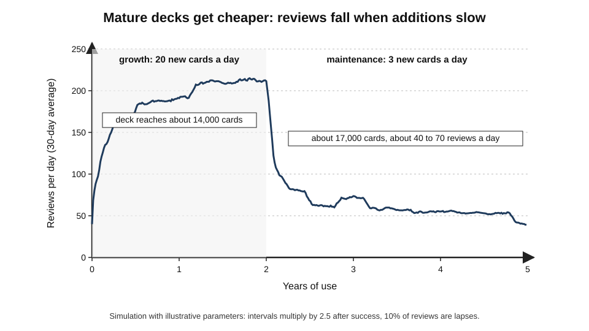
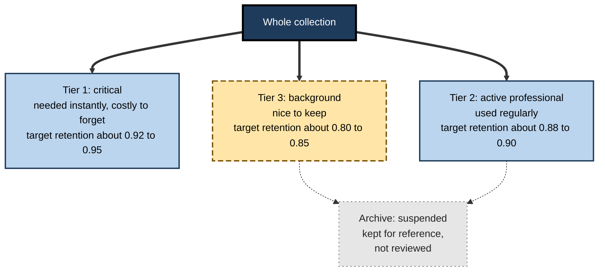
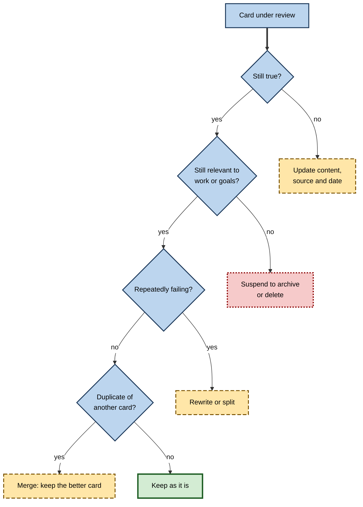
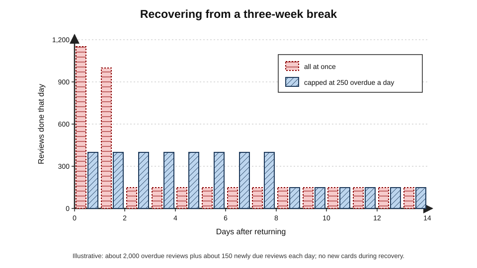
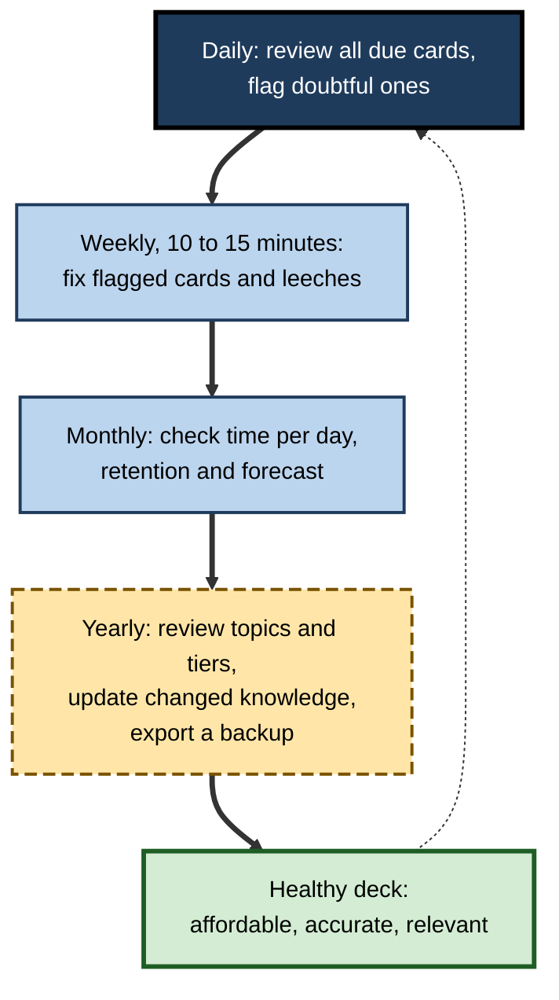

# D.10. Maintaining Long-Term Review Decks

A pharmacist started a review deck in her first year of training. Twelve years later it holds 14,000 cards, costs her fifteen minutes a day, and contains knowledge she could not otherwise have kept: rare interactions, dosing rules, the reasoning behind guidelines that have since changed twice. Getting a deck through its first months is one challenge; keeping it **healthy, current and affordable for decades** is another, with its own arithmetic, its own failure modes and its own craft.

> **Definition — Long-term deck maintenance:** the ongoing work of keeping a spaced-repetition collection sustainable, accurate and valuable over years — managing its review load, pruning and rewriting cards, updating changing knowledge, recovering from breaks and protecting its data.

**Why it matters**

- The greatest returns from spaced repetition come **after** the first year, when mature cards cost almost nothing yet keep knowledge available.
- Most decks never reach that point: they are abandoned during a backlog, a career change or an exam aftermath.
- Over years, cards go **out of date**, become **irrelevant** or reveal themselves as **badly made**; unmaintained decks accumulate dead weight.
- A collection held for a decade is a valuable asset; losing it to a corrupted file or a discontinued application is a real risk.

---

## The Life Cycle of a Deck

### Phases

- **Growth** — many new cards; daily load rising quickly; the most fragile period.
- **Steady state** — new cards at a constant rate; load stable at roughly 8–10 reviews per daily new card.
- **Maturity** — fewer new cards; most cards at long intervals; load falls.
- **Maintenance** — a few additions; reviews of a large, stable collection at low daily cost.
- **Retirement** — parts of the deck become obsolete or irrelevant and are suspended or deleted.

**Figure 1.** How daily reviews change as a deck matures.

> **Key point:** daily load depends mainly on **how many cards are being added**, not on how large the deck is. A mature deck of 15,000 cards can cost less per day than a young deck of 3,000.

### The arithmetic of a mature deck

> **Formula — Steady-state review load:** daily reviews ≈ Σ (1 ÷ current interval of each card) — roughly, number of active cards ÷ average interval, plus relearning of lapses. Example: 12,000 cards with an average interval of 300 days → about **40 reviews a day**, plus a few lapses; at 8 seconds each, about **6 minutes**.

- **Intervals keep growing** — each successful review multiplies the interval, so mature cards are seen once a year or less.
- **Lapses persist** — even mature cards occasionally fail; at 90% target retention, about one review in ten is a lapse.
- **The "long tail" of difficult cards** — a minority of cards stay on short intervals and generate a large share of reviews; these are the main targets of maintenance.

> **Remember:** in a mature deck, the **worst 5–10% of cards** often cause a disproportionate share of the daily work.

### What decades of retention look like

**Study card — Harry Bahrick and Lynda Hall (1991)**

- **Design:** tested retention of high-school algebra and geometry in about 1,700 adults who had learned it up to 50 years earlier, recording how much mathematics each had studied and when.
- **Results:**
  - people who had taken only the high-school course lost most of the content over the following decades, approaching chance levels;
  - people who had gone on to take college-level mathematics — and so had **rehearsed** the high-school content over several more years — retained it at high levels for half a century;
  - grades in the original course predicted long-term retention far less than later rehearsal did.
- **Conclusion:** what predicts lifetime retention is not how well something was learned once but whether it was **re-encountered over years** — the condition a long-term review deck creates deliberately.

> **Key point:** a maintained deck is a way of manufacturing the extended, spaced exposure that, in Bahrick's data, separated lifelong retention from near-total loss.

---

## Structuring for the Long Term

### Tiers of importance

**Figure 2.** A tiered structure for a long-term collection.

- **Why tiers help:** retention targets and review costs can match importance; lowering the target for background knowledge can cut its reviews by more than half.
- **How to implement:** separate options presets, or decks, for each tier; tags for topic within each tier.
- **Movement between tiers:** knowledge moves down when a role changes (a specialty no longer practised) and up when it becomes critical (preparing for a new role).

> **In practice:** long-term users rarely keep everything at the same retention. They keep **a small critical core** at high retention and let the **large background** run cheaply.

### Notes that last

- **Fields for source and date** on every note type that holds changeable knowledge.
- **Consistent note types** — a few well-designed types rather than dozens of ad hoc ones.
- **Stable tag vocabulary** — a documented hierarchy (*med::pharm::antibiotics*), not free-form tags that drift.
- **Plain formatting** — heavy styling and add-on-specific features may not survive software changes.

---

## Pruning: Keeping the Deck Worth Its Cost

### Why prune

- **Cost:** every card consumes reviews for as long as it stays active.
- **Accuracy:** outdated cards actively teach wrong information.
- **Morale:** irrelevant cards make reviews feel pointless and erode the habit.

**Figure 3.** Deciding what to do with a card during maintenance.

### Delete or suspend?

| | Delete | Suspend |
|---|---|---|
| Effect on reviews | Removed permanently | Removed until restored |
| History kept | Lost | Kept |
| Best for | Wrong, trivial, duplicate cards | Knowledge that may be needed again (a specialty, a language) |
| Risk | Losing something later wanted | Clutter in searches and statistics |
| Long-term habit | Delete freely when wrong or worthless | Suspend whole topics, not single cards |

### Pruning in the flow of review

- **Every review is an audit** — when a card feels pointless, wrong or confusing, flag it immediately rather than grading and moving on.
- **A weekly ten-minute slot** for flagged cards keeps maintenance from piling up.
- **Annual review of topics** — once a year, look at each major tag and ask whether it still deserves its tier.

> **Watch out:** pruning can become procrastination. Rewriting cards is satisfying; the daily reviews are what preserve knowledge. Keep maintenance to a small, fixed slot.

---

## Leeches Over Years

- **Leech accumulation** — in a large deck, a few hundred leeches may account for a large share of lapses.
- **Patterns among leeches** often reveal:
  - **interference clusters** — groups of similar cards failing together;
  - **gaps in understanding** — a topic whose cards all fail because its foundation was never learned;
  - **formatting problems** — long answers, lists, ambiguous prompts.
- **Treatments:**
  - fix the **cluster**, not each card: add contrast cards, restudy the topic, rewrite with distinguishing cues;
  - suspend leeches that are not worth the effort;
  - review the suspended-leech list periodically and decide.

> **Key point:** leeches are a **map of weak understanding and poor design**. Searching for cards with many lapses, sorted by topic, is one of the most valuable maintenance tasks.

---

## Knowledge That Changes

- **Sources of change:** new guidelines, laws, software versions, prices and rates, organisational policies, scientific revisions.
- **Strategies:**
  - **date-stamp** volatile cards and record their source;
  - **separate principles from parameters** — "Why does a capital buffer exist?" changes slowly; "What is the buffer this year?" changes often;
  - **subscribe to change** — when a guideline or law changes, search the deck by tag and update all related cards in one sitting;
  - **mark superseded knowledge** — sometimes the old rule matters (for historical cases); keep it with an explicit label ("before 2024 …").

> **Example (illustrative):** a tax adviser keeps a tag for each annual budget. When a new budget changes thresholds, she searches that tag, updates every affected card in one session, and adds one contrast card per major change ("2024 vs 2025 threshold for …").

| Kind of knowledge | Change rate | Maintenance approach |
|---|---|---|
| Foundational concepts | Very slow | Rarely revisit; trust long intervals |
| Methods and mechanisms | Slow | Occasional review of sources |
| Standards and guidelines | Every few years | Date-stamp; tag by version; bulk update on change |
| Rates, prices, thresholds | Yearly or faster | Card sparingly; date-stamp; consider not carding |
| Software commands and APIs | Months to years | Version-tag; retire on deprecation |

---

## Breaks, Backlogs and Recovery

### Why backlogs happen

- **Illness, holidays, exams, a new job, a new child** — any interruption of more than a few days lets due cards pile up.
- **Overdue cards** are reviewed later than planned; many will have been forgotten.

### Principles of recovery

1. **Stop adding new cards** until the backlog is cleared.
2. **Cap daily overdue reviews** at a manageable number — a sustainable session beats a heroic one followed by burnout.
3. **Prioritise:**
   - critical tiers first;
   - within a tier, cards **most likely to be forgotten** (lowest predicted retrievability) or, alternatively, **the most recently learned** cards, whose memories are most fragile;
   - leave long-interval mature cards for later — a few extra days hardly harm them.
4. **Use the scheduler's knowledge** — modern schedulers handle overdue reviews correctly: a card recalled after a long delay is credited with a large stability gain.
5. **Resume new cards gradually** once due counts return to normal.

**Figure 4.** Two ways to recover from a three-week break.

> **Watch out:** "resetting" the deck — rescheduling everything as new — throws away years of information about each card. It is almost never necessary; a capped recovery preserves the history.

### Worked example (illustrative): recovering from parental leave

An engineer returns from six weeks away to a 16,000-card deck with 3,200 overdue reviews; her normal load is 90 reviews a day, and she can manage about 30 minutes (around 220 reviews) daily.

1. **Pause new cards** entirely.
2. **Budget:** 220 reviews a day − 90 newly due ≈ **130 overdue reviews a day**.
3. **Duration:** 3,200 ÷ 130 ≈ **25 days** to clear the backlog.
4. **Faster option:** temporarily lower desired retention for background tiers to 0.80, reducing newly due reviews and lapses; or suspend the background tier during recovery and restore it later.
5. **Order:** critical tier first; then active professional; background last.
6. **After clearing:** restore normal settings; resume new cards at half the usual rate for two weeks, then normal.

| Option | Time to clear | Daily session | Main cost |
|---|---|---|---|
| Everything at once | 2–3 days | 1,000+ reviews | Exhaustion, sloppy grading, risk of abandoning |
| Capped at 130 overdue a day | About 25 days | About 30 minutes | Slower; some extra forgetting |
| Capped plus background suspended | About 15 days | About 30 minutes | Background knowledge delayed further |

*Illustrative figures.*

- **Conclusion:** the capped plans preserve the habit and grading quality; the speed of recovery matters much less than not quitting.

---

## Monitoring Deck Health

- **Daily review time** — the true cost; track the trend.
- **True retention by tier and by card age** — young cards are expected to fail more; mature cards should be stable.
- **Lapse concentration** — what share of lapses comes from the worst cards.
- **Forecast** — expected reviews in coming weeks; rising forecasts warn of overload.
- **Cards added per week** — the main driver of future load.
- **Leech count** — trend over time as a quality indicator.

**Figure 5.** The maintenance rhythm of a long-term deck.

> **Mnemonic — "TRACK":** **T**ime per day, **R**etention by tier, **A**dditions per week, **C**oncentration of lapses, **K**eep an eye on the forecast.

---

## Protecting the Collection

- **Backups:**
  - automatic local backups (most programs keep several);
  - periodic exported backups stored separately (cloud storage, external drive);
  - an occasional export in an **open text format** (for example tab-separated fields) so content survives even if the program does not.
- **Synchronisation discipline:** sync before and after studying on different devices to avoid conflicts that force one side to be overwritten.
- **Platform risk:** prefer tools with open formats and the ability to export review history; a collection is a decade of work.
- **Privacy:** professional decks may contain confidential information; keep them within approved storage, and strip identifiers from case-based cards.

---

## Case Study (illustrative): A Physician's Ten-Year Deck

- **Situation:** a physician began a deck in medical school, adding cards heavily for licensing exams; by residency it held 25,000 cards from a shared deck and personal additions.
- **Problem:** in her second year as a consultant, the deck cost 50 minutes a day; much of it covered topics she no longer used (paediatric dosing, obstetric emergencies), and some cards contradicted current guidelines.
- **Diagnosis:**
  1. no tiers — every card reviewed at the same retention;
  2. many shared-deck cards outside her specialty;
  3. no date-stamping; guideline changes not reflected;
  4. a cluster of leeches in cardiology drugs, all similar names and mechanisms.
- **Actions:**
  1. suspended about 9,000 cards in specialties she did not practise, keeping them as an archive;
  2. created three tiers: critical (emergency and specialty-specific, retention 0.93), active (0.90), background (0.82);
  3. ran a one-month project with a junior colleague to update cards against current guidelines, adding source and date fields;
  4. rebuilt the cardiology cluster with contrast cards and mechanism-based cues;
  5. set a weekly 15-minute maintenance slot and a yearly topic review.
- **Result:** daily time fell to about 15 minutes; lapse rate on critical cards fell; she reported confidence that her deck reflected current practice.
- **Side effects:** archived topics faded; she accepted relearning them if her role changed.
- **Lesson:** long-term decks must **follow the career** — tiered by importance, pruned to the current role, and updated as knowledge changes.

---

## Long-Term Decks in Teams

- **Shared team decks** need **owners** for each topic, a change process and a way to push updates to members without overwriting their review history.
- **Retire on schedule** — product or policy decks should be reviewed at each release or policy change.
- **New joiners** can start from a curated subset rather than the whole historical deck.
- **Departures** — personal decks are the individual's; team knowledge must live in the shared deck and its source documents.

---

## Why Very Long Intervals Work — and Where They Strain

### Mechanisms at long time scales

- **Growing stability** — each successful review after a long interval produces a large gain in stability, consistent with Jost's law that older memories decay more slowly; intervals of years become possible.
- **Low retrieval strength at review** — after a long gap, recall is effortful; under the new theory of disuse, this is when storage gains are greatest.
- **Varied contexts** — reviews years apart happen in very different life and work contexts, broadening retrieval routes.

### Where large decks strain memory

- **Interference grows with the collection** — more similar cards mean more competition; mature decks often see lapses concentrated in clusters of similar items.
- **The fan effect** — John Anderson (1974) found that the more separate facts a person learns about one concept, the slower each fact is to retrieve; a concept with many overlapping cards can become slower to recall.
- **Remedy:** organise facts about one concept into meaningful structures (comparison tables, mechanisms) and write cards that use that structure rather than many isolated facts.

> **Definition — Fan effect:** the finding that the more separate facts are associated with a concept, the slower and more error-prone retrieval of any one of them becomes.

---

## The Economics of Keeping Versus Relearning

Not every card deserves to be kept for ever. Savings in relearning mean that forgotten knowledge can often be regained quickly when needed.

> **Formula — Keep or let go:** keep a card if (expected future reviews × seconds per review) < (probability of needing the knowledge × cost of relearning it when needed + cost of not knowing it at the moment of need). Example: a card costing 10 reviews × 8 s ≈ **80 seconds** over ten years versus a 20% chance of needing the fact, with relearning taking 15 minutes (900 s) → expected relearning cost **180 seconds** — keep it. If relearning took only 2 minutes (120 s), the expected cost would be **24 seconds** — letting it go is reasonable, unless not knowing it at the moment of need is itself costly.

- **Keep** knowledge that is needed **without warning** (emergencies, live conversations, examinations) or is slow to relearn.
- **Let go** of knowledge that is rarely needed, easily found and quickly relearned.
- **The hidden term** is the cost of not knowing at the moment of need — a forgotten contraindication or security control can be far more expensive than any review time.

| Situation | Review cost | Relearning cost | Cost of not knowing at the moment | Decision |
|---|---|---|---|---|
| Emergency drug dose | Low | Moderate | Very high | Keep at high retention |
| Obscure historical case detail | Low | Low | Low | Archive or delete |
| Core concepts of one's field | Low | High | High | Keep |
| Last year's tax threshold | Low | Low | Negative if remembered wrongly | Delete or mark superseded |

---

## Item Banks in Organisations

Organisations that run spaced reinforcement maintain **item banks** — the organisational equivalent of a long-term deck — and face the same maintenance problems at larger scale.

- **Ownership** — every item has a named owner responsible for accuracy.
- **Review cycles** — items on regulations and products are reviewed on a fixed cycle (for example every 6–12 months) and whenever the source changes.
- **Version control** — changes are logged with dates and reasons, so audits can show what staff were taught at a given time.
- **Retirement rules** — items are retired when content changes, when statistics show they no longer discriminate, or when the knowledge is no longer required.
- **Analytics** — error patterns across thousands of learners show which items, and which parts of training, need attention.

> **Definition — Item bank:** a managed collection of review or assessment questions, with owners, versions and usage statistics, used to deliver spaced reinforcement to many learners.

### Case study (illustrative): a law firm's knowledge-maintenance programme

- **Situation:** a commercial law firm built a shared review bank of about 1,200 items on procedural rules, limitation periods and leading cases for its trainee and junior lawyers.
- **Problem:** after three years, junior lawyers began reporting that some items contradicted current practice; trust in the bank fell and usage halved.
- **Diagnosis:**
  1. no owner for most items after the original authors moved on;
  2. no record of the date or source for each item;
  3. changes in procedure rules not propagated to the bank.
- **Actions:**
  1. assigned each practice group responsibility for its items, with a named partner accountable;
  2. added source and effective-date fields, and audited every item over two months;
  3. created a change process: when the knowledge-management team circulated a legal update, owners updated linked items within a fortnight;
  4. retired about 300 items judged trivial or obsolete.
- **Result:** usage recovered over the following year; juniors reported trusting the bank as "current"; the audit trail proved useful when the firm reviewed its training records.
- **Lesson:** at organisational scale, the limiting factor in long-term spaced review is **governance** — owners, dates and change processes — not scheduling.

---

## Moving, Auditing and Future-Proofing a Collection

### Moving between tools

- **What must move:** the content (notes, media) and, ideally, the **review history**, which holds years of information about each item's difficulty and stability.
- **Formats:** some tools import each other's collections with history; plain-text exports preserve content but usually lose scheduling.
- **Practical rule:** test a migration on a copy; keep the old collection until the new one has run successfully for several weeks.

### Auditing with AI assistance

- **Possible uses:** asking a language model to flag cards that look outdated, ambiguous, duplicated or inconsistent with a supplied source document; suggesting contrast cards for clusters of similar items.
- **Limits:** models can be confidently wrong about current rules, versions and thresholds; every proposed change must be checked against an authoritative source.
- **Safeguards:** never send confidential or client information to external services without approval; audit in batches by tag, with a human decision on every change.

> **In practice:** an annual audit of a professional deck, assisted by search and AI tools but decided by the owner, keeps a decade-old collection trustworthy at the cost of a few hours a year.

---

## Open Questions

- **What is the best retention target for very old cards?**
  - Mature cards are cheap; whether they deserve high retention or should be allowed to fade is a question of value that research has not addressed.
- **How should overdue cards be prioritised?**
  - Lowest retrievability first, most recent first and most important first each have arguments; comparative evidence is thin.
- **How can decks handle knowledge that changes automatically?**
  - Linking cards to authoritative sources so changes trigger updates is technically possible but not standard.
- **Does a decade of review produce permastore?**
  - Long intervals suggest so, but few studies follow individual decks for decades.
- **When is relearning cheaper than maintaining?**
  - Savings make relearning fast; for rarely needed knowledge, letting it go and relearning on demand may cost less than years of reviews.

---

## Summary

- Decks pass through **growth, steady state, maturity, maintenance and retirement**; daily load depends on **additions**, not size.
- Mature-deck load ≈ **active cards ÷ average interval**, plus lapses; a minority of difficult cards drives much of the work.
- Use **tiers** with different retention targets: a small critical core at high retention, a large background at lower retention, an **archive** suspended.
- Design notes to last: **source and date fields**, few note types, a stable tag vocabulary, plain formatting.
- **Prune** continuously: update what is wrong, archive what is irrelevant, rewrite what keeps failing, merge duplicates; keep maintenance to a fixed small slot.
- Treat **leeches** as a map of interference and weak understanding; fix clusters.
- Handle **changing knowledge** with date stamps, principle–parameter separation and bulk updates.
- Recover from **backlogs** by pausing new cards, **capping** daily overdue reviews and prioritising; avoid resetting.
- Monitor **time, retention by tier, additions, lapse concentration and forecast** (TRACK); protect the collection with **backups and open exports**.

---

## Self-Check

1. Describe the phases of a deck's life and how daily load changes across them.
2. Estimate the daily reviews for 20,000 cards with an average interval of 400 days.
3. Why can a large mature deck cost less per day than a small young one?
4. What are tiers, and how do retention targets differ between them?
5. When should a card be deleted rather than suspended?
6. Why are leeches valuable diagnostic information in a mature deck?
7. Describe three strategies for maintaining knowledge that changes.
8. A learner returns to 2,400 overdue reviews with 30 minutes a day available and a normal load of 100 reviews. Plan the recovery.
9. Why is resetting a deck almost always a mistake?
10. List the TRACK indicators and what each reveals.
11. What backups should a long-term user keep, and why an open text export?
12. A lawyer moving from litigation to corporate work has a 10,000-card deck. How should she restructure it?
13. What problems arise when a team maintains a shared deck over years?
14. When might relearning on demand be cheaper than maintaining a card?
15. Summarise Bahrick and Hall's (1991) findings on mathematics retention and their implication for long-term decks.
16. Using the keep-or-let-go formula, decide whether to keep a card that costs about 100 seconds of reviews over ten years, with a 10% chance of being needed and 5 minutes to relearn, where not knowing it at the moment of need would cost little.
17. What is the fan effect, and how should a mature deck be designed to limit it?
18. What are the risks of migrating a large deck to a new tool, and how can they be reduced?

### Answer Key

1. Growth (rapid additions, rising load), steady state (constant additions, stable load), maturity (fewer additions, falling load), maintenance (few additions, low load), retirement (obsolete parts suspended or deleted).
2. 20,000 ÷ 400 = **50 reviews a day**, plus some lapses.
3. Load depends on additions and intervals: mature cards are reviewed rarely, while a young deck adds many cards on short intervals.
4. Groups of cards by importance — critical, active, background — with higher retention targets for critical knowledge (about 0.92–0.95) and lower for background (about 0.80–0.85), plus an unreviewed archive.
5. When the card is wrong, trivial or a duplicate; suspend when the knowledge may be needed again.
6. They reveal interference clusters, gaps in understanding and design faults; fixing them reduces a disproportionate share of lapses.
7. Date-stamp and record sources; separate stable principles from changing parameters; bulk-update by tag when a source changes; label superseded rules explicitly.
8. Pause new cards; 30 minutes ≈ 220 reviews, so about 120 overdue a day after the normal 100; about 20 days to clear; critical cards first; optionally lower background retention or suspend background temporarily; resume new cards gradually.
9. It discards the stored history of each card's difficulty and stability; modern schedulers handle overdue cards well, so a capped recovery is better.
10. Time per day (cost), retention by tier (whether scheduling and cards work), additions per week (future load), concentration of lapses (problem cards), forecast (coming overload).
11. Automatic local backups, periodic exported backups stored elsewhere, and an open text export; the latter keeps content usable even if the program is discontinued.
12. Move litigation-specific cards to background or archive; create a critical tier for corporate law she needs now; add new corporate cards at a sustainable rate; update date-stamped rules; keep general foundations active.
13. Ownership of topics, keeping cards current, pushing updates without destroying members' history, curating subsets for new joiners, and retiring obsolete material.
14. For knowledge needed rarely and easily relearned (savings make relearning fast) — years of reviews may cost more than a short relearning session when the need arises.
15. High-school mathematics was largely lost over decades by people who took no further courses, but retained for 50 years by those who took later college courses that rehearsed it; later rehearsal mattered more than original grades. Long-term decks create such extended, spaced re-exposure deliberately.
16. Expected relearning cost = 0.1 × 300 s = 30 seconds, less than the 100-second review cost, and the cost of not knowing is low — so letting the card go (archive or delete) is reasonable.
17. The more separate facts are linked to one concept, the slower retrieval of any one becomes. Organise facts about a concept into meaningful structures and write cards that use those structures, rather than accumulating many isolated overlapping facts.
18. Review history and scheduling may be lost, media may break, and formatting may change. Test the migration on a copy, check that history imports, keep the old collection until the new one has run successfully for several weeks, and keep an open text export as a fallback.

---

## Glossary

| Term | Meaning |
|---|---|
| Archive | Suspended cards kept for possible future use but not reviewed. |
| Backlog | Accumulated overdue reviews. |
| Date-stamp | A record of when a card's fact was true. |
| Fan effect | Slower retrieval of any one fact as more facts are linked to the same concept. |
| Interference cluster | A group of similar cards that fail together. |
| Item bank | A managed collection of review questions with owners, versions and statistics. |
| Keep-or-let-go decision | Weighing review cost against the expected cost of relearning or not knowing. |
| Lapse concentration | The share of lapses produced by the worst cards. |
| Mature card | A card with a long interval, reviewed rarely. |
| Open export | A copy of deck content in a plain, program-independent format. |
| Overdue review | A review done later than its scheduled date. |
| Pruning | Removing, updating or rewriting cards to keep a deck valuable. |
| Review history | The record of every past review of every card, used by schedulers to estimate memory state. |
| Savings | The reduced effort needed to relearn previously learned material. |
| Steady state | The phase in which additions and daily load are stable. |
| Tier | A group of cards sharing a level of importance and retention target. |
| Version tag | A label linking a card to the version or year of its source. |
