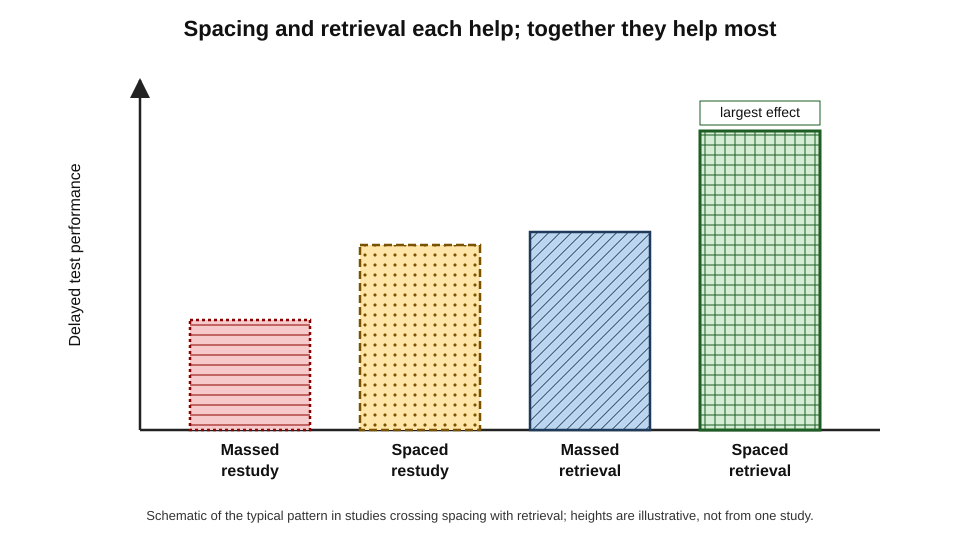
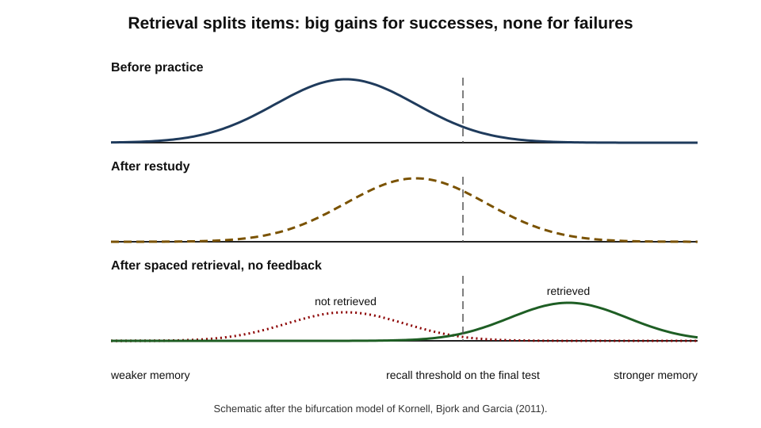
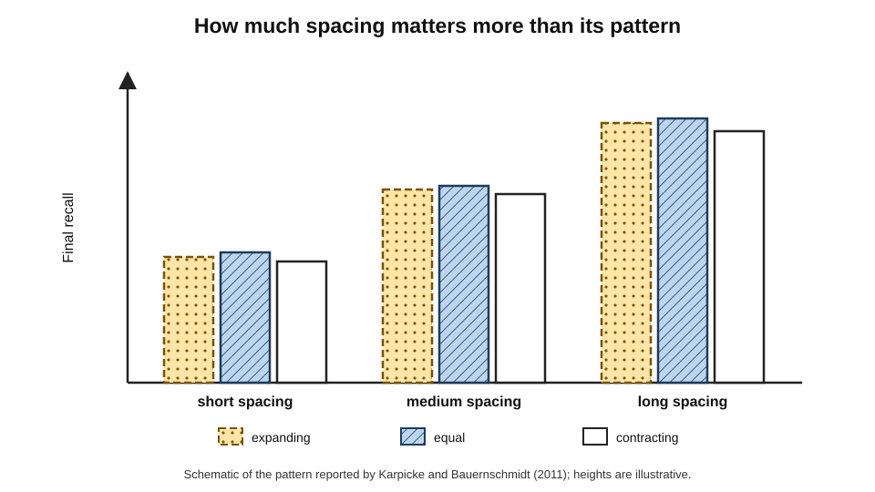
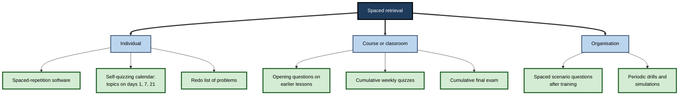
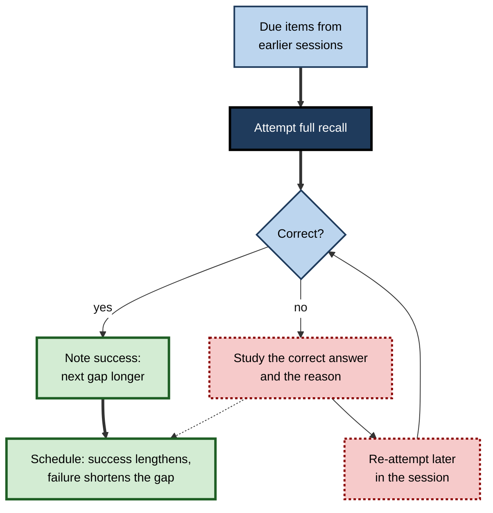

# D.11. Combining Spacing with Retrieval

A team leader prepares for a certification by re-reading her notes every Sunday for six weeks — spaced, but passive. A colleague quizzes himself on the same notes every evening of the week before the exam — retrieval, but massed. A third colleague answers practice questions on each topic once a week for six weeks, checking each answer. All three put in similar hours; the third remembers far more a year later. Spacing and retrieval are each powerful; **combined**, they form the most reliable method known for building durable knowledge.

> **Definition — Spaced retrieval practice:** retrieving information from memory — answering questions, recalling facts, solving problems — on several occasions separated by gaps, with feedback, so that each retrieval occurs after some forgetting has taken place.

**Why it matters**

- It is the mechanism inside every spaced-repetition system, reinforcement programme and cumulative quiz.
- The two techniques **interact**: spacing makes retrieval harder and more valuable; retrieval makes spacing far more effective than spaced re-reading.
- Combining them changes design decisions: how long to wait, how hard each attempt should be, when feedback is essential and how many successful recalls are enough.
- Getting the combination wrong — gaps too long without feedback, or retrieval too easy because it is too soon — wastes much of the benefit.

---

## Two Effects and Their Interaction

### The two ingredients in brief

- **Spacing** — distributing study of the same material over separate occasions.
- **Retrieval practice** — producing information from memory rather than re-reading it; the act of retrieval strengthens the memory itself, an effect known as the **testing effect**.

> **Key point:** retrieval practice decides **what happens** at each study occasion; spacing decides **when** the occasions happen. Each improves retention on its own; together they improve it most.

### The two-by-two picture

| | Massed (one occasion) | Spaced (several occasions) |
|---|---|---|
| **Restudy** (re-reading, re-watching) | Weakest long-term retention | Better; but each occasion is passive |
| **Retrieval** (recall, quizzing) | Better; but early retrievals are easy | Strongest long-term retention |

**Figure 1.** Delayed test performance when spacing and retrieval are crossed.

- **Studies crossing the two factors** consistently find benefits of each, with the combination best on delayed tests.
- **A 2021 meta-analysis by Latimier, Peyre and Ramus** compared spaced with massed retrieval practice and found a large advantage for spacing the retrieval episodes, with no reliable difference between expanding and uniform schedules.

> **Watch out:** the size of the combined effect varies widely between studies, materials and delays. The **direction** is very consistent; specific percentages quoted in popular sources should be treated with caution.

### Why the combination is more than additive in practice

- **Spacing makes retrieval effortful** — after a gap, recall is harder; harder successful recall strengthens memory more.
- **Retrieval makes spacing honest** — re-reading after a gap feels familiar and can be done without noticing what was forgotten; retrieval reveals forgetting and repairs it.
- **Retrieval tells the scheduler what happened** — a success or failure is data that spacing systems use to set the next gap; re-reading gives no such signal.

---

## Mechanisms

### Retrieval effort

**Study card — Mary Pyc and Katherine Rawson (2009)**

- **Design:** learners practised retrieving foreign-language word translations with short or long lags between retrievals within a session, and with different numbers of correct retrievals before stopping.
- **Results:**
  - longer lags between retrievals produced better final recall, even though each retrieval was harder;
  - more correct retrievals helped, with diminishing returns.
- **Conclusion:** the **retrieval effort hypothesis** — difficult but successful retrievals are more beneficial than easy ones.

> **Definition — Retrieval effort hypothesis:** the proposal that the benefit of a successful retrieval increases with the difficulty of carrying it out.

### The bifurcation model

- **Nate Kornell, Robert Bjork and Michael Garcia (2011)** proposed that retrieval affects items differently depending on whether it succeeds:
  - **retrieved items** receive a large boost in memory strength — larger than restudy gives;
  - **unretrieved items** without feedback receive **no** boost, and remain weak.
- **Consequence:** the distribution of item strengths **splits in two** after retrieval practice.
- **Implication for spacing:** as gaps grow, more items fail. Without feedback, a long gap can make retrieval practice **worse** than restudy for weakly learned items; with feedback, failed items are restudied and the problem disappears.

**Figure 2.** How retrieval without feedback splits items into strengthened and unchanged groups.

> **Remember:** the longer the gap, the more **feedback** matters. Spaced retrieval without feedback works only for items that are recalled.

### Competing accounts of the combination

- **Study-phase retrieval** — spaced **restudy** works partly because the second encounter triggers a covert retrieval of the first; spaced retrieval practice makes that retrieval explicit and complete, which is one reason it outperforms spaced restudy.
- **Elaborative retrieval** — Shana Carpenter (2009) proposed that effortful retrieval activates related information, adding retrieval routes; harder retrievals after longer gaps activate more.
- **Episodic context account** — Jeffrey Karpicke, Melissa Lehman and William Aue (2014) proposed that retrieval reinstates the context of earlier learning and updates it with the present context; spaced retrievals accumulate a richer set of contexts, so later cues find the memory more easily.
- **Encoding variability** — spaced retrieval episodes occur in different contexts, so the memory becomes linked to many cues.

> **Definition — Elaborative retrieval hypothesis:** the proposal that effortful retrieval activates information related to the target, creating additional routes to it.

> **Definition — Episodic context account:** the proposal that retrieval reinstates and updates the context associated with a memory, so repeated spaced retrievals link it to more contexts.

### Storage strength and retrieval strength

- In the Bjorks' new theory of disuse, the gain in **storage strength** from a retrieval is larger when **retrieval strength** has fallen — that is, after a gap.
- Retrieval itself is a strong learning event; spacing ensures it happens when it produces the most storage gain.

---

## How Much Spacing, How Many Retrievals?

### Absolute spacing beats relative pattern

**Study card — Jeffrey Karpicke and Althea Bauernschmidt (2011)**

- **Design:** learners practised retrieving word pairs until each had been recalled correctly several times, with different **amounts** of spacing between retrievals (absolute spacing) and different **patterns** (expanding, equal, contracting) at each amount.
- **Results:**
  - more absolute spacing between retrievals produced much better long-term retention;
  - the pattern of spacing made little difference once the amount was fixed.
- **Conclusion:** **how far apart** retrievals are matters more than **whether the gaps expand**.

**Figure 3.** Final recall depends on the amount of spacing more than on its pattern.

**Study card — Harry Bahrick (1979)**

- **Design:** learners studied Spanish–English word pairs and then relearned them in several sessions, recalling each word with feedback until it was produced correctly; the sessions were separated by **0 days**, **1 day** or **30 days**; a final test came 30 days after the last session.
- **Results:**
  - during training, the 30-day group recalled the least at the start of each session and needed the most effort;
  - on the final test, the 30-day group recalled the **most**.
- **Conclusion:** the schedule that looked worst during practice was the best for retention — spaced retrieval with feedback produces durable memory precisely because each session begins with forgetting.

### The criterion question

- **Criterion** — how many correct recalls are required before an item is set aside for the session.
- **Katherine Rawson and John Dunlosky (2011)** studied combinations of initial criterion and later relearning sessions:
  - raising the **initial** criterion beyond about three correct recalls gave diminishing returns;
  - **relearning** sessions on later days produced large gains, and once items had been relearned several times, differences due to the initial criterion largely disappeared — a "relearning-override" pattern.
- **Practical rule:** reach a modest criterion in the first session (often one to three correct recalls), then rely on **spaced relearning sessions** rather than more drilling on the first day.

> **Definition — Criterion (in retrieval practice):** the number of correct recalls required for an item before it is dropped from practice in a session.

> **Key point:** effort spent in **later sessions** returns far more than extra effort on the first day — the combination's power lies in the return visits, a pattern formalised as successive relearning.

| Design choice | Weak version | Strong version | Reason |
|---|---|---|---|
| First session | Drill each item until perfect many times | Reach one to three correct recalls | Extra first-day drilling is massed |
| Gaps | Immediate or same-day repeats | Days, then weeks | Effortful retrieval after forgetting |
| Number of sessions | One | Three or more spaced sessions | Relearning overrides initial differences |
| Feedback | None | After every attempt, especially failures | Failed items otherwise get no benefit |
| Pattern of gaps | Debated expanding vs equal | Either, with enough total spacing | Absolute spacing matters more |

### Success rate as a design target

- **Too easy** (success near 100%) — retrieval occurs too soon; little effort, little gain.
- **Too hard** (success well below half) — many failures; much time spent on feedback; motivation falls.
- **Productive zone** — success rates of very roughly **70–90%** in practice, depending on the cost of failure and the value of effort.
- Spaced-repetition software implements this through a **target retention** — the predicted recall probability at which a review is scheduled.

> **Watch out:** a recall rate of 95–100% in a review system feels reassuring but usually means reviews are too frequent — time is being spent on retrievals that add little.

---

## Feedback in Spaced Retrieval

- **After failures** — essential; the correct answer must be studied, ideally with a brief explanation.
- **After low-confidence successes** — helpful; confirms a shaky memory.
- **After high-confidence errors** — particularly valuable: the **hypercorrection effect** shows that confidently held errors, once corrected, are often remembered especially well.
- **Timing** — immediate feedback is the practical default in spaced systems; some laboratory studies find that delayed feedback can aid retention, but the effect is small and inconsistent in applied settings.

> **In practice:** in self-study, "feedback" means **checking the answer properly** — reading the full correct answer, noticing what was missing, and, for important errors, adding a card or note that targets the confusion.

---

## Forms of Spaced Retrieval

**Figure 4.** Forms of spaced retrieval at different scales.

### For individuals

- **Spaced-repetition software** — the most efficient form for large bodies of facts and concepts.
- **A retrieval calendar** — for topics rather than cards: write a list of topics with dates for recall sessions (for example days 1, 7, 21, 60) and, on each date, recall the topic on paper before checking.
- **Redo lists** — problems re-solved at increasing intervals.
- **Spaced self-explanation** — explaining a concept from memory weeks after learning it, then checking against the source.

### In courses and classrooms

- **Opening questions** — each lesson begins with a few questions on material from earlier weeks, not just the last lesson.
- **Cumulative quizzes** — low-stakes quizzes that always include some older material.
- **Cumulative final assessments** — knowing that everything will be tested encourages spaced review.
- **Evidence:** classroom studies of cumulative and spaced quizzing, in subjects from psychology to mathematics, generally show better long-term retention than unit-only quizzes.

> **Example:** an introductory statistics course replaces end-of-unit tests with a weekly ten-question quiz in which six questions cover the current week and four are drawn at random from all earlier weeks.

### In organisations

- **Spaced scenario questions** after training, with explanations.
- **Recurring drills** — fire, cyber-incident, clinical-emergency simulations at intervals.
- **Spaced coaching prompts** — managers asked at intervals to recall and apply a framework to a current case.

### In rehabilitation and support

- **Spaced retrieval training** has been used since the late 1980s, notably by Cameron Camp and colleagues, to help people with memory impairment, including dementia, learn specific information such as a name or a daily routine through recall at gradually increasing intervals.
- **Its value** shows the robustness of the principle: even memory systems with severe damage can benefit from spaced, successful retrieval.

---

## Designing a Spaced Retrieval Session

1. **Start with retrieval** — before any re-reading, attempt to recall.
2. **Mix old and new** — include items from earlier sessions; due items first.
3. **Answer fully** — produce the complete answer, not a vague sense of it.
4. **Check and correct** — compare with the source; for failures, study the right answer and the reason.
5. **Re-attempt failures** — later in the same session, after other items.
6. **Record outcomes** — so the next gap can be set (software does this automatically).
7. **Stop at a modest criterion** — then rely on the next session.

**Figure 5.** The flow of one spaced retrieval session.

---

## Worked Example: A Twelve-Week Professional Course

A firm runs a twelve-week internal course on financial modelling for 30 analysts. Previously, each week covered a topic with an end-of-week quiz on that topic only; three months after the course, analysts remembered little of the early topics.

1. **Restructure quizzes:** each weekly quiz of 12 questions has 6 on the current topic and 6 drawn from earlier weeks, weighted towards topics two, four and eight weeks old.
2. **Feedback:** every question shows the worked answer immediately.
3. **Opening recall:** each session begins with five minutes of unaided recall on paper of the previous week's key ideas.
4. **Post-course schedule:** a short spaced quiz at 3 weeks, 2 months and 5 months after the course.
5. **Evaluation:** an unaided modelling task six months after the course, compared with the previous cohort.

| | Previous design | Spaced retrieval design |
|---|---|---|
| Quizzes | Topic-only, end of week | Mixed current and earlier topics |
| Retrievals per topic | 1 | About 4–6 spread over months |
| Feedback | Scores only | Worked answers for every question |
| Average quiz scores during the course | Higher | Lower; older questions are harder |
| Unaided task at six months | Many early topics forgotten | Most topics retained |
| Extra time | — | About 10 minutes a week, plus three short post-course quizzes |

> **Watch out:** quiz averages fall when older material is included. Managers and learners must understand that **lower scores during practice** are part of the design, not a sign that it is failing.

---

## Case Study: Spaced Retrieval in a Nursing Programme

- **Situation:** a nursing school found that students passed pharmacology modules but performed poorly on drug calculations and high-alert medication questions in later clinical placements.
- **Problem:** pharmacology was taught in two blocks with unit tests; nothing required students to retrieve the material again until placement.
- **Diagnosis:**
  1. retrieval occurred, but only once per topic — massed at the unit test;
  2. calculations and high-alert drugs are both error-prone and safety-critical;
  3. students re-read notes before placements rather than practising recall.
- **Actions:**
  1. introduced a fortnightly 15-question online quiz throughout the programme, each mixing current content with calculations and high-alert drug questions from all earlier terms;
  2. provided full worked solutions and explanations for every item;
  3. required a minimum score on a **delayed** calculation assessment before each placement;
  4. taught students about the spacing and testing effects so that harder quizzes were not interpreted as failure.
- **Result:** pass rates on the pre-placement calculation assessment rose; placement mentors reported fewer calculation errors; students' confidence in pharmacology increased over the programme.
- **Side effects:** quiz-writing workload rose for staff; a shared question bank and a rota made it manageable.
- **Lesson:** turning one-off tests into **spaced, cumulative, feedback-rich retrieval** made safety-critical knowledge durable at modest cost.

---

## Common Failures in Combining the Two

- **Spacing without retrieval** — re-reading notes weekly; feels productive, adds relatively little.
- **Retrieval without spacing** — quizzing the same day until perfect; strong immediate performance, weak retention.
- **Spacing too long without feedback** — failed retrievals with no correction leave items unlearned.
- **Spacing too short** — near-perfect recall every time; time wasted.
- **Recognition instead of recall** — multiple-choice review with obvious distractors gives little retrieval effort.
- **Unit-only testing** — each topic retrieved once, then abandoned.

> **Mnemonic — "GAP-FIX":** **G**aps long enough to forget a little, **A**ttempt before checking, **P**roduce the full answer — **F**eedback on every miss, **I**nclude old material, e**X**pect lower scores.

---

## Spaced Retrieval and Artificial Intelligence

- **Question generation** — models can turn any material into retrieval questions, removing a major barrier to spaced quizzing.
- **Answer evaluation** — models can judge free-text answers and give feedback, making open questions practical at scale.
- **Adaptive tutoring** — a well-designed tutor can return to earlier topics at intervals instead of only answering the current question.
- **Risk** — conversational AI that answers on demand replaces retrieval with lookup; the learner gets fluency without effort.

> **In practice:** ask AI tools to **quiz** on earlier material, to withhold answers until an attempt is made, and to revisit missed items in later sessions.

---

## Boundary Conditions and Individual Differences

- **Initial learning must be sufficient** — if the first gap is so long that almost nothing is retrieved, the session becomes restudy; weakly learned material needs a shorter first gap.
- **Feedback is not optional at long gaps** — the bifurcation model predicts, and studies confirm, that spaced retrieval without feedback can underperform for weakly learned items.
- **Complex material** — retrieving a full argument or procedure after a long gap may fail; break it into retrievable parts, or provide partial cues at first and remove them later.
- **Prior knowledge** — learners with more knowledge succeed at longer gaps; novices need shorter early gaps.
- **Test anxiety and motivation** — low-stakes framing matters; spaced quizzes perceived as high-stakes assessments can reduce engagement.
- **Working memory and age** — spaced retrieval benefits learners across ages and abilities, including older adults and people with memory impairment, although the gaps that suit them may be shorter.

| Condition | Risk | Adjustment |
|---|---|---|
| Weak initial learning | Retrieval fails; no benefit | Shorter first gap; reach a modest criterion first |
| Long gaps, no feedback | Failed items gain nothing | Always provide the correct answer |
| Complex material | Whole-item retrieval fails | Retrieve parts; fade cues |
| High-stakes framing | Anxiety, avoidance | Keep quizzes low-stakes |
| Novice learners | Many early failures | Shorter early gaps; more support |

---

## Spaced Retrieval in Enterprise Systems

- **Adaptive reinforcement platforms** deliver retrieval questions at intervals that adapt to each learner's answers; items answered correctly move to longer gaps, missed items return soon with explanations.
- **Confidence ratings** — some platforms ask learners to rate their confidence with each answer, flagging **confident errors** (the most dangerous kind in safety-critical work) for extra feedback and earlier review.
- **Longitudinal assessment** — professional bodies increasingly replace occasional high-stakes examinations with frequent small question sets with feedback.
- **Integration with work** — questions triggered by work events (a new product release, an audit finding, an incident) give retrieval immediate relevance.

> **Definition — Confidence-based assessment:** assessment that records the learner's confidence alongside each answer, so that confident errors can be identified and corrected.

### Worked example: estimating retrievals and success rates

A training team plans spaced retrieval of 50 key items on a new policy over six months, with reviews at days 2, 7, 21, 50, 100 and 170.

1. **Retrievals per item:** 6; total = 50 × 6 = **300 retrievals** per learner.
2. **Time:** at about 20 seconds per scenario question including feedback, 300 × 20 s = 6,000 s ≈ **100 minutes** over six months — about 4 minutes a week.
3. **Expected success rates:** high at day 2 (perhaps 85–90%), lower at day 7 and day 21 (perhaps 70–80%) as gaps outpace stability, then rising again (80–90%) as memories stabilise.
4. **Design checks:**
   - if success at any review falls below about 60%, shorten the preceding gap or improve the initial teaching;
   - if success stays above about 95%, lengthen the gaps — reviews are coming too soon.

> **Watch out:** these success rates are planning assumptions, not laws. Real rates depend on item difficulty and the quality of initial learning, and should be checked against the platform's data after the first cohort.

---

## Open Questions

- **What success rate is optimal for spaced retrieval?**
  - The productive range is broad; the best target likely depends on material, learner and the cost of failure, and has not been precisely established.
- **How should complex knowledge be retrieved at spaced intervals?**
  - Most evidence uses facts and word pairs; spaced retrieval of arguments, models and procedures is less studied.
- **When does feedback timing matter?**
  - Laboratory and applied findings differ; the best timing in spaced systems is unresolved.
- **How do mixing, spacing and retrieval interact in real courses?**
  - Each helps, but courses that combine all three are rarely tested against combinations of two.
- **Can AI tutors schedule spaced retrieval well across months?**
  - Promising designs exist; long-term evaluations are scarce.

---

## Summary

- **Spacing** decides when study occasions happen; **retrieval** decides what happens in them; **spaced retrieval** produces the strongest long-term retention.
- Studies crossing the two find the combination best; a 2021 meta-analysis found a large advantage of spaced over massed retrieval, with no reliable expanding-versus-uniform difference.
- **Retrieval effort** (Pyc and Rawson): harder successful retrievals help more; spacing creates that difficulty.
- **Bifurcation model** (Kornell, Bjork and Garcia): retrieved items gain greatly, unretrieved items without feedback gain nothing — so **feedback becomes essential as gaps grow**.
- **Absolute spacing** matters more than the pattern of gaps (Karpicke and Bauernschmidt).
- A modest **initial criterion** plus several **spaced relearning sessions** is more efficient than heavy first-day drilling; relearning overrides initial differences (Rawson and Dunlosky).
- Aim for success rates of roughly **70–90%**; near-perfect recall means reviews are too frequent.
- Forms include software, retrieval calendars, redo lists, cumulative quizzes, opening questions, spaced scenarios, drills and rehabilitation training.
- Expect **lower practice scores** and explain this to learners and managers.

---

## Self-Check

1. Explain how spacing and retrieval each contribute to long-term retention, and why their combination is especially effective.
2. Describe the four cells of the spacing-by-retrieval design and their typical ranking on a delayed test.
3. What is the retrieval effort hypothesis, and what evidence supports it?
4. Explain the bifurcation model and its implication for long gaps without feedback.
5. What did Karpicke and Bauernschmidt (2011) find about absolute and relative spacing?
6. Describe the relearning-override pattern and its practical implication for first-session drilling.
7. Why is a 98% success rate in reviews usually a sign of inefficiency?
8. What role does feedback play after high-confidence errors?
9. Describe how a course can build spaced retrieval through its quizzes.
10. How can an individual use spaced retrieval for topics that do not suit flashcards?
11. A manager complains that weekly quiz scores fell after older material was added. Respond.
12. Design a spaced retrieval plan for a compliance officer learning a new regulation over three months.
13. What is the main risk of conversational AI for spaced retrieval, and how can it be avoided?
14. Why might spaced retrieval without feedback perform worse than spaced restudy for weakly learned material?
15. Describe Bahrick's (1979) relearning study and explain why the condition that looked worst during training was best at the final test.
16. How do the elaborative retrieval and episodic context accounts explain why spaced retrieval outperforms spaced restudy?
17. Why might a reinforcement platform ask learners to rate their confidence, and what should it do with confident errors?

### Answer Key

1. Spacing returns to material after forgetting begins, increasing the storage gain from each occasion; retrieval strengthens memory and reveals what is forgotten. Combined, each retrieval is effortful (because of the gap) and each gap is used actively (because of retrieval), and outcomes guide the next gap.
2. Massed restudy (weakest), spaced restudy and massed retrieval (intermediate), spaced retrieval (strongest).
3. Difficult but successful retrievals produce more benefit than easy ones; Pyc and Rawson found longer lags between retrievals improved final recall even though retrievals were harder.
4. Successful retrieval greatly strengthens items; failed retrieval without feedback leaves them unchanged, splitting the distribution. With long gaps, more items fail, so without feedback many receive no benefit.
5. More absolute spacing between retrievals produced much better retention; expanding, equal or contracting patterns made little difference at a fixed amount.
6. After several spaced relearning sessions, differences due to the initial criterion largely disappear; so reach a modest first-session criterion and invest in later sessions.
7. Recall is so easy that reviews occur too soon; little effort, little gain; the same retention could be maintained with fewer, later reviews.
8. Correcting confidently held errors produces especially good memory for the correction (hypercorrection), so these errors deserve careful feedback.
9. Each quiz mixes current material with questions from earlier weeks, gives full feedback, and a cumulative final encourages ongoing review.
10. Keep a topic calendar with recall dates (e.g. days 1, 7, 21, 60); on each date recall the topic on paper, then check and correct; use redo lists for problems.
11. Older questions are harder because some forgetting has occurred — exactly what produces durable learning; evaluate at a delay and compare long-term retention, not weekly averages.
12. Initial study, then recall sessions on key provisions at days 2, 7, 21, 45 and 80, with scenario questions and full feedback; mix provisions in each session; add cards for confusable requirements; finish with an unaided scenario assessment.
13. It answers on demand, replacing retrieval with lookup. Use it to quiz, require an attempt before revealing answers, and revisit missed items in later sessions.
14. Weakly learned items are often not retrieved after a gap; without feedback they receive nothing, whereas restudy at least re-exposes them to the material.
15. Learners relearned Spanish–English pairs with feedback in sessions 0, 1 or 30 days apart. The 30-day group recalled least at each session start and worked hardest, but recalled most 30 days later: each session began after forgetting, so each successful retrieval produced larger, more durable gains.
16. Elaborative retrieval: effortful retrieval after a gap activates related information, adding routes to the memory. Episodic context: retrieval reinstates and updates the memory's context, so spaced retrievals link it to more contexts. Spaced restudy involves at most covert, partial retrieval, so it gains less.
17. Confidence ratings identify confident errors, which are the most dangerous mistakes in practice and, when corrected, are often remembered especially well. The platform should give immediate, detailed feedback on them and schedule those items for earlier review.

---

## Glossary

| Term | Meaning |
|---|---|
| Absolute spacing | The total amount of time or intervening material between retrievals. |
| Bifurcation model | The account that retrieval strongly boosts recalled items and leaves unrecalled items unchanged without feedback. |
| Confidence-based assessment | Recording confidence with each answer to identify confident errors. |
| Criterion | The number of correct recalls required in a session before an item is dropped. |
| Cumulative quiz | A quiz that includes material from all earlier parts of a course. |
| Elaborative retrieval hypothesis | Effortful retrieval activates related information, adding retrieval routes. |
| Episodic context account | Retrieval reinstates and updates a memory's context, linking it to more contexts. |
| Feedback | Information about the correct answer after an attempt. |
| Hypercorrection effect | Better memory for corrections of high-confidence errors. |
| Longitudinal assessment | Frequent small question sets with feedback over a long period. |
| Relative spacing | The pattern of gaps — expanding, equal or contracting. |
| Relearning-override | The finding that spaced relearning erases differences due to initial criterion. |
| Retrieval effort hypothesis | The proposal that harder successful retrievals produce more benefit. |
| Spaced retrieval practice | Retrieval repeated on separate occasions with gaps and feedback. |
| Spaced retrieval training | A rehabilitation method teaching specific information through recall at increasing intervals. |
| Testing effect | Better retention from retrieving information than from restudying it. |
