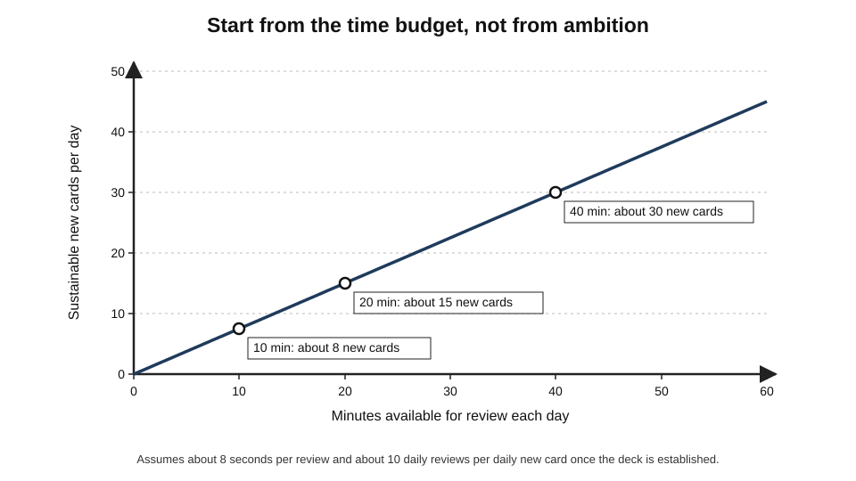
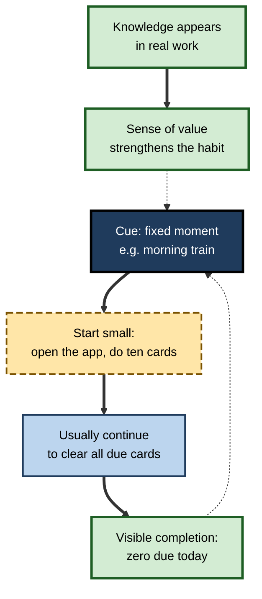
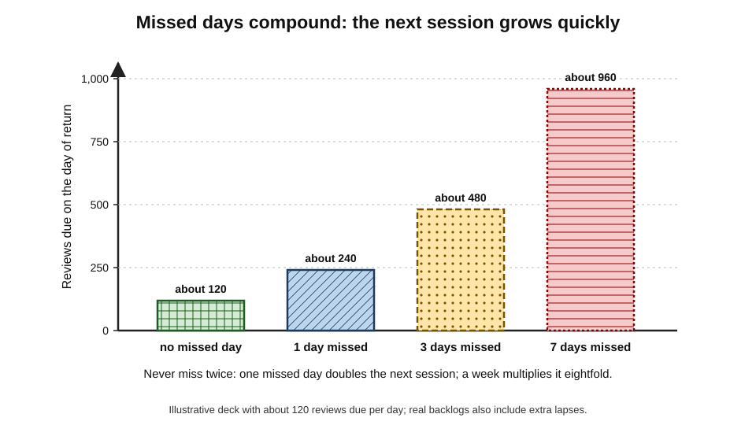
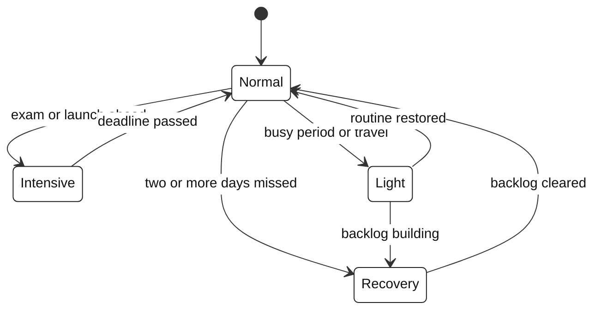
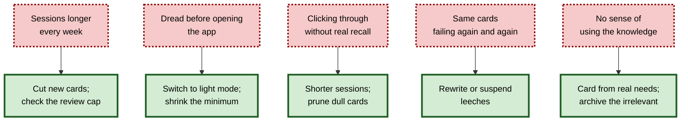

# D.12. Building Sustainable Spaced Rep Habits

Spaced repetition has an unusual property: its benefits compound over years, but its costs arrive every single day. A learner who reviews faithfully for three years ends with knowledge that is cheap to keep and hard to lose; a learner who stops after three months keeps almost nothing. The technique rarely fails because the science is wrong. It fails because the **daily habit** breaks — under an exam, a new job, a holiday, a backlog or plain boredom.

> **Definition — Sustainable spaced-repetition habit:** a daily review practice designed to survive real life — sized to a realistic time budget, anchored in a stable routine, robust to missed days and busy periods, and continually connected to knowledge the learner actually values.

**Why it matters**

- The payoff of spaced repetition depends on **continuity**: a review missed today becomes tomorrow's double load.
- Most people who try spaced-repetition software stop within weeks or months; the commonest causes are **overload** and **loss of meaning**, not lack of willpower.
- A habit designed for the bad weeks lasts; a habit designed for the good weeks does not.
- For professionals, review must coexist with demanding work, travel and family life for years.

---

## Why Spaced-Repetition Habits Fail

### The common pattern

1. **Enthusiastic start** — many new cards a day; reviews feel quick.
2. **Rising load** — after three to six weeks, the reviews generated by early cards arrive; sessions double.
3. **A disruption** — a deadline, illness or trip; several days missed.
4. **Backlog shock** — hundreds of overdue cards; the first session back is miserable.
5. **Avoidance** — the app is not opened; the backlog grows; the habit ends.

> **Key point:** the habit is usually broken in week one, when the new-card rate is set — the collapse simply arrives later.

### Causes and their fixes

| Cause | What it looks like | Fix |
|---|---|---|
| Too many new cards | Sessions grow every week | Set new cards from the time budget |
| Hidden backlog | Review cap reached daily; due count keeps rising | Keep the cap high; cut new cards instead |
| Missed days | Huge sessions after breaks | Minimum session; "never miss twice" |
| Boring or meaningless cards | Mechanical clicking; poor recall | Prune; card only what matters |
| Bad cards | Same cards failing repeatedly | Rewrite or delete leeches |
| No visible benefit | "Why am I doing this?" | Connect reviews to real use; track wins |
| Perfectionism | Quitting after breaking a streak | Plan for imperfection; recovery mode |

### The behavioural mechanisms behind dropout

- **Present bias** — people weigh immediate costs more heavily than delayed benefits; the review is a cost today, while its benefit arrives months later.
- **The fluency illusion** — spaced reviews feel effortful and full of failures, so they **feel** less productive than re-reading or cramming, even though they work better.
- **The planning fallacy** — learners underestimate future workload; early enthusiasm sets a new-card rate that the future self cannot sustain.
- **Loss aversion and the "what-the-hell" effect** — once a streak or a clean daily record is broken, the perceived loss can lead to abandoning the effort altogether.
- **Basic psychological needs** — self-determination theory (Edward Deci and Richard Ryan) holds that motivation lasts when activities support **autonomy**, **competence** and **relatedness**; a deck imposed by others, full of failing cards and reviewed alone, undermines all three.

> **Definition — Present bias:** the tendency to give disproportionate weight to immediate costs and rewards relative to future ones.

> **Definition — Self-determination theory:** a theory of motivation holding that sustained, high-quality motivation depends on satisfying needs for autonomy, competence and relatedness.

> **Key point:** the habit's design should **counter each mechanism**: make today's cost small (present bias), show progress (fluency illusion), budget for bad weeks (planning fallacy), plan recovery (loss aversion), and keep the deck chosen, achievable and shared where possible (self-determination).

---

## Designing the Habit

### Start from the budget

- **Step 1 — choose a daily time budget** that would still be possible in a bad week: commonly 10–30 minutes.
- **Step 2 — derive the new-card rate:** at about 8 seconds per review and about 10 daily reviews per daily new card at steady state, new cards per day ≈ minutes × 60 ÷ 80.

> **Formula — Budget-first new-card rate:** new cards per day ≈ (daily minutes × 60) ÷ (seconds per review × reviews per new card). Example: 20 minutes, 8 seconds, 10 reviews → 1,200 ÷ 80 = **15 new cards a day**.

**Figure 1.** The sustainable new-card rate for a given daily time budget.

- **Step 3 — set the review cap high** so that the true load is always visible.
- **Step 4 — review the budget monthly:** if sessions run long, reduce new cards; if short, add a few.

> **Watch out:** the budget is set for the **typical bad week**, not the ideal week. A learner who can do 45 minutes on a quiet Sunday but 15 on a busy Tuesday should budget for Tuesday.

### Anchor the session

- **A fixed cue** — the same time and place each day: after the morning coffee, on the commute, before opening email.
- **Habit stacking** — attaching review to an existing routine is a robust way to build automaticity; the general science of habit formation applies fully.
- **Location and device** — reviews on the phone fit into transit and waiting; card creation is better on a computer.
- **One main session** — splitting into many fragments increases the chance of skipping; one or two sessions are typical.

**Figure 2.** A daily spaced-repetition habit loop.

**Study card — Phillippa Lally, Cornelia van Jaarsveld, Henry Potts and Jane Wardle (2010)**

- **Design:** 96 volunteers chose a new daily eating, drinking or exercise behaviour, performed it in the same context each day, and reported daily how automatic it felt, for twelve weeks.
- **Results:**
  - automaticity rose along a curve that levelled off; the median time to reach most of the plateau was about **66 days**, with a very wide range (roughly 18 to 254 days);
  - **missing a single day** did not materially affect the habit's development.
- **Conclusion:** habits take weeks to months to form and vary greatly between people and behaviours; occasional misses are harmless — consistent abandonment is what matters.

> **Remember:** a missed day is a normal event in habit formation; the **second** missed day is where risk begins.

### The minimum viable session

> **Definition — Minimum viable session:** the smallest amount of review that counts as "done" on a difficult day — for example, ten cards or three minutes — chosen so that it is almost impossible to skip.

- **Purpose:** keep the chain unbroken on bad days; most days, starting leads to finishing.
- **Rule:** on a bad day, do the minimum and stop without guilt.

### Never miss twice

**Figure 3.** How missed days compound into large sessions.

- One missed day doubles the next session; several missed days create a backlog that threatens the habit.
- **Rule:** missing one day is normal; missing two in a row triggers the recovery plan.

> **Remember:** "**Never miss twice**" and "**minimum on bad days**" together protect the habit far better than willpower.

---

## Modes for Different Seasons

Real life has seasons — exams, launches, holidays, illness. A sustainable habit has **modes**.

**Figure 4.** Modes of a long-term spaced-repetition habit.

- **Normal** — the standard budget and new-card rate.
- **Intensive** — before an exam or a role change: more new cards for a limited time, higher retention target for critical material; planned with an end date.
- **Light** — during heavy work or travel: **no new cards**, reviews only, possibly a lower retention target for background material.
- **Recovery** — after missed days: no new cards, a daily cap on overdue reviews, critical material first, until the backlog is cleared.

> **In practice:** experienced users switch modes **deliberately** and in advance — "next week is a client launch; light mode" — rather than drifting into chaos.

| Mode | New cards | Reviews | Retention target | Typical duration |
|---|---|---|---|---|
| Normal | Budget-derived rate | All due | Standard (about 0.90) | Most of the year |
| Intensive | Higher, time-limited | All due | Higher for critical material | Weeks to a few months |
| Light | None | All due, or minimum on bad days | Lower for background | Days to weeks |
| Recovery | None | All due plus a capped share of overdue | Standard or slightly lower | One to four weeks |

---

## Keeping Motivation Alive

### Connect reviews to real use

- **Notice the wins** — a term recalled in a meeting, a dose remembered at the bedside, a command recalled during an incident.
- **Card from real needs** — knowledge looked up twice at work is a strong candidate; cards that never connect to life feel pointless.
- **Prune what no longer matters** — irrelevant cards are the fastest route to boredom.

### Streaks and gamification

- **Streaks** — consecutive days of practice — are powerful motivators in language apps and review tools.
- **Benefits:** a clear daily target; loss aversion keeps people going.
- **Risks:**
  - **gaming** — doing trivial work to keep the streak alive;
  - **collapse** — consumer research has found that breaking a streak can **reduce** subsequent engagement, as if the motivation was attached to the streak rather than the goal;
  - **anxiety** — practising out of fear rather than value.
- **Healthy use:** track streaks lightly; allow planned "freeze" days; measure success by weekly consistency and real use rather than an unbroken chain.

> **Watch out:** a long streak is not the goal. A learner who reviews 90% of days for five years learns far more than one who reviews 100% of days for five months and then quits after the streak breaks.

**Study card — Katherine Milkman, Julia Minson and Kevin Volpp (2014)**

- **Design:** gym members were given access to engaging audiobooks they could listen to **only at the gym** (temptation bundling), or not.
- **Results:** members with bundled audiobooks visited the gym more often in the following weeks than controls, although the effect faded after a break in the programme.
- **Conclusion:** pairing a "should" activity with a "want" activity increases participation — a technique applicable to review sessions (for example, reviewing only with a favourite coffee or during a pleasant commute).

> **Definition — Temptation bundling:** restricting a pleasurable activity to times when a beneficial but less appealing activity is performed.

### Progress visibility

- **Cards mature** — watching the number of mature (long-interval) cards grow is a better motivator than total card count.
- **Retention statistics** — true retention near target shows the system works.
- **Periodic reflection** — every few months, list what the deck has made possible.

### Social and organisational support

- **Study partners or groups** — shared decks and occasional check-ins.
- **Manager support** — in workplace programmes, managers who discuss the knowledge (not just completion) raise participation.
- **Public commitment** — telling colleagues about a learning goal adds gentle accountability.

---

## Warning Signs and Responses

**Figure 5.** Warning signs of an unsustainable habit and what to do about each.

> **Key point:** treat warning signs as **design problems**. The response is almost always to reduce input, improve cards or switch mode — not to try harder.

---

## Habits Across a Career

- **Student years** — high input; exam-driven intensive modes; risk of post-exam abandonment.
- **Early career** — the transition from academic to professional knowledge; the deck must change content; many users quit here.
- **Established practice** — low input, cheap maintenance, occasional intensive modes for new roles or certifications.
- **Career changes** — archive old specialties; start new tiers; the habit, not the deck, is the main asset.

> **Example:** a software engineer who learned Japanese at university kept a light daily review through three job changes; ten years later her deck costs eight minutes a day, and when she was offered a role in Tokyo she resumed new cards with a vocabulary already largely intact.

---

## Worked Example: Rebuilding a Habit After Burnout

A management consultant abandoned his deck four months ago with 6,000 overdue reviews. He wants to restart but works long hours and travels weekly.

1. **Decide what matters:** he reviews his tags and keeps only industry and finance knowledge relevant to current clients (about 3,500 cards); he suspends the rest.
2. **Choose a budget for bad weeks:** 12 minutes a day on the morning train — about 90 reviews.
3. **Recovery mode:** no new cards; about 90 reviews a day, prioritising the critical tier and cards most at risk of being forgotten.
4. **Minimum viable session:** 15 cards on travel days.
5. **Rule:** never miss twice.
6. **After recovery (about six weeks):** resume new cards at **6 a day** (12 × 60 ÷ 80 ≈ 9, starting lower); card only terms he has needed in client work.
7. **Monthly check:** session length, true retention, and three examples of the deck helping in real work.

| | Original habit | Rebuilt habit |
|---|---|---|
| New cards per day | 40 | 6 |
| Daily budget | Undefined | 12 minutes |
| Cards in active review | 9,000 | 3,500 |
| Bad-day rule | None | 15-card minimum |
| Missed-day rule | None | Never miss twice |
| Outcome after six months | Abandoned | Stable at about 10–12 minutes a day |

---

## Case Study: A Graduate Programme's Retention Habit

- **Situation:** a professional-services firm gave every graduate access to a spaced-repetition tool with a firm-curated deck on accounting, tax and internal methods.
- **Problem:** in the first cohort, usage peaked in the first month and fell to a small minority by month four.
- **Diagnosis:**
  1. graduates were told to "do 50 new cards a day" in the first weeks;
  2. busy-season workloads arrived in month three, causing missed days and backlogs;
  3. the deck included many cards irrelevant to each graduate's department;
  4. managers asked only whether graduates had "completed the deck".
- **Actions:**
  1. set a default of **10 new cards a day** with a 15-minute target;
  2. created department-specific sub-collections, with general cards shared;
  3. built in a **light mode** for busy season: no new cards for six weeks;
  4. taught "never miss twice" and a five-minute minimum in induction;
  5. asked managers to discuss **one subject from the deck each week** in team meetings, linked to real client work;
  6. reported mature-card counts and real-use examples rather than completion.
- **Result:** in the next cohort, most graduates were still reviewing at month six; busy season caused dips but few abandonments; graduates described the deck as "part of the job".
- **Side effects:** curating departmental collections required ongoing effort from senior staff.
- **Lesson:** sustainable habits came from **smaller input, planned light periods, relevance and managerial meaning** — not from more pressure.

---

## Habits and Artificial Intelligence

- **Lower friction** — AI can draft cards from notes in seconds, removing a barrier to keeping the deck fed.
- **Higher risk of overload** — the same ease makes it tempting to add far more than the budget allows.
- **Conversational review** — AI tutors can turn review into dialogue, which some learners find more engaging; whether this sustains habits better than card review is untested.
- **Reminders and planning** — assistants can help switch modes and plan recovery around calendars.

> **In practice:** let AI help with **making** and **maintaining** cards, but keep the **budget rule** in charge of how many enter the deck.

---

## Individual Differences in Sustaining Review

- **Conscientiousness and routine** — people with stable daily routines find fixed cues easy; those with irregular schedules (shift workers, frequent travellers) need **event-based** cues ("after check-in", "after handover") rather than clock times.
- **Chronotype** — some people are sharper early, others late; reviews placed at a time of reasonable alertness are faster and more accurate.
- **Caring responsibilities and health** — long periods of disruption are predictable for parents, carers and people with chronic illness; light and recovery modes should be planned, not improvised.
- **Attention differences** — learners who find sustained attention difficult often do better with shorter sessions split across the day, strong external cues and very small minimums.
- **Motivational orientation** — some learners are sustained by streaks and statistics; others by seeing knowledge used; designs should offer both rather than relying on one.

---

## Sustaining Spaced Learning in Organisations

### What drives participation

- **Relevance** — questions drawn from the learner's actual role and current work.
- **Brevity** — items that take a minute or two, delivered at predictable times.
- **Manager attention** — managers who discuss the content, not merely the completion rate.
- **Feedback** — explanations after each answer that teach something.
- **Fair use of data** — participation statistics used to improve the programme, not to rank or discipline individuals.

### Gamification: what the evidence shows

- **Meta-analyses** of gamification in education, such as one by Michael Sailer and Lisa Homner (2020), report small-to-moderate positive effects on cognitive, motivational and behavioural outcomes on average, with large variation between designs.
- **Elements that tend to help:** clear goals, visible progress, meaningful feedback, and social elements that encourage collaboration.
- **Elements that can backfire:** leaderboards that discourage those near the bottom, rewards that make the points the goal, and streak mechanics that punish occasional misses.

> **Watch out:** organisational dashboards that show 95% "completion" of spaced questions can hide poor learning if items are easy or answered carelessly. Pair participation data with delayed performance measures.

### Worked example: an annual habit plan

A senior accountant plans a year of spaced review around a known work calendar: a heavy year-end period in January–February and a three-week holiday in August.

| Period | Mode | New cards a day | Daily time | Days |
|---|---|---|---|---|
| March–July | Normal | 12 | About 15 minutes | 150 |
| August | Light, then recovery on return | 0 | About 5 minutes on the road; 25 minutes for 10 days on return | 31 |
| September–December | Normal | 12 | About 15 minutes | 120 |
| January–February | Light | 0 | About 8 minutes | 60 |

- **New cards in the year:** 12 × (150 + 120) ≈ **3,200**.
- **Total review time:** roughly (150 + 120) × 15 + 21 × 5 + 10 × 25 + 60 × 8 minutes ≈ **4,900 minutes**, about **80 hours** — around 1.5 hours a week averaged over the year.
- **Why it works:** the busy periods are anticipated, the recovery is planned, and the normal rate is set for ordinary weeks rather than ideal ones.

---

## Restarting After Abandonment

Many learners return to spaced repetition after months away. A restart is a design problem of its own.

- **Use a fresh start** — Hengchen Dai, Katherine Milkman and Jason Riis (2014) found that people are more likely to begin pursuing goals after **temporal landmarks** such as the start of a week, a month, a new year or a birthday; a new job, term or project is a natural moment to restart.
- **Shrink the collection first** — suspend everything not needed in the next six months; restart with a small active core.
- **Do not attempt the whole backlog** — for an abandonment of many months, overdue cards behave much like partially forgotten material; review a capped number a day, critical tiers first, and accept that some cards will be relearned.
- **Restart at a lower rate** — begin new cards at about half the previous sustainable rate for the first month.
- **Write down the failure cause** — overload, missed days, irrelevance or bad cards — and change the design so that the same cause cannot recur.

> **Definition — Fresh-start effect:** the tendency for people to initiate goal-directed behaviour after temporal landmarks that feel like new beginnings.

> **Example:** an analyst who abandoned her deck in March restarts on 1 September, the start of a new project: she suspends 6,000 of her 9,000 cards, reviews 80 overdue cards a day for three weeks, and resumes new cards at 6 a day instead of her old 20.

---

## Open Questions

- **What predicts who sustains spaced-repetition habits for years?**
  - Usage data suggest heavy early dropout, but rigorous studies of long-term persistence and its causes are scarce.
- **Do streaks help or harm in the long run?**
  - Streaks raise short-term engagement; evidence on their effect over years, and on recovery after breaks, is limited.
- **What is the best minimum session?**
  - Small minimums keep chains alive; whether they maintain learning or merely the ritual is not established.
- **How can organisations support habits without turning them into compliance?**
  - Managerial involvement helps, but mandates may reduce intrinsic motivation; designs that balance both are not well tested.
- **Will conversational AI review sustain habits better than cards?**
  - Plausible, but not yet studied over long periods.

---

## Summary

- Spaced repetition's benefits compound over years; its costs arrive daily — so the **habit**, not the algorithm, decides success.
- Habits typically fail through **overload** (too many new cards), **hidden backlog**, **missed days**, **meaningless or bad cards** and **perfectionism**.
- Design **budget-first**: choose minutes for a bad week, then derive new cards ≈ minutes × 60 ÷ 80; keep the review cap high.
- Anchor the session to a **fixed cue**; use a **minimum viable session** on bad days; **never miss twice**.
- Use **modes** — normal, intensive, light and recovery — and switch deliberately.
- Keep motivation by connecting cards to **real use**, pruning the irrelevant, and treating **streaks** lightly; broken streaks can reduce engagement.
- Treat warning signs — growing sessions, dread, mindless clicking, leeches, lack of meaning — as **design problems**.
- Over a career, decks change with roles; the **habit** is the lasting asset.
- In organisations, small defaults, light modes, relevance and managerial discussion sustain habits better than pressure.

---

## Self-Check

1. Describe the common pattern by which spaced-repetition habits collapse.
2. Why is the new-card rate the most important habit decision?
3. Calculate a sustainable new-card rate for a 25-minute budget at 8 seconds per review.
4. What is a minimum viable session, and why does it help?
5. Explain "never miss twice" using the arithmetic of missed days.
6. Describe the four modes and when each is used.
7. What are the benefits and risks of streaks?
8. Name five warning signs of an unsustainable habit and a response to each.
9. Why should the time budget be set for a bad week?
10. A learner says spaced repetition "doesn't work for me" after quitting twice. What questions would you ask?
11. Design a habit for a nurse working rotating twelve-hour shifts.
12. How should a learner handle the transition from student exams to professional work?
13. How can managers support spaced-repetition habits without making them a compliance exercise?
14. What risks does AI card generation pose to habit sustainability?
15. Explain how present bias, the planning fallacy and loss aversion each contribute to the abandonment of spaced-repetition habits, and give a design response to each.
16. What did Lally and colleagues (2010) find about habit formation and missed days, and what does it imply for spaced review?
17. How should an organisation use participation data from a spaced-question programme?
18. How should a learner restart a deck abandoned for six months?

### Answer Key

1. Enthusiastic start with many new cards, rising load weeks later, a disruption causing missed days, a backlog that makes sessions miserable, then avoidance and abandonment.
2. It determines future daily load; too high a rate guarantees later overload regardless of motivation.
3. 25 × 60 = 1,500 seconds; ÷ (8 × 10) = **about 19 new cards a day**, best started lower (e.g. 15).
4. The smallest amount of review that counts as done on a bad day (e.g. ten cards); it keeps the habit alive and often leads to a full session.
5. Each missed day adds a full day's reviews to the next session: one missed day doubles it, a week multiplies it about eightfold; preventing a second consecutive miss keeps sessions manageable.
6. Normal (standard settings), intensive (before exams or role changes, time-limited), light (busy periods: no new cards), recovery (after missed days: no new cards, capped overdue reviews).
7. Benefits: a clear daily target and loss-aversion motivation. Risks: gaming, anxiety, and reduced engagement after a broken streak.
8. Sessions growing — cut new cards; dread — light mode and smaller minimum; mindless clicking — shorter sessions and pruning; recurring failures — rewrite leeches; no meaning — card from real needs and archive the irrelevant.
9. Habits break in bad weeks; a budget that fits only good weeks fails exactly when life gets hard.
10. How many new cards a day? Was the review cap low? What happened after missed days? Were cards relevant and well made? Was there a recovery plan? What time budget was realistic?
11. A fixed cue tied to shift routine (e.g. after the handover meal), a budget of about 10–15 minutes, a five-card minimum on night shifts, light mode during runs of nights, never miss twice, and cards drawn from clinical needs on the ward.
12. Archive exam-only material, keep foundations, create tiers for current work, lower the new-card rate, and card from real work needs.
13. Discuss the knowledge in team settings, link cards to real cases, set sensible defaults and light modes, report real-use examples rather than completion, and avoid punitive mandates.
14. It makes adding cards effortless, encouraging overload; cards may be inaccurate or irrelevant, eroding trust and meaning.
15. Present bias makes today's review feel costlier than its distant benefit — keep sessions short and the minimum tiny. The planning fallacy leads to over-ambitious new-card rates — set the rate from a bad-week budget. Loss aversion makes a broken streak feel like total failure — plan recovery modes, allow freeze days and adopt "never miss twice".
16. Automaticity developed over a median of about 66 days, with a wide range, and missing a single day did not materially affect it. Spaced-review habits will take weeks to months to become automatic, and occasional missed days are harmless as long as the routine resumes promptly.
17. To improve the programme — finding items that are too easy, confusing or irrelevant and spotting groups that need support — read alongside delayed performance measures, not to rank or discipline individuals; completion alone is not evidence of learning.
18. Choose a natural fresh start (a new month, job or project); suspend material not needed soon; review a capped number of overdue cards daily, critical material first, accepting some relearning; restart new cards at about half the previous rate; and identify and design out the cause of the earlier abandonment.

---

## Glossary

| Term | Meaning |
|---|---|
| Backlog | Accumulated overdue reviews. |
| Budget-first design | Setting the new-card rate from a realistic daily time budget. |
| Event-based cue | A habit trigger tied to an event, such as a shift handover, rather than a clock time. |
| Fresh-start effect | Greater goal pursuit after temporal landmarks that feel like new beginnings. |
| Habit stacking | Attaching a new habit to an established routine. |
| Intensive mode | A time-limited period of higher input before a goal such as an exam. |
| Light mode | A period with no new cards, reviews only. |
| Minimum viable session | The smallest amount of review that counts as done on a bad day. |
| Never miss twice | The rule that one missed day is acceptable but two in a row trigger recovery. |
| Planning fallacy | The tendency to underestimate the time and effort future tasks will need. |
| Present bias | Giving disproportionate weight to immediate costs and rewards. |
| Recovery mode | A period of capped overdue reviews and no new cards after missed days. |
| Review cap | The maximum number of reviews shown per day. |
| Self-determination theory | The theory that lasting motivation depends on autonomy, competence and relatedness. |
| Streak | A run of consecutive days of practice. |
| Streak freeze | A planned exemption that preserves a streak for a missed day. |
| Temptation bundling | Restricting a pleasurable activity to times when a beneficial task is done. |
