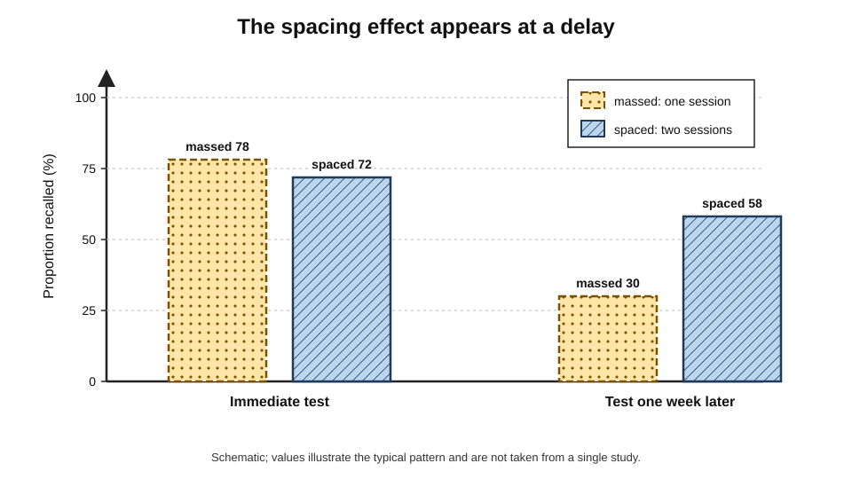
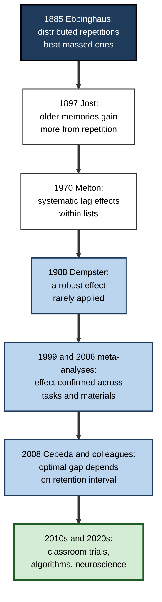
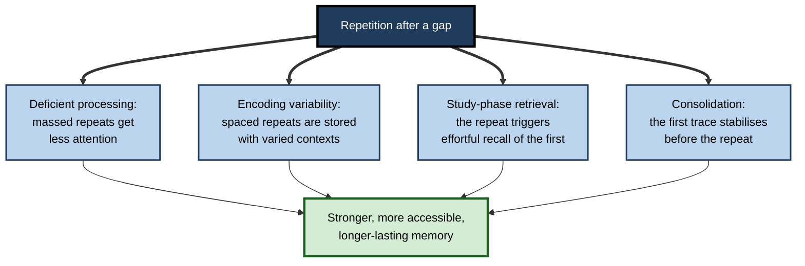
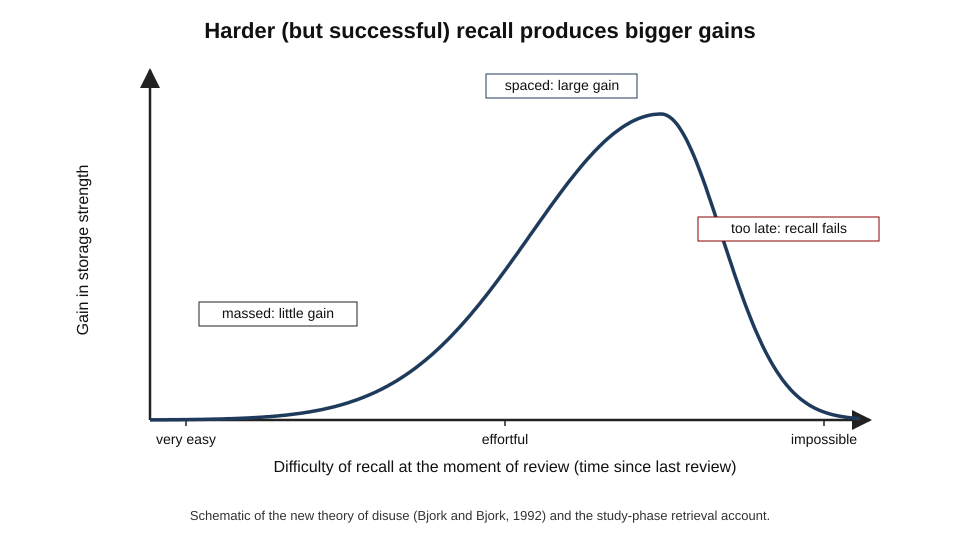
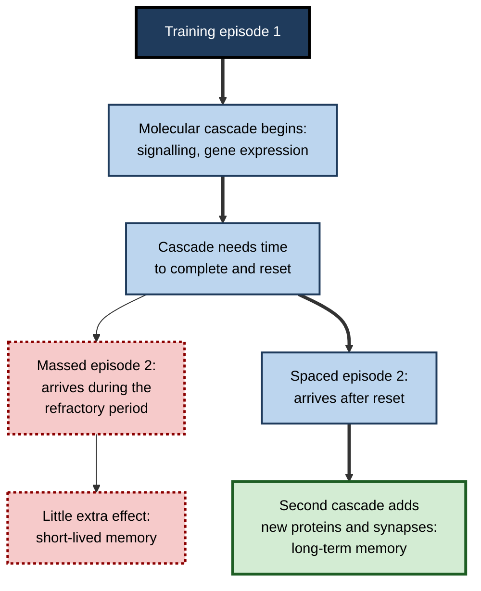
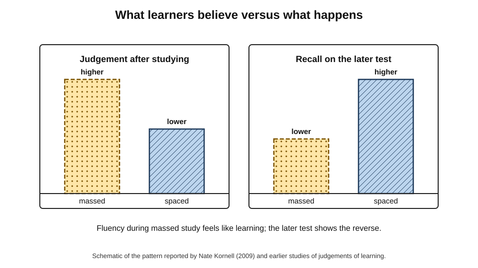

# D.2. The Spacing Effect Explained

Two analysts prepare for the same certification with exactly six hours of study each. One studies for six hours on the Saturday before the exam; the other studies for one hour on six separate days over three weeks. On exam day they score about the same. Six months later, when the material is needed on a client project, the second analyst still knows most of it and the first remembers little. The time was identical; only its **distribution** differed.

> **Definition — Spacing effect (distributed practice effect):** the finding that, for a fixed amount of study, long-term retention is better when study of the same material is spread across separate occasions than when it is massed into one.

**Why it matters**

- It is one of the most **robust** findings in the science of learning, reproduced for more than a century across materials, ages, species and settings.
- It is essentially **free**: it requires no extra time, only a different arrangement of the same time.
- It runs **against intuition** — massed study feels more effective, so learners, teachers and training departments routinely choose the weaker option.
- It is the scientific foundation of spaced-repetition software, reinforcement programmes and well-designed curricula.
- Understanding **why** it works tells a practitioner when it will help, when it will not, and how to apply it to new kinds of learning.

---

## The Basic Phenomenon

### Massed and spaced study

> **Definition — Massed practice:** repetitions of the same material given back-to-back, with no gap or only a very short gap between them.

> **Definition — Spaced practice:** repetitions of the same material separated by gaps, during which other activity occurs.

- **Same content, same total time** — only the **timing** of repetitions differs.
- **Typical laboratory design:**
  - learners study word pairs, facts or problems twice;
  - the two study episodes are either consecutive (massed) or separated by minutes, days or weeks (spaced);
  - all learners take a final test after the same **retention interval** from the last study episode.

> **Definition — Inter-study interval (ISI, gap, lag):** the time between two study episodes of the same material.

> **Definition — Retention interval (RI):** the time between the last study episode and the final test.

### The lag effect

- The spacing effect compares **some** gap with **no** gap.
- The **lag effect** compares **shorter** gaps with **longer** gaps: within limits, longer gaps produce better retention.
- **Limit:** if the gap becomes too long relative to the retention interval, recall of the first episode fails and the benefit shrinks.

> **Definition — Lag effect:** the finding that longer gaps between repetitions usually produce better long-term retention than shorter gaps, up to an optimum that depends on how long the material must be retained.

### Spacing shows at a delay

- On an **immediate** test, massed study often performs as well as spaced study — sometimes better.
- On a **delayed** test, spaced study wins, usually by a wide margin.
- This makes spacing a classic **desirable difficulty**: it lowers short-term fluency and raises long-term learning.

**Figure 1.** Massed and spaced study compared at an immediate and a delayed test.

> **Key point:** the spacing effect is a statement about **retention**, not about how well things go during study. Any evaluation made at the end of a massed session will mislead.

### What spacing is not

- **Not interleaving.** Interleaving mixes **different** topics or problem types within a session; spacing separates repetitions of the **same** material. Interleaving naturally creates some spacing, but they are distinct manipulations with different mechanisms.
- **Not simply "studying more".** The comparison holds total time constant.
- **Not resting.** The benefit arises from the gap between **repetitions** of the material, not from breaks as such.

---

## A Century of Evidence

### Origins

- **Hermann Ebbinghaus (1885)** found that repetitions spread over three days produced as much savings as nearly twice as many repetitions on a single day.
- **Adolf Jost (1897)** argued that spaced repetitions are more valuable because older memories benefit more from further practice.
- **Early twentieth century** — numerous studies of handwriting, typing, maze learning and arithmetic confirmed advantages of distribution.
- **Arthur Melton (1970)** helped revive laboratory interest by showing systematic effects of lag within a single list.

**Figure 2.** Milestones in the study of spacing.

### The failure to apply

**Frank Dempster (1988)**

- Published a review in a leading journal subtitled "a case study in the failure to apply the results of psychological research".
- **Argument:** the spacing effect is reliable, large, cheap and easy to use — yet schools, textbooks and training programmes ignored it.
- **Reasons he identified:** limited awareness among educators, a belief that laboratory findings with word lists do not transfer, and the practical difficulty of scheduling.
- **Status today:** awareness has grown considerably; the scheduling problem remains the main obstacle, and software has done much to solve it for individuals.

### The meta-analyses

**Study card — John Donovan and David Radosevich (1999)**

- **Design:** meta-analysis of 63 studies of distributed versus massed practice on a wide range of tasks, including motor and verbal tasks.
- **Results:** a moderate overall advantage for distributed practice; the advantage was **smaller for more complex tasks** and varied with the length of the gaps.
- **Conclusion:** spacing helps across task types, but task complexity is an important moderator.

**Study card — Nicholas Cepeda, Harold Pashler and colleagues (2006)**

- **Design:** quantitative review of 839 assessments of distributed practice drawn from 317 experiments in 184 articles, mostly on verbal recall.
- **Results:**
  - spaced presentations beat massed presentations in the large majority of comparisons;
  - the **optimal gap increased** as the retention interval increased;
  - very few studies had used long gaps and long retention intervals together.
- **Conclusion:** the spacing effect is reliable; the outstanding practical question is **how long** the gap should be for a given retention goal.

**Recent syntheses**

- **Classroom learning** — a 2025 meta-analysis by Mawson and Kang of applied classroom studies found a moderate advantage for distributed over massed practice (d ≈ 0.54).
- **Mathematics** — a 2025 meta-analysis by Murray, Horner and Göbel found a smaller but robust benefit (g ≈ 0.28), larger in tightly controlled studies than in studies embedded in real courses.
- **Health-professions education** — a systematic review found most included studies reported benefits of distributed practice, retrieval practice, or both.

> **Watch out:** effect sizes from classroom and course-embedded studies are usually **smaller** than laboratory effects, because real courses add noise, partial spacing in both conditions, and outcomes that measure more than recall. Smaller does not mean unimportant — the effect is cheap to obtain.

### Across species and ages

- **Sea slugs (*Aplysia*)** — spaced training sessions produce long-lasting sensitisation and habituation that massed training does not.
- **Fruit flies** — Tim Tully and colleagues (1994) found that spaced training produced a long-term, protein-synthesis-dependent memory that massed training did not.
- **Rodents, birds, bees** — spacing advantages in conditioning and spatial learning.
- **Humans** — from infants learning to recognise objects to older adults learning names; across verbal, visual, motor and conceptual material.

> **Key point:** an effect found in sea slugs and in university classrooms is unlikely to be an artefact of any one method. It points to something fundamental about how nervous systems store information.

---

## Why Spacing Works

No single theory explains every spacing result. Several mechanisms are supported, and each probably dominates under different conditions.

**Figure 3.** The main explanations of the spacing effect.

### Deficient processing

- **Idea:** when an item is repeated immediately, the learner feels "I have just seen this" and processes the repeat **superficially**; after a gap, the repeat receives full attention.
- **Supporting evidence:**
  - learners voluntarily spend less time on immediate repeats;
  - massed repetitions produce reduced brain responses, a form of **repetition suppression**.
- **Limits:** spacing advantages remain when study time is controlled and in incidental learning, so reduced attention cannot be the whole story.

### Encoding variability

- **Idea:** each study episode is stored together with its **context** — mood, surroundings, preceding thoughts. Spaced repetitions occur in more **varied** contexts, so the memory is linked to more potential retrieval cues.
- **Origins:** William Estes's stimulus-sampling theory (1955) and Arthur Glenberg's component-levels theory (1979).
- **Supporting evidence:** spacing benefits are often larger when the final test occurs in a new context.
- **Limits:** directly increasing context variability between massed repetitions does not reliably reproduce the spacing effect, so variability alone is insufficient.

### Study-phase retrieval and reminding

- **Idea:** when an item is encountered again, the learner **retrieves** the earlier encounter. After a gap, that retrieval is more **effortful**, and effortful successful retrieval strengthens memory more.
- **Prediction:** benefits grow with gap — until the gap is so long that the earlier episode is not retrieved at all, after which the repeat acts like a new first study.
- **This explains the inverted-U shape** of the lag effect: too short, little effort; too long, no reminding; in between, maximal gain.
- **Modern versions:** Aaron Benjamin and Jonathan Tullis (2010) formalised this as a **reminding** account; related work shows that noticing the repetition is crucial.

> **Definition — Study-phase retrieval:** the retrieval of an earlier encounter with an item that occurs when the item is studied again.

### Consolidation

- **Idea:** memories stabilise over time after learning, partly during sleep. A second episode after consolidation **builds on** a stabilised trace instead of adding to a fragile one.
- **Supporting evidence:**
  - spacing advantages are often stronger when a night's sleep separates the sessions;
  - in animals, spaced training engages gene expression and protein synthesis needed for long-term memory, while massed training does not.
- **Limits:** spacing effects also occur with gaps of seconds or minutes, too short for overnight consolidation.

### The new theory of disuse

- **Robert and Elizabeth Bjork (1992):** each memory has **storage strength** and **retrieval strength**.
- **Central principle:** the **gain in storage strength** from a study or retrieval event is **larger when retrieval strength is low** — that is, when the memory has become harder to access.
- **Spacing works because** the gap lets retrieval strength fall, so the next encounter produces a larger gain in storage.

**Figure 4.** How the gain from a review depends on how difficult recall has become.

> **Key point:** most theories converge on one practical rule — **return to material when it has become harder, but not impossible, to recall**. That is the logic behind every spacing schedule.

### Computational models

- **Philip Pavlik and John Anderson (2005)** — an extension of the ACT-R cognitive architecture in which each presentation adds activation that decays, and **decay is faster when activation is already high**. Massed presentations therefore decay quickly; spaced ones last.
- **Michael Mozer and colleagues (2009)** — the multiscale context model, in which memory traces exist at several time scales and spaced presentations update slower, more durable scales.
- **Value:** these models predict optimal schedules and underpin personalised review systems.

| Theory | Core mechanism | Best explains | Main difficulty |
|---|---|---|---|
| Deficient processing | Less attention to immediate repeats | Short-lag effects, voluntary study time | Effect survives when attention is equalised |
| Encoding variability | More varied contexts, more retrieval routes | Benefits in new test contexts | Manipulating variability alone gives mixed results |
| Study-phase retrieval | Effortful reminding of the earlier encounter | The inverted-U lag function | Hard to measure reminding directly |
| Consolidation | Repeat builds on a stabilised trace | Long gaps, sleep effects, animal data | Cannot explain spacing over seconds |
| New theory of disuse | Bigger storage gains when retrieval strength is low | Desirable-difficulty pattern in general | Strengths are not directly observable |

### Hybrid accounts

- **Peter Delaney, Peter Verkoeijen and Arie Spirgel (2010)** reviewed the literature at length and concluded that different mechanisms likely operate in different conditions:
  - **short lags, intentional learning** — deficient processing and reminding;
  - **longer lags** — retrieval-based and contextual mechanisms;
  - **very long lags and sleep** — consolidation.
- **Practical upshot:** the effect is overdetermined — many roads lead to it, which is why it is so robust.

---

## The Biology of Spacing

### Cellular evidence

- **Long-term potentiation (LTP)** — the strengthening of synapses that underlies many forms of memory — is induced more durably by **spaced** trains of stimulation than by the same stimulation delivered at once.
- **Gene expression:** long-term memory requires new proteins; the molecular cascades that produce them (involving a transcription factor called **CREB**) have refractory periods. Stimulation that comes again **before** the cascade has reset adds little.
- **Paul Smolen, Yili Zhang and John Byrne (2016)** reviewed this evidence and argued that optimal spacing in animals follows the timing of these biochemical cycles.

**Figure 5.** A simplified cellular account of why spaced training builds lasting memory.

> **Watch out:** the cellular gaps that are optimal in sea slugs and rats are minutes to hours. Human spacing benefits extend across days, months and years, so cellular timing cannot be translated directly into study schedules. The biology shows **that** spacing is fundamental, not **exactly** how long to wait.

### Brain-imaging evidence

- Massed repetitions produce **reduced** responses in regions involved in encoding — consistent with deficient processing.
- Spaced repetitions are associated with greater **pattern similarity** between the brain's responses on successive encounters in some studies and greater variability in others — the imaging evidence does not yet decide between theories.

---

## Why Learners Prefer Massing

### The fluency illusion

- During massed study the material is **fresh** — it feels easy, familiar and understood.
- During spaced study each return involves **struggle** — partly forgotten details, hesitations, errors.
- Learners interpret ease as learning and struggle as failure — the reverse of the truth for long-term retention.

**Study card — Nate Kornell (2009)**

- **Design:** university students studied vocabulary flashcards either in one large stack (spaced: each card returned only after many others) or in several small stacks (massed: each card returned quickly), then were tested later; they also judged which method had worked better.
- **Results:**
  - spacing produced better recall for about **90%** of participants;
  - yet after the first session about **72%** judged massing to have been at least as effective.
- **Conclusion:** learners systematically misjudge spacing; their experience during study points the wrong way.

**Figure 6.** Learners' judgements contradict their actual retention.

- **Earlier work** (Eugene Zechmeister and John Shaughnessy, 1980) found the same pattern: massed items received **higher** predictions of later recall and were in fact **recalled less**.

> **Definition — Judgement of learning (JOL):** a learner's prediction of how well they will remember material later.

> **Remember:** "It feels easy" during massed study means **recently seen**, not **well learned**.

### Other reasons massing persists

- **Deadlines** — work and exams arrive in blocks; cramming is the natural response to a looming date.
- **Completion bias** — finishing a topic in one sitting feels productive.
- **Course structure** — textbooks, workshops and modules are organised by topic: learn it, test it, move on.
- **Measurement** — end-of-session quizzes and satisfaction scores reward massed designs.

---

## Boundary Conditions

### Where spacing is strongest

- **Verbal and factual material** — vocabulary, definitions, names, facts.
- **Long retention goals** — the longer the material must last, the larger the advantage.
- **Material that is understood** at first encounter — spacing preserves what was encoded; it cannot create understanding where none existed.

### Where it is smaller or qualified

- **Complex tasks** — Donovan and Radosevich found smaller spacing effects for complex tasks; the gap may cause loss of the context needed to continue.
- **Very short retention intervals** — for a test in an hour, massing may be as good or better.
- **Gaps far too long** — if nothing is recalled when study resumes, the benefit is lost; the learner effectively starts again.
- **Initial acquisition of difficult skills** — a learner may need a concentrated block to reach a working level before spacing can operate.

> **Watch out:** spacing is not a reason to fragment **understanding**. A complex argument or a new procedure may need an unbroken first session; spacing applies to the **later** encounters with it.

### Moderators studied

- **Age** — spacing benefits appear in children, adults and older adults; some evidence suggests older adults benefit at least as much.
- **Prior knowledge** — experts may need fewer repetitions, but spacing still aids retention of new details.
- **Retrieval versus restudy** — spacing helps both, but the combination with retrieval tends to be strongest.
- **Intentional versus incidental learning** — effects appear in both, with somewhat different mechanisms.

| Condition | Massing performs | Spacing performs | Practical implication |
|---|---|---|---|
| Test within the hour | As well or better | Similar or slightly worse | Massing is acceptable only for immediate needs |
| Test after days or weeks | Poorly | Much better | Space anything needed later |
| Simple facts, vocabulary | Fast initial gain | Large long-term advantage | Ideal use of spacing |
| Complex, interdependent tasks | Keeps context intact | Smaller advantage | Mass the first encounter, space the reviews |
| Gap so long that nothing is recalled | — | Little benefit | Keep gaps within recoverable range |

---

## Spacing in Professional Life

### The economics

- **Zero marginal cost:** the same hours produce more retained learning.
- **Hidden cost of massing:** re-training, errors and lookups when knowledge decays.
- **Main cost of spacing:** coordination — calendars, reminders, scheduling across weeks.

> **In practice:** learning teams that understand spacing replace a single long event with **shorter sessions plus spaced follow-ups**, and evaluate with a delayed test rather than an end-of-course quiz.

### Worked example: two ways to spend eight hours

A firm must train 40 managers on a new performance-review process that they will first use in three months.

| | Design A: one-day workshop | Design B: spaced programme |
|---|---|---|
| Schedule | 8 hours on one day | 3-hour kick-off, then five 1-hour sessions at weeks 1, 2, 4, 7 and 11 |
| End-of-training quiz | High | Moderate after kick-off; high by the final session |
| Participant satisfaction | High; "very efficient" | Moderately high; some find the follow-ups inconvenient |
| Knowledge when the process is first used | Low; many consult the guide for basics | High; managers recall the steps and rationale |
| Total time | 8 hours | 8 hours |

1. Both designs cost the same instructional time.
2. Design B places its last session near the moment of use and spaces earlier sessions across the interval.
3. Design A's quiz overstates retention because it is taken at the point of maximum fluency.

- **Conclusion:** Design B produces more usable knowledge at the moment it is needed, for the same hours.

> **Watch out:** Design B is only better if the follow-ups require **retrieval and application** — a session that simply re-presents slides gains less from spacing.

### Case study: spacing a graduate engineering programme

- **Situation:** a graduate programme for new software engineers taught its security module in an intensive two-week block during the first month.
- **Problem:** code reviews in the following year repeatedly found basic security errors among graduates who had passed the module with high marks.
- **Diagnosis:**
  1. the module's assessment came at the end of the block — maximum fluency, minimum delay;
  2. after the block, security topics were not revisited until a year later;
  3. graduates themselves believed they "knew security" because the module had felt easy.
- **Actions:**
  1. reduced the block to one week of core concepts;
  2. added brief security challenges in each subsequent month, each revisiting earlier topics alongside new ones;
  3. moved part of the assessment to a code review six months after joining;
  4. explained the spacing effect to graduates so that the harder follow-ups were not read as failure.
- **Result:** security findings in graduates' code fell in the following cohort; the six-month review became the most predictive measure of later competence.
- **Side effects:** some graduates and their managers resented monthly challenges during busy delivery periods; scheduling had to be protected by programme leads.
- **Lesson:** spacing turned a module that **looked** successful into one that **was** successful — at the cost of coordination, not time.

---

## Spacing and Artificial Intelligence

- **Scheduling is solved for individuals** — software can track every item and present it at the right moment; the coordination problem that defeated Dempster's educators has largely disappeared for self-directed learners.
- **AI tutors** can deliberately revisit earlier material in conversation — but many general-purpose assistants answer only what is asked and have no memory of what the learner needs to review.
- **Models of the effect** — machine-learning models trained on millions of reviews now predict spacing benefits for individual learners and items more accurately than classic theories, though they explain less.

---

## Open Questions

- **Which mechanism dominates where?**
  - Hybrid accounts are plausible, but there is no agreed way to measure each mechanism's contribution in a given situation.
- **How does spacing interact with sleep?**
  - Overnight gaps seem especially beneficial, but the size of the sleep contribution relative to time itself is unresolved.
- **How well does spacing transfer to complex skills and understanding?**
  - Most evidence concerns facts and simple procedures; effects on deep conceptual understanding and complex performance are less studied and smaller.
- **Can learners be taught to prefer spacing?**
  - Explaining the effect helps somewhat, but the felt fluency of massing often wins in practice.
- **Does the biological timing in animals map onto human schedules?**
  - The molecular evidence is strong, but how cellular cycles relate to optimal human gaps of weeks or months is unknown.

---

## Summary

- **The spacing effect:** for the same total time, study spread over separate occasions produces better long-term retention than massed study; the **lag effect** shows that longer gaps help up to an optimum.
- The benefit appears on **delayed** tests; on immediate tests massing can look as good or better — spacing is a **desirable difficulty**.
- The effect is supported by more than a century of research, large meta-analyses (**Donovan and Radosevich, 1999**; **Cepeda and colleagues, 2006**), recent classroom syntheses, and studies across **species** and ages; **Dempster (1988)** called it a case of failure to apply research.
- Explanations include **deficient processing**, **encoding variability**, **study-phase retrieval**, **consolidation** and the Bjorks' **new theory of disuse**; hybrid accounts suggest different mechanisms at different lags.
- The common rule: **return when recall has become harder but is still possible**.
- At the cellular level, spaced training engages the molecular processes of **long-term memory**; massed training repeats them before they reset.
- Learners **prefer massing** because of **fluency**; Kornell found that most believed massing worked while spacing helped almost all of them.
- Spacing is strongest for factual material and long retention goals, smaller for complex tasks; the first encounter with complex material may need to be concentrated.
- In organisations, spacing costs coordination, not time; programmes should be judged by **delayed** measures.

---

## Self-Check

1. Define the spacing effect and the lag effect, and explain how they differ.
2. Define inter-study interval and retention interval with an example from exam preparation.
3. Why can massed study outperform spaced study on an immediate test?
4. What did Dempster mean by "the failure to apply" the spacing effect, and is his criticism still valid?
5. Summarise what the Cepeda and colleagues (2006) meta-analysis found about optimal gaps.
6. Explain the study-phase retrieval account and how it explains the inverted-U shape of the lag effect.
7. What does the new theory of disuse say about when a review produces the largest gain?
8. Give one piece of evidence for, and one against, the deficient-processing account.
9. Why do findings in fruit flies and sea slugs strengthen confidence in the spacing effect, and why should their timings not be copied into study plans?
10. Describe Kornell's (2009) flashcard study and what it shows about learners' judgements.
11. Name two conditions under which the spacing advantage is smaller.
12. A trainer argues that a one-day workshop is better because participants score higher on the end-of-day quiz. Respond.
13. A lawyer has ten hours to prepare for a client meeting in two weeks and a regulatory exam in six months on overlapping material. How should she distribute her time?
14. Explain why spacing and interleaving are different manipulations even though they often occur together.

### Answer Key

1. The spacing effect: spaced study beats massed study for the same total time. The lag effect: among spaced schedules, longer gaps usually beat shorter ones, up to an optimum. The first compares some gap with none; the second compares gap lengths.
2. ISI is the time between study episodes of the same material; RI is the time from the last episode to the test. A student who studies a chapter on Monday and again on Thursday (ISI three days) and sits the exam ten days after Thursday has an RI of ten days.
3. Immediately after massed study, material is highly accessible (high retrieval strength) and fluent. Spaced learners have partly forgotten between sessions. The spacing advantage depends on durable storage, which shows only after a delay.
4. That a large, reliable, cheap effect had been ignored by education. Awareness has grown and software solves scheduling for individuals, but many courses and corporate programmes still mass learning and evaluate immediately, so the criticism remains partly valid.
5. Spacing beat massing in most comparisons, and the optimal gap grew as the retention interval grew; few studies had tested long gaps with long retention intervals.
6. A repeat prompts retrieval of the earlier encounter; after a longer gap the retrieval is more effortful and strengthens memory more. If the gap is too long, the earlier encounter is not retrieved and the repeat acts like new study. Gains therefore rise then fall with gap length.
7. Gains in storage strength are largest when retrieval strength is low — when the memory has become hard, but not impossible, to access.
8. For: learners spend less time on, and brains respond less to, immediate repeats. Against: the effect remains when study time is controlled and in incidental learning.
9. An effect present in very different nervous systems and methods is unlikely to be an artefact; it reflects basic memory biology. But the optimal cellular gaps are minutes to hours, while human benefits extend to months, so the timings do not translate.
10. Students studied vocabulary with spaced (one large stack) or massed (small stacks) flashcards. Spacing helped about 90% of them, yet about 72% judged massing at least as effective — learners misjudge spacing because massed study feels fluent.
11. Complex, interdependent tasks; very short retention intervals; gaps so long that nothing is recalled when study resumes.
12. The end-of-day quiz measures performance at peak fluency, which favours massing. The relevant measure is delayed, unaided performance on the job. Propose spaced follow-ups and evaluate at a delay.
13. She should study the material for the meeting with several sessions over the two weeks, ending close to the meeting, then continue reviewing the overlapping material at widening intervals (for example weekly, then every few weeks) across the six months, so the meeting preparation also serves as early spaced study for the exam.
14. Spacing separates repetitions of the **same** material by a gap; interleaving mixes **different** topics or problem types within a session. Interleaving creates gaps between repetitions of each type, so it includes some spacing, but its main benefit — learning to discriminate between types — comes from the mixing, not the gap.

---

## Glossary

| Term | Meaning |
|---|---|
| CREB | A transcription factor involved in the gene expression needed for long-term memory. |
| Consolidation | Stabilisation of a memory over time after learning, partly during sleep. |
| Deficient processing | The account that immediate repeats receive less attention than spaced repeats. |
| Desirable difficulty | A condition that lowers short-term performance but improves long-term learning. |
| Encoding variability | The account that spaced repeats are stored with more varied contexts and cues. |
| Inter-study interval | The gap between two study episodes of the same material. |
| Interleaving | Mixing different topics or problem types within a study session. |
| Judgement of learning | A learner's prediction of later recall. |
| Lag effect | Longer gaps between repetitions usually improve retention, up to an optimum. |
| Long-term potentiation | Lasting strengthening of synapses after stimulation. |
| Massed practice | Repetitions given back-to-back with little or no gap. |
| New theory of disuse | The Bjorks' theory distinguishing storage strength from retrieval strength. |
| Repetition suppression | Reduced neural response to an immediately repeated stimulus. |
| Retention interval | The time from the last study episode to the test. |
| Retrieval strength | How accessible a memory is now. |
| Spaced practice | Repetitions separated by gaps during which other activity occurs. |
| Spacing effect | Better retention from spaced than from massed study for the same total time. |
| Storage strength | How well established a memory is. |
| Study-phase retrieval | Retrieval of an earlier encounter triggered when an item is studied again. |
