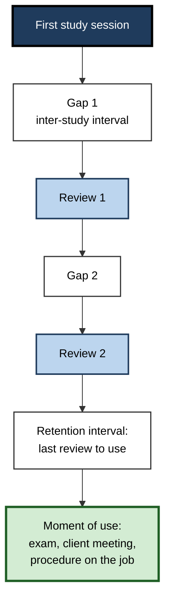
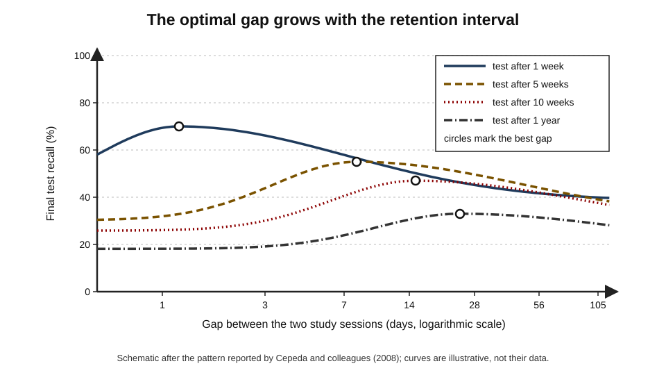
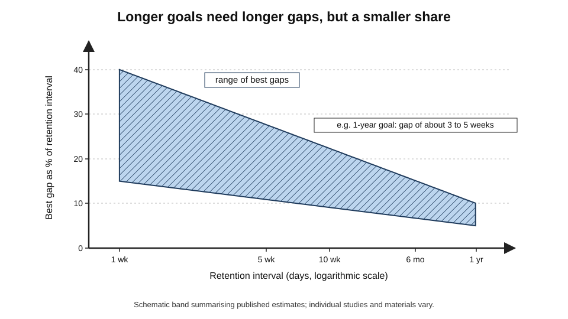
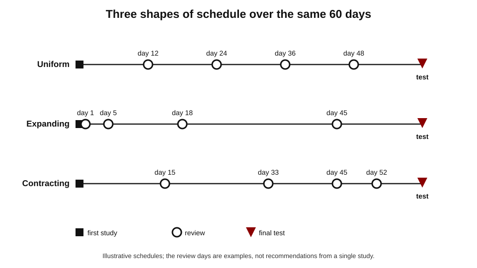
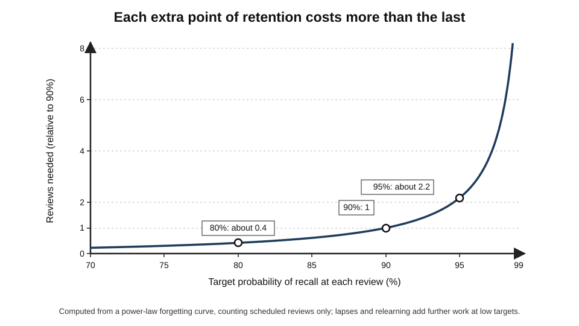
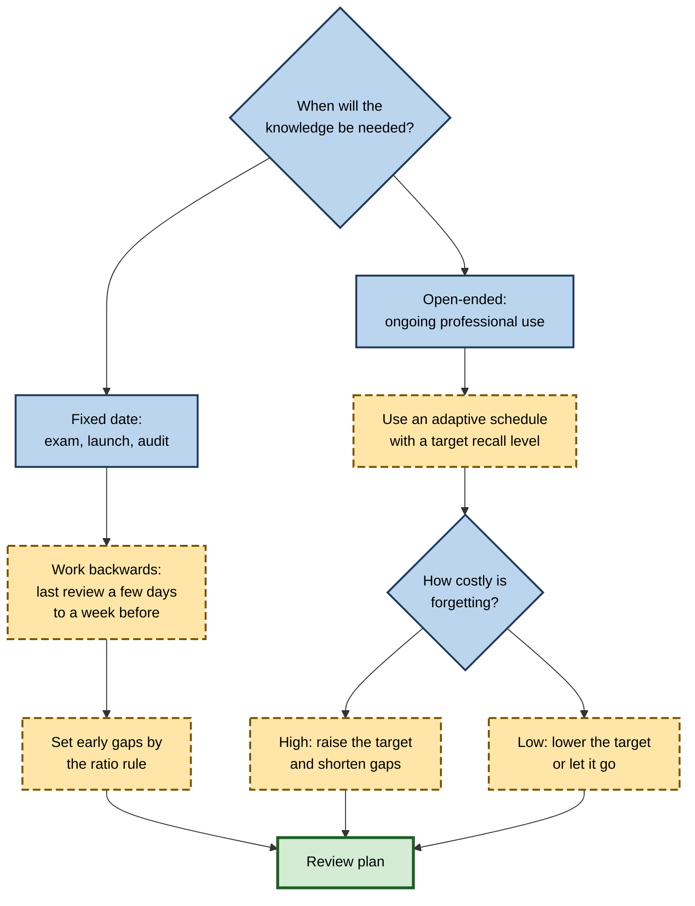

# D.3. Optimal Spacing Intervals

Knowing that spaced study beats massed study raises an immediate practical question: spaced by **how much**? A pharmacist revising drug interactions for an exam in five weeks, a sales engineer who must remember a product catalogue for a year, and a language learner aiming for lifelong vocabulary all need different gaps. Too short a gap wastes the advantage of spacing; too long a gap lets the memory slip away before it is refreshed.

> **Definition — Optimal spacing interval:** the gap between study or review sessions of the same material that produces the best retention at the time the knowledge will be needed, for a given amount of study.

**Why it matters**

- The size of the spacing benefit depends heavily on choosing a sensible gap; a poor gap can erase most of it.
- The answer depends on **when** the knowledge is needed — so every schedule begins with a retention goal.
- The same logic underlies exam revision plans, training reinforcement, curriculum design and spaced-repetition algorithms.
- Practitioners face a **cost–benefit trade-off**: more frequent reviews give higher recall but cost more time.
- Several popular rules ("review at 1, 7 and 30 days") are reasonable starting points but are not laws; knowing the evidence behind them lets a practitioner adapt.

---

## The Vocabulary of Schedules

**Figure 1.** The elements of a study schedule.

- **First study** — the initial encounter in which the material is learned to some level.
- **Gap or inter-study interval (ISI)** — time between two sessions on the same material.
- **Number of sessions** — how many times the material is studied or retrieved.
- **Retention interval (RI)** — time from the last session to the moment of use.
- **Test delay** — total time from first study to the moment of use.
- **Schedule shape:**
  - **uniform (equal)** — the same gap each time;
  - **expanding** — each gap longer than the last;
  - **contracting** — each gap shorter than the last.

> **Definition — Expanding schedule:** a review schedule in which successive gaps grow longer, such as 1, 3, 7, 21 days.

> **Definition — Uniform schedule:** a review schedule in which all gaps are the same length, such as every 7 days.

> **Key point:** "optimal" is always optimal **for something** — a particular retention interval, number of sessions and type of material. There is no single best gap.

---

## The Temporal Ridgeline

### The landmark study

**Study card — Nicholas Cepeda, Edward Vul, Doug Rohrer, John Wixted and Harold Pashler (2008)**

- **Design:**
  - more than 1,350 adults took part online;
  - each learned a set of obscure facts, then reviewed them once after a gap of between zero and about 105 days (3.5 months);
  - a final test followed after a retention interval of 7, 35, 70 or 350 days.
- **Results:**
  - for **every** retention interval, recall first **rose** as the gap increased, reached a peak, then **declined gradually**;
  - the **best gap grew** as the retention interval grew;
  - as a **proportion** of the retention interval, the best gap **shrank** — about 20% or more for intervals of a few weeks, about 5–10% for a year;
  - performance fell more sharply when the gap was **too short** than when it was **too long**.
- **Conclusion:** the optimal gap forms a "**temporal ridgeline**" across retention intervals. Choosing a gap that is somewhat too long costs little; choosing one too short costs a lot.

**Figure 2.** Final recall as a function of the gap, for four retention intervals.

> **Definition — Temporal ridgeline:** the line joining the optimal gaps across different retention intervals; it rises with the retention interval but less than proportionally.

### The ratio rule

- From the ridgeline comes a practical heuristic: **set the gap at roughly 10–20% of the retention interval**, using the upper end for shorter intervals and the lower end for longer ones.
- **Examples:**
  - test in **10 days** → gap of about 1–2 days;
  - test in **1 month** → gap of about 4–7 days;
  - test in **6 months** → gap of about 2–4 weeks;
  - knowledge needed for **a year** → gap of about 3–5 weeks.

> **Formula — Ratio rule:** gap ≈ r × retention interval, with r ≈ 0.2 for intervals of weeks and r ≈ 0.05–0.1 for a year. Example: retention interval of 90 days, r = 0.15 → gap ≈ **13–14 days**.

**Figure 3.** The best gap expressed as a share of the retention interval.

> **Watch out:** the ratio rule comes mainly from studies with **two** sessions of fact learning. With many sessions, adaptive schedules and different material, the best gaps differ. Treat the rule as a starting estimate, not a precise prescription.

**Study card — Nicholas Cepeda, Noriko Coburn, Doug Rohrer, John Wixted, Michael Mozer and Harold Pashler (2009)**

- **Design:** learners studied Swahili–English word pairs (and, in another experiment, obscure facts), reviewed them once after gaps ranging from minutes to several months, and were tested after a retention interval of up to six months.
- **Results:**
  - for a six-month retention interval, a gap of about a month gave better recall than gaps of a day or a week;
  - much longer gaps of several months reduced recall again, though less steeply than very short gaps.
- **Conclusion:** the ridgeline pattern holds for foreign vocabulary and at long time scales; the asymmetry — too short is worse than too long — reappears.

### The asymmetry: err on the long side

- Ridgeline curves are **steep on the short side** and **shallow on the long side** of the optimum.
- **Practical rule:** when uncertain, choose the **longer** of two plausible gaps.
- **Caveat:** "longer" must still be within the range where most material is recalled or quickly relearned; a gap so long that nothing is recognised becomes a fresh start.

### Replications and extensions

- **Classroom studies** of vocabulary, history and science facts with school pupils show the same direction: a review after a week or more outlasts a review the next day when the test is weeks away.
- **Professional training** — studies of spaced online questions in medicine found that repeating questions after gaps of weeks maintained knowledge over months.

---

## Expanding, Uniform or Contracting?

**Figure 4.** Three shapes of review schedule over the same period.

### The case for expanding gaps

- **Logic:** a new memory is fragile and needs an early review; each successful review makes it more stable, so the next gap can be longer.
- **Paul Pimsleur (1967)** proposed **graduated-interval recall** for language learning: gaps of roughly 5 seconds, 25 seconds, 2 minutes, 10 minutes, 1 hour, 5 hours, 1 day, 5 days, 25 days, 4 months and 2 years — each about five times the last.
- **Thomas Landauer and Robert Bjork (1978)** found that expanding retrieval of names for faces produced better recall than uniform retrieval in their conditions.
- **Spaced-repetition software** generally produces expanding gaps because intervals multiply after each success.

### The case against a fixed expansion

**Study card — Jeffrey Karpicke and Henry Roediger (2007)**

- **Design:** learners practised retrieving word pairs on expanding or equally spaced schedules with the same total spacing; tests came after short and long delays.
- **Results:**
  - expanding schedules helped at **short** delays — the early, easy first retrieval kept items available;
  - equally spaced schedules were better at **long** delays — mainly because their **first** retrieval came after a longer gap, making it more effortful.
- **Conclusion:** the **first gap** matters more than the shape; an early, very easy first review sacrifices long-term benefit.

- **Later reviews** — Sean Kang and colleagues (2014) and a 2021 meta-analysis by Latimier, Peyre and Ramus found **no reliable overall advantage** for expanding over uniform schedules once total spacing is equated.
- **Contracting schedules** — rarely better and often worse; reviews bunched near the end act more like late cramming.

| | Uniform | Expanding | Contracting |
|---|---|---|---|
| Gap pattern | Equal gaps | Gaps grow after each review | Gaps shrink before the test |
| Strength | Simple; first review effortful | Protects fragile new memories; efficient for long horizons | Material fresh at test time |
| Weakness | Too frequent late, or too sparse early | Very early first review can be too easy | Weak long-term retention |
| Evidence | As good as expanding in most comparisons | Not reliably better than uniform when spacing is equated | Generally inferior |
| Best use | Courses with regular sessions | Long-term maintenance, software schedules | Final exam polish only |

> **Key point:** when total time and number of sessions are equal, the **shape** of the schedule matters less than its **first gap**, its **total span**, and whether reviews are **successful**. Expansion is valuable mainly because it lets reviews stretch over long horizons at low cost.

### Adaptive scheduling resolves the debate

- Fixed expansion treats every item the same; real items differ in difficulty and in how well they were learned.
- **Adaptive schedules** lengthen the gap after a success and shorten it after a failure — so easy items expand quickly and hard items stay on short gaps.
- In effect, adaptive schedules are **expanding for successful items** and **contracting for failing ones**.

> **Definition — Adaptive schedule:** a review schedule that adjusts each item's next gap according to the learner's performance on it.

---

## Spacing for Recall Probability: The Modern View

### Reviews timed to a target recall level

- Modern scheduling aims at a **target probability of recall** at each review rather than a fixed gap.
- **Logic:** review an item when its estimated chance of recall has fallen to the target, such as 90%.
- **Consequence:** the gap automatically lengthens as the memory becomes more stable.

> **Definition — Desired retention (target retention):** the probability of recall at which a review is scheduled; lower targets give longer gaps and fewer reviews, higher targets give shorter gaps and more reviews.

### The cost of high targets

> **Formula — Gap for a target recall level:** with a power-law forgetting curve calibrated so recall is 90% when elapsed time equals stability S, the gap for target R is about 4.26 × S × (1/R² − 1). Example: S = 20 days → R = 0.90 gives **20 days**; R = 0.80 gives about **48 days**; R = 0.95 gives about **9 days**.

- **Reading the numbers:**
  - raising the target from 90% to 95% **more than doubles** the number of scheduled reviews;
  - lowering it to 80% cuts scheduled reviews by more than half — but more items are forgotten and must be relearned, which adds work back.

**Figure 5.** How the number of reviews rises with the retention target.

| Target recall at review | Gap relative to 90% target | Scheduled reviews relative to 90% | Lapses (forgotten items) per review | Typical use |
|---|---|---|---|---|
| 70% | About 4.4× | About 0.2× | 30% | Rarely sensible; many relearning sessions |
| 80% | About 2.4× | About 0.4× | 20% | Light maintenance of low-priority material |
| 90% | 1× | 1× | 10% | Common default; balanced |
| 95% | About 0.46× | About 2.2× | 5% | High-stakes exam period; critical facts |
| 97% | About 0.27× | About 3.7× | 3% | Rarely worth it; very heavy workload |

> **Key point:** the optimal schedule is an **economic** decision. Simulations of spaced-repetition users generally show that total effort, including relearning, is lowest at a moderate target, and rises steeply above about 90–95%.

> **Watch out:** a lower target means **lower recall at review time**, not necessarily at the exam. Learners preparing for a fixed date often raise the target as the date approaches so that recall is high when it matters.

### The desirable-difficulty argument for lower targets

- Reviews at lower recall probability are harder and produce **larger stability gains** per success.
- But each **failure** costs more: a failed item loses much of its stability, and failure without feedback may strengthen errors.
- **Practical balance:** most learners do best with targets between about **80% and 92%**, adjusted for importance.

---

## Gaps at Different Time Scales

### Within a session

- **Short gaps of minutes** — returning to an item after a few other items is far better than immediate repetition.
- **Within-session spacing** is what flashcard stacks provide: a large stack means each card returns after a longer gap.
- **Limit:** within-session gaps help retention over hours to days, but not on their own over months.

### Across days

- **Sleep between sessions** appears especially helpful; a gap of one night often adds more than its clock time suggests.
- **Daily review** is the backbone of most effective systems.

### Across weeks and months

- **Long-horizon knowledge** — professional facts, language, foundational concepts — needs gaps that eventually reach months.
- **Bahrick and colleagues (1993)** — learning and relearning foreign words with gaps of 14, 28 or 56 days showed that wider gaps slowed relearning slightly but gave **much** better retention up to five years later; 13 sessions at 56-day gaps matched 26 sessions at 14-day gaps.

**Study card — Harry Bahrick, Lorraine Bahrick, Audrey Bahrick and Phyllis Bahrick (1993)**

- **Design:** four family members learned 300 English–foreign word pairs and relearned them in either 13 or 26 sessions spaced 14, 28 or 56 days apart; retention was tested 1, 2, 3 or 5 years after training ended.
- **Results:** longer gaps gave better long-term retention; 13 sessions at 56 days produced retention comparable to 26 sessions at 14 days.
- **Conclusion:** for very long retention goals, wide gaps can **halve** the number of sessions needed.

> **Remember:** **minutes** for the first consolidation, **days** for early reviews, **weeks** for intermediate ones, **months** for maintenance.

---

## Planning Gaps in Practice

**Figure 6.** Choosing review gaps for a learning goal.

### Worked example (illustrative): revising for a professional exam in eight weeks

A trainee accountant has 56 days until an exam and has just studied a chapter on revenue recognition.

1. **Retention interval:** the exam is 56 days away; the chapter must survive until then.
2. **First gap:** a review within the first **1–2 days** secures the fragile memory and reveals what was not understood.
3. **Middle gaps:** by the ratio rule (about 15–20% of the remaining interval), subsequent reviews at about **day 7** and **day 18**.
4. **Final review:** about **5–7 days before** the exam (day 49–51), so the last gap is short relative to the exam but follows earlier spaced reviews.
5. **Check:** each review is a **retrieval** of the material, not a re-read; items failed are revisited sooner.

| Session | Day | Gap from previous | Purpose |
|---|---|---|---|
| First study | 0 | — | Understand and encode |
| Review 1 | 1 | 1 day | Secure and find gaps |
| Review 2 | 7 | 6 days | First effortful retrieval |
| Review 3 | 18 | 11 days | Strengthen across weeks |
| Review 4 | 34 | 16 days | Consolidate |
| Review 5 | 50 | 16 days | Final refresh before the exam |
| Exam | 56 | 6 days | — |

*Illustrative figures.*

- **Result:** five brief reviews, totalling perhaps two hours for the chapter, replace an exam-week cram of similar length — with far better retention on the day and afterwards.

> **Watch out:** many chapters overlap in time. The plan must be built across **all** topics, which is exactly the bookkeeping that software or a simple review calendar handles; without one, learners drift back to massing.

### Rules of thumb that work

- **Review once soon** — within a day — then let gaps grow.
- **Make the first real retrieval effortful** — not immediately after study.
- **Prefer slightly longer gaps** to slightly shorter ones.
- **Shorten gaps after failures**, lengthen after successes.
- **End shortly before the moment of use** for fixed-date goals.
- **Continue at long gaps** after the exam if the knowledge matters professionally.

> **Mnemonic — "SOON, THEN WIDER":** review **Soon**, **Then** let gaps grow **Wider**, shorten after failure, err long when unsure.

---

## Designing Intervals for Organisations

### Reinforcement after training

- **Common practical pattern:** retrieval questions at roughly 2 days, 1 week, 3 weeks and 2 months after a training event, then quarterly for critical knowledge.
- **Adaptive versions:** questions answered correctly twice are retired or moved to long gaps; missed questions return sooner.
- **B. Price Kerfoot's "spaced education"** trials in medical training used email questions repeated at intervals of weeks, with explanations, and found improved retention over months compared with non-spaced delivery.

### Case study (illustrative): a bank's anti-money-laundering refresh

- **Situation:** a retail bank required all branch staff to complete a 90-minute annual anti-money-laundering course.
- **Problem:** mystery-shopper tests and audit samples showed that staff missed warning signs months after completing the course with high marks.
- **Diagnosis:**
  1. one massed exposure per year — the gap between learning and most real use was months;
  2. the end-of-course quiz measured recall minutes after study;
  3. no reviews in between.
- **Actions:**
  1. shortened the annual course to 45 minutes;
  2. sent two-minute scenario questions on work tablets at about 3 days, 2 weeks, 6 weeks, 3 months and 6 months, adapting to performance;
  3. focused questions on the warning signs most often missed in audits;
  4. measured success by mystery-shopper results across the year.
- **Result:** detection of seeded warning signs in mystery-shopper visits improved and stayed higher late in the year; total training time per person fell slightly.
- **Side effects:** some staff found frequent questions intrusive; frequency was capped and questions were kept short.
- **Lesson:** matching gaps to the period over which knowledge is **used** — not the training calendar — produces retention where it matters, for less time.

---

## Why the Ridgeline Has Its Shape

The main accounts of the spacing effect each make predictions about **where** the optimal gap should lie. Seen together, they explain why the best gap grows with the retention interval.

- **Study-phase retrieval** — a review helps most when the learner must work to retrieve the earlier encounter but still succeeds.
  - **Prediction:** an inverted-U — too short and retrieval is trivial; too long and it fails.
  - **Why the optimum moves:** a longer retention interval rewards memories with higher stability, which come from more effortful (later) retrievals.
- **Encoding variability** — each session stores the material with its context; a later test occurs in a new context.
  - **Prediction:** longer gaps add more varied contexts, which matters more the further away (and the more different) the test context is.
- **Consolidation** — memories stabilise over hours and days, especially during sleep.
  - **Prediction:** gaps that include at least one night are disproportionately valuable; very short same-day gaps help less for long horizons.
- **Deficient processing** — immediate repeats receive less attention.
  - **Prediction:** explains the poor performance of very short gaps, but says little about the long-gap side of the curve.

> **Key point:** no single account explains the whole ridgeline. Retrieval-based accounts explain its inverted-U shape; contextual and consolidation accounts explain why longer horizons favour longer gaps.

### Computational models of the optimal gap

- **The multiscale context model** (Michael Mozer and colleagues, 2009) represents memory as traces decaying at several time scales; spaced reviews strengthen the slower, more durable scales. It reproduced the ridgeline from parameters fitted to earlier data.
- **The ACT-R spacing model** (Philip Pavlik and John Anderson, 2005) lets each presentation add activation that decays faster when activation is already high, so massed presentations decay quickly.
- **Use in practice:** such models compute an optimal next gap for each item and learner — the basis of personalised schedules that have outperformed generic spacing in classroom studies.

> **Definition — Multiscale context model:** a computational model of memory in which traces decay at several time scales and spaced study strengthens the slower ones, used to predict optimal review gaps.

---

## Individual Differences and Boundary Conditions

- **Degree of initial learning** — if material was only weakly learned, a long first gap leaves nothing to retrieve; weakly learned material needs a **shorter first gap**.
- **Item difficulty** — hard, arbitrary items (unfamiliar words, codes) need shorter early gaps than meaningful ones; adaptive schedules handle this automatically.
- **Prior knowledge** — experts link new details to a rich structure and can tolerate longer gaps; novices forget isolated details faster.
- **Age** — spacing benefits appear in children and older adults; older adults may need slightly shorter early gaps but benefit at least as much from spacing overall.
- **Type of material** — the ridgeline was mapped for facts and vocabulary; for complex skills, the gap must preserve enough of the procedure to resume practice, which usually argues for shorter early gaps.
- **Stakes** — the cost of a failure (a missed dose versus a forgotten trivia fact) shifts the target recall level and therefore the gap.

> **Definition — Degree of initial learning:** how well material is known at the end of first study, often measured by the number of correct recalls achieved; it sets how long the first gap can safely be.

| Factor | Effect on the best first gap | Effect on later gaps | Practical adjustment |
|---|---|---|---|
| Weak initial learning | Shorter | Grows once recall succeeds | Review within a day |
| Difficult, arbitrary items | Shorter | Grows more slowly | Use adaptive scheduling |
| Rich prior knowledge | Longer | Grows quickly | Fewer early reviews |
| Long retention goal | Slightly longer | Much longer | Follow the ratio rule |
| High cost of forgetting | Shorter | Shorter | Raise the recall target |

### Worked example (illustrative): a year-long certification horizon

A network engineer must maintain knowledge for a certification renewal exam in twelve months and also use it at work throughout. She has studied a chapter on routing protocols today.

1. **Early gaps:** the material is newly learned, so review at **day 1** and **day 4** to secure it.
2. **Middle gaps:** apply the ratio rule to the remaining horizon — about 5–10% of 360 days ≈ **3–5 weeks**: reviews near **day 30** and **day 65**.
3. **Long gaps:** with recall now reliable, extend to about **2–3 months**: reviews near **day 140** and **day 230**.
4. **Final review:** about **2–3 weeks before** the exam (around day 340).
5. **Cost:** seven brief reviews of perhaps 15 minutes each — under two hours for the chapter over a year.

| Review | Day | Gap from previous (days) | Reason |
|---|---|---|---|
| 1 | 1 | 1 | Secure new learning |
| 2 | 4 | 3 | Early consolidation |
| 3 | 30 | 26 | Ratio rule for a long horizon |
| 4 | 65 | 35 | Ratio rule |
| 5 | 140 | 75 | Stable memory; longer gap |
| 6 | 230 | 90 | Maintenance |
| 7 | 340 | 110 | Refresh before the exam |

*Illustrative figures.*

> **Watch out:** a fixed plan like this is a starting point. If a review reveals that much was forgotten, the next gap should be **shortened**; if recall was effortless, it can be **lengthened**.

---

## Open Questions

- **How should gaps be set for complex knowledge rather than isolated facts?**
  - Almost all ridgeline evidence concerns facts and word pairs; conceptual knowledge and skills may need different gaps.
- **What is the best target recall level?**
  - Simulations disagree depending on assumptions about the cost of failure and the value of harder retrieval; empirical tests across years are scarce.
- **Does the first gap matter more than everything else?**
  - Several studies point that way, but it has not been tested systematically across materials and long horizons.
- **How do sleep and time of day interact with gaps?**
  - Overnight gaps seem to add benefit, but how to weigh them in schedules is unclear.
- **How do schedules interact across many items?**
  - Real learners review thousands of related items; reviewing one may strengthen or interfere with others, which item-by-item models ignore.

---

## Summary

- The **optimal gap** depends on the **retention interval** — when the knowledge is needed — and is always optimal for a particular goal.
- **Cepeda and colleagues (2008)** showed a **temporal ridgeline**: for every retention interval, recall rises then slowly falls as the gap lengthens; the best gap grows with the retention interval but shrinks as a **proportion** of it (about 20% for weeks, 5–10% for a year).
- Gaps that are **too short** cost more than gaps that are **too long** — err on the long side.
- **Expanding** schedules are not reliably better than **uniform** ones when total spacing is equal (**Karpicke and Roediger, 2007**; later reviews); the **first gap** and total span matter more.
- **Adaptive schedules** lengthen gaps after success and shorten them after failure, combining the strengths of both.
- Modern schedules aim at a **target recall level**; raising the target from 90% to 95% more than doubles reviews; total effort is usually lowest at moderate targets.
- **Bahrick (1993)** showed that wide gaps of eight weeks can halve the sessions needed for retention over years.
- In practice: review **soon**, then let gaps grow, err long, shorten after failure, and finish shortly before the moment of use.
- Organisations should time reinforcement against the period of **use**, not the training calendar.

---

## Self-Check

1. Define inter-study interval, retention interval and test delay, using a single example.
2. Describe the design and three main findings of Cepeda and colleagues (2008).
3. What is the temporal ridgeline, and why does it imply a smaller proportional gap for longer retention intervals?
4. Using the ratio rule, suggest a gap for knowledge needed in 120 days.
5. Why is it safer to choose a gap that is slightly too long than one slightly too short?
6. Summarise the evidence on expanding versus uniform schedules.
7. Why did Karpicke and Roediger conclude that the first gap matters?
8. What is an adaptive schedule, and how does it relate to the expanding-versus-uniform debate?
9. Using the formula in the notes, calculate the gap for a memory with stability 10 days at targets of 90% and 80%.
10. Why does a higher target retention cost disproportionately more reviews?
11. Describe the Bahrick (1993) study and its practical implication.
12. A student plans to review a topic at days 1, 2, 3 and 4 before an exam on day 30. Critique and improve the plan.
13. A compliance team wants staff to remember a procedure all year. Propose a schedule and justify it.
14. When might it be sensible to choose a target recall level of 95% rather than 90%?
15. Explain how the study-phase retrieval and consolidation accounts each predict features of the temporal ridgeline.
16. A learner reviewed a chapter after a two-week gap and recalled almost nothing. What has probably gone wrong, and how should the schedule change?

### Answer Key

1. A manager studies a policy on day 0 and reviews it on day 10 (ISI = 10 days); she uses it in a meeting on day 40 (RI from last review = 30 days; test delay = 40 days).
2. More than 1,350 adults learned facts, reviewed after gaps of 0–105 days, and were tested after 7–350 days. Recall rose then gently fell with the gap; the optimal gap increased with the retention interval; it fell as a proportion of the interval; too-short gaps cost more than too-long ones.
3. The line joining optimal gaps across retention intervals. It rises with the interval, but less than proportionally — so the optimal gap is about 20% of a few weeks but only 5–10% of a year.
4. About 10–15% of 120 days → **12–18 days**, perhaps with an early review in the first day or two.
5. Ridgeline curves fall steeply on the short side of the optimum and gently on the long side, so overshooting loses little while undershooting loses much of the benefit.
6. When total spacing is equal, expanding schedules are not reliably better than uniform ones; expanding helps at short delays, uniform often helps at long delays; meta-analytic evidence shows no consistent overall advantage.
7. Equal schedules won at long delays mainly because their first retrieval came later and was more effortful; a very early first retrieval in expanding schedules was easy and gave less long-term benefit.
8. A schedule that adjusts each item's next gap by performance — longer after success, shorter after failure. It expands for easy items and contracts for difficult ones, so the debate about a fixed shape matters less.
9. At 90%: 4.26 × 10 × (1/0.81 − 1) = 4.26 × 10 × 0.235 ≈ **10 days**. At 80%: 4.26 × 10 × (1/0.64 − 1) = 4.26 × 10 × 0.5625 ≈ **24 days**.
10. Near the top of the forgetting curve, recall falls slowly at first, so reaching a higher target requires reviewing much earlier; the gap shrinks faster than the target rises, multiplying the reviews.
11. Four family members learned 300 word pairs with 13 or 26 relearning sessions spaced 14, 28 or 56 days apart; tested up to five years later. Wider gaps gave much better retention; 13 sessions at 56 days matched 26 at 14 days. For long horizons, wide gaps save many sessions.
12. The reviews are massed early and leave a 26-day gap before the exam; the first three are too close together. Better: day 1, day 6, day 14, day 23 and a final review around day 26–27.
13. A short initial session, then brief scenario retrievals at about 3 days, 2 weeks, 6 weeks, 3 months and 6 months, adapting to performance, with extra frequency for steps often missed. This spaces reviews across the whole period of use and follows the ratio rule while expanding gaps as memories stabilise.
14. When the cost of forgetting is high (safety-critical facts, drug doses, imminent high-stakes exams), when the material is small enough that extra reviews are affordable, or in the final weeks before a fixed-date test.
15. Study-phase retrieval predicts the inverted-U: too short a gap makes retrieval trivial, too long makes it fail, so an intermediate gap is best; longer retention intervals favour the more stable memories produced by more effortful retrievals. Consolidation predicts that gaps including sleep are especially valuable and that same-day gaps help little for long horizons.
16. The degree of initial learning was probably too low for so long a first gap, or the material was difficult and arbitrary. Relearn the chapter, review again within a day or two, then let gaps grow as recall succeeds.

---

## Glossary

| Term | Meaning |
|---|---|
| Adaptive schedule | A schedule that adjusts gaps according to performance on each item. |
| Contracting schedule | A schedule in which gaps become shorter over time. |
| Degree of initial learning | How well material is known at the end of first study. |
| Desired retention | The target probability of recall at which a review is scheduled. |
| Expanding schedule | A schedule in which gaps become longer after each review. |
| Graduated-interval recall | Pimsleur's expanding schedule, with each gap about five times the last. |
| Inter-study interval | The gap between two sessions on the same material. |
| Lapse | A review in which a previously learned item is forgotten. |
| Multiscale context model | A memory model with traces at several time scales, used to predict optimal gaps. |
| Ratio rule | The heuristic that the best gap is a fraction (about 5–20%) of the retention interval. |
| Retention interval | Time from the last session to the moment of use. |
| Stability | How slowly a memory loses accessibility. |
| Study-phase retrieval | Retrieval of an earlier encounter triggered when material is studied again. |
| Temporal ridgeline | The line joining optimal gaps across retention intervals. |
| Test delay | Total time from first study to the moment of use. |
| Uniform schedule | A schedule with equal gaps between sessions. |
| Within-session spacing | Gaps of minutes created by studying other items between repetitions. |
