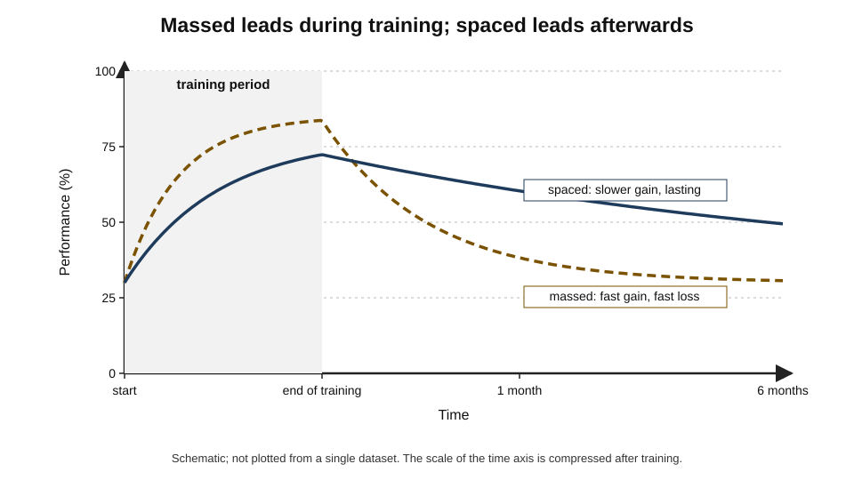
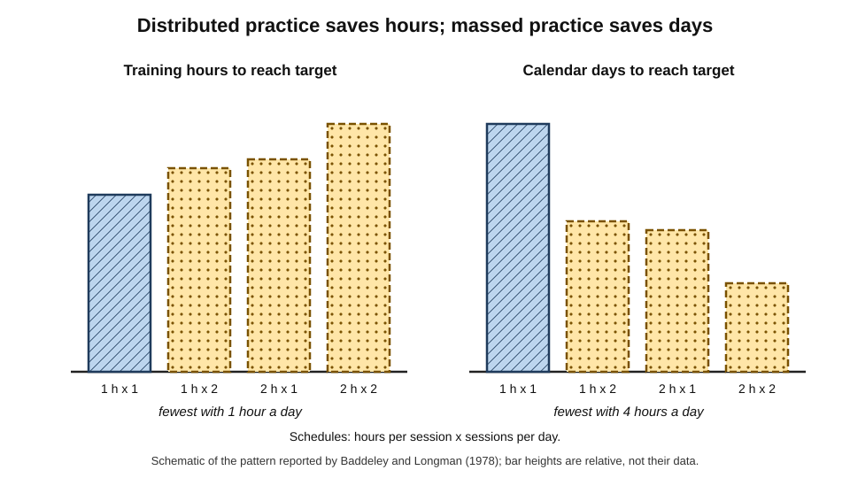
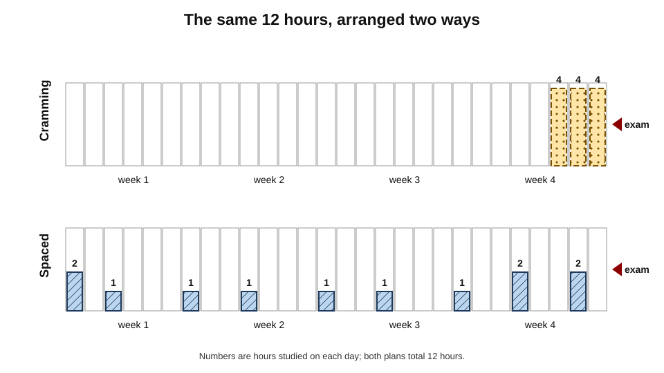
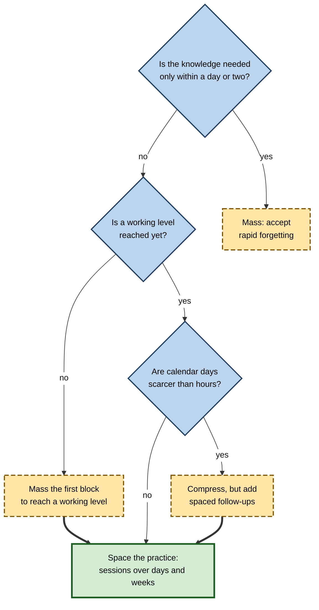
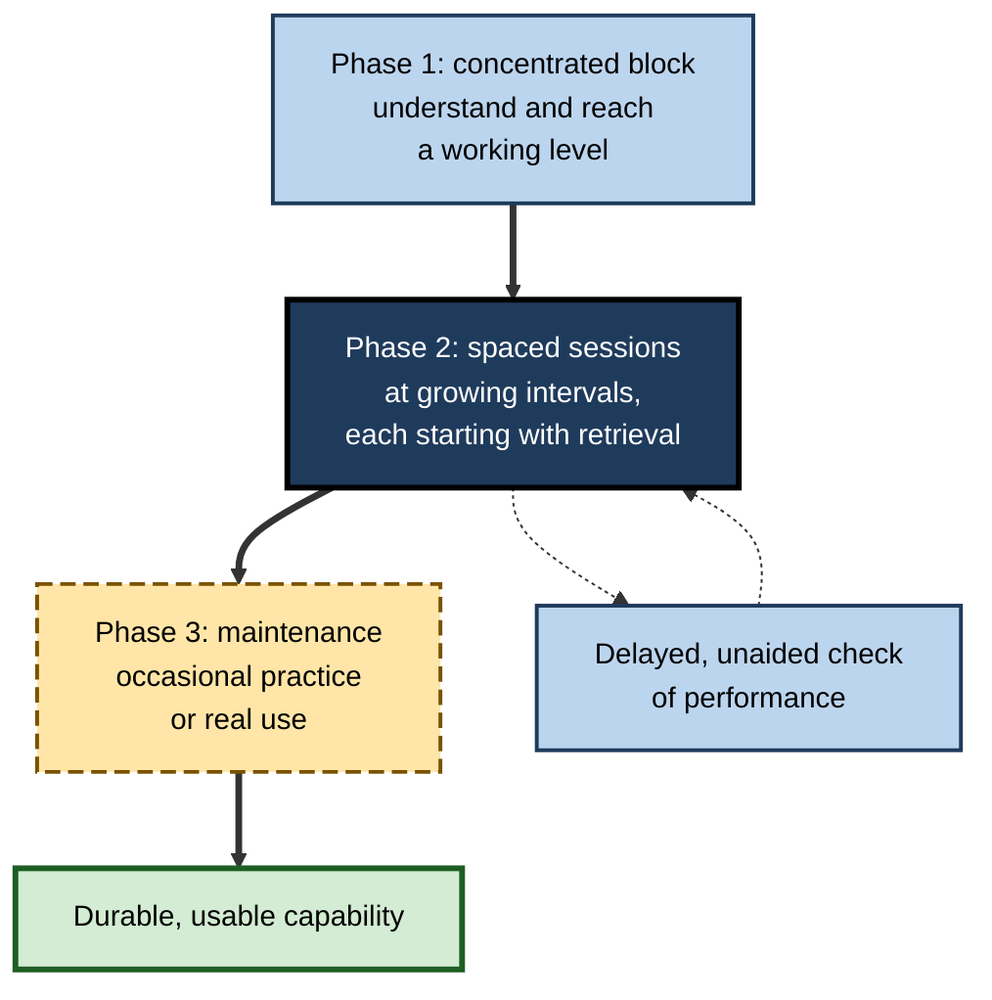

# D.4. Spaced Practice vs. Massed Practice

A surgical trainee can learn to tie microvascular sutures in one intensive day or in four weekly sessions. A sales team can attend a two-day product launch or six short sessions over a month. A student can revise for twelve hours across the three days before an exam or across four weeks. In each pair the hours are the same; the arrangement is different — and so is what remains a month later.

> **Definition — Massed practice:** concentrating practice of a skill or material into one continuous session or a short burst of closely packed sessions, with little time between repetitions.

> **Definition — Spaced (distributed) practice:** dividing the same amount of practice into separate sessions with gaps between them, so that each skill or item is returned to after time has passed.

**Why it matters**

- The choice between massing and spacing is made, explicitly or not, in **every** study plan, course timetable, training programme and onboarding schedule.
- It is a choice between **two kinds of success**: massing optimises performance now; spacing optimises retention and use later.
- Massing dominates real practice — cramming, bootcamps, one-day workshops, annual refreshers — because it is convenient and feels effective.
- Knowing **when massing is acceptable** is as important as knowing that spacing is usually better.

---

## Two Ways to Spend the Same Time

### Everyday and workplace forms

| | Massed form | Spaced form |
|---|---|---|
| Student revision | All-night cram before the exam | Short sessions across weeks |
| Language learning | Intensive weekend course | Twenty minutes a day |
| Software onboarding | Five-day bootcamp | Two days, then weekly sessions over two months |
| Sales training | Two-day launch event | Kick-off plus short follow-ups over a quarter |
| Surgical or technical skill | One full day on the simulator | Weekly simulator sessions |
| Compliance | Annual two-hour course | Short course plus brief quarterly scenarios |

### What massing feels like and what it does

- **During:** smooth progress, rising fluency, high confidence, a sense of completion.
- **Immediately after:** high scores on end-of-session tests.
- **Weeks later:** steep loss of detail; skills need re-teaching; confidence outstrips competence.

### What spacing feels like and what it does

- **During:** each session begins with partial forgetting; early minutes feel clumsy.
- **Immediately after:** scores similar to or slightly below massed groups.
- **Weeks later:** much greater retention; skills used with less help.

**Figure 1.** Performance during and after massed and spaced training.

> **Key point:** massed and spaced practice are not competing methods for the same outcome. Massing buys **short-term performance**; spacing buys **long-term retention**. The choice should follow the goal.

---

## The Evidence Across Domains

### Verbal and factual learning

- The best-studied domain: word lists, vocabulary, facts, definitions.
- Spaced presentations beat massed ones in the large majority of hundreds of comparisons, with advantages growing as the delay to the test increases.

**Study card — Haley Sobel, Nicholas Cepeda and Irina Kapler (2011)**

- **Design:** primary-school pupils learned the meanings of unfamiliar English words, either in two lessons on the same day (massed) or in two lessons a week apart (spaced); they were tested five weeks later.
- **Results:** pupils recalled substantially more definitions after spaced lessons.
- **Conclusion:** the spacing advantage holds in real classrooms with ordinary lessons, not only in laboratories.

**Study card — Shana Carpenter, Harold Pashler and Nicholas Cepeda (2009)**

- **Design:** secondary-school pupils studying United States history received a review of course facts either one week or sixteen weeks after their lessons; the final test came nine months later.
- **Results:** the later review produced better retention at nine months.
- **Conclusion:** for long-term goals, a review long after initial learning beats a review soon after — even in a normal school course.

### Mathematics

**Study card — Doug Rohrer and Kelli Taylor (2006)**

- **Design:** university students learned to solve a type of combinatorics problem. One group did all practice problems in one session; another split the same problems across two sessions a week apart. A further comparison doubled the number of problems in a single session (overlearning).
- **Results:**
  - spaced practice produced clearly better scores four weeks later;
  - doubling the problems in one session gave **no** lasting benefit.
- **Conclusion:** distributing a fixed number of problems across sessions is more effective than doing more problems at once.

- **Textbook practice:** most mathematics textbooks place all problems on a topic directly after the lesson, which is massed practice; **spaced problem sets** that mix in earlier topics are a practical alternative.
- **Recent synthesis:** a 2025 meta-analysis of mathematics learning found a robust but small-to-medium spacing benefit, larger in controlled studies than in course-embedded ones.

### Motor and perceptual-motor skills

**Study card — Alan Baddeley and D. J. A. Longman (1978)**

- **Design:** British postal workers learned to use a new keyboard for entering postcodes. The schedules were 1 hour once a day, 1 hour twice a day, 2 hours once a day, or 2 hours twice a day.
- **Results:**
  - the **one-hour-a-day** group reached the target in the **fewest training hours** and retained the skill well;
  - the most intensive groups needed **more hours** but reached the target in **fewer calendar days**;
  - the workers' own preferences did not match the most efficient schedule.
- **Conclusion:** distributed practice is more **efficient per hour**; massed practice is faster **per calendar day**. Organisations must decide which resource is scarcer.

**Figure 2.** Distributed practice saves training hours; massed practice saves calendar days.

- **Timothy Lee and Elizabeth Genovese (1988)** — a review of motor-learning studies concluded that distributing practice benefits both performance and learning of **continuous** tasks such as tracking.
- **Discrete tasks** (a single throw, a short keystroke sequence) show smaller or inconsistent effects of within-session rest; here the important distinction is between-session spacing.

> **Watch out:** motor-learning research often manipulates **rest between trials within a session** (work–rest ratio), which partly reflects fatigue. That is different from spacing **sessions** over days. Findings about one should not be applied automatically to the other.

### Surgery and clinical skills

**Study card — Carol-Anne Moulton and colleagues (2006)**

- **Design:** surgical residents learned microvascular anastomosis (joining tiny blood vessels) on a simulator in four sessions, either all in one day (massed) or once a week for four weeks (spaced).
- **Results:** a month later the spaced group performed better on retention tests and on a live transfer test, judged by expert raters.
- **Conclusion:** even for complex manual skills in demanding professions, weekly sessions outperform a single intensive day.

- **Resuscitation and emergency skills** — short, frequent practice sessions maintain performance better than infrequent long courses; several health systems have adopted brief, regular refreshers.

### Workplace and organisational training

- **John Donovan and David Radosevich (1999)**, in a meta-analysis of 63 studies, found a moderate overall advantage for spaced practice, **smaller for complex tasks**.
- **Corporate bootcamps** — intensive programmes deliver high end-of-course scores but often show steep decay unless followed by spaced practice on the job.
- **Microlearning and reinforcement platforms** are commercial applications of spacing; their effectiveness depends on whether they require retrieval and are well timed.

| Domain | Typical massed format | Evidence for spacing | Strength of evidence |
|---|---|---|---|
| Vocabulary and facts | Cramming lists | Large, consistent advantage at delays | Very strong |
| School subjects | Topic blocks with immediate tests | Consistent advantage in classroom studies | Strong |
| Mathematics problems | All problems after the lesson | Robust, smaller in real courses | Moderate to strong |
| Continuous motor skills | Long unbroken practice | Better performance and learning | Strong |
| Complex procedural skills | Single intensive day | Better retention and transfer in trials | Moderate |
| Workplace programmes | Bootcamps, one-day workshops | Smaller but positive effects | Moderate |

---

## Why Massing Remains So Popular

- **Convenience** — one block is easier to schedule than many.
- **Calendar speed** — massing reaches a working level in fewer days, valuable when a deadline is near.
- **Fluency illusion** — massed practice feels effective; spaced practice feels effortful and slow.
- **Completion** — a topic "done" in one sitting gives a satisfying sense of progress.
- **Logistics** — travel, venues, trainers and time zones push organisations towards concentrated events.
- **Measurement** — end-of-course quizzes and satisfaction scores, taken at the peak of massed fluency, make massing look better than it is.
- **Procrastination** — for students, cramming is often not a strategy but the result of delay.

> **Watch out:** "I always cram and I do fine in exams" may be true for an exam the next morning. The cost appears later — in the next course that builds on the material, or in professional use — and is rarely traced back to the cramming.

### Cramming specifically

> **Definition — Cramming:** intensive study concentrated immediately before a test, typically after little earlier study.

- **What it achieves:** high retrieval strength for a short period — often enough for a test within a day.
- **What it costs:**
  - rapid forgetting afterwards;
  - often **sleep loss**, which impairs both encoding and test performance;
  - anxiety and fatigue during the exam;
  - poor foundations for later courses.
- **What evidence shows:** students who spread study over the term generally retain more and perform as well or better on final exams, especially cumulative ones.

**Figure 3.** The same twelve hours arranged as cramming and as spaced study. (illustrative)

---

## When Massing Is the Right Choice

Massing is not always wrong. Several situations justify it.

### Legitimate uses of massed practice

- **The goal is immediate** — a presentation tomorrow, a one-off exam whose content will never be needed again, a negotiation this afternoon.
- **Initial acquisition of a complex skill** — reaching a minimum working level may require an unbroken block, so the learner has enough to retain.
- **Immersion** — intensive exposure creates a rich context and builds momentum, especially in languages; it works best **followed by** spaced practice.
- **Deep work on a single problem** — writing, design, analysis and research need long uninterrupted periods; these are not repetitions of the same material and are not what the spacing effect concerns.
- **Calendar constraints** — when days are scarcer than hours, as in Baddeley and Longman's study.

**Figure 4.** Deciding between massed and spaced practice.

### The hybrid: mass to learn, space to keep

- **Phase 1 — concentrated acquisition:** a focused block to understand the material and reach a basic level of performance.
- **Phase 2 — spaced consolidation:** short sessions at growing intervals, each requiring retrieval and application.
- **Phase 3 — maintenance:** occasional practice or use at long intervals.

**Figure 5.** The hybrid design: mass the start, space the rest.

> **Key point:** the most effective real-world designs are rarely pure. They **mass the beginning** to build a foundation and **space everything after** to keep it.

> **Example (illustrative):** an intensive two-week language course followed by daily twenty-minute practice for six months retains far more than either the course alone or daily practice without the initial momentum.

---

## Spacing Within and Between Sessions

### Within a session

- **Distribute repetitions** of each item across the session rather than repeating it immediately.
- **Large flashcard stacks** create longer within-session gaps than small stacks.
- **Mixed practice sets** revisit earlier problem types between new ones.

### Between sessions

- **Overnight gaps** — sleep supports consolidation; a nightly gap is particularly valuable for both facts and skills.
- **Weekly gaps** — suit course structures and skill practice.
- **Monthly gaps** — maintain established knowledge.

### Session length

- **Too short:** fixed set-up costs dominate; nothing substantial gets done.
- **Too long:** fatigue and diminishing attention; within-session repetitions become massed.
- **Practical ranges:** 20–60 minutes for focused retrieval or skill practice; longer only for deep, non-repetitive work.

> **Remember:** spacing applies to **repetitions of the same material**. A four-hour writing session is not "massed practice" in the problematic sense; four hours rereading the same chapter is.

---

## Designing Spaced Programmes

### Worked example (illustrative): redesigning a five-day analytics bootcamp

A consulting firm runs a five-day data-analytics bootcamp for new joiners. Six weeks later, project managers report that joiners cannot write basic queries unaided.

1. **Identify the goal:** joiners must perform core analyses unaided **on projects**, starting in week 3 and continuing for years.
2. **Keep a concentrated start:** reduce the bootcamp to three days — enough to understand concepts and reach a working level.
3. **Add spaced sessions:** six 90-minute sessions at weeks 1, 2, 3, 5, 8 and 12, each starting with unaided problems on earlier material before new content.
4. **Use real work as spacing:** require one analytic task on a live project between sessions.
5. **Measure later:** an unaided practical test at week 12, not a quiz on day 5.

| | Original bootcamp | Redesigned programme |
|---|---|---|
| Total instruction | 5 days (40 hours) | 3 days + 9 hours = 33 hours |
| End-of-bootcamp quiz | High | Slightly lower |
| Unaided performance at week 6 | Weak; frequent requests for help | Good on core tasks |
| Unaided test at week 12 | Not measured | Most pass |
| Cost | Five days away from projects | Fewer total hours; more coordination |

*Illustrative figures.*

- **Conclusion:** fewer total hours, distributed, produced more usable capability — at the cost of scheduling effort.

> **Watch out:** spaced sessions that merely re-present slides gain little. Each session must start with **effortful retrieval or practice** of earlier material.

### Case study (illustrative): a hospital's resuscitation training

- **Situation:** nurses on medical wards completed a full-day resuscitation course every two years.
- **Problem:** in simulated emergencies a few months after the course, compression quality and sequence errors were common, and confidence was low.
- **Diagnosis:**
  1. a massed day followed by up to two years without practice;
  2. resuscitation is rare on most wards, so natural practice was minimal;
  3. psychomotor quality (depth, rate) decays quickly without feedback.
- **Actions:**
  1. kept a shorter initial course;
  2. installed a manikin with real-time feedback on each ward;
  3. asked each nurse to complete a few minutes of practice every month, logged by the manikin;
  4. ran brief team simulations quarterly.
- **Result:** compression quality in unannounced simulations remained high across the year; nurses reported greater confidence; total time per nurse rose only modestly.
- **Side effects:** monthly practice slipped during staffing shortages; ward leaders had to protect the time.
- **Lesson:** for rare, high-stakes skills, **frequent short practice** beats rare long courses — and needs organisational protection to survive busy periods.

### Organisational barriers and remedies

- **Barrier:** travel and venue costs favour events. **Remedy:** a short in-person start with remote spaced sessions.
- **Barrier:** managers see follow-ups as time away from work. **Remedy:** link sessions to real tasks and report delayed outcomes.
- **Barrier:** learners skip later sessions. **Remedy:** short sessions, fixed calendar slots, visible progress, manager involvement.
- **Barrier:** evaluation measures only the event. **Remedy:** a delayed, unaided measure as the main success criterion.

| | Massed design | Spaced design |
|---|---|---|
| Calendar time to working level | Short | Longer |
| Hours to working level | Often more | Often fewer |
| End-of-training scores | High | Moderate to high |
| Delayed retention | Low | High |
| Satisfaction | High | Moderate; "harder" |
| Coordination cost | Low | Higher |
| Best when | Immediate need, short horizon | Knowledge needed for months or years |

---

## Spacing, Massing and Technology

- **Software removes the scheduling burden** for individuals: spaced-repetition and reinforcement tools present items at the right gaps automatically.
- **Learning platforms** can deliver spaced follow-ups after events at little cost.
- **AI assistants** can generate retrieval questions on earlier material for each session, making spaced sessions easier to prepare.
- **Risk:** on-demand tools encourage **just-in-time massing** — looking things up and learning them minutes before use, then forgetting. For knowledge needed repeatedly, this is the cramming pattern in a new form.

---

## Why Massed Practice Underperforms

The general explanations of the spacing effect take a particular form when applied to practice schedules for skills and training programmes.

### Attention and effort decline within a block

- **Deficient processing:** in a long block, the third and fourth repetition of the same move, rule or fact receives less attention than the first; learners slip into going through the motions.
- **Repetition suppression:** brain responses to an immediately repeated stimulus are reduced — the repeat is processed less fully.
- **Fatigue:** in motor and vigilance tasks, a long block degrades performance and can mask what has been learned; part of the apparent benefit of distribution in motor studies is simply recovery from fatigue.

### Consolidation happens between sessions

- **Offline gains:** for some motor skills, performance **improves** between sessions without further practice, especially across sleep.

**Study card — Matthew Walker, Tiffany Brakefield, Alexandra Morgan, J. Allan Hobson and Robert Stickgold (2002)**

- **Design:** participants learned a finger-tapping sequence on a keyboard and were retested after a period of wakefulness or after a night's sleep.
- **Results:** speed improved substantially after a night of sleep (by roughly a fifth in their data), with no comparable improvement after the same time awake.
- **Conclusion:** motor-skill memories continue to develop **offline**, particularly during sleep; massing practice into one day forgoes these between-session gains.

> **Definition — Offline gains:** improvements in skill that appear between practice sessions without further practice, often linked to sleep-dependent consolidation.

### Variety of context across sessions

- **Encoding variability:** sessions on different days occur in different moods, places and mental states, so the skill is linked to more cues and transfers more easily to new situations.
- **Retrieval at the start of each session:** a spaced session begins by recovering a partly forgotten skill — effortful reactivation that strengthens it; a massed block never requires this.

> **Key point:** massing loses on three fronts at once — **less effortful processing** within the block, **no consolidation** between repetitions and **less contextual variety**. Spacing gains on all three for the same hours.

---

## Individual and Task Differences

- **Novices versus experienced learners**
  - Novices may need a concentrated first exposure to build a working model of the task; once that exists, spacing helps them as much as anyone.
  - Experienced practitioners can often tolerate longer gaps because new details attach to existing knowledge.
- **Task complexity and interdependence**
  - Long, interdependent tasks (a full audit, a complex surgical procedure) lose context if broken too finely; sessions must be long enough to complete meaningful units.
  - Simple, separable components (facts, short drills) can be spaced very finely.
- **Motivation and self-regulation**
  - Spaced plans require starting early; learners prone to procrastination benefit most from **external** structure — scheduled sessions, deadlines for intermediate milestones.
- **Time of day and energy**
  - Sessions placed at times of reasonable alertness work better; spacing across days makes it easier to avoid fatigued sessions.
- **Health and sleep**
  - Learners with disrupted sleep (shift workers, new parents) lose some of the consolidation benefit; even so, spaced practice remains better than massed for them.

---

## Spaced Training in Enterprises

### Where organisations apply it

- **Compliance refreshers** — anti-money-laundering, data protection, health and safety: short scenario questions spread through the year instead of one annual module.
- **Product and sales enablement** — launch training followed by spaced questions and practice calls.
- **Onboarding** — a short induction followed by scheduled check-ins and practice over the first months.
- **Safety-critical skills** — brief, frequent simulation or manikin practice in healthcare, aviation and energy.
- **Leadership programmes** — monthly sessions with application to real cases between them, rather than a single residential week.

### Microlearning and reinforcement platforms

- **What they do:** deliver short questions or tasks on phones at scheduled intervals, adapt to answers, and report results to learning teams.
- **What the evidence supports:** the **principles** they implement — spacing, retrieval, feedback — are well supported; randomised trials of spaced question programmes in medical education found better retention than conventional delivery.
- **What remains uncertain:** many vendor claims of large performance improvements come from internal case studies without comparison groups.

> **Watch out:** "microlearning" is not a learning mechanism. Short content delivered at intervals helps only if it requires **retrieval** and **application** and is spaced sensibly; short videos watched once are simply massed content in smaller pieces.

### Worked example (illustrative): the cost of a massed event versus a spaced programme

A company must train 500 staff on a new data-protection procedure. Staff time is valued at £40 an hour.

| | Massed event | Spaced programme |
|---|---|---|
| Design | One 8-hour workshop | 4-hour workshop plus 12 five-minute spaced scenarios over 6 months |
| Staff hours per person | 8 | 4 + 1 = 5 |
| Staff-time cost (500 people) | 500 × 8 × £40 = £160,000 | 500 × 5 × £40 = £100,000 |
| Retention at six months | Low; refresher needed | Higher; no full refresher |
| Additional platform cost | None | Licence and question writing |

*Illustrative figures.*

1. **Direct saving:** 3 hours per person, £60,000 in staff time, before platform costs.
2. **Indirect saving:** fewer errors and no need for a full refresher course after six months.
3. **Decision rule:** the spaced programme is cheaper whenever platform and question-writing costs are below the staff-time saved — which is common for large audiences.

> **In practice:** the strongest business case for spacing is often not "better learning" but **fewer hours away from work for the same or better outcome** — a framing finance and operations leaders readily accept.

### Evaluating spaced programmes properly

- **Delayed measures** — test at the time of real use (three to six months), not at the end of the event.
- **Comparison groups** — the previous cohort, a staggered roll-out, or random assignment by team.
- **Behavioural outcomes** — audit findings, error rates, customer escalations, observed performance.
- **Participation data** — completion of spaced activities, read alongside outcomes rather than as a success measure in itself.

---

## Open Questions

- **How large is the spacing advantage for complex, integrated professional skills?**
  - Trials in surgery are encouraging, but evidence for complex judgement and multi-step professional tasks is limited.
- **What is the ideal balance between an initial massed block and later spacing?**
  - Hybrid designs are widely recommended, but the right length of the first block is rarely tested.
- **Why do learners keep choosing massing even after experiencing spacing's benefits?**
  - Explanations include fluency, convenience and procrastination; interventions that change behaviour durably are not well established.
- **How should organisations value calendar time against training hours?**
  - Baddeley and Longman's trade-off is real, but few organisations measure both.
- **Does just-in-time learning with AI reduce long-term competence?**
  - The question is new; evidence on repeated on-demand lookup versus spaced retention is only beginning to appear.

---

## Summary

- **Massed practice** concentrates repetitions; **spaced practice** spreads the same amount over separate sessions.
- Massing produces **better performance during and just after** practice; spacing produces **better retention and transfer** later — the lines cross.
- Evidence spans **vocabulary and facts** (Sobel and colleagues; Carpenter and colleagues), **mathematics** (Rohrer and Taylor), **motor skills** (Baddeley and Longman; Lee and Genovese), **surgery** (Moulton and colleagues) and **workplace training** (Donovan and Radosevich).
- **Baddeley and Longman** showed that distributed practice saves **training hours** while massed practice saves **calendar days**.
- Massing persists because of convenience, fluency, completion, logistics and end-of-event measurement; **cramming** buys short-term recall at a high long-term cost.
- Massing is justified for **immediate goals**, for **initial acquisition** of complex skills, for **immersion** followed by spacing, and when **days are scarcer than hours**.
- The best designs are **hybrid**: mass the start, space the rest, maintain at long intervals.
- Spaced sessions must require **retrieval or practice**, not re-presentation, and must be judged by **delayed** measures.

---

## Self-Check

1. Define massed and spaced practice and give a workplace example of each.
2. Describe the typical pattern of performance during and after massed versus spaced training.
3. Summarise the Rohrer and Taylor (2006) findings and what they show about overlearning.
4. What trade-off did Baddeley and Longman (1978) reveal, and when would an organisation prefer each side?
5. Why should within-session rest findings in motor learning not be applied automatically to multi-day schedules?
6. Describe the Moulton and colleagues (2006) surgical study and its significance.
7. List four reasons massing remains popular despite the evidence.
8. When is cramming a rational choice, and what does it cost?
9. Describe the hybrid "mass to learn, space to keep" model with an example.
10. Why is a long writing session not "massed practice" in the problematic sense?
11. A training manager reports that a two-day workshop received top satisfaction scores and a 95% quiz average. What would you ask before calling it a success?
12. Redesign a three-day annual leadership workshop for managers who must use the skills all year.
13. Why does a spaced session that only re-presents slides gain little from spacing?
14. How might on-demand AI tools encourage a new form of massed learning?
15. Explain three reasons, drawn from different accounts of the spacing effect, why a single long practice block underperforms the same hours spread across days.
16. A firm can either run a 6-hour workshop for 1,000 staff or a 3-hour workshop plus eight 5-minute spaced scenarios. At £50 per staff hour, what is the staff-time saving, and what else must be considered?

### Answer Key

1. Massed: a two-day product launch for a sales team. Spaced: a kick-off followed by short sessions over a quarter. Massed concentrates repetitions; spaced spreads them with gaps.
2. Massed groups improve faster and score higher at the end of training; afterwards they decline faster, so spaced groups overtake them and lead at delayed tests.
3. Splitting the same problems across two sessions a week apart gave clearly better scores four weeks later; doubling the problems in one session gave no lasting benefit — overlearning in one session is inefficient.
4. Distributed practice reached the target in fewer training hours; massed practice in fewer calendar days. Prefer distributed when staff time is the constraint and there is no urgent deadline; prefer compressed schedules when a skill is needed by a fixed near date.
5. Within-session rest manipulations mostly affect fatigue and performance during practice, while multi-day spacing affects consolidation and retrieval across sessions — different mechanisms.
6. Residents practised microvascular anastomosis either in one day or weekly over four weeks. The weekly group performed better a month later, including on a live transfer task — spacing benefits even complex surgical skills.
7. Convenience; fewer calendar days; fluency feels like learning; satisfaction of completion; logistics of events; end-of-course measurement; procrastination.
8. When the knowledge is needed only for an imminent test and never again. It costs rapid forgetting, sleep loss, anxiety and weak foundations for later learning.
9. A concentrated block to reach a working level, then spaced sessions at growing intervals, then maintenance. Example: an intensive language fortnight followed by daily short practice.
10. Writing is not repetition of the same material; it is extended work on a single problem. The spacing effect concerns repeated study of the same content.
11. When and how the quiz was taken (immediate, open-book, recognition?); whether there is any delayed, unaided measure; whether behaviour on the job changed; whether there was a baseline or comparison group.
12. A shorter initial workshop (one or two days), then monthly 60–90-minute sessions in which managers recall and practise skills on current cases, with peer observation, plus a delayed assessment (e.g. observed one-to-one at three and nine months).
13. Spacing benefits come largely from effortful re-access of partly forgotten material. Re-presentation allows recognition without retrieval, so little of that effort occurs.
14. Learners look up and absorb information minutes before using it, then forget it — repeated just-in-time exposure is massed each time, so knowledge never accumulates in memory.
15. Attention and effort decline within a long block (deficient processing and fatigue); consolidation, including offline gains during sleep, occurs only between sessions; and sessions on different days add contextual variety and require effortful reactivation at the start of each session, improving retention and transfer.
16. Massed: 1,000 × 6 × £50 = £300,000. Spaced: 3 hours + 40 minutes ≈ 3.67 hours → about £183,000. Saving ≈ £117,000 in staff time. Also consider platform and question-writing costs, coordination effort, participation rates and whether the delayed outcomes actually improve.

---

## Glossary

| Term | Meaning |
|---|---|
| Bootcamp | An intensive, concentrated training programme over several days or weeks. |
| Compliance refresher | Periodic training to maintain knowledge of rules and procedures. |
| Continuous task | A motor task without a clear beginning and end, such as tracking. |
| Cramming | Intensive study concentrated immediately before a test. |
| Discrete task | A motor task with a clear beginning and end, such as a throw. |
| Hybrid design | A programme that concentrates initial learning and spaces later practice. |
| Immersion | Intensive, continuous exposure to a subject or language. |
| Massed practice | Practice concentrated into one session or closely packed sessions. |
| Microlearning | Short learning units, often delivered at intervals. |
| Offline gains | Skill improvements that appear between sessions without further practice. |
| Overlearning | Continued practice beyond first mastery, usually within the same session. |
| Reinforcement | Spaced follow-up activity after training to maintain knowledge. |
| Repetition suppression | Reduced neural response to an immediately repeated stimulus. |
| Spaced practice | Practice divided into separate sessions with gaps between them. |
| Work–rest ratio | The proportion of practice to rest within a session in motor learning. |
