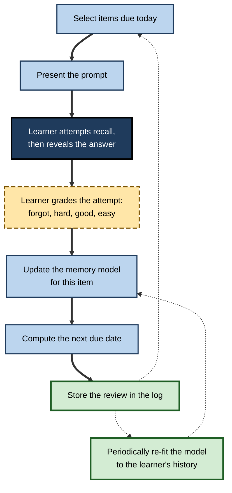
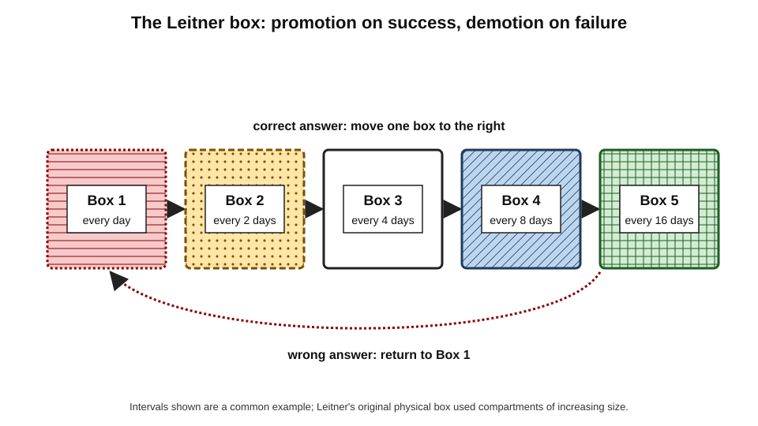
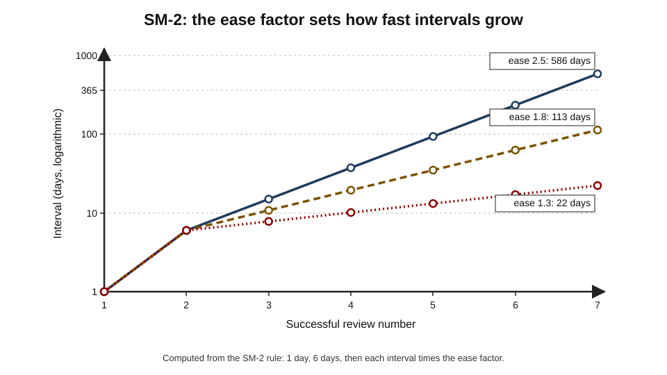
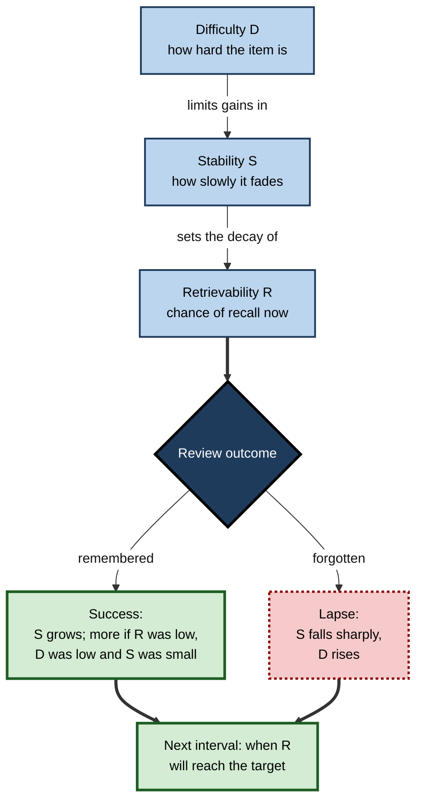
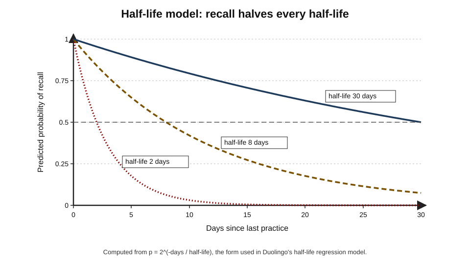
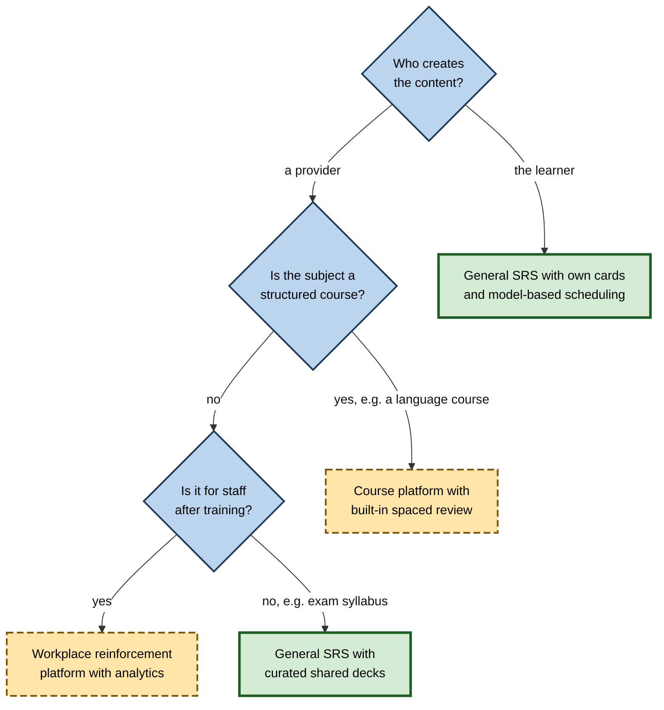

# D.5. Spaced Repetition Software (SRS)

A medical student holds 20,000 facts in a phone application and spends about an hour a day reviewing the few hundred that are due. A language learner opens an app for ten minutes on the train; the words it shows are the ones it predicts she is about to forget. Neither learner decides what to review or when. The decision is made by an algorithm that models each memory and schedules it against its forgetting curve — something no human could do by hand for thousands of items.

> **Definition — Spaced repetition software (SRS):** a computer program that presents items for retrieval at intervals chosen by a scheduling algorithm, lengthening the interval after successful recall and shortening it after failure, so that each item is reviewed shortly before it would be forgotten.

**Why it matters**

- It solves the **bookkeeping problem** that defeats manual spacing: tracking when each of thousands of items is due.
- It combines two of the most robust findings in learning research — **spacing** and **retrieval** — in a daily routine.
- It has become standard infrastructure in medicine, languages, law, technology and professional certification.
- Its algorithms are among the most heavily data-driven models of human memory ever built, trained on hundreds of millions of reviews.
- Choosing and configuring an SRS well — and understanding what its algorithm assumes — separates sustainable long-term use from abandoned decks.

---

## How Every SRS Works

### The core loop

**Figure 1.** The scheduling loop at the heart of every spaced-repetition system.

- **Items** — a prompt and an answer; in many systems generated from richer "notes".
- **Queue** — items due today, new items to introduce, and items in short-term learning.
- **Grading** — the learner's judgement of recall, usually on a 2- to 6-point scale.
- **Memory model** — the algorithm's estimate of each item's state.
- **Scheduler** — the rule that turns the model's estimate into a due date.
- **Review log** — the history of every review, which modern systems use to personalise the model.

> **Key point:** every SRS is a **model of forgetting plus a scheduling rule**. Systems differ mainly in how sophisticated the model is and how much it learns from the individual.

### What the learner contributes

- **Honest recall** — attempting the answer before revealing it.
- **Honest grading** — marking failures as failures.
- **Good items** — clear, single-answer prompts on understood material.
- **Daily consistency** — the schedule works only if due items are actually reviewed.

> **Watch out:** an algorithm cannot compensate for dishonest grading. Pressing "good" on a half-remembered answer tells the model the memory is stronger than it is; intervals grow too fast and the item is forgotten.

---

## Before Software: Manual Systems

### Graduated-interval recall

- **Paul Pimsleur (1967)** proposed reviewing language items at intervals each roughly five times longer than the last — seconds, minutes, hours, days, months, years.
- The idea became the basis of a widely used audio language course.
- **Limitation:** fixed intervals ignore how well each item is actually known.

### The Leitner box

> **Definition — Leitner system:** a manual spaced-repetition method in which flashcards move through a series of boxes reviewed at increasing intervals; correct cards advance a box, incorrect cards return to the first.

- **Sebastian Leitner**, a German science journalist, described the method in *So lernt man lernen* (*How to Learn to Learn*, 1972).
- **Procedure:**
  1. all new cards start in box 1, reviewed daily;
  2. a correctly answered card moves to the next box, reviewed less often;
  3. a missed card returns to box 1;
  4. cards in the last box are considered learned or reviewed very rarely.
- **Strengths:** simple, physical, adaptive at the level of the individual card.
- **Weaknesses:** coarse intervals; the harsh "back to box 1" rule wastes work on items that were nearly remembered; review of high boxes is easily neglected.

**Figure 2.** The Leitner box.

> **Example (illustrative):** a law student with 400 cards in five boxes reviews box 1 daily, box 2 every two days and so on; a case name missed once returns to box 1 even if it had reached box 4.

---

## The SuperMemo Lineage

### Piotr Woźniak and SM-2

- **Piotr Woźniak**, a Polish student of molecular biology, began measuring his own forgetting of English vocabulary in the mid-1980s and derived interval rules from his data.
- **SM-2 (1987)** — the algorithm in the first SuperMemo program — became the most widely copied scheduling rule in history; it was later adopted, with modifications, by Anki, Mnemosyne and many other applications.

> **Definition — Ease factor (E-factor):** in SM-2, a number attached to each item that multiplies its interval after each successful review; easy items have larger ease factors.

**The SM-2 rule**

1. Grade each recall from 0 (complete blackout) to 5 (perfect).
2. If the grade is below 3, restart the item's repetitions (interval 1 day), keeping its ease factor.
3. Otherwise:
   - first interval = 1 day;
   - second interval = 6 days;
   - each later interval = previous interval × ease factor.
4. Update the ease factor after each review: easy recalls raise it, hard recalls lower it, with a floor of 1.3; new items start at 2.5.

> **Formula — SM-2 ease update:** EF′ = EF + (0.1 − (5 − q) × (0.08 + (5 − q) × 0.02)), with q the grade. Example: q = 5 → EF rises by **0.10**; q = 4 → **no change**; q = 3 → EF falls by **0.14**.

**Worked example (illustrative) — one item under SM-2**

| Review | Grade | Ease factor after | Next interval |
|---|---|---|---|
| 1 | 4 | 2.50 | 1 day |
| 2 | 4 | 2.50 | 6 days |
| 3 | 5 | 2.60 | 6 × 2.6 ≈ 16 days |
| 4 | 3 | 2.46 | 16 × 2.46 ≈ 39 days |
| 5 | 4 | 2.46 | 39 × 2.46 ≈ 96 days |

*Illustrative figures.*

- After five reviews spanning about two months, the next review is about three months away.

**Figure 3.** How the ease factor determines interval growth under SM-2.

### Weaknesses of SM-2

- **Fixed formula** — the same rule for every learner and every kind of material.
- **No explicit forgetting curve** — it does not estimate recall probability, so it cannot target a chosen retention level.
- **Ignores timing** — a review done late (after a holiday) is treated much like one done on time, though late success shows a stronger memory.
- **"Ease hell"** — in implementations that lower ease after hard or failed reviews, items that were once difficult can be stuck at the 1.3 floor and reviewed far too often even after they become easy.

> **Definition — Ease hell:** a state in SM-2-based systems in which repeated lapses drive an item's ease factor to its minimum, so its intervals grow very slowly and it is over-reviewed long after it has been learned.

### Later SuperMemo algorithms

- **SM-4 to SM-8 (late 1980s–1990s)** — replaced fixed formulas with matrices of optimal intervals that adapted to the learner's data.
- **The two-component model (1995)** — Woźniak, Gorzelańczyk and Murakowski proposed describing memory by **retrievability** (current recall probability) and **stability** (how slowly retrievability falls).
- **SM-17 (2016) and SM-18 (2019)** — algorithms built directly on stability, retrievability and item difficulty, fitted to the user's history.
- **Influence:** the two-component model became the conceptual basis of most modern open algorithms.

---

## Anki and the Open Ecosystem

### The rise of Anki

- **Anki** — released in 2006 by Damien Elmes; free and open-source on desktop and Android, with a paid iOS application funding development.
- **Design choices that made it dominant:**
  - **notes and templates** — one note can generate several cards (for example, both directions of a vocabulary pair);
  - **shared decks** — learners exchange decks, some refined by thousands of users;
  - **add-ons** — community extensions;
  - **synchronisation** across devices.
- **Scheduler history:**
  - originally a modified SM-2 with four answer buttons and short "learning steps" for new cards;
  - from version 23.10 (2023), an optional modern scheduler, **FSRS**, built into the program;
  - later versions adopted newer FSRS releases, including FSRS-6 from version 25.07 (2025).

### Other applications

- **Mnemosyne** — an early open-source SRS that also collected anonymised review data for research.
- **SuperMemo** — the commercial descendant of Woźniak's original program, with incremental reading of long texts.
- **Language platforms** — Duolingo, Memrise, WaniKani (for Japanese characters) and others use spaced scheduling inside broader courses.
- **General study tools** — Quizlet and similar products offer learning modes with some spacing, often less rigorous.
- **Note-taking integrations** — plugins for knowledge-management tools turn notes into spaced prompts.
- **Workplace reinforcement platforms** — systems that send spaced scenario questions to employees after training.

| | Paper Leitner box | SM-2-based apps | Modern model-based schedulers |
|---|---|---|---|
| Model of memory | None explicit | Ease factor per item | Difficulty, stability, retrievability per item |
| Personalisation | By card performance only | By card performance only | Fitted to the learner's whole history |
| Targets a retention level | No | No | Yes |
| Handles late reviews well | No | Poorly | Yes |
| Effort to run | High for large decks | Low | Low |
| Typical weakness | Neglected high boxes | Ease hell, one rule for all | Needs enough review history to fit |

---

## Modern Model-Based Scheduling

### The DSR model

> **Definition — DSR model:** a model describing each memory by three variables — **difficulty** (how hard the item is to learn), **stability** (how slowly it is forgotten) and **retrievability** (the probability of recall now).

- **Retrievability** falls over time along a forgetting curve whose speed is set by stability.
- **Stability** grows after each successful review; how much it grows depends on:
  - **difficulty** — harder items gain less;
  - **current stability** — already stable memories gain proportionally less;
  - **retrievability at review** — the lower recall had fallen (while still succeeding), the larger the gain.
- **A lapse** (failure) reduces stability sharply, though usually not to zero.
- **Difficulty** moves up after failures and down after easy successes, with a pull back towards a typical value.

**Figure 4.** The three variables of the DSR model and how a review updates them.

### FSRS

- **FSRS (Free Spaced Repetition Scheduler)** — an open-source algorithm developed by **Jarrett Ye** and collaborators, first described in academic work in 2022 based on data from a Chinese vocabulary application, then developed openly with the Anki community.
- **Model:** the DSR model with a **power-shaped** forgetting curve, calibrated so that retrievability equals 90% when elapsed time equals stability.
- **Parameters:** around twenty numbers (21 in FSRS-6) that set initial stabilities, difficulty dynamics and stability growth; default values come from large datasets, and each learner can **fit** them to their own review history.
- **FSRS-6 (2025):** made the steepness of the forgetting curve itself a fitted parameter and improved handling of same-day reviews.
- **Scheduling rule:** the learner chooses a **desired retention** (commonly 0.9); the next interval is the time at which predicted retrievability falls to that value.

> **Formula — FSRS forgetting curve (FSRS-4.5 and FSRS-5 form):** R = (1 + (19/81) × t/S)^(−0.5). Interval for desired retention r: t = S × (81/19) × (r^(−2) − 1). Example: S = 30 days, r = 0.9 → t = 30 × 4.263 × 0.2346 ≈ **30 days**; r = 0.85 → t = 30 × 4.263 × 0.384 ≈ **49 days**.

- **Benchmarks:** an open benchmark maintained by the FSRS developers, using review logs from thousands of volunteer users, reports that FSRS predicts recall considerably more accurately than SM-2 and lets users reach the same retention with fewer reviews.

> **Watch out:** most published comparisons of FSRS with older algorithms come from its own developers and community, measured as **prediction accuracy** on past review logs. Independent, controlled trials of long-term learning outcomes between algorithms are scarce. The improvement in prediction is well documented; the size of real-world savings varies by user.

### Half-life regression

**Study card — Burr Settles and Brendan Meeder (2016)**

- **Setting:** Duolingo, using about 13 million practice records from language learners.
- **Model:** each word's recall probability decays as p = 2^(−Δ/h), where Δ is the time since last practice and h the word's **half-life**, predicted from features such as past correct and incorrect answers and properties of the word.
- **Results:**
  - prediction error fell substantially (by more than 45% on their measures) compared with earlier baselines, including Leitner and Pimsleur schedules;
  - deployed in the product, it raised **daily engagement** by about 12% in an operational experiment.
- **Conclusion:** a simple, interpretable decay model fitted with machine learning to large data outperforms hand-set schedules.

> **Definition — Memory half-life:** the time over which an item's predicted probability of recall falls by half.

**Figure 5.** Predicted recall under the half-life model for three half-lives.

### Personalised review in classrooms

**Study card — Robert Lindsey, Jeff Shroyer, Harold Pashler and Michael Mozer (2014)**

- **Design:** a semester-long middle-school Spanish course; students reviewed vocabulary through software under three schedules: massed (current-unit only), generic spaced, and **personalised** spaced review driven by a model combining memory theory with data on each student and item.
- **Results:** on a cumulative test, personalised review improved retention by about **16.5%** over massed study and about **10%** over generic spacing.
- **Conclusion:** models that adapt to each learner and item improve on fixed spacing, even within a normal school course.

### Optimal control

- **Behzad Tabibian and colleagues (2019)** treated scheduling as an optimal-control problem — choosing review times to maximise recall for a given review budget — and tested it on language-learning data.
- **Broader point:** with an explicit forgetting model, scheduling becomes an **optimisation** of retention against effort, and simulators can show the review load each choice implies.

| | SM-2 | Half-life regression | FSRS |
|---|---|---|---|
| Era | 1987 | 2016 | 2022 onwards |
| Memory state per item | Ease factor, interval | Half-life | Difficulty, stability, retrievability |
| Forgetting curve | Implicit | Exponential (base 2) | Power-shaped, fitted |
| Learns from data | No | Yes, across users | Yes, per user |
| Targets a chosen retention | No | Indirectly | Yes |
| Main use | Anki (legacy), many apps | Duolingo and research | Anki and other open tools |

---

## Choosing an SRS

### Criteria

- **Algorithm** — model-based scheduling with a selectable target retention, or at least a sound SM-2 variant.
- **Item creation** — support for cloze deletions, images, audio, reversed cards and templates.
- **Content** — availability of good shared decks in the field, and the ability to edit them.
- **Data ownership** — export, backup and open formats, so years of review history are not locked in.
- **Synchronisation** — reliable use on phone and computer.
- **Friction** — how quickly a learner can add a card while reading or working.
- **Cost and longevity** — a tool used for a decade must be expected to survive a decade.

**Figure 6.** Choosing a spaced-repetition tool for a purpose.

---

## What the Evidence Shows About Real Use

### Strong evidence

- **The components work:** spacing and retrieval, the two ingredients of SRS, are among the best-supported techniques in learning research.
- **Personalised scheduling helps** in controlled settings (Lindsey and colleagues; Settles and Meeder).
- **Spaced online questioning** in medical training — B. Price Kerfoot's randomised trials of "spaced education" — improved knowledge retention over months; commercial platforms later grew from this work.

### Weaker evidence

- **Medical-student surveys** find that heavier SRS users tend to score higher on licensing exams, but these studies are **correlational** — motivated students both use SRS more and study more overall.
- **App-based language learning** — learners make measurable progress, but comparisons with other methods are mostly short-term or commercially sponsored.
- **Algorithm comparisons** — strong on prediction accuracy, limited on independently measured learning outcomes.

> **Key point:** SRS is a **delivery system** for spaced retrieval. It is as good as the items in it, the honesty of grading and the consistency of use.

---

## Failure Modes

- **Card bloat** — adding items faster than they can be reviewed; daily load grows until the learner quits.
- **Backlog after absence** — missed days pile up; the learner faces hundreds of overdue reviews.
- **Pattern recognition** — learners recognise a card's appearance and recall the answer without knowing the content in any other form.
- **Memorising without understanding** — cards created before the idea is understood produce words without meaning.
- **Dishonest grading** — passing near-misses inflates intervals.
- **Algorithm fiddling** — endless tuning of settings instead of reviewing.
- **Isolated knowledge** — facts held in a deck but never connected or applied.

> **Watch out:** the commonest reason SRS "doesn't work" is not the algorithm. It is **too many poor cards** reviewed **inconsistently**.

---

## SRS in Organisations

- **Reinforcement after training** — short spaced questions sent to staff for weeks after a programme.
- **Certification maintenance** — keeping regulatory, safety and product knowledge current.
- **Onboarding** — spaced review of systems, policies, people and terminology for new joiners.
- **Analytics** — platforms show which items are commonly forgotten, revealing weak training content or confusing policies.

### Case study (illustrative): spaced questions for a pharmaceutical sales force

- **Situation:** a pharmaceutical company launched a new product with a two-day training event for 300 representatives covering clinical data, safety information and approved messaging.
- **Problem:** field observation two months later found frequent errors in clinical figures and in required safety statements — a regulatory risk.
- **Diagnosis:**
  1. dense factual material taught in one massed event;
  2. no structured review afterwards;
  3. representatives over-confident after high end-of-event quiz scores.
- **Actions:**
  1. built a bank of about 150 short questions on clinical data, safety and handling objections, written and reviewed by medical and compliance staff;
  2. delivered two or three questions a day through a reinforcement platform with adaptive spacing — missed questions returned within days, correct ones at growing intervals;
  3. gave immediate explanations after each answer;
  4. reported item-level error rates to the training team.
- **Result:**
  - accuracy on spaced questions rose over eight weeks and stayed high;
  - field-observation errors on safety statements fell markedly;
  - item analytics showed that two clinical figures were consistently confused, which led to a clearer comparison slide in the next training.
- **Side effects:** some representatives disliked daily questions; participation dropped without manager encouragement and recovered when results were discussed in team meetings.
- **Lesson:** SRS turns a one-off event into a **retention system**, and its data reveal where the training itself is weak.

---

## SRS and Artificial Intelligence

- **Card generation** — language models can draft prompts from notes, papers or manuals, removing much of the effort of building decks.
- **Grading free answers** — models can judge typed or spoken answers rather than relying on self-grading.
- **Explanations on demand** — after a lapse, a model can explain the item or give a new example.
- **Scheduling models** — sequence models trained on review logs have been explored as successors to DSR models.
- **Risks:**
  - errors in generated cards, learned and reinforced for years;
  - loss of the processing that writing one's own cards provides;
  - generation of far more cards than can be sustained.

> **In practice:** experienced users let AI **draft** but keep human judgement over **what** enters the deck, and add cards at a rate the daily review budget can carry.

---

## Open Questions

- **How much do better algorithms improve real learning?**
  - Prediction accuracy has improved greatly; independent trials measuring long-term outcomes are rare.
- **How should related items be scheduled?**
  - Current models treat items as independent; real knowledge is networked, and reviewing one item affects others.
- **Can self-grading be replaced reliably?**
  - Automatic grading of free answers is promising but not yet validated across subjects.
- **What retention target is best for a given learner?**
  - Simulations suggest moderate targets minimise effort, but the value of higher retention depends on the stakes, which models do not know.
- **Does SRS support understanding, or only recall?**
  - Evidence is strongest for facts and vocabulary; benefits for conceptual and applied knowledge depend on how items are written.

---

## Summary

- **SRS** presents items for retrieval at algorithmically chosen intervals, lengthening them after success and shortening them after failure.
- Every system is a **memory model plus a scheduling rule**, fed by the learner's grades.
- **Manual precursors:** Pimsleur's **graduated-interval recall** (1967) and the **Leitner box** (1972).
- **SM-2 (1987)** introduced the **ease factor**: 1 day, 6 days, then intervals multiplied by ease; it is simple but uses one rule for all, ignores late reviews and can cause **ease hell**.
- The **two-component model** (stability and retrievability) underlies modern algorithms; **FSRS** adds **difficulty**, a fitted power-shaped forgetting curve and a selectable **desired retention**.
- **Half-life regression** (Settles and Meeder, 2016) and **personalised review** (Lindsey and colleagues, 2014) show that data-driven models beat fixed schedules.
- Evidence for SRS components is strong; evidence for specific products and algorithms on long-term outcomes is weaker and often developer-generated.
- Most failures come from **card bloat**, **inconsistent review**, **dishonest grading** and **cards made before understanding**.
- Organisations use SRS for **reinforcement**, onboarding and certification; item analytics reveal weak training content.
- AI can draft cards and grade answers, but deck size and accuracy need human control.

---

## Self-Check

1. Define spaced repetition software and describe the core scheduling loop.
2. Explain how the Leitner system works and give one strength and one weakness.
3. Apply SM-2 to an item graded 5, 5, 4: give the ease factor and interval after each review.
4. What is ease hell and why does it occur?
5. Describe the two-component model and explain how it improves on SM-2.
6. What do the three variables of the DSR model represent, and what makes stability grow most after a successful review?
7. Using the FSRS curve, calculate the interval for an item with stability 10 days at a desired retention of 0.95.
8. Summarise Settles and Meeder's half-life regression and its results.
9. What did Lindsey and colleagues (2014) find, and why does it matter?
10. Why should claims that one algorithm reduces reviews by a given percentage be treated with care?
11. List five criteria for choosing an SRS for ten years of professional use.
12. Name four failure modes of SRS use and the remedy for each.
13. A company wants to use SRS after a compliance programme. Outline a design and how to evaluate it.
14. Discuss the benefits and risks of using AI to generate SRS cards.

### Answer Key

1. A program that schedules retrieval of items at intervals set by an algorithm. Loop: select due items, present the prompt, learner recalls and reveals, grades, the model updates, the next due date is computed, the review is logged, and the model is periodically re-fitted.
2. Cards move through boxes reviewed at increasing intervals; correct cards advance, missed cards return to box 1. Strength: simple and adaptive per card. Weakness: coarse intervals and harsh demotion; high boxes neglected.
3. Review 1 (q = 5): EF 2.6, interval 1 day. Review 2 (q = 5): EF 2.7, interval 6 days. Review 3 (q = 4): EF 2.7, interval 6 × 2.7 ≈ 16 days.
4. Repeated lapses or "hard" grades lower an item's ease to the 1.3 floor; its intervals then grow very slowly, so it is over-reviewed even after it becomes easy, because ease rises only slowly or not at all.
5. Memory is described by retrievability (current recall probability) and stability (rate of decline). Because it models recall probability explicitly, it can schedule for a chosen retention level, handle late reviews correctly and learn from data.
6. Difficulty: how hard the item is; stability: how slowly it is forgotten; retrievability: current recall probability. Stability grows most when the item is easy, its current stability is low, and recall had fallen low but still succeeded.
7. t = 10 × 4.263 × (1/0.9025 − 1) = 10 × 4.263 × 0.108 ≈ **4.6 days**.
8. Recall decays as p = 2^(−Δ/h), with half-life h predicted from practice history and word features via machine learning on about 13 million Duolingo records. It cut prediction error by more than 45% against baselines and raised daily engagement about 12% in a live test.
9. In a semester-long Spanish course, personalised model-based review improved cumulative retention by about 16.5% over massed and 10% over generic spaced review — showing that adaptive models improve on fixed spacing in real classrooms.
10. They usually come from the algorithm's developers, measure prediction accuracy on past logs or simulated workload rather than learning outcomes in controlled trials, and vary greatly between users and settings.
11. Sound algorithm with selectable retention; flexible card types; good content and editing; data export and backup; reliable synchronisation; low friction for adding cards; cost and longevity.
12. Card bloat — cap new cards per day; backlog — clear gradually with a daily limit and prioritise; dishonest grading — fail near-misses; cards before understanding — study first, then card; pattern recognition — vary wording and add application prompts.
13. Build a reviewed bank of short scenario questions on key rules; deliver a few a day with adaptive spacing and explanations for some months; involve managers. Evaluate with delayed, unaided scenario tests, audit or incident data compared with a previous cohort or a randomly chosen group, and item analytics to improve training content.
14. Benefits: speed, broad coverage, varied phrasings, application questions. Risks: factual errors reinforced for years, loss of processing gained by writing cards, and over-production leading to card bloat. Use AI to draft, then select, edit and verify a sustainable number.

---

## Glossary

| Term | Meaning |
|---|---|
| Card bloat | Growth of a deck beyond what can be reviewed sustainably. |
| Desired retention | The recall probability at which an item is scheduled for review. |
| DSR model | A memory model using difficulty, stability and retrievability. |
| Ease factor | In SM-2, the multiplier applied to an item's interval after success. |
| Ease hell | Items stuck at minimum ease and over-reviewed in SM-2-based systems. |
| FSRS | Free Spaced Repetition Scheduler, an open DSR-based algorithm. |
| Graduated-interval recall | Pimsleur's fixed expanding schedule for language items. |
| Half-life regression | A model predicting each item's memory half-life from features with machine learning. |
| Lapse | A failed review of a previously learned item. |
| Leitner system | A box-based manual spacing method with promotion and demotion. |
| Memory half-life | Time over which predicted recall falls by half. |
| Retrievability | Probability of recall at a given moment. |
| Review log | The stored history of every review of every item. |
| SM-2 | Woźniak's 1987 scheduling algorithm based on ease factors. |
| Stability | How slowly an item's retrievability declines. |
| Two-component model | A model of memory using retrievability and stability. |
