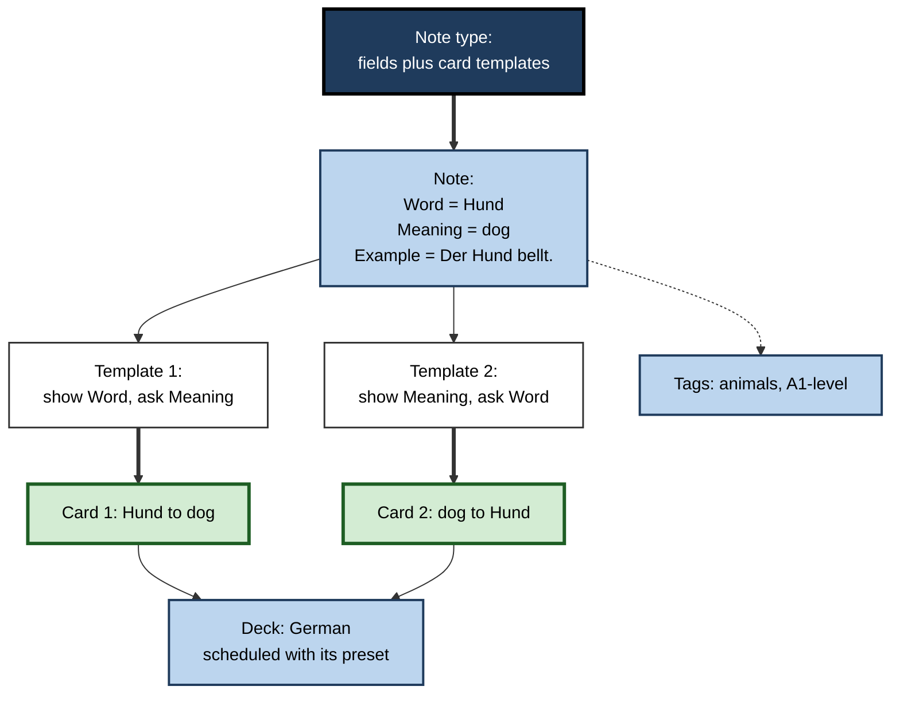
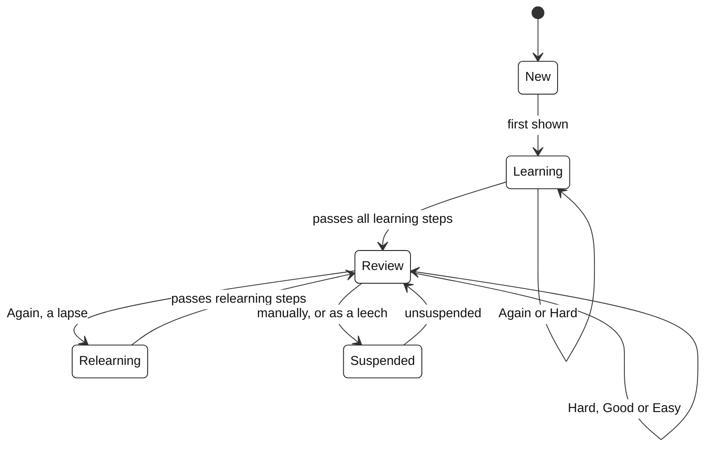
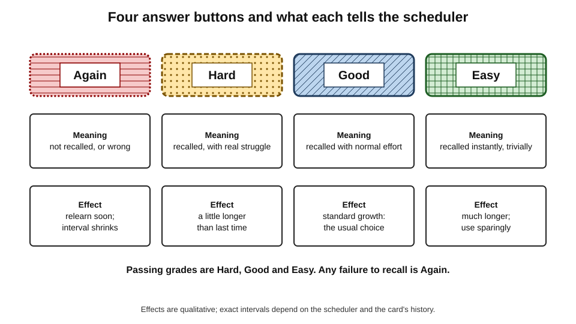
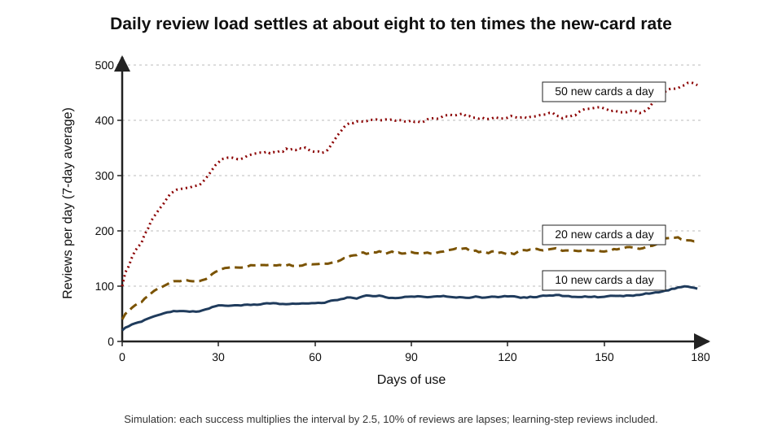
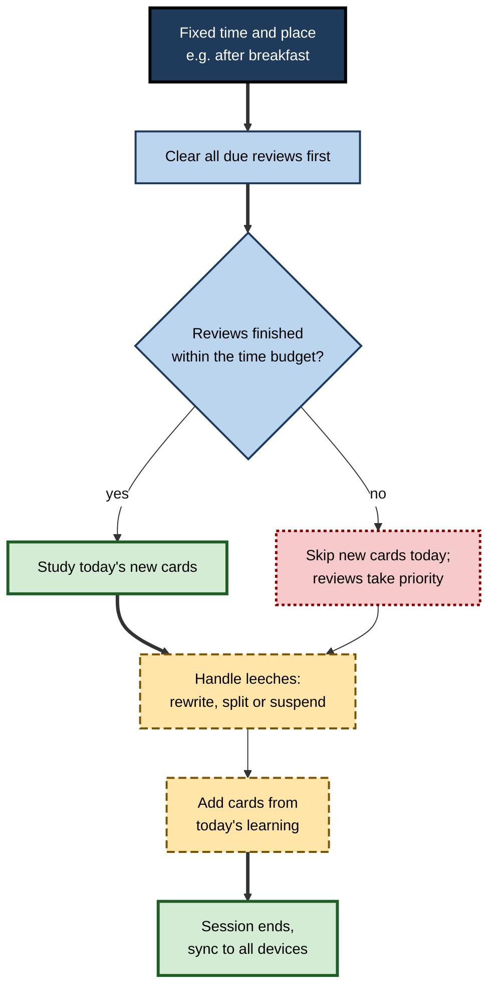

# D.6. Anki: Setup and Best Practices

Two junior doctors install the same free program on the same day. Eighteen months later one has a deck of 9,000 well-made cards reviewed in forty minutes each morning and remembers pharmacology she learned in her first year; the other abandoned his deck after six weeks, facing 1,100 overdue reviews. The software was identical. What differed was how it was set up and how it was used.

> **Definition — Anki:** a free, open-source spaced-repetition program, first released by Damien Elmes in 2006, that stores knowledge as notes, generates flashcards from them through templates, and schedules each card's reviews with an adaptive algorithm.

**Why it matters**

- Anki is the most widely used general-purpose spaced-repetition tool among medical students, language learners, programmers, lawyers and others who must retain large bodies of knowledge.
- Its flexibility is both its strength and its trap: it can be configured into an excellent system or a punishing one.
- A few early decisions — card structure, daily limits, scheduler choice, grading habits — determine whether a deck is sustainable for years.
- Most problems reported by users are not failures of spacing but of **setup and habits**, and are preventable.

---

## How Anki Organises Knowledge

### Notes, fields, note types and cards

> **Definition — Note:** a unit of information in Anki, made of named **fields** (for example *Word*, *Meaning*, *Example sentence*); cards are generated from notes.

> **Definition — Note type:** the definition of a note's fields and of the **card templates** that turn those fields into one or more cards.

> **Definition — Card:** a single prompt–answer pair that Anki schedules and shows for review.

- **One note, several cards** — a vocabulary note can produce *word → meaning* and *meaning → word* cards from the same fields.
- **Built-in note types:**
  - **Basic** — one card, front to back;
  - **Basic (and reversed card)** — two cards, both directions;
  - **Basic (optional reversed card)** — reverse only when a field is filled;
  - **Basic (type in the answer)** — the learner types before seeing the answer;
  - **Cloze** — one card per deletion in a passage;
  - **Image Occlusion** — parts of an image are hidden in turn (built in since 2023).
- **Sibling cards** — cards generated from the same note; by default Anki can **bury** siblings so they are not shown on the same day.

**Figure 1.** How notes, note types and cards relate in Anki.

### Decks, presets and tags

- **Deck** — a container of cards; a card belongs to exactly one deck. Decks can be nested (subdecks).
- **Options preset** — a named group of scheduling settings; several decks can share one preset.
- **Tag** — a label on a note; a note can have many tags, and tags can be nested (for example *pharm::antibiotics*).
- **Good structure:**
  - **few decks**, divided by genuinely different **scheduling needs** or by broad subject;
  - **many tags** for topic, source, chapter, exam and status;
  - **filtered decks** (temporary decks built from a search) for targeted sessions.

> **Key point:** decks decide **how** cards are scheduled; tags describe **what** cards are about. Deep deck hierarchies by chapter fragment review and make interleaving impossible; tags give the same organisation without the cost.

> **Watch out:** studying one small subdeck at a time is a form of **blocking** — it lets the learner guess answers from context. Reviewing the whole parent deck mixes subjects and makes recall more honest.

### The collection and synchronisation

- **Collection** — all decks, notes, cards and review history in one database per user profile.
- **Synchronisation** — a free online service, AnkiWeb, keeps the collection in step across desktop, Android (AnkiDroid) and iOS (AnkiMobile, a paid application).
- **Backups** — Anki keeps automatic local backups; regular exported backups (an *.colpkg* file) protect years of work.

---

## The Life of a Card

**Figure 2.** States a card passes through in Anki.

- **New** — never studied; introduced at a daily limit.
- **Learning** — new cards going through short **learning steps** (by default 1 minute, then 10 minutes) on the day they are introduced.
- **Review** — graduated cards with intervals of a day or more, scheduled by the algorithm.
- **Relearning** — review cards that were forgotten ("lapses"), shown again after short **relearning steps** (by default 10 minutes).
- **Suspended** — removed from review until unsuspended.
- **Buried** — hidden until the next day (often siblings).

> **Definition — Lapse:** a review in which a card in the review state is forgotten and answered *Again*.

> **Definition — Leech:** a card that has lapsed many times (by default 8); Anki tags it, and can suspend it, because repeated failure usually signals a badly designed card or a misunderstanding.

---

## The Four Buttons and Honest Grading

**Figure 3.** The four answer buttons and what each tells the scheduler.

- **Again** — the answer was not recalled, or was wrong. Always use it for failures, including near-misses that matter.
- **Hard** — recalled, but with serious hesitation. It is a **pass**, not a fail.
- **Good** — recalled with normal effort. The default choice for most successful reviews.
- **Easy** — recalled instantly and effortlessly; increases the interval much more.

> **Watch out:** the commonest grading error is pressing **Hard** for a card that was actually **forgotten**. The scheduler then treats it as remembered, its interval grows, and it is forgotten again. "Hard" means "remembered with difficulty".

> **Remember:** fail what was failed; pass what was passed; use **Good** by default; **Easy** only when truly trivial.

### Rules for a fair review

1. **Attempt the full answer before revealing it** — say it, think it fully or type it.
2. **Judge against the whole answer** — partially right on a key detail is a fail.
3. **Do not peek, then pretend** — a glimpse of the answer invalidates the attempt.
4. **Keep the pace brisk** — most cards should take seconds; long struggles signal a card that needs splitting.
5. **Do not grade by mood** — an annoying card is not an "Easy" card.

---

## Configuring the Scheduler

### The two schedulers

- **SM-2-based legacy scheduler** — Anki's original algorithm with ease factors.
- **FSRS** — a model-based scheduler (difficulty, stability, retrievability) built into Anki since version 23.10; it schedules reviews to meet a chosen **desired retention** and can fit its parameters to the user's own review history.

| | Legacy (SM-2-based) scheduler | FSRS |
|---|---|---|
| Main setting | Starting ease, interval modifier, easy bonus | Desired retention |
| Personalisation | Per card, through ease changes | Parameters fitted to the user's history |
| Handles late reviews | Partially | Explicitly, through the forgetting curve |
| Ease hell | Possible | Not applicable |
| Long learning steps | Needed for early spacing | Should be short; FSRS schedules from the first day |
| Best for | Users with established habits who prefer predictability | Most users, especially with large decks |

> **In practice:** most experienced users now switch on FSRS, keep **desired retention around 0.85–0.92**, run the **parameter fitting** periodically once a few hundred to a few thousand reviews exist, and keep learning steps under a day.

### Key settings and sensible values

**Daily limits**

- **New cards per day** (default 20) — the most important setting in Anki. It determines the future review load.
- **Maximum reviews per day** (default 200 in recent versions) — keep it **high**; a low cap hides the true load and creates hidden backlog.

**Learning and relearning**

- **Learning steps** (default 1 minute, 10 minutes) — short steps on the first day; under FSRS, avoid steps of a day or more.
- **Relearning steps** (default 10 minutes) — one short step is usually enough.
- **Graduating interval and easy interval** (defaults 1 and 4 days) — used by the legacy scheduler; FSRS sets these from its model.

**Retention and intervals**

- **Desired retention** (FSRS; default 0.90) — the probability of recall at review time.
- **Maximum interval** (default 100 years) — leave long unless a hard upper limit is wanted for professional reasons.

**Leeches**

- **Leech threshold** (default 8 lapses) and **leech action** (tag only, or suspend) — tag or suspend leeches and **rewrite** them rather than grinding through them.

**Display and burying**

- **Bury new and review siblings** — avoids seeing a card's reverse on the same day.
- **Display order** — mixing new cards among reviews keeps sessions varied; reviewing due cards first ensures overdue material is covered.

> **Formula — Steady-state daily load (rule of thumb):** daily reviews ≈ 8 to 10 × new cards per day, once the deck has run for a couple of months. Example: 20 new cards a day → about **160–200 reviews**; at about 8 seconds each → roughly **20–27 minutes** a day.

**Figure 4.** How the new-card limit determines the daily review load.

### Choosing desired retention

| Situation | Suggested desired retention | Reason |
|---|---|---|
| Long-term professional knowledge, moderate stakes | 0.85–0.90 | Balanced workload |
| High-stakes exam in the coming months | 0.90–0.95 | Higher recall when it counts |
| Huge deck, limited daily time | 0.80–0.85 | Fewer reviews, more lapses |
| Critical safety facts (small set) | 0.95 | Small deck, high cost of forgetting |

> **Watch out:** increasing desired retention from 0.90 to 0.95 roughly **doubles** scheduled reviews. Learners who raise it to "remember more" often find their daily load unsustainable within weeks.

### Fitting FSRS to one's own history

- **What fitting does:** the scheduler adjusts its parameters — initial stabilities, how difficulty moves, how much stability grows after each grade — so that its predicted recall matches the learner's actual review history.
- **When to fit:** once a few hundred to a thousand or more reviews have accumulated; before that, the default parameters (fitted to many users) are usually better.
- **How often:** every month or two during heavy use; less often for a stable, mature collection.
- **Separate presets:** material with very different behaviour (a language deck versus a pharmacology deck) can be given separate presets, each fitted to its own history.
- **Checking the fit:** Anki reports how well predictions match outcomes; a fit that worsens prediction should not be kept.

> **Watch out:** fitting cannot repair **dishonest grading**. If "Hard" is used for failures, the model learns a false picture of the learner's memory and schedules accordingly.

### Smoothing the daily load

- **Fuzz** — Anki adds a small random variation to longer intervals, so cards learned on the same day do not all fall due on the same future day.
- **Load smoothing** — recent versions can also shift reviews slightly between nearby days to even out the daily total, and can make chosen weekdays lighter.
- **Why it matters:** an even load is easier to sustain than one with occasional spikes, even if the average is the same.

> **Definition — Fuzz:** a small random adjustment to scheduled intervals that spreads reviews of similar cards across nearby days.

**Study card — the open spaced-repetition benchmark (2023 onwards)**

- **Design:** the developers of FSRS and community contributors collected anonymised review logs from thousands of volunteer Anki users and compared how accurately different scheduling algorithms predicted whether each review would succeed.
- **Results:** FSRS variants predicted recall more accurately than SM-2 and several other published models across most users' collections; later versions improved further.
- **Conclusion:** model-based scheduling captures individual forgetting better than fixed rules. **Caveat:** the benchmark measures **prediction**, is maintained by the algorithm's own developers, and does not directly measure learning outcomes.

---

## Building the Deck

### Make or borrow?

- **Shared decks** — large, community-maintained decks exist for medical licensing exams, languages and certifications; the best are refined over years by thousands of users.
- **Self-made cards** — match personal gaps, use one's own words, and the act of writing them is useful processing.
- **Practical approach:**
  - use a high-quality shared deck for a large standard syllabus;
  - **unsuspend** only the cards for topics actually studied (a common workflow in medical decks);
  - add personal cards for what the shared deck lacks or explains poorly;
  - edit shared cards that repeatedly fail.

> **Example:** a medical student keeps a community licensing-exam deck fully suspended, and after each lecture unsuspends the cards tagged to that lecture's topics — so reviews follow the course rather than the whole syllabus at once.

### Adding cards efficiently

- **Card at the point of understanding** — after studying a topic, not before.
- **Keep a capture habit** — note candidate cards during reading; convert in a short daily block.
- **Use templates and cloze** to avoid retyping.
- **Use the browser** to search, edit, tag, reposition and suspend in bulk.

### Useful searches in the browser

- `tag:pharm::antibiotics` — all notes with a tag.
- `is:due` — cards due today.
- `prop:lapses>4` — cards forgotten more than four times.
- `added:7` — cards added in the last seven days.
- `deck:German -tag:verbs` — cards in a deck without a tag.

---

## The Daily Routine

**Figure 5.** A sustainable daily Anki session.

- **Reviews before new cards** — reviews protect what is already invested; new cards create future work.
- **Every day, including weekends** — a missed day doubles the next day's load.
- **Short and brisk** — most users do better with one or two focused sessions than with many fragments.
- **Mobile for reviews, desktop for creation** — reviews fit into waiting time; making good cards needs a keyboard and attention.

> **Mnemonic — "RAIN":** **R**eviews first, **A**dd only what is understood, **I**nspect leeches, **N**ever skip a day.

---

## Statistics That Matter

- **True retention** — the share of review-state cards answered correctly; close to the desired retention when the scheduler is working.
  - Much lower than target — cards may be poorly designed or grading too strict on wording.
  - Much higher than target — intervals may be too short; reviews are being wasted.
- **Future due forecast** — shows the coming review load; a rising forecast is a signal to reduce new cards.
- **Review time per day** — the real cost of the deck.
- **Leeches count** — a measure of card quality.
- **Added cards per day** — the input that drives everything else.

> **Key point:** watch **time per day** and **true retention**. If time is sustainable and retention is near target, the system is healthy; tuning beyond that has small returns.

---

## Common Mistakes and Remedies

| Mistake | Consequence | Remedy |
|---|---|---|
| Too many new cards per day | Review load explodes within weeks | Set new cards by the time budget (about 10 reviews per new card) |
| Low maximum-reviews cap | Hidden backlog grows | Keep the cap high; reduce new cards instead |
| Pressing Hard for failures | Intervals grow on forgotten cards | Use Again for every failure |
| Many tiny subdecks studied one at a time | Context cues answers; poor mixing | Few decks, many tags; review parent decks |
| Long learning steps of days | Duplicates the scheduler's job | Short steps; let the scheduler handle days |
| Cards before understanding | Memorised words, many leeches | Study first, then make cards |
| Grinding leeches | Wasted time, frustration | Rewrite, split, add context or suspend |
| Endless setting changes | Time lost, unstable schedules | Choose sensible settings and leave them |

---

## Worked Example: Setting Up for a Professional Exam

A trainee chartered accountant has 10 months until a set of professional exams and can spare 35 minutes a day for Anki.

1. **Time budget:** 35 minutes ≈ 2,100 seconds; at about 8 seconds per review, about **260 reviews** a day.
2. **New-card limit:** by the rule of thumb (about 10 reviews per new card per day at steady state), about **25 new cards a day**; start at 20 to leave room.
3. **Deck structure:** one deck for the exams, with tags for paper, chapter and source.
4. **Scheduler:** FSRS, desired retention 0.90; fit parameters after the first month.
5. **Capacity check:** 20 new cards × 5 study days a week × 40 weeks ≈ **4,000 cards** — enough for key standards, definitions, thresholds and formats.
6. **Final two months:** stop adding new cards for broad topics; raise desired retention to 0.93–0.95 for the exam period; continue past the exam at 0.85 for professional retention.
7. **Weekly maintenance:** 15 minutes to deal with leeches and tidy tags.

> **Watch out:** cards cannot replace **practice questions and past papers**. Anki keeps definitions, rules and facts available; exam skill also needs full problems under timed conditions.

---

## Case Study: Rescuing a Collapsed Medical Deck

- **Situation:** a second-year medical student had used a large shared licensing deck for five months, adding 100 new cards a day during a burst of motivation.
- **Problem:** daily reviews passed 900, sessions took three hours, and after a week of examinations she stopped; the backlog reached 4,000 overdue cards.
- **Diagnosis:**
  1. new-card rate far above her time budget;
  2. maximum-reviews cap set low, hiding the growing load until it overwhelmed her;
  3. many cards unsuspended for topics not yet taught, producing leeches;
  4. "Hard" used routinely for failures.
- **Actions:**
  1. set new cards to **zero** until the backlog cleared;
  2. switched on FSRS at desired retention 0.85 for the recovery period;
  3. reviewed the overdue cards at about 300 a day, oldest-learned and most important topics first;
  4. **re-suspended** cards for topics not yet covered in the course;
  5. rewrote or suspended about 200 leeches;
  6. retrained her grading: Again for any failure.
- **Result:** after about three weeks the backlog was cleared; daily reviews settled at about 180 (around 25 minutes); new cards resumed at 15 a day aligned with lectures; retention rose towards target.
- **Lesson:** decks collapse because of **input rate** and **hidden load**, not because spacing fails. Control new cards, keep the review cap honest and align cards with what has been learned.

---

## Anki in Teams and Organisations

- **Shared decks within teams** — a department can maintain a deck of policies, product facts or terminology; notes are updated centrally and re-shared.
- **Version control** — tools exist to export decks to text formats so changes can be tracked and reviewed.
- **Limitations for organisations:** no built-in reporting across users, no assignment features; workplace reinforcement platforms fill these gaps.
- **Privacy and accuracy:** decks with client or proprietary information should stay within approved systems; facts that change (rates, thresholds, regulations) need an owner who updates them.

---

## Anki and Artificial Intelligence

- **Card drafting** — language models can turn notes or documents into draft cards in Anki's import format.
- **Explanation** — after a lapse, a model can explain why the answer is right.
- **Risks:** inaccurate cards, too many cards, and loss of the selection and paraphrase that make self-made cards effective.
- **Workflow:** draft with AI, select the few that matter, rewrite in one's own words, verify against the source, then add at a sustainable rate.

---

## What Evidence Exists on Anki Use

**Study card — Andrew Deng, Jeffrey Gluckstein and Douglas Larsen (2015)**

- **Design:** a survey of medical students preparing for the first United States licensing examination, recording their use of Anki and other resources alongside examination scores.
- **Results:** students who reviewed more unique Anki cards tended to score higher, after taking other study resources into account.
- **Conclusion:** consistent with a benefit of student-directed spaced retrieval; **but** the design is correlational — more diligent students may both use Anki more and study more effectively in other ways.

- **Similar surveys** in several countries report the same association between heavy Anki use and examination performance in medicine.
- **What is missing:** randomised comparisons of Anki with other methods over full courses; such trials are hard to run because students choose their own tools.
- **Reasonable inference:** Anki is an efficient vehicle for spaced retrieval, whose effectiveness is established by controlled research on the principles; the tool's particular contribution is not separately measured.

---

## Running Shared Decks at Scale

### Shared decks inside organisations

- **Maintained centrally:** a subject owner edits notes; members import the updated deck; notes that already exist are updated while each member's review history is kept.
- **Stable note identifiers:** updates work only if the same notes are edited rather than deleted and recreated — recreating notes resets everyone's progress.
- **Version notes:** a field recording the date of the last content change helps learners and owners see what is current.

### Where Anki fits and where it does not

| Need | Anki | Workplace reinforcement platform |
|---|---|---|
| Personal, self-directed retention | Excellent | Adequate |
| Central reporting of progress | None built in | Built in |
| Assigning content to groups | Manual sharing | Built in |
| Cost | Free on most platforms | Licensed |
| Flexibility of item types | Very high | Moderate |
| Data governance | Learner-controlled files | Organisation-controlled system |

> **In practice:** organisations often use Anki where learners are **self-directed** (doctors in training, engineers, analysts) and reinforcement platforms where **assignment and reporting** are required (compliance, sales).

### Worked example: presets for three tiers

A pharmacist sets up one collection with three presets and estimates the daily load.

| Preset | Cards active | Desired retention | Typical mean interval | Estimated reviews a day |
|---|---|---|---|---|
| Critical (high-alert drugs) | 600 | 0.95 | About 60 days | 600 ÷ 60 ≈ 10 |
| Professional (therapeutics) | 4,000 | 0.90 | About 150 days | 4,000 ÷ 150 ≈ 27 |
| Background (basic science) | 3,000 | 0.82 | About 400 days | 3,000 ÷ 400 ≈ 8 |

- **Total:** about **45 reviews a day**, plus lapses and any new cards — roughly **8–10 minutes**.
- **Without tiers** (everything at 0.95) the same collection would need roughly twice as many reviews.

---

## Open Questions

- **What desired retention is best for long-term professional use?**
  - Simulations suggest moderate values minimise effort; whether higher retention yields better professional performance is untested.
- **How much does parameter fitting help individual users?**
  - Prediction accuracy improves on average; the effect on time saved and real learning varies and is not independently measured.
- **Are shared decks as effective as self-made ones?**
  - Self-made cards add processing; shared decks save time and are often more accurate. Head-to-head long-term evidence is limited.
- **How should knowledge that changes be handled?**
  - Anki has no native notion of expiry or source updates; practices for maintaining time-sensitive cards are informal.
- **Can automatic grading of typed or spoken answers replace self-grading?**
  - It would remove a major source of error, but is not yet established.

---

## Summary

- Anki stores **notes** (fields), uses **note types** and **templates** to generate **cards**, and schedules each card; **decks** decide scheduling, **tags** describe content.
- Cards move through **new → learning → review**, with **relearning** after lapses; **leeches** (default 8 lapses) signal cards to rewrite.
- **Again** for any failure; **Hard** is a pass; **Good** by default; **Easy** rarely.
- **FSRS**, built in since 2023, schedules for a chosen **desired retention** (commonly 0.85–0.92) and fits parameters to the user's history; keep learning steps short.
- **New cards per day** is the master setting: daily reviews settle at about **8–10 times** the new-card rate; keep the **maximum-reviews** cap high.
- Use **few decks and many tags**; review mixed parent decks rather than tiny subdecks.
- Combine **shared decks** (unsuspend as topics are covered) with **self-made** cards for personal gaps.
- Daily routine: **reviews first**, new cards only if time allows, handle leeches, add cards from understood material, never skip a day.
- Watch **true retention** and **time per day**; most failures come from input rate, hidden backlog and dishonest grading.

---

## Self-Check

1. Distinguish a note, a note type and a card, with an example.
2. Why should decks be few and tags many?
3. Describe the states a card passes through, from new to review, including what happens after a lapse.
4. What is a leech and what should be done with one?
5. Explain the meaning of each answer button and the most common grading mistake.
6. Compare the legacy scheduler with FSRS on three dimensions.
7. Why should the maximum-reviews limit be kept high?
8. A learner has 20 minutes a day. Estimate a sustainable new-card limit.
9. What does true retention tell a user, and what might a value far below target indicate?
10. Why is reviewing a small subdeck by itself a problem?
11. Describe a sensible workflow for a large shared deck in a medical course.
12. A learner returns from a two-week break to 1,500 overdue cards. Outline a recovery plan.
13. Explain why raising desired retention from 0.90 to 0.95 may make a deck unsustainable.
14. A team wants to use Anki to keep product knowledge current. What problems should it anticipate?
15. Why should FSRS parameters not be fitted until enough reviews exist, and what can make a fit misleading?
16. A team deck owner deletes and recreates 200 notes while editing them. What happens to members, and what should she have done?

### Answer Key

1. A note holds fields (Word = Hund, Meaning = dog); a note type defines the fields and templates; cards are generated prompts (Hund → dog and dog → Hund) that Anki schedules.
2. A card belongs to one deck, and decks determine scheduling and what is studied together. Many small decks fragment review and allow context to cue answers; tags provide topic organisation without those costs.
3. New → learning (short same-day steps) → review (intervals of days or more). A lapse sends a review card to relearning steps, then back to review with a shorter interval.
4. A card that has lapsed many times (default 8). Rewrite, split, add context, or suspend it — repeated failure usually means a poor card or a misunderstanding.
5. Again: failed; Hard: recalled with difficulty (a pass); Good: normal recall; Easy: trivially recalled. The common mistake is pressing Hard for a card that was actually forgotten.
6. Legacy: ease-factor-based, no explicit retention target, risk of ease hell. FSRS: fitted to the user's history, targets a chosen retention, models late reviews explicitly. Legacy needs longer learning steps; FSRS works best with short ones.
7. A low cap hides the real load; unreviewed due cards accumulate as hidden backlog. The right control is the new-card limit.
8. 20 minutes ≈ 1,200 seconds ≈ 150 reviews at 8 seconds; at about 10 reviews per new card per day, about **15 new cards a day**.
9. The share of review cards answered correctly; it should be near desired retention. Far below target suggests poorly designed cards, cards made before understanding, or overly strict grading of wording.
10. Context cues the answers (all cards are on one topic) and there is no mixing between subjects, so recall is easier and less like real use.
11. Keep the deck suspended; after each lecture, unsuspend cards tagged to its topics; add personal cards for gaps; edit cards that fail repeatedly.
12. Set new cards to zero; possibly lower desired retention temporarily; review a fixed daily number of overdue cards (prioritising important and recently learned material); handle leeches; resume new cards slowly once the backlog is cleared.
13. Near high retention targets, intervals shorten sharply; scheduled reviews roughly double, so a deck at a comfortable 25 minutes may need 50 minutes or more.
14. Facts change, so cards need owners and updating; no built-in reporting or assignment; sharing proprietary data raises privacy issues; card quality varies; staff may not review consistently without managerial support.
15. With few reviews the fitted parameters are unreliable and usually worse than the defaults fitted to many users; dishonest grading (Hard for failures) or very mixed material in one preset can also make the fit describe a false picture of memory.
16. Every member's review history for those notes is lost and the cards return as new. She should have edited the existing notes so that their identifiers stayed the same, then shared the updated deck.

---

## Glossary

| Term | Meaning |
|---|---|
| AnkiWeb | Anki's free online synchronisation service. |
| Bury | Hide a card until the next day. |
| Card | A single prompt–answer pair scheduled for review. |
| Cloze | A card type that hides one part of a passage at a time. |
| Collection | All of a user's decks, notes, cards and history. |
| Deck | A container of cards that determines scheduling and study grouping. |
| Desired retention | The recall probability FSRS aims for at review time. |
| Field | A named part of a note, such as Word or Meaning. |
| Filtered deck | A temporary deck built from a search. |
| FSRS | The model-based scheduler built into Anki since 2023. |
| Fuzz | A small random adjustment to intervals that spreads reviews across nearby days. |
| Image Occlusion | A card type that hides parts of an image in turn. |
| Lapse | Forgetting a card that was in the review state. |
| Learning steps | Short same-day intervals for new cards. |
| Leech | A card that has lapsed many times. |
| Load smoothing | Shifting reviews between nearby days to even out daily totals. |
| Note | A unit of information made of fields, from which cards are generated. |
| Note type | The definition of a note's fields and card templates. |
| Options preset | A named set of scheduling settings shared by decks. |
| Parameter fitting | Adjusting a scheduler's parameters to match a learner's review history. |
| Relearning steps | Short intervals for cards after a lapse. |
| Sibling cards | Cards generated from the same note. |
| Suspend | Remove a card from review until restored. |
| Tag | A label on a note used for organisation and search. |
| True retention | The observed share of review cards answered correctly. |
