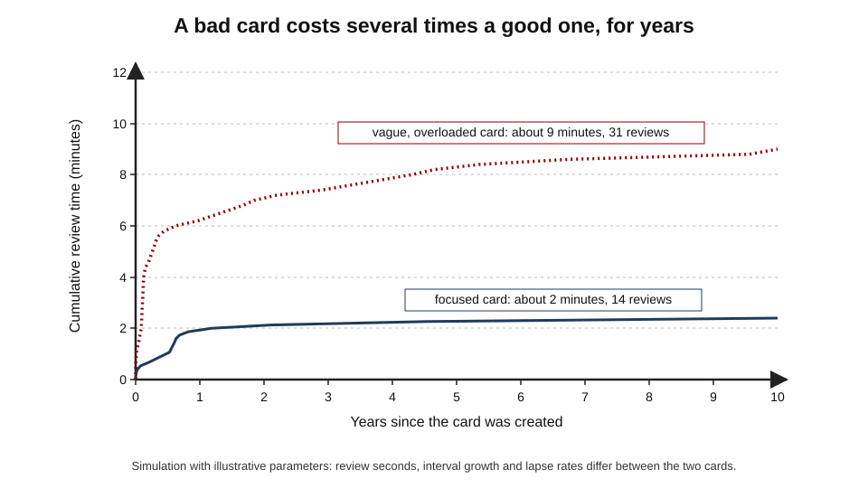
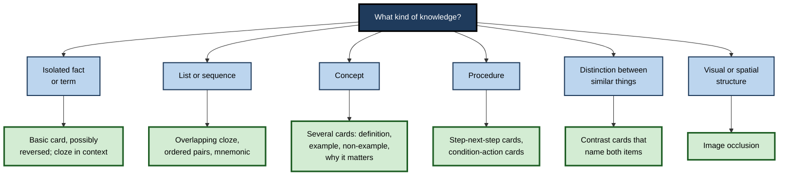
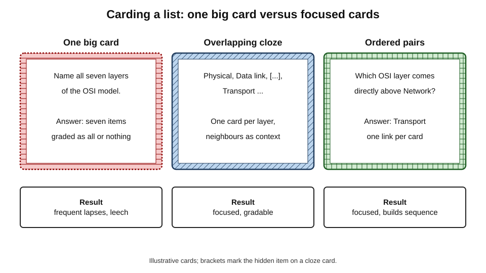
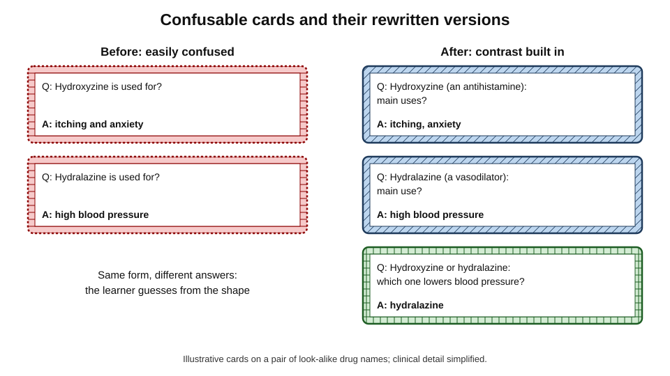
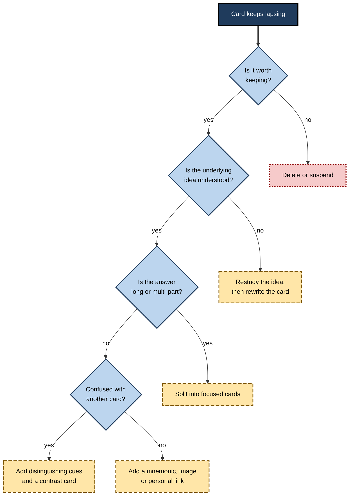

# D.7. Card Design for Spaced Repetition

A card written in thirty seconds today may be reviewed fifteen times over the next ten years — or sixty times, if it is badly written and keeps being forgotten. In a deck of several thousand cards, the difference between careful and careless writing adds up to hundreds of hours, and to knowledge that is either usable or merely memorised. Card design for spaced repetition is the craft of writing prompts that stay **cheap, accurate and meaningful for years**.

> **Definition — Card design (prompt writing):** the craft of turning knowledge into retrieval prompts that can be answered quickly and reliably, graded honestly, and reviewed over long periods without confusion, so that spaced review produces durable and usable knowledge.

**Why it matters**

- In spaced repetition, a card is not used once: it is an **investment** whose cost is paid in reviews for as long as it stays in the deck.
- Card quality, not the scheduling algorithm, is the main determinant of how much time a deck costs and whether its knowledge transfers.
- Badly designed cards become **leeches**, drive up daily load and are the most common reason learners abandon spaced repetition.
- Well-designed cards can capture not just facts but **concepts, procedures, distinctions and applications**.
- Long-lived decks face problems that one-off flashcard use never meets: interference among thousands of similar cards, knowledge that changes, and prompts that the learner recognises by appearance rather than recalls by meaning.

---

## The Card as a Long-Term Investment

### Lifetime cost

> **Formula — Lifetime cost of a card:** total cost ≈ number of reviews over the card's life × seconds per review. Example: a focused card reviewed about 14 times at 8–10 seconds costs about **2 minutes over ten years**; a vague card that lapses repeatedly may be reviewed 30 or more times at 12 seconds — about **9 minutes**. Across 5,000 cards the difference is roughly **580 hours**.

**Figure 1.** Cumulative review time for a focused card and a vague, overloaded card.

- **What drives the cost:**
  - **lapses** — each failure resets much of the card's progress and adds relearning reviews;
  - **review time** — a long answer takes longer to recall and to check;
  - **lifetime** — cards for knowledge that will soon be obsolete still cost reviews until deleted.
- **What drives the value:**
  - how often the knowledge is needed;
  - how costly it is to look up or to get wrong;
  - how much other knowledge it supports.

> **Key point:** every card should pass a simple test — **would knowing this instantly, for years, be worth a few minutes of total effort?** Many prospective cards fail it and should not be written.

### What deserves a card

- **Yes:**
  - foundations that later learning builds on (definitions, principles, key mechanisms);
  - knowledge needed **fluently** in real time (vocabulary, commands, drug doses, legal tests);
  - knowledge needed to **judge** sources and AI outputs in one's field;
  - distinctions between easily confused things.
- **Usually not:**
  - trivia that will never be used;
  - details trivially found and rarely needed;
  - information that changes frequently, unless an owner keeps it current;
  - material not yet understood.

> **Watch out:** the urge to card "everything important" in a text produces decks that collapse. Experienced users card **selectively** — often a handful of prompts per hour of reading.

---

## Properties of a Good Prompt

The core rules for writing flashcards — one idea per card, a precise cue, no long lists, the learner's own words — apply fully. Long-term spaced repetition adds further requirements, which writer and researcher Andy Matuschak summarised (2020) as five properties.

> **Mnemonic — "FPCTE: Five Prompts Carry Tested Effort":** **F**ocused, **P**recise, **C**onsistent, **T**ractable, **E**ffortful.

- **Focused** — the prompt targets one detail, so a lapse is diagnostic and grading is unambiguous.
- **Precise** — it admits one answer; vague prompts produce vague, variable answers that are graded loosely.
- **Consistent** — it produces the **same** answer every time; if the answer can legitimately vary, each review practises a different thing and the memory is not strengthened.
- **Tractable** — it can be answered correctly most of the time; prompts the learner almost always fails need breaking down or supporting with cues.
- **Effortful** — it requires genuine retrieval; prompts whose answer is given away by the question, or that are trivially easy, produce little learning.

| Property | Failure looks like | Rewrite strategy |
|---|---|---|
| Focused | "Explain monetary policy." | Split into specific prompts on instruments, targets and transmission |
| Precise | "What about the 1688 revolution?" | "Which monarch was replaced in England's 1688 revolution?" |
| Consistent | "Give an example of a cognitive bias." | "Which bias is the tendency to favour information that confirms prior beliefs?" |
| Tractable | "List the 12 cranial nerves in order." | Overlapping cloze or ordered pairs, plus a mnemonic |
| Effortful | "Is the capital of Japan Tokyo?" | "What is the capital of Japan?" |

> **Watch out:** **yes/no** and **true/false** cards fail the effortful test — a guess succeeds half the time, and recognition replaces recall. Turn them into questions that require producing the answer.

---

## Woźniak's Rules for Long-Term Decks

Piotr Woźniak, creator of the SuperMemo software, published twenty rules for formulating knowledge in 1999, drawn from years of maintaining very large decks. Several go beyond basic flashcard advice.

- **Do not learn what is not understood; learn before memorising** — build the picture of the subject first, then card its parts.
- **Build upon the basics** — card simple foundations before complex details; the details become far easier.
- **Minimum information** — make prompts as simple as possible, while still carrying enough context.
- **Use cloze deletion** — a fast way to turn understood sentences into focused prompts.
- **Use imagery and graphic deletion** — hide parts of diagrams, anatomy or maps rather than describing them in words.
- **Avoid sets and enumerations** — sets (unordered lists) are especially hard; convert them into ordered or overlapping prompts, or into meaningful groupings.
- **Combat interference** — make similar items distinct; interference is the single biggest source of lapses in mature decks.
- **Optimise wording** — fewer words, faster review, less ambiguity.
- **Refer to other memories** — link new items to known ones ("like X, but…").
- **Personalise and use emotional states** — tie items to personal experience and vivid examples.
- **Context cues simplify wording** — a short label ("pharm:", "tax UK:") replaces long explanations.
- **Redundancy does not contradict minimum information** — several small cards approaching one idea from different angles are better than one large card.
- **Provide sources and date-stamp** — record where a fact came from and when, especially for knowledge that may change.
- **Prioritise** — the learner's time is finite; card what matters most first.

> **Key point:** these rules share a theme — **simple prompts, rich understanding**. The understanding lives in the learner's head and in the **connections** between cards; each individual card stays small.

---

## Matching the Card to the Knowledge

Different kinds of knowledge need different card forms.

**Figure 2.** Choosing a card form for the kind of knowledge being captured.

### Facts and terms

- **Basic card** — "What is the boiling point of water at sea level in °C?" → 100.
- **Reversed cards** — only when both directions are genuinely needed (vocabulary, symbols).
- **Cloze in context** — a full sentence with the key term hidden keeps meaning attached: "The {{c1::Reynolds}} number predicts whether flow is laminar or turbulent."

### Lists and sequences

**Figure 3.** Three ways to turn a list into cards.

- **Overlapping cloze** — each card hides one item and shows its neighbours.
- **Ordered pairs** — "What comes after X?" builds the chain link by link.
- **Meaningful grouping** — reorganise a long set into a few categories, then card each category.
- **Mnemonic plus cards** — a card for the mnemonic itself and cards for what each letter stands for.

### Concepts

A concept cannot be held by one card. Approach it from several angles — each prompt small, together forming understanding.

- **Definition** — "Opportunity cost: the value of the next-best alternative given up."
- **Example** — "A worker earning £150 a day takes an unpaid day off: what is the opportunity cost?" → £150 plus any other forgone benefits.
- **Non-example** — "Is money already spent and unrecoverable an opportunity cost?" → No; it is a sunk cost.
- **Significance** — "Why should opportunity cost, not accounting cost, drive a decision?" → Because the decision is between alternatives.
- **Connection** — "How does opportunity cost relate to comparative advantage?"

> **Example (illustrative):** a data scientist learning *regularisation* writes five cards: its purpose, the difference between L1 and L2, what L1 tends to do to coefficients, a sign of overfitting it addresses, and when it is unnecessary. No single card is long; together they capture the concept.

### Procedures

- **Step–next-step** — "In the incident process, after declaring a severity-1 incident, what is the next step?"
- **Condition–action** — "If an API call returns 429, what should the client do?" → back off and retry later.
- **Error–cause** — "A pivot table shows blank instead of zero: most likely cause?"
- **Full procedure practice** happens outside the deck; cards support the **decision points**.

### Distinctions and interference

> **Definition — Interference (in decks):** confusion between similar cards, which causes lapses on both and is the main source of leeches in mature decks.

- **Symptoms:** two cards each fail with the other's answer; the learner hesitates whenever either appears.
- **Remedies:**
  1. add a **distinguishing cue** to each card (category, mechanism, mnemonic);
  2. add a **contrast card** that names both and asks for the difference;
  3. add **why** cards that explain the basis of the difference;
  4. stagger the introduction of similar items so one is stable before the other arrives.

**Figure 4.** Confusable cards rewritten with contrast built in.

### Visual knowledge

- **Image occlusion** — hide one label of a diagram at a time; for anatomy, maps, circuit diagrams, architecture diagrams.
- **Draw-then-check** — a prompt asking the learner to sketch a structure, then compare.
- **Keep images small and specific** — a cluttered image allows guessing from position.

### Evidence behind the design rules

**Study card — Mary Pyc and Katherine Rawson (2010)**

- **Design:** learners studied Swahili–English word pairs and were encouraged to create **mediators** — keywords linking each foreign word to its meaning; some practised by retrieval, others by restudy; later, they were asked to recall both the mediators and the translations.
- **Results:** retrieval practice produced better final recall, and learners who practised retrieval were more likely to remember and use their mediators.
- **Conclusion:** cards that include a memorable link (a mnemonic, keyword or image) give retrieval something to strengthen; good design and retrieval reinforce each other.

**Study card — Andrew Butler (2010)**

- **Design:** students read passages and then either repeatedly restudied key concepts or repeatedly answered questions about them; the final test asked **new inferential questions**, some applying concepts to a different domain.
- **Results:** repeated testing produced better performance on the new questions, including transfer to other domains.
- **Conclusion:** retrieval of **conceptual** content can transfer beyond the exact question — supporting cards that ask *why* and *how*, not only *what*.

> **Definition — Mediator:** a word, image or association that a learner creates to link a cue to its answer, such as a keyword resembling a foreign word.

---

## Cue Dependence and Pattern Matching

### The problem

- After many reviews, learners can **recognise a card's appearance** — its length, wording, image — and produce the answer without knowing it in any other form.
- **Example (illustrative):** a learner always answers "Krebs cycle" to a card with a particular diagram, but cannot name it when the same process is described in a lecture.

> **Definition — Pattern matching (in spaced repetition):** answering a card from superficial features of its prompt rather than from knowledge of the content, so that the knowledge fails to transfer to new contexts.

### Remedies

- **Vary the prompt** — several phrasings of the same question, as separate cards or through templates that randomise wording.
- **Ask in both directions** where both are needed.
- **Use application prompts** — new examples that require recognising the concept.
- **Keep cards short** — long cards have more distinctive surface features.
- **Review mixed decks** — topic-specific subdecks provide context that gives away answers.

> **Watch out:** a deck with high retention statistics can still produce knowledge that does not transfer. The test is whether the learner can use the knowledge **outside the deck** — in a problem, conversation or real case.

---

## Cloze Deletion Done Well

- **One cloze per idea** — several deletions on one card turn it into a list card.
- **Hide the important word, not the obvious one** — hiding "the" or a trivial word gives no learning.
- **Keep sentences short** — long passages give the answer away through context, or make the card slow.
- **Avoid "cloze soup"** — a paragraph with eight deletions produces eight cards with shared context; each becomes easy to guess.
- **Use hints sparingly** — a hint such as `{{c1::Krebs::cycle name}}` can make a hard cloze tractable.

| | Good cloze | Poor cloze |
|---|---|---|
| Deletion | The key term or number | A trivial word |
| Sentence length | One short sentence | A long paragraph |
| Deletions per sentence | One or two | Many |
| Answer | Unique from context | Several plausible answers |
| Review time | A few seconds | Long reading before answering |

---

## Diagnosing and Rewriting Leeches

**Figure 5.** Diagnosing why a card keeps failing.

> **Key point:** a leech is **information about the card**, not a judgement on the learner. Continuing to review an unchanged leech is the most expensive activity in spaced repetition.

### Worked example (illustrative): rewriting a leech

A cloud engineer's card has lapsed nine times:

- **Original:** "What are the differences between the three main storage classes and when should each be used?"

1. **Diagnose:** the answer is long, multi-part and variable — not focused, not precise, not consistent.
2. **Check understanding:** the engineer can explain the classes in conversation, so the problem is the card, not the knowledge.
3. **Split by attribute:**
   - "Which storage class has the lowest cost per gigabyte but charges to retrieve data?" → archive class;
   - "Which storage class suits data read many times a day?" → standard class;
   - "Infrequent-access class: main trade-off compared with standard?" → cheaper storage, higher retrieval cost.
4. **Add a contrast card:** "Standard vs archive: which suits backups restored once a year?" → archive.
5. **Add a scenario card:** "Logs kept for audit, read perhaps twice a year: which class?" → infrequent access or archive, depending on retrieval time required.

| | Original card | Rewritten set |
|---|---|---|
| Cards | 1 | 5 |
| Answer length | A paragraph | A few words each |
| Seconds per review | About 30 | About 6 each |
| Lapses in the next six months | Expected to continue | Few |
| Transfer to real decisions | Weak | Strong — scenario card practises the decision |

*Illustrative figures.*

- **Conclusion:** five small cards cost less over their lifetime than one large failing card, and capture the knowledge better.

---

## Cards for Changing Knowledge

- **Date-stamp** cards whose facts may change: "UK personal allowance (tax year 2025–26)?"
- **Record the source** in a field, so the card can be checked.
- **Separate stable principles from volatile numbers** — card the principle (how a threshold works) separately from the current value.
- **Review ownership** — in team decks, assign an owner for each volatile topic.
- **Retire, do not hoard** — delete cards whose knowledge is obsolete; suspended dead cards clutter searches and statistics.

---

## Case Study (illustrative): A Consultancy's Shared Terminology Deck

- **Situation:** a management consultancy created a shared deck to help new analysts learn financial, industry and internal terminology.
- **Problem:** after three months most analysts had stopped using it; those who persisted reported spending long sessions on cards that "never stick".
- **Diagnosis:**
  1. about 2,000 cards copied from glossary entries — each answer a paragraph;
  2. many near-synonymous terms ("EBIT", "operating profit", "EBITDA") on cards with no contrast;
  3. firm-specific terms mixed with general finance terms without labels;
  4. outdated internal process cards still in the deck.
- **Actions:**
  1. reduced the deck to about 600 high-value notes, chosen by asking senior staff what they expected analysts to know instantly;
  2. rewrote each as focused prompts: definition, formula or component, and one example from a real (anonymised) case;
  3. added contrast cards for confusable terms;
  4. added context labels ("Firm:", "Finance:", "Energy sector:");
  5. assigned owners for internal-process cards and date-stamped them.
- **Result:** average review time per card fell by more than half; leeches became rare; analysts reported recognising terms in client documents and meetings; adoption in the next intake was much higher.
- **Lesson:** fewer, focused, contrasted cards produced more usable knowledge than a comprehensive glossary — **completeness is not the goal; usable recall is**.

---

## Card Design and Artificial Intelligence

- **Drafting:** language models produce fluent cards quickly from notes or documents.
- **Typical faults in generated cards:**
  - overlong answers;
  - vague or inconsistent prompts;
  - trivial deletions;
  - factual errors stated confidently;
  - far too many cards per page of source.
- **Effective use:**
  1. ask for a **small** number of prompts on the key ideas;
  2. specify the properties wanted (focused, precise, consistent, one answer);
  3. **edit** every card and check facts against the source;
  4. add personal examples and contrasts the model cannot know.

> **In practice:** AI-generated cards are a **draft**, not a deck. The selection and rewording that the learner does is part of what makes the cards work.

---

## Designing Card Ecosystems

Individual cards are small; knowledge is a network. Long-lived decks work best when cards are designed as a **system**.

- **Prerequisite order** — introduce foundational cards before the cards that depend on them; a card on "net present value" is far easier once "discounting" is stable.
- **Atomic but connected** — each card holds one idea, but cards refer to one another: "Like a call option, but giving the right to sell: what is it?"
- **Several routes to one idea** — definition, example, contrast and application cards approach a concept from different sides, so recall does not depend on a single cue.
- **Consistent conventions** — the same prefixes, formats and field layouts across a deck make each card quicker to read and less ambiguous.
- **Deliberate redundancy** — overlapping cards on critical knowledge are acceptable; overlapping cards on trivia are waste.

> **Key point:** the unit of design in a mature deck is the **cluster** — a small family of cards around one idea — not the single card.

---

## Card Design in Organisations

When cards or reinforcement questions are written for many learners, card design becomes **item writing**, and the discipline of assessment design applies.

### Item-writing standards

- **One clear question** with a single defensible answer.
- **Realistic scenarios** for application items, using the situations learners actually meet.
- **Plausible alternatives** in multiple-choice items — distractors drawn from real misconceptions, not obviously wrong options.
- **No clues** in wording, length or grammar that reveal the answer.
- **Explanations** written for every item, especially for the wrong options.
- **Review by subject experts** and, for regulated content, by compliance or legal staff.

### Using item statistics

> **Definition — Item difficulty index:** the proportion of learners who answer an item correctly; very high values suggest the item is too easy to be useful, very low values suggest it is confusing or wrong.

> **Definition — Discrimination index:** a measure of how well an item separates stronger from weaker learners, often the correlation between success on the item and overall performance.

- **Low discrimination** — an item that strong and weak learners fail equally often is often ambiguous or mis-keyed.
- **Shared wrong answers** — many learners choosing the same wrong option reveal a common misconception worth addressing in training.
- **Retire or rewrite** items whose statistics show they teach little.

| Item statistic | Typical warning sign | Likely cause | Action |
|---|---|---|---|
| Difficulty above about 0.95 | Almost everyone correct | Too easy, or answer obvious | Make it more demanding or retire it |
| Difficulty below about 0.30 | Most learners fail | Ambiguous, wrong key, or untaught content | Check accuracy; rewrite; add teaching |
| Low or negative discrimination | Strong learners fail as often as weak | Ambiguity or mis-keying | Review with an expert |
| One popular wrong option | Shared misconception | Gap in training content | Fix the training and add a contrast item |

### Case study (illustrative): rewriting a bank's reinforcement questions

- **Situation:** a retail bank's spaced-question programme on lending rules had run for a year with about 400 questions.
- **Problem:** completion was high, but audit errors on the same rules had barely changed; staff described questions as "obvious".
- **Diagnosis:**
  1. most items had difficulty above 0.9 — recognition of obviously correct statements;
  2. distractors were implausible;
  3. items tested definitions rather than decisions on real applications.
- **Actions:**
  1. rewrote 150 items as short loan-application scenarios requiring a decision;
  2. built distractors from errors found in past audits;
  3. added contrast items for the three rules most often confused;
  4. reviewed item statistics quarterly and retired items above 0.95 difficulty.
- **Result:** average correct rates fell at first — the questions had become genuinely demanding — then rose over months; audit errors on the targeted rules fell in the following year.
- **Lesson:** spaced delivery cannot rescue weak items; the gains came when items required the **decisions** staff make at work.

---

## Open Questions

- **How should conceptual understanding be represented in cards?**
  - Multi-angle sets of small prompts are widely recommended, but there is little controlled evidence on which combinations best build transferable understanding.
- **How much does pattern matching limit transfer in real decks?**
  - The phenomenon is widely reported by experienced users; its size has rarely been measured.
- **Can interference be detected automatically?**
  - Review logs could reveal pairs of cards that fail together; tools to flag them are only beginning to appear.
- **Are self-written cards still better when AI drafts are available?**
  - The generation benefit of writing one's own cards is plausible, but its size relative to well-edited AI drafts is unknown.
- **What is the ideal number of cards per concept?**
  - Too few leaves gaps; too many multiplies reviews. Guidance is based on experience rather than data.

---

## Summary

- A card in spaced repetition is a **long-term investment**: its lifetime cost is reviews × seconds; vague and failing cards can cost several times more than focused ones.
- Card **selectively**: foundations, fluency-critical knowledge, judgement-critical knowledge and confusable distinctions; not trivia, not unstable details, not what is not yet understood.
- Good prompts are **focused, precise, consistent, tractable and effortful** (Matuschak); avoid yes/no prompts.
- **Woźniak's rules** add: understand first, build on basics, minimum information, cloze, imagery, avoid sets, **combat interference**, optimise wording, personalise, context cues, redundancy across small cards, sources and dates, prioritise.
- Match form to knowledge: **basic or cloze** for facts; **overlapping cloze or ordered pairs** for lists; **multi-angle sets** for concepts; **step and condition–action** cards for procedures; **contrast cards** for distinctions; **image occlusion** for visual structure.
- Guard against **pattern matching** by varying prompts, adding application cards and reviewing mixed decks.
- Treat **leeches** as diagnostic: restudy, split, contrast, add mnemonics, or delete.
- **Date-stamp** volatile facts, separate principles from numbers, and retire obsolete cards.
- AI drafts must be **selected, edited and verified**.

---

## Self-Check

1. Why is a spaced-repetition card best thought of as an investment? Calculate the lifetime cost of a card reviewed 20 times at 9 seconds.
2. List the five properties of a good prompt and give one failure for each.
3. Why are yes/no cards weak?
4. Explain three of Woźniak's rules that go beyond "one idea per card".
5. How should a list of eight unordered items be turned into cards?
6. Design a set of four cards for the concept "sunk cost".
7. What is interference in a deck, how does it show itself, and how is it remedied?
8. What is pattern matching and how can it be reduced?
9. Give three rules for good cloze deletions.
10. A card has lapsed ten times. Describe how to diagnose it.
11. How should cards for frequently changing facts be handled?
12. Rewrite this card into a focused set: "Explain the main types of machine-learning model and their uses."
13. A colleague generates 300 cards from a 20-page report with AI. Advise her.
14. Why can high retention statistics coexist with poor real-world use of knowledge?
15. Describe the findings of Pyc and Rawson (2010) and Butler (2010), and what each implies for card design.
16. In a reinforcement programme, an item has a difficulty index of 0.25 and a discrimination index near zero. What would you suspect and do?

### Answer Key

1. It is paid for in reviews for as long as it remains in the deck, and its value comes from years of instant recall. 20 × 9 s = 180 s = **3 minutes**.
2. Focused (fails: "Explain X" covering many details); precise (fails: vague question with many acceptable answers); consistent (fails: "give an example" — answer varies); tractable (fails: 12-item list almost always failed); effortful (fails: answer given away in the question, or yes/no).
3. A guess succeeds half the time and recognition replaces recall, so little retrieval effort occurs and grading is unreliable.
4. For example: understand before memorising (cards preserve understanding but do not create it); combat interference (similar items cause most lapses — make them distinct); date-stamp and record sources (volatile facts can be checked and updated); redundancy across small cards (approach one idea from several angles).
5. Regroup into meaningful categories if possible; otherwise use overlapping cloze or a mnemonic with a card for each element; avoid one card asking for all eight.
6. Definition: "Sunk cost: a cost already incurred that cannot be recovered." Example: "A non-refundable £500 course fee when deciding whether to attend: what kind of cost?" Non-example: "Is next month's rent you can still avoid a sunk cost?" — no. Significance: "Why should sunk costs be ignored in decisions?" — they are the same whatever is chosen.
7. Confusion between similar cards; each fails with the other's answer, and both become leeches. Remedies: distinguishing cues, contrast cards, why cards, staggered introduction.
8. Answering from superficial features of the prompt rather than content knowledge. Reduce it with varied wording, both directions where needed, application prompts, short cards and mixed-deck review.
9. One cloze per idea; hide the important term; keep the sentence short (and avoid many deletions in one passage).
10. Ask whether it is worth keeping; whether the idea is understood; whether the answer is long or multi-part (split); whether it is confused with another card (contrast); otherwise add a mnemonic, image or personal link.
11. Date-stamp, record the source, separate stable principles from current values, assign an owner in team decks, and delete obsolete cards.
12. For example: "Supervised learning needs what kind of data?" → labelled examples; "Which type of learning finds structure in unlabelled data?" → unsupervised; "Model type for predicting a continuous number?" → regression; "Classification vs regression: which predicts a category?" → classification; "Customer segmentation without labels: which learning type?" → unsupervised (clustering).
13. 300 cards from 20 pages will create heavy, low-value load. Keep perhaps 20–40 on the key ideas, edit each for focus and accuracy against the report, add contrasts and personal examples, and add them gradually.
14. Cards may be answered by pattern matching, may test isolated facts never connected to use, or may be easy recognition prompts; the knowledge fails to transfer to new contexts even though in-deck recall is high.
15. Pyc and Rawson found that retrieval practice strengthened learners' memory for their own mediators and improved recall, so cards with memorable links benefit from retrieval. Butler found that repeated testing on concepts transferred to new inferential and cross-domain questions, so conceptual why and how cards are worth writing.
16. Most learners fail and strong learners fail as often as weak ones, which suggests the item is ambiguous, mis-keyed or tests content that was never taught. Check its accuracy with a subject expert, rewrite it or add teaching, and retire it if it cannot be fixed.

---

## Glossary

| Term | Meaning |
|---|---|
| Application prompt | A card that presents a new case requiring the learner to apply knowledge. |
| Cloze deletion | A card that hides part of a sentence for the learner to supply. |
| Condition–action card | A card asking what to do when a given condition occurs. |
| Contrast card | A card naming two similar items and asking for their difference. |
| Date-stamp | Recording when a fact was true, for knowledge that may change. |
| Discrimination index | How well an item separates stronger from weaker learners. |
| Image occlusion | Hiding one part of an image at a time for recall. |
| Interference | Confusion between similar cards causing lapses. |
| Item difficulty index | The proportion of learners answering an item correctly. |
| Item writing | The craft of writing assessment or review questions to defined standards. |
| Leech | A card that lapses repeatedly. |
| Lifetime cost | Total review time a card consumes while in the deck. |
| Mediator | A learner-created link, such as a keyword, between a cue and its answer. |
| Minimum information principle | Making each prompt as simple as possible while keeping context. |
| Overlapping cloze | List cards that each hide one item and show its neighbours. |
| Pattern matching | Answering from a card's surface features rather than its content. |
| Prompt | The question side of a card. |
| Tractable | Answerable correctly most of the time. |
