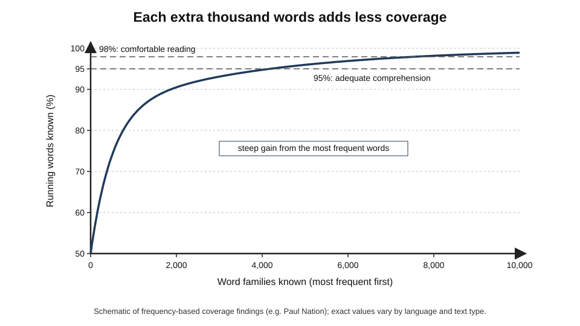
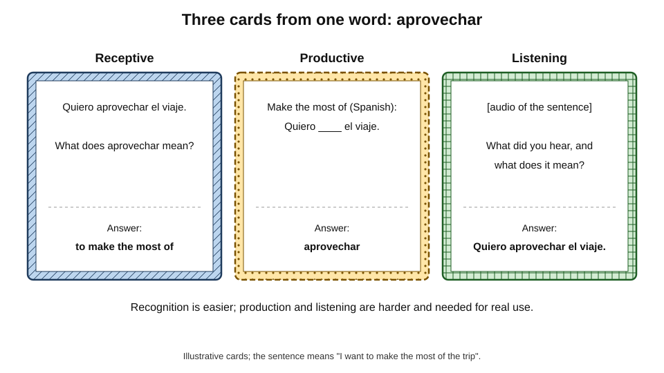
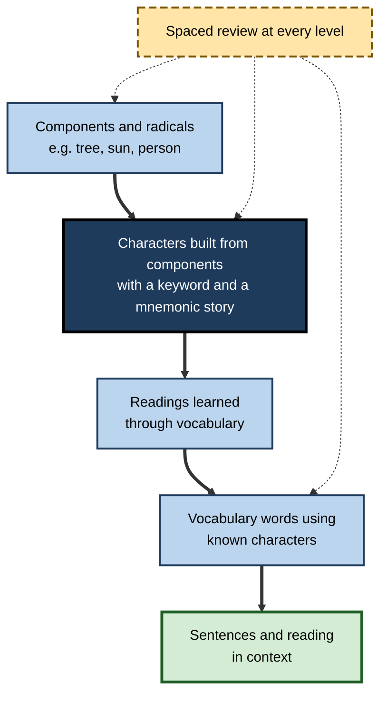
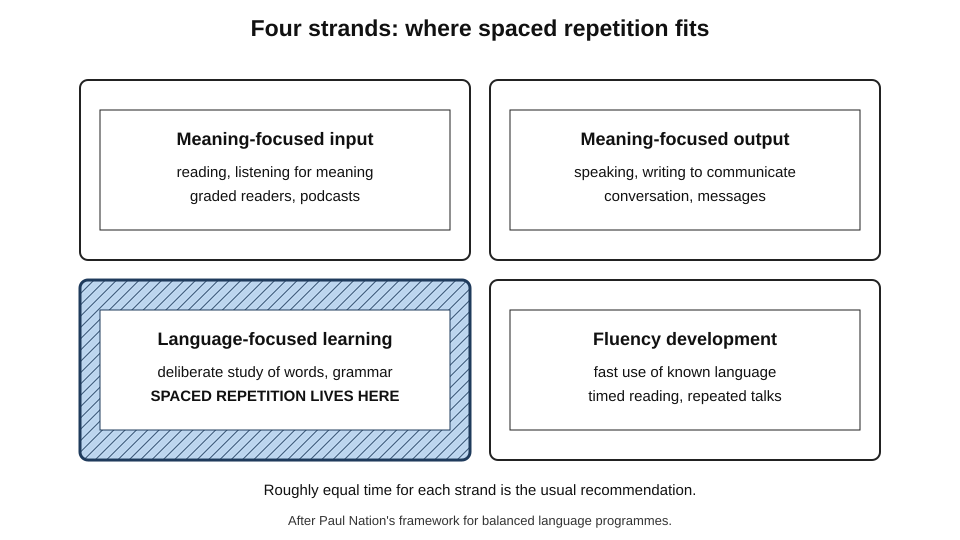
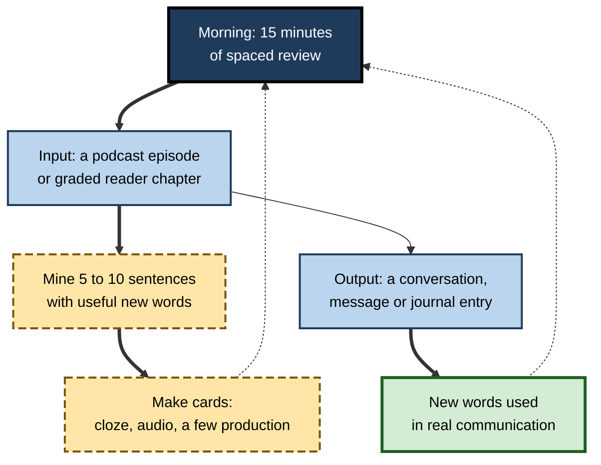

# D.8. Spaced Repetition for Languages

An engineer moving from Bangalore to Munich has eight months to reach working German. She needs thousands of words, each an arbitrary pairing of sound, spelling and meaning, and she needs them available in the half-second a conversation allows. Language learning is the domain where spaced repetition was born — Pimsleur, Leitner and Woźniak all began with vocabulary — and where its strengths and its limits are clearest.

> **Definition — Spaced repetition for languages:** the use of spaced, retrieval-based review — usually through software — to build and maintain knowledge of a language's vocabulary, characters, phrases, grammar patterns and pronunciation, as one component of a programme that also includes meaningful input, output and fluency practice.

**Why it matters**

- Vocabulary is the largest single component of language knowledge, and the main limit on comprehension.
- Word knowledge is **arbitrary** — nothing in *Hund* suggests "dog" — so it is forgotten quickly without review; this is exactly the problem spacing solves.
- Spaced review makes deliberate vocabulary learning efficient enough to accelerate progress significantly, especially for adults.
- Used badly, it produces learners who know thousands of isolated words but cannot follow a conversation.
- Professionals learning languages for relocation, client work, healthcare or customer service need **efficient** learning around full-time work.

---

## Why Vocabulary Needs Spacing

### How many words?

> **Definition — Word family:** a base word together with its inflected and closely derived forms, such as *decide*, *decides*, *decided*, *decision*.

> **Definition — Lexical coverage:** the percentage of running words in a text that a reader knows.

- **Coverage research** (associated especially with Paul Nation and Batia Laufer):
  - around **95%** coverage is needed for adequate comprehension of a text;
  - around **98%** for comfortable, unassisted reading;
  - reaching 98% in written English requires knowledge of roughly **8,000–9,000 word families**; spoken English somewhat fewer.
- **The frequency principle:** the most frequent couple of thousand word families account for the large majority of running words; each further thousand adds less.

**Figure 1.** How text coverage grows with vocabulary size.

> **Key point:** the early high-frequency words give huge returns; the long tail of less frequent words is necessary for real comprehension but slow to acquire. Spaced repetition is most valuable for building the **first few thousand** quickly and then targeting the tail efficiently.

### Incidental and deliberate learning

- **Incidental learning** — words learned from reading and listening without intending to learn them.
  - Natural and rich in context, but slow: a word may need many encounters, spread over time, before it is learned.
  - Mid-frequency words may be met too rarely for incidental learning alone to work.
- **Deliberate learning** — studying words directly, with flashcards or lists.
  - Fast and efficient for form–meaning links.
  - Weak for collocation, register and nuance unless supported by context.
- **Combination:** deliberate learning gives the learner enough vocabulary to understand input; input then deepens and extends each word.

> **Watch out:** the claim that adults should learn "only through comprehensible input, never deliberately" is a strong form of Stephen Krashen's input hypothesis. Research on deliberate vocabulary learning shows it is effective and efficient; the stronger claim is not supported. Equally, flashcards alone do not produce communicative ability.

### What it means to know a word

- **Form** — spoken form (pronunciation, stress), written form (spelling, characters), word parts.
- **Meaning** — form–meaning link, concepts and referents, associations.
- **Use** — grammar (gender, irregular forms, verb patterns), collocations ("make a decision", not "do a decision"), register and frequency.
- **Receptive versus productive** — recognising a word when reading or hearing it versus producing it when speaking or writing; productive knowledge is harder and usually lags behind.

> **Mnemonic — "FMU":** **F**orm, **M**eaning, **U**se — the three faces of knowing a word.

---

## Evidence for Spacing in Language Learning

**Study card — Harry Bahrick and family (1993)**

- **Design:** four family members learned 300 English–foreign word pairs (French or German) with relearning sessions spaced 14, 28 or 56 days apart; retention was tested up to five years after training.
- **Results:** wider spacing gave much better long-term retention; 13 sessions at 56-day gaps rivalled 26 sessions at 14-day gaps.
- **Conclusion:** for lifetime vocabulary, wide gaps make each session go further.

**Study card — Richard Atkinson and Michael Raugh (1975)**

- **Design:** learners of Russian vocabulary used either the **keyword method** — linking each Russian word to an English word that sounds similar and forming a vivid image — or their own strategies, with computer-presented practice.
- **Results:** the keyword group recalled substantially more translations, including on a delayed test.
- **Conclusion:** mnemonic links make arbitrary form–meaning pairs easier to establish; spacing then maintains them.

> **Definition — Keyword method:** a mnemonic for vocabulary in which the foreign word is linked to a similar-sounding familiar word, and the two meanings are combined in a vivid image (for example Spanish *carta*, "letter", imagined as a letter in a shopping **cart**).

- **Classroom personalisation** — Lindsey and colleagues (2014) found that personalised spaced review in a middle-school Spanish course improved retention by about 16.5% over massed study and 10% over generic spacing.
- **Large platforms** — Duolingo's half-life regression model (Settles and Meeder, 2016) improved prediction of word recall and increased daily engagement.
- **Second-language research syntheses** — meta-analyses of spacing in second-language learning, such as one by Kim and Webb (2022), report that spaced practice beats massed practice for vocabulary and that longer spacing tends to help most on delayed tests.
- **Expanding versus equal spacing** — studies by Tatsuya Nakata and others on second-language vocabulary generally find that the shape of the schedule matters less than total spacing, mirroring the wider literature.

> **Key point:** the case for spacing vocabulary is strong. The live questions concern **which kinds of card** produce usable knowledge, and how to integrate review with real communication.

### Why spacing suits new words

- **Study-phase retrieval** — meeting a word again after a gap requires recalling its form or meaning, which strengthens the link far more than an immediate repeat.
- **Encoding variability** — each later encounter comes in a different sentence, context or mood, giving the word more retrieval routes; this is one reason sentence-based cards and varied input help.
- **Consolidation and lexical integration** — newly learned word forms take time, including sleep, to become part of the mental lexicon.

**Study card — Nicolas Dumay and Gareth Gaskell (2007)**

- **Design:** adults learned new made-up words that resembled existing English words (such as *cathedruke*, resembling *cathedral*); researchers tested whether the new words began to compete with the familiar ones during word recognition — a sign that they had joined the mental lexicon.
- **Results:** the competition effect appeared after a night's sleep but not after an equivalent period awake during the day.
- **Conclusion:** new vocabulary is integrated into the lexicon **offline**, with sleep playing a role — one reason spreading vocabulary learning across days works better than packing it into a single long session.

> **Definition — Lexical integration:** the process by which a newly learned word becomes part of the mental lexicon, so that it interacts with known words during recognition and production.

**Study card — Sean Kang, Tamar Gollan and Harold Pashler (2013)**

- **Design:** English speakers learned Hebrew vocabulary either by **imitation** (hearing and repeating each word with its picture) or by **retrieval** (trying to produce the word from the picture before hearing it).
- **Results:** retrieval led to better later recall and production than imitation.
- **Conclusion:** "listen and repeat" methods benefit from a retrieval step — the learner should try to produce the word **before** hearing it.

---

## Card Types for Languages

**Figure 2.** Receptive, productive and listening cards built from one word.

### Recognition cards (receptive)

- **Prompt:** target-language word or sentence → meaning.
- **Builds:** reading and listening comprehension.
- **Advantage:** quick to review; the easiest way to build a large passive vocabulary.
- **Risk:** knowing a word only receptively leaves the learner unable to produce it.

### Production cards (productive)

- **Prompt:** meaning, picture or gapped sentence → target-language word.
- **Builds:** speaking and writing.
- **Advantage:** productive retrieval tends to build stronger, more flexible knowledge.
- **Cost:** harder, slower, more lapses — so typically reserved for higher-frequency words the learner needs to use.

### Listening and pronunciation cards

- **Audio → meaning** — trains recognition of spoken forms, often very different from written forms.
- **Audio → transcription** — trains segmenting speech into words.
- **Minimal pairs** — "Which did you hear: *ship* or *sheep*?" for sounds the learner's first language does not distinguish.
- **Shadowing prompts** — listen and repeat aloud, then compare with the recording.

### Sentence and cloze cards

- **Sentence mining** — collecting real sentences from reading, films or conversation that contain one new word, and carding them.
- **Cloze sentences** — "Ich habe keine ____, das zu tun." (*Lust*) — the word in its natural context, with collocations and grammar.
- **Advantages:** keep words attached to usage; train grammar implicitly; support pattern learning.
- **Risk:** long sentences slow reviews and can be answered from context; keep them short.

> **Definition — Sentence mining:** collecting natural sentences, each containing one unknown word or structure, from material the learner encounters, and turning them into spaced-repetition cards.

### Picture cards

- **Image → word** instead of translation — avoids routing every word through the first language, especially for concrete nouns and actions.
- **Limits:** abstract words ("however", "although") are hard to picture; translation or example sentences are more practical.

### Grammar pattern cards

- **Pattern in example** — "After *weil*, where does the verb go?" → to the end of the clause, with an example sentence.
- **Transformation** — "Put into the past tense: *Ich gehe nach Hause.*" → *Ich ging nach Hause* / *Ich bin nach Hause gegangen*.
- **Gender and agreement** — "Gender of *Mädchen*?" → neuter (*das*), with the reason (diminutive *-chen*).

| Card type | Prompt → answer | Builds | Review speed | Best for |
|---|---|---|---|---|
| Recognition | Word → meaning | Comprehension | Fast | Large passive vocabulary |
| Production | Meaning or gap → word | Speaking, writing | Slower | High-frequency, active words |
| Listening | Audio → meaning or text | Spoken comprehension | Moderate | All learners; vital for speech-heavy goals |
| Cloze sentence | Sentence with gap → word | Usage, collocation | Moderate | Mid-frequency words, grammar |
| Picture | Image → word | Direct meaning links | Fast | Concrete nouns, actions |
| Grammar pattern | Example → rule or transformation | Accuracy | Moderate | Persistent errors |

---

## Writing Systems and Characters

### Learning thousands of characters

- **Chinese and Japanese** require knowledge of thousands of characters; Japanese learners commonly target about **2,100** characters on the official list of characters for general use.
- **Components:** most characters are built from recurring parts (radicals and other components) that carry meaning or sound.

**Figure 3.** A component-first route through Japanese characters.

- **Keyword-and-story methods** — popularised for Japanese by James Heisig's *Remembering the Kanji*: each character gets an English keyword, and a short story built from its components links them.
- **Staged applications** — some character-learning platforms enforce an order of components, then characters, then vocabulary, each with fixed spaced stages.
- **Reading through vocabulary** — character readings are usually learned best inside real words, not as isolated lists.

> **Watch out:** learning character meanings without readings or vocabulary can produce learners who recognise thousands of characters but cannot read aloud or understand words. The component route is a scaffold, not the goal.

### Alphabets with unfamiliar scripts

- **Arabic, Cyrillic, Devanagari, Greek, Hangul** — scripts with a few dozen letters are learned in days to weeks; spaced cards for letter shapes and sounds help, then reading practice takes over.

---

## Balancing Review With Real Use

### The four strands

**Figure 4.** The four strands of a balanced language programme, and where spaced repetition fits.

- **Paul Nation's four strands** — a well-known framework for balanced language programmes:
  - **meaning-focused input** — reading and listening for meaning;
  - **meaning-focused output** — speaking and writing to communicate;
  - **language-focused learning** — deliberate attention to words, grammar and pronunciation;
  - **fluency development** — fast, easy use of what is already known.
- **Recommendation:** roughly equal time for each strand.
- **Where spaced repetition fits:** it belongs to **language-focused learning**, and it serves the other three by making input comprehensible and output possible.

> **Key point:** if spaced repetition takes far more than a quarter of language-learning time, the learner is probably accumulating words faster than they can use them.

### A daily routine

**Figure 5.** A daily language routine linking input, cards and use.

### Levels and priorities

| Stage | Main vocabulary goal | Card emphasis | Daily new cards (typical) |
|---|---|---|---|
| Beginner (first months) | Most frequent 1,000–2,000 words; core grammar | Recognition and production of high-frequency words; audio | 10–20 |
| Intermediate | Next 2,000–5,000 words | Sentence mining, cloze, listening | 10–20 |
| Advanced | Mid- and low-frequency words, idioms, field vocabulary | Cloze from authentic material; production for active needs | 5–15 |
| Maintenance | Keep what is known while using the language | Few new cards; long-interval reviews | 0–5 |

---

## Professional Language Learning

### Field vocabulary

- **Professional registers** have their own high-frequency words — medical, legal, financial, technical.
- **Priority:** after core general vocabulary, card the field's most frequent terms, collocations and phrases.
- **Examples:**
  - a nurse working in Germany — symptoms, body parts, instructions to patients ("Bitte tief einatmen");
  - a lawyer working in French — contract terms and standard clauses;
  - a support engineer — error descriptions and polite formulae for customers.

### Phrases and chunks

> **Definition — Lexical chunk:** a multi-word unit stored and used as a whole, such as "I'm afraid that…", "Would you mind…", "on the other hand".

- Chunks let learners speak fluently before grammar is fully mastered.
- **Cards:** situation → phrase ("politely ask a client to repeat") with audio.

### Worked example: reaching working Spanish in twelve months

A project manager must hold basic meetings in Spanish within a year and can spare 25 minutes a day for spaced review, plus other practice.

1. **Review budget:** 25 minutes ≈ 1,500 seconds; at about 8–10 seconds per review, about **150–180 reviews** a day.
2. **New cards:** at about 8–10 reviews per new card per day at steady state, about **15–18 new cards a day**.
3. **Year's vocabulary:** 15 cards × 300 days ≈ **4,500 cards** — roughly 2,500–3,000 words once several cards per word (recognition, production, audio) are counted.
4. **Priorities:**
   - months 1–3 — the 1,000 most frequent words and core phrases, with audio;
   - months 4–8 — sentence-mined vocabulary from podcasts and business articles, field terms;
   - months 9–12 — meeting phrases, production cards for active needs, idioms that colleagues actually use.
5. **Other strands:** 20 minutes of listening most days, a weekly conversation lesson, and short written messages to colleagues.

| | Cards only | Balanced programme |
|---|---|---|
| Daily time | 45 minutes of review | 25 minutes review + 20 minutes input + weekly speaking |
| Vocabulary recognised after a year | High | High |
| Listening comprehension | Weak | Good |
| Ability to hold a meeting | Poor | Basic but functional |
| Risk of abandonment | High; monotonous | Lower; varied |

> **Watch out:** "I know 5,000 words in my deck" is not the same as understanding 5,000 words in speech at natural speed. Audio cards and listening practice close much of the gap.

### Case study: preparing hospital doctors for practice in Germany

- **Situation:** a recruitment agency prepared overseas-trained doctors for medical practice in Germany, where they had to pass a specialist medical-language examination.
- **Problem:** candidates who had completed intensive general-language courses failed the medical-communication examination at high rates, struggling with patient histories and case presentations.
- **Diagnosis:**
  1. general courses had taught everyday vocabulary, not the language of consultations, documentation and handover;
  2. medical vocabulary learned once in class was quickly forgotten;
  3. little practice of listening to patients' colloquial descriptions of symptoms.
- **Actions:**
  1. built a shared deck of about 2,500 notes: lay and technical symptom terms, history-taking questions, examination instructions and handover phrases, each with audio from native speakers;
  2. paired each technical term with its **lay equivalent** ("Hypertonie" ↔ "Bluthochdruck") as contrast cards;
  3. set 20 new cards a day and daily review with FSRS;
  4. ran weekly role-plays of patient consultations using the week's vocabulary;
  5. added sentence-mined cards from recorded consultations.
- **Result:** pass rates on the medical-language examination rose substantially; candidates reported better understanding of patients' colloquial speech; the deck became the agency's standard preparation.
- **Side effects:** some candidates over-added cards and fell behind; a cap and weekly check-ins were introduced.
- **Lesson:** spaced repetition was most effective when the deck matched the **real communicative situations**, included audio and lay–technical contrasts, and was paired with role-play.

---

## Language Apps and Spacing

- **Gamified apps** — streaks, points and short lessons make daily practice habitual; their internal schedulers apply spacing, but learners usually cannot see or adjust it.
- **Strengths:** motivation, structure for beginners, built-in audio.
- **Limitations:** fixed curricula; limited vocabulary depth; emphasis on recognition; streak preservation can replace real learning goals.
- **Audio courses** based on graduated-interval recall prompt spoken production at expanding intervals, building speaking confidence early.
- **General SRS tools** give full control and suit motivated adults with specific goals.

---

## Language Learning and Artificial Intelligence

- **Conversation partners** — AI chat and voice models provide unlimited speaking and writing practice, filling the output strand cheaply.
- **Card generation** — example sentences, translations and audio (via speech synthesis) for any word.
- **Personalised input** — texts generated at the learner's level using their recently learned words, which turns review vocabulary into reading practice.
- **Risks:**
  - generated example sentences may be unnatural or wrong;
  - synthetic audio may carry errors in stress or intonation;
  - fluent machine translation can tempt learners to stop building their own vocabulary.

> **In practice:** pair spaced review with AI conversation that **uses the words just learned** — ask the model to include the day's new vocabulary in a dialogue, then review the words that were not recognised.

---

## Individual Differences in Language Spacing

- **Age**
  - Adults usually learn vocabulary faster than children in the short term because they can use deliberate strategies; children often reach better pronunciation with long exposure.
  - For adult professionals with limited time, deliberate spaced learning is especially valuable.
- **Distance between languages**
  - **Cognates** — words similar in form and meaning across languages (*information*, *Information*, *información*) are learned almost free; languages sharing many cognates with the learner's own progress faster.
  - Distant languages (for an English speaker, Japanese or Arabic) need more cards per word: script, reading and meaning separately.
- **Phonological memory**
  - Learners differ in how well they hold new sound sequences; those with weaker phonological memory benefit from audio cards, shorter words first and mnemonic links.
- **Previous language learning**
  - Experienced learners know how to select vocabulary and use input, and usually need fewer cards per word.

> **Definition — Cognate:** a word that shares form and meaning with a word in another language because of a common origin or borrowing.

---

## Language Programmes in Organisations

### Typical enterprise needs

- **Relocation and international assignments** — staff and families moving abroad.
- **Customer-facing roles** — support, sales and hospitality staff serving customers in several languages.
- **Healthcare and care work** — staff qualified abroad working in a new language.
- **Global teams** — a shared working language for meetings and documentation.

### Design principles

- **Set a level goal** using a recognised framework such as the Common European Framework of Reference (CEFR) — for example, B1 for basic professional interaction, B2 for independent professional work.
- **Prioritise field vocabulary and phrases** for the roles involved, built into a shared deck with audio.
- **Combine** spaced review with weekly live practice — role-plays of the real situations staff face.
- **Measure** with delayed, practical assessments (a simulated customer call, a patient consultation) rather than app activity alone.

> **Definition — CEFR:** the Common European Framework of Reference for Languages, which describes proficiency on six levels from A1 (beginner) to C2 (mastery).

### Worked example: field vocabulary for a support centre

A support centre in Lisbon adds German-language customer support. Agents already speak some German but struggle with technical calls.

1. **Analyse real calls:** transcripts of 200 German support calls are reviewed to find the most frequent technical terms and phrases — about 400 items cover most of the specialised language.
2. **Build the deck:** each item becomes a note with audio, an example sentence from a real call and recognition and production cards — about 900 cards.
3. **Schedule:** 15 new cards a day for 60 days covers the deck; daily review settles at about 120–150 cards (15–20 minutes), done at the start of each shift.
4. **Live practice:** weekly 30-minute role-plays using the week's vocabulary.
5. **Measure:** first-contact resolution and customer satisfaction on German calls, before and three months after.

| | Before the programme | Three months after (target) |
|---|---|---|
| Specialised terms recognised | Patchy | Most of the 400 core items |
| Average call handling | Long; frequent escalation | Shorter; fewer escalations |
| Daily learning time | None | 15–20 minutes review, 30 minutes weekly practice |

> **Watch out:** a deck built from real calls must be checked for **accuracy and register** by a fluent speaker; transcripts contain errors, slang and customer mistakes that should not be learned.

---

## Open Questions

- **How should receptive and productive cards be balanced?**
  - Productive cards are harder but may build stronger knowledge; the best mix for different goals is not settled.
- **How much does deliberate vocabulary learning speed real communicative ability?**
  - It clearly speeds vocabulary growth; its effect on fluency and listening depends on other practice and is less well measured.
- **Are mnemonic methods such as keywords effective over years?**
  - Benefits are clear in the short and medium term; long-term effects and interactions with spacing are less studied.
- **What is the right unit to card — words, sentences or chunks?**
  - Each has advantages; comparative evidence across proficiency levels is limited.
- **How will AI conversation change the role of spaced repetition?**
  - Abundant output practice may shift the balance, but vocabulary still needs to be retained; evidence is just emerging.

---

## Summary

- Vocabulary is the largest part of language knowledge; about **95%** text coverage is needed for adequate comprehension and **98%** for comfortable reading — several thousand word families.
- Word knowledge is **arbitrary**, so it decays quickly; spaced repetition makes **deliberate learning** efficient, complementing slow **incidental** learning.
- Knowing a word means **form, meaning and use**, receptively and productively.
- Evidence: **Bahrick (1993)** on wide gaps; the **keyword method** (Atkinson and Raugh, 1975); **personalised review** (Lindsey and colleagues, 2014); **half-life regression** at Duolingo; second-language meta-analyses favouring spacing.
- Card types: **recognition**, **production**, **listening**, **sentence and cloze** (via **sentence mining**), **picture** and **grammar pattern** cards; each builds different skills.
- Characters can be learned through **components and mnemonic stories**, but readings and vocabulary must follow.
- Spaced repetition belongs to **language-focused learning**, one of Nation's **four strands**; keep it to about a quarter of study time.
- Professionals should prioritise **field vocabulary**, **chunks** and **audio**, matched to real communicative situations.
- AI offers conversation practice and personalised input; generated content needs checking.

---

## Self-Check

1. What is lexical coverage, and what coverage levels are associated with adequate and comfortable comprehension?
2. Why does the frequency principle make spaced repetition especially valuable early in language learning?
3. Contrast incidental and deliberate vocabulary learning, and explain why they are complementary.
4. What are the three aspects of knowing a word? Give an example of each.
5. Describe the Atkinson and Raugh (1975) study and the keyword method.
6. Compare recognition and production cards on what they build and their cost.
7. What is sentence mining, and what are its advantages and risks?
8. Why should character learning not stop at keywords and meanings?
9. Describe Nation's four strands and where spaced repetition fits.
10. A learner has 30 minutes a day for review. Estimate a sustainable number of new cards and explain.
11. A learner reports knowing 6,000 words in Anki but cannot follow films. Diagnose and advise.
12. Design a deck structure for a nurse preparing to work in a French-speaking hospital.
13. What should a learner check when using AI to generate example sentences and audio?
14. Why might the strong claim that adults should never learn vocabulary deliberately be mistaken?
15. What did Dumay and Gaskell (2007) find, and what does it imply for scheduling vocabulary study?
16. Design a language-learning programme for 40 nurses recruited from abroad who must reach professional-level communication in the local language within a year.

### Answer Key

1. The share of running words in a text that the reader knows. About 95% for adequate comprehension; about 98% for comfortable, unassisted reading.
2. The most frequent words account for most running words, so learning them quickly yields large comprehension gains; spaced repetition builds and keeps them efficiently.
3. Incidental learning comes from input without intention — rich in context but slow, especially for less frequent words. Deliberate learning studies words directly — fast for form–meaning links but thin on use. Deliberate learning makes input comprehensible; input deepens the words.
4. Form (pronunciation of *Mädchen*), meaning (it means "girl"), use (it is neuter, *das Mädchen*; it collocates with certain verbs and registers).
5. Learners of Russian vocabulary using the keyword method — linking each word to a similar-sounding English word and a vivid image — recalled substantially more translations than learners using their own strategies.
6. Recognition (word → meaning) builds comprehension, is fast and easy; production (meaning → word) builds speaking and writing, is slower and more error-prone, and is usually reserved for high-frequency active words.
7. Collecting natural sentences containing one new item and carding them. Advantages: context, collocation, grammar. Risks: long sentences slow review and allow guessing from context.
8. Recognising character meanings without readings or vocabulary does not enable reading aloud or understanding words; readings are best learned through vocabulary and real text.
9. Meaning-focused input, meaning-focused output, language-focused learning and fluency development, in roughly equal time. Spaced repetition belongs to language-focused learning and supports the others.
10. 30 minutes ≈ 1,800 seconds ≈ 180–220 reviews at 8–10 seconds; at about 8–10 reviews per new card per day, roughly **18–25 new cards a day**, starting lower.
11. The deck probably emphasises written recognition; spoken forms, speed and connected speech are untrained. Add audio and listening cards, sentence-mined cards from films, and regular listening practice; reduce new written-recognition cards.
12. Core high-frequency vocabulary plus a field section: symptoms (lay and technical, as contrast cards), body parts, history-taking questions, instructions to patients, medication and handover phrases, all with audio; production cards for phrases she must say; weekly role-plays.
13. Naturalness and correctness of sentences (ideally checked by a native speaker or reliable source), correct stress and intonation in audio, register appropriate to the situation, and that the sentences use the word in its common meaning.
14. Evidence shows deliberate learning is effective and efficient for building vocabulary, which then makes input comprehensible; incidental learning alone is slow for mid- and low-frequency words.
15. New words began to compete with familiar similar-sounding words — a sign of lexical integration — only after a night's sleep, not after equal time awake. Vocabulary should therefore be learned across several days with sleep between sessions rather than in one long block.
16. Set a level goal (for example B2) with a delayed practical assessment; build a shared deck of high-frequency general vocabulary plus clinical, lay-symptom and handover phrases with audio, checked by fluent clinicians; schedule about 15 new cards a day with daily review; run weekly role-plays of patient consultations and handovers; add input such as recorded consultations; measure at intervals with simulated consultations.

---

## Glossary

| Term | Meaning |
|---|---|
| CEFR | Common European Framework of Reference: six proficiency levels from A1 to C2. |
| Cloze sentence | A sentence with a word removed for the learner to supply. |
| Cognate | A word sharing form and meaning with a word in another language. |
| Deliberate learning | Intentional, direct study of language items. |
| Four strands | Nation's framework: input, output, language-focused learning, fluency. |
| Incidental learning | Learning words from input without intending to learn them. |
| Keyword method | A mnemonic linking a foreign word to a similar-sounding familiar word and an image. |
| Lexical chunk | A multi-word unit stored and used as a whole. |
| Lexical coverage | The share of running words in a text that a reader knows. |
| Lexical integration | Incorporation of a newly learned word into the mental lexicon. |
| Minimal pair | Two words differing in one sound, used for pronunciation training. |
| Phonological memory | The ability to hold sequences of speech sounds briefly in mind. |
| Productive knowledge | Ability to produce a word when speaking or writing. |
| Receptive knowledge | Ability to recognise a word when reading or listening. |
| Sentence mining | Collecting natural sentences with one new item and carding them. |
| Shadowing | Listening to speech and repeating it aloud simultaneously or immediately. |
| Word family | A base word with its inflected and closely derived forms. |
