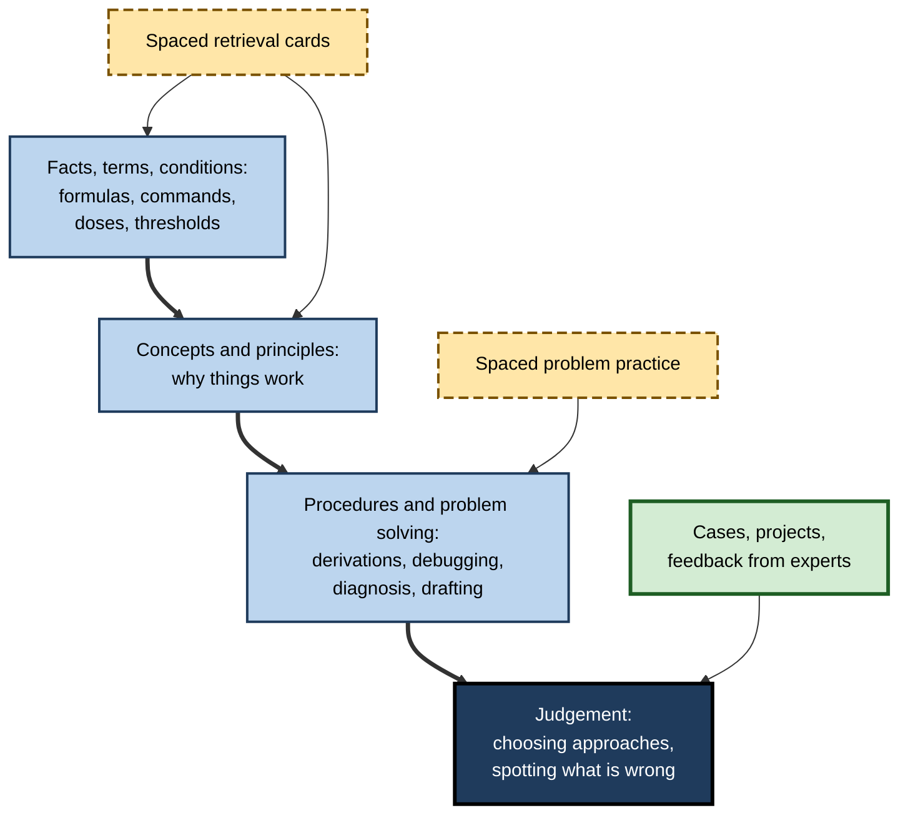
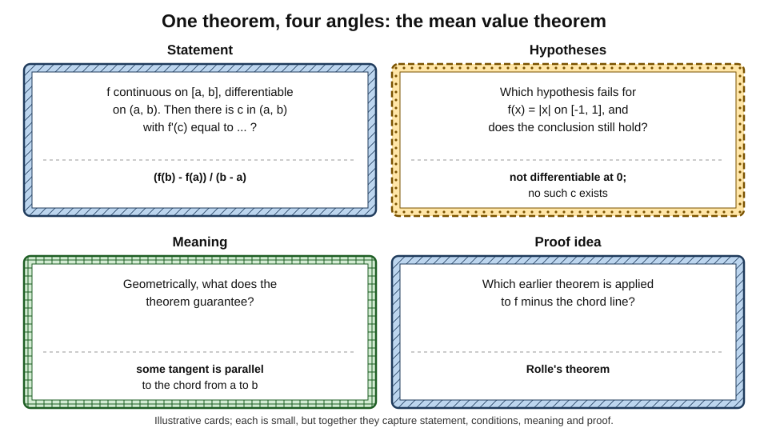
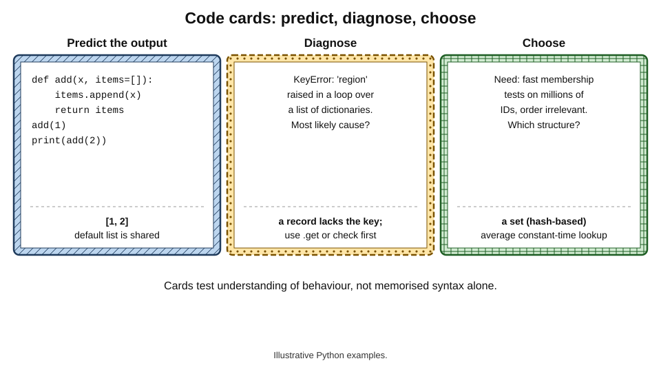
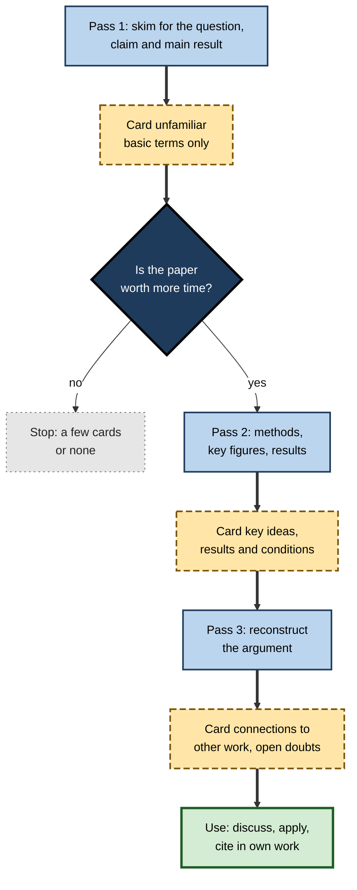
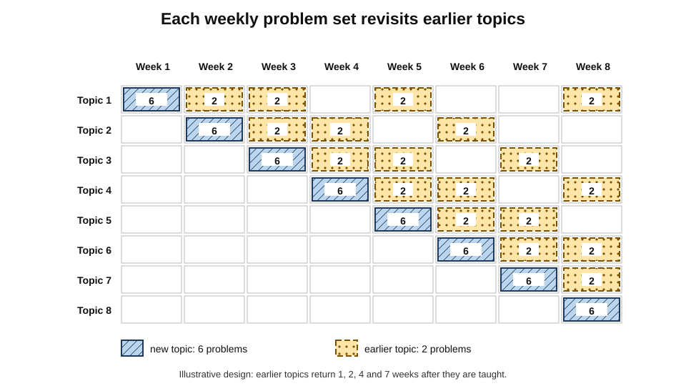
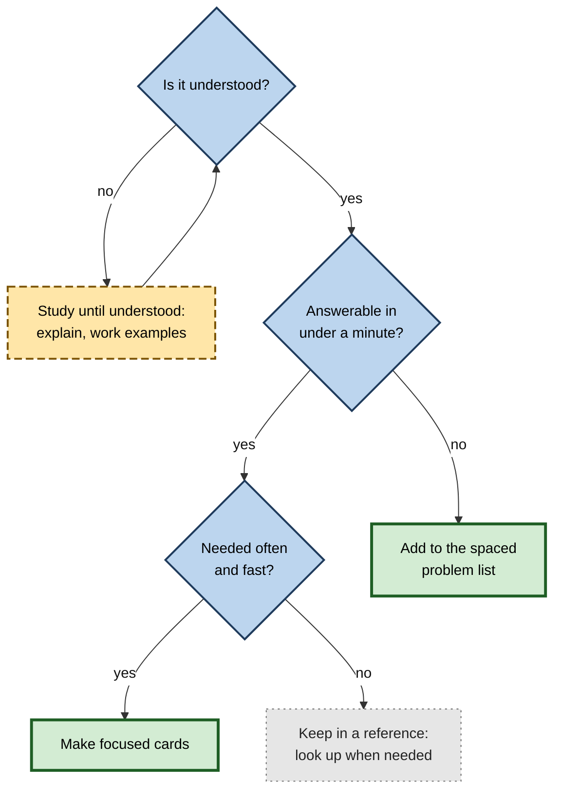

# D.9. Spaced Repetition for Technical Topics

A senior software engineer can explain distributed consensus in an interview but cannot recall, during an outage at three in the morning, the flag that rolls back a deployment. A junior doctor understands renal physiology yet hesitates over the dose adjustment for a common antibiotic in kidney failure. Technical expertise rests on understanding, but it is **exercised** through a large stock of precise facts, conditions and procedures that must be available instantly. Spaced repetition, applied with care, keeps that stock available without turning understanding into rote.

> **Definition — Spaced repetition for technical topics:** the use of spaced retrieval to maintain the facts, definitions, conditions, procedures, distinctions and key ideas of technical fields — such as mathematics, engineering, computing, medicine, law and finance — as a complement to building understanding and practising whole problems.

**Why it matters**

- Technical fields combine **deep concepts** with **many precise details**: formulas, thresholds, commands, doses, legal tests, standards.
- Experts rely on fast recall of details to free working memory for reasoning; slow lookup interrupts the reasoning itself.
- Technical knowledge is **cumulative**: forgetting foundations makes later material much harder.
- It also **changes** — software versions, regulations, guidelines — so long-term decks must be maintained.
- Badly applied, spaced repetition in technical subjects produces memorised formulas without understanding; well applied, it becomes what the physicist Michael Nielsen called a way to make memory "a choice".

---

## What Is Different About Technical Knowledge

### Layers of technical knowledge

**Figure 1.** Layers of technical knowledge and the practice suited to each.

- **Facts, terms and conditions** — the natural territory of cards.
- **Concepts and principles** — cards can maintain them if written from several angles, but understanding must be built first.
- **Procedures and problem solving** — need **whole problems**, practised at spaced intervals; cards support the decision points.
- **Judgement** — built through cases, projects and feedback; cards play a minor supporting role.

> **Key point:** in technical fields, spaced repetition is **necessary but not sufficient**. It keeps the lower layers available so the upper layers can be practised.

### Why details matter to experts

- **Working memory** is small; recalling a formula or command from memory takes almost no capacity, while looking it up interrupts the chain of reasoning.
- **Chunking** — experts recognise patterns built from many stored details; without the details, the patterns do not form.
- **Error detection** — checking an AI-generated proof, prescription or contract clause requires knowing what the right detail looks like.

---

## Capturing Technical Knowledge in Cards

### Mathematics and quantitative subjects

- **Definitions** — exact statements, with an example and a non-example.
- **Theorem statements** — with every hypothesis.
- **Hypotheses and counterexamples** — "Which condition fails for this function, and does the conclusion still hold?"
- **Proof ideas** — the key step or earlier result used, not the full proof.
- **Formula meaning** — what each term represents and when the formula applies.
- **Standard techniques** — "To evaluate an integral of a product of a polynomial and an exponential, which technique?"

**Figure 2.** One theorem captured from four angles.

> **Watch out:** a card that only asks for a formula ("Variance of a binomial?" → np(1 − p)) can be answered without knowing what it means or when it applies. Pair it with cards on interpretation and conditions.

### Programming and software engineering

- **Behaviour cards** — "What does this snippet output?" with a short piece of code.
- **Diagnosis cards** — "This error message in this situation: most likely cause?"
- **Choice cards** — "Which data structure or design pattern fits this need?"
- **Command and API cards** — only for frequently used commands that are slow to look up mid-task.
- **Concept cards** — idempotency, race conditions, time complexity of standard operations.
- **Gotcha cards** — surprising behaviours that cause bugs (mutable defaults, floating-point equality, time-zone conversions).

**Figure 3.** Code cards that test behaviour, diagnosis and design choice.

> **In practice:** many experienced engineers card **the bugs they have personally fixed** — the cause, the symptom and the fix — so the same diagnosis is quicker next time.

### Medicine and health sciences

- **Pharmacology** — mechanisms, indications, key adverse effects, interactions, dose adjustments.
- **Diagnosis** — distinguishing features of similar conditions, "red flags", first investigations.
- **Physiology and pathology** — mechanisms behind signs and symptoms.
- **Guidelines** — thresholds and first-line treatments, date-stamped.
- **Image cards** — radiology, dermatology, histology, electrocardiograms.

### Law

- **Elements** of offences, torts and causes of action.
- **Tests** from leading cases, with the case name as a cue rather than the answer.
- **Time limits and thresholds**, date-stamped.
- **Distinctions** between similar doctrines.

### Finance, accounting and engineering

- **Standards and their key requirements**; ratios with **interpretation**; tax thresholds (date-stamped).
- **Engineering:** material properties, safety factors, failure modes, standard symbols and units, rules of thumb with their conditions.

| Field | Good card targets | Poor card targets | What cards cannot replace |
|---|---|---|---|
| Mathematics | Definitions, hypotheses, counterexamples, proof ideas | Long proofs recited verbatim | Solving new problems |
| Programming | Behaviour, diagnosis, design choice, frequent commands | Entire API references | Writing and debugging real code |
| Medicine | Mechanisms, distinguishing features, doses, red flags | Whole textbook paragraphs | Clinical reasoning with patients |
| Law | Elements, tests, limits, distinctions | Full judgments | Drafting, advocacy, advising |
| Finance and accounting | Standards, ratios and meaning, thresholds | Full regulatory texts | Analysing real statements |
| Engineering | Properties, failure modes, conditions of rules of thumb | Complete design codes | Design and calculation practice |

---

## Reading Technical Material With Spaced Repetition

### Carding papers and books

- **Michael Nielsen (2018)**, a physicist and writer, described using Anki to read research papers in an unfamiliar field:
  - a **first pass** to grasp the main ideas, carding only basic terms;
  - **later passes** adding cards on methods, results and the reasoning that connects them;
  - a few dozen cards per important paper; few or none for papers that matter less.
- **His observation:** within months, he could read papers in the new field with far less effort because the vocabulary and core results were reliably in memory.

**Figure 4.** A multi-pass approach to reading a technical paper with spaced repetition.

> **Remember:** card **selectively and progressively** — basic terms first, then ideas, then connections — and stop early for material that does not deserve the investment.

### Building on foundations

- **Card foundations first** — in a new field, the most frequent terms and concepts give the biggest return, just as high-frequency words do in a language.
- **Later cards lean on earlier ones** — "Like a hash map, but ordered by key: which structure?" works only if hash maps are already known.
- **Revisit foundations rarely but reliably** — mature foundational cards cost little at long intervals.

---

## Spacing Whole Problems

Cards maintain the pieces; problem solving needs whole problems, also spaced.

### Spaced cumulative problem sets

- **The common pattern in textbooks:** all problems on a topic appear straight after the lesson — massed practice.
- **The alternative:** each week's problem set contains problems on the **current** topic **plus** some on **earlier** topics, so every topic returns at intervals.
- **Evidence:** studies of mathematics learning by Doug Rohrer and colleagues found that spacing practice problems across sessions improved delayed test performance; mixing problem types adds benefits for choosing the right method, a separate effect from spacing.

**Figure 5.** A weekly problem schedule in which earlier topics keep returning.

### Problem cards

- **Small problems** that take under a minute can be cards: "Derivative of x·ln x?"; "Big-O of inserting into a balanced binary search tree?"
- **Larger problems** are better in a separate spaced list — a spreadsheet or task list of problems to redo after one week, one month, three months.
- **Redo, do not re-read** — the value comes from solving again, not from reviewing the old solution.

> **Definition — Spaced problem practice:** returning to solve problems of each type at increasing intervals after first learning, rather than practising each type only once in a block.

**Figure 6.** Deciding whether a piece of technical knowledge belongs on a card or in problem practice.

---

## Evidence From Technical Professions

### Medical education

**Study card — B. Price Kerfoot and colleagues (2007)**

- **Design:** a randomised trial with urology residents across many training programmes; one group received **spaced education** — short case-based questions with answers and explanations, sent by email and repeated at intervals — on certain topics, while the other received it on different topics, each serving as the other's control.
- **Results:** residents scored better on the topics delivered by spaced education, and the knowledge persisted for months after the programme ended.
- **Conclusion:** brief, spaced, question-based delivery improves long-term retention of clinical knowledge in busy professionals.

- **Later trials** by Kerfoot's group extended spaced education to medical students and practising clinicians, and in some trials to improvements in clinical behaviour, such as more appropriate test ordering.
- **Medical students' decks** — surveys find that students who use spaced-repetition software more tend to score higher on licensing examinations; these studies are **correlational**, and motivated students may simply study more.

> **Watch out:** medical-school enthusiasm for very large shared decks is often cited as proof that they work. The observational evidence is consistent with benefit but cannot separate the tool from the student. Controlled evidence comes mainly from spaced-question programmes like Kerfoot's.

**Study card — Keith Lyle and colleagues (2020)**

- **Design:** in a university precalculus course, students answered retrieval-practice questions on course topics either all in the week each topic was taught (massed) or spread across later weeks (spaced); retention was tested at the start of a following calculus course.
- **Results:** spacing the retrieval practice produced better retention weeks later, while performance on the course's own unit exams was broadly similar.
- **Conclusion:** in a real mathematics course, simply redistributing the same practice across weeks improved the knowledge students carried into the next course at little cost.

### Engineering and computing

- **Certification preparation** — candidates for cloud, networking and security certifications widely use spaced cards for service names, limits, ports and protocols; formal studies are few.
- **Programming education** — spaced and mixed review of earlier concepts in programming courses has shown benefits in several studies, consistent with the general literature, though the evidence base is smaller than in mathematics.

### Mathematics

- **Spaced versus massed problem practice** — Rohrer and Taylor (2006) found that spreading the same problems over two sessions improved four-week retention, while doubling problems in one session did not.
- **A 2025 meta-analysis** of spacing and retrieval in mathematics found a robust spacing benefit (small to medium) and weaker, less consistent benefits of retrieval practice alone — suggesting that, in mathematics, **spaced problem solving** matters more than flashcard-style recall.

---

## Keeping Technical Decks Current

- **Version-tag cards** — "kubectl (v1.30): command to …"; "Guideline (2024): first-line treatment …".
- **Separate principle from parameter** — "Why does the threshold exist?" lasts; "What is the threshold?" changes.
- **Retire deprecated knowledge** — delete or suspend cards for removed features and superseded guidance.
- **Review sources periodically** — once or twice a year, check volatile topics against current documentation or guidelines.
- **Prefer understanding over trivia** — knowledge of mechanisms transfers across versions; memorised flags often do not.

> **Key point:** in fast-moving fields the **half-life of a fact** may be shorter than the interval of its card. Card the stable core heavily and the volatile edge lightly.

---

## Worked Example: An Engineer Learning a Container Platform

A backend engineer joins a team that runs services on a container-orchestration platform and must become self-sufficient on call within three months.

1. **Identify what must be instant:** commands used during incidents (inspecting logs, rolling back, scaling), core concepts (pods, services, deployments, health probes), and common failure signatures.
2. **Understand first:** work through a structured course and the team's runbooks; deploy a test service.
3. **Card selectively** — about 150 cards over the first month:
   - **concept cards** — "What does a readiness probe failure do to traffic?" → stops routing traffic to the pod;
   - **diagnosis cards** — "Pod status CrashLoopBackOff: what is happening?" → the container keeps crashing and restarting with increasing delay;
   - **command cards** — only the ten or so used under pressure, version-tagged;
   - **contrast cards** — readiness versus liveness probes.
4. **Spaced problems:** a list of ten realistic incidents from the team's history, redone in a test environment at one week, three weeks and two months.
5. **Maintain:** after each real incident, add one or two cards on its cause and fix.

| | Without a plan | With cards and spaced problems |
|---|---|---|
| First on-call shift | Frequent lookups; slow diagnosis | Common issues diagnosed quickly |
| Commands under pressure | Searched each time | Core commands recalled |
| Understanding of failures | Fragmented | Patterns recognised |
| Daily cost | None, until incidents | About 10 minutes of review, plus occasional problem sessions |

> **Watch out:** carding the entire command reference is a common mistake. Most commands are used rarely and are easy to look up; card only those needed **fast** and **often**.

---

## Case Study: A Regional Bank's Risk Analysts

- **Situation:** a bank's credit-risk team trained new analysts on regulatory capital rules, internal models and reporting standards during a six-week induction.
- **Problem:** reviewers found recurring errors in analysts' work months later — wrong risk weights, misapplied definitions of default, confusion between similar exposure classes.
- **Diagnosis:**
  1. an intensive induction with no structured review afterwards;
  2. many similar categories and thresholds learned together, causing interference;
  3. rules changing with new regulation, so some induction material was already out of date.
- **Actions:**
  1. senior analysts identified about 300 items that analysts should know without looking up;
  2. built a team deck with definition, condition, contrast and short calculation cards, each with a source field and an effective date;
  3. created a monthly set of five worked cases drawn from real (anonymised) exposures, rotating topics so each returned every few months;
  4. assigned owners to update cards when regulations changed;
  5. reviewed error logs each quarter and added cards for recurring mistakes.
- **Result:** recurring classification errors in review fell substantially over the following year; new analysts reached independence faster; the monthly case sets became part of performance development.
- **Side effects:** maintaining date-stamped cards required ongoing effort from senior staff; ownership had to be written into role descriptions.
- **Lesson:** in technical, regulated work, spaced repetition succeeds when it combines **focused cards on stable distinctions**, **spaced cases for application**, and **ownership of changing knowledge**.

---

## Spaced Repetition, Technical Work and AI

- **AI as lookup** — coding assistants and chat models answer syntax and fact questions instantly, reducing the need to card rarely used details.
- **AI as a reason to remember** — verifying AI output requires knowing what correct looks like; core concepts, conditions and common failure modes become **more** important to hold in memory.
- **AI as card author** — models can generate behaviour and diagnosis cards from code or documentation; they must be checked, especially for version-specific details.
- **AI as problem generator** — models can produce fresh practice problems on earlier topics, making spaced problem sets easier to build.

> **In practice:** in the age of AI assistants, technical professionals card **less trivia and more judgement-critical knowledge** — what an answer must satisfy, what typically goes wrong, and how to tell.

---

## Why Technical Knowledge Decays Unevenly

- **Interference among similar items** — similar formulas, commands, drug names or legal sections compete in memory; technical fields are dense with near-identical items, which is why contrast cards matter.
- **Schema protection** — details that fit a well-understood structure are forgotten more slowly than isolated details; a cardiologist forgets fewer cardiology facts than a generalist does.
- **Declarative versus procedural memory** — facts decay steadily without use; practised procedures decay more slowly while used but can fail abruptly when a rare step is needed.
- **Use frequency** — knowledge used weekly is maintained by work itself; knowledge needed once a year (a rare incident, an unusual tax rule) is where spacing pays most.
- **Skill decay research** in training settings consistently finds greater loss for cognitive, multi-step tasks than for continuous physical ones, and greater loss the longer the non-use.

> **Definition — Schema:** an organised structure of knowledge in long-term memory into which new details can be fitted, making them easier to understand and remember.

> **Key point:** the best targets for spaced review in technical work are **rarely used, high-consequence, easily confused** items — exactly the knowledge that normal work does not rehearse.

---

## Spacing in Technical Organisations

### Professional certification moves to spaced assessment

- **Traditional model:** a high-stakes recertification examination every ten years — a massed event that encourages cramming and then decades of decline.
- **Longitudinal assessment:** several medical specialty boards in the United States have introduced programmes that send physicians a small number of questions at regular intervals throughout the certification cycle, with immediate feedback and explanations.
  - The American Board of Anesthesiology's **MOCA Minute** sends short weekly questions.
  - The American Board of Internal Medicine's **Longitudinal Knowledge Assessment** delivers quarterly question sets over five years.
- **Rationale:** spaced, feedback-rich questions maintain knowledge throughout practice rather than measuring it once a decade.

> **Definition — Longitudinal assessment:** assessment delivered as frequent small sets of questions over a long period, with feedback, instead of a single high-stakes examination.

### Incident readiness in engineering

- **Game days and drills** — teams rehearse failures (a database outage, a region failure) at intervals, so rarely used recovery procedures stay available.
- **Runbook review rotations** — on-call engineers periodically walk through procedures they have not used recently.
- **Post-incident cards** — engineers convert the cause, signature and fix of each significant incident into a few review items.

> **Definition — Game day:** a planned exercise in which an engineering team simulates a failure to practise detection, response and recovery.

### Security awareness: a cautionary example

- **Common practice:** organisations send simulated phishing emails at intervals and give brief training to those who click.
- **Evidence:** a large study of thousands of employees at a United States health system, published in 2025, found that annual awareness training and embedded training after simulated phishing produced little measurable reduction in later click rates.
- **Interpretation:** spacing alone does not guarantee learning; brief, poorly engaging content delivered after a failure may not involve meaningful retrieval or practice, and behaviour may depend more on context and system defences.

> **Watch out:** "spaced" programmes in organisations vary enormously in quality. The spacing principle is robust; a particular programme works only if each episode requires real retrieval or practice with feedback.

### Worked example: maintaining a security engineer's certification knowledge

A security engineer holds a certification that requires renewal every three years and wants to keep its core knowledge current rather than cram before each renewal.

1. **Select:** about 300 cards on concepts, protocols, attack patterns and controls she does not use daily.
2. **Budget:** at a mature mean interval of about 200 days, 300 ÷ 200 ≈ **2 reviews a day**, plus lapses — under a minute.
3. **Add:** 2–3 cards after each significant incident or advisory relevant to her work.
4. **Problems:** a quarterly session redoing five realistic scenarios.
5. **Renewal:** a two-week review before renewal rather than two months of cramming.

| | Cram before renewal | Continuous spaced maintenance |
|---|---|---|
| Time in renewal year | About 60 hours | About 10 hours |
| Time between renewals | None | About 30 minutes a month |
| Knowledge between renewals | Declines steadily | Stays available |
| Stress | High near renewal | Low |

---

## AI Assistants and Technical Retention: Early Evidence

- **Productivity:** controlled experiments with AI coding assistants have found large speed-ups on well-defined tasks — in one 2023 experiment with GitHub Copilot, developers given the assistant completed a programming task substantially faster (about 55% in that study).
- **Learning:** early randomised studies of learning a new library or tool with AI assistance suggest that heavy reliance on generated code can reduce how much of the underlying concepts developers can later recall or explain, especially when the assistant writes the code and the developer does not engage with it.
- **Reconciling the two:** assistance raises **assisted performance**; whether it builds **independent capability** depends on how it is used — asking for explanations, attempting first, and reviewing the concepts afterwards preserve learning.
- **Role of spacing:** short, spaced review of the concepts and failure modes met while working with an assistant converts assisted episodes into retained knowledge.

> **Watch out:** this evidence is new, comes from a small number of studies and settings, and is still developing. The general pattern — assisted performance rising while unaided capability may not — is consistent with research on learning, but its size in professional work is not yet known.

---

## Open Questions

- **How should spacing be applied to whole problem solving?**
  - Spacing of problems helps in mathematics; how to schedule complex, multi-step technical tasks across months is little studied.
- **Do large shared decks cause better examination performance?**
  - Correlations are strong; controlled evidence on the decks themselves is lacking.
- **How much technical knowledge should remain in memory when AI assistants are available?**
  - The balance between offloading and retention is a live professional question with little evidence.
- **Can cards build transferable conceptual understanding in technical fields?**
  - Multi-angle cards are recommended; their effect on solving novel problems is not well measured.
- **How should rapidly changing knowledge be handled?**
  - Practices for expiry, versioning and ownership are informal and vary widely.

---

## Summary

- Technical knowledge has **layers**: facts and conditions, concepts, procedures and judgement; cards serve the lower layers, **spaced problems** and **cases** the upper ones.
- Experts need details **instantly** to free working memory, to form patterns and to **check** sources and AI output.
- Card **definitions, hypotheses, counterexamples and proof ideas** in mathematics; **behaviour, diagnosis and design choice** in programming; **mechanisms, distinctions, doses and red flags** in medicine; **elements, tests and limits** in law.
- Read technical material in **passes**, carding progressively and selectively (Nielsen's approach).
- Space **whole problems** through cumulative problem sets and redo lists; in mathematics, spaced problem solving matters more than recall cards.
- **Kerfoot's spaced education** trials provide controlled evidence in medicine; large-deck evidence is mostly correlational.
- **Version-tag**, separate principle from parameter, and retire obsolete cards; card the stable core heavily.
- With AI, card **less trivia** and **more judgement-critical knowledge**.

---

## Self-Check

1. Describe the layers of technical knowledge and which kind of practice suits each.
2. Why do experts need technical details in memory even when they can look them up?
3. Design four cards for a mathematical theorem of your choice.
4. Give an example of a behaviour card, a diagnosis card and a design-choice card in programming.
5. Why is a card that asks only for a formula weak, and how should it be supplemented?
6. Describe Nielsen's approach to reading papers with spaced repetition.
7. What is a spaced cumulative problem set and why is it better than massed problem practice?
8. Summarise Kerfoot and colleagues' (2007) trial and its significance.
9. Why is evidence from medical students' deck use weaker than it appears?
10. How should version-specific technical knowledge be carded and maintained?
11. A developer wants to card the whole reference for a command-line tool. Advise him.
12. Design a three-month plan for a junior lawyer who must master a body of employment law.
13. How does the availability of AI assistants change what technical professionals should card?
14. What did the 2025 mathematics meta-analysis suggest about spacing versus retrieval in mathematics?
15. Why are rarely used, high-consequence, easily confused items the best targets for spaced review in technical work?
16. What does the 2025 study of phishing training suggest about spaced programmes in organisations?
17. How can a developer who relies on AI coding assistants keep the conceptual knowledge needed to judge their output?

### Answer Key

1. Facts, terms, conditions — spaced cards; concepts — multi-angle cards after understanding; procedures and problem solving — spaced practice of whole problems; judgement — cases, projects and expert feedback.
2. Recalled details cost little working memory, while lookups interrupt reasoning; stored details form the patterns experts recognise; and checking sources or AI output requires knowing what is correct.
3. For example, for the mean value theorem: statement; which hypothesis fails for |x| on [−1, 1]; geometric meaning; which earlier theorem is used in the proof.
4. Behaviour: "What does this code print?" Diagnosis: "This error in this situation — likely cause?" Design choice: "Which data structure suits fast membership tests?"
5. It can be answered without knowing what the formula means or when it applies. Add cards on the meaning of each term, the conditions for use and an example application.
6. Several passes: first skim and card basic terms; if the paper is worth it, card methods and results; then reconstruct the argument and card connections — selectively, with few cards for less important papers.
7. Each week's set mixes problems on the current topic with problems on earlier topics, so each topic returns at intervals; it produces better delayed performance than practising each topic only once.
8. Urology residents received spaced, email-delivered case questions on some topics; they scored better on those topics, with retention lasting months — evidence that brief, spaced questions improve retention in busy professionals.
9. It is correlational; motivated students may both use decks more and study more, so the effect of the decks themselves cannot be isolated.
10. Version-tag or date-stamp; separate stable principles from changing parameters; assign ownership or periodic source checks; retire deprecated cards.
11. Most commands are rarely used and easy to look up; card only those needed often and fast, plus diagnosis and concept cards; keep the rest in a reference.
12. Month 1: understand the core statutes and tests; card elements, time limits (date-stamped) and distinctions. Months 1–3: weekly spaced problem questions on earlier topics; redo past advice scenarios at 1, 3 and 8 weeks; add cards for errors. Month 3: timed case analyses unaided.
13. Card less trivia that is instantly retrievable, and more of the knowledge needed to judge answers: concepts, conditions, typical errors, red flags, and distinctions.
14. It found a robust spacing benefit and weaker, inconsistent benefits for retrieval practice alone, suggesting that in mathematics spaced problem solving is more important than recall-style cards.
15. Normal work rehearses frequently used knowledge automatically, so it needs little review; rarely used items decay because nothing rehearses them, high-consequence items make forgetting costly, and confusable items suffer interference — so spacing produces the greatest benefit there.
16. That delivering content at intervals is not enough: brief, unengaging training after a failure may involve no meaningful retrieval or practice and produced little change in behaviour. Programmes must require real retrieval or practice with feedback and should be evaluated against behavioural outcomes.
17. Attempt problems or outline solutions before asking; ask the assistant to explain unfamiliar code; after each significant task, add a few cards on the concepts, failure modes and checks involved; and periodically solve small problems unaided, so that spaced retrieval maintains the knowledge assisted work does not rehearse.

---

## Glossary

| Term | Meaning |
|---|---|
| Assisted performance | What a person can achieve with a tool's help, as distinct from unaided capability. |
| Behaviour card | A card asking what a piece of code or system will do. |
| Chunking | Grouping stored details into larger recognised patterns. |
| Counterexample | A case showing that a claim fails when a condition is removed. |
| Cumulative problem set | A problem set mixing current topics with earlier ones. |
| Diagnosis card | A card linking a symptom or error to its likely cause. |
| Game day | A planned exercise simulating a failure to practise response and recovery. |
| Hypothesis (of a theorem) | A condition that must hold for the theorem's conclusion. |
| Longitudinal assessment | Frequent small question sets with feedback over a long period, replacing one high-stakes exam. |
| Redo list | A list of problems scheduled to be solved again at intervals. |
| Schema | An organised structure of knowledge into which new details fit. |
| Skill decay | Loss of trained skill or knowledge during periods of non-use. |
| Spaced education | Short, spaced, question-based delivery of professional knowledge. |
| Spaced problem practice | Returning to solve problems of each type at increasing intervals. |
| Version tag | A label recording the version or date to which a fact applies. |
