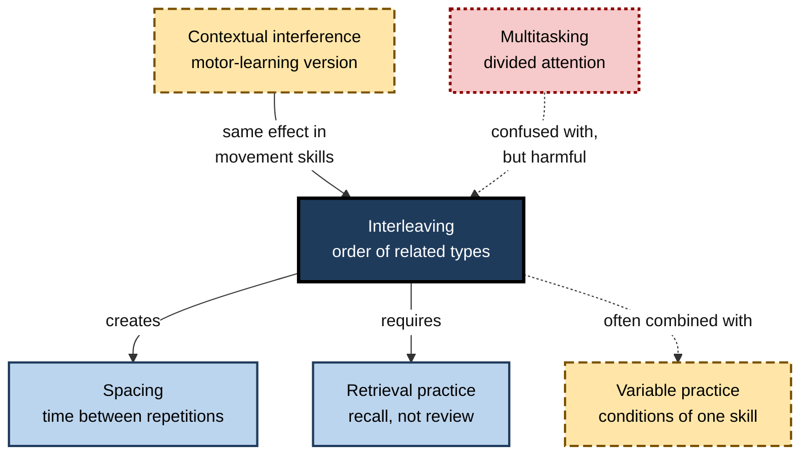
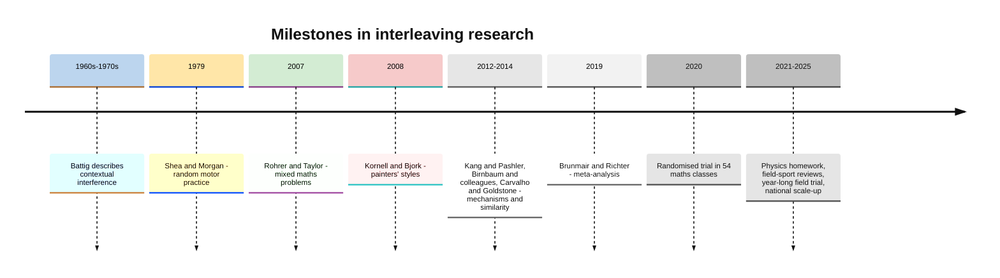
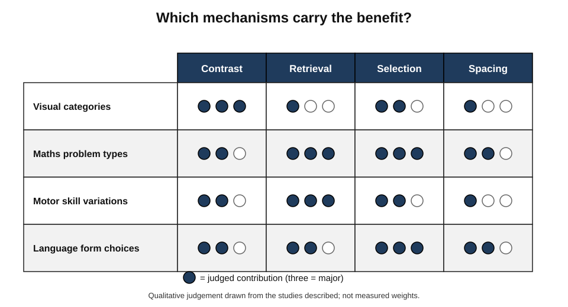
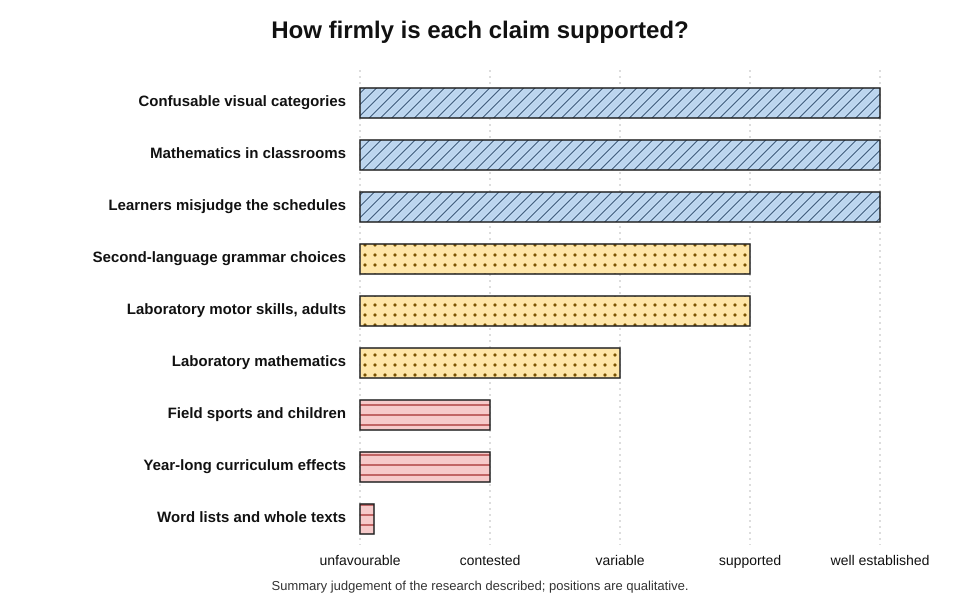
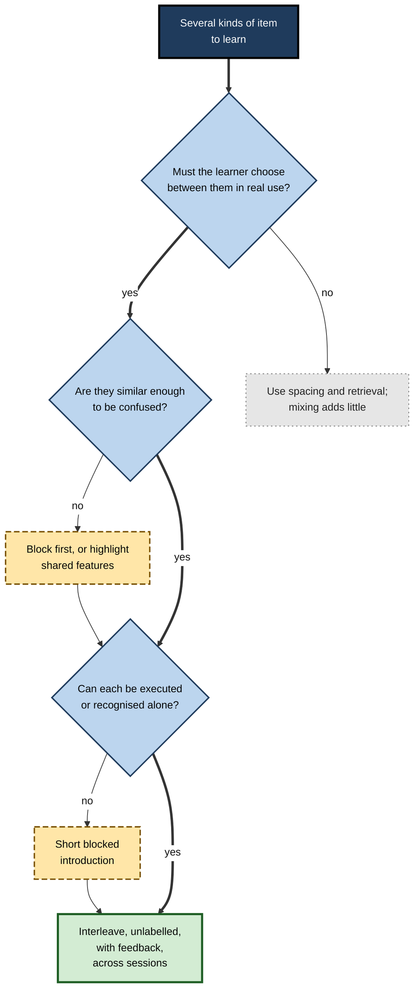
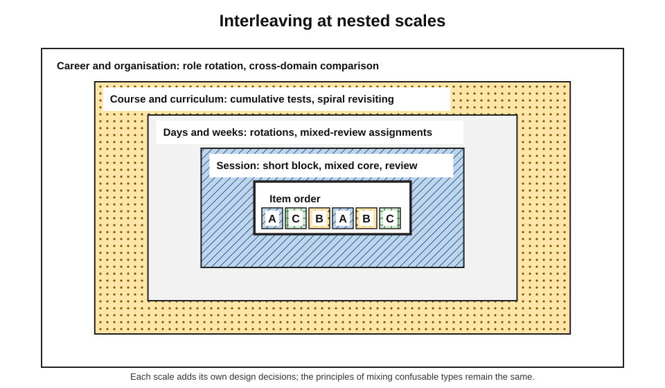
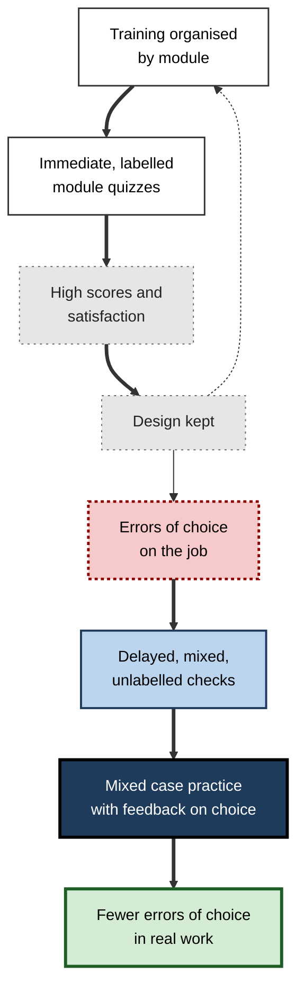

# E. Interleaving

Most practice is arranged in tidy runs: twenty problems on one method, then twenty on the next; a basket of forehands, then a basket of backhands; a week on one disease, then a week on another. The arrangement feels natural, efficient and satisfying. Yet real problems seldom arrive in runs. An examination paper, a ward round, a client meeting or a production incident presents one thing after another in no particular order, and the first task is always to work out **what kind of problem this is**.

Interleaving is the practice of arranging learning so that it reflects that reality: different but related kinds of item are mixed, so that the learner must recognise, choose and then act.

> **Definition — Interleaving:** arranging study or practice so that items of different but related types are mixed together — for example A, C, B, A, B, C — rather than completed one type at a time (A, A, A, B, B, B, C, C, C), which is **blocked practice**.

**Why it matters**

- **It trains a skill blocked practice removes.** In a blocked set the heading or the previous item announces the method; interleaving makes the learner identify it, which is what real use demands.
- **It can produce large gains at no cost in time.** The same items, reordered, have produced substantially better delayed performance in classroom trials and laboratory studies.
- **It is conditional.** It helps most when types are confusable and does little — or harm — for unrelated material, word lists or whole texts.
- **It defeats intuition.** Learners, teachers and trainers consistently judge blocked practice as more effective, so interleaving is rarely used unless deliberately designed in.
- **It matters across professions.** Diagnosis, triage, inspection, analysis and advice all depend on telling similar cases apart and choosing the right response.

---

## The Subject and Its Scope

### What interleaving covers

- **A principle** — learning to discriminate and choose is strengthened when related types are encountered in mixed order.
- **A family of schedules** — systematic rotation, random order, mixed review, graduated schedules and hybrid designs that begin with short blocks.
- **A set of scales** — mixing items within a category-learning task, problem types within an assignment, topics within a session, subjects across days, skills within a training programme, and cases across domains.
- **A set of boundary conditions** — similarity, learner level, material, feedback and timing, which decide whether the principle applies.

> **Key point:** interleaving is a property of **order**. It changes nothing about the content of practice — only the sequence in which the content is met — and that change alters the mental work each item requires.

### Neighbouring ideas

- **Spacing** — separating repetitions of the same material with time. Interleaving automatically spaces each type, so the two are entangled; experiments separate them with schedules that are spaced but not mixed.
- **Retrieval practice** — strengthening memory by recalling rather than re-reading. Every interleaved item demands retrieval of a method, so interleaved sets are a form of retrieval practice.
- **Variable practice** — changing the conditions of one skill (distance, context, style). Interleaving changes **which** skill or type is practised.
- **Contextual interference** — the motor-learning name for the effect of mixing tasks; in practice it describes the same phenomenon in movement skills.
- **Multitasking** — dividing attention between tasks at once or switching rapidly between unrelated ones; it generally harms learning and is not interleaving.

| Term | What is manipulated | Main benefit | Relation to interleaving |
|---|---|---|---|
| Interleaving | Order of related types | Discrimination and choice | — |
| Spacing | Time between repetitions | Durable retention | Built into interleaving; separable |
| Retrieval practice | Recall instead of review | Stronger, more accessible memory | Each interleaved item is a retrieval |
| Variable practice | Conditions within one skill | Adaptable skill | Often combined; distinct |
| Contextual interference | Order of motor tasks | Retention and transfer | The motor-learning version |
| Multitasking | Simultaneous or rapid switching | None for learning | Often confused; opposite in effect |

**Figure 1.** Interleaving among neighbouring ideas.

---

## Origins and History

### Interference that helps

- **Verbal learning research** in the mid-twentieth century treated interference — one learned item disrupting another — as an enemy of memory.
- **William Battig**, in the 1960s and 1970s, noticed that some kinds of interference during practice, while slowing acquisition, **improved** later retention and transfer. He called it **contextual interference**.
- **John Shea and Robyn Morgan (1979)** showed the effect in motor learning: students learning three movement patterns in random order performed worse during practice but better at retention tests minutes and days later.
- A generation of motor-learning research followed, explaining the effect through **elaboration and distinctiveness** (comparing tasks) and **reconstruction** (rebuilding each action plan after it has been displaced).

### From motor skills to concepts

- **Inductive learning** — learning categories from examples — was long assumed to benefit from blocking, because seeing many examples of one category together makes their common features obvious. Ernst Rothkopf's phrase, that spacing was "the friend of recall, but the enemy of induction", captured the assumption.
- **Nate Kornell and Robert Bjork (2008)** overturned it: interleaving paintings by different artists improved identification of **new** paintings, yet most participants believed blocking had helped them more.
- **Sean Kang and Harold Pashler (2012)** and **Monica Birnbaum and colleagues (2013)** showed that, for such category learning, the benefit comes mainly from **juxtaposing** different categories rather than from spacing.
- **Paulo Carvalho and Robert Goldstone (2014 onwards)** showed that similarity decides the direction: interleaving helps highly similar categories, blocking can help dissimilar ones.

### Into the classroom

- **Doug Rohrer and Kelli Taylor (2007)** found that university students who practised mixed volume problems scored far lower during practice but roughly three times higher a week later than those who practised in blocks.
- A series of classroom studies culminated in a **randomised trial in 54 seventh-grade mathematics classes** (Rohrer, Dedrick, Hartwig and Cheung, 2020): 61% against 38% on an unannounced test a month later, an effect size of about 0.83.
- **Marion Brunmair and Tobias Richter (2019)** pooled the published studies: a medium overall benefit, strongest for visual categories, small and variable for mathematics in the laboratory, and **negative** for word lists.
- **Recent years** have brought both scale-up — a nationally representative trial in the United States was under way by 2025 — and caution, including a year-long field experiment in Nigerian primary schools that found short-term gains but no effect on end-of-year tests, and systematic reviews finding no consistent benefit of random practice in field sports.

**Figure 2.** Milestones in the history of interleaving.

---

## How Interleaving Works

Four mechanisms explain most of the effect. Their relative weight differs by task.

### Discriminative contrast

- Consecutive items of different types invite **comparison**, drawing attention to the features that distinguish them.
- Blocked sequences invite comparison only within a type, highlighting shared features instead.
- **Sequential attention theory** (Carvalho and Goldstone) formalises this: the sequence directs attention, and attention determines what is learned.

> **Definition — Discriminative contrast:** the highlighting of distinguishing features that occurs when examples of different categories are encountered close together.

### Retrieval and reconstruction

- In a blocked run the method is still active from the previous item and can be reused; in a mixed set it must be **retrieved** from memory afresh.
- Effortful retrieval strengthens memory more than easy reuse — a principle captured in Robert and Elizabeth Bjork's distinction between **storage strength** and **retrieval strength**.
- In motor learning the same idea appears as **action-plan reconstruction**.

### Strategy selection and transfer-appropriate processing

- Real problems require **identify → select → execute**; blocked practice trains only the last step.
- Practice that requires the same processes as the eventual test transfers better — the principle of **transfer-appropriate processing**.

### Spacing

- Interleaving separates repetitions of each type, so part of its benefit is the general advantage of spaced over massed practice.
- In visual category learning spacing appears to contribute little beyond juxtaposition; in mathematics both contrast and spacing contribute (Foster and colleagues, 2019).

**Figure 3.** The weight of each mechanism differs by kind of task.

> **Remember:** **contrast** shows the boundary, **retrieval** strengthens each method, **selection** practises the real task, **spacing** keeps it all from fading.

> **Mnemonic — "CRSS — Contrast, Retrieval, Selection, Spacing":** the four mechanisms of interleaving.

---

## The Evidence Base and Its Limits

### What is well established

- **Confusable visual categories** — paintings, birds, skin lesions, ECG rhythms — are learned better with interleaving or side-by-side comparison, tested on new examples.
- **Mathematics in classrooms** — well-designed randomised trials show large benefits of mixed practice on delayed, unannounced tests.
- **The crossover** — blocked practice leads during practice; interleaving leads at delayed and transfer tests.
- **The metacognitive illusion** — learners consistently misjudge the two schedules, and the belief in blocking is hard to correct.

### What is supported but more variable

- **Laboratory mathematics** — small average effects with wide variation between studies.
- **Second-language grammar** — benefits for choices between forms such as tenses, sometimes only when practice is spread across several sessions.
- **Motor skills in the laboratory** — a moderate retention benefit for adults in meta-analyses.
- **Physics and other problem-solving subjects** — encouraging semester-long studies.

### What is contested or unfavourable

- **Field sports and children** — no consistent advantage of random practice in applied sport studies; smaller or absent benefits in children.
- **Long-term, curriculum-wide effects** — a year-long trial without end-of-year benefit; most classroom evidence comes from one research programme.
- **Word lists and expository texts** — negative or null effects; interleaving is the wrong tool.
- **Rule discovery** — some studies, such as French spelling-to-sound rules, found blocking better.

**Figure 4.** How firmly different claims about interleaving are supported.

> **Watch out:** "interleaving works" and "interleaving is a myth" are both wrong. The defensible claim is precise: **interleaving reliably improves learning when learners must discriminate between related, confusable types that they can already execute, with feedback, judged after a delay.**

---

## Boundary Conditions

| Condition | Favours interleaving | Favours blocking or something else |
|---|---|---|
| Similarity between types | High; types easily confused | Low, when shared features within a type are the hard part |
| Learner level | Each method can already be executed | First exposure; novices on complex skills |
| Kind of material | Problem types, categories, grammatical choices, skill variations | Word lists, isolated facts, whole texts |
| Task | Choosing among known rules or responses | Discovering a single simple rule |
| Feedback | Prompt, naming the identifying feature | Absent — wrong choices are practised |
| Timing of judgement | Delayed, mixed, unseen tests | Immediate or blocked tests hide the benefit |
| Duration | Across several sessions | A single session may show no benefit |

**Figure 5.** Deciding whether interleaving is the right tool.

---

## The Metacognitive Obstacle

- **Why learners resist** — interleaved practice is slower, more error-prone and less fluent, and people judge their learning from **fluency, recent success and effort**. Every cue points the wrong way.
- **Why it persists** — even after experiencing the benefit, many learners attribute it to other causes; beliefs shift most when **experience is combined with explanation**.
- **Why organisations drift** — reaction surveys, end-of-module tests and trainer ratings reward the smoothness of blocked designs.
- **What helps** — predicting the dip in advance, explaining the reason, showing the evidence and judging by **delayed, mixed** checks.

> **Key point:** the main barrier to interleaving is not evidence but **perception**. Any serious use of it must plan for the feeling that it is not working.

---

## Designing Interleaved Practice

### Principles that hold at every scale

1. **Map the confusions** — find which types are actually mistaken for which, from errors, examiners, experts and look-alike features.
2. **Introduce, then mix** — a brief blocked introduction to each new type, then mixed practice.
3. **Hide the type** — no headings, tags, file names or predictable rotations that reveal it.
4. **Keep runs short and order unpredictable.**
5. **Place confusable pairs adjacent and include near-misses.**
6. **Give feedback on the choice** — naming the feature that identifies the type — before the answer.
7. **Spread mixing across sessions** and raise its share over time.
8. **Judge by delayed, unseen, mixed checks.**

> **Mnemonic — "MIH-KPF-SJ":** Map, Introduce, Hide — Keep runs short, Pairs adjacent, Feedback on choice — Spread, Judge late.

### Scales of design

- **Item and session** — the order of items within a sitting and the structure of the sitting itself.
- **Days and weeks** — rotations, mixed-review assignments and cumulative checks, where spacing joins discrimination.
- **Course and curriculum** — cumulative assessment, spiral revisiting and mixed final practice.
- **Career and organisation** — role rotation, cross-training and comparison of cases across domains.

**Figure 6.** Interleaving operates at nested scales, from the single item to the career.

- **Across subjects** the picture is consistent: in mathematics the decisive gain is choosing a strategy without the chapter heading; in languages it is choosing between grammatical forms, while word lists gain nothing; in perceptual expertise it is seeing the diagnostic feature; in motor and professional skills it is producing the right action when the situation, not the coach, decides what comes next.
- **Across domains**, the most powerful form is the comparison of cases that share a deep structure under different surfaces — the route by which principles become portable.

---

## Interleaving and the Making of Expertise

### What experts can do that novices cannot

- **They classify by deep structure.** Michelene Chi, Paul Feltovich and Robert Glaser (1981) found that physics novices grouped problems by surface features — springs, inclined planes — while experts grouped them by the principles needed to solve them.
- **They recognise quickly.** Experienced clinicians, inspectors and analysts often identify the kind of case within seconds, before conscious analysis begins; much of this is **perceptual learning** — learning to see the features that matter.
- **They know the boundaries.** Experts can say not only what a category is but what it is **not**, and they attend to the near-misses that mislead others.
- **They choose before they act.** The first step of expert problem-solving is diagnosing the problem type; novices often begin computing at once.

| | Novice | Expert |
|---|---|---|
| Basis of classification | Surface features | Deep structure |
| Speed of recognition | Slow, deliberate | Fast, often perceptual |
| Knowledge of boundaries | Vague | Sharp, including near-misses |
| First step on a new problem | Start a familiar procedure | Identify the kind of problem |
| Typical practice history | Blocked exercises by topic | Years of mixed, unlabelled cases with feedback |

### Interleaving as compressed experience

- In most professions, experts acquired these abilities **incidentally**, through years of cases that arrived in no particular order — naturally interleaved — with feedback from outcomes.
- Deliberately interleaved practice can **compress** part of that experience: it presents mixed, unlabelled cases, with near-misses and prompt feedback, far more densely than ordinary work does.
- It cannot replace experience altogether. Expert judgement also rests on depth of knowledge, tacit context and the variety of real situations; but it can bring the novice's ability to **recognise and choose** much closer to the expert's, much sooner.

> **Key point:** blocked practice builds the **procedures** of a field; interleaved practice builds the **perception** that tells the practitioner which procedure the moment requires. Expertise needs both.

> **Watch out:** experience is not automatically interleaved practice. In **wicked** environments, where feedback is delayed or misleading, years of mixed cases can build confidence without accuracy. Interleaving teaches only when the learner eventually learns which choice was right.

---

## Interleaving in Professional and Organisational Life

### Where it already operates

- **Medicine** — differential diagnosis training with mixed cases; simulation scenarios presenting unpredictable complications.
- **Aviation** — simulator sessions in which failures arrive in unpredictable order.
- **Security and fraud** — classification drills on mixed alerts and transactions.
- **Engineering and software** — debugging and review exercises mixing defect types.
- **Law, tax and audit** — issue-spotting on fact patterns that may engage several areas.
- **Sales and service** — role-plays in which the customer's problem is not announced.

### What organisations can do

- **Build case banks from real work** — anonymised tickets, files, images, calls — tagged but presented unlabelled.
- **Make mixed mode the default** in learning platforms after first exposure.
- **Replace module quizzes with cumulative, mixed checks** some weeks later.
- **Train trainers** to explain the dip and to give feedback on identification.
- **Evaluate with delayed performance**, not reaction sheets.

**Figure 7.** How measurement choices keep organisations in blocked training, and how to break the loop.

### Case study (illustrative): credit analysts and loan-risk patterns

- **Situation:** a bank's credit-analysis academy trained new analysts on five patterns of borrower risk — cash-flow stress, over-leverage, customer concentration, working-capital strain and management or governance concerns — one pattern per week, each with its own case pack.
- **Problem:** in their first year, analysts' recommendations were frequently overturned by senior credit officers, mostly because the **wrong risk pattern** had been identified as the main concern — working-capital strain read as cash-flow stress, concentration risk overlooked in apparently healthy firms.
- **Diagnosis:**
  - each case pack announced its pattern, so analysts had practised analysing a known risk, not **identifying** which risk dominated;
  - the most confusable patterns had never been compared directly;
  - the academy's final assessment was a set of five labelled cases.
- **Actions:**
  1. The weekly structure was kept for first teaching, shortened.
  2. From week three, each day included a **mixed set of short case summaries** from all patterns taught so far, unlabelled; analysts named the dominant pattern and the evidence before any analysis.
  3. **Side-by-side comparisons** were introduced for the confusable pairs, using two firms with similar headline ratios but different underlying risks.
  4. **Near-miss cases** — firms whose ratios looked alarming but whose risks were well mitigated — were added.
  5. Feedback came from senior credit officers and addressed **identification** first.
  6. The final assessment became a **mixed set of unseen cases**, repeated three months into the job.
- **Result:**
  - trainees found the mixed sets demanding, and academy satisfaction scores dipped;
  - the proportion of first-year recommendations overturned for misidentified risk fell noticeably over the following year, and senior officers reported that analysts' written rationales were clearer about why one risk dominated.
- **Side effects:** building the case bank required senior officers' time; the before–after comparison was not randomised.
- **Lesson:** the academy had taught analysts to **analyse** risks; interleaving taught them to **recognise** which one they were looking at.

---

## Interleaving When Tools Can Generate Anything

### New possibilities

- **Unlimited practice items** — AI assistants can generate mixed, unlabelled problems on request and explain why each belongs to its type.
- **Adaptive mixing** — platforms can track confusions and return confused pairs sooner, placing them side by side.
- **Cross-domain comparison** — assistants can produce analogous cases from other fields for comparison.

### New risks

- **Blocked by default** — "give me ten more like this" produces blocked sets; learners must ask for mixing explicitly.
- **Answers without choice** — a tool that names the method removes the step interleaving exists to train.
- **Quality** — generated items may be wrong, ambiguous or reveal their type in their wording.
- **Offloading the identification** — if professionals let tools classify every case, their own discrimination may never develop, leaving them unable to check the tool.

> **In practice:** when tools pre-classify cases, human expertise shifts towards the **borderline** cases the tool finds hardest. Training for that role should be built from interleaved **near-misses**.

---

## Worked Example (illustrative): Auditing a Programme for Interleaving

- **Situation:** a learning manager reviews an eight-week onboarding programme for insurance claims handlers, who must classify and process claims of several types: theft, accidental damage, liability and potential fraud.

| Feature of the programme | Issue | Change |
|---|---|---|
| One claim type per week | Fully blocked | Keep a short first week per type; mixed claims from week two |
| Case files named by type | Labels reveal the answer | Neutral case numbers |
| Fraud taught last | Most confusable type practised least in mixture | Introduce fraud indicators earlier; mix them with genuine claims |
| Feedback only on payment calculation | Identification ignored | Feedback on claim type and deciding evidence first |
| End-of-week quiz on that week's type | Immediate and blocked | Cumulative, unseen mixed check every fortnight |
| Satisfaction survey as main evaluation | Rewards smoothness | Add delayed accuracy on live claims after one and three months |

1. **Map confusions** — supervisors report that accidental damage and liability claims are confused, and that genuine claims with unusual features are flagged as fraud.
2. **Design** — mixed daily sets of eight claim summaries, constrained random order, near-miss genuine claims with fraud-like features.
3. **Explain** — a briefing at the start of week two on why the sets will feel harder.
4. **Measure** — identification accuracy on unseen mixed sets, tracked fortnightly, and error rates on live claims.

> **Formula — Expected change in misclassification:** if 120 of 1,000 live claims were misclassified before the redesign and 75 of 1,000 after, the relative reduction is (120 − 75) ÷ 120 = **37.5%** (hypothetical figures). A comparison group or a second cohort is needed before attributing the whole change to the redesign.

---

## Open Questions

- **What are the relative contributions of contrast, retrieval, selection and spacing?**
  - They differ between visual categories, mathematics and motor skills, and are hard to separate.
- **How can similarity be measured before training begins?**
  - It is the strongest moderator, but practical measures are lacking.
- **What is the best mixture of blocked and interleaved practice, and when should mixing begin?**
  - Rules of thumb exist; direct evidence on optimal proportions and switch points is scarce.
- **Do short-term classroom gains accumulate over years?**
  - Large trials are promising; a year-long trial with no end-of-year effect counsels caution.
- **Why are field-sport results inconsistent?**
  - Task complexity, learner variety and measurement may all contribute.
- **How can metacognitive resistance be overcome durably?**
  - Explanation plus experience helps; lasting change in learners' choices is little studied.
- **How should interleaving be designed into AI-supported learning?**
  - Tools make mixing easy but also make skipping the identification step easy.

---

## Summary

- **Interleaving** mixes related types in practice (A C B A B C); **blocked practice** completes one type at a time. Only the **order** changes, but the learner must now **identify, select and execute**.
- It sits among **spacing** (built in), **retrieval practice** (each item is a retrieval), **variable practice** (conditions of one skill), **contextual interference** (the motor version) and is the opposite of **multitasking**.
- History: **contextual interference** (Battig; Shea and Morgan, 1979) → **category induction** (Kornell and Bjork, 2008; Kang and Pashler, 2012; Carvalho and Goldstone) → **mathematics classrooms** (Rohrer and Taylor, 2007; 54-class trial, 61% vs 38%, d ≈ 0.83) → **meta-analysis** (g ≈ 0.42; strongest for visual categories, negative for word lists).
- Mechanisms: **contrast, retrieval, selection, spacing** — weighted differently by task.
- Evidence: strong for **confusable categories** and **classroom maths**; variable in **laboratory maths, grammar and laboratory motor tasks**; contested for **field sports, children and year-long curricula**; unfavourable for **word lists, texts** and some **rule discovery**.
- **Boundary conditions:** similarity, learner level, material, task, feedback, timing and duration.
- The main obstacle is **metacognitive**: interleaving feels worse while working better; explain the dip and judge by **delayed, mixed** checks.
- Design: **map confusions, introduce then mix, hide the type, short runs, adjacent pairs and near-misses, feedback on choice, spread across sessions, judge late** — at every scale from the item to the career.
- Interleaving helps build the expert's ability to classify by **deep structure**, recognise quickly and know the boundaries — **compressing** part of what experience teaches, provided feedback is available.
- In organisations, measurement choices sustain blocked training; case banks, mixed defaults and delayed checks break the loop. AI makes mixing easy but can also remove the identification step.

---

## Self-Check

1. Define interleaving and blocked practice, and explain why changing only the order changes the learning.
2. Distinguish interleaving from spacing, retrieval practice, variable practice and multitasking.
3. Outline the history of interleaving research from contextual interference to classroom trials.
4. Explain the four mechanisms by which interleaving works and how their weight differs by task.
5. What did Brunmair and Richter's meta-analysis find?
6. Which claims about interleaving are well established, which are variable, and which are contested?
7. List the main boundary conditions and the direction of each.
8. Why do learners and organisations resist interleaving, and what helps?
9. State the principles of interleaved design that hold at every scale.
10. In the credit-analyst case, what had the original programme failed to train, and how was it fixed?
11. What new possibilities and risks does AI bring to interleaving?
12. A colleague says "interleaving is proven to work for everything". Give a precise correction.
13. An organisation reports a 30% fall in errors after redesigning training with interleaving. What else would you want to know before attributing the fall to interleaving?
14. How do experts and novices differ in classifying problems, and how can interleaving help close the gap?

### Answer Key

1. Interleaving mixes related types (A C B A B C); blocked practice completes one type before the next. In blocked practice the context reveals the type, so only execution is practised; mixing forces identification and selection, and invites comparison and retrieval.
2. Spacing manipulates time between repetitions (interleaving creates it); retrieval practice replaces review with recall (each interleaved item requires it); variable practice changes conditions of one skill (interleaving changes which skill); multitasking divides attention between usually unrelated tasks and harms learning.
3. Battig's contextual interference; Shea and Morgan's motor studies (1979); the assumption that blocking aids induction overturned by Kornell and Bjork (2008); mechanism studies by Kang and Pashler, Birnbaum and colleagues, and Carvalho and Goldstone; mathematics studies by Rohrer and Taylor (2007) leading to a 54-class randomised trial (2020); a meta-analysis (2019); recent scale-up and cautionary field results.
4. Contrast (juxtaposition highlights distinguishing features; dominant in visual categories); retrieval and reconstruction (methods must be recalled; important in maths and motor skills); selection and transfer-appropriate processing (practice matches the real task); spacing (repetitions separated; contributes in maths, less in visual categories).
5. A medium overall benefit (g ≈ 0.42), strongest for visual materials such as paintings, small and variable for mathematical tasks, negative for words and absent for expository texts, with similarity between categories as the key moderator.
6. Established: confusable visual categories, classroom maths, the crossover, the metacognitive illusion. Variable: laboratory maths, second-language grammar, laboratory motor tasks, physics. Contested or unfavourable: field sports and children, year-long curricula, word lists and texts, some rule discovery.
7. High similarity, prior ability to execute each method, material involving choice, application of known rules, feedback on choice, delayed mixed tests and multiple sessions favour interleaving; low similarity, first exposure, word lists and texts, single-rule discovery, no feedback and immediate tests do not.
8. Interleaving reduces fluency, success and ease — the cues people use to judge learning — and organisations measure satisfaction and immediate performance. Predicting the dip, explaining the reason, showing evidence and judging by delayed mixed checks help.
9. Map confusions; introduce then mix; hide the type; keep runs short and order unpredictable; place confusable pairs adjacent and include near-misses; give feedback on the choice; spread mixing across sessions and raise its share; judge by delayed, unseen, mixed checks.
10. Identifying which risk pattern dominated a case. Fixed by mixed, unlabelled daily case summaries, side-by-side comparisons of confusable patterns, near-miss cases, identification-first feedback and mixed unseen assessments repeated on the job.
11. Possibilities: unlimited mixed items with explanations, adaptive return of confused pairs, cross-domain comparison cases. Risks: blocked sets by default, tools naming the method, poor-quality items, and professionals offloading identification so that their own discrimination never develops.
12. Interleaving reliably helps when learners must discriminate between related, confusable types they can already execute, with feedback, judged after a delay; it helps little or harms for unrelated material, word lists, whole texts and some rule learning, and evidence is mixed in field sports and for children.
13. Whether there was a comparison group or randomisation; whether other changes occurred at the same time; how errors were measured and over what period; whether the cases or staff differed; whether the effect persisted; and whether errors of identification specifically fell.
14. Novices classify by surface features, experts by deep structure; experts recognise quickly and know category boundaries. Interleaved practice with near-misses and feedback presents mixed, unlabelled cases densely, training recognition by structure — compressing part of what years of experience provide.

---

## Glossary

| Term | Meaning |
|---|---|
| Blocked practice | Completing all items of one type before the next. |
| Boundary condition | A circumstance that determines whether an effect occurs. |
| Contextual interference | Disruption from mixing tasks that slows practice but aids retention and transfer. |
| Crossover | Blocked practice leading during practice, interleaving leading at a delayed test. |
| Discriminative contrast | Highlighting of distinguishing features when different categories are juxtaposed. |
| Deep structure | The underlying principle a problem requires, as opposed to its surface features. |
| Hedges' g | A standardised effect size with a small-sample correction. |
| Inductive learning | Learning categories or concepts from examples. |
| Interleaving | Mixing related types of item within practice. |
| Juxtaposition | Placing examples of different categories next to each other. |
| Mixed review | Practice combining new items with items of earlier types. |
| Near-miss | An example resembling one type but belonging to another. |
| Perceptual learning | Learning to detect the features that distinguish categories. |
| Retrieval strength | Current accessibility of a memory. |
| Sequential attention theory | Account that order of examples directs attention to similarities or differences. |
| Spacing | Separating repetitions of the same material with time. |
| Storage strength | How durably a memory is established. |
| Strategy selection | Choosing a method from a problem's features. |
| Transfer-appropriate processing | Principle that learning transfers best when practice and test processes match. |
| Variable practice | Practising one skill under varied conditions. |
