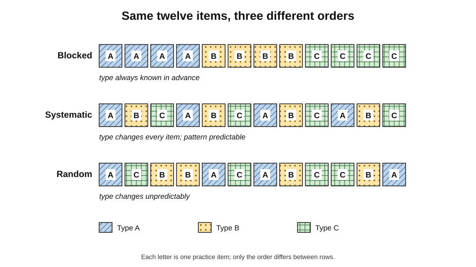
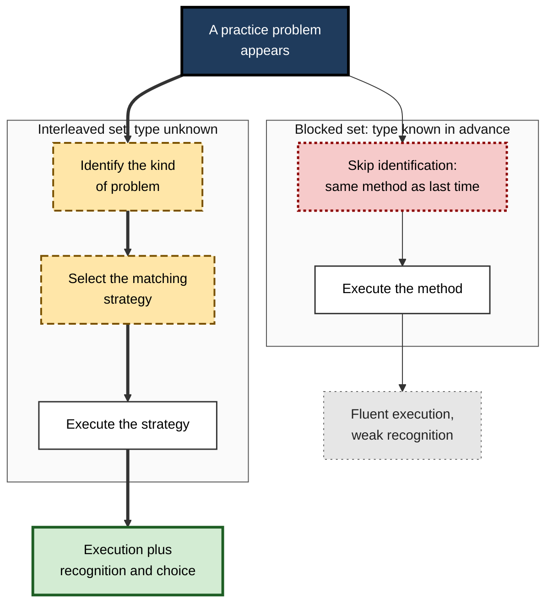
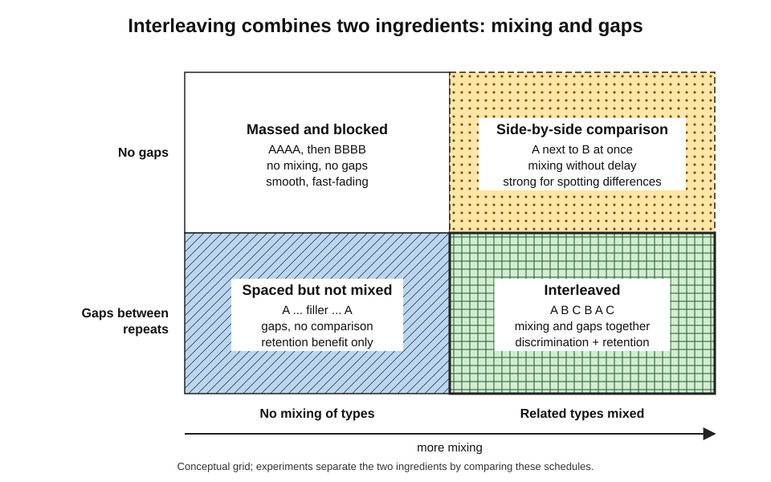
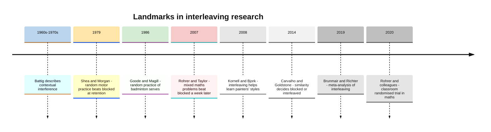
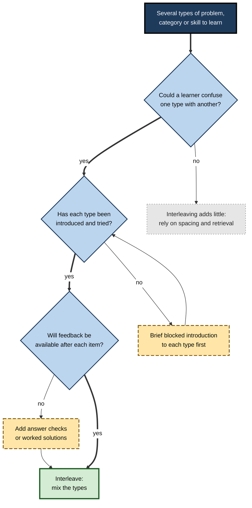
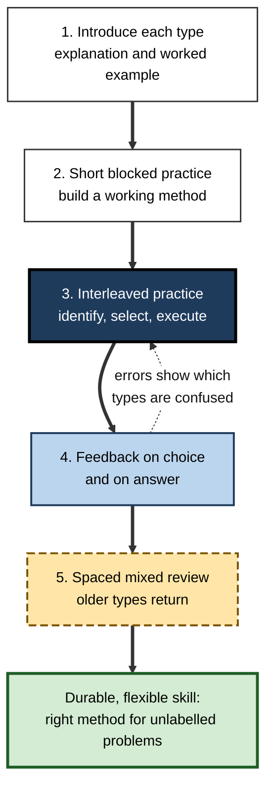

# E.1. What is Interleaving?

A mathematics textbook ends its chapter on percentages with twenty percentage problems; the next chapter ends with twenty ratio problems. A student who works through both sets scores well, then meets a mixed exam paper and freezes: the questions no longer announce which method they need. A trainee radiologist who has looked at fifty fractures in one afternoon and fifty tumours the next morning faces the same difficulty on the ward, where cases arrive in no particular order.

**Interleaving** is the practice of arranging study so that the learner meets different kinds of problem mixed together, as reality presents them.

> **Definition — Interleaving (interleaved practice):** arranging practice or study so that items of different but related types are mixed together within a session or sequence — for example A, B, C, B, A, C — instead of being completed one type at a time.

> **Definition — Blocked practice:** arranging practice so that all items of one type are completed before moving to the next type — for example A, A, A, B, B, B, C, C, C.

**Why it matters**

- It trains a skill that blocked practice quietly removes: **recognising which kind of problem is in front of you** and choosing the right approach.
- Across many studies it improves performance on **delayed** tests and on **new** examples, especially when the types being mixed are easily confused.
- It costs nothing extra: the same practice items are simply **reordered**.
- It runs against intuition. Learners, teachers and trainers almost always prefer blocking because it feels smoother — so most study materials are blocked by default.
- It is not universally helpful, and knowing **when** it helps is as important as knowing that it can.

---

## Interleaving in Everyday and Working Life

People interleave constantly without naming it. The work of a study method is to make deliberate what everyday life does by accident.

**Ordinary situations that are naturally interleaved**

- **Driving in traffic** — a driver must respond to a roundabout, then a cyclist, then a red light, then a merging lorry, in an order nobody chooses.
- **Cooking for a family** — chopping, frying, seasoning and timing are switched between continually, not done in tidy blocks.
- **Playing a racket sport** — each shot from the opponent may require a different stroke.
- **Conversation in a foreign language** — the speaker must choose the right tense, case or register sentence by sentence.

**Working situations that are naturally interleaved**

- **An IT service desk** — a password reset, then a printer fault, then a suspected phishing email, then a licensing query.
- **General practice in medicine** — a cough, a rash, a blood-pressure review and a mental-health concern in a single morning.
- **Audit and accounting** — revenue recognition, lease classification and impairment questions arising in the same set of accounts.
- **Software maintenance** — a null-reference bug, a race condition and a configuration error reported on the same day.
- **Legal advice** — a client's question that may be a contract matter, a tort matter or an employment matter, and must first be classified.

> **Key point:** in almost all real work, **problems do not come labelled**. Deciding what kind of problem one faces is part of the skill — and it is the part that blocked practice never exercises.

---

## The Vocabulary of Practice Schedules

Interleaving is a property of the **order** in which practice is arranged. A small vocabulary makes the idea precise.

### Items, types and blocks

- **Practice item** — a single problem, question, example, case or repetition.
  - *e.g.* one equation to solve; one painting to classify; one golf swing.
- **Type (category)** — a group of items that share a solution method, a label or a skill.
  - *e.g.* "problems solved with the Pythagorean theorem"; "paintings by Braque"; "chip shots".
- **Block** — an uninterrupted run of items of the same type.
- **Schedule** — the full sequence of items across a session or a course.

> **Definition — Practice schedule:** the order and timing in which practice items of different types are presented to a learner.

### Kinds of schedule

- **Blocked** — one type at a time: AAAA BBBB CCCC.
  - The type of each item is known in advance; the learner simply repeats one method.
- **Systematically interleaved** — types alternate in a fixed rotation: ABC ABC ABC ABC.
  - Each new item is a different type from the last; the pattern itself is predictable.
- **Randomly interleaved** — types are shuffled: A C B B A C A B C C B A.
  - Neither the next type nor the pattern can be predicted.
- **Mixed review (cumulative)** — each practice set contains a few items of the newest type plus items from earlier types.
  - The common form in well-designed mathematics homework.
- **Hybrid** — a short blocked introduction to each type, followed by interleaved practice.

**Figure 1.** Three ways of ordering the same twelve practice items of three types.

> **Remember:** blocked, systematic and random schedules can contain **exactly the same items**. Only the **order** differs — and the order changes what is learned.

### Levels at which interleaving can happen

- **Items within a category-learning task** — mixing examples of several categories.
  - *e.g.* bird species, skin lesions, architectural styles, fraud patterns.
- **Problem types within a subject** — mixing problems that need different methods.
  - *e.g.* volume of a cone, a cylinder and a sphere.
- **Topics within a session** — alternating among several related topics in one sitting.
  - *e.g.* contract formation, misrepresentation and remedies in a law revision session.
- **Subjects across days** — rotating several subjects through a week instead of devoting whole weeks to each.
- **Skills within a training programme** — alternating variations of a motor or professional skill.
  - *e.g.* forehand, backhand and volley; three different negotiation scenarios.

> **Watch out:** the word "interleaving" is used loosely for all five levels. The strongest evidence concerns the first two — **mixing confusable categories and problem types**. Mixing unrelated subjects across a week may be useful for other reasons, but it is a different thing.

---

## What Interleaving Changes

### The three demands of a real problem

Solving any problem outside a textbook requires three steps.

1. **Identify** — recognise what kind of problem it is.
   - *e.g.* "This is a present-value question, not an interest-rate question."
2. **Select** — choose the strategy, formula, rule or procedure that fits that kind.
   - *e.g.* "Discount each cash flow and sum them."
3. **Execute** — carry the strategy out correctly.
   - *e.g.* the arithmetic, the coding, the physical movement.

**Figure 2.** The steps a learner practises under blocked and under interleaved schedules.

### How blocking hides the first two steps

- In a blocked set, **the context answers the identification question**.
  - The chapter heading, the page, or simply the previous five problems tell the learner which method to use.
- The learner can therefore succeed by **repeating the method mechanically**, without ever noticing the features that signal when it applies.
- The skill practised is **execution**; the skill needed later is **identification + selection + execution**.

> **Example (illustrative):** a trainee accountant practises twenty depreciation calculations in a row and gets them all right. In the exam a question describes a machine bought, used for three years and sold. The trainee must first realise this is a disposal question needing depreciation, carrying value **and** gain or loss — and has never practised deciding that.

> **Definition — Strategy selection:** choosing the appropriate method for a problem on the basis of its features; the step that interleaved practice requires and blocked practice usually removes.

### What the learner notices

- **Under blocking** the learner tends to attend to what items of the same type **have in common**.
  - Useful for discovering what a category is like.
- **Under interleaving** the learner tends to attend to what distinguishes one type **from another**.
  - Useful for telling categories apart.
- Paulo Carvalho and Robert Goldstone described this as a shift of attention: blocked study draws attention to **similarities within** a category, interleaved study to **differences between** categories.

> **Key point:** interleaving is not just harder practice; it is practice of a **different skill** — discrimination and choice.

---

## Interleaving and Its Neighbours

Several study ideas are often confused with interleaving. They overlap, but they are not the same.

### Spacing

- **Spacing** means separating repetitions of the same material with time.
- Interleaving **automatically spaces** each type: in ABCABC, the second A comes after B and C.
- So any interleaving benefit could, in principle, be a spacing benefit in disguise.
- Researchers separate the two by building schedules that are **spaced but not interleaved** (the gaps filled with unrelated material) and comparing them with interleaved schedules.
  - Where the types are confusable, interleaving usually adds a benefit **beyond** spacing; where they are not, the benefit often reduces to spacing alone.

### Variability

- **Varied practice** changes the conditions of a single skill.
  - *e.g.* throwing at targets at different distances; reading code in several styles.
- **Interleaving** mixes **different skills or types**.
- The two often travel together, and in motor learning the terms are sometimes used interchangeably.

### Multitasking

- **Multitasking** means attempting two tasks at the same moment, or switching between unrelated tasks every few seconds.
  - *e.g.* answering messages while reading a report.
- Interleaving completes each item fully before moving on, and the items are **related** — chosen so that comparing them is useful.

### Shuffling and randomness

- Randomisation is one way of interleaving, not its definition.
- A fixed rotation (ABCABC) can work as well as, or better than, true random order, and is easier to plan.

| | Interleaving | Spacing | Varied practice | Multitasking |
|---|---|---|---|---|
| What is manipulated | Order of different types | Time between repetitions | Conditions of one skill | Simultaneous or rapid switching between tasks |
| Typical sequence | A B C B A C | A … A … A | A₁ A₂ A₃ | A/B/A/B every few seconds |
| Main benefit | Discrimination and strategy choice | Durable retention | Flexible, adaptable skill | None for learning; usually a cost |
| Items related? | Yes, deliberately | Not necessarily | Variants of one skill | Usually unrelated |

**Figure 3.** Interleaving separated from spacing: mixing and time gaps are two distinct ingredients.

> **Watch out:** "I study three subjects a day, so I am interleaving" is only half true. Rotating unrelated subjects is mainly **spacing**. The distinctive benefit of interleaving comes from mixing types that the learner must **tell apart**.

---

## Origins of the Idea

The idea grew from two separate research traditions — motor skill and verbal learning — that converged in the 2000s.

### Contextual interference in motor learning

- **William Battig (1960s and 1970s)** noticed in verbal-learning experiments that conditions creating **interference** during practice — making it harder — sometimes improved later retention and transfer.
  - He called this **contextual interference**.
- The idea was taken up in motor learning, where "interference" meant switching between different movement tasks.

> **Definition — Contextual interference:** the disruption to performance during practice caused by switching among several tasks or variations; high contextual interference (random order) usually slows acquisition but can improve retention and transfer.

**Study card — Shea and Morgan (1979)**

- **Design:** university students learned three movement patterns — knocking down small barriers with the hand in a set sequence as fast as possible.
  - **Blocked group** — practised one pattern at a time.
  - **Random group** — practised the three patterns in an unpredictable order.
- **Results:**
  - During practice the **blocked** group was faster.
  - On retention tests given minutes later and again days later, the **random** group was faster — the advantage reversed.
  - The random group also coped better with new, more complex patterns (transfer).
- **Conclusion:** the schedule that made practice look worse made learning better.

### Induction and category learning

- Verbal-learning researchers long assumed that blocking would help people learn **concepts** from examples, because seeing examples of one category together makes their common features obvious.
- Ernst Rothkopf captured this assumption in a phrase quoted by later researchers: spacing is "the friend of recall, but the enemy of induction".

> **Definition — Induction (inductive learning):** learning a general concept or category from specific examples, without being told the rule.

**Study card — Kornell and Bjork (2008)**

- **Design:** participants studied paintings by twelve little-known artists.
  - For some artists the paintings were shown **blocked** (all by one artist together); for others **interleaved** with other artists.
- **Test:** participants were shown **new** paintings, never seen before, and asked to name the artist.
- **Results:**
  - Interleaved study produced **better** identification of the new paintings.
  - Yet most participants **believed** blocking had helped them more.
- **Conclusion:** interleaving helps induction, contrary to the long-held assumption — and learners' intuitions point the wrong way.

### Interleaved mathematics practice

**Study card — Rohrer and Taylor (2007)**

- **Design:** university students learned to find the volumes of four unusual solids (such as a wedge and a spherical cone).
  - **Blocked group** — practice problems grouped by solid.
  - **Mixed group** — the same problems shuffled.
- **Results:**
  - During practice the blocked group scored far higher (about 89% against 60%).
  - On a test a week later the result reversed sharply (about 63% for the mixed group against 20% for the blocked group).
- **Conclusion:** mixing problem types lowered practice scores but greatly improved later performance — largely because the blocked group had never practised choosing which formula to use.

**Figure 4.** Landmarks in the research on interleaving.

---

## What the Evidence Says, in Brief

### The overall pattern

- **Meta-analysis — Marion Brunmair and Tobias Richter (2019)** pooled published studies of interleaved versus blocked learning.
  - Overall effect: **medium and positive** (Hedges' g of about 0.42).
  - **Strong** for visual categories such as paintings.
  - **Small and variable** for mathematical tasks, with some individual studies negative.
  - **Negative** for learning lists of words, and no benefit for expository texts.
  - The key moderator was **similarity between categories**: the more alike the categories, the more interleaving helped.
- **Classroom trial — Rohrer, Dedrick, Hartwig and Cheung (2020)**
  - 54 seventh-grade mathematics classes, randomly assigned.
  - Classes with mostly interleaved homework scored 61% against 38% on an unannounced test about a month later — a large effect (d ≈ 0.83).

> **Definition — Hedges' g:** a standardised effect size — the difference between two group means divided by their pooled standard deviation, with a small-sample correction. Around 0.2 is conventionally small, 0.5 medium and 0.8 large.

| Kind of material | Typical effect of interleaving | Why |
|---|---|---|
| Confusable visual categories (art styles, species, skin lesions, X-ray findings) | Clearly positive | Learning depends on spotting subtle differences between categories |
| Mathematics and physics problem types | Positive, often large in classroom trials; variable in the laboratory | Learner must choose a method; similar-looking problems need different solutions |
| Motor skills | Positive in laboratory tasks; inconsistent in field sports and in children | Depends on task complexity and learner level |
| Lists of words, vocabulary pairs | Neutral to negative | Little to discriminate; switching adds load without benefit |
| Expository prose (textbook chapters) | No clear benefit | Understanding a text depends on its internal coherence, which mixing breaks |

> **Watch out:** "interleaving works" is too strong. The defensible claim is: **interleaving reliably helps when learners must discriminate between related, confusable types — and often does little or harm when they need not.**

> **Mnemonic — "MIX when they're TWINS":** interleave types that look like twins — similar on the surface, different underneath.

---

## The Paradox of Felt Difficulty

- During interleaved practice learners make **more errors**, work **more slowly** and feel **less confident**.
- These are signs of **performance**, not of **learning**; the benefit appears on delayed and novel tests.
- Learners therefore judge interleaving to be less effective — in Kornell and Bjork's study, and in many since, most participants rated blocking as better even when their own scores showed the opposite.

> **Definition — Desirable difficulty (Robert Bjork):** a condition that makes practice harder and slower in the short term but improves long-term retention or transfer, provided the learner can eventually succeed.

> **Key point:** interleaving is a classic desirable difficulty. A learner who judges it by how practice **feels** will abandon it; one who judges it by **delayed results** will keep it.

---

## When Interleaving Is the Right Tool

### Conditions that favour interleaving

- **The types are confusable.** They look alike on the surface but require different responses.
  - *e.g.* the preterite and imperfect tenses in Spanish; atrial fibrillation and atrial flutter on an ECG; revenue and capital expenditure.
- **The real task requires choosing.** Problems will arrive unlabelled in the exam or the job.
- **Each type has been introduced.** The learner knows, at least roughly, how each method works.
- **There is feedback.** The learner finds out quickly whether the choice and the answer were right.
- **Learning will be tested later.** The goal is retention over weeks and transfer to new cases, not a smooth session today.

### Conditions that favour blocking, at least at first

- **Complete novices** meeting a new method for the first time.
  - A short blocked introduction lets them build a working version of the method.
- **Highly dissimilar categories** — where the challenge is to notice what members of a category share.
  - Carvalho and Goldstone found that for categories with **low** similarity, blocked study helped more.
- **Simple verbal memorisation** — such as single vocabulary pairs.
- **Rule discovery with a simple, verbalisable rule** — some studies find blocking helps learners notice the rule.

**Figure 5.** Deciding whether to interleave a set of practice material.

> **Remember:** **introduce** (blocked, briefly) → **mix** (interleaved, with feedback) → **revisit** (mixed, spaced over weeks).

---

## A First Interleaved Practice Set

### Worked example (illustrative): rebuilding a finance exercise set

- **Situation:** a corporate-finance course gives trainees three blocked exercise sets of six problems each — **net present value (NPV)**, **internal rate of return (IRR)** and **payback period**. Trainees do well on each set but mix the methods up in case-study exams.

1. **List the types and what signals each.**
   - NPV — a discount rate is given and the question asks for value created.
   - IRR — the question asks for the rate at which the project breaks even.
   - Payback — the question asks how long until the initial outlay is recovered.
2. **Keep a short blocked introduction.**
   - The first two problems of each type stay together in the teaching session, with a worked example.
3. **Interleave the remaining twelve problems.**
   - Order them so that no type appears twice in a row and no predictable pattern emerges.
4. **Remove the labels.**
   - Problems no longer sit under headings "NPV", "IRR", "Payback".
5. **Add a "which method?" step.**
   - Before solving, trainees write the method they will use and the feature that told them.
6. **Provide feedback after each problem**, including on the choice of method.
7. **Repeat a smaller mixed set a week later**, adding earlier topics such as annuities.

| | Original (blocked) | Rebuilt (interleaved) |
|---|---|---|
| Order | 6 NPV, then 6 IRR, then 6 payback | 2 + 2 + 2 introductory, then 12 mixed |
| Labels | Each set headed by its method | No headings; method chosen by the trainee |
| Skill practised | Executing a known method | Identifying, selecting and executing |
| Practice accuracy | High | Lower, with errors of method choice |
| Expected delayed performance | Weaker on mixed case questions | Stronger on mixed case questions |

- **Conclusion:** the rebuilt set contains the **same problems**, yet practises the skill the exam requires.

> **Watch out:** trainees may complain that the new set is "confusing". That confusion is the identification step being practised for the first time; it is not evidence that the method is failing.

---

## Interleaving in Professional Practice

### How professionals use it

- **Clinical education** — mixing cases of similar-looking conditions (for example different heart rhythms, or different skin lesions) in practice sets, instead of studying one condition per week.
- **Aviation and emergency services** — simulator sessions that present failures in unpredictable order, so that crews must diagnose before acting.
- **Software engineering** — code-review exercises mixing several kinds of defect, so that reviewers learn to recognise which kind they are seeing.
- **Professional examinations** — question banks used in "mixed" mode rather than chapter by chapter in the final months before an exam.
- **Sales and consulting** — role-plays in which the client objection is not announced in advance (price, timing, authority, need).

> **In practice:** the simplest professional test is to ask, "In the real job, will the problem tell me what kind it is?" If not, practice should not tell the learner either.

**Figure 6.** Where interleaving sits in a sequence of learning a set of related methods.

### Case study (illustrative): triage training on an IT service desk

- **Situation:** a managed-services firm trained new service-desk analysts in a two-week course organised by ticket category — a day on access problems, a day on networking, a day on email, a day on security incidents.
- **Problem:** in their first month, analysts frequently **misrouted** tickets. A suspected phishing report was treated as an email-delivery fault; a VPN issue was handled as a password problem. Each misroute cost time and, in security cases, risk.
- **Diagnosis:**
  - every practice ticket during the course had arrived **under its category heading**;
  - analysts had practised **resolving** each category but never **classifying** tickets that arrived mixed;
  - the categories most often confused (phishing versus spam; VPN versus account lock-out) had never been placed side by side.
- **Actions:**
  1. Category days were kept for the **first exposure** to each area, shortened by a third.
  2. From the second week, practice queues mixed **realistic tickets from all categories** in random order, written from anonymised real tickets.
  3. Before resolving a ticket, each trainee recorded its **category and the clue** that indicated it.
  4. Confusable pairs were deliberately placed **next to each other** in the queue.
  5. Supervisors gave feedback on **classification** first and resolution second.
  6. A short mixed queue was repeated in weeks four and eight on the job.
- **Result:**
  - practice accuracy during the course fell, and trainees rated the second week as "much harder";
  - misrouting in the first month on the job fell markedly, and analysts reached independent working sooner.
- **Side effects:** the course needed a larger bank of realistic tickets, which took time to build and maintain.
- **Lesson:** where work arrives unlabelled, training that arrives labelled teaches only half the job.

---

## Open Questions

- **Exactly why does interleaving work?**
  - Discrimination between categories, the extra spacing it creates, and the repeated retrieval of a method all contribute; their relative weight varies by task and is still debated.
- **How similar must types be?**
  - Similarity clearly matters, but there is no agreed way to measure it before a course begins.
- **How should blocked and interleaved phases be combined?**
  - Many studies compare pure schedules; the best mixture for novices — and the right moment to switch — is not settled.
- **Does it scale?**
  - Large classroom trials in mathematics are encouraging, but a year-long trial in Nigerian primary schools found short-term gains that did not show on cumulative end-of-year tests; effects may vary with context and learner level.
- **What happens in complex professional skills?**
  - Most evidence comes from short tasks with clear categories; evidence from long, messy professional skills is thinner.

---

## Summary

- **Interleaving** mixes different but related types of item within practice (A B C B A C); **blocked practice** completes one type at a time (AAA BBB CCC). The items can be identical — only the **order** changes.
- Schedules can be **blocked**, **systematically interleaved**, **randomly interleaved**, **mixed review** or **hybrid**; interleaving can happen at the level of items, problem types, topics, subjects or skills.
- Real problems require **identify → select → execute**. Blocking lets context do the identifying; interleaving makes the learner practise **strategy selection**.
- Blocking draws attention to **similarities within** a type; interleaving to **differences between** types.
- Interleaving is distinct from **spacing** (time gaps), **varied practice** (conditions of one skill) and **multitasking** (simultaneous or rapid switching between unrelated tasks).
- Roots: **contextual interference** (Battig; Shea and Morgan, 1979), **category induction** (Kornell and Bjork, 2008), **mathematics** (Rohrer and Taylor, 2007; Rohrer and colleagues, 2020).
- Meta-analysis: medium overall benefit (g ≈ 0.42), strongest for **confusable visual categories**, smaller and variable for maths in the laboratory, **negative for word lists**. **Similarity** is the key moderator.
- Interleaving is a **desirable difficulty**: practice feels worse, delayed learning is better, and learners misjudge it.
- Use it when types are **confusable**, choice is **required**, basics are **known** and **feedback** is available; begin novices with a brief blocked introduction.

---

## Self-Check

1. Define interleaving and blocked practice, and give an example sequence for each.
2. What is the difference between systematic and random interleaving?
3. Name the three steps involved in solving an unlabelled problem. Which step does blocked practice usually remove, and how?
4. Why might an interleaving benefit really be a spacing benefit, and how do researchers tell the two apart?
5. Distinguish interleaving from varied practice and from multitasking.
6. Describe the design and results of Shea and Morgan (1979).
7. What did Kornell and Bjork (2008) find, and why was it surprising?
8. Summarise the results of Rohrer and Taylor (2007), including what happened during practice and at the test.
9. According to Brunmair and Richter (2019), for which materials does interleaving help most and for which does it help least or harm?
10. Give three conditions under which interleaving is likely to help, and two under which blocking may be better.
11. A student rotates history, chemistry and French through each evening and says she is "interleaving". Evaluate the claim.
12. A training manager says, "Trainees scored worse on the mixed practice set, so we are going back to blocked sets." What is wrong with this reasoning, and what evidence should the manager collect instead?
13. Design the first interleaved practice set for a new employee learning three types of customer complaint that need different responses.

### Answer Key

1. Interleaving mixes related types within practice (A B C A C B); blocked practice completes one type before the next (A A A B B B C C C). Example: mixing area, perimeter and volume problems versus doing ten of each in turn.
2. Systematic interleaving rotates types in a fixed pattern (ABCABC), so each item differs from the last but the pattern is predictable; random interleaving shuffles types so neither the next type nor the pattern can be predicted.
3. Identify the kind of problem, select a strategy, execute it. Blocking removes identification (and largely selection), because the heading or the previous problems announce the method.
4. Interleaving automatically separates repetitions of each type, which is spacing. Researchers compare interleaved schedules with schedules that are equally spaced but not interleaved (gaps filled with unrelated material); a further benefit for interleaving indicates something beyond spacing, typically discrimination.
5. Varied practice changes conditions within one skill (throwing at different distances); interleaving mixes different skills or types. Multitasking means simultaneous or rapid switching between usually unrelated tasks and generally harms learning; interleaving finishes each related item before moving on.
6. Students learned three barrier-knockdown movement patterns in blocked or random order. Blocked practice was faster during acquisition; random practice was faster on retention tests minutes and days later and transferred better to new patterns.
7. Interleaving paintings by different artists improved classification of new paintings compared with blocking — surprising because blocking had long been assumed to aid induction — and most participants wrongly believed blocking had helped them more.
8. Students learned volumes of four unusual solids. Blocked practice scored about 89% versus 60% for mixed during practice, but a week later mixed scored about 63% versus 20% for blocked.
9. Most: confusable visual categories such as paintings. Least: lists of words (a negative effect) and expository texts (no benefit); maths showed small, variable effects in laboratory studies.
10. Helps: confusable types; real task requires choosing a method; each type already introduced; feedback available; delayed testing. Blocking may be better: complete novices meeting a method for the first time; categories with low similarity; simple word-list memorisation.
11. Partly true. Rotating unrelated subjects mainly creates spacing; there is little to discriminate between history and chemistry. Interleaving's distinctive benefit would come from mixing related, confusable material within a subject, such as different types of chemistry calculation or French past tenses.
12. Practice scores measure performance during training, which interleaving is expected to lower. The manager should compare delayed (weeks later), unaided performance on mixed, unlabelled tasks — ideally on-the-job measures — between blocked and interleaved groups.
13. For example: briefly introduce each complaint type (billing error, service fault, policy dispute) with one worked example each; then present twelve anonymised complaints in random order without labels; require the employee to name the type and the clue before responding; give feedback on classification and response; place the most confusable pairs side by side; repeat a smaller mixed set a week later.

---

## Glossary

| Term | Meaning |
|---|---|
| Block | An uninterrupted run of practice items of the same type. |
| Blocked practice | Completing all items of one type before moving to the next. |
| Contextual interference | Disruption during practice caused by switching among tasks; high levels can improve retention and transfer. |
| Cumulative (mixed) review | Practice sets that combine new items with items of earlier types. |
| Desirable difficulty | A condition that makes practice harder now but improves long-term learning. |
| Discrimination | Telling apart items or categories that are similar. |
| Hedges' g | Standardised effect size with a small-sample correction. |
| Hybrid schedule | A brief blocked introduction to each type followed by interleaved practice. |
| Induction | Learning a general concept from specific examples. |
| Interleaving | Mixing different but related types of item within practice. |
| Multitasking | Doing two tasks at once or switching rapidly between unrelated tasks. |
| Practice item | A single problem, example, case or repetition. |
| Practice schedule | The order and timing of practice items. |
| Random interleaving | Mixing types in an unpredictable order. |
| Spacing | Separating repetitions of the same material with time. |
| Strategy selection | Choosing the right method for a problem from its features. |
| Systematic interleaving | Mixing types in a fixed rotation such as ABCABC. |
| Type (category) | A group of items sharing a method, label or skill. |
| Varied practice | Practising one skill under changing conditions. |
