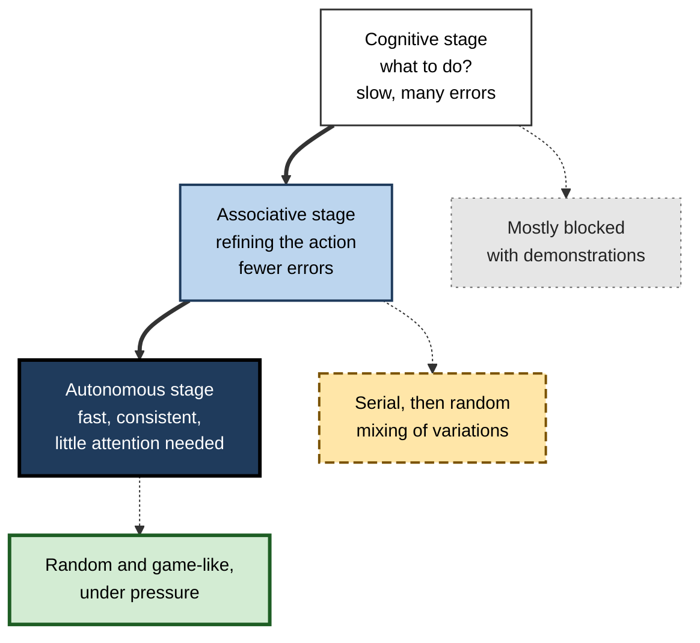
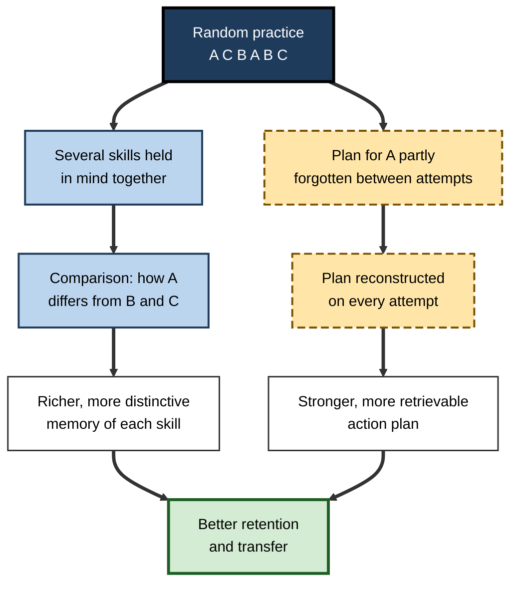
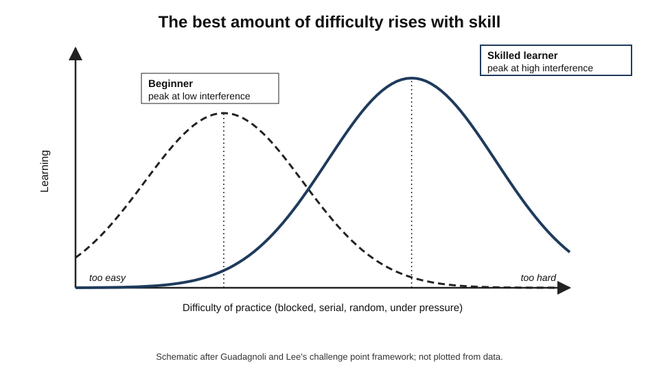
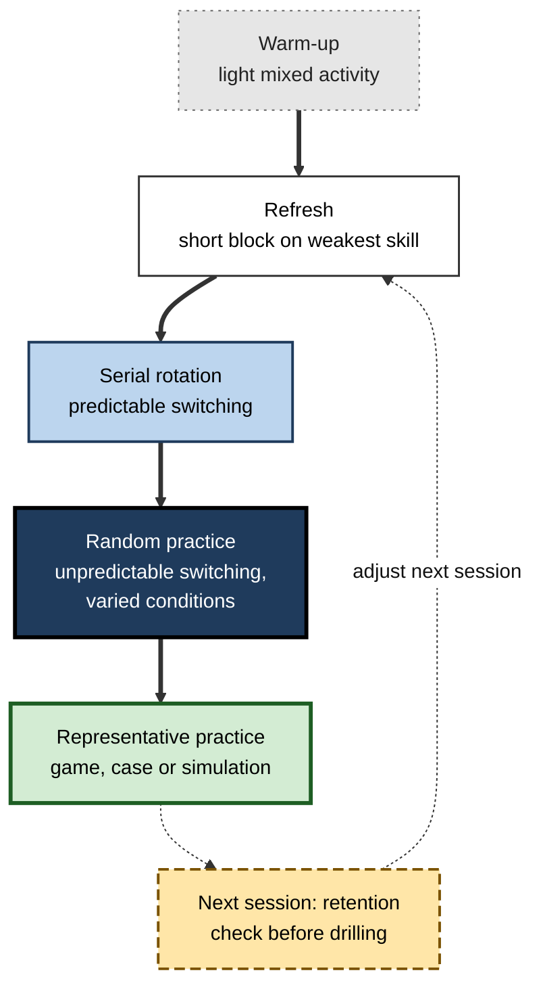
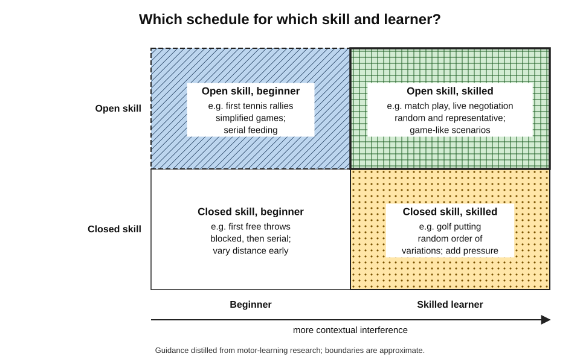

# E.10. Interleaving for Skill Development

A tennis coach can feed a pupil fifty forehands in a row, then fifty backhands, then fifty volleys — and watch the strokes become smooth and consistent within each basket. Or she can mix them, so that the pupil never knows which shot is coming, and watch the strokes stay ragged for longer. A surgical trainee can practise one laparoscopic task until it is fluent before moving to the next, or rotate through several. A salesperson can rehearse one objection-handling script repeatedly, or face objections in unpredictable order.

In each case the question is the same: how should practice of several related **skills** be arranged so that the skills hold up **later, under real conditions**, rather than only at the end of the session?

> **Definition — Skill:** a learned capability to carry out a task with a high degree of consistency, efficiency and adaptability, such as a stroke in sport, a surgical procedure, a musical passage or a structured conversation.

> **Definition — Contextual interference (CI) effect:** the finding that practising several skills or skill variations in a mixed (random) order produces poorer performance during practice but better retention and transfer than practising them in blocks.

**Why it matters**

- Most skill coaching, from sport to surgery to sales, relies heavily on **repetition in blocks** — a schedule that flatters performance in the session.
- The contextual interference effect is one of the most studied phenomena in motor learning, and it shows that mixed practice can make skills **more durable and adaptable**.
- It is also one of the most **contested**: its size depends on the learner, the task and the setting, and field studies are less consistent than laboratory ones.
- Professionals designing skills training need to know both the effect and its limits.

---

## What Kind of Skill?

### Skill types

- **Motor skills** — movements of the body.
  - *e.g.* a golf swing, typing, suturing.
- **Perceptual-motor skills** — movement guided by fast perception.
  - *e.g.* returning a serve, driving in traffic, catching.
- **Cognitive skills** — mental procedures.
  - *e.g.* mental arithmetic, debugging, financial modelling.
- **Interpersonal skills** — structured interaction with others.
  - *e.g.* giving feedback, negotiating, handling a complaint.

### Closed and open skills

- **Closed skills** take place in a stable, predictable environment; the performer starts when ready.
  - *e.g.* a basketball free throw; a golf putt; a scripted presentation.
- **Open skills** take place in a changing environment; the performer must react.
  - *e.g.* a rally in tennis; a live negotiation; handling an incident.
- Open skills demand **selection** of a response under uncertainty — exactly what mixed practice trains.

> **Definition — Open skill:** a skill performed in an unpredictable, changing environment, requiring the performer to perceive and select a response in real time.

### Stages of skill learning

- **Paul Fitts and Michael Posner (1967)** described three stages.
  - **Cognitive** — the learner works out what to do; performance is slow, variable and effortful.
  - **Associative** — the learner refines the movement or procedure; errors fall.
  - **Autonomous** — performance becomes fast, consistent and largely automatic.
- The best practice schedule **changes across the stages**.

**Figure 1.** Stages of skill learning and the place of mixed practice.

> **Key point:** contextual interference is **not** a schedule for the first minutes of a new skill. It earns its place once the learner can produce a recognisable version of each skill.

---

## The Contextual Interference Effect

### The core finding

- **Origins:** William Battig proposed the idea in verbal learning; John Shea and Robyn Morgan (1979) demonstrated it in motor learning with arm-movement patterns.
- **The pattern:**
  - **blocked** practice — better performance during acquisition;
  - **random** practice — better retention after a delay and better transfer to new variations.
- **Serial** practice (a fixed rotation) usually falls between the two.

| | Blocked practice | Serial practice | Random practice |
|---|---|---|---|
| Order | AAA BBB CCC | ABC ABC ABC | A C B B A C |
| Level of contextual interference | Low | Medium | High |
| Acquisition performance | Best | Intermediate | Poorest |
| Retention and transfer (laboratory, adults) | Poorest | Intermediate, often close to random | Best |
| Typical learner feeling | Smooth, confident | Moderate | Effortful, uncertain |

### What learners believe

**Study card — Simon and Bjork (2001)**

- **Task:** learning sequences of key presses with specific timing.
- **Design:** blocked or random practice; during practice, learners predicted how well they would perform on a later test.
- **Results:**
  - blocked learners performed better in practice and **predicted** better test performance;
  - random learners performed better at the **delayed test**.
- **Conclusion:** learners misjudge motor practice schedules in the same way as academic ones, because they base predictions on how well practice is going.

> **Watch out:** a coach or trainee judging a session by how good the final repetitions look is judging **acquisition**. Contextual interference predicts that the best-looking sessions may produce the least durable skill.

### Real skills, real athletes

- **Goode and Magill (1986)** — badminton serves: random practice gave the best retention and transfer.
- **Hall, Domingues and Cavazos (1994)** — skilled college baseball players: random batting practice of three pitch types improved hitting more than blocked practice.
- **Music** — a study of advanced clarinettists by Christine Carter and Jessica Grahn (2016) found that interleaved practice of musical excerpts produced performances rated better by expert judges than blocked practice, although players did not consistently perceive the difference.

---

## Why Random Practice Helps

### Two classic explanations

- **Elaboration–distinctiveness** (John Shea and Steven Zimny, 1983)
  - With several skills in play, the learner compares them and notices how each differs.
  - Each skill is stored in a richer, more **distinctive** way.
- **Forgetting–reconstruction / action-plan reconstruction** (Timothy Lee and Richard Magill, 1983 onwards)
  - Switching makes the learner partly **forget** the plan for each skill between attempts.
  - Each attempt therefore requires the plan to be **reconstructed**, which strengthens it.
  - In blocked practice the plan is simply reused from the previous attempt.

> **Definition — Action plan:** the mental specification of a movement or procedure — its sequence, timing and force — prepared before execution.

**Figure 2.** Two accounts of why random practice strengthens skill.

### Evidence from the brain

**Study card — Kantak, Sullivan, Fisher, Knowlton and Winstein (2010)**

- **Design:** participants practised an arm-movement task under blocked or random schedules; immediately afterwards, brief magnetic stimulation (TMS) temporarily disrupted either the **primary motor cortex** or the **dorsolateral prefrontal cortex**.
- **Results:**
  - after **blocked** practice, disrupting the **primary motor cortex** impaired later retention;
  - after **random** practice, disrupting the **dorsolateral prefrontal cortex** impaired later retention.
- **Interpretation:** the two schedules appear to rely on **different neural processes** for consolidation; random practice engages prefrontal regions associated with planning and working memory, consistent with the reconstruction account.
- **Caveat:** a single study with a small sample; it is suggestive rather than decisive.

| Explanation | Core claim | What it predicts |
|---|---|---|
| Elaboration–distinctiveness | Mixing invites comparison between skills | Benefit grows when skills are related and comparable |
| Forgetting–reconstruction | Mixing forces the action plan to be rebuilt each time | Benefit grows with the effort of retrieval; disappears if the plan stays active |
| Challenge point | Benefit depends on matching difficulty to skill | Novices on complex tasks may be harmed; skilled performers helped |

---

## When the Effect Shrinks or Reverses

### Learner level and task complexity

- **The challenge point framework** (Mark Guadagnoli and Timothy Lee, 2004) proposes that learning depends on the **functional difficulty** of practice — how hard it is for this learner at this stage.
  - Too little difficulty → little learning (the learner is not challenged).
  - Too much difficulty → little learning (the learner is overwhelmed).
  - The **optimal challenge point** rises as skill grows.
- **Implication:** random practice, which adds difficulty, suits **more skilled** learners and **simpler** tasks; novices on **complex** tasks may need lower interference first.

> **Definition — Functional difficulty:** the difficulty of a practice task relative to the skill level of the learner, as opposed to its nominal difficulty independent of the learner.

**Figure 3.** The optimal amount of practice difficulty shifts as skill grows.

- **Gabriele Wulf and Charles Shea (2002)** reviewed motor-learning principles and argued that findings from **simple laboratory tasks** do not always generalise to **complex skills**; for complex skills, conditions that reduce load early can be beneficial.

### Age

- **Children** generally show **smaller or absent** contextual-interference benefits in recent meta-analyses; many studies with children find blocked practice at least as effective.
- **Older adults** — some recent analyses report **larger** benefits of random practice for retention and transfer than in younger adults; this is an area of active research.

### Laboratory versus the field

- **Meta-analyses of laboratory studies** (for example by Graser and colleagues, 2021, and Czyż and colleagues, 2024) support a **moderate** retention benefit of random practice in adults.
- **Systematic reviews of applied sport studies** (Ammar and colleagues, 2023, 2024) found **no consistent advantage** of random over blocked practice for sport skills.
- **Possible reasons:**
  - field studies are smaller and noisier;
  - sport skills are complex and practised by learners at varied stages;
  - "blocked" coaching practice in the field is often already varied in subtle ways;
  - outcome measures differ widely.

> **Watch out:** the claim "random practice is always better" is **not supported**. The evidence supports a narrower claim: **for adults who can already perform each variation, mixing variations usually improves retention and transfer, especially in controlled tasks; in complex field skills and with children, the benefit is uncertain.**

| Factor | Effect on the benefit of random practice | Practical implication |
|---|---|---|
| Learner is a complete beginner | Smaller; may reverse | Blocked first, then rising interference |
| Learner is skilled | Larger | Random and game-like practice |
| Task is simple | Larger | Mix early |
| Task is complex | Smaller early on | Simplify or block first |
| Learner is a child | Smaller or absent | Do not assume a benefit; monitor |
| Laboratory setting | Moderate, reliable | Strong basis for principles |
| Field sport setting | Inconsistent | Test locally; combine with representative practice |

---

## Interleaving Is Not the Same as Variability

### Two ways of mixing

- **Interleaving (contextual interference)** mixes **different skills** — forehand, backhand, volley; three different surgical knots.
- **Variable practice** changes the **parameters of one skill** — throwing the same way at different distances; suturing the same knot on different tissue models.

**Study card — Kerr and Booth (1978)**

- **Participants:** children aged about eight and twelve.
- **Task:** throwing beanbags at a target on the floor, without seeing where they landed during throws (vision occluded), with knowledge of results afterwards.
- **Design:**
  - **constant** group — practised only at **3 feet**;
  - **varied** group — practised at **2 and 4 feet**, never at 3.
- **Test:** throws at **3 feet**.
- **Result:** the varied group was **more accurate** at 3 feet than the group that had practised only that distance.
- **Conclusion:** varying a skill's parameters can build a more general capability than repeating the exact test condition.

> **Definition — Schema theory (Richard Schmidt, 1975):** the theory that people learn generalised rules (schemas) relating movement parameters to outcomes, so that varied practice strengthens the rule and allows new variations to be produced accurately.

| | Variable practice | Interleaved (random) practice |
|---|---|---|
| What varies | Parameters of one skill (distance, speed, force, context) | Which skill is practised |
| Example | Putts from 1 m, 2 m and 4 m | Putts, chips and drives in random order |
| Main theory | Schema theory | Elaboration–distinctiveness; reconstruction |
| Main benefit | Adapting one skill to new conditions | Retaining several skills and selecting among them |
| Common combination | Random order of varied parameters | Random order of different skills, each varied |

> **Remember:** **vary** a skill to make it **adaptable**; **interleave** skills to make them **durable and selectable**. Most good practice does both.

---

## Designing Mixed Skill Practice

### Principles

1. **Establish each skill first** — demonstration, explanation and a short block until a recognisable version can be produced.
2. **Move to serial practice** — rotate skills predictably.
3. **Move to random practice** — unpredictable order, as in performance.
4. **Add variability** — vary conditions within each skill.
5. **Make practice representative** — practise under conditions resembling real performance, with the information the performer will actually use.
6. **Reduce and delay feedback as skill grows** — frequent feedback helps early, but constant feedback can create dependence.
7. **Monitor retention** — judge progress at the start of the next session, not the end of this one.

> **Definition — Representative practice design:** arranging practice so that it samples the information and conditions of real performance — for example practising batting against real pitching rather than a machine — so that learned skills transfer to the performance environment.

> **Mnemonic — "ESRVR-FM":** Establish, Serial, Random, Vary, Representative — Feedback faded, Monitor retention.

### Worked example: a tennis session for an intermediate player

- **Situation:** an intermediate adult player can hit forehands, backhands and volleys reasonably well in feeding drills but breaks down in rallies, where shots arrive unpredictably.

| Block | Minutes | Activity | Interference |
|---|---|---|---|
| Warm-up | 10 | Mini-tennis, mixed strokes at low pace | Low–moderate |
| Refresh | 10 | Short blocked feed of the weakest stroke (backhand), technical cue | Low |
| Serial | 15 | Coach feeds forehand, backhand, volley in fixed rotation | Medium |
| Random | 20 | Coach feeds the three strokes in unpredictable order and to varied depths | High |
| Representative | 25 | Live points starting from serve, with a scoring game rewarding approach-and-volley | High, realistic |
| Retention check | next session, first 5 minutes | Random feed of the three strokes before any warm-up drilling | — |

1. **Expect the random block to look worse** than the serial block.
2. **Feedback:** frequent cues in the refresh block; sparse, summary feedback in the random block.
3. **Judge progress** by the retention check at the start of the next session and by rally performance over weeks.

> **Watch out:** if the player cannot produce a recognisable backhand in the random block, the session has skipped a stage. Return to the refresh and serial blocks for that stroke rather than abandoning mixing altogether.

**Figure 4.** Progression of interference across a skill session.

---

## Feedback, Choice and Pressure in Mixed Practice

### How much feedback?

- **Feedback** — knowledge of results (the outcome) and knowledge of performance (how the movement was made) — guides skill learning.
- **The guidance hypothesis** (Alan Salmoni, Richard Schmidt and Charles Walter, 1984) holds that feedback given after **every** attempt can make learners **dependent** on it: performance is good while feedback is present but worse when it is removed.
- **Ways of reducing dependence:**
  - **faded feedback** — frequent early, less frequent later;
  - **summary feedback** — given after a set of attempts rather than each one;
  - **bandwidth feedback** — given only when an error exceeds a set tolerance.
- **With mixed practice**, reduced feedback has an extra role: the learner must judge each attempt internally, which strengthens the self-monitoring needed in real performance.

> **Definition — Guidance hypothesis:** the proposal that very frequent feedback guides performance during practice but creates dependence, so that learning measured without feedback suffers.

> **Watch out:** faded feedback is not "no feedback". Early in learning, and whenever a new variation is introduced, frequent feedback remains essential; it is reduced as the learner's own error detection improves.

### Letting learners choose

- **Self-controlled practice** — allowing learners some choice over aspects of practice, such as when to receive feedback or which variation to attempt next — has often been reported to improve learning, possibly through motivation and more active engagement.
- **But** learners left to choose the **order** of skills tend to repeat a skill until it feels right — a blocked pattern.
- **A compromise:** let learners choose **within** a mixed structure — for example, choosing the order of a set of variations, provided each appears several times and none twice in a row.
- Recent replication efforts have questioned the size of some self-control benefits; the evidence is **mixed**.

### Practising under pressure

- Real performance often happens under **stress** — a match point, a complication in theatre, a difficult client.
- Mixed practice prepares the **selection** of responses; **pressure training** prepares the performer to execute them when anxious.
  - *e.g.* scoring consequences in drills; time limits; an audience; simulated high-stakes scenarios.
- Combining the two — random practice **with** realistic pressure — is common in elite sport, aviation and emergency medicine.

| Feedback schedule | When it suits | Risk |
|---|---|---|
| After every attempt | First learning; new variation | Dependence on feedback |
| Faded | Most of the associative stage | Withdrawing too fast |
| Summary after a set | Random practice once skills are established | Errors repeated within the set |
| Bandwidth (only large errors) | Skilled performers refining details | Small but systematic errors unnoticed |

> **Example:** a golf coach working with a club player alternates putts from 1, 3 and 6 metres (variability) with chips and short pitches (different skills) in random order, keeping score as in a round. The session looks messier than ten putts from each distance in turn, but the scorecard at the start of the following week shows which skills were actually retained.

---

## Skills Beyond Sport

### Clinical and surgical skills

- **Simulation training** for procedures — suturing, knot-tying, laparoscopic tasks, intubation, ultrasound-guided access — traditionally drills one task to proficiency before the next.
- Mixed practice rotates tasks and variations once each is established, preparing trainees for operations where the needed technique is not known in advance.
- **Emergency algorithms** — such as cardiac arrest rhythms requiring different actions — are practised in simulated scenarios that present different rhythms unpredictably, so that recognition and selection are trained along with the action.

### Music and performance

- Musicians commonly practise one passage until it is secure before moving to the next.
- Mixing passages within a practice session, once each can be played, may improve retention and performance, as the clarinet study suggests — while feeling less productive.

### Cognitive and technical skills

- **Software development** — mixing short exercises that require different algorithms or data structures (coding "katas") rather than ten variants of one.
- **Spreadsheet and data skills** — mixed tasks requiring different functions or analyses.
- **Aviation** — flying different approach types and handling different failures in unpredictable order in the simulator.

### Interpersonal skills

- **Sales and service** — role-plays in which the customer's objection or problem type is drawn at random.
- **Management conversations** — practising feedback, delegation and conflict conversations in mixed scenarios rather than one type per workshop.
- **Negotiation** — mixed cases varying the counterpart's style and interests.

> **In practice:** in interpersonal skills, the "random" element is best supplied by **another person** — a colleague or actor playing a counterpart who chooses the problem secretly — so that the learner must diagnose before responding.

**Figure 5.** Matching the practice schedule to skill type and learner level.

---

## Case Study: Laparoscopic Skills in a Surgical Simulation Programme

- **Situation:** a surgical training programme ran a simulation curriculum for junior trainees with four tasks on a box trainer: peg transfer, precision cutting, intracorporeal suturing and knot-tying. Trainees completed each task in a separate weekly session, repeating it until a time and error threshold was reached.
- **Problem:** trainees met the thresholds, but supervising surgeons reported that skills seemed to "evaporate" between the simulation course and theatre, and that trainees struggled when an operation required switching between instruments and tasks.
- **Diagnosis:**
  - each task was practised in a long **blocked** session and then rarely revisited;
  - thresholds were assessed **at the end** of the blocked session, when performance peaks;
  - no practice required switching between tasks, as real operations do.
- **Actions:**
  1. **First exposure** to each task remained a short blocked session with expert demonstration.
  2. From the second week, sessions **rotated all tasks learned so far** — first in serial order, then in random order — with variations (different tissue models, angles, instrument lengths).
  3. Proficiency was assessed at the **start** of the following session, before any warm-up on that task.
  4. Feedback moved from frequent, real-time coaching to **summary feedback** after sets.
  5. A final **integrated scenario** required the tasks in a realistic sequence with unexpected complications.
- **Result:**
  - trainees took longer to reach the end-of-session thresholds and rated the new sessions as more frustrating;
  - start-of-session proficiency, the measure of retention, was markedly higher than in the previous cohort;
  - supervising surgeons reported smoother performance when trainees first assisted in theatre.
- **Side effects:** sessions required more equipment set-up for switching tasks; the comparison with the previous cohort was not randomised.
- **Lesson:** a threshold reached in a blocked session measures **acquisition**; a threshold met at the **start** of the next session measures **learning**.

**Figure 6.** Redesign of the simulation curriculum.

```mermaid
%%{init: {'theme':'base','themeVariables':{'fontFamily':'Arial, Helvetica, sans-serif','fontSize':'15px','primaryColor':'#FFFFFF','primaryTextColor':'#111111','primaryBorderColor':'#222222','lineColor':'#333333','secondaryColor':'#F2F2F2','tertiaryColor':'#FFFFFF','clusterBkg':'#FAFAFA','clusterBorder':'#555555','edgeLabelBackground':'#FFFFFF','titleColor':'#111111'}}}%%
flowchart TD
    classDef core    fill:#1F3B5C,stroke:#000000,stroke-width:3px,color:#FFFFFF
    classDef key     fill:#BCD5EE,stroke:#1F3B5C,stroke-width:2px,color:#000000
    classDef detail  fill:#FFFFFF,stroke:#333333,stroke-width:1.5px,color:#000000
    classDef accent  fill:#FFE6A8,stroke:#7A5200,stroke-width:2px,stroke-dasharray:8 4,color:#000000
    classDef good    fill:#D3ECD3,stroke:#1E5E24,stroke-width:3px,color:#000000
    classDef caution fill:#F6CACA,stroke:#8B0000,stroke-width:2.5px,stroke-dasharray:3 3,color:#000000
    classDef muted   fill:#E6E6E6,stroke:#666666,stroke-width:1px,stroke-dasharray:2 4,color:#222222
    subgraph OLD["Before"]
        O1["One task per week,<br/>repeated to threshold"]
        O2["Assessed at end<br/>of blocked session"]
    end
    subgraph NEW["After"]
        N1["Short blocked<br/>first exposure"]
        N2["Serial then random<br/>rotation of all tasks"]
        N3["Varied models,<br/>angles, instruments"]
        N4["Assessed at start<br/>of next session"]
        N5["Integrated scenario<br/>with complications"]
    end

    O1 --> O2
    N1 ==> N2 ==> N3 ==> N4 ==> N5

    class O1,O2 muted
    class N1 detail
    class N2 core
    class N3 accent
    class N4 key
    class N5 good
```

---

## Open Questions

- **Why are field results less consistent than laboratory results?**
  - Task complexity, learner variety, measurement and the subtle variability of "blocked" coaching are all candidates; well-powered field trials are few.
- **How should interference rise as skill develops?**
  - Graduated schedules are promising but rest on a small number of studies.
- **Why do children benefit less?**
  - Developmental differences in working memory and planning are plausible explanations; the evidence is unsettled.
- **What happens in the brain?**
  - Early neuroscience suggests different consolidation processes after blocked and random practice; replication and extension are needed.
- **How should mixed practice interact with self-control and feedback?**
  - Each has been studied mostly in isolation; how faded feedback, learner choice and random scheduling combine in long programmes is not well understood, and some self-control findings have proved hard to replicate.
- **How well do motor-learning principles apply to interpersonal and cognitive skills?**
  - The logic transfers plausibly, but direct evidence for skills such as negotiation is sparse.

---

## Summary

- **Skills** — motor, perceptual-motor, cognitive, interpersonal — develop through **cognitive, associative and autonomous** stages (Fitts and Posner, 1967); **open** skills require selecting responses under uncertainty.
- The **contextual interference effect**: blocked practice wins during acquisition; **random** practice wins at **retention and transfer**; serial practice sits between.
- Learners misjudge it: in Simon and Bjork (2001), blocked learners predicted better test performance but random learners performed better.
- Explanations: **elaboration–distinctiveness** (Shea and Zimny) and **forgetting–reconstruction** (Lee and Magill); brain-stimulation evidence suggests different consolidation processes (Kantak and colleagues, 2010).
- The effect **shrinks** for beginners on complex tasks (**challenge point framework**, Guadagnoli and Lee, 2004), for **children**, and in **field sport** studies; laboratory meta-analyses support a moderate benefit in adults. The evidence is **contested**.
- **Variable practice** (parameters of one skill; schema theory; Kerr and Booth, 1978) differs from **interleaving** (different skills); good practice combines both.
- Design: **establish → serial → random → vary → representative**, fade feedback, and judge progress by **retention at the start of the next session**.
- Fade **feedback** to avoid dependence (guidance hypothesis); allow **choice within a mixed structure**; add realistic **pressure** once selection is secure.
- The principles extend to surgery, music, aviation, software and interpersonal skills, with the random element supplied by realistic scenarios or a counterpart.

---

## Self-Check

1. Define the contextual interference effect.
2. Distinguish open and closed skills and explain why open skills especially benefit from mixed practice.
3. Describe Fitts and Posner's three stages and the schedule suited to each.
4. Compare blocked, serial and random practice on acquisition and retention.
5. What did Simon and Bjork (2001) find about learners' predictions?
6. Explain the elaboration–distinctiveness and forgetting–reconstruction hypotheses.
7. What did Kantak and colleagues (2010) find, and why should it be interpreted cautiously?
8. Explain the challenge point framework and its implication for beginners.
9. Summarise the evidence on contextual interference in children and in field sports.
10. Distinguish variable practice from interleaved practice, using Kerr and Booth (1978).
11. List the principles for designing mixed skill practice.
12. Why should skill thresholds be assessed at the start of the next session?
13. Design a mixed practice session for a customer-service team learning to handle billing errors, delivery failures and cancellation requests.
14. A youth football coach reads that random practice is best and switches all drills to random order for eight-year-olds. Evaluate this decision.
15. Explain the guidance hypothesis and describe two ways of scheduling feedback in random practice to avoid dependence.

### Answer Key

1. Practising several skills or variations in mixed order gives poorer performance during practice but better retention and transfer than practising them in blocks.
2. Closed skills occur in stable environments where the performer starts when ready; open skills occur in changing environments requiring real-time selection of responses. Mixed practice trains that selection.
3. Cognitive (working out what to do) — mostly blocked with demonstrations; associative (refining) — serial then random mixing; autonomous (automatic) — random, game-like practice under pressure.
4. Blocked: best acquisition, poorest retention and transfer. Serial: intermediate. Random: poorest acquisition, best retention and transfer in laboratory studies with adults.
5. Blocked learners performed better during practice and predicted better test performance, but random learners performed better at the delayed test.
6. Elaboration–distinctiveness: mixing invites comparison between skills, producing richer, more distinctive memories. Forgetting–reconstruction: switching causes partial forgetting of each action plan, which must be rebuilt every time, strengthening it.
7. Disrupting motor cortex after blocked practice, and prefrontal cortex after random practice, impaired retention — suggesting different consolidation processes. It is a single small study and needs replication.
8. Learning depends on difficulty relative to the learner's skill; the optimal challenge rises with skill. Beginners on complex tasks may be overwhelmed by random practice and need lower interference first.
9. Children show smaller or absent benefits in meta-analyses; systematic reviews of field sport studies find no consistent advantage of random over blocked practice, unlike laboratory studies with adults.
10. Variable practice changes parameters of one skill; interleaving mixes different skills. Kerr and Booth found children who practised throwing at 2 and 4 feet were more accurate at 3 feet than those who practised only at 3 feet — a variability benefit.
11. Establish each skill; move to serial then random practice; add variability; make practice representative; fade feedback; monitor retention at the next session.
12. Performance at the end of a blocked session reflects short-term acquisition; performance at the start of the next session, before warm-up, reflects what was retained — the learning.
13. Briefly model and practise each call type in a short block; then serial role-plays rotating the three types; then random role-plays in which a colleague secretly draws the type and varies the customer's mood and details; sparse summary feedback; a retention check at the start of the next session.
14. Risky. Evidence for contextual interference benefits in children is weak, and beginners on complex skills may be overwhelmed. Better to establish skills with blocked and varied practice, introduce mixing gradually, use game-like representative activities, and monitor whether retention improves.
15. Feedback after every attempt guides performance but creates dependence, so performance falls when feedback is removed. In random practice, use summary feedback after sets, faded feedback that becomes less frequent, or bandwidth feedback given only for errors beyond a tolerance.

---

## Glossary

| Term | Meaning |
|---|---|
| Action plan | Mental specification of a movement's sequence, timing and force. |
| Blocked practice | Practising one skill repeatedly before the next. |
| Challenge point framework | Proposal that learning is best at a difficulty matched to skill and task. |
| Closed skill | A skill performed in a stable, predictable environment. |
| Contextual interference effect | Mixed practice impairs acquisition but improves retention and transfer. |
| Elaboration–distinctiveness hypothesis | Mixing invites comparison, producing distinctive memories. |
| Forgetting–reconstruction hypothesis | Switching forces action plans to be rebuilt, strengthening them. |
| Functional difficulty | Difficulty of a task relative to the learner's skill. |
| Guidance hypothesis | Frequent feedback aids practice performance but creates dependence. |
| Open skill | A skill performed in a changing environment requiring real-time choice. |
| Random practice | Practising skills in unpredictable order. |
| Pressure training | Practice under realistic stress, such as consequences or time limits. |
| Representative practice design | Practice sampling the information and conditions of real performance. |
| Schema theory | Schmidt's theory that varied practice builds generalised movement rules. |
| Serial practice | Practising skills in a fixed rotation. |
| Skill | A learned capability to perform a task consistently, efficiently and adaptably. |
| Stages of skill learning | Cognitive, associative and autonomous stages (Fitts and Posner). |
| Variable practice | Practising one skill under varied parameters. |
