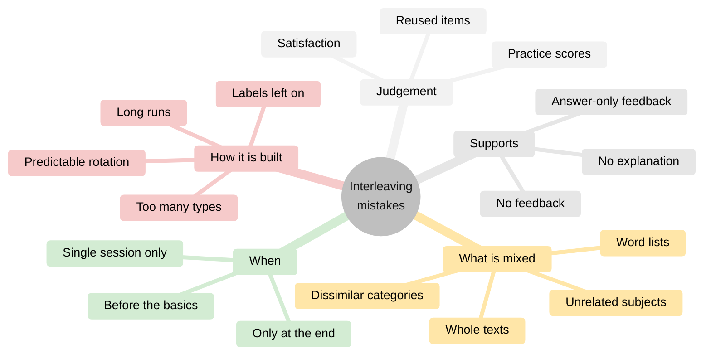
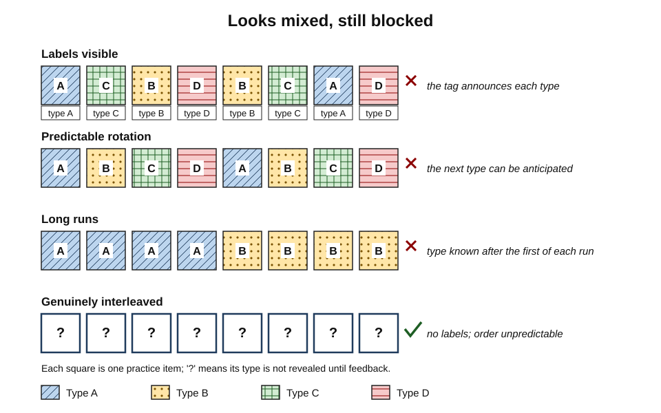
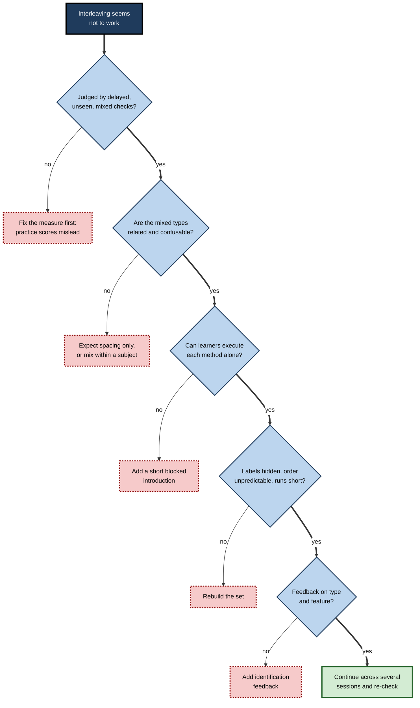
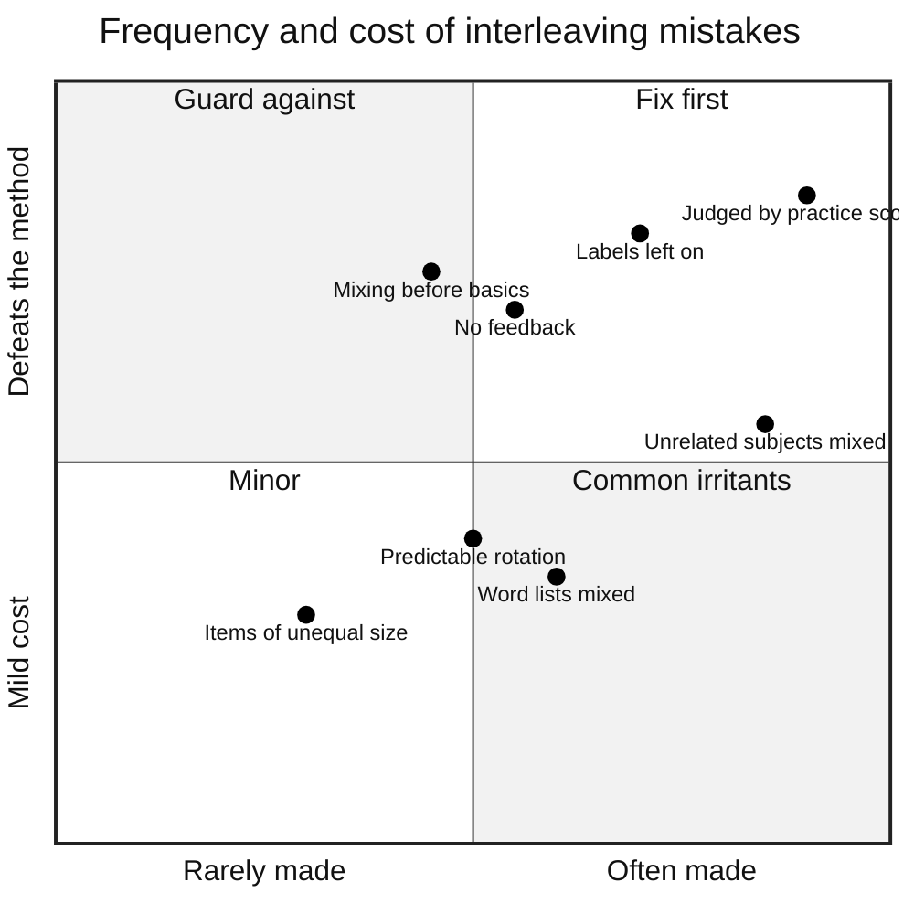
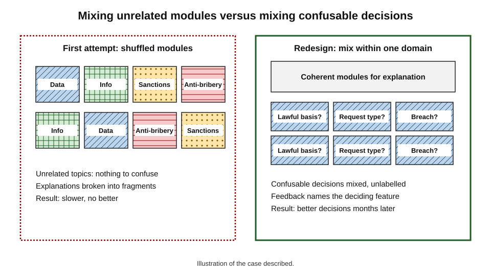
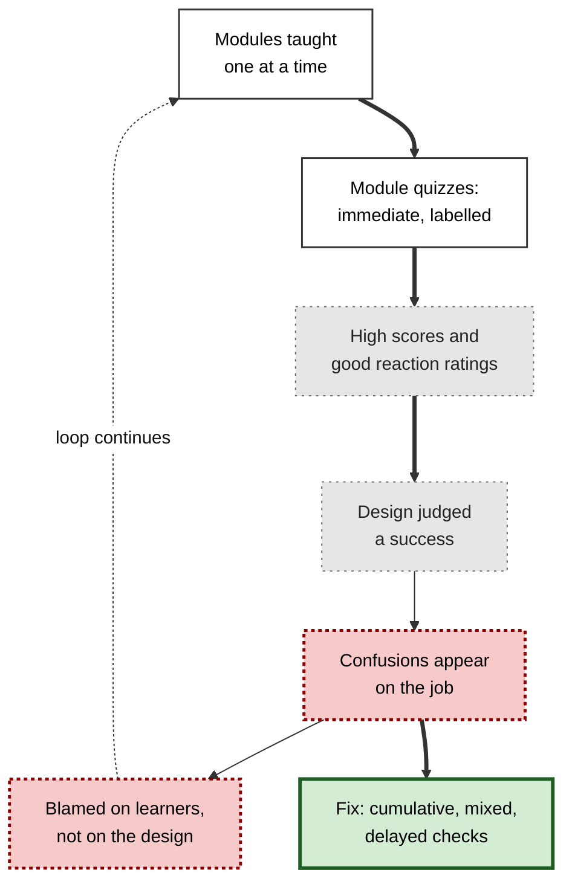

# E.11. Common Mistakes With Interleaving

A student reads that interleaving improves learning, so she alternates between history and chemistry every twenty minutes and is disappointed when nothing changes. A trainer shuffles a slide deck so that topics appear in random order, and the course becomes merely confusing. A teacher introduces mixed homework, sees scores fall in the first week and reverts to chapter exercises. Each of them applied a word — "interleaving" — without the conditions that make it work.

Interleaving is a **conditional** technique. Applied to the right material, at the right moment, with the right supports, it produces some of the largest gains in the learning-strategy literature; applied carelessly, it adds effort without benefit or even makes learning worse.

> **Definition — Interleaving mistake:** a way of applying interleaving that removes the conditions it depends on — related, confusable types; prior acquaintance with each type; unpredictability; feedback; and delayed judgement of results.

> **Definition — Boundary condition:** a circumstance that determines whether, or how strongly, an effect occurs; for interleaving the main ones are similarity between types, learner level, feedback and the timing of the test.

**Why it matters**

- Most disappointing experiences with interleaving trace back to a small number of **predictable errors**.
- Each error has a recognisable **symptom**, a clear **reason** and a simple **fix**.
- Misapplication also feeds a false conclusion — "interleaving doesn't work for me" — that keeps learners and organisations in blocked practice.
- Several errors are made not by learners but by **course designers, managers and software**, and must be fixed at that level.

---

## Five Families of Mistakes

Mistakes fall into five families, according to which part of the method goes wrong.

- **What is mixed** — unrelated material, word lists, expository texts, dissimilar categories.
- **When mixing happens** — too early, too late, too briefly.
- **How the mix is built** — labels left on, predictable patterns, long runs, too many types, unlike items.
- **What supports it** — no feedback, feedback on answers only, no explanation to learners.
- **How it is judged** — by practice scores, by satisfaction, by tests on practised items.

**Figure 1.** The five families of interleaving mistakes.

> **Mnemonic — "WWHSJ" — "Which When How Supports Judgement":** the five questions to ask when interleaving seems not to work.

---

## Mistakes About What Is Mixed

### Mistake 1: Mixing unrelated material and expecting discrimination

- **Symptom:** a learner alternates history, chemistry and French in one evening and sees no special benefit.
- **Why it fails:**
  - interleaving's distinctive benefit comes from **comparing** types that could be **confused**;
  - history and chemistry are never confused, so there is nothing to discriminate;
  - Hausman and Kornell (2014) found no benefit from interleaving unrelated material once spacing was controlled.
- **Fix:**
  - rotate subjects across days for **spacing**, by all means, but expect only spacing's benefit;
  - for discrimination, mix **within** a subject — types of chemistry calculation, French tenses, historical causes.

> **Watch out:** this is the most common misunderstanding in popular advice. "Switch subjects every half hour" is a scheduling preference, not interleaving in the sense supported by research.

### Mistake 2: Interleaving lists of words or isolated facts

- **Symptom:** a learner shuffles several vocabulary decks together and learns more slowly.
- **Why it fails:**
  - a word pair or a fact has no category structure and no choice to practise;
  - Brunmair and Richter's meta-analysis (2019) found a **negative** interleaving effect for word lists.
- **Fix:** rely on **spacing** and **retrieval** for such items; interleave only where a **choice** is involved, such as near-synonyms already known.

### Mistake 3: Hopping between texts

- **Symptom:** a reader alternates paragraphs or sections from different textbook chapters and understands less.
- **Why it fails:**
  - understanding expository text depends on following its **argument**; breaking it up destroys coherence;
  - the meta-analysis found **no benefit** for interleaving expository texts.
- **Fix:** read each text as a coherent whole; interleave the **practice questions** that follow.

### Mistake 4: Ignoring similarity

- **Symptom:** mixing helps for some topics but seems to hinder others.
- **Why it fails:**
  - Carvalho and Goldstone (2014) showed that interleaving helps when categories are **similar**, but blocking can help when categories are **dissimilar** and their own shared features are hard to see;
  - mixing dissimilar categories directs attention to differences that are already obvious.
- **Fix:** ask what the learner is **missing** — the differences between categories (interleave) or the commonalities within one (block first).

| Material | Is there a choice or confusion? | Advice |
|---|---|---|
| Confusable problem types or categories | Yes | Interleave |
| Known near-synonyms, similar tenses | Yes | Interleave in context |
| Unrelated subjects | No | Rotate for spacing; do not expect discrimination |
| New word lists, isolated facts | No | Spacing and retrieval; mixing adds nothing |
| Expository text | No | Read whole; interleave the questions |
| Dissimilar categories with subtle internal features | Commonalities are the challenge | Block first, then mix |

---

## Mistakes About When Mixing Happens

### Mistake 5: Mixing before the basics

- **Symptom:** learners guess wildly, freeze or repeat the same errors after feedback.
- **Why it fails:**
  - a learner who cannot execute a method gains nothing from having to choose it;
  - the challenge point framework predicts that too much difficulty for a beginner harms learning.
- **Fix:** a **short blocked introduction** to each new type — an explanation, a worked example, one or two practice items — before it enters the mix.

### Mistake 6: Mixing only at the end

- **Symptom:** a plan covers topics one by one for weeks and introduces mixed practice in the final fortnight; mixed scores are poor and there is no time to recover.
- **Why it fails:**
  - early topics have faded before mixing starts;
  - identification is practised for the first time just before it is needed.
- **Fix:** **mix early, mix more, mix last** — a small mixed component from the first week, rising steadily.

### Mistake 7: Expecting results from a single session

- **Symptom:** a one-off interleaved session shows no advantage on a test a week later.
- **Why it fails:**
  - in Spanish verb learning, Pan and colleagues (2019) found interleaving gave **no advantage** in single-session training but a clear advantage when practice was spread across **several sessions**;
  - interleaving works with spacing, not instead of it.
- **Fix:** build mixed practice into a **series** of sessions across days and weeks.

---

## Mistakes About How the Mix Is Built

### Mistake 8: Leaving the labels on

- **Symptom:** problems are mixed, but each still carries its section heading, colour code, file name or tag — "Q7 (Pythagoras)".
- **Why it fails:** the label does the identification, so the learner practises only execution; the set is **blocked in disguise**.
- **Fix:** remove every cue to type during practice; reveal the type only in **feedback**.

### Mistake 9: Predictable rotation

- **Symptom:** a set follows A B C D A B C D; learners soon anticipate the next type.
- **Why it fails:** a predictable pattern lets the learner skip identification.
- **Fix:** use **constrained random** order — shuffled, with no long runs — after the first session.

### Mistake 10: Runs that are too long

- **Symptom:** "mixed" practice consists of six of one type, then six of another.
- **Why it fails:** long runs are blocks; after the first item of a run, the type is known.
- **Fix:** keep runs mostly to **one**, occasionally two.

**Figure 2.** Three ways a "mixed" set can still be blocked in disguise.

### Mistake 11: Too many new types at once

- **Symptom:** a first mixed set contains eight unfamiliar methods; learners are overwhelmed.
- **Why it fails:** load exceeds what working memory can manage, turning a desirable difficulty into an undesirable one.
- **Fix:** start with **two to four** closely related types; add others as each becomes familiar; include well-known **anchor** items.

### Mistake 12: Mixing items of very different size

- **Symptom:** a mixed set combines two-minute questions with forty-minute case studies; the long items dominate and the switching benefit is lost.
- **Why it fails:** few switches occur, and fatigue from long items swamps the identification practice.
- **Fix:** keep items in a mixed set of **similar size**; use short identification-only items when full solutions are long.

### Mistake 13: Confusing interleaving with multitasking

- **Symptom:** a learner switches between reading, messaging and watching a lecture every few seconds and calls it "mixing things up".
- **Why it fails:** multitasking divides attention and fragments processing; it consistently harms learning.
- **Fix:** interleaving finishes each item before moving on, and mixes **related** items deliberately chosen for comparison.

> **Example (illustrative):** a software team's code-review training mixed exercises on security flaws, performance problems and style issues, but each exercise file was named after its category (security_01, perf_02). Reviewers opened the file already knowing what to look for. Renaming the files with neutral numbers was the only change needed to turn a disguised block into genuine interleaving.

> **Remember:** **hide the type, break the pattern, keep runs short, keep the set small, keep items comparable, finish each item.**

---

## Mistakes About Supports

### Mistake 14: No feedback

- **Symptom:** learners complete mixed sets with no answers available, and the same confusions persist for weeks.
- **Why it fails:** wrong choices go uncorrected and are **practised**, strengthening the confusion.
- **Fix:** provide answers promptly — after each item for new or confusable types.

### Mistake 15: Feedback on the answer only

- **Symptom:** learners see "correct answer: 42" but never learn why the method was the right one.
- **Why it fails:** identification is the skill interleaving targets; feedback that ignores it misses the point.
- **Fix:** feedback that states the **type** and the **feature** that identifies it, before the solution.

### Mistake 16: Not explaining the method to learners

- **Symptom:** a teacher or trainer introduces mixed practice without comment; learners complain, ratings fall, the method is dropped.
- **Why it fails:** the felt difficulty is read as failure; learners' beliefs in blocking are strong and persistent.
- **Fix:** explain in advance — what it will feel like, why, what the evidence shows, and how results will be judged.

> **Key point:** supports turn interleaving from **confusion** into **contrast**. Without feedback and explanation, the same mixed set can teach the wrong lessons and discourage the learner.

---

## Mistakes About Judgement

### Mistake 17: Judging by practice scores

- **Symptom:** "My scores were lower on the mixed set, so blocked practice suits me better."
- **Why it fails:** interleaving is expected to lower **practice** performance; its benefit appears at **delayed** and **mixed** tests.
- **Fix:** judge methods by **unseen, mixed checks** after a delay; track **identification accuracy** separately.

### Mistake 18: Judging by satisfaction

- **Symptom:** a course is evaluated by end-of-session ratings, which fall after the switch to mixed practice.
- **Why it fails:** reaction measures reward comfort and fluency, both of which interleaving reduces.
- **Fix:** collect delayed performance data alongside ratings; decide on the former.

### Mistake 19: Testing on the practised items

- **Symptom:** checks reuse questions from practice, and scores look excellent.
- **Why it fails:** the test measures memory of the specific items, not the ability to identify and solve new ones.
- **Fix:** keep a **reserve of unseen items** for checks.

### Mistake 20: Testing in blocked form

- **Symptom:** a blocked and an interleaved group are compared on a test grouped by topic, and show no difference.
- **Why it fails:** a grouped test removes identification, the very skill interleaving trains.
- **Fix:** test with **mixed, unlabelled** items, as real use requires.

**Figure 3.** Diagnosing why interleaving seems not to be working.

> **In practice:** when a learner reports that interleaving "did not work", the most productive first question is not about the method but about the measurement: "How did you decide?" In most cases the answer is a practice score or a feeling, and the fix begins there.

---

## How Common and How Costly?

Not all mistakes do equal damage. Some are frequent but mild; others are rarer but defeat the method entirely.

**Figure 4.** Frequency and cost of common interleaving mistakes (judgement based on the research and practice described).

> **Watch out:** the positions in this chart are a **judgement** drawn from the research and from practice, not measured frequencies. Their purpose is to set priorities, not to quantify.

| Mistake | Who usually makes it | Cost | Simplest fix |
|---|---|---|---|
| Judging by practice scores | Learners, trainers | Method abandoned | Weekly unseen mixed check |
| Labels left on | Textbook and course designers | Identification never practised | Strip headings and tags |
| Unrelated subjects mixed | Learners following popular advice | Effort without discrimination benefit | Mix within subjects |
| Mixing before basics | Enthusiastic adopters | Confusion, demotivation | Short blocked introduction |
| No or answer-only feedback | Self-study, under-resourced courses | Confusions practised | Feedback on type and feature |
| Not explaining | Teachers, trainers | Complaints, reversal | Four-part explanation in advance |

---

## Worked Example (illustrative): Auditing a Revision Plan

- **Situation:** an economics student shares her revision plan for a final exam of mixed problem and essay questions, and says she is "interleaving".

| Element of her plan | Mistake | Fix |
|---|---|---|
| Alternates economics and law every 30 minutes | 1 — unrelated material for discrimination | Rotate across days for spacing; mix within economics |
| Reads chapters in shuffled order | 3 — hopping between texts | Read each chapter whole; mix the questions afterwards |
| Practice questions taken from chapter-end sets, headings visible | 8 — labels left on | Pool questions into one unlabelled set |
| Mixed past papers only in the final week | 6 — mixing only at the end | Small mixed sets from now, rising each week |
| Checks progress by scores on practice sets | 17 — wrong measure | Weekly unseen mixed check of ten questions |
| No answers for half the questions | 14 — no feedback | Use questions with model answers; write the type before checking |

1. **Diagnose** — six of her plan's features match common mistakes.
2. **Prioritise** — the most damaging are labels left on (8), mixing only at the end (6) and judging by practice scores (17).
3. **Rebuild** — a single pool of unlabelled questions; daily mixed sets of eight to ten items within economics; weekly unseen checks; essay planning practice mixing question types (definitions, evaluation, data response).
4. **Expect** — lower practice scores for a fortnight and rising weekly-check scores thereafter.

> **Example (illustrative):** her first weekly check after the change shows identification accuracy of 70% on mixed questions, with elasticity and multiplier problems most often confused. The next week's sets place those two types side by side.

---

## Overcorrection: Mistakes of the Converted

Learners and designers who discover interleaving sometimes swing too far. These mistakes are less common than blocking everything, but they are real.

### Mistake 21: Abandoning blocked practice entirely

- **Symptom:** every exercise, from the first minute of a new topic, is mixed.
- **Why it fails:**
  - blocked practice has a genuine role in **first acquisition** and in building **fluency** of basic procedures;
  - without it, novices never form a workable version of each method to choose among.
- **Fix:** keep a **short blocked phase** for each new type and for fluency drills of basic procedures; mix everything else.

### Mistake 22: Applying motor-learning findings uncritically

- **Symptom:** a coach switches all drills for young children to random order because "research says random practice is better".
- **Why it fails:**
  - contextual-interference benefits are **smaller or absent in children** and inconsistent in **field sports**;
  - beginners on complex skills may be overwhelmed.
- **Fix:** establish skills first, introduce interference gradually, use game-like activities, and **monitor retention** rather than assuming a benefit.

### Mistake 23: Interleaving as a substitute for understanding

- **Symptom:** mixed practice is introduced, but the underlying concepts were never properly taught; learners can sometimes identify types by surface cues without knowing why the methods work.
- **Why it fails:** interleaving trains the link between features and methods; it does not replace explanation of **why** each method fits.
- **Fix:** pair mixed practice with explanation and with "why this method?" prompts; check understanding on novel problems that cannot be solved by surface matching.

### Mistake 24: Treating every difficulty as desirable

- **Symptom:** a designer reasons that "if mixing is good because it is hard, making it harder must be better" — longer sets, no feedback, time pressure for novices.
- **Why it fails:** a difficulty is desirable only if it is **surmountable**, followed by **feedback** and the **same kind of work** the real task requires; extra difficulty beyond that is simply obstruction.
- **Fix:** add difficulty only where it trains identification, retrieval or comparison; remove difficulty that adds only load.

### Mistake 25: Over-engineering the schedule

- **Symptom:** a plan specifies the exact type of every item for twelve weeks, collapses after one disrupted week and is abandoned.
- **Why it fails:** rigid plans are fragile; the benefits of interleaving come from a few robust habits, not a perfect timetable.
- **Fix:** keep simple rules — mixed sets in every session, weekly unseen checks, a confusion log — and let the details adapt.

> **Key point:** the goal is not **maximum** interleaving but **appropriate** interleaving — blocked where a method is being built, mixed where it must be chosen, and judged by delayed results in both cases.

| Overcorrection | What is lost | Balanced practice |
|---|---|---|
| No blocked practice at all | First acquisition; fluency | Short blocks for new types and basic drills |
| Random practice for young beginners | Manageable challenge | Gradual increase in interference |
| Mixing without explanation | Understanding of why methods fit | "Why this method?" prompts and explanation |
| Making everything harder | Surmountability and feedback | Difficulty only where it trains the target skill |
| Rigid twelve-week timetable | Resilience to disruption | A few simple rules that adapt |

---

## Mistakes Made by Organisations and Tools

### In course and curriculum design

- **Modules with non-cumulative tests** — encourage learners to block and forget.
- **Labelled practice in learning platforms** — every item tagged with its topic on screen.
- **Mastery-by-module dashboards** — declare a skill "mastered" after a blocked run.

### In workplace training

- **Shuffling unrelated compliance modules** — mixing fire safety, data protection and anti-bribery content achieves nothing beyond variety.
- **Role-plays announced by title** — "handling price objections" tells the trainee the answer.
- **Evaluation by reaction sheets** — rewards blocked designs.

### In learning software and AI tools

- **"More like this" practice generation** — produces blocked sets by default.
- **Adaptive engines that keep learners on one skill until correct** — blocked mastery loops.
- **Feedback that gives the answer only.**

> **In practice:** many platforms already contain the fix — a "mixed review" or "exam" mode — but bury it. Making mixed mode the default after first exposure is one of the cheapest improvements a learning-technology team can make.

### Case study (illustrative): interleaving the wrong things in compliance training

- **Situation:** a financial-services firm's learning team read about interleaving and redesigned its annual compliance programme. Instead of completing data protection, anti-bribery, sanctions and information-security modules one after another, employees received **shuffled screens from all four modules**.
- **Problem:** completion times rose, satisfaction fell, and audit findings on data-protection errors did not improve. The team concluded that "interleaving doesn't work in compliance".
- **Diagnosis:**
  - the four modules were **unrelated** — no one confuses sanctions screening with password policy — so mixing offered nothing to discriminate (mistake 1);
  - mixing screens broke up explanatory content, damaging coherence (mistake 3);
  - the real errors in audits were **within** data protection: confusing the lawful bases for processing, misjudging when a breach must be reported, mixing up access requests and erasure requests;
  - assessment used the module's own quiz items, immediately (mistakes 19 and 17).
- **Actions:**
  1. Modules were restored as coherent units for explanation.
  2. A new **mixed scenario set** was built **within** data protection: twenty short workplace scenarios requiring the employee to identify the lawful basis, whether a breach is reportable, or the kind of request — unlabelled and in constrained random order.
  3. Feedback named the **deciding feature** of each scenario.
  4. A short mixed scenario check, with **new** scenarios, was sent three months later.
- **Result:**
  - completion times returned to normal;
  - the three-month check showed clearly better identification of request types and reportable breaches than the previous year's cohort, and data-protection audit findings declined the following year.
- **Side effects:** the comparison was with a previous cohort rather than a randomised group, so other changes may have contributed.
- **Lesson:** interleaving failed when applied to **unrelated modules** and succeeded when applied to **confusable decisions within one domain**.

**Figure 5.** Two ways of "interleaving" a compliance programme. (illustrative)

**Figure 6.** How organisational choices push training back towards blocking.

---

## Open Questions

- **How common are these mistakes in practice?**
  - Surveys of student strategies show that blocking is preferred, but systematic data on how interleaving is misapplied are scarce.
- **Which mistakes matter most?**
  - Their relative cost has not been measured directly; priorities rest on reasoning from the research.
- **Can tools prevent mistakes automatically?**
  - Platforms could hide labels, randomise order and track identification by default; evaluations of such designs are few.
- **How should "similar enough to interleave" be judged in practice?**
  - Without a practical similarity measure, designers must rely on error data and expert judgement.
- **Where exactly does useful blocking end?**
  - Short blocked introductions are widely recommended, but how many blocked items each new type needs, and whether this differs by learner, has scarcely been tested.
- **How should overcorrection be detected?**
  - Signs such as persistent guessing or falling retention could flag excessive mixing, but no validated indicators exist.
- **Do warnings about mistakes change behaviour?**
  - Knowing a rule and following it under time pressure are different; the effect of guidance on real practice is little studied.

---

## Summary

- Interleaving is **conditional**; most failures come from removing its conditions.
- **What is mixed:** unrelated subjects (spacing only), word lists (negative effect), expository texts (no benefit), dissimilar categories (blocking may help) — mix **confusable** types **within** a domain.
- **When:** not before the basics; not only at the end; not in a single session — **introduce briefly, mix early, mix more, mix last**, across several sessions.
- **How:** hide labels, avoid predictable rotation, keep runs short, start with two to four types, keep items comparable, and never confuse interleaving with **multitasking**.
- **Supports:** feedback on **type and feature**, not only on the answer; explain the method in advance.
- **Judgement:** never by practice scores, satisfaction, reused items or blocked tests — use **delayed, unseen, mixed checks**.
- **Overcorrection** is also a mistake: keep short blocks for new types and fluency, introduce interference gradually for children and beginners, pair mixing with explanation, add only desirable difficulty and keep plans simple.
- Organisations and tools make the same mistakes at scale — labelled platforms, blocked mastery loops, module quizzes, reaction sheets — and can fix them cheaply with mixed defaults and cumulative checks.

---

## Self-Check

1. Why is rotating unrelated subjects not interleaving in the research sense?
2. Why does interleaving word lists tend to fail?
3. What is wrong with alternating paragraphs from different chapters?
4. When might blocking be better than interleaving, according to Carvalho and Goldstone?
5. What symptoms suggest that interleaving has started before the basics, and what is the fix?
6. Why is mixing only in the final fortnight a mistake?
7. What did Pan and colleagues (2019) find about single-session interleaving?
8. Give three ways a "mixed" set can remain blocked in disguise.
9. Why must feedback address the type and identifying feature, not only the answer?
10. List four mistaken ways of judging whether interleaving works and the correct alternative.
11. Use the diagnostic sequence to explain what to check first when interleaving seems not to work.
12. A learning platform declares a skill "mastered" after five correct answers in a row on that skill. What is the problem and how could it be fixed?
13. Explain why the compliance programme in the case study failed at first and how it was corrected.
14. A colleague says, "I tried interleaving for one evening and it didn't help, so it doesn't work for me." Respond, identifying at least three possible mistakes.
15. Describe two ways of overcorrecting after discovering interleaving and the balanced alternative to each.

### Answer Key

1. Interleaving's distinctive benefit comes from comparing confusable types; unrelated subjects are never confused, so rotation provides spacing but no discrimination.
2. Word pairs have no category structure or choice to practise; mixing adds switching without contrast, and meta-analysis shows a negative effect.
3. Understanding expository text depends on following its argument; fragmenting it destroys coherence, and there is no evidence of benefit.
4. When categories are dissimilar and the difficulty is noticing what members of each category share; blocking directs attention to within-category commonalities.
5. Wild guessing, freezing and repeating the same errors after feedback. Give a short blocked introduction — explanation, worked example, one or two items — before mixing.
6. Early topics fade before mixing begins and identification is practised for the first time just before the exam, with no time to recover.
7. Interleaving gave no advantage over blocking in single-session training but a clear advantage when practice spanned several sessions.
8. Headings, colour codes or tags reveal the type; a predictable rotation lets learners anticipate the type; long runs of one type make all but the first item predictable.
9. Identification is the skill interleaving targets; feedback that names the type and the deciding feature corrects the boundary, whereas answer-only feedback leaves the confusion intact.
10. Practice scores, satisfaction ratings, tests on practised items, tests grouped by topic. Use delayed, unseen, mixed checks and track identification accuracy.
11. First check the measure (delayed, unseen, mixed checks); then whether the types are related and confusable; then whether learners can execute each method; then whether labels are hidden, order unpredictable and runs short; then whether feedback addresses type and feature.
12. Five correct answers in a blocked run show execution when the skill is known, not the ability to recognise when it applies. Confirm mastery with mixed, unlabelled items drawn from several skills, after a delay.
13. It shuffled unrelated modules, breaking coherence without offering anything to discriminate, and it was judged by immediate module quizzes. It was corrected by restoring modules for explanation, building mixed scenarios within data protection where real confusions lay, giving feature-based feedback and checking with new scenarios after three months.
14. One evening is a single session; benefits often require several sessions. The judgement was probably based on practice performance, which interleaving lowers. The material may have been unrelated or word lists; labels may have been visible; feedback may have been absent. Try several sessions of mixed, confusable, unlabelled items with feedback, judged by a delayed mixed check.
15. Abandoning blocked practice entirely — keep short blocks for new types and fluency drills; making everything harder — add difficulty only where it trains identification, retrieval or comparison and keep feedback. (Also: random practice for young beginners — increase interference gradually; rigid timetables — keep a few simple, adaptable rules.)

---

## Glossary

| Term | Meaning |
|---|---|
| Anchor item | A well-known item included in a mixed set for confident success. |
| Blocked in disguise | A set that looks mixed but still reveals each item's type. |
| Boundary condition | A circumstance that determines whether an effect occurs. |
| Constrained random order | A shuffled order adjusted to avoid long runs. |
| Identification feedback | Feedback naming an item's type and its identifying feature. |
| Interleaving mistake | A way of applying interleaving that removes the conditions it depends on. |
| Multitasking | Dividing attention between tasks at once or switching rapidly between unrelated tasks. |
| Overcorrection | Swinging from blocking everything to mixing everything, losing the benefits of blocked practice. |
| Reaction measure | Evaluation based on participants' satisfaction. |
| Reserve items | Unseen items kept for checks, never used in practice. |
| Run length | Number of consecutive items of one type. |
