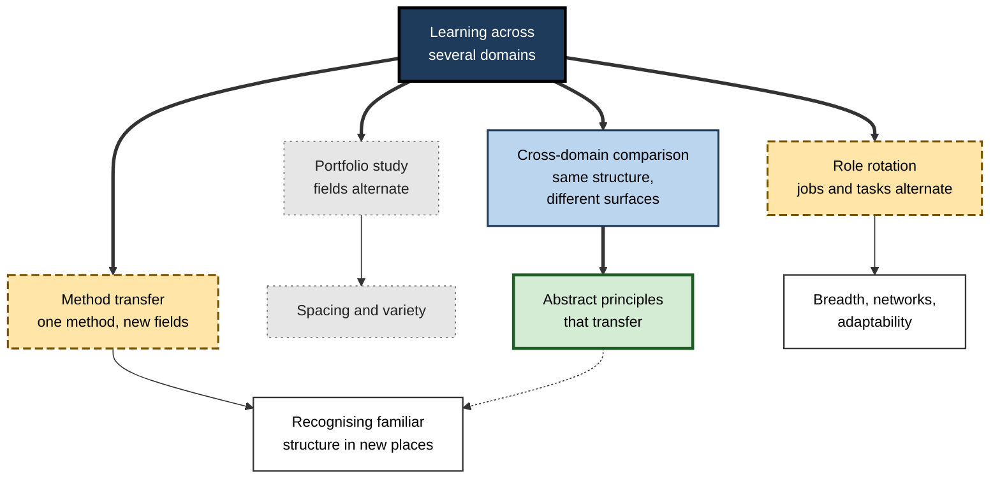
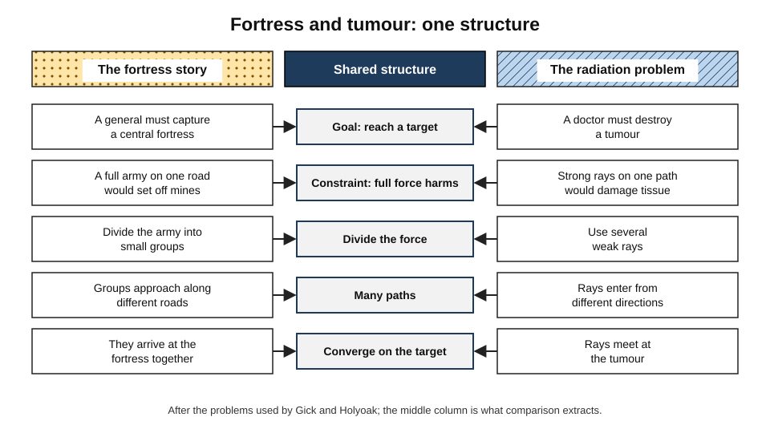
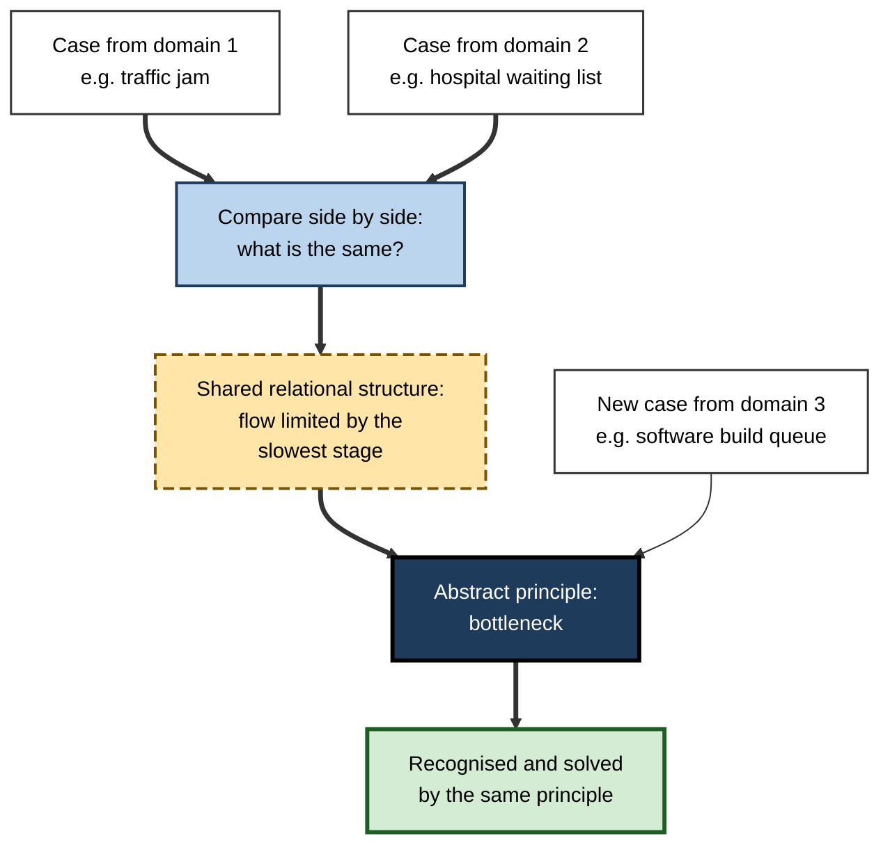
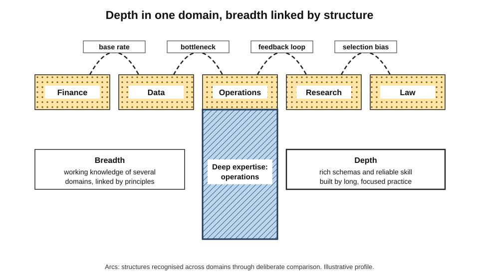
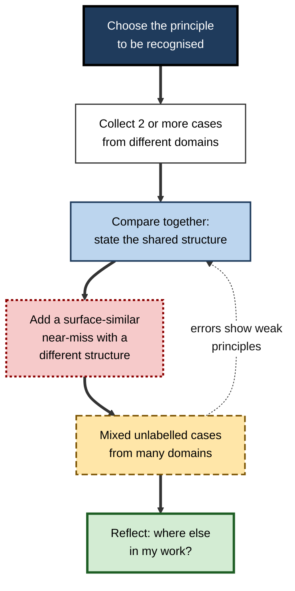
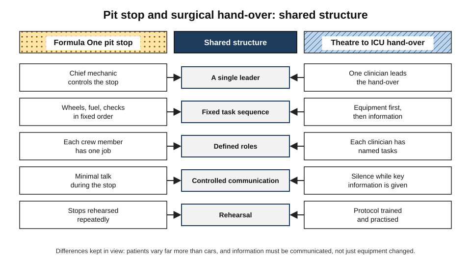

# E.12. Interleaving Across Multiple Domains

A product manager must understand finance well enough to build a business case, user research well enough to judge an interview study, and data well enough to question a dashboard. A management consultant moves from a bank to a hospital to a retailer within a year. A surgical team improves its patient hand-overs after studying how a racing team changes tyres.

Each faces learning that crosses **domains** — distinct fields with their own vocabulary, methods and problems. The question is whether, and how, mixing those domains during learning helps, and the answer turns on a distinction the earlier evidence makes clear: mixing **unrelated** content does little, but mixing cases that share a **deep structure** across different surfaces can produce some of the most valuable learning a professional can achieve — the ability to recognise a familiar problem in an unfamiliar place.

> **Definition — Domain:** a field of knowledge or practice with its own concepts, methods and typical problems, such as accounting, clinical medicine, software engineering or marketing.

> **Definition — Cross-domain interleaving:** arranging learning so that material, cases or tasks from different domains are encountered in alternation — either to spread practice across several fields, or, more powerfully, to compare cases from different fields that share an underlying structure.

**Why it matters**

- Professional work increasingly combines several domains; few roles stay within one field.
- The most transferable knowledge is **structural** — principles such as feedback loops, bottlenecks and incentives — and structure is best learned by **comparing** cases across surfaces.
- Organisations rotate people across roles, cross-train teams and borrow practices from other industries; each is a form of cross-domain interleaving with its own benefits and costs.
- Popular claims about the value of breadth over depth are sometimes overstated; a professional needs to know what the evidence supports.

---

## What "Across Domains" Can Mean

### Four forms

- **Portfolio study** — learning several fields in parallel, alternating them across days or weeks.
  - *e.g.* a manager studying finance on Mondays, data analysis on Wednesdays and negotiation on Fridays.
- **Cross-domain comparison** — studying cases from **different** fields that share the **same** underlying principle.
  - *e.g.* comparing a traffic jam, a hospital waiting list and a software build queue as examples of a **bottleneck**.
- **Role rotation** — moving between jobs, teams or tasks at work.
  - *e.g.* graduate rotation schemes; nurses cross-trained across wards; engineers rotating through on-call, development and support.
- **Method transfer** — applying a method learned in one field to problems in another.
  - *e.g.* using statistical process control from manufacturing in clinical audit.

| Form | What alternates | Main mechanism | Strength of evidence |
|---|---|---|---|
| Near transfer | Applying learning to a very similar situation. |
| Portfolio study | Unrelated fields | Spacing; variety | Benefit mainly from spacing; little discrimination |
| Cross-domain comparison | Cases sharing a deep structure | Analogical comparison; schema abstraction | Strong in laboratory and classroom studies |
| Role rotation | Jobs and tasks | Breadth of experience; network; adaptability | Moderate, mostly correlational |
| Method transfer | Problems from new fields | Recognising structure; adapting the method | Strong for experts; rare spontaneously in novices |

**Figure 1.** Four forms of cross-domain interleaving and what each mainly offers.

> **Key point:** the form with the strongest evidence is not alternating fields as such, but **comparing cases from different fields that share a structure**. That is where interleaving across domains does its distinctive work.

---

## Portfolio Study: Mostly Spacing

- Alternating unrelated fields gives each field **spacing** — returns after gaps — which improves retention.
- It offers **little discrimination** benefit, because finance and negotiation are not confused with each other.
- It also brings **costs**:
  - switching between very different vocabularies and mental models takes time at the start of each session;
  - progress in each field is slower in calendar time than with concentrated study.

> **Watch out:** "studying several subjects at once makes you learn each faster" is not supported. Studying several fields in parallel can make each **more durable** through spacing, but the distinctive gains of interleaving come from comparison, not from alternation itself.

---

## Cross-Domain Comparison: Where the Power Lies

### The problem of inert knowledge

- People often fail to use knowledge they possess when a new problem looks different on the surface from the context in which they learned it.
- Alfred North Whitehead (1929) called such unused knowledge **inert**.

> **Definition — Inert knowledge:** knowledge that a person has but does not spontaneously apply to relevant new problems, usually because those problems look different from the context of learning.

### Analogies are rarely noticed spontaneously

**Study card — Gick and Holyoak (1980, 1983)**

- **The target problem:** Karl Duncker's "radiation problem" — a doctor must destroy a tumour with rays that will damage healthy tissue at the strength needed; the solution is to send several weak rays from different directions that **converge** on the tumour.
- **The analogue:** a story about a general who captures a fortress by dividing his army into small groups that approach along different roads and **converge** at the same moment.
- **Findings (1980):**
  - after reading the fortress story, relatively few participants spontaneously applied it to the radiation problem;
  - when given a simple **hint** that the story might help, most did.
- **Findings (1983):**
  - participants who read **two** different convergence stories and were asked to **compare** them were much more likely to solve the radiation problem spontaneously;
  - the quality of the principle they wrote down from the comparison predicted their success.
- **Conclusion:** a single example in one domain rarely transfers; **comparing two examples from different domains** helps people extract the shared **schema**, which then transfers.

> **Definition — Schema (in problem solving):** an abstract representation of a type of problem and its solution, free of the surface details of any one example.

**Figure 2.** Two surface-different stories share one deep structure.

### Analogical encoding in professional learning

**Study card — Loewenstein, Thompson and Gentner (1999, 2003)**

- **Participants:** management students and executives learning negotiation.
- **Material:** two written cases from **different** business contexts, each illustrating the same principle — a **contingent contract** (an agreement whose terms depend on a future outcome, used to bridge differences in expectations).
- **Design:**
  - **separate** — the two cases were read and analysed one at a time;
  - **comparison** — the same two cases were read **together**, with the instruction to identify what they had in common.
- **Result:** those who compared the cases were substantially **more likely to use a contingent contract** in a later face-to-face negotiation simulation.
- **Conclusion:** comparing cases across contexts — **analogical encoding** — helps professionals extract principles they can use, even when the cases are the same ones studied by the separate group.

> **Definition — Analogical encoding (Dedre Gentner and colleagues):** learning a principle by comparing two or more examples that share it, which highlights their common relational structure and reduces attention to surface details.

### Why comparison works

- **Dedre Gentner's structure-mapping theory** holds that comparison aligns two cases by their **relations** (A causes B; X blocks Y), not by their objects.
- Alignment makes the shared relational structure **salient** and the surface details less salient.
- The resulting abstract representation is **portable**: it can be recognised in a third case from yet another domain.

**Figure 3.** How comparing cases from different domains produces a transferable principle.

> **Remember:** **one case teaches a story; two cases compared teach a principle; a third case from elsewhere tests it.**

| | Studying one case at a time | Comparing cases across domains |
|---|---|---|
| What the learner attends to | Surface details and narrative | Shared relations and principle |
| What is stored | Example-bound knowledge | Abstract schema |
| Spontaneous transfer to a new domain | Rare | Much more likely |
| Typical instruction | "Analyse this case" | "What do these cases have in common?" |
| Effort and feeling | Easier, engaging story | More effortful, less vivid |

---

## Structures That Recur Across Domains

Many of the most useful professional principles appear in many fields under different names.

| Structure | Domain 1 | Domain 2 | Domain 3 |
|---|---|---|---|
| Bottleneck | Factory production line | Hospital discharge process | Software deployment pipeline |
| Feedback loop | Thermostat and heating | Price and demand in markets | Employee engagement and performance |
| Base-rate neglect | Screening test results in medicine | Fraud alerts in banking | Hiring decisions from a single interview |
| Compounding | Investment returns | Technical debt in software | Skill development over a career |
| Principal–agent problem | Shareholders and managers | Patients and doctors | Clients and contractors |
| Network effects | Telephone networks | Social platforms | Payment systems |
| Optionality | Financial options | Staged investment in R&D | Keeping job offers open |
| Regression to the mean | Sports "curse" after a record season | Sales targets after an exceptional quarter | Patient improvement after a severe episode |

> **In practice:** experienced consultants, engineers and clinicians often describe their expertise as "having seen this problem before" — even when they have never worked in the client's industry. What they have seen before is the **structure**.

---

## Breadth, Depth and the Debate About Range

### The argument for breadth

- **David Epstein's book *Range* (2019)** argued that many successful people in complex fields had a **sampling period** of broad experience before specialising, and that breadth supports creative problem-solving and analogical thinking.
- The argument draws on research such as the analogy studies above and on studies of innovation suggesting that combining ideas from distant fields can produce breakthroughs.

### The argument for depth

- **Expertise research** — including Anders Ericsson's work on deliberate practice — shows that high performance in a field requires long, focused practice in that field.
- **Kind** learning environments, with fast and accurate feedback (chess, many sports, some technical tasks), reward early specialisation and repetition.
- **Wicked** learning environments, with delayed or misleading feedback (strategy, policy, many management decisions), are where breadth and analogical reasoning may matter most — a distinction drawn by Robin Hogarth.

> **Definition — Kind learning environment:** a setting in which feedback is rapid and accurate and patterns repeat, so that experience reliably produces skill.

> **Watch out:** the breadth-versus-depth debate is often presented as a contest with a winner. The evidence supports a **combination**: depth in one or two domains to provide reliable skill and rich schemas, plus deliberate cross-domain comparison to make those schemas portable. Claims that generalists always outperform specialists, or the reverse, overreach.

### The T-shaped professional

- A widely used image describes the professional with **deep** expertise in one domain (the vertical stroke of a T) and **broad** working knowledge across several (the horizontal stroke).
- Cross-domain interleaving is the means by which the horizontal stroke becomes more than a collection of facts: it links the domains through shared structure.

**Figure 4.** Depth in one domain, breadth across others, and the structural links between them.

---

## Interleaving Across Roles at Work

### Job rotation

**Study card — Campion, Cheraskin and Stevens (1994)**

- **Setting:** employees in a large pharmaceutical company, many of whom had experienced job rotation.
- **Findings:**
  - rotation was associated with greater gains in **knowledge and skills**, particularly business and administrative knowledge, and with career progress;
  - employees and managers also reported **costs**: a learning curve in each new job, lower productivity during transitions and workload for colleagues.
- **Caveat:** the study was largely **correlational**; people chosen for rotation may differ from those who are not.

> **Definition — Job rotation:** a planned movement of employees between jobs or assignments at intervals, to broaden their skills and experience.

### Cross-training

- **Nursing** — cross-training staff across wards allows flexible staffing and broadens clinical recognition, but may dilute specialist skill if rotations are too frequent.
- **Manufacturing** — multi-skilling workers across stations improves flexibility and understanding of the whole process.
- **Software** — rotating engineers through development, operations and support builds understanding of how code behaves in production.

### Designing rotations for learning, not just coverage

- **Make the structure explicit** — at each new role, ask what principles carry over and what is genuinely different.
- **Compare across rotations** — debriefs that ask "where have you seen this problem before?"
- **Stay long enough** — rotations so short that the learner never becomes competent produce exposure without skill.
- **Return periodically** — rotations that revisit earlier roles add spacing to breadth.

| Rotation design | Learning benefit | Cost or risk |
|---|---|---|
| Very short (weeks) | Exposure, networks | Little competence; high transition cost |
| Medium (several months) | Competence in each role; breadth | Productivity dips at each move |
| Long (years) | Depth in each role | Slow breadth; fewer comparisons |
| With structured cross-role debriefs | Principles made explicit and portable | Requires facilitation time |

---

## Designing Cross-Domain Learning

### A procedure

1. **Choose the principle**, not the domain — the structure the learner needs to recognise.
2. **Collect cases from at least two domains** that clearly share it, with different surfaces.
3. **Present them together** and ask for the **common structure** in the learner's own words.
4. **Add a near-miss** — a case from a third domain that looks similar on the surface but has a **different** structure.
5. **Mix new, unlabelled cases** from several domains, some sharing the principle and some not; the learner must decide which apply.
6. **Reflect** — "where else in my work does this appear?"

**Figure 5.** Designing a cross-domain comparison exercise.

> **Mnemonic — "PCSNMR" — "Principles Cross Surfaces; Near-misses Make Recognition":** the six steps in order.

### Worked example: base-rate neglect across three fields

- **Situation:** a leadership programme wants managers to recognise **base-rate neglect** — ignoring how rare an event is when interpreting evidence — in their own decisions.

1. **Case A (medicine):** a screening test is 90% sensitive and 90% specific for a disease with 1% prevalence. Of 1,000 people, 10 have the disease and 9 test positive; of 990 without it, 99 test positive. So only 9 of 108 positives — about **8%** — actually have the disease.
2. **Case B (banking):** a fraud system flags 2% of legitimate transactions and catches most fraud, but fraud occurs in 0.1% of transactions. Most flags are therefore **legitimate** transactions.
3. **Comparison prompt:** "What do these cases share?" Expected answer: when the event is rare, even an accurate test produces mostly **false positives**.
4. **Near-miss (operations):** a quality test on a production line where defects are common (30%) — here a positive result is usually a real defect; the structure differs because the base rate is high.
5. **Mixed new cases:** a hiring interview that "identifies stars" when true stars are rare; a security alert system; a sales lead score.
6. **Reflection:** each manager names one decision in their own work where base rates are ignored.

> **Formula — Proportion of positives that are true:** true positives ÷ (true positives + false positives). In case A: 9 ÷ (9 + 99) ≈ **0.08**, or about 8%.

| Case | Domain | Base rate | Is base-rate neglect a risk? |
|---|---|---|---|
| Disease screening | Medicine | 1% | Yes — most positives are false |
| Fraud flags | Banking | 0.1% | Yes — most flags are legitimate |
| Production defects | Operations | 30% | Less — most positives are real |
| "Star" interview signals | Hiring | Low | Yes — a strong interview often reflects chance |

> **Watch out:** without the near-miss, managers may learn "positive tests are usually wrong" — a surface rule. The near-miss forces them to learn the **actual principle**: the meaning of a positive result depends on the base rate.

---

## Near and Far Transfer

### How far can learning travel?

- **Near transfer** — applying learning to situations very like the original.
  - *e.g.* using a spreadsheet formula learned on one budget in another budget.
- **Far transfer** — applying learning to situations that differ greatly in content, context or time.
  - *e.g.* applying a queueing principle from operations to a staffing problem in a hospital.
- **Susan Barnett and Stephen Ceci (2002)** proposed a taxonomy describing transfer distance along several dimensions — knowledge domain, physical context, temporal context, functional context, social context and modality.
- **Sceptics**, such as Douglas Detterman (1993), argued that far transfer is rare and that much apparent transfer is near transfer in disguise.

> **Definition — Far transfer:** application of learning to a situation that differs substantially from the learning situation in domain, context or purpose.

### What makes far transfer more likely

- **Abstract principles learned through comparison** rather than single examples.
- **Explicit naming of the principle**, so that it can be called to mind by its label.
- **Practice recognising the principle in varied surfaces** — the cross-domain mixing described above.
- **Prompts in the new context** — asking "what kind of problem is this?" before reaching for the familiar method.

> **Key point:** far transfer is not automatic, and much training that hopes for it achieves only near transfer. Cross-domain comparison is one of the few methods with good evidence of moving learning further.

| | Near transfer | Far transfer |
|---|---|---|
| Similarity of new situation | High | Low on the surface |
| Frequency | Common | Rare without support |
| Typical support needed | Little | Comparison, named principles, prompts |
| Example | A second budget model | A queueing principle applied to hospital staffing |

---

## Learning From Other Industries

Organisations, like individuals, can learn across domains.

- **Cross-industry benchmarking** — studying how another sector solves a structurally similar problem.
  - *e.g.* hospitals studying aviation's checklists and crew resource management; retailers studying airline revenue management.
- **Borrowed methods** — lean production from car manufacturing applied to hospitals, software and offices; statistical process control in clinical audit.
- **Risks of borrowing:**
  - copying the **surface** procedures without the conditions that made them work;
  - ignoring **differences** that matter — patients are not cars, software is not an assembly line.
- **A disciplined approach** follows the same steps as individual comparison: identify the shared structure, list the differences, adapt rather than copy, and test in the new setting.

> **Watch out:** "best practice from another industry" fails when only the surface is imported. The Great Ormond Street team succeeded because they mapped the **structure** of a high-reliability transfer and kept the **differences** in view.

---

## Managing Several Learning Goals at Once

- **Choose a small portfolio** — two or three domains at a time; more fragments attention.
- **Give each domain a rhythm** — regular slots across the week, so each recurs (spacing).
- **Reserve deep blocks** — longer sessions for the domain where depth is being built.
- **Build bridges deliberately** — a weekly half-hour asking what principles from one domain illuminate another.
- **Keep a cross-domain notebook** — one page per recurring structure, with examples collected from each domain.

> **In practice:** a product manager learning finance, research methods and data analysis keeps a "structures" notebook. Under "selection bias" she records a survey sampling only satisfied customers, a dashboard showing only active users and a finance case analysing only surviving products — three domains, one principle.

### Cross-domain learning with AI

- **AI assistants** make unfamiliar domains far more accessible: a professional can obtain a quick explanation of a concept from another field.
- This raises the value of **recognising structure** — knowing which principle from another field to ask about.
- AI can also generate **analogies** and **comparison cases** across domains on request.
- **Caution:** generated analogies can be superficial or wrong; they must be checked for genuine structural correspondence, not just surface resemblance.

---

## Case Study: From the Racing Pit Lane to the Intensive Care Unit

- **Situation:** in the early 2000s, clinicians at Great Ormond Street Hospital in London were concerned about the **hand-over** of children from the operating theatre to the intensive care unit after heart surgery — a moment when equipment, monitoring and information must be transferred quickly and without error.
- **Problem:** hand-overs were often informal and crowded; studies of the process found frequent **technical errors** and **omissions of information**.
- **Cross-domain insight:** two of the team, watching a Formula One race, noticed that a pit-stop crew performed a complex, time-critical transfer — many people, many tasks, seconds to complete — with remarkable reliability.
- **Actions:**
  1. The hospital team worked with Formula One teams (including Ferrari and McLaren) to study how pit stops were organised.
  2. They identified **shared structure**: a fixed sequence of tasks, a clear leader, defined roles for each person, a rule that only one task-group speaks at a time, and rehearsal.
  3. They identified **differences**: patients vary far more than cars, and clinical information must be communicated, not just equipment changed.
  4. They designed a new hand-over protocol: equipment transfer first, then information transfer, with a single leader, defined roles, a checklist and silence for key communications.
- **Result:** a study published by Ken Catchpole and colleagues in 2007 reported that after the new protocol was introduced, both **technical errors** and **information omissions** during hand-over fell, and hand-overs did not take longer.
- **Lesson:** the team did not copy the pit stop; they **compared** two domains, extracted the shared structure of a high-reliability transfer, and adapted it — cross-domain learning at its best.

**Figure 6.** Mapping the structure of a pit stop onto a surgical hand-over.

---

## Open Questions

- **How many domains, and how far apart, give the best transfer?**
  - Comparison of two cases helps; the value of more distant or more numerous domains is less clear.
- **Can breadth be taught deliberately, or only accumulated through experience?**
  - Analogical-encoding studies suggest it can be trained, but long-term professional evidence is thin.
- **How should rotations be designed?**
  - Job-rotation research is mostly correlational; optimal length and sequencing are unknown.
- **When does breadth harm depth?**
  - In kind environments early specialisation may be best; how to time breadth for different careers is debated.
- **How will AI change cross-domain learning?**
  - Easy access to other fields may encourage structural thinking — or encourage shallow borrowing of analogies.

---

## Summary

- Cross-domain interleaving takes four forms: **portfolio study**, **cross-domain comparison**, **role rotation** and **method transfer**.
- **Portfolio study** of unrelated fields mainly provides **spacing**; it does not by itself produce the discrimination benefits of interleaving.
- **Cross-domain comparison** is where the power lies: one example rarely transfers (Gick and Holyoak, 1980), but **comparing two analogues** produces a schema that does (Gick and Holyoak, 1983; Loewenstein, Thompson and Gentner — negotiation cases).
- Comparison works by **structure mapping** (Gentner): aligning relations, not objects, makes principles portable and overcomes **inert knowledge**.
- Many principles recur across fields — bottlenecks, feedback loops, base rates, compounding, principal–agent problems.
- **Breadth versus depth** is a false contest: depth builds rich schemas; deliberate comparison makes them portable. **Kind** environments favour depth; **wicked** ones reward analogical breadth.
- **Job rotation** is associated with knowledge gains and costs (Campion, Cheraskin and Stevens, 1994); rotations should be long enough for competence and include structured cross-role debriefs.
- **Far transfer** is rare without support (Barnett and Ceci; Detterman); comparison, named principles and prompts make it more likely. Organisations borrowing across industries must map **structure** and keep **differences** in view.
- Design: **principle → cases from two domains → compare → near-miss → mixed new cases → reflect**.
- The Great Ormond Street hand-over redesign, modelled on Formula One pit stops, shows structured cross-domain learning reducing errors.

---

## Self-Check

1. Distinguish the four forms of cross-domain interleaving and the main benefit of each.
2. Why does studying several unrelated fields in parallel give mainly a spacing benefit?
3. What is inert knowledge, and why does it arise?
4. Describe Gick and Holyoak's findings in 1980 and 1983, and what changed between them.
5. What did Loewenstein, Thompson and Gentner find with negotiation cases?
6. Explain structure-mapping theory in plain language.
7. Give two recurring structures and an example of each in three domains.
8. Summarise the breadth-versus-depth debate and a balanced position.
9. Distinguish kind from wicked learning environments and explain why the difference matters for breadth.
10. What did Campion, Cheraskin and Stevens (1994) find about job rotation, and what is the main limitation?
11. List the six steps for designing a cross-domain comparison exercise.
12. In a screening test with 2% prevalence, 95% sensitivity and 95% specificity, what proportion of positives in 1,000 people are true positives?
13. Why does a cross-domain exercise need a near-miss?
14. Describe the Great Ormond Street case and explain why it is an example of comparison rather than copying.
15. Distinguish near from far transfer and name three conditions that make far transfer more likely.

### Answer Key

1. Portfolio study (alternating fields; spacing and variety); cross-domain comparison (cases sharing a structure; transferable principles); role rotation (alternating jobs; breadth, networks, adaptability); method transfer (applying a method to new fields; recognising structure).
2. Unrelated fields are not confused, so there is nothing to discriminate; what they gain is the spacing between returns to each.
3. Knowledge that is possessed but not applied to relevant new problems, usually because those problems look different on the surface from the context of learning.
4. In 1980, few participants spontaneously applied the fortress story to the radiation problem, although most did when hinted. In 1983, participants who compared two different convergence stories were much more likely to solve the problem spontaneously, because comparison produced an abstract schema.
5. Participants who compared two cases illustrating contingent contracts were substantially more likely to use one in a later negotiation than those who analysed the same cases separately.
6. Comparison aligns two situations by their relationships — what causes or limits what — rather than by their objects, making the shared relational pattern stand out so it can be recognised elsewhere.
7. E.g. bottleneck: factory line, hospital discharge, software pipeline; feedback loop: thermostat, market price and demand, engagement and performance.
8. Breadth advocates stress analogical thinking and innovation; depth advocates stress deliberate practice and reliable skill. A balanced view: build depth in one or two domains and use deliberate cross-domain comparison to make schemas portable.
9. Kind environments give rapid, accurate feedback and repeating patterns, rewarding focused practice; wicked environments have delayed or misleading feedback, where analogical reasoning from varied experience may matter more.
10. Rotation was associated with knowledge and skill gains and career progress, alongside costs such as learning curves and productivity dips. The study was largely correlational.
11. Choose the principle; collect cases from at least two domains; compare them and state the shared structure; add a near-miss; mix new unlabelled cases from many domains; reflect on where else it applies.
12. Of 20 with the condition, 19 test positive; of 980 without, 49 test positive. True positives ÷ all positives = 19 ÷ 68 ≈ 28%.
13. Without it, learners may extract a surface rule; a case that looks similar but has a different structure forces them to learn the actual principle.
14. Clinicians studied Formula One pit stops, identified shared structure (fixed sequence, leader, roles, rehearsal) and differences (patient variability, information transfer), and designed a new hand-over protocol; errors and omissions fell. It was comparison because they extracted and adapted structure rather than copying procedures.
15. Near transfer applies learning to very similar situations; far transfer to substantially different ones. Far transfer is more likely when principles are learned through comparison, named explicitly, practised across varied surfaces and prompted in the new context.

---

## Glossary

| Term | Meaning |
|---|---|
| Analogical encoding | Learning a principle by comparing examples that share it. |
| Base-rate neglect | Ignoring how common an event is when interpreting evidence. |
| Cross-domain comparison | Comparing cases from different fields that share a structure. |
| Cross-domain interleaving | Alternating material or cases from different domains during learning. |
| Cross-training | Training staff to work in several roles or units. |
| Domain | A field with its own concepts, methods and problems. |
| Far transfer | Applying learning to a substantially different situation. |
| Inert knowledge | Knowledge possessed but not applied to relevant new problems. |
| Job rotation | Planned movement of employees between jobs to broaden skills. |
| Kind learning environment | Setting with rapid, accurate feedback and repeating patterns. |
| Method transfer | Applying a method learned in one field to another. |
| Near transfer | Applying learning to a very similar situation. |
| Portfolio study | Learning several fields in parallel. |
| Schema | An abstract representation of a problem type and its solution. |
| Structure-mapping theory | Gentner's theory that comparison aligns relational structure. |
| T-shaped professional | Deep expertise in one domain with broad knowledge across others. |
| Wicked learning environment | Setting with delayed, missing or misleading feedback. |
