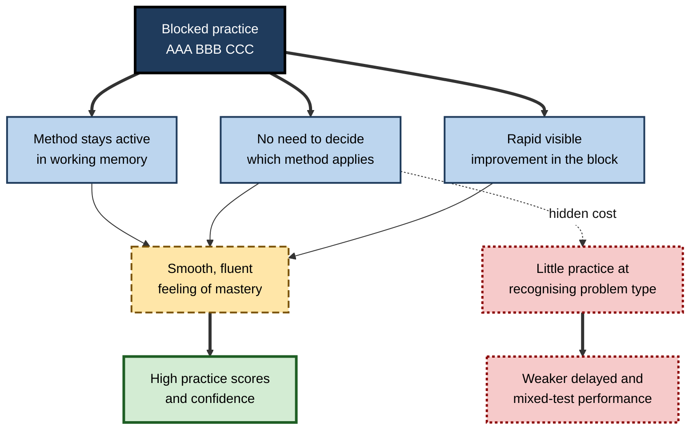
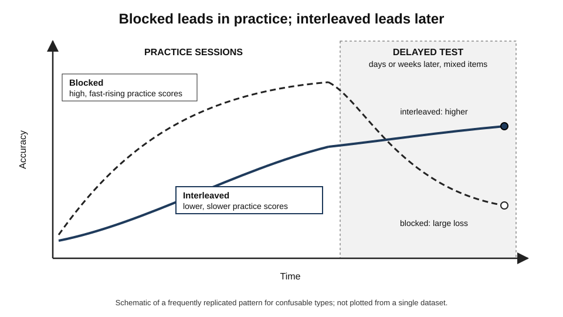
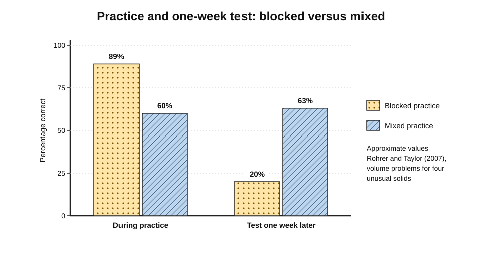
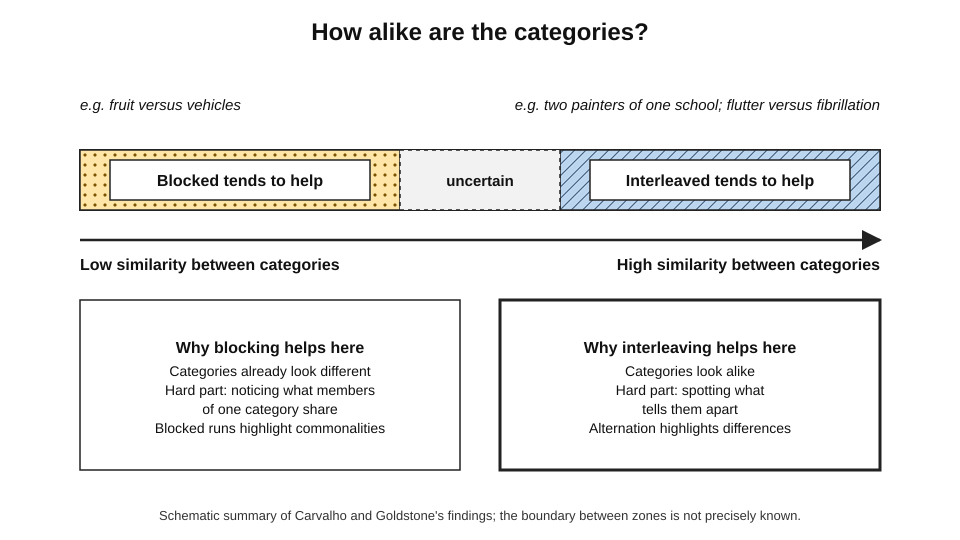
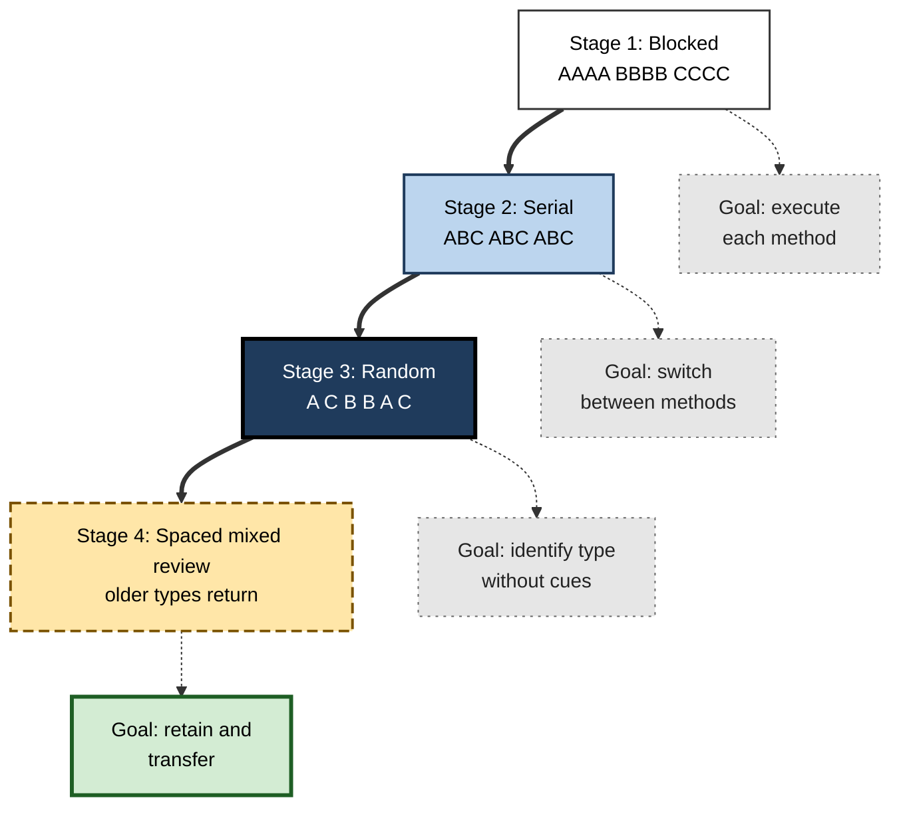
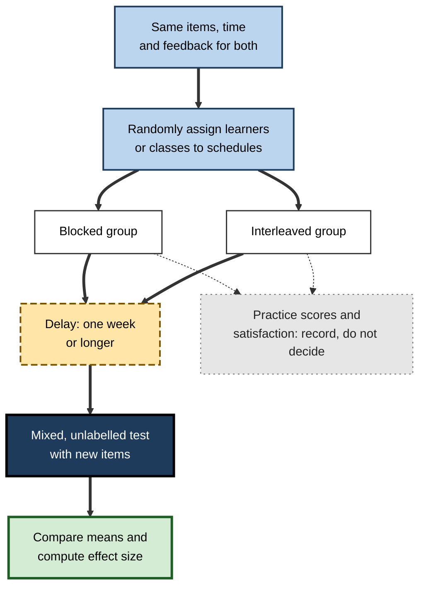

# E.2. Blocked vs. Interleaved Practice

Two groups of trainee analysts are given the same thirty spreadsheet exercises: ten on lookups, ten on pivot tables, ten on conditional formulas. One group works through them in three tidy blocks; the other receives them shuffled. At the end of the afternoon the first group is ahead, more confident and happier. A month later, given a messy real data request, the second group is clearly better. The two schedules have produced **opposite pictures** depending on when, and how, performance is measured.

> **Definition — Blocked practice:** practising all items of one type before moving to the next type (AAA BBB CCC).

> **Definition — Interleaved practice:** practising items of several related types in a mixed order (A B C B A C), so that consecutive items usually differ in type.

**Why the comparison matters**

- It is one of the clearest demonstrations that **how practice looks** and **what practice builds** can diverge.
- Most textbooks, courses, drills and onboarding programmes are blocked by default; choosing between the two schedules is a real and frequent design decision.
- The evidence is not one-sided: blocking wins under identifiable conditions, and knowing them prevents misuse.
- Comparing the two well requires sound measurement — delayed, unaided and on new items — which is itself a professional skill.

---

## Two Schedules, Same Material

### What stays the same and what changes

- **Same:** the items, the number of repetitions, the total time, the feedback.
- **Different:** only the **order** — and therefore what the learner must do on each item.

| | Blocked practice | Interleaved practice |
|---|---|---|
| Sequence | AAA BBB CCC | A B C B A C (or random) |
| Type of the next item | Known in advance | Must be worked out |
| Main mental work | Executing one method repeatedly | Identifying the type, choosing and executing a method |
| What the learner attends to | Similarities among items of one type | Differences between types |
| Practice accuracy and speed | High, rising quickly | Lower, rising slowly |
| Learner confidence | High | Lower |
| Delayed retention (confusable types) | Lower | Higher |
| Transfer to new, unlabelled problems | Weaker | Stronger |

> **Key point:** both schedules give the learner the same **material**; they give the learner different **tasks**.

### Why blocked practice looks so good

- **Momentum** — once a method has been used, it is still active in working memory for the next item.
- **No decision cost** — the learner never has to ask which method to use.
- **Visible progress** — scores rise within the block, which is rewarding.
- **Fluency** — the work feels smooth, and smoothness is easily mistaken for mastery.

> **Definition — Fluency:** the subjective ease of carrying out a task or recalling information; a feeling that strongly influences learners' judgements of their own learning but predicts later performance poorly.

**Figure 1.** Why blocked practice produces strong performance during practice.

---

## The Crossover: Performance During Practice Versus Learning Later

### The characteristic pattern

- In study after study the two schedules produce a **crossover**:
  - **during practice** blocked is ahead;
  - **at a delayed test** interleaved is ahead.
- The crossover is the clearest everyday illustration of the distinction between **performance** (what can be done now) and **learning** (the durable change in capability).

**Figure 2.** The typical crossover between blocked and interleaved practice.

### The classic numbers

**Study card — Rohrer and Taylor (2007)**

- **Participants:** university students.
- **Task:** finding the volume of four unusual solids — a wedge, a spheroid, a spherical cone and a half cone.
- **Design:** after a tutorial, practice problems were either **blocked** by solid or **mixed**.
- **Results:**
  - Practice: blocked about **89%** correct, mixed about **60%**.
  - Test one week later: mixed about **63%**, blocked about **20%**.
- **Analysis of errors:** many blocked-group errors were **discrimination errors** — the right kind of calculation for the wrong solid.

**Figure 3.** Practice and delayed-test scores in Rohrer and Taylor (2007).

**Study card — Taylor and Rohrer (2010)**

- **Participants:** fourth-grade children (about nine or ten years old).
- **Task:** four kinds of problem about prisms — the number of faces, edges, corners and angles, each with its own formula.
- **Design:** the same practice problems blocked or interleaved.
- **Results:**
  - During practice the blocked group made fewer errors.
  - On a test the next day the interleaved group scored **roughly twice** as high.
  - Blocked-group errors were mostly the use of the **wrong formula** for the question asked.
- **Conclusion:** the crossover appears in children too, and its cause is again the failure to learn **which** formula applies.

### Retention and transfer, not just acquisition

| Measure | Blocked practice | Interleaved practice |
|---|---|---|
| **Acquisition** — accuracy during practice | Usually higher | Usually lower |
| **Immediate test** — minutes after | Often similar or blocked ahead | Often similar |
| **Delayed retention** — days to weeks after | Lower (confusable types) | Higher |
| **Transfer** — new examples or new problem forms | Lower | Higher |
| **Learner's prediction of own learning** | Higher | Lower |

> **Remember:** the comparison is decided by **delayed** and **transfer** measures. A study, course or audit that measures only acquisition will **systematically choose the wrong schedule**.

---

## Evidence Beyond Mathematics

### Motor skills

**Study card — Goode and Magill (1986)**

- **Participants:** women with no badminton experience.
- **Task:** three serves — short, long and drive.
- **Design:** practice over several weeks in **blocked**, **serial** (fixed rotation) or **random** order.
- **Results:**
  - Blocked practice gave the best performance during practice.
  - At retention, and especially at **transfer** (serving from the other side of the court), the random group performed best.

**Study card — Hall, Domingues and Cavazos (1994)**

- **Participants:** skilled college baseball players.
- **Design:** extra batting practice twice a week for several weeks.
  - **Blocked** — fastballs, then curveballs, then change-ups in separate sets.
  - **Random** — the three pitch types in unpredictable order.
- **Results:** at the final test the random group hit better, including under blocked test conditions.
- **Conclusion:** contextual-interference benefits were found in skilled athletes on a real sport skill.

> **Definition — Serial practice:** cycling through tasks in a fixed, predictable order (ABCABC); an intermediate level of contextual interference between blocked and random practice.

### Category and concept learning

- **Kornell and Bjork (2008)** — interleaving paintings by different artists improved classification of **new** paintings.
- **Clinical images** — studies with medical students mixing electrocardiogram (ECG) rhythms or skin lesions have generally found better diagnostic accuracy on new cases after mixed practice, especially for the most confusable diagnoses.
- **Science problems** — Samani and Pan (2021) gave about 350 undergraduate physics students interleaved or blocked homework across a semester (each student received both in different weeks). On surprise tests with **novel, harder** problems, performance after interleaved homework was markedly better, yet students rated interleaving harder and believed they had learned less from it.

### The pooled evidence

- **Brunmair and Richter (2019)** — meta-analysis of interleaving studies:
  - medium overall benefit (g ≈ 0.42);
  - strongest for **visual** categories, small and variable for **maths** in the laboratory;
  - **negative** for lists of **words**; none for **expository texts**.
- **Contextual interference in motor learning** — recent meta-analyses (for example by Graser and colleagues in 2021 and Czyż and colleagues in 2024) support a moderate retention benefit of random over blocked practice in **laboratory** tasks with adults, with smaller or absent benefits in **children**.
- **Applied sports settings** — systematic reviews by Ammar and colleagues (2023, 2024) found **no consistent evidence** that random practice beats blocked practice in field sport skills.

> **Watch out:** the motor-learning evidence is genuinely **contested**. Laboratory tasks are short and simple; real sports skills are long, complex and practised by learners of all levels. Claims that random practice is "always better" in coaching go beyond the evidence.

### Longer delays widen the gap

- In a study of seventh-grade mathematics, Doug Rohrer, Robert Dedrick and Sandra Stershic (2015) tested students either **one day** or **thirty days** after interleaved or blocked practice.
  - Interleaving was ahead at both delays.
  - The advantage was **larger** after thirty days, because the blocked group forgot more.
- The pattern is typical: the longer the interval before the test, the more the schedules diverge.

> **Key point:** the more distant the moment of real use — an exam at the end of the year, a rare emergency, a client question months later — the more the choice of schedule matters.

---

## Why the Two Schedules Diverge

The crossover has several complementary explanations. Each points to something blocked practice lets the learner skip.

### Three accounts

- **Discrimination (contrast) account**
  - Consecutive items of different types invite comparison, so the learner discovers **what tells the types apart**.
  - Blocked items of one type invite comparison only **within** the type.
- **Reconstruction (forgetting–reconstruction) account** — proposed in motor learning by Timothy Lee and Richard Magill (1980s).
  - When types alternate, the plan for each type is partly forgotten between uses and must be **rebuilt** from memory each time.
  - Repeated rebuilding strengthens the plan; in a blocked run the plan is simply reused.
- **Elaboration–distinctiveness account** — proposed by John Shea and Steven Zimny (1983).
  - Holding several tasks in mind at once leads the learner to compare them and encode each more **distinctively** and **elaborately**.
- **Spacing contribution**
  - Interleaving automatically spaces each type, and spacing on its own improves retention.

> **Definition — Forgetting–reconstruction hypothesis:** the account that switching between tasks causes partial forgetting of each task's action plan, so the plan must be reconstructed on every attempt, which strengthens it.

> **Definition — Elaboration–distinctiveness hypothesis:** the account that practising tasks in mixed order encourages comparison between them, producing richer and more distinctive memory representations.

| Account | What blocking lets the learner skip | Best evidence |
|---|---|---|
| Discrimination | Comparing types and noticing differences | Benefits strongest for similar categories; side-by-side comparison often works as well as interleaving |
| Reconstruction | Retrieving and rebuilding the method each time | Motor learning; benefits shrink when the method is kept visible |
| Elaboration–distinctiveness | Encoding each type in relation to the others | Motor learning; comparison instructions can mimic interleaving |
| Spacing | Gaps between repetitions | Spaced-but-blocked schedules recover part of the benefit |

> **Remember:** the accounts are **not rivals** — in most real practice all four operate together, in proportions that differ by task.

---

## What Learners Choose When Left to Themselves

- Learners given control over the order of study **mostly block**.

**Study card — Tauber, Dunlosky, Rawson, Wahlheim and Jacoby (2013)**

- **Task:** learning to classify birds into families from pictures.
- **Design:** participants chose for themselves which family to study next.
- **Result:** most participants chose to study **one family at a time** — blocking — and switched to the next family only after a run of the same family.
- **Conclusion:** without guidance, learners pick the schedule that **feels** better, not the one that works better for confusable categories.

- **Teachers and authors choose the same way.**
  - Textbook exercise sets, coaching drills and e-learning modules are overwhelmingly blocked by default.
- **Reasons for the preference:**
  - higher accuracy during practice;
  - the sense of "finishing" one thing before starting another;
  - easier lesson planning and marking;
  - learner satisfaction ratings that reward smoothness.

> **Watch out:** learner preference is not evidence of effectiveness. In several studies the **majority** who preferred blocking performed **better** under interleaving.

---

## When Blocked Practice Wins

Blocking is not simply the inferior schedule. It is better, or at least not worse, under several conditions.

### Low similarity between categories

**Study card — Carvalho and Goldstone (2014)**

- **Design:** participants learned artificial categories of shapes in blocked or interleaved order.
  - In one condition the categories were **highly similar** to each other; in another they were **dissimilar**.
- **Results:**
  - **High similarity** → interleaving gave better classification of new items.
  - **Low similarity** → **blocking** gave better classification of new items.
- **Explanation (sequential attention theory):** blocked study directs attention to features shared **within** a category; interleaved study to features that differ **between** categories. Whichever kind of information is harder to discover benefits from the schedule that highlights it.

> **Definition — Sequential attention theory:** Carvalho and Goldstone's account that the order of examples shapes attention — successive same-category items draw attention to similarities, successive different-category items to differences.

**Figure 4.** Category similarity and the schedule likely to help most.

### Other conditions favouring blocking

- **First exposure to a new method.**
  - A learner who cannot yet execute a procedure gains little from having to choose it.
  - Short blocked practice builds a working version of each method first.
- **Low prior knowledge combined with high complexity.**
  - In motor learning, the **challenge point framework** of Mark Guadagnoli and Timothy Lee (2004) holds that the best amount of difficulty depends on the learner's skill and the task's complexity: novices on complex tasks may be overwhelmed by random practice.
- **Learning simple verbal items.**
  - Interleaving word lists gave negative effects in the meta-analysis.
- **Some rule-learning tasks.**
  - In a study of foreign-language **pronunciation** rules, Shana Carpenter and Frank Mueller (2013) found blocking better — possibly because seeing many examples of one spelling–sound rule in a row made the rule easier to notice.

> **Definition — Challenge point framework:** the proposal that learning is best when the difficulty of practice is matched to the learner's skill level and the task's complexity — too little challenge and too much both reduce learning.

| Condition | Likely better schedule | Reason |
|---|---|---|
| Similar, confusable types | Interleaved | Differences are hard to see unless contrasted |
| Dissimilar types whose own features are subtle | Blocked | Commonalities within a type are the harder thing to see |
| First encounter with a method | Brief blocked | Learner cannot yet execute, so choosing is premature |
| Methods known; real task requires choosing | Interleaved | Practises identification and selection |
| Simple word pairs or isolated facts | Neither clearly; spacing and retrieval matter more | Nothing to discriminate |
| Complex motor skill, novice learner | Blocked first, then rising interference | Avoids overload |

---

## Between the Extremes: Hybrid and Graduated Schedules

### Ways of combining the two

- **Blocked-then-interleaved** — a few blocked items per type, then mixed practice.
- **Graduated (increasing) interference** — blocked → serial → random as skill grows.
- **Mixed review** — each new practice set contains some items of the newest type and some of earlier types.
- **Blocked introduction, interleaved review** — common in mathematics homework where the day's lesson is practised briefly and the rest of the assignment mixes earlier types.

**Study card — Porter and Magill (2010)**

- **Task:** golf putting from different distances (and, in a second experiment, basketball passes).
- **Design:** blocked, random, or **systematically increasing** interference (blocked → serial → random).
- **Result:** the increasing schedule gave the best transfer performance.
- **Caveat:** a single line of studies with relatively small samples; the general idea is plausible but not firmly established.

**Figure 5.** A graduated schedule moves from blocked to random as competence grows.

> **In practice:** a sound default is **"block to learn the method, interleave to learn the choice"** — one or two blocked items per new type, then mixed practice for the rest, with the proportion of mixing rising over a course.

---

## Comparing Schedules Fairly

### Pitfalls in evaluating a schedule

- **Measuring during practice** — guarantees blocking will look better.
- **Measuring immediately after** — short-term effects can hide or reverse the benefit.
- **Testing in blocked format** — if the test is grouped by type, the identification step is never examined.
- **Unequal time or items** — if the interleaved group did fewer problems or had less feedback, the comparison is unfair.
- **Confounding with spacing** — interleaving spaces each type; to claim a discrimination benefit, a spaced-but-blocked control is needed.
- **Relying on satisfaction ratings** — learners usually prefer blocking.

**Figure 6.** Designing a fair comparison of blocked and interleaved training.

### Worked example: reading the results of a training pilot

- **Situation:** a bank pilots two versions of anti-money-laundering (AML) training. Trainees must classify transaction patterns into four typologies — structuring, layering, trade-based laundering and mule activity — which are easily confused. Forty trainees are randomly split.
- **Data (hypothetical):**

| | Blocked group (n = 20) | Interleaved group (n = 20) |
|---|---|---|
| Practice accuracy | 88% | 71% |
| Satisfaction (out of 5) | 4.5 | 3.9 |
| Mixed test, 4 weeks later: mean | 58% | 70% |
| Standard deviation of test scores | 15 | 15 |

1. **Ignore practice accuracy and satisfaction as evidence of learning.** They favour blocking, as expected.
2. **Compute the difference on the delayed test:** 70 − 58 = 12 percentage points.
3. **Compute the effect size.**

> **Formula — Cohen's d:** d = (mean₁ − mean₂) ÷ pooled standard deviation. Here d = (70 − 58) ÷ 15 = **0.8** — a large effect by the usual benchmarks.

4. **Check the error pattern.** If blocked-group errors are mostly **misclassifications between typologies** (layering called structuring), the benefit is most likely due to discrimination.
5. **Check fairness.** Same cases, same time, same feedback? If yes, the interleaved version should be adopted.
6. **Check the cost.** Re-ordering cases costs almost nothing; the main cost is trainee discomfort, which can be addressed by explaining in advance why the practice will feel harder.

> **Watch out:** with only twenty per group, a single pilot can mislead. A sensible organisation repeats the comparison with the next cohort before treating the effect size as settled.

---

## Blocked and Interleaved Practice in Professional Work

### Typical design decisions

- **Onboarding curricula** — module-by-module courses (blocked) are easy to build and schedule; mixed case work in later weeks adds the identification skill.
- **Certification preparation** — chapter-by-chapter question banks early; mixed, timed sets in the final weeks.
- **Clinical skills** — one condition per teaching session early; mixed case conferences and image sets later.
- **Software teams** — learning a new framework feature by feature, then mixed code-review or debugging exercises.
- **Sport and performing arts** — technical drills in blocks for new skills; game-like or performance-like random practice for consolidation.

### Digital platforms and AI tutors

- **Question banks and learning apps** usually offer both modes — "practise by chapter" and "mixed" or "exam" mode.
  - Learners left to choose tend to stay in chapter mode long after it has stopped being useful.
  - A sensible platform default is chapter mode for the first session on new material, mixed mode thereafter.
- **Adaptive systems** often keep a learner on one skill until mastery is shown, which is a blocked design.
  - Mastery shown in a blocked run can be **illusory**: it shows the method can be executed when its type is known.
  - Better systems confirm mastery with **mixed** items that do not reveal the skill being tested.
- **AI tutors** that generate practice on request will, by default, produce "ten more problems like this one".
  - A learner can instead ask for mixed sets drawn from everything studied so far, **without labels**, and for feedback on the choice of method as well as on the answer.

> **Watch out:** a dashboard showing "skill mastered" after a blocked run is reporting **performance under cueing**, not learning. Ask how mastery was measured before trusting it.

> **In practice:** look at the **final** form of performance — an exam paper, a ward round, a sales call, a production incident. If it is mixed, practice must eventually be mixed too.

### Case study: from module tests to mixed cases in a tax practice

- **Situation:** the trainee programme of a mid-sized tax advisory practice taught corporation tax, VAT and employment taxes in successive four-week modules, each ending with a module test.
- **Problem:** trainees passed module tests comfortably but struggled with real client queries, which often involved **more than one tax** and did not say which applied — for example a company car arrangement raising employment-tax and VAT questions together.
- **Diagnosis:**
  - every practice question and test had been **labelled by the module**;
  - trainees had never practised deciding **which taxes were engaged** by a set of facts;
  - the most common error on real work was not a wrong calculation but a **missed issue**.
- **Actions:**
  1. Modules were kept for first teaching, but each week after the first included a **mixed problem set** drawing on all modules taught so far.
  2. Module tests were replaced by **cumulative mixed tests** at weeks 4, 8 and 12.
  3. Each mixed problem began with an "issues spotting" step: list every tax engaged and why.
  4. Trainers explained at the outset that the mixed sets would feel harder and that this was intended.
- **Result:**
  - average scores on practice sets fell during the programme;
  - reviewers of trainees' early client work reported fewer missed issues;
  - trainees initially disliked the mixed sets but, by the end, described them as "closest to the real job".
- **Lesson:** blocked teaching built the knowledge; interleaved practice built the **judgement of which knowledge applied**.

---

## Open Questions

- **When exactly should a learner switch from blocked to interleaved practice?**
  - Rules of thumb exist (after one or two successful items of each type), but there is little direct evidence on the optimum point.
- **Why does the benefit vary so much across studies?**
  - Similarity, learner level, feedback, delay and the form of the test all matter; their interactions are not fully mapped.
- **Do graduated schedules beat pure interleaving?**
  - Some motor-learning results suggest so; evidence in academic subjects is sparse.
- **Do the laboratory motor-skill findings generalise to sport and workplace skills?**
  - Recent systematic reviews of field studies are inconclusive.
- **How do individual differences matter?**
  - Some studies suggest learners with weaker prior knowledge, or lower fluid reasoning, may benefit less or need more support; findings are not yet consistent.

---

## Summary

- **Blocked** practice completes one type at a time; **interleaved** practice mixes types. The items can be identical; the **task** differs.
- Blocked practice looks good because of **momentum**, **no decision cost**, **visible progress** and **fluency**.
- The schedules produce a **crossover**: blocked ahead during practice, interleaved ahead at delayed and transfer tests (Rohrer and Taylor, 2007: about 89% vs 60% in practice; 20% vs 63% a week later).
- The benefit appears in children (Taylor and Rohrer, 2010), motor skills (Goode and Magill, 1986; Hall and colleagues, 1994), category learning (Kornell and Bjork, 2008) and physics homework (Samani and Pan, 2021).
- Pooled evidence: medium overall benefit; strongest for **confusable visual categories**; small and variable for laboratory maths; **negative for word lists**; motor-learning benefits robust in the laboratory but **contested in field sports** and weaker in children.
- **Blocking wins** for dissimilar categories whose shared features are subtle (Carvalho and Goldstone, 2014), first exposure to a method, novices on complex tasks (challenge point framework) and some rule-learning tasks.
- **Hybrid** and **graduated** schedules — block to learn the method, interleave to learn the choice — are a sound default.
- Compare schedules **fairly**: same items and time, random assignment, delay, mixed unlabelled test, effect size; never decide on practice scores or satisfaction.

---

## Self-Check

1. In a blocked and an interleaved schedule with the same items, what stays the same and what changes?
2. Give four reasons why blocked practice produces high practice scores.
3. Describe the crossover pattern and explain what it shows about performance and learning.
4. Summarise the results and error analysis of Rohrer and Taylor (2007).
5. What did Taylor and Rohrer (2010) add to the evidence?
6. Describe one motor-skill study showing a contextual-interference benefit, including its measures.
7. What does the evidence say about random practice in field sports and in children?
8. Explain Carvalho and Goldstone's finding about category similarity and the theory proposed to explain it.
9. List three conditions under which blocked practice may be preferable.
10. What is a graduated schedule, and what evidence supports it?
11. A study measures both groups ten minutes after practice using a test grouped by problem type. Identify two weaknesses.
12. In a pilot, the interleaved group scores 74% and the blocked group 65% on a delayed test, with a pooled standard deviation of 18. Calculate d and interpret it.
13. A hospital trains nurses to recognise five types of cardiac rhythm, one rhythm per week. Propose a better schedule and explain how you would evaluate it.

### Answer Key

1. The items, repetitions, time and feedback stay the same; only the order changes, which changes the task — in interleaved practice the learner must identify each item's type and choose a method.
2. The method stays active in working memory; there is no need to decide which method applies; progress within each block is visible and rewarding; the work feels fluent, which is mistaken for mastery.
3. Blocked practice is ahead during practice, interleaved practice ahead at delayed and transfer tests. Practice performance is a poor guide to durable learning; conditions that lower performance now can raise learning later.
4. Volumes of four unusual solids: blocked about 89% versus mixed 60% during practice; a week later mixed about 63% versus blocked 20%. Many blocked-group errors applied a formula for the wrong solid — discrimination errors.
5. The crossover appeared in fourth-grade children on prism problems: blocked had fewer practice errors but interleaved scored roughly twice as high the next day; blocked-group errors were mostly using the wrong formula.
6. Goode and Magill (1986): novices practised three badminton serves blocked, serial or random. Blocked was best during practice; random was best at retention and especially transfer to serving from the other side of the court. (Or Hall and colleagues, 1994, with college baseball batting.)
7. Systematic reviews of field sports find no consistent advantage of random over blocked practice; benefits in children are smaller or absent, while laboratory studies with adults show moderate retention benefits.
8. For highly similar categories interleaving improved classification of new items; for dissimilar categories blocking did. Sequential attention theory: blocked sequences draw attention to within-category similarities, interleaved sequences to between-category differences; the harder-to-find information benefits from the schedule that highlights it.
9. Dissimilar categories whose shared features are subtle; the first exposure to a new method; novices on complex tasks; simple word lists; some rule-learning tasks such as pronunciation rules.
10. A schedule that increases interference as skill grows — blocked, then serial, then random. Porter and Magill (2010) found it gave the best transfer in golf putting and basketball passing, but the evidence base is small.
11. The test is immediate, so short-term effects dominate; and it is grouped by type, so it never tests identification of problem type — the very skill interleaving trains.
12. d = (74 − 65) ÷ 18 = 0.5, a medium effect by conventional benchmarks; worth adopting if the comparison was fair, and worth confirming with another cohort.
13. Introduce each rhythm with a short blocked session, then use mixed sets of rhythm strips from all rhythms learned so far, placing the most confusable rhythms close together, with immediate feedback; repeat mixed sets at spaced intervals. Evaluate with random assignment to old and new schedules, a delayed mixed test on new strips several weeks later, error analysis of confusions, and ideally audit of recognition on the ward.

---

## Glossary

| Term | Meaning |
|---|---|
| Acquisition | Performance during or just after practice. |
| Blocked practice | Practising all items of one type before the next type. |
| Challenge point framework | Proposal that the best difficulty depends on learner skill and task complexity. |
| Cohen's d | Difference between means divided by pooled standard deviation. |
| Contextual interference | Disruption during practice from switching among tasks. |
| Crossover | Pattern in which blocked practice leads during practice and interleaved practice leads at a delayed test. |
| Discrimination error | Applying the method for one type to a problem of another type. |
| Fluency | Subjective ease of performing or recalling. |
| Graduated schedule | Practice that moves from blocked to serial to random as skill grows. |
| Interleaved practice | Practising related types in mixed order. |
| Mixed review | Practice sets combining the newest type with earlier types. |
| Random practice | Practising tasks in an unpredictable order. |
| Retention test | A test after a delay, without further practice. |
| Sequential attention theory | Account that order of examples directs attention to similarities or differences. |
| Serial practice | Practising tasks in a fixed rotation. |
| Transfer test | A test using new examples, contexts or problem forms. |
