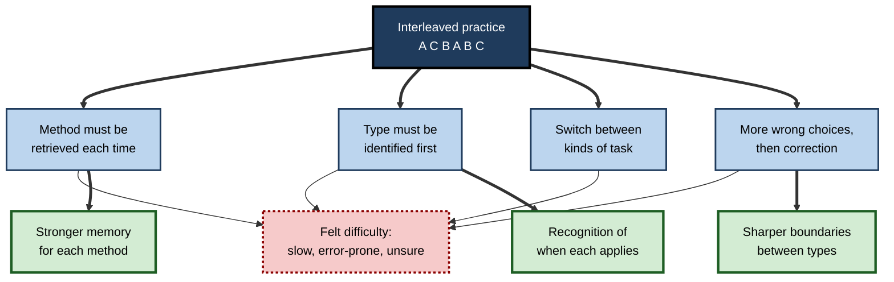
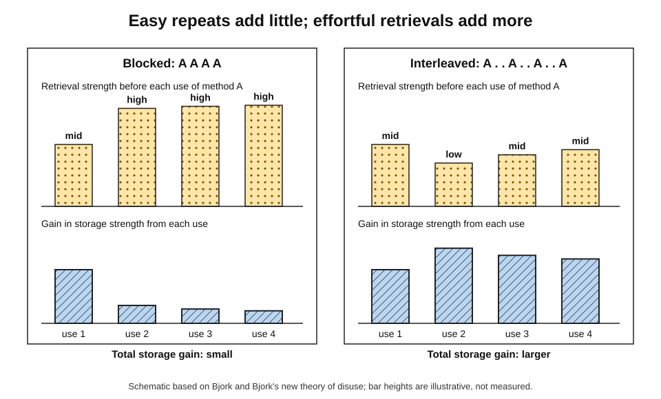
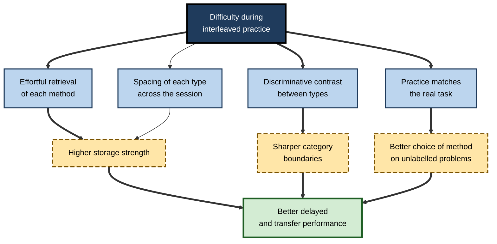
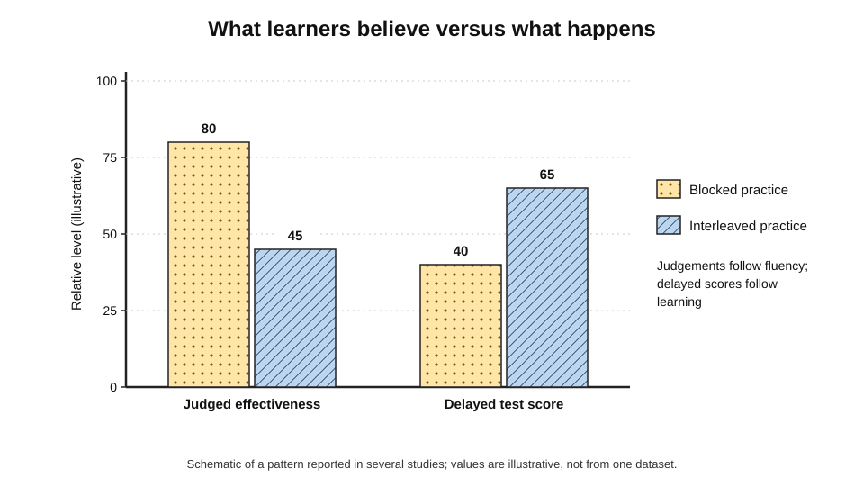
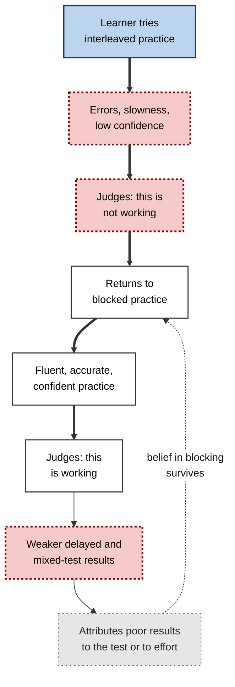
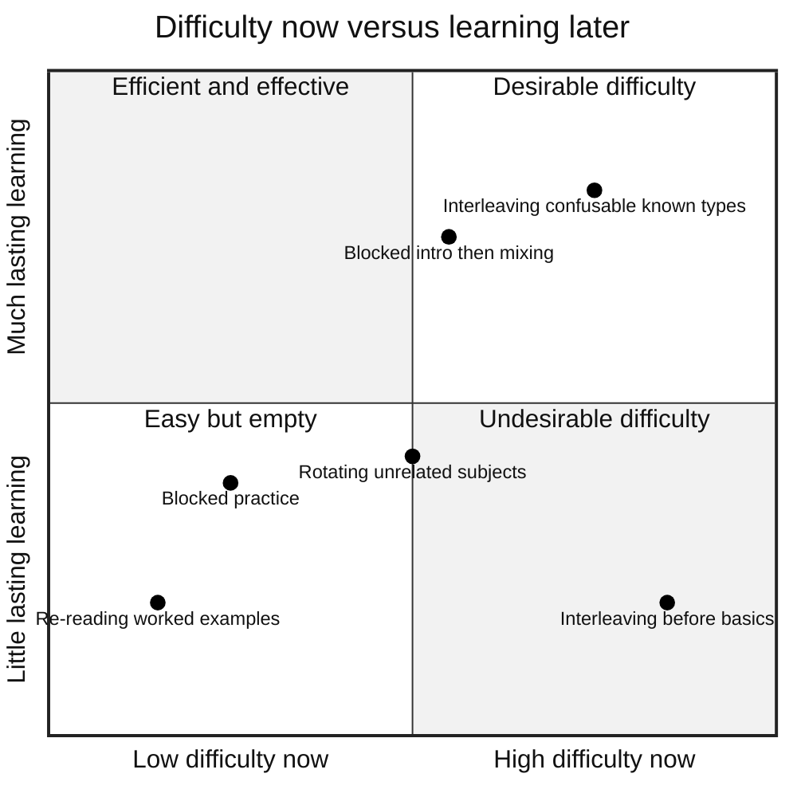

# E.3. Why Interleaving Feels Harder but Works

Halfway through a mixed problem set, a student stops and says, "I was fine when these were in chapters; now I keep getting them wrong. This can't be working." She is describing the experience almost everyone has with interleaved practice: more mistakes, slower progress and a nagging sense of confusion. A week later, on a test she did not know was coming, she will probably do better than her friend who practised the same problems in tidy blocks — and she will probably still believe the blocks were better.

> **Definition — Desirable difficulty:** a condition of practice that makes performance slower or less accurate in the short term but improves long-term retention or transfer, provided the learner can eventually respond successfully. The term was introduced by Robert Bjork in the 1990s.

> **Definition — Metacognitive judgement:** a person's assessment of their own learning or knowledge — for example, how well they think they have learned something, or how well they will do on a later test.

**Why it matters**

- The feeling of difficulty is the **main reason** learners, teachers and trainers abandon interleaving.
- Understanding **where the difficulty comes from** shows that it is the very work that produces learning.
- Understanding **why judgements mislead** protects a learner from choosing methods by how they feel.
- Not all difficulty is desirable; telling the two apart prevents interleaving from being misused.
- Organisations that evaluate training by satisfaction or practice scores will systematically reject interleaving unless they understand this effect.

---

## What Interleaved Practice Feels Like

The felt experience is consistent across subjects, ages and settings.

**Typical reports from learners**

- **"I keep getting confused."** — methods for different types are mixed up.
- **"I'm slower."** — each item takes longer to start.
- **"I don't feel I'm getting better."** — scores do not climb within the session the way they do in blocks.
- **"It's frustrating."** — errors feel like failure, not progress.
- **"I never get into a rhythm."** — there is no run of repetitions to settle into.
- **"I don't feel finished."** — no type is "done" by the end of the session.

**What can be measured**

- **More errors** during practice, especially errors of choosing the wrong method.
- **Longer response times**, particularly at the start of each item.
- **Lower confidence ratings** on each answer.
- **Lower predictions** of later test performance.

> **Key point:** every one of these is a sign of lower **performance during practice**. None of them is a measure of **learning**, which can only be seen later.

---

## Where the Difficulty Comes From

### Five sources of extra effort

1. **No momentum.**
   - In a blocked run the method used on the last item is still active and can simply be reused.
   - In an interleaved set the method must be **retrieved from memory** afresh for almost every item.
2. **A decision on every item.**
   - The learner must decide which type of problem it is before beginning.
   - Blocked practice makes that decision for them.
3. **Switching costs.**
   - Changing from one kind of task to another takes a small extra amount of time and attention, even when the switch is predictable.
   - Laboratory studies of task switching, such as those of Robert Rogers and Stephen Monsell (1995), show these costs reliably.
4. **Errors and their correction.**
   - Choosing the wrong method produces wrong answers, which must be noticed and corrected.
5. **Loss of fluency.**
   - The work never feels smooth; smoothness is the feeling people use to judge their own progress.

> **Definition — Switch cost:** the extra time and errors that occur when a person changes from one task to another, compared with repeating the same task.

**Figure 1.** Sources of the extra effort in interleaved practice and what each one trains.

> **Watch out:** switch costs are **not** what makes interleaving work. They are a pure performance cost. The useful effort is the **retrieval** of the method and the **identification** of the type; the switch cost simply comes along with them.

---

## Why the Difficulty Produces Learning

### Storage strength and retrieval strength

- **Robert and Elizabeth Bjork's new theory of disuse (1992)** distinguishes two properties of any memory:
  - **storage strength** — how well established it is (reflects learning);
  - **retrieval strength** — how accessible it is right now (reflects performance).
- **Key claim:** the gain in storage strength from a successful retrieval is **greater** when retrieval strength was **low** — when the retrieval was hard.
- **Applied to schedules:**
  - In a blocked run, the method's retrieval strength is high after the first item; further uses add little storage strength.
  - In an interleaved set, the method has partly faded since its last use; retrieving it is harder and adds more storage strength.

> **Definition — Storage strength:** how deeply and durably a memory is established; it can only increase and is not directly observable.

> **Definition — Retrieval strength:** how easily a memory can be accessed at a given moment; it rises with recent use and falls with time and interference.

**Figure 2.** Hard retrievals build more storage strength than easy ones.

### Retrieving the method, not just the answer

- Interleaving turns each problem into a small act of **retrieval**: the learner must bring back *how* to solve it.
- Retrieving information from memory, rather than re-reading it, is one of the best-established ways of strengthening memory; interleaving applies that principle to **procedures and choices**.
- Blocked practice, by contrast, often involves retrieving the method once and then **copying** it.

### Contrast reveals the boundaries

- When a type-A problem follows a type-B problem, the learner notices — sometimes painfully, through an error — the feature that makes them different.
- Such **discriminative contrast** sharpens the boundary between categories in memory.
- Errors of choosing the wrong method are especially informative: after feedback, the learner knows precisely **which** feature they missed.

> **Definition — Discriminative contrast:** the comparison of items from different categories presented close together, which draws attention to the features that distinguish them.

### Practising the real task

- The real task — an exam, a diagnosis, a client problem — requires identifying the type and choosing the method.
- Interleaved practice is closer to that task; in the language of transfer research, it has higher **transfer-appropriate processing**: the mental work in practice matches the mental work at the test.

> **Definition — Transfer-appropriate processing:** the principle, set out by C. Donald Morris, John Bransford and Jeffery Franks (1977), that memory performance is best when the processes used at learning match those required at test.

**Figure 3.** How the difficulty of interleaving is converted into learning.

| Mechanism | Felt as | What it builds | Evidence strength |
|---|---|---|---|
| Effortful retrieval of the method | "I have to remember how to do it every time" | Durable memory for each procedure | Strong, from retrieval and spacing research |
| Identification of type | "I have to work out what it is first" | Recognition of cues that signal each method | Strong in maths (error analyses) |
| Discriminative contrast | "I keep confusing them" | Sharper boundaries between categories | Strong for confusable categories |
| Spacing of each type | "I've half forgotten this one" | Long-term retention | Strong in general; partial explanation |
| Switch cost | "I'm slower" | Nothing useful | Robust as a cost, not as a benefit |

---

## Why Learners Misjudge It

### How people judge their own learning

- People cannot observe their own memory directly; they **infer** how well they have learned from cues available during study.
- Asher Koriat's **cue-utilisation** account (1997) holds that these judgements rely heavily on **experience-based cues**, especially:
  - **fluency** — how easily the material is processed or recalled;
  - **recent success** — whether recent attempts were correct;
  - **effort** — how hard the work felt.
- In blocked practice every one of these cues signals "learning well". In interleaved practice every one signals "learning badly".

> **Definition — Judgement of learning (JOL):** a learner's prediction, made during or after study, of how well they will remember or perform later.

> **Definition — Cue-utilisation:** the process by which people base metacognitive judgements on available cues, such as fluency and effort, rather than on direct knowledge of their memory.

**Figure 4.** Judged learning and actual delayed performance under the two schedules.

### The evidence on misjudgement

**Study card — Kornell and Bjork (2008), the belief question**

- **After** the test on new paintings, participants were asked which schedule had helped them more.
- **Result:** most said **blocking**, even though most had done better with interleaving.
- **Conclusion:** even direct experience of the benefit did not correct the belief.

**Study card — Yan, Bjork and Bjork (2016)**

- **Aim:** to find out whether the belief in blocking could be corrected.
- **Design:** a series of experiments with painting styles in which participants received different combinations of:
  - experience of both schedules followed by test feedback;
  - an explanation of the interleaving benefit;
  - prompts to consider the possibility that their intuition was wrong.
- **Results:**
  - the belief that blocking was better was **remarkably persistent**;
  - many participants attributed their better interleaved performance to other causes;
  - beliefs shifted most when **experience was combined with explanation**.
- **Conclusion:** metacognitive illusions about interleaving are hard to mend; telling people is not enough, and neither is experience alone.

**Study card — Samani and Pan (2021)**

- **Setting:** undergraduate physics homework over a semester, each student receiving blocked and interleaved assignments in different weeks.
- **Result:** interleaved homework produced much better performance on surprise tests with novel problems, yet students rated interleaving as **more difficult** and believed they had **learned less** from it.

- **Misinterpreted effort** — Afton Kirk-Johnson, Brian Galla and Scott Fraundorf (2019) found that learners treat **effort as a sign of poor learning**: the harder a strategy feels, the less effective they judge it, and the less likely they are to choose it.
- **Underappreciation in mathematics** — Marissa Hartwig, Doug Rohrer and Robert Dedrick (2022) found that students rated spaced and interleaved mathematics practice as less helpful than blocked practice, even though the evidence favours them.

> **Watch out:** a learner's sense that "this isn't working" is **evidence about the cues**, not about the learning. For interleaving, the cues are biased in a predictable direction.

### A self-reinforcing loop

**Figure 5.** How misjudgement keeps learners in blocked practice.

---

## Difficulty, Emotion and Motivation

The cost of interleaving is not only cognitive. Repeated errors and the absence of visible progress have emotional effects that can undermine persistence.

### How the felt difficulty affects motivation

- **Lower self-efficacy in the moment.**
  - Self-efficacy — a person's belief in their ability to succeed at a task, as described by Albert Bandura — is fed by experiences of success. Interleaving supplies fewer of them during practice.
- **Frustration and anxiety.**
  - Learners who already doubt their ability, such as adults returning to mathematics, may read errors as confirmation of a fixed lack of talent.
- **Reduced choice of the strategy.**
  - Even learners who accept the evidence may avoid interleaving when tired or under time pressure, because it feels costly.
- **Social comparison.**
  - In a class or cohort, learners on mixed sets may feel behind peers whose blocked scores look higher.

> **Definition — Self-efficacy:** a person's belief in their capability to carry out the actions needed to reach a particular goal.

### Keeping motivation while the scores dip

- **Track a different kind of progress.**
  - Record the number of items where the **type was identified correctly**, which rises steadily even while full solutions are still error-prone.
- **Use short sets.**
  - Ten mixed items feel manageable; forty feel punishing.
- **Mix in some confident wins.**
  - Including well-mastered older types in each mixed set provides successes without removing the need to choose.
- **Frame errors as information.**
  - "Which feature did I miss?" turns an error into a specific lesson.
- **Review delayed gains.**
  - Seeing one's own mixed-test score rise over weeks is the most convincing evidence a learner can receive.

> **In practice:** coaches in many sports report a version of the same pattern: players complain about random drills, but trust them once they notice the drills carry over into matches. Making that link explicit — "this is what the game will feel like" — reduces resistance.

### Does the felt difficulty differ between learners?

**Study card — Kornell, Castel, Eich and Bjork (2010)**

- **Participants:** younger adults and older adults (in their sixties and seventies).
- **Task:** learning painters' styles from blocked or interleaved paintings, then classifying new paintings.
- **Results:**
  - interleaving helped **both** age groups;
  - both groups tended to **believe** blocking had been more effective.
- **Conclusion:** the benefit and the misjudgement are not confined to students; they persist into later adulthood.

- **Prior knowledge matters.**
  - Learners who already know each method well experience less overload, so more of their effort goes into identification and contrast.
  - Learners who barely know the methods may experience interleaving as chaos — an undesirable difficulty.
- **Cognitive ability is a possible moderator.**
  - A 2024 study of perceptual category learning reported that individual differences in **fluid intelligence** moderated the size of the interleaving benefit; findings on individual differences are still few and not yet consistent.

> **Watch out:** it does not follow that "interleaving is only for strong students". Large classroom trials in mathematics have included whole classes of mixed ability and still found clear average benefits. The safer conclusion is that weaker learners may need a **longer blocked introduction** and **more feedback** before mixing.

---

## When Difficulty Is Not Desirable

"Harder" is not the same as "better". A difficulty is desirable only when the learner can, with effort, **succeed** — and when the extra processing is the kind the later task needs.

### Undesirable difficulties in interleaving

- **Interleaving before the basics.**
  - If the learner cannot yet execute any of the methods, mixing them produces errors without learning.
- **No feedback.**
  - Without knowing whether the method chosen was right, the learner may practise wrong choices.
- **Too many new types at once.**
  - Mixing eight unfamiliar methods may overload working memory.
- **Unrelated material.**
  - Switching between subjects that need no discrimination adds switch costs without discriminative benefit.
- **Complete novices on complex motor skills.**
  - The challenge point framework predicts that excessive interference harms learning when skill is low and the task complex.

| | Desirable difficulty | Undesirable difficulty |
|---|---|---|
| Learner can eventually succeed? | Yes, with effort | Rarely |
| Kind of effort | Retrieval, identification, comparison | Confusion, guessing, overload |
| Feedback | Available and used | Absent or ignored |
| Errors | Informative, then corrected | Repeated and unexplained |
| Typical example | Mixing three known, confusable methods | Mixing eight brand-new methods without feedback |
| Effect on learning | Positive at delay | Neutral or negative |

**Figure 6.** Short-term difficulty against long-term learning for different practice choices.

> **Remember:** a difficulty is desirable when it is **(1) surmountable, (2) followed by feedback and (3) the same kind of work the real task demands**.

> **Mnemonic — "SFS":** Surmountable, Feedback, Same work — the three tests of a desirable difficulty.

---

## Working With the Feeling

### For the individual learner

- **Expect the dip.** Decide in advance that lower practice scores are the price, not a warning.
- **Change the scoreboard.** Judge methods by a **delayed, mixed** self-test a week later, not by in-session accuracy.
- **Name the effort.** When an item feels hard, label it: "I am retrieving the method" or "I am working out the type" — this reframes effort as the work itself.
- **Keep errors useful.** After each wrong choice, write one line on the feature that should have signalled the right method.
- **Run a personal experiment** — direct experience, combined with explanation, is what shifted beliefs in the research.

### Worked example (illustrative): a personal schedule experiment

- **Situation:** a data analyst studying for a statistics certificate doubts that interleaving helps her.

1. **Choose two comparable sets.**
   - Set 1: three types of hypothesis test (t-test, chi-square, ANOVA) — 18 problems.
   - Set 2: three types of probability problem (binomial, Poisson, normal approximation) — 18 problems.
2. **Practise one set blocked and the other interleaved**, with equal time and checking answers after each problem.
3. **Record during practice:** accuracy and how confident she feels (1–5).
4. **Wait one week** without further practice of either set.
5. **Test with new problems**, mixed, unlabelled, six from each set.
6. **Compare.**

| | Set practised blocked | Set practised interleaved |
|---|---|---|
| Practice accuracy | 16 of 18 (89%) | 11 of 18 (61%) |
| Confidence during practice | 4.5 | 2.8 |
| One-week mixed test | 2 of 6 | 5 of 6 |
| Most common error at test | Wrong test or distribution chosen | Arithmetic slip |

- **Conclusion (hypothetical data):** the pattern matches the research; the blocked set failed mostly at **choosing** the method.

> **Watch out:** the two sets must be of similar difficulty, or the comparison is unfair. Swapping which set is blocked in a second round makes the experiment more convincing.

### For teachers and trainers

- **Explain before, not after.** Tell learners what interleaving will feel like and why, before the first mixed set.
- **Show the data.** A simple chart of practice versus delayed scores from a previous cohort is persuasive.
- **Grade on delayed mixed tests**, so the incentive matches the method.
- **Praise correct identification**, not only correct answers.
- **Collect satisfaction data, but do not let it decide.**

### A short explanation that works

Explanations persuade best when they are brief, concrete and linked to the learner's own goal. A useful structure has four parts.

1. **Predict the feeling.** "The next set mixes the three methods. You will make more mistakes than in the chapter exercises."
2. **Give the reason.** "In the exam, nobody tells you which method a question needs. This set makes you practise deciding."
3. **Give the evidence.** "In classroom trials, students who practised this way scored much higher on tests a month later, even though they scored lower while practising."
4. **Change the measure.** "We will judge how well this works by the mixed quiz in two weeks, not by today's score."

> **Mnemonic — "FREM":** Feeling, Reason, Evidence, Measure — the four parts of explaining a desirable difficulty.

| Learner objection | What lies behind it | Response |
|---|---|---|
| "I keep getting them wrong." | Errors read as failure | Errors of choice are the skill being practised; feedback turns each into a lesson |
| "I never master anything." | No sense of completion | Mastery means choosing correctly when types are mixed — the only kind that counts later |
| "Blocks are faster." | Speed during practice | Faster now, slower and less accurate at the test |
| "It's fine for others, not for me." | Low self-efficacy | Longer introduction and more feedback, not abandoning the method |

> **In practice:** many experienced teachers introduce mixed sets with a single sentence — "These will feel harder than the chapter exercises; that is how you know they are working" — and repeat it whenever learners complain.

---

## Perception, Evaluation and Organisations

### Why organisations drift towards blocking

- **Reaction surveys** — the most common training measure — reward smooth, comfortable sessions.
- **End-of-module tests** reward performance under cueing.
- **Trainer evaluations** suffer when learners feel confused.
- **Time pressure** favours designs that look efficient within the session.

> **Definition — Reaction measure:** an evaluation of training based on participants' satisfaction or perceived usefulness, typically collected at the end of a session.

> **Key point:** if an organisation measures what learners **feel** and how they **perform immediately**, it will consistently choose the schedule that produces **less learning**.

### Case study (illustrative): an ECG interpretation course that nearly abandoned mixing

- **Situation:** a teaching hospital redesigned its ECG interpretation course for junior doctors. Instead of one rhythm family per session, the new design gave a short blocked introduction to each family, then mixed sets of rhythm strips from all families covered so far, with immediate feedback.
- **Problem:** end-of-session evaluations fell sharply. Comments included "confusing", "too fast" and "we never mastered one thing before moving on". The course lead was asked to revert.
- **Diagnosis:**
  - the evaluations measured **reaction**, which interleaving lowers;
  - no one had compared **delayed** performance;
  - learners had not been told what to expect.
- **Actions:**
  1. A briefing was added at the start explaining the schedule, with a chart of practice versus delayed performance from published studies.
  2. An unannounced mixed test of **new** strips was given four weeks after the course to the new cohort and, as a comparison, to doctors who had taken the old blocked course.
  3. Errors were classified: misidentified rhythm family versus detail within a family.
  4. Evaluation forms gained a question on confidence in recognising rhythms "on the ward, without knowing in advance what to expect".
- **Result:**
  - the new cohort outperformed the comparison group on the delayed test, chiefly through **fewer confusions** between similar rhythms such as atrial flutter and atrial fibrillation;
  - satisfaction recovered partially once the briefing was added, though it stayed below the old course;
  - the course was retained.
- **Side effects:** the comparison was not randomised, so cohort differences could account for part of the effect; the hospital planned a randomised comparison the following year.
- **Lesson:** a method that feels worse must be defended with **delayed evidence** and **advance explanation**, or it will be voted out.

---

## Open Questions

- **How can metacognitive illusions about interleaving be corrected durably?**
  - Explanation plus experience helps, but beliefs often drift back; long-term interventions are little studied.
- **How much of the benefit is retrieval, contrast or spacing?**
  - The proportions differ between tasks and are hard to separate experimentally.
- **When does difficulty tip from desirable to undesirable?**
  - The point depends on prior knowledge, number of types and feedback; there is no reliable way to locate it in advance.
- **Do learners who understand desirable difficulty persist with interleaving outside the laboratory?**
  - Evidence on long-term, self-directed use is scarce.
- **Can learning platforms show learners their delayed gains in a way that changes behaviour?**
  - Promising in principle; rigorous trials are few.

---

## Summary

- Interleaved practice feels harder: **more errors, slower responses, lower confidence, no rhythm**. These are signs of lower **performance**, not of less **learning**.
- The difficulty comes from **no momentum**, a **decision on every item**, **switch costs**, **errors** and **loss of fluency**. Switch costs are a pure cost; retrieval and identification are the useful work.
- It works because of **effortful retrieval** (hard retrievals build more **storage strength** — Bjork and Bjork, 1992), **discriminative contrast**, **transfer-appropriate processing** and **spacing**.
- Learners misjudge it because judgements of learning rely on **fluency, recent success and effort** (Koriat's cue-utilisation), all of which favour blocking.
- Evidence: Kornell and Bjork (2008), Yan, Bjork and Bjork (2016), Samani and Pan (2021), Kirk-Johnson and colleagues (2019), Hartwig and colleagues (2022) — the belief in blocking is **persistent** and shifts most with **experience plus explanation**.
- A difficulty is desirable only if it is **Surmountable**, followed by **Feedback**, and the **Same work** the real task demands.
- Learners should **expect the dip**, judge by **delayed mixed tests** and run **personal experiments**; trainers should **explain in advance** and **grade on delayed tests**.
- Organisations that rely on **reaction measures** and immediate tests will drift towards blocking.

---

## Self-Check

1. Define desirable difficulty and state the condition that makes a difficulty "desirable".
2. List five sources of the extra effort in interleaved practice. Which of them contributes nothing to learning?
3. Explain the difference between storage strength and retrieval strength, and use it to explain why interleaving helps.
4. How does interleaving apply the principle of retrieval to procedures?
5. What is transfer-appropriate processing, and how does it apply to interleaved practice?
6. Explain Koriat's cue-utilisation account and why it predicts that learners will prefer blocking.
7. What did Yan, Bjork and Bjork (2016) find about correcting beliefs in blocking?
8. Give two examples of undesirable difficulty in interleaving and explain why each fails.
9. A learner says, "I got 60% on the mixed set and 90% on the blocked set, so blocked is better for me." Respond.
10. Describe how a learner could run a fair personal experiment comparing blocked and interleaved practice.
11. Why do organisations tend to drift towards blocked training designs?
12. A course lead must defend an interleaved course with poor satisfaction scores. What evidence and actions would you recommend?

### Answer Key

1. A condition that lowers short-term performance but improves long-term retention or transfer. It is desirable only if the learner can eventually respond successfully, ideally with feedback, and if the effort is the kind the later task requires.
2. No momentum (method must be retrieved), a decision on each item, switch costs, more errors and correction, loss of fluency. Switch costs contribute nothing useful; they are a pure performance cost.
3. Storage strength is how well established a memory is; retrieval strength is how accessible it is now. Successful retrieval when retrieval strength is low increases storage strength more. In interleaving the method has faded since its last use, so retrieving it is harder and builds more storage strength than repeated easy use in a block.
4. Each interleaved problem requires the learner to bring back how to solve it, rather than reusing a method still active from the previous item — a retrieval of procedure and choice instead of copying.
5. Memory is best when processing at learning matches processing at test. Real tests require identifying problem type and choosing a method; interleaved practice requires the same processes, so it transfers better.
6. People judge their learning from cues such as fluency, recent success and effort. Blocked practice is fluent, successful and feels easy; interleaved practice is the opposite, so judgements systematically favour blocking.
7. Beliefs in blocking were remarkably persistent; people often attributed their interleaved success to other causes; beliefs shifted most when experience of the benefit was combined with an explanation.
8. Interleaving before the basics — learner cannot execute any method, so errors bring no learning. No feedback — wrong choices go uncorrected. Also: too many new types at once (overload); unrelated subjects (switch costs without discrimination benefit).
9. Practice scores measure performance under the practice conditions; interleaving is expected to lower them. The relevant comparison is a delayed, mixed test with new problems; in most research the interleaved set wins there.
10. Choose two sets of similar difficulty; practise one blocked and one interleaved with equal time and feedback; wait a week; test with new mixed, unlabelled problems from both; compare and analyse errors; ideally swap the schedules in a second round.
11. Reaction surveys reward comfort, end-of-module tests reward cued performance, trainers are rated by satisfied learners, and time pressure favours designs that look efficient within the session.
12. Brief learners in advance about the expected difficulty; collect delayed, unannounced mixed tests with new items, ideally against a randomised comparison group; analyse errors for confusions; add evaluation questions about real-world readiness; present delayed evidence alongside satisfaction data.

---

## Glossary

| Term | Meaning |
|---|---|
| Cue-utilisation | Basing judgements of learning on cues such as fluency and effort. |
| Desirable difficulty | A surmountable difficulty that lowers performance now but improves learning later. |
| Discriminative contrast | Comparison of items from different categories that highlights their differences. |
| Fluency | Subjective ease of processing or recall. |
| Judgement of learning (JOL) | A learner's prediction of later memory or performance. |
| Metacognitive illusion | A systematic error in judging one's own learning. |
| Misinterpreted effort | Treating the effort of a strategy as a sign that it is not working. |
| New theory of disuse | Bjork and Bjork's theory distinguishing storage strength and retrieval strength. |
| Reaction measure | Training evaluation based on participant satisfaction. |
| Retrieval strength | Current accessibility of a memory. |
| Storage strength | How durably a memory is established. |
| Switch cost | Extra time and errors when changing from one task to another. |
| Transfer-appropriate processing | Principle that memory is best when learning and test processes match. |
| Undesirable difficulty | Difficulty that the learner cannot overcome or that does not build the needed skill. |
