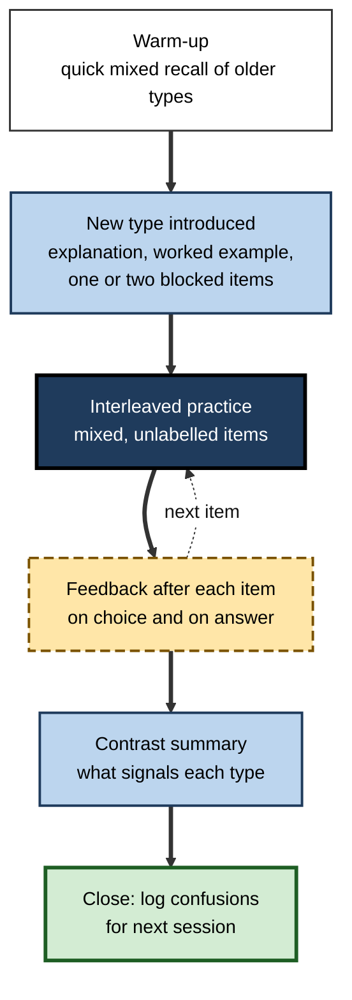
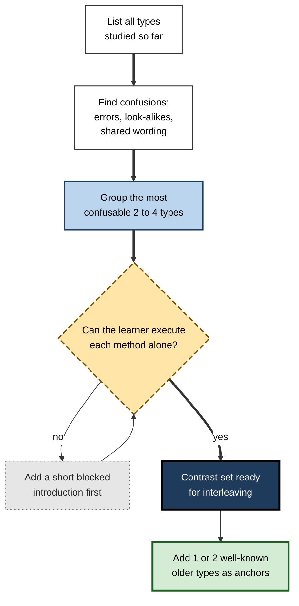
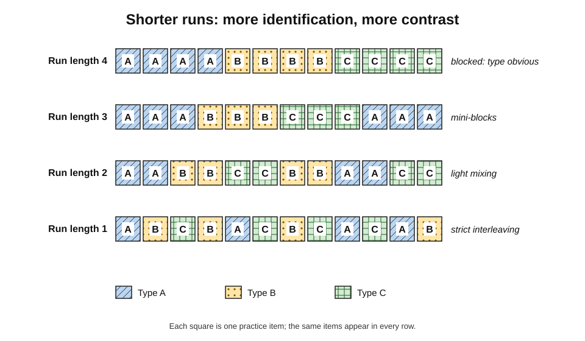
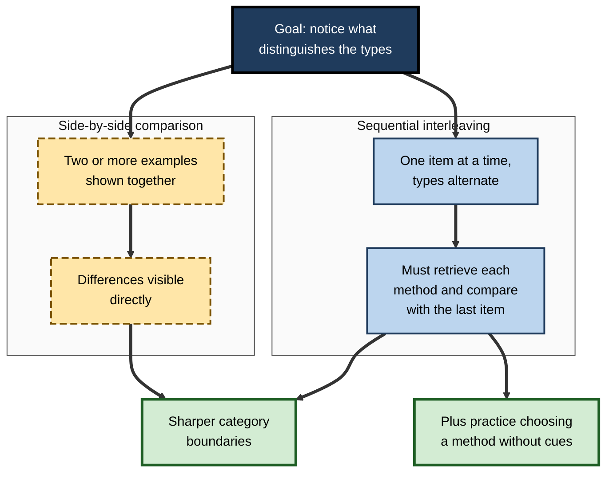
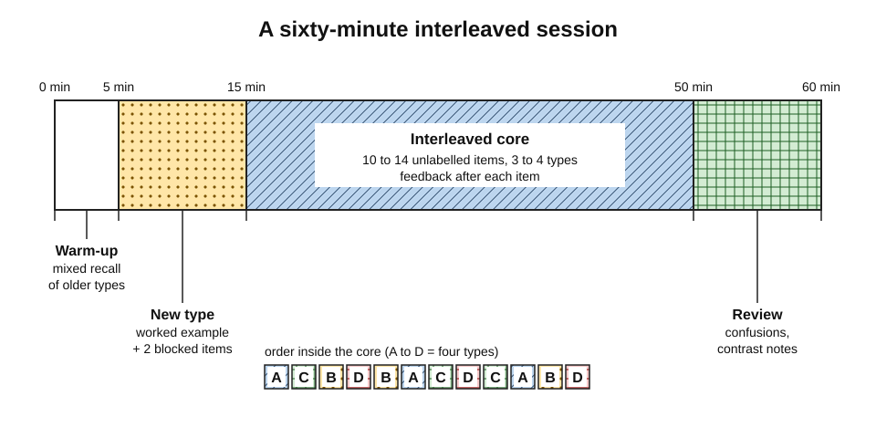
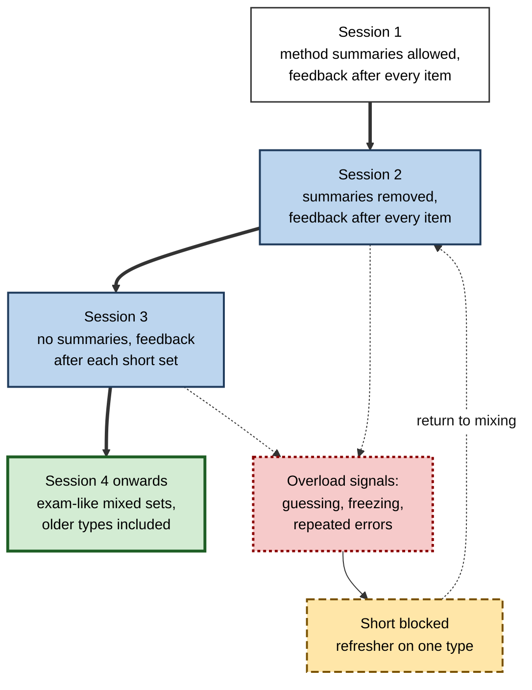

# E.4. Interleaving Topics Within a Session

A law student has ninety minutes to revise four doctrines of contract law that examiners love to blur together: misrepresentation, mistake, frustration and breach. She can spend twenty minutes on each in turn, or she can work through problem questions in which the doctrine at stake is not announced.

A data scientist preparing for an interview has an hour to practise choosing between precision, recall, F1 score and the area under the curve. In each case the materials are fixed; what remains to be designed is the **shape of the session**.

> **Definition — Within-session interleaving:** mixing several related topics, problem types or categories inside a single study or practice session, so that consecutive items usually differ in type and the learner must identify which type each item belongs to.

> **Definition — Session design:** the deliberate choice of what a study session contains, in what order, in what quantities and with what feedback.

**Why it matters**

- The session is the **unit in which interleaving actually happens**; a good intention to "mix things up" succeeds or fails in its details.
- Small design decisions — how many types, how long the runs, when feedback arrives — decide whether interleaving produces discrimination or just confusion.
- Most published experiments specify these details carefully; most learners and trainers improvise them.
- A well-designed session takes no longer than a blocked one; it simply uses the same time differently.

---

## The Anatomy of an Interleaved Session

### Components

- **Warm-up retrieval** — a few quick items from earlier sessions to activate prior knowledge.
- **Introduction of any new type** — an explanation and a worked example, followed by one or two practice items **in a short block**.
- **Interleaved practice** — the main body: items of several types in mixed order, without labels.
- **Feedback** — after each item, on both the **choice of method** and the **answer**.
- **Contrast summary** — a brief comparison of the types practised: what signals each, which pairs were confused.
- **Close** — noting errors and confusions for the next session.

**Figure 1.** The parts of a well-designed interleaved study session.

> **Key point:** interleaving is the **core** of the session, not the whole of it. A brief blocked introduction to any new type and a contrast summary at the end make the core work.

### The design variables

| Variable | Options | Usual recommendation |
|---|---|---|
| Number of types mixed | 2 to 6 or more | 2–4 closely related types for most learners |
| Run length | 1 (strict alternation) to 3 or more | Mostly 1; occasional runs of 2 are harmless |
| Order rule | Systematic, random, constrained random | Constrained random; confusable pairs adjacent |
| Labels | Shown or hidden | Hidden during practice; named in feedback |
| Proportion new versus old | All new to mostly old | Newest type a minority after first exposure |
| Feedback timing | After each item, after the set | After each item for confusable types |
| Number of items | 6 to 40 | Enough for each type to appear at least 3–4 times |

---

## Choosing What to Mix

### The contrast set

- The most important decision is **which types go together** in a session.
- The best candidates form a **contrast set**: types that learners are likely to confuse because they share surface features but need different responses.

> **Definition — Contrast set:** a group of related types, categories or methods deliberately practised together because they are easily confused.

**Sources of good contrast sets**

- **Error records** — which types are confused in tests, marking or on the job.
  - *e.g.* trainee nurses confusing hypoglycaemia and hyperglycaemia symptoms.
- **Shared surface features** — similar wording, layout or appearance.
  - *e.g.* "find the rate" questions in compound interest and in exponential decay.
- **Shared vocabulary with different meanings.**
  - *e.g.* "consideration" in contract law and in everyday speech.
- **Adjacent options in a decision.**
  - *e.g.* choosing between a mean, a median and a trimmed mean.

**Figure 2.** Building a contrast set for an interleaved session.

### A confusion matrix as a design tool

- A **confusion matrix** records, for each true type, how often a learner chose each type.
- Off-diagonal cells show **which confusions to target**.

| True type ↓ / chosen → | Misrepresentation | Mistake | Frustration | Breach |
|---|---|---|---|---|
| Misrepresentation | **14** | 5 | 0 | 1 |
| Mistake | 4 | **12** | 3 | 1 |
| Frustration | 0 | 4 | **15** | 1 |
| Breach | 1 | 0 | 2 | **17** |

- **Reading it (hypothetical revision data):** misrepresentation and mistake are confused in both directions; mistake and frustration are also confused; breach is rarely confused.
- **Design consequence:** the next session should interleave **misrepresentation, mistake and frustration**, placing misrepresentation–mistake pairs next to each other, with breach used occasionally as an anchor.

> **Definition — Confusion matrix:** a table showing, for items of each true category, how often each category was chosen; correct choices lie on the diagonal and confusions off it.

> **Watch out:** mixing types that are **never confused** adds little. Interleaving breach with land law questions may feel like interleaving, but there is nothing to discriminate.

---

## How Many Types, and How Long the Runs

### Number of types

- **Two types** — the simplest contrast; useful when a pair is the main source of error.
  - *e.g.* Spanish *ser* and *estar*; type I and type II statistical errors.
- **Three or four types** — the range used in many classroom studies; enough variety to make identification non-trivial.
- **Five or more** — appropriate for advanced learners consolidating a whole area, such as all the rhythm families of an ECG course.
  - For newcomers, very large sets risk overload.

### Run length

- **Run length** is the number of consecutive items of the same type.
  - Strict interleaving: run length 1 (A B C A C B).
  - Mini-blocks: run length 2–3 (AA BB CC A B ...).
- **Shorter runs** maximise the need to identify and the opportunity to contrast.
- **Longer runs** reduce load but move the schedule back towards blocking.
- Research usually compares pure blocked with pure interleaved schedules; there is little direct evidence on the best run length.

> **Definition — Run length:** the number of consecutive practice items of the same type within a sequence.

**Figure 3.** Run length from fully blocked to strictly interleaved.

> **Remember:** if a learner can predict the next item's type, they are not practising identification. **Unpredictability** is the active ingredient; occasional repeats keep the order from becoming a predictable rhythm.

---

## Ordering the Items

### Rules for constructing an order

- **Hide the type.** No headings, no colour coding, no file names that reveal the method.
- **Avoid long runs.** No more than two items of a type in a row.
- **Avoid predictable rotation** once the learner is past the first session — ABCABC is easy to predict.
- **Place confusable pairs adjacent** — a misrepresentation problem immediately followed by a mistake problem invites comparison.
- **Spread each type through the set** — each type should appear early, middle and late.
- **End on mixed items**, not on a run of the newest type.

### Systematic, random or both

- **Systematic (ABCABC)** — each item differs from the previous one; predictable.
- **Random** — unpredictable but may by chance produce runs.
- **Constrained random** — shuffled, then adjusted to respect the rules above.
- **Evidence:** in second-language grammar learning, Steven Pan and colleagues (2019) reported benefits from combining **systematic** interleaving with **random** interleaving — suggesting the two kinds of order may contribute differently.

> **In practice:** a simple way to build a constrained random order is to shuffle a deck of cards bearing the item numbers, then scan the sequence and swap any item that makes a run of three.

---

## Mixing in Sequence Versus Comparing Side by Side

### Simultaneous comparison

**Study card — Kang and Pashler (2012)**

- **Aim:** to test whether interleaving works by **spacing** or by **discrimination**.
- **Design:** participants learned painters' styles under several schedules:
  - **blocked**;
  - **interleaved**;
  - **blocked but temporally spaced** — the gaps between paintings filled with unrelated material;
  - **simultaneous** — paintings by different artists shown **side by side**.
- **Results:**
  - temporal spacing alone did **not** improve learning over blocking;
  - **simultaneous** presentation was as good as interleaving.
- **Conclusion:** for this kind of category learning the benefit comes chiefly from **juxtaposition** — the chance to compare categories — not from spacing.

> **Definition — Juxtaposition:** placing examples of different categories next to each other, in space or in time, so that they can be compared directly.

- **Birnbaum, Kornell, Bjork and Bjork (2013)** reached a related conclusion with bird families: inserting unrelated trivia questions between consecutive interleaved birds **reduced** the benefit, implying that comparison of consecutive items matters.

**Figure 4.** Two routes to discriminative contrast within a session.

### Using both in one session

- **Side-by-side comparison** is efficient for **seeing** the differences — especially for visual material such as images, graphs or code.
  - *e.g.* two ECG strips placed together with the instruction "name two differences".
- **Sequential interleaving** is necessary for **using** the differences — choosing a method when an unlabelled item arrives alone, as it will in real work.
- A sound session can open with a comparison exercise and then move to sequential mixed practice.

> **Watch out:** side-by-side comparison on its own does not practise **retrieving** the method without cues. It helps learners see differences; it does not replace mixed practice.

---

## Feedback and Reflection Inside the Session

### What feedback should contain

- **Was the type identified correctly?**
- **If not, which feature should have signalled the right type?**
- **Was the method executed correctly?**
- **What is the correct solution?**

> **Key point:** in interleaved practice, the most valuable feedback is often about **identification**, not calculation. "You used the formula for a cone; the clue that this was a spherical cone was …" teaches the boundary.

### Timing

- **After each item** — best when types are new and confusable, so that wrong choices are not repeated.
- **After the set** — acceptable for advanced learners, and closer to exam conditions.
- **Delayed feedback** may aid retention in some tasks, but in interleaved practice immediate feedback on identification prevents wrong rules from being practised.

### Reflection prompts

- "What told me this was a frustration problem and not a mistake problem?"
- "Which two types did I confuse today, and what single feature separates them?"
- "If I were writing a question designed to trick me, what would I change?"

---

## Interleaving in Group Sessions

Interleaving also works when people study together, and groups add useful tools.

- **Sorting tasks.**
  - A pile of mixed cases is sorted by type on a table or a shared board; disagreements are discussed.
  - *e.g.* a compliance team sorting thirty anonymised incidents into reporting categories.
- **Peer question-setting.**
  - Each member writes two unlabelled items of different types; items are pooled, shuffled and exchanged.
  - Writing a question that could be mistaken for another type is itself a strong test of understanding.
- **"Odd one out" rounds.**
  - Three examples are shown, two of one type and one of another; the group names the odd one and the feature that gives it away.
- **Rotating role-plays.**
  - In a sales or service team, one member plays the customer and draws a scenario card in secret; the others must identify the issue from the conversation.
- **Debrief on confusions.**
  - The group ends by listing the pairs most often confused and agreeing the clearest distinguishing feature for each.

> **Key point:** in groups, the **disagreement** about which type an item is becomes the most productive moment of the session — it forces each person to state the features they relied on.

| Format | Best for | Watch for |
|---|---|---|
| Individual mixed set | Steady practice of identification and execution | Learner drifting back to blocks |
| Sorting task in a group | Fast exposure to many examples and discussion of boundaries | Dominant members deciding for everyone |
| Peer question-setting | Deep understanding of distinguishing features | Questions that are too easy or ambiguous |
| Rotating role-plays | Interpersonal skills where the issue must be diagnosed | Scenario cards that leak the answer |

---

## Session Templates

### Templates by length

| Session length | Structure | Suitable for |
|---|---|---|
| 25 minutes | 3 min warm-up → 18 min mixed set of 2–3 types (about 8–10 items) → 4 min contrast notes | A single confusable pair or trio; daily practice |
| 60 minutes | 5 min warm-up → 10 min new-type introduction → 35 min mixed set of 3–4 types → 10 min feedback review and contrast summary | Typical study session or training module |
| 90 minutes | 5 min warm-up → 15 min introduction → 25 min mixed set → 5 min break → 25 min mixed set including older types → 15 min review | Workshop, revision day, team training |

**Figure 5.** A sixty-minute interleaved session on a timeline.

### Worked example: a ninety-minute contract law revision session

- **Situation:** the law student from the opening has a mixed problem exam in three weeks. She can apply each doctrine when told which one is relevant; her errors come from **identifying** the doctrine.

1. **Warm-up (5 minutes):** answer from memory: "What must be shown for misrepresentation? For common mistake? For frustration?" — then check.
2. **Comparison exercise (15 minutes):** read two short scenarios side by side — one misrepresentation, one mistake — and list the facts that distinguish them; repeat for mistake versus frustration.
3. **Mixed practice, part one (25 minutes):** six short problem questions in constrained random order: misrepresentation, frustration, mistake, mistake, misrepresentation, frustration. For each, first write **the doctrine and the triggering fact** in one line, then sketch the answer.
4. **Break (5 minutes).**
5. **Mixed practice, part two (25 minutes):** six more problems, now including two breach questions as anchors and one problem raising **two** doctrines.
6. **Review (15 minutes):** compare her one-line identifications with the model answers; fill in a confusion matrix; write a "distinguishing features" card for each confused pair.

| | Blocked plan (4 × 20 minutes) | Interleaved plan (as above) |
|---|---|---|
| Items practised | 12 problems, 3 per doctrine | 12 problems, mixed, plus comparison pairs |
| Identification practised | Never — each block names its doctrine | On every problem |
| Contrast between doctrines | Incidental | Deliberate (comparison exercise, adjacent pairs) |
| Feeling at the end | Confident | Less confident, clearer about confusions |
| Likely exam benefit | Weaker on unlabelled problems | Stronger on unlabelled problems |

> **Watch out:** writing the doctrine **before** sketching the answer is essential. Without that step, a learner can drift into the answer and only notice the doctrine afterwards, losing much of the identification practice.

---

## Managing Load in a Mixed Session

Interleaving asks working memory to hold more at once: the features of the current item, the candidate methods and the decision between them. Good session design keeps that load **productive**.

### Where the load comes from

- **Intrinsic load** — the complexity of each method itself.
  - *e.g.* a multi-step tax computation is heavier than a single formula.
- **Selection load** — weighing several possible methods for each item.
  - The load interleaving deliberately adds; this is the useful part.
- **Extraneous load** — anything that consumes attention without contributing to learning.
  - *e.g.* hunting through notes for a formula; badly laid-out questions; switching between applications.

> **Definition — Cognitive load:** the demand that a task places on limited working memory; John Sweller's cognitive load theory distinguishes load intrinsic to the material from extraneous load imposed by poor design.

### Tactics that keep load manageable

- **Fade a method summary.**
  - In the first mixed session, allow a one-page summary of each method — but **not** of how to tell the types apart.
  - Remove the summary in later sessions, so that methods must be retrieved.
- **Shrink each item.**
  - Use shorter problems for interleaved practice, so that the identification step is a larger share of the work.
  - *e.g.* "Which test, and why?" items that stop before the calculation.
- **Separate identification from execution when needed.**
  - A quick round of "name the type" items (ten in five minutes) followed by fewer full solutions.
- **Reduce extraneous load.**
  - Put all items in one document, in one format; avoid switching between tools or screens.
- **Watch for overload signals.**
  - Random guessing, long freezes, the same error repeated after feedback — signs that a short blocked refresher is needed.

**Figure 6.** Fading support across successive interleaved sessions.

> **Watch out:** a method summary that also lists "use this when …" removes the identification step. Summaries should describe **how** each method works, not **when** to use it.

### Worked examples and interleaving

- **Worked examples** — fully solved problems studied before or alongside practice — are especially useful for novices.
- Two arrangements are common:
  - **example–problem pairs** — a worked example followed by a similar problem;
  - **mixed worked examples** — worked examples of different types presented in alternation, each followed by a problem of a different type.
- Mixing the **types** of worked example encourages learners to compare solutions and notice what distinguishes them, while the examples carry much of the execution load.

| | Example–problem pairs, one type at a time | Mixed worked examples and problems |
|---|---|---|
| Load on novice | Low | Moderate |
| Identification practised | Little | Some — learner must see why each example differs |
| Best stage | First exposure to a method | After first exposure, before fully independent mixed practice |

---

## Self-Study Tools for Mixed Sessions

- **Flashcard applications** — studying several related decks together, or a combined deck, mixes card types; studying deck by deck blocks them.
- **Question banks** — most offer a "custom" or "mixed" mode in which several chapters can be selected; choose the confusable chapters together.
- **Spreadsheets** — a list of item numbers with a random-number column, sorted, gives a quick shuffled order; scan it for long runs.
- **Paper methods** — write each item number on a card, shuffle, and deal the session's sequence.
- **AI assistants** — a request such as "give me twelve unlabelled problems mixing the three types I studied this week, then tell me after each whether I identified the type correctly" produces a ready-made mixed set.

> **In practice:** keep a running **confusion log** — one line for each identification error, naming the two types confused and the missed clue. The log is the raw material for choosing the next session's contrast set.

---

## Interleaved Sessions in the Workplace

### Typical formats

- **Onboarding labs** — after modules on several tools, a mixed lab in which each task requires choosing the right tool.
- **Clinical skills sessions** — mixed case vignettes or images at the end of a teaching block.
- **Coding practice** — a set of short exercises requiring different data structures, unlabelled.
- **Sales and service role-plays** — a series of customer calls in which the objection or issue type is not announced.
- **Incident-response drills** — a tabletop session presenting different incident types in unpredictable order.

> **In practice:** the most common workplace failure is to **label** the practice — a role-play titled "Handling price objections" tells the trainee which response to give. Remove the title and let the customer reveal the objection.

### Case study: model-evaluation metrics in a data-science training programme

- **Situation:** a data-science training programme taught classification metrics — accuracy, precision, recall, F1 score and the area under the ROC curve — in a single 60-minute lecture followed by five short exercise blocks, one per metric.
- **Problem:** in capstone projects, participants frequently chose the wrong metric: accuracy on heavily imbalanced data, precision where missing positive cases was costly, AUC where a single decision threshold mattered.
- **Diagnosis:**
  - each exercise block had named its metric, so participants practised **calculating** metrics, never **choosing** them;
  - the most consequential confusions (precision versus recall; accuracy versus balanced measures on imbalanced data) were never placed side by side.
- **Actions:**
  1. The lecture was followed by a **comparison exercise**: two confusion matrices from the same model at different thresholds, with the question "which metric changes most, and why?".
  2. The five blocks were replaced by **one mixed set of 15 business scenarios**, unlabelled: fraud detection, cancer screening, email spam, credit scoring and more.
  3. For each scenario, participants first wrote **the metric and the business reason** in one sentence, then calculated it from given data.
  4. Feedback came after each scenario, starting with the choice of metric.
  5. Precision–recall scenarios were placed adjacently; one scenario in five used an older topic (regression error measures) as an anchor.
- **Result:**
  - the mixed set took the same 60 minutes but felt markedly harder; several participants asked for "the old exercises";
  - capstone reviewers reported far fewer inappropriate metric choices in the next cohort.
- **Side effects:** writing realistic scenarios took time, and some participants needed a second short block on calculating F1 before they could manage the mixed set.
- **Lesson:** a session that practises **choosing** must give the learner something to choose between — and must stop announcing the answer in its headings.

---

## Open Questions

- **What is the best run length and number of types?**
  - Studies usually compare pure schedules; the optimal mixture for different learners and materials is untested.
- **How much side-by-side comparison should precede sequential mixing?**
  - Comparison clearly helps for visual categories; the balance with sequential practice is not established.
- **Does constrained random order outperform simple random order?**
  - Plausible from theory; little direct evidence.
- **How should feedback be timed for advanced learners?**
  - Immediate feedback suits novices; whether experts benefit from delayed feedback in interleaved practice is unclear.
- **How do session-level effects add up over a course?**
  - Most experiments use one or a few sessions; cumulative effects across months are less well known.

---

## Summary

- **Within-session interleaving** mixes related types inside one session; its success depends on **session design**.
- A sound session has a **warm-up**, a short **blocked introduction** to any new type, an **interleaved core** of unlabelled items, **feedback** on choice and answer, a **contrast summary** and a **close**.
- The key decision is the **contrast set** — the 2–4 types most likely to be confused, found from errors, look-alikes and shared wording; a **confusion matrix** shows which pairs to target.
- Keep **run length** short (mostly 1), keep the order **unpredictable** (constrained random), place **confusable pairs adjacent**, and **hide labels**.
- **Side-by-side comparison** (Kang and Pashler, 2012) helps learners see differences; **sequential interleaving** practises using them without cues — combine the two.
- Feedback should address **identification first**; immediate feedback suits confusable new types.
- Templates: **25, 60 and 90 minutes** — the same time as a blocked session, used differently.
- Manage **load**: fade method summaries, shrink items, separate identification from execution when needed, and use short blocked refreshers when overload appears.
- In groups, **sorting tasks**, **peer question-setting** and **odd-one-out** rounds turn disagreement about type into learning.
- In the workplace, **remove labels** from practice and use realistic, mixed scenarios.

---

## Self-Check

1. Define within-session interleaving and list the components of a well-designed session.
2. What is a contrast set, and how can one be identified?
3. Explain how a confusion matrix can guide the design of the next session.
4. Why might interleaving breach-of-contract questions with land-law questions add little?
5. What is run length, and what are the trade-offs between short and long runs?
6. List five rules for constructing the order of items in an interleaved set.
7. Describe the design and findings of Kang and Pashler (2012). What do they imply about the mechanism of interleaving?
8. Why is side-by-side comparison not a complete substitute for sequential interleaving?
9. What should feedback in an interleaved session address first, and why?
10. Outline a 60-minute interleaved session for a trainee learning three types of tax relief.
11. A trainer runs a role-play session titled "Responding to delivery complaints". Explain the weakness and suggest a fix.
12. A learner using a mixed set notices that the items follow the pattern ABCDABCD. What problem does this create and how would you fix it?
13. A novice freezes on most items of her first mixed set and repeats the same error after feedback. What would you change?
14. Why should a method summary used in a mixed session not say when each method applies?

### Answer Key

1. Mixing several related types inside one session so that consecutive items usually differ and the learner must identify each. Components: warm-up retrieval, brief blocked introduction of any new type, interleaved unlabelled practice, feedback on choice and answer, contrast summary, close with a log of confusions.
2. A group of related types deliberately practised together because they are easily confused. Identified from error records, shared surface features, shared vocabulary with different meanings, or adjacent options in a decision.
3. It shows, for each true type, which types were chosen. Off-diagonal cells reveal specific confusions; the next session interleaves the confused types and places those pairs adjacent, using rarely confused types only as anchors.
4. The two are not confused; there is nothing to discriminate, so mixing them adds switching cost without the discriminative benefit (it may still give some spacing).
5. The number of consecutive items of one type. Short runs maximise identification and contrast but increase load; long runs reduce load but drift back towards blocking. The optimum is not well established.
6. Hide the type; avoid runs longer than two; avoid predictable rotation after the first session; place confusable pairs adjacent; spread each type throughout; end on mixed items.
7. Painters' styles were learned blocked, interleaved, blocked with temporal spacing (unrelated filler), or simultaneously side by side. Spacing alone did not help; simultaneous presentation matched interleaving. The benefit stems mainly from juxtaposition and comparison, not spacing.
8. It shows the differences but does not require the learner to retrieve a method and identify a type when an item arrives alone, as in real work.
9. Whether the type was identified correctly and which feature should have signalled it, because identification errors are the distinctive weakness interleaving targets and must not be repeated.
10. E.g. 5 min warm-up recalling conditions for each relief; 10 min introduction and worked example for the newest relief with one or two blocked items; 35 min mixed set of 9–12 unlabelled client scenarios, writing the relief and triggering fact first, with feedback after each; 10 min review of confusions and a distinguishing-features summary.
11. The title tells trainees the issue type, so they never practise identifying it. Remove the title and run a series of calls in which the issue (delivery, billing, product fault, cancellation) is revealed only by the customer.
12. The order is predictable, so the learner can anticipate each type and skip identification. Shuffle into a constrained random order with no long runs and no fixed rotation.
13. These are overload signals. Give a short blocked refresher on the type causing trouble, shrink the items (for example, identification-only questions), allow a method summary for one session, and return to mixing once each method can be executed alone.
14. Saying when each method applies does the identification for the learner, removing the step that interleaving is meant to practise; summaries should describe how methods work, not when to use them.

---

## Glossary

| Term | Meaning |
|---|---|
| Anchor item | A well-known older type included in a mixed set to provide confident successes. |
| Confusion matrix | Table showing how often each category was chosen for items of each true category. |
| Constrained random order | A shuffled order adjusted to avoid long runs and to place confusable pairs adjacent. |
| Contrast set | Related, easily confused types practised together. |
| Contrast summary | End-of-session comparison of what signals each type. |
| Cognitive load | Demand a task places on limited working memory. |
| Confusion log | Running record of identification errors and the clues missed. |
| Juxtaposition | Placing examples of different categories next to each other for comparison. |
| Run length | Number of consecutive items of the same type. |
| Session design | Deliberate choice of a session's content, order, quantities and feedback. |
| Side-by-side comparison | Presenting examples of different categories simultaneously. |
| Systematic interleaving | Fixed rotation of types, such as ABCABC. |
| Warm-up retrieval | Brief recall of older material at the start of a session. |
| Within-session interleaving | Mixing related types inside one study or practice session. |
