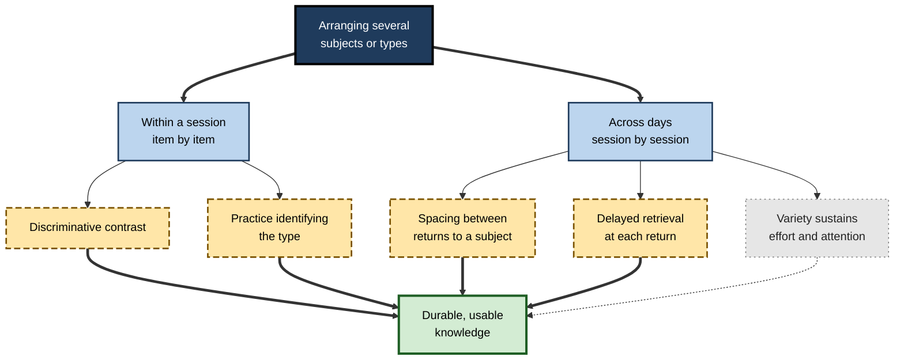
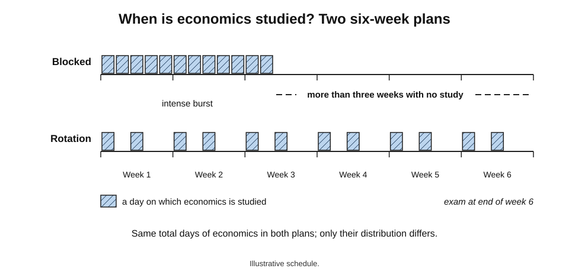
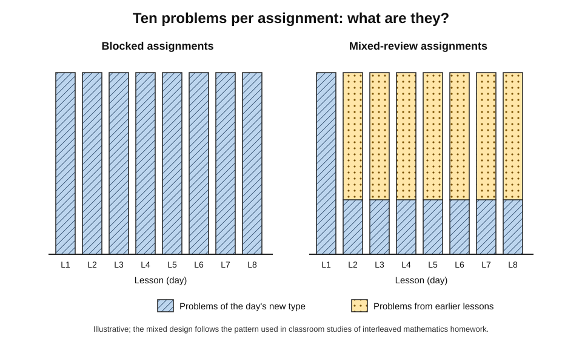
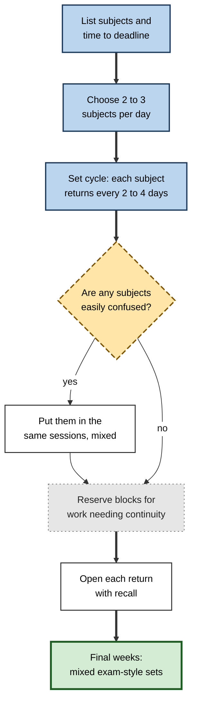
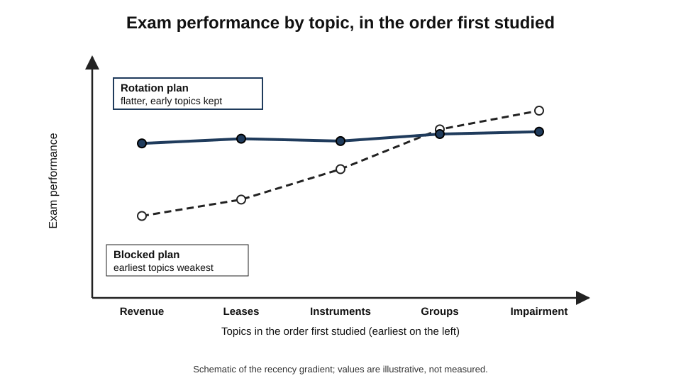
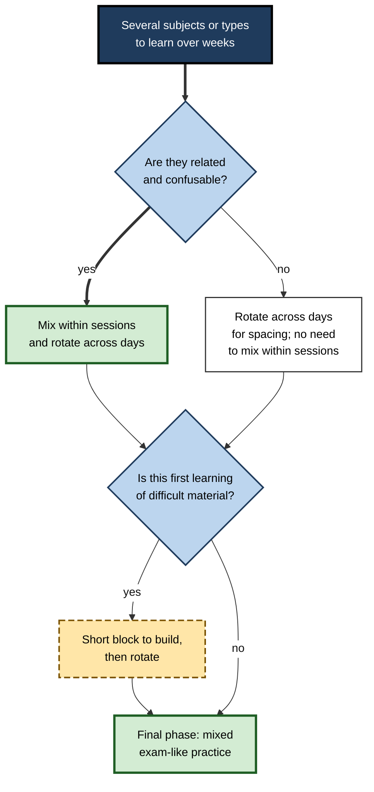

# E.5. Interleaving Subjects Across Days

A student has six weeks before four examinations: economics, statistics, accounting and business law. One plan gives each subject a week and a half in turn; another rotates all four through every week. A trainee actuary working towards a professional exam must keep ten syllabus areas alive across five months while doing a full-time job. Both face the same question one level above the single session: **how should different subjects or topics be arranged across days and weeks?**

> **Definition — Across-day interleaving:** arranging study so that several subjects, or several topics within a subject, recur in alternation across successive days and weeks, rather than each being studied in one continuous period before moving to the next.

> **Definition — Rotation schedule:** a timetable in which subjects or topics return in a planned cycle — for example economics on Monday and Thursday, statistics on Tuesday and Friday.

**Why it matters**

- Most people plan study, courses and training **subject by subject**, finishing one before starting the next — a blocked design at the scale of weeks.
- Arranging subjects across days changes **when** each subject is revisited, which strongly affects how much survives to the exam or to real use.
- Within a subject, arranging **problem types** across days — so that each assignment mixes old and new — is one of the best-supported designs in mathematics education.
- The benefits at this scale come from **different mechanisms** from those within a session, and the two should not be confused.

---

## Two Scales of Mixing

### Within a session and across days

- **Within a session** — types alternate item by item: A B C B A C.
- **Across days** — types or subjects alternate day by day or week by week: Monday A and B, Tuesday C and A, Wednesday B and C.
- Both are called "interleaving", but they do **different work**.

| | Within-session interleaving | Across-day interleaving |
|---|---|---|
| Unit that alternates | Individual items | Sessions, days or weeks |
| Main mechanism | Discrimination between consecutive items; identification of type | Spacing and delayed retrieval of each subject |
| Contrast between types | Strong — items are side by side in time | Weak — hours or days apart |
| Value for unrelated subjects | Little | Real, through spacing and retrieval |
| Value for related, confusable types | High | Moderate, unless sessions themselves are mixed |
| Typical design | Mixed problem set | Weekly rotation; cumulative homework |

**Figure 1.** Interleaving at two scales and what each mainly contributes.

> **Key point:** rotating **unrelated** subjects across days is mainly a **spacing** strategy. Mixing **related** types across days adds some discrimination benefit — but the strongest contrast still comes from mixing within the session.

---

## What Rotation Across Days Does

### It creates gaps

- In a blocked plan, a subject studied in weeks 1–2 is not seen again until the exam in week 6 — a long gap after an intense burst.
- In a rotation, every subject recurs every few days; each return comes after a gap long enough for some forgetting.
- Repeated study spread over time produces far better long-term retention than the same total time concentrated in one period — the **spacing effect**, one of the best-replicated findings in the psychology of memory.

### It forces delayed retrieval

- Each return to a subject begins with reconstructing what was learned days earlier.
- That effortful reconstruction strengthens memory more than continuing while everything is still fresh.

### It sustains attention

- Long blocks of a single subject invite **fatigue and boredom**; changing subject at a natural boundary can restore effort.
- This is a motivational benefit rather than a memory mechanism, and the evidence for it is mostly experiential.

### It reduces the "just finished" illusion

- At the end of a blocked fortnight on statistics, the learner feels fluent — but that fluency reflects recency.
- Rotation repeatedly tests whether the subject has survived a few days' absence, giving a **more honest signal** of what is known.

> **Definition — Recency-driven fluency:** the feeling of knowing that comes from having just studied material, which fades quickly and overstates long-term learning.

**Figure 2.** Time since last study of one subject under a blocked plan and a rotation plan.

> **Watch out:** the gaps that help retention also lower **performance at each return** — the first twenty minutes back on a subject feel rusty. That rust is the retrieval being practised, not a sign that the rotation is failing.

---

## The Evidence at This Scale

### Unrelated material: mostly spacing

**Study card — Hausman and Kornell (2014)**

- **Question:** does mixing **unrelated or loosely related** material add anything beyond spacing?
- **Material:** foreign-language vocabulary and anatomy terms.
- **Design:** interleaved study was compared with blocked study while the **spacing** of repetitions was held equal.
- **Result:** no reliable benefit of interleaving once spacing was controlled.
- **Conclusion:** for material that needs no discrimination, the gain from mixing comes from **spacing**, not from mixing as such.

- **Brunmair and Richter's meta-analysis (2019)** found no benefit of interleaving for **expository texts** and a **negative** effect for word lists — consistent with the view that mixing helps only where there is something to discriminate.

### Related types across sessions: interleaving helps over time

**Study card — Pan, Tajran, Lovelett, Osuna and Rickard (2019)**

- **Participants:** adult learners with little or no Spanish.
- **Task:** conjugating Spanish verbs in two easily confused past tenses — the **preterite** and the **imperfect**.
- **Design:** blocked versus interleaved practice of the two tenses, under different training schedules.
- **Results:**
  - in **single-session** training, interleaving gave **no advantage** over blocking;
  - when practice was spread over **multiple sessions**, interleaving produced substantially better performance on a test a week later.
- **Conclusion:** for some materials, the benefit of interleaving emerges only when it is combined with practice spread **across days**.

> **Key point:** the Spanish-verb results suggest that **mixing and spacing work together** — interleaving across several sessions can succeed where a single mixed session does not.

### Mixed review in school mathematics

- **Doug Rohrer's classroom studies** used homework assignments in which each night's problems included a few of the day's new type and **mostly earlier types**, spread over weeks.
  - Rohrer, Dedrick and Stershic (2015) — seventh-grade students; interleaved assignments gave higher scores, with the advantage **larger at 30 days** than at 1 day.
  - Rohrer, Dedrick, Hartwig and Cheung (2020) — 54 classes, randomised; 61% versus 38% on an unannounced test about a month later (d ≈ 0.83).
- These designs combine **within-assignment** mixing with **across-day** spacing; their effects cannot be attributed to either alone.

**Figure 3.** Composition of daily assignments under blocked and mixed-review designs.

### A year-long field experiment

**Study card — interleaved mathematics practice in Nigerian primary schools (reported 2023)**

- **Setting:** a year-long randomised field experiment in primary schools in Nigeria.
- **Intervention:** practice materials restructured so that problem types were interleaved over the year.
- **Results:**
  - **short-term** tests showed gains of about **0.28 standard deviations**;
  - **cumulative end-of-year** assessments showed **no overall effect**;
  - gains were concentrated among **lower-achieving** pupils, with little or no benefit — possibly some cost — for higher achievers.
- **Conclusion:** effects found in short trials may not simply add up over a year, and may differ by prior attainment.

> **Watch out:** the year-long null result is a genuine **counterweight** to the strong short-term classroom findings. It does not show that interleaving fails, but it shows that implementation, context and learner level matter, and that long-term effects need testing directly.

| Study | Scale | Mixing | Main finding |
|---|---|---|---|
| Hausman and Kornell (2014) | Laboratory | Vocabulary and anatomy terms | No benefit beyond spacing |
| Pan and colleagues (2019) | Laboratory, several sessions | Two confusable Spanish tenses | Benefit only across multiple sessions |
| Rohrer and colleagues (2015, 2020) | Classrooms, weeks | Mixed-review homework | Large benefit at about a month |
| Nigerian primary schools (2023) | Classrooms, a year | Interleaved practice materials | Short-term gains; none on end-of-year cumulative tests |

---

## Spiral Curricula and Cumulative Courses

### The spiral curriculum

- **Jerome Bruner (1960)** proposed that a subject's central ideas should be revisited repeatedly across years of schooling, each time at a higher level of sophistication.
- A spiral curriculum is **across-time interleaving at the scale of a curriculum**: topics recur rather than being "done" once.

> **Definition — Spiral curriculum:** a curriculum in which key topics are revisited repeatedly over time, each visit building on the last at greater depth.

### Spiralling done well and badly

- **Done well:** each return involves **retrieval** of earlier learning and **extension** to harder problems.
- **Done badly:** each return **re-teaches** the topic from scratch, so learners never consolidate it, and the curriculum becomes a series of shallow visits.

### Cumulative courses and assessments

- **Cumulative assessment** — tests that include material from the whole course, not just the latest unit — gives learners a reason to keep revisiting earlier subjects.
- **Non-cumulative unit tests** encourage blocked study: learn a unit, pass its test, forget it.

> **In practice:** one of the simplest ways to make a course interleaved across days is to make **every quiz cumulative**. Learners then rotate earlier material without being told to.

---

## Building Mixed-Review Assignments Within a Subject

The best-evidenced form of across-day interleaving operates **inside one subject**: each day's practice mixes the newest problem type with earlier ones, so that every type keeps returning across weeks.

### Design rules

- **A minority of new items.**
  - After the lesson, perhaps three or four problems of the new type — enough to consolidate it — and the rest from earlier lessons.
- **A spread of ages.**
  - Earlier items should come from a range of lessons: yesterday's, last week's, last month's.
  - This creates **lags** of varied length between returns to each type.
- **No labels.**
  - Items appear without lesson numbers or headings that reveal their type.
- **Confusable types together.**
  - Where two earlier types are often confused, include both in the same assignment.
- **Similar length.**
  - Mixed assignments need not be longer than blocked ones; they reuse the same number of problems.

> **Definition — Lag:** the number of days, sessions or items between two encounters with the same type of material.

### Worked example: converting a unit of algebra homework

- **Situation:** a teacher's unit has eight lessons, each followed by ten homework problems of that lesson's type.

1. **Keep the total:** 80 problems across the eight evenings.
2. **Lesson 1 homework:** all ten problems of type 1 — there is nothing earlier to mix.
3. **Lessons 2–8:** four problems of the day's type, six drawn from earlier types, weighted towards those taught **two to five** lessons earlier, plus one or two from the oldest.
4. **The final two lessons' types** reappear in the first homework of the next unit, so the mixing continues across units.
5. **Unit test:** cumulative and unlabelled.

| Evening | Blocked homework | Mixed-review homework |
|---|---|---|
| Lesson 1 | 10 × type 1 | 10 × type 1 |
| Lesson 3 | 10 × type 3 | 4 × type 3, 3 × type 2, 3 × type 1 |
| Lesson 6 | 10 × type 6 | 4 × type 6, 2 × type 5, 2 × type 3, 1 × type 2, 1 × type 1 |
| Lesson 8 | 10 × type 8 | 4 × type 8, 2 × type 6, 2 × type 5, 1 × type 4, 1 × type 2 |

> **Watch out:** the teacher's marking load rises slightly, because errors now come from many types. The payoff is diagnostic: errors on old types reveal **which earlier lessons did not stick**.

---

## Keeping Track of a Rotation

Rotation plans fail mainly because they are hard to follow; a simple tracker keeps them honest.

### What to record

- **Subject or topic.**
- **Date last studied.**
- **Next planned return.**
- **Result of the opening recall** — a rough score or a note such as "rules recalled, examples weak".
- **Confusions noticed** — pairs of topics mixed up.

### Using the tracker

- **Overdue topics first** — anything past its planned return goes into the next session.
- **Weak recall shortens the cycle** — a topic that comes back poorly returns sooner next time.
- **Strong recall lengthens it** — a topic that comes back cleanly can wait longer.
- **Confusions shape sessions** — topics confused with each other are scheduled into the same session, mixed.

> **In practice:** a single spreadsheet with one row per topic and columns for "last studied", "next due" and "recall quality" is enough. Sorting by "next due" each morning produces the day's plan.

> **Key point:** the tracker turns rotation from a timetable into a **feedback system** — each return tells the learner when the next return should be.

---

## Designing a Weekly Rotation

### The procedure

1. **List the subjects or topic areas** and the time available until the deadline.
2. **Decide the number per day** — usually two or three distinct subjects in a day of study; one for a short evening.
3. **Set the cycle length** — how often each subject must return (every two to four days is a common choice for exam preparation).
4. **Place related subjects in the same sessions** where discrimination matters (for example two branches of accounting), so that mixing occurs within sessions as well.
5. **Reserve longer blocks** for work that needs continuity — a long essay, a coding project, a large case study.
6. **Start each return with retrieval** — a few minutes of recall before opening notes.
7. **Increase the mix as the deadline nears** — the final weeks should resemble the exam: mixed questions across subjects.

**Figure 4.** Building a rotation schedule across a study period.

### Common rotation patterns

| Pattern | Example | Strengths | Weaknesses |
|---|---|---|---|
| Daily pair rotation | Mon: A+B, Tue: C+D, Wed: A+C, Thu: B+D | Every subject every two days; simple | Rigid if one subject needs more time |
| Core plus rotating | Daily maths practice + one rotating other subject | Keeps a skill-heavy subject fresh | Rotating subjects may get too little time |
| A/B days | A days: economics, law; B days: statistics, accounting | Easy to remember; groups related subjects | Each subject only every other day |
| Expanding review | New topic studied, then reviewed after 1, 3, 7, 14 days | Efficient for retention | Requires tracking dates |
| Final-phase mixing | Mixed past papers across all subjects | Matches the exam | Too demanding early on |

> **Mnemonic — "LCRBM":** List, Cycle, Related together, Blocks for continuity, Mix at the end.

---

## Balancing Rotation With Depth

### When long blocks are right

- **Projects that need continuity** — writing a dissertation chapter, building a model, preparing a client report — suffer from being broken into short daily slots.
- **First learning of a difficult subject** may need a few days of concentrated attention before rotation begins.
- **Deep focus** has its own value: some work requires holding a large structure in mind, which takes time to rebuild after each break.

### The two-rhythm solution

- **Blocks for building** — long sessions on one subject when constructing new understanding or producing a major piece of work.
- **Rotation for keeping** — short, frequent, retrieval-based returns to subjects already learned.

> **Remember:** **block to build, rotate to keep, mix to prepare.**

> **Watch out:** rotating too many subjects in one day — six subjects in a six-hour day — fragments attention and leaves no subject long enough for real progress. Two or three per day is a practical ceiling for most learners.

---

## Worked Example: A Six-Week Exam Plan

- **Situation:** a business student has four exams in six weeks — economics (E), statistics (S), accounting (A) and business law (L) — and about four hours of study per weekday. Statistics and accounting both involve calculation; statistics has several confusable tests.

**Plan A (blocked by subject)**

| Week | 1 | 2 | 3 | 4 | 5 | 6 |
|---|---|---|---|---|---|---|
| Subject | E | E / S | S | A | A / L | L |

**Plan B (rotation, then mixing)**

| Week | Daily pattern | Notes |
|---|---|---|
| 1–2 | Mon E+S, Tue A+L, Wed S+E, Thu L+A, Fri mixed review | First learning; longer sessions on new material |
| 3–4 | Same rotation; each session opens with 15 min recall | Statistics sessions mix the confusable tests within the session |
| 5 | Two subjects per day, past-paper questions mixed within each subject | Exam-style practice |
| 6 | Mixed past-paper sections across all four subjects | Matches exam conditions |

1. **Compare gaps.** Under Plan A, economics last appears in week 2 — about four weeks before its exam. Under Plan B, every subject recurs every two days until the end.
2. **Compare identification practice.** Plan A has none for statistics tests until the exam; Plan B mixes them within statistics sessions from week 3.
3. **Compare the experience.** Plan A feels efficient and satisfying in weeks 1–2; Plan B feels slower at first because each return requires recall.
4. **Predict the outcome.** Plan B should give better retention of every subject at exam time, especially those blocked early under Plan A.

> **Watch out:** Plan B does not reduce time on any subject; it **redistributes** it. If one subject is far weaker, give it more slots in the rotation rather than reverting to a block.

---

## Across-Day Interleaving in Professional Life

### Keeping a broad syllabus alive

- **Professional examinations** — accountancy, actuarial science, law, project management, cloud certifications — cover many areas over months.
  - A rotation keeps early areas from fading while new ones are added.
- **Mixed question banks** in the final weeks provide both across-day spacing and within-session discrimination.

> **In practice:** many candidates for broad professional examinations set a simple rule — no syllabus area may go more than a week without at least a short set of mixed questions — which prevents any area from falling into the long gap that blocked plans create.

### Maintaining rarely used skills

- **Rare but critical procedures** — emergency drills, disaster-recovery runbooks, resuscitation, rejected-takeoff procedures for pilots — decay when unused.
  - Organisations schedule **recurrent training** in cycles, rotating through procedures so that each returns before it fades.
- **In software teams**, rotating on-call duties and incident drills across months serves the same function.

> **In practice:** aviation recurrent training typically cycles a set of non-normal procedures through simulator sessions across a year, with failures presented in unpredictable order — across-day rotation and within-session interleaving combined.

### Case study: a trainee accountant's professional exam

- **Situation:** a trainee in a professional-services firm sat a professional accountancy paper covering financial reporting standards. Her first attempt used a blocked plan: two weeks each on revenue, leases, financial instruments, group accounts and impairment, in that order.
- **Problem:** she failed narrowly. Her marks were strong on impairment and group accounts (studied last) and weak on revenue and leases (studied first). Several questions combined standards, and she missed issues.
- **Diagnosis:**
  - the blocked plan left **six to eight weeks** between last study and the exam for the first topics;
  - she had never practised questions mixing standards, so **identification of issues** was unpractised;
  - her end-of-topic quizzes had felt reassuring, reflecting recency.
- **Actions for the resit:**
  1. A **rotation**: three standards per week, each returning at least twice a week.
  2. Each session opened with **ten minutes of recall** — writing the recognition and measurement rules from memory.
  3. From week three, **mixed question sets** across standards, starting with an issue-spotting step.
  4. Weekly **cumulative mock sections**; a confusion log of missed issues.
  5. The final fortnight used **full mixed past papers**.
- **Result:** early-topic scores rose to match later ones on mocks; she passed comfortably.
- **Side effects:** the first fortnight felt slow and frustrating; she reported "never feeling finished with anything".
- **Lesson:** blocked study by topic produces a **recency gradient** in the exam; rotation flattens it.

> **Definition — Recency gradient:** the pattern in which topics studied most recently are remembered best and topics studied earliest are remembered worst.

**Figure 5.** Expected performance by topic at exam time under blocked and rotation plans.

---

## Choosing the Right Scale of Mixing

**Figure 6.** Deciding how to arrange several subjects or types over a study period.

---

## Open Questions

- **How much of the across-day benefit is spacing, and how much is interleaving?**
  - The Spanish-verb results suggest an interaction, but few studies separate the two at this scale.
- **Why did a year-long trial show no end-of-year effect?**
  - Possible reasons include implementation, test design, the interaction with prior attainment and the content of the curriculum; the result needs replication elsewhere.
- **What is the best cycle length?**
  - Spacing research offers guidance for retention intervals, but optimal rotation cycles for several subjects at once are not well studied.
- **How should rotation be balanced against deep, continuous work?**
  - The trade-off is widely discussed in practice but little researched.
- **Should rotation cycles adapt to each learner?**
  - Adaptive spacing algorithms exist for single facts; adaptive rotation of whole subjects or problem types, driven by recall quality, is largely untested.
- **Does rotation help motivation, or only memory?**
  - Reports of reduced boredom are common; controlled evidence is sparse.

---

## Summary

- **Across-day interleaving** rotates subjects or topics through days and weeks instead of finishing each in turn.
- Its main mechanisms are **spacing** and **delayed retrieval**, plus variety that sustains effort; **discrimination** benefits come mainly from mixing **within** sessions.
- For **unrelated** material, mixing adds little beyond spacing (Hausman and Kornell, 2014; no benefit for expository texts in meta-analysis).
- For **related, confusable** types, interleaving across **multiple sessions** helped Spanish tense learning where a single session did not (Pan and colleagues, 2019).
- **Mixed-review homework** spread over weeks produced large classroom benefits (Rohrer and colleagues, 2015, 2020); a **year-long** Nigerian trial found short-term gains but no end-of-year effect — a genuine caution.
- **Spiral curricula** and **cumulative assessment** are interleaving at the scale of a course; spiralling must retrieve and extend, not re-teach.
- Design a rotation by **listing, setting a cycle, grouping related subjects, reserving blocks for continuity and mixing at the end**: block to build, rotate to keep, mix to prepare.
- **Mixed-review assignments** within a subject keep a minority of new items, spread item ages and hide labels; a simple **tracker** of last-studied dates and recall quality keeps a rotation honest.
- Blocked study by topic produces a **recency gradient** at exam time; rotation flattens it.

---

## Self-Check

1. Define across-day interleaving and contrast it with within-session interleaving.
2. What are the main mechanisms by which rotation across days helps retention?
3. Why does rotating unrelated subjects produce little discrimination benefit?
4. Describe the findings of Hausman and Kornell (2014) and what they imply.
5. What did Pan and colleagues (2019) find about single-session and multi-session interleaving?
6. How did Rohrer's mixed-review homework combine interleaving and spacing?
7. Summarise the year-long Nigerian field experiment and explain why it matters.
8. What is a spiral curriculum, and what distinguishes a good spiral from a poor one?
9. Why does making every quiz cumulative encourage across-day interleaving?
10. List the steps for designing a weekly rotation.
11. When are long blocks of a single subject appropriate?
12. A student studies one subject per fortnight and finds the first subjects weakest in the exam. Name the pattern and propose a better plan.
13. A cloud engineer preparing for a certification with eight domains has two months. Outline a rotation and final-phase plan.
14. A teacher converts a unit's homework to mixed review. What rules should the new assignments follow, and what new information will the marking provide?
15. How should a rotation tracker change the schedule when a topic comes back poorly at its opening recall?

### Answer Key

1. Arranging study so that subjects or topics recur in alternation across days and weeks. Within-session interleaving alternates items within a sitting and mainly trains discrimination; across-day interleaving alternates sessions and mainly provides spacing and delayed retrieval.
2. Spacing between returns to each subject; effortful delayed retrieval at each return; variety that sustains attention; and a more honest signal of what has survived.
3. Discrimination benefits arise from comparing confusable items close together in time; unrelated subjects are not confused and are studied hours or days apart, so there is little to contrast.
4. Interleaving vocabulary and anatomy terms gave no benefit once spacing was held equal, implying that for material needing no discrimination, the benefit of mixing is spacing.
5. For Spanish preterite and imperfect conjugation, interleaving gave no advantage in single-session training but substantially improved one-week test performance when practice spanned multiple sessions.
6. Each night's assignment contained a few problems of the new type and mostly earlier types, so problem types were mixed within assignments and each type recurred across weeks.
7. Interleaved maths practice over a year gave short-term gains of about 0.28 standard deviations but no effect on cumulative end-of-year tests, with benefits concentrated among lower achievers. It shows that short-term effects may not accumulate and that context and learner level matter.
8. A curriculum that revisits key topics repeatedly at increasing depth. A good spiral retrieves and extends earlier learning; a poor one re-teaches from scratch so nothing is consolidated.
9. Learners know that any earlier material may be tested, so they keep revisiting it across the course rather than learning and dropping each unit.
10. List subjects and time; choose 2–3 subjects per day; set a cycle so each returns every few days; put confusable subjects in the same sessions; reserve blocks for work needing continuity; open each return with recall; mix exam-style in the final phase.
11. For projects needing continuity (essays, models, reports), for initial learning of very difficult material, and for work that requires holding a large structure in mind.
12. A recency gradient. Rotate all subjects through every week, opening each session with recall, then move to mixed exam-style practice in the final weeks.
13. E.g. weeks 1–3: two or three domains per day in rotation, each returning every two to three days, with initial blocks for the hardest new domains; weeks 4–6: rotation continues with mixed practice questions across related domains (networking and security together); weeks 7–8: full mixed practice exams with a confusion log and targeted review.
14. Keep a minority of new-type problems (about three or four of ten), draw the rest from a spread of earlier lessons, hide labels, put confusable earlier types in the same assignment and keep the total length unchanged. Errors on old types will show which earlier lessons did not stick, guiding reteaching.
15. Shorten that topic's cycle so it returns sooner, and if it was confused with another topic, schedule both into the same mixed session; topics recalled cleanly can have their cycle lengthened.

---

## Glossary

| Term | Meaning |
|---|---|
| Across-day interleaving | Rotating subjects or topics across days and weeks. |
| A/B days | Rotation in which two sets of subjects alternate by day. |
| Cumulative assessment | Tests including material from the whole course. |
| Expanding review | Reviews at increasing intervals after first study. |
| Lag | Number of days, sessions or items between encounters with the same type. |
| Mixed-review assignment | Homework combining the newest type with earlier types. |
| Recency gradient | Better memory for topics studied most recently. |
| Recency-driven fluency | Feeling of knowing caused by having just studied. |
| Recurrent training | Scheduled periodic retraining of procedures, as in aviation. |
| Rotation schedule | A timetable in which subjects return in a planned cycle. |
| Spacing effect | Better retention when study is spread over time. |
| Spiral curriculum | Curriculum revisiting topics at increasing depth. |
