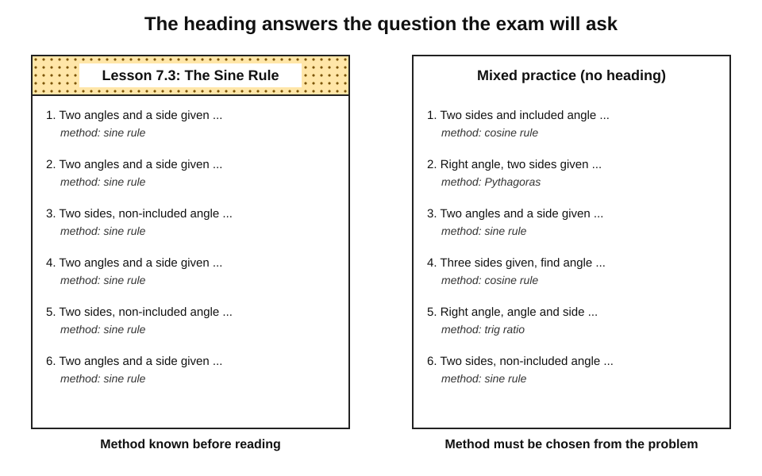
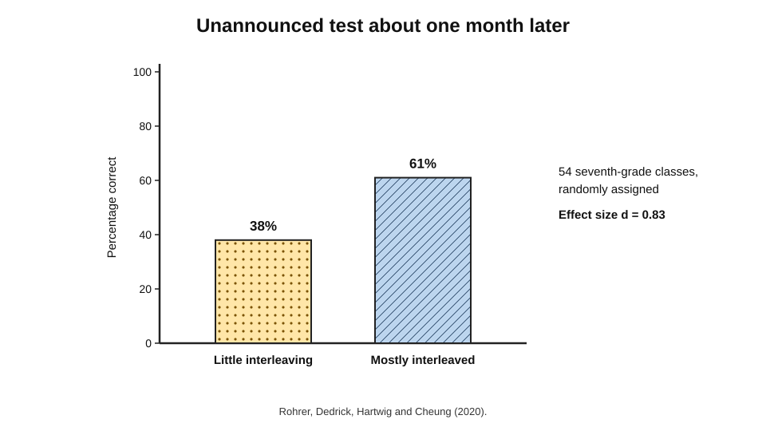
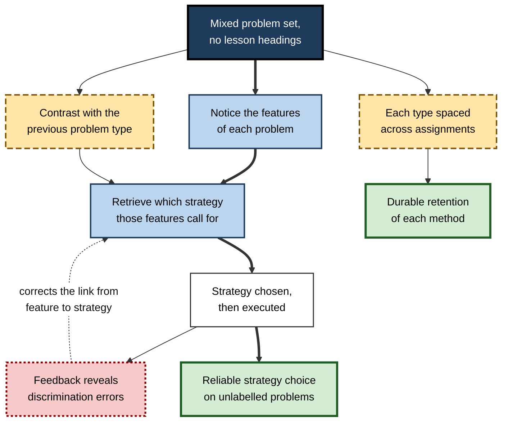
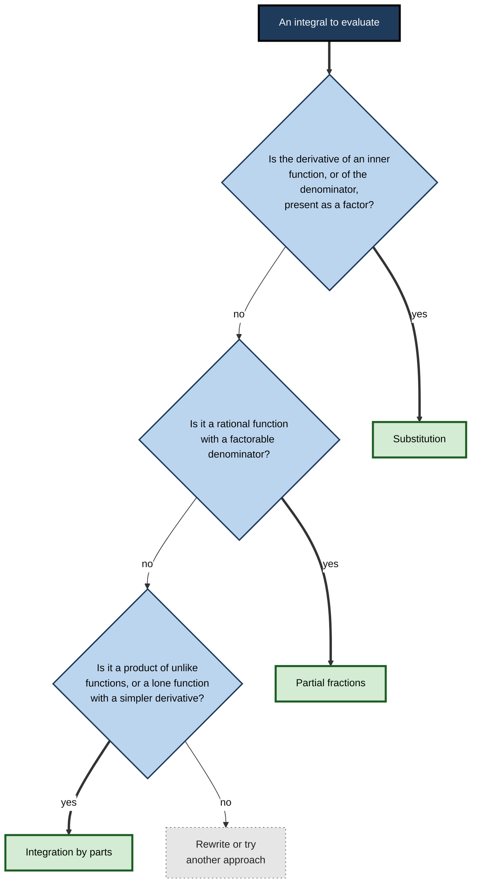
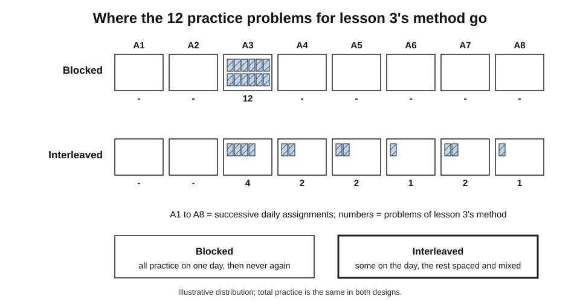
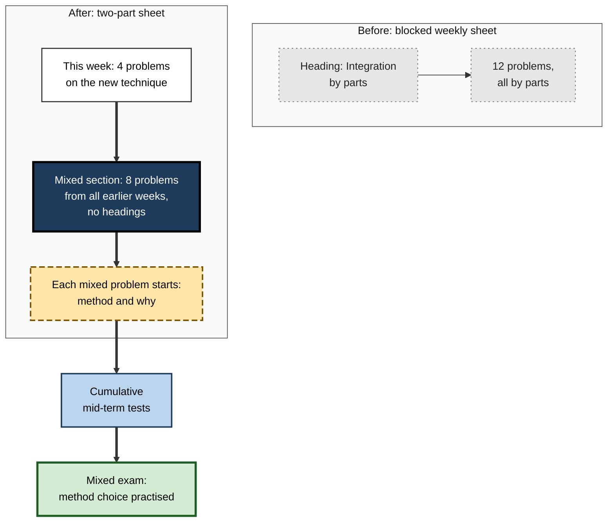

# E.6. Interleaving in Mathematics Learning

Open almost any mathematics textbook at the end of a lesson and the practice set has a quiet giveaway: every problem uses the method just taught. A student working through "Lesson 7.3: The Sine Rule" never has to wonder whether a triangle needs the sine rule or the cosine rule — the heading has already answered. Months later, on an examination paper where triangle problems arrive without headings, that unasked question is exactly where marks are lost.

**Interleaved mathematics practice** removes the giveaway. It is the setting in which interleaving has been studied most thoroughly, tested most often in real classrooms and found to make some of its largest differences.

> **Definition — Interleaved mathematics practice:** practice in which problems requiring different strategies are mixed within assignments, so that students must choose a strategy on the basis of the problem itself, rather than the chapter or lesson it comes from.

> **Definition — Problem type (in mathematics):** a class of problems that share a solution strategy — for example, problems solved with the Pythagorean theorem, or integrals solved by integration by parts.

**Why it matters**

- In mathematics, **choosing** the method is often harder than **executing** it; blocked practice trains execution only.
- Randomised trials in ordinary classrooms have found **large** benefits on delayed, unannounced tests.
- The change costs almost nothing: the same problems, reordered across assignments.
- The same principle applies to every quantitative profession — engineering, finance, data science, actuarial work — where problems never arrive labelled.
- The evidence also shows **limits**: smaller effects in some laboratory studies, and a year-long trial with no end-of-year effect. A professional needs both halves of the picture.

---

## Why Mathematics Is a Natural Fit

### The structure of mathematical problems

- **Many problems look alike but need different methods.**
  - *e.g.* "Find the angle" may need the sine rule, the cosine rule or simple trigonometric ratios.
  - *e.g.* "How many ways …?" may need permutations, combinations, or the multiplication principle.
- **The cues to the right method are often subtle.**
  - Whether two sides and the included angle are given, or two sides and a non-included angle.
  - Whether order matters.
- **Executing a method is usually learnable in a single lesson**; recognising when to use it takes far longer.

### How practice is usually organised

- **Lessons introduce one method at a time** — a sensible design for explanation.
- **Practice sets follow the lesson** — so they are blocked by default.
- Doug Rohrer, who has led much of the research, observed that in widely used textbooks the great majority of practice problems appear in the lesson that teaches their method — the **blocked** design.
- **Tests and real problems are mixed** — so the format of practice and the format of use do not match.

> **Key point:** in a blocked practice set the student can succeed **without knowing which method to use**, because the lesson heading has already chosen it. Interleaving makes the student do that choosing.

**Figure 1.** A blocked lesson practice set compared with an interleaved assignment.

### Superficially similar and dissimilar problems

- A natural assumption is that interleaving helps only when problems **look alike**, because only then is there something to confuse.
- Rohrer, Dedrick and Kaleena Burgess (2014) tested this with seventh-grade students, mixing problem types that were **not** superficially similar.
  - Interleaving still improved delayed test scores.
- **Interpretation:** even when problems look different, students must still **retrieve** which method goes with which kind of problem — and blocked practice skips that retrieval.

> **Watch out:** "interleave only look-alike problems" is too narrow for mathematics. The benefit is largest when problems are confusable, but mixing different types still trains the link between **problem features** and **methods**.

---

## The Classroom Evidence

### Early studies

**Study card — Rohrer and Taylor (2007)**

- University students, volumes of four unusual solids.
- Practice: blocked about 89%, mixed about 60%. One-week test: mixed about 63%, blocked about 20%.
- Most blocked-group errors used a formula for the **wrong** solid.

**Study card — Taylor and Rohrer (2010)**

- Fourth-grade children, four kinds of prism problem (faces, edges, corners, angles).
- Blocked practice had fewer errors during practice; interleaved practice scored **roughly twice** as high on a test the next day.
- Blocked-group errors were overwhelmingly **discrimination errors** — the right kind of formula for the wrong question.

> **Definition — Discrimination error:** an error in which a student applies a strategy that is correct for a different problem type; it shows that the student can execute methods but cannot tell when each applies.

### Classroom trials

**Study card — Rohrer, Dedrick and Stershic (2015)**

- **Setting:** seventh-grade classes in the United States.
- **Design:** over several months, each student received some material through interleaved assignments and other material through blocked assignments (a within-student comparison).
- **Test:** an unannounced test either **1 day** or **30 days** later.
- **Results:** interleaving gave higher scores at both delays, and the advantage was **larger after 30 days**.

**Study card — Rohrer, Dedrick, Hartwig and Cheung (2020)**

- **Setting:** 54 seventh-grade mathematics classes in Florida public schools.
- **Design:** classes randomly assigned to receive **mostly interleaved** practice or **little interleaved** practice (business as usual) over several months.
  - Both groups saw the **same practice problems**; only their arrangement across assignments differed.
- **Test:** an unannounced test about a month after the final practice.
- **Results:** **61%** correct for the interleaved group against **38%** for the control group — an effect size of **d ≈ 0.83**.
- **Conclusion:** in ordinary classrooms, with ordinary teachers, interleaving produced a large and practically important benefit.

**Figure 2.** Unannounced test scores in the randomised classroom trial of Rohrer and colleagues (2020).

> **Formula — Interpreting d ≈ 0.83:** with roughly normal score distributions, the average student in the interleaved group scored higher than about **80%** of students in the control group (the standard normal value at 0.83 is about 0.80).

### Contrasting algebraic operations

**Study card — Ziegler and Stern (2014)**

- **Participants:** sixth-grade students in Switzerland learning elementary algebraic transformations.
- **Material:** two operations that novices easily confuse — **adding** like terms (a + a = 2a) and **multiplying** them (a · a = a²).
- **Design:**
  - **separated** — addition taught and practised over several sessions, then multiplication;
  - **contrasted** — the two introduced and practised **side by side** from the start.
- **Results:**
  - during learning the contrasted group found the work **harder** and performed worse;
  - on delayed tests the contrasted group performed **better**, with fewer confusions between the operations.
- **Conclusion:** comparing confusable operations from the start pays off later, even at the cost of early difficulty.

### Physics, a close relative

- **Samani and Pan (2021)** — about 350 undergraduates in introductory physics received blocked homework for some weeks and interleaved homework for others.
  - On surprise tests with novel, harder problems, performance after interleaved homework was markedly better.
  - Students nonetheless rated interleaving harder and believed they had learned less.

### Separating the mechanisms

- **Foster, Mueller, Was, Rawson and Dunlosky (2019)** asked why interleaving improves mathematics learning.
  - They compared schedules that isolated **discriminative contrast** (different types side by side) from **distributed practice** (spacing of each type).
  - Both contributed to the benefit.
- **Implication:** in mathematics, interleaving works partly by spacing each type and partly by forcing comparison and choice.

### The cautions

- **Laboratory heterogeneity** — Brunmair and Richter's meta-analysis (2019) found only a **small** average effect for mathematical tasks, with individual laboratory studies ranging from strongly negative to clearly positive.
- **A year-long field trial** — interleaved practice in Nigerian primary schools (reported 2023) produced short-term gains of about 0.28 standard deviations but **no effect** on cumulative end-of-year tests; benefits were concentrated among lower achievers.
- **Scaling** — a large cluster-randomised trial across several United States districts and states, led by Bryan Matlen with Rohrer and others, was described in 2025 as under way to test whether the classroom effects hold in a nationally representative sample.

> **Watch out:** the strong classroom findings come largely from one research programme in one region of the United States. They are well designed and consistent, but independent replications at scale are still accumulating, and at least one long field trial found no lasting effect.

| Study | Learners | Comparison | Main result |
|---|---|---|---|
| Rohrer and Taylor (2007) | University students | Mixed vs blocked solids problems | 63% vs 20% at one week |
| Taylor and Rohrer (2010) | Fourth grade | Interleaved vs blocked prism problems | About twice as high next day |
| Ziegler and Stern (2014) | Sixth grade | Contrasted vs separated algebra operations | Contrasted better at delay |
| Rohrer, Dedrick and Stershic (2015) | Seventh grade | Interleaved vs blocked assignments | Advantage larger at 30 days |
| Rohrer and colleagues (2020) | 54 seventh-grade classes | Mostly vs little interleaving | 61% vs 38%, d ≈ 0.83 |
| Samani and Pan (2021) | Undergraduate physics | Interleaved vs blocked homework | Better on novel surprise tests |
| Nigerian field trial (2023) | Primary pupils, one year | Interleaved materials | Short-term gain; none at year end |

---

## How Interleaving Works in Mathematics

**Figure 3.** The routes by which interleaved practice improves mathematical performance.

### Three mechanisms, in mathematical terms

- **Strategy choice** — every problem requires linking its features to a method.
  - *e.g.* "A right angle and two sides are given → Pythagoras; two angles and a side → sine rule."
- **Discriminative contrast** — consecutive problems of different types show what separates them.
  - *e.g.* a combination problem straight after a permutation problem highlights whether order matters.
- **Spacing** — each method returns across many assignments rather than being practised once.

> **Key point:** the feature-to-strategy link is the knowledge interleaving builds. It is the knowledge expert problem-solvers use when they "see" what kind of problem they face.

### What experts see

- Studies of expertise in physics, notably by Michelene Chi, Paul Feltovich and Robert Glaser (1981), found that **novices** sorted problems by **surface features** (inclined planes, springs), while **experts** sorted them by **underlying principles** (conservation of energy, Newton's second law).
- Interleaved practice pushes learners towards the expert way of seeing, because surface features no longer predict the method — only the underlying structure does.

> **Definition — Deep structure:** the underlying principle or method that a problem requires, as opposed to its surface features such as context, wording or diagram.

---

## Contrast Sets Across Mathematics

| Level | Commonly confused types | Distinguishing cue |
|---|---|---|
| Primary | Area vs perimeter | Covering a surface or going round its edge |
| Primary | Multiplication vs division word problems | Whether the total or the group size is unknown |
| Lower secondary | Adding vs multiplying like terms | a + a = 2a; a · a = a² |
| Lower secondary | Percentage of vs percentage change | A part of a whole versus a change relative to an original |
| Upper secondary | Sine rule vs cosine rule | Which sides and angles are given, and whether the angle is included |
| Upper secondary | Permutations vs combinations | Whether order matters |
| Upper secondary | Arithmetic vs geometric sequences | Constant difference versus constant ratio |
| University | Integration by substitution vs by parts vs partial fractions | Whether a function's derivative is present; a product of unlike functions; a rational function with factorable denominator |
| University | Convergence tests for series | Form of the general term (ratio, comparison, alternating) |
| Statistics | t-test vs chi-square vs ANOVA | Kind of variables and number of groups |

> **Mnemonic — "LOOK, LINK, LAUNCH":** **look** at the features, **link** them to a strategy, **launch** the method — the sequence every interleaved problem demands.

---

## Worked Example (illustrative): An Interleaved Set on Integration

- **Situation:** first-year university students have learned three integration techniques in successive lectures — **substitution**, **integration by parts** and **partial fractions** — each followed by a block of exercises. On mixed exam questions they often pick the wrong technique.

### The mixed set

| No. | Integral | Technique | Cue |
|---|---|---|---|
| 1 | ∫ x·e^(x²) dx | Substitution, u = x² | The derivative of the inner function (2x) is present, up to a constant |
| 2 | ∫ x·eˣ dx | By parts | Product of a polynomial and an exponential; no inner derivative present |
| 3 | ∫ 1 ÷ (x² − 1) dx | Partial fractions | Rational function; denominator factorises as (x − 1)(x + 1) |
| 4 | ∫ sin²x·cos x dx | Substitution, u = sin x | cos x is the derivative of sin x |
| 5 | ∫ ln x dx | By parts, with u = ln x and dv = dx | A single function whose derivative is simpler |
| 6 | ∫ (2x + 3) ÷ (x² + 3x) dx | Substitution, u = x² + 3x | The numerator is exactly the derivative of the denominator |

### How the set is used

1. **No headings** — the six integrals appear in this order with no indication of technique.
2. **Name before solving** — students write the technique and the cue in one line.
3. **Solve.**
4. **Feedback on the choice first**, then on the working.
5. **Pairs for contrast** — items 1 and 2 (exponential with and without an inner derivative) and items 3 and 6 (rational functions that look alike but need different techniques) are designed as deliberate contrasts.

**Figure 4.** Cue-based choice among three integration techniques.

> **Watch out:** item 6 is a rational function, and students who have just practised partial fractions will reach for them. Partial fractions work, but substitution is far quicker. Such **near-miss** items teach more than any number of straightforward ones.

> **Definition — Near-miss item:** a problem that closely resembles one type but belongs to another, used to sharpen the boundary between them.

---

## Designing Interleaved Mathematics Courses

### Principles drawn from the classroom studies

- **Teach in lessons, practise in mixtures.**
  - Lessons can still introduce one method at a time; the **practice** that follows is redistributed.
- **Few problems of the new type in the lesson's own assignment.**
  - Enough to consolidate the method; most of its practice moves into later assignments.
- **Spread each type across many later assignments.**
  - So that each method returns repeatedly over weeks.
- **Include earlier types in every assignment.**
- **Use cumulative, unlabelled tests.**
- **Give answer keys or prompt feedback**, so wrong strategy choices are corrected.

**Figure 5.** Where the practice problems for one lesson's method appear under the two designs.

### Practical issues for teachers

- **Writing materials** — few textbooks provide interleaved sets; teachers must reorder existing problems or use supplements.
  - Reordering problems from existing chapters is often enough.
- **Marking and feedback** — errors come from many types, which complicates marking but gives better diagnostic information.
- **Student reactions** — students may complain that homework "has things we haven't done today"; a brief explanation helps.
- **Parents** — may worry when children struggle with "old" topics; the same explanation applies.

> **In practice:** a common, workable compromise is the **"two plus" assignment** — the day's lesson problems first, followed by a larger mixed section of earlier types, with no labels in the mixed section.

### For the independent learner

- **Build mixed sets from textbook exercises** — take a few problems from each of the last several chapters, shuffle them and remove chapter numbers.
- **Use mixed modes** in question banks.
- **Make "which method?" cards** — the front shows a problem, the back names the method and the cue; studying them in shuffled order trains identification quickly, without full solutions.
- **Ask an AI assistant** for unlabelled mixed problems from named topics, with feedback on method choice before the answer.

> **Example (illustrative):** a student preparing for a statistics exam writes forty short scenario cards ("Two independent groups, a continuous outcome" → independent-samples t-test). Ten minutes of shuffled cards a day trains the choice that the exam tests in every question.

---

## Interleaving Alongside Other Mathematics Practices

Interleaving does not replace other good practice in mathematics teaching; it changes how practice is **arranged**. Several familiar approaches combine with it naturally.

### Classroom routines that build in mixing

- **Starter questions** — four or five quick questions at the start of each lesson, drawn from different earlier topics.
  - Cheap, routine and a daily source of identification practice.
- **"Which method?" sorts** — a set of problem cards sorted by method without solving them.
  - Isolates the identification step in a few minutes.
- **Same surface, different structure** — pairs of problems with identical contexts but different methods.
  - *e.g.* two questions about a ladder against a wall: one needs Pythagoras, the other a trigonometric ratio.
- **Different surface, same structure** — pairs of problems with different contexts but the same method.
  - Shows that the method is chosen by structure, not by story.
- **Error discussions** — showing an anonymous discrimination error and asking the class what cue was missed.

> **Remember:** **same surface, different structure** sharpens discrimination; **different surface, same structure** builds generalisation. Interleaved sets benefit from both.

### Mastery, fluency and interleaving

- **Mastery approaches** keep a class on a topic until most students can do it — a blocked design at the level of the unit.
  - Mastery of **execution** within a unit is a sound first step; mastery of **choice** requires later mixing.
- **Fluency practice** — speed and accuracy on basic facts or procedures — is often best done in short blocked bursts.
  - Mixing comes when fluent procedures must be selected among.
- **Retrieval-based quizzes** that mix topics combine two benefits — retrieval and interleaving — and are a natural vehicle for mixed practice.

| Practice | Main purpose | Where interleaving fits |
|---|---|---|
| Worked examples | Show how a method works | Mixed worked examples once each method has been seen |
| Blocked lesson exercises | Build initial execution | A short section only |
| Mixed homework | Build choice and retention | The core of interleaved design |
| Starter questions | Daily retrieval of older topics | Naturally mixed |
| Cumulative tests | Measure durable learning | Must be mixed and unlabelled |

> **In practice:** a teacher wishing to begin without rewriting materials can start with **starter questions** and a **mixed section** at the end of each homework — two small changes that capture much of the design.

---

## Limits and Open Debates

### When interleaving may not help in mathematics

- **Before a method can be executed at all.**
  - A student who cannot yet carry out integration by parts gains nothing from choosing it.
- **When the method itself is long and demanding.**
  - Extended proofs or multi-step modelling problems may need focused practice before mixing.
- **When there is no feedback.**
  - Wrong strategy choices, unchecked, are practised and strengthened.
- **When the test is blocked.**
  - The benefit shows only on mixed or delayed tests; a chapter test will not detect it.

### Differences between learners

- The year-long Nigerian trial suggests that **lower-achieving** pupils may gain most, while higher achievers gain little or may lose some ground — possibly because they already discriminate well and lose practice time on more advanced material.
- Other studies have found benefits across the attainment range; the question is unresolved.

> **Watch out:** "interleaving is proven in maths" overstates the case; "interleaving is unproven" understates it. The fair summary is: **strong evidence from well-designed classroom trials, a small and variable effect in laboratory meta-analysis, and an important null result over a full school year.**

---

## Interleaving in Quantitative Professional Work

### Where it applies

- **Engineering** — choosing between analysis methods (static versus dynamic, linear versus non-linear) for a design problem.
- **Finance** — choosing valuation approaches (discounted cash flow, multiples, option-based) for different assets.
- **Data science** — choosing models and metrics for different problem structures.
- **Actuarial and risk work** — choosing distributions and estimation methods.
- **Quantitative interviews** — mixed problems on probability, statistics and estimation, deliberately unlabelled.

> **In practice:** quantitative interview preparation that drills one topic per evening (probability one night, combinatorics the next) mirrors the textbook chapter. Mixed sets, timed and unlabelled, mirror the interview.

### Case study (illustrative): rescuing first-year engineering mathematics

- **Situation:** a university engineering faculty taught first-year mathematics in weekly topics — differentiation, integration techniques, differential equations, series, linear algebra — each with a weekly problem sheet on that topic only.
- **Problem:** pass rates on the end-of-year exam were low, and examiners reported that many students "knew the methods but could not start the questions".
- **Diagnosis:**
  - every weekly sheet was blocked;
  - mid-term tests were topic-by-topic;
  - the exam mixed topics and often required students to **decide** which technique to use;
  - the most frequent error was not a calculation slip but choosing an **inappropriate method** or none.
- **Actions:**
  1. Weekly sheets were split: a **short "this week" section** and a **larger mixed section** drawing on all previous weeks, unlabelled.
  2. Each mixed problem began with a box: "Method and why".
  3. Tutors' feedback addressed method choice first.
  4. Mid-term tests became **cumulative**.
  5. Near-miss problems were written for the most confused pairs (substitution versus partial fractions; separable versus linear first-order differential equations).
  6. Students were told in the first lecture why the sheets would feel harder.
- **Result:**
  - students' weekly-sheet marks dropped in the first term, and module feedback included complaints about "old material";
  - the proportion of exam scripts with no attempt at a question fell, and pass rates rose in the following year;
  - examiners noted fewer method-choice errors.
- **Side effects:** the faculty could not run a randomised comparison, so a cohort effect cannot be ruled out; tutors needed guidance on giving method-choice feedback.
- **Lesson:** in mathematics, the problem sheet's layout is a powerful, cheap lever on what students actually learn to do.

**Figure 6.** Redesign of a weekly problem sheet.

---

## Open Questions

- **Do the large classroom effects replicate at national scale?**
  - A nationally representative trial was under way in 2025; results will show how far the Florida findings generalise.
- **Why did the year-long Nigerian trial show no end-of-year effect?**
  - Implementation, curriculum, test design and learner differences are all possible explanations.
- **How should the proportion of new and old problems be set?**
  - Classroom studies used particular ratios; the optimum is unknown and may vary by topic.
- **How does interleaving interact with worked examples and explicit comparison?**
  - Combining them is plausible and partially supported; the best sequence is not settled.
- **Who benefits most?**
  - Evidence on differences by prior attainment is mixed.

---

## Summary

- **Interleaved mathematics practice** mixes problem types within assignments so that students must **choose** a strategy from the problem itself.
- Mathematics fits interleaving because problems **look alike** but need **different methods**, and because textbook practice is **blocked** while tests are **mixed**.
- Benefits appear even for **superficially dissimilar** types (Rohrer, Dedrick and Burgess, 2014), because students must still link features to methods.
- Evidence: Rohrer and Taylor (2007); Taylor and Rohrer (2010); Ziegler and Stern (2014); Rohrer, Dedrick and Stershic (2015 — advantage larger at 30 days); Rohrer and colleagues (2020 — 54 classes, 61% vs 38%, d ≈ 0.83); Samani and Pan (2021, physics).
- Mechanisms: **strategy choice**, **discriminative contrast** and **spacing** (Foster and colleagues, 2019). Interleaving pushes learners from surface features towards **deep structure** (Chi, Feltovich and Glaser, 1981).
- **Discrimination errors** — the right method for the wrong problem — are the signature of blocked practice.
- Design: **teach in lessons, practise in mixtures**; spread each type across later assignments; use **near-miss** items, "method and why" prompts, feedback and **cumulative tests**.
- Cautions: small, variable **laboratory** effects; a **year-long** trial without end-of-year benefit; most classroom evidence from one research programme.

---

## Self-Check

1. Why is mathematics especially suited to interleaved practice?
2. What did Rohrer observe about how textbook practice problems are arranged?
3. What is a discrimination error? Give a mathematical example.
4. Why might interleaving help even when problem types do not look alike?
5. Describe the design and results of Rohrer and colleagues' 2020 randomised trial.
6. Interpret an effect size of d ≈ 0.83 in plain language.
7. What did Ziegler and Stern (2014) find about learning addition and multiplication of algebraic terms?
8. Which two mechanisms did Foster and colleagues (2019) find both contribute to the interleaving benefit in mathematics?
9. How do experts and novices differ in categorising physics problems, and how does this relate to interleaving?
10. What is a near-miss item? Construct one for permutations versus combinations.
11. List four principles for designing an interleaved mathematics course.
12. Summarise the main cautions in the evidence on interleaved mathematics practice.
13. A statistics lecturer's weekly worksheets each cover one test. Redesign the worksheets and explain how you would judge whether the change worked.
14. Distinguish "same surface, different structure" from "different surface, same structure" problem pairs and state what each builds.

### Answer Key

1. Many problems look alike but require different methods; choosing the method is often harder than executing it; textbook practice is blocked while tests and real problems are mixed.
2. The great majority of practice problems appear in the lesson that teaches their method, so practice sets are blocked.
3. Applying a method that is correct for a different problem type. Example: using the sine rule when two sides and the included angle are given (a cosine-rule problem).
4. Students must still retrieve which method goes with which kind of problem; blocked practice skips that retrieval because the lesson supplies the method.
5. Fifty-four seventh-grade classes were randomly assigned to mostly interleaved or little interleaved practice over several months, with the same problems. On an unannounced test about a month later the interleaved group scored 61% versus 38% (d ≈ 0.83).
6. The average interleaved student outscored roughly 80% of the control group — a large effect by conventional standards.
7. Introducing and practising the two operations side by side made learning harder at first but produced better delayed performance and fewer confusions than teaching them separately.
8. Discriminative contrast and distributed practice (spacing).
9. Novices sort by surface features, experts by underlying principles. Interleaving makes surface features unreliable guides to the method, pushing learners to attend to deep structure as experts do.
10. A problem that resembles one type but belongs to another. Example: "In how many ways can a committee of 3 be chosen from 10 people?" (combination) placed right after "In how many ways can a president, secretary and treasurer be chosen from 10 people?" (permutation).
11. Teach in lessons but practise in mixtures; keep few new-type problems in the lesson's assignment and spread the rest across later assignments; include earlier types in every assignment; use near-miss items and "method and why" prompts; give feedback on method choice; use cumulative, unlabelled tests.
12. Laboratory meta-analysis shows only a small, variable average effect; most classroom evidence comes from one research programme; a year-long Nigerian trial found short-term gains but no end-of-year effect; benefits may differ by prior attainment.
13. Split each worksheet into a short section on the week's test and a larger mixed section of scenarios from all tests covered, with no labels and a "test and why" step; give feedback on test choice; make quizzes cumulative. Judge success by delayed, mixed, unlabelled assessments with new scenarios, analysis of test-choice errors, and ideally comparison with a previous or parallel cohort.
14. Same surface, different structure: identical contexts needing different methods, which sharpens discrimination. Different surface, same structure: different contexts needing the same method, which builds generalisation by showing that the method follows structure, not story.

---

## Glossary

| Term | Meaning |
|---|---|
| Contrasted introduction | Teaching confusable operations side by side from the start. |
| Cumulative test | A test covering all material taught so far. |
| Deep structure | The underlying principle or method a problem requires. |
| Discrimination error | Applying a method correct for a different problem type. |
| Interleaved mathematics practice | Mixing problem types within assignments so that students must choose strategies. |
| Mixed section | Part of an assignment containing unlabelled problems of earlier types. |
| Near-miss item | A problem resembling one type but belonging to another. |
| Problem type | A class of problems sharing a solution strategy. |
| Strategy choice | Selecting a method from a problem's features. |
| Surface features | Context, wording or diagrams of a problem, as opposed to its structure. |
