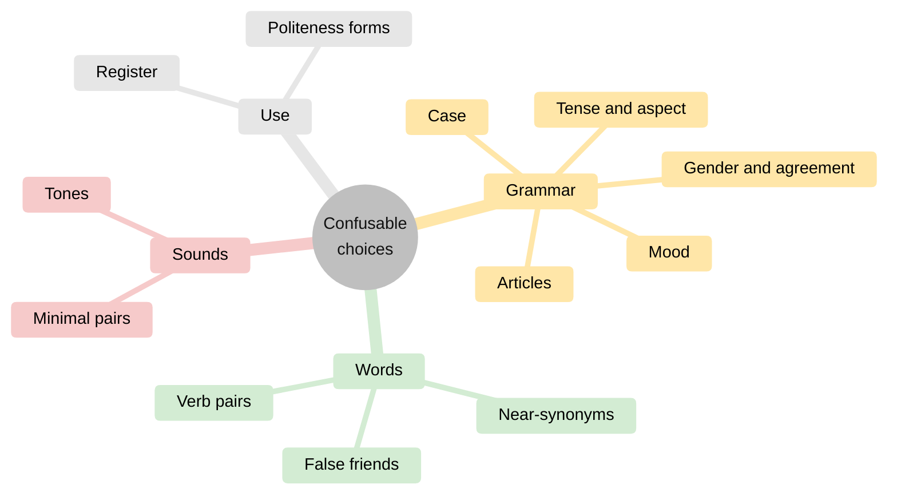
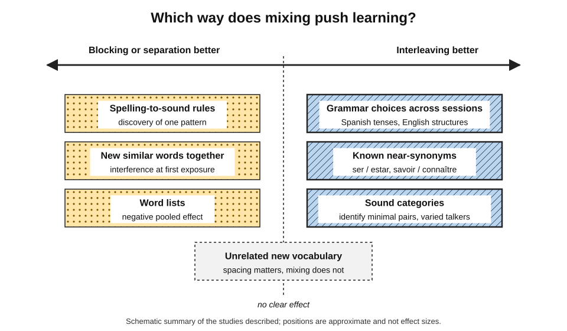
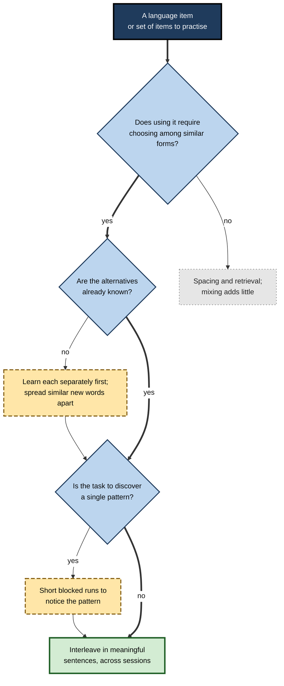
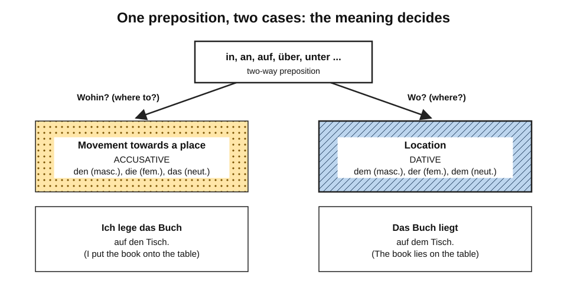
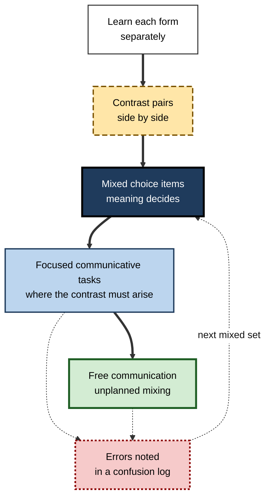
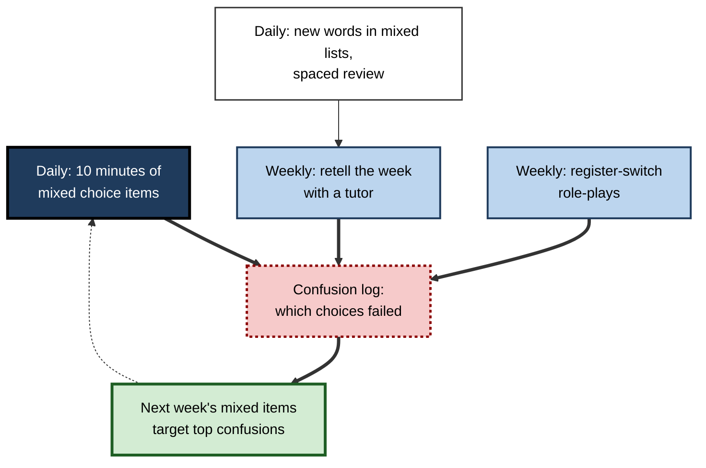

# E.7. Interleaving in Language Learning

A learner of Spanish can conjugate every verb in the preterite and every verb in the imperfect — as long as the exercise says which. In conversation, telling a story about last summer, she must decide for each verb whether the action was a completed event or an ongoing background, and she hesitates, guesses and often guesses wrong.

A German learner knows that *in* takes the accusative for movement and the dative for location, yet says *ich gehe in dem Park*. In both cases the learner has practised the **forms** but not the **choice between them**.

> **Definition — Interleaving in language learning:** mixing practice of related, easily confused language choices — tenses, cases, genders, near-synonyms, sound contrasts — so that the learner must decide which form is required in each item, rather than practising one form at a time.

> **Definition — Form choice:** the decision, made in every real sentence, about which of several possible grammatical or lexical forms the meaning and context require.

**Why it matters**

- Language use is a continuous series of **choices among similar forms**; textbooks and apps often practise each form in isolation.
- Several well-designed studies show interleaving improves the learning of **grammatical choices**.
- Language learning also provides some of the clearest cases where interleaving **does not help** — word lists, and some pronunciation rules — so it is an essential test of where the method's limits lie.
- Professionals relocating, serving international clients or working in multilingual teams need fast, accurate form choice under time pressure.

---

## The Choices a Language Learner Must Make

### Kinds of confusable choice

- **Tense and aspect** — completed versus ongoing, simple versus progressive.
  - *e.g.* Spanish preterite versus imperfect; English present perfect versus past simple.
- **Mood** — indicative versus subjunctive.
  - *e.g.* French *il faut que tu viennes* versus *je sais que tu viens*.
- **Case** — the form a noun phrase takes for its role in the sentence.
  - *e.g.* German accusative versus dative after two-way prepositions.
- **Gender and agreement** — choosing articles and endings.
  - *e.g.* German *der*, *die*, *das*; French *le* and *la*.
- **Articles and determiners** — notoriously hard for speakers of languages without them.
  - *e.g.* English *a*, *the* or no article.
- **Near-synonyms and verb pairs** — similar meanings, different uses.
  - *e.g.* Spanish *ser* and *estar*; French *savoir* and *connaître*; English *make* and *do*.
- **False friends** — words that look alike across languages but differ in meaning.
  - *e.g.* Spanish *embarazada* (pregnant), not "embarrassed".
- **Sound contrasts** — pairs of sounds the learner's first language does not distinguish.
  - *e.g.* English /r/ and /l/ for Japanese speakers; Mandarin tones for speakers of non-tonal languages.
- **Register** — formal versus informal address.
  - *e.g.* French *tu* and *vous*; German *du* and *Sie*.

**Figure 1.** Kinds of confusable choice in a foreign language.

> **Key point:** most of these choices depend on **meaning and context**, not on the word itself. They cannot be learned by memorising forms; they must be practised as **decisions**.

### What blocked language practice looks like

- **Conjugation tables** — all preterite forms, then all imperfect forms.
- **Unit-based exercises** — "Unit 9: the dative case" with twenty dative sentences.
- **Single-form gap-fills** — "Put the verb in the imperfect."
- **App lessons** that introduce one structure and drill it in isolation.
- In each, the instruction or the unit title **makes the choice for the learner**.

> **Watch out:** a learner who scores 95% on "Put these verbs in the subjunctive" may still almost never use the subjunctive spontaneously — the exercise tested **forming** it, not **knowing when** it is needed.

---

## Evidence: Grammar

### Spanish past tenses

**Study card — Pan, Tajran, Lovelett, Osuna and Rickard (2019)**

- **Participants:** English-speaking adults with little or no Spanish.
- **Task:** conjugating Spanish verbs in the **preterite** and **imperfect** past tenses.
- **Design:** several experiments compared blocked and interleaved practice of the two tenses under different training schedules.
- **Results:**
  - interleaving between tenses yielded **substantially better** performance on a test **one week later** when practice was spread across **multiple sessions**;
  - under two **single-session** schedules, interleaving gave **no advantage** over blocking.
- **Conclusion:** interleaving can benefit foreign-language grammar, but its benefit may depend on being combined with practice spread over time.

### English grammar for Japanese learners

**Study card — Nakata and Suzuki (2019)**

- **Participants:** Japanese university students learning English.
- **Task:** exercises on several English grammatical structures.
- **Design:** **blocked**, **interleaved** and **increasing** schedules (moving from blocked towards mixed).
- **Results:**
  - interleaving produced the **most errors** during training;
  - it was **more effective than blocking** on a one-week delayed post-test.
- **Conclusion:** the interleaving advantage extends to second-language grammar, with the familiar pattern of worse training performance and better retention.

### Systematic and random order

- **Pan, Lovelett, Phun and Rickard (2019)** examined different kinds of interleaving for second-language grammar and reported **synergistic** benefits when **systematic** interleaving (a predictable alternation) was combined with **random** interleaving.
- A **2024** study reported that interleaved practice enhanced grammar learning for both **similar** and **dissimilar** tenses in Romance languages.

| Study | Learners | Structures | Finding |
|---|---|---|---|
| Pan and colleagues (2019) | English-speaking adults | Spanish preterite vs imperfect | Benefit at one week when spread across sessions; none in a single session |
| Nakata and Suzuki (2019) | Japanese university students | Several English structures | Most training errors, best one-week retention |
| Pan, Lovelett, Phun and Rickard (2019) | Adult learners | Second-language grammar | Systematic plus random interleaving synergistic |
| 2024 study, Romance languages | Adult learners | Similar and dissimilar tenses | Interleaving helped both |

> **Remember:** for **grammar choices**, the language evidence matches the general pattern — **harder in training, better a week later** — with the important addition that spreading interleaved practice over **several sessions** may be needed.

---

## Evidence: Vocabulary

### Words are a poor fit

- **Brunmair and Richter's meta-analysis (2019)** found a **negative** interleaving effect for word lists.
- **Hausman and Kornell (2014)** found no benefit from interleaving foreign vocabulary once spacing was controlled.
- **Why:** a vocabulary pair (*perro* — dog) has no category structure to discover and no choice to practise; mixing different lists adds switching without adding contrast.

### Semantic clustering

- A long line of second-language vocabulary research — associated with Robert Waring, Thomas Tinkham and others in the 1990s — compared learning **new** words in **semantically related sets** (all fruits, all clothes) with learning them in **unrelated** sets.
  - Related sets were often learned **more slowly**, with more confusion between the words.
- **Interpretation:** at **first exposure**, similar new words **interfere** with each other.

> **Definition — Semantic clustering:** presenting new vocabulary in groups of words from the same meaning category, such as colours or body parts.

> **Watch out:** this seems to contradict the rule that confusable items should be mixed. It does not. Clustering asks learners to **acquire** several similar new labels at once; interleaving asks them to **discriminate** between items they already partly know. Similar words are best **learned apart** and **contrasted later**.

### When contrast between words does help

- **After both words are known**, contrasting near-synonyms or false friends in the same practice makes sense.
  - *e.g.* once *ser* and *estar* have each been learned, mixed sentences requiring one or the other train the choice.
- The principle: **separate for acquisition, together for discrimination**.

| Vocabulary situation | Best arrangement | Reason |
|---|---|---|
| Learning new, unrelated words | Spacing and retrieval; mixing irrelevant | No contrast to learn |
| Learning several new words from one semantic field | Spread them across different sets | Avoid interference at first exposure |
| Choosing between known near-synonyms | Interleave in sentence contexts | The choice is the skill |
| Known false friends | Contrast directly with the true equivalent | Sharpen the boundary |

---

## Evidence: Sounds and Spelling

### Pronunciation rules: a case for blocking

**Study card — Carpenter and Mueller (2013)**

- **Participants:** native English speakers with no knowledge of French.
- **Task:** learning French **spelling-to-sound rules** — how particular letter combinations are pronounced.
- **Design:** examples of each rule presented **blocked** or **interleaved**.
- **Result:** **blocking** produced better learning of the rules than interleaving — the reverse of the usual effect.
- **Interpretation:** seeing several examples of one rule in a row may make the rule's **common feature** easier to notice; when examples are mixed, the shared pattern is harder to extract.

### Perceiving difficult sound contrasts

- Research on **high-variability phonetic training** — begun with Japanese learners of English /r/ and /l/ by John Logan, Scott Lively and David Pisoni (1991) — trained learners to identify minimal pairs (*rock* or *lock*) spoken by **many different talkers** in varied words.
  - Training with **high variability** generalised to new talkers and words better than training with a single talker.
- This is **variability** within one contrast rather than interleaving of several contrasts, but it shares the logic: the learner must identify the category on each trial without being told.

> **Definition — Minimal pair:** two words that differ in a single sound, such as *rock* and *lock*, used to train perception of the contrast.

> **Key point:** in language, **rule discovery** from examples of one rule may favour blocking; **choosing between known rules** favours interleaving. The task, not the subject, decides.

**Figure 2.** Typical direction of the interleaving effect for different kinds of language material.

---

## Why Language Results Vary

### Four questions that predict the effect

1. **Is there a choice to practise?**
   - Grammar choices: yes. Word pairs: no.
2. **Are the alternatives already known?**
   - Interleaving helps discrimination between known forms; it can hinder acquisition of new ones.
3. **Is the task discovering a rule or applying it?**
   - Discovering a single rule from examples may benefit from blocking; applying several known rules benefits from mixing.
4. **Is practice spread over sessions?**
   - Some grammar benefits appear only when interleaving is combined with multi-session practice.

**Figure 3.** Choosing a practice arrangement for a language item.

---

## Designing Interleaved Language Practice

### Exercise formats that force a choice

- **Choose-the-form gap-fills** — "Ayer (llover / llovía) cuando salí" — with no instruction about which tense to use.
- **Mixed transformation** — sentences to put into the past, where some need the preterite and some the imperfect.
- **Story retelling** — narrating a short sequence of events, where background and foreground actions alternate naturally.
- **Error spotting** — a paragraph with mixed correct and incorrect choices to find and justify.
- **Minimal-pair identification** — mixed audio items from several sound contrasts.
- **Role-plays with register shifts** — alternating between a friend and a client.

### Rules for good mixed language sets

- **Meaning must decide.** Each item must contain the context that determines the form; otherwise the learner can only guess.
- **No instruction that names the form.** "Choose the correct form" is enough.
- **Balanced alternatives.** Each option should be correct in roughly comparable numbers of items, so that guessing one form does not pay.
- **Near-miss contexts.** Include sentences where a small change in meaning changes the form.
  - *e.g.* *Estaba en casa cuando llamaste* (background) versus *Estuve en casa toda la tarde* (bounded period).
- **Feedback with the reason.** "Imperfect, because it describes an ongoing state at the moment of the call."

> **Mnemonic — "MANNF":** Meaning decides, Avoid naming the form, Number of alternatives balanced, Near-miss contexts, Feedback with reasons.

### Worked example: German two-way prepositions

- **Situation:** an English-speaking learner knows that nine German prepositions (including *in*, *an*, *auf*, *über*, *unter*) take the **accusative** for movement towards a place and the **dative** for location. Unit exercises practised each case separately; in speech, she defaults to the dative.

**Figure 4.** The choice underlying German two-way prepositions.

1. **Contrast pairs first** — sentences differing only in movement versus location:
   - *Ich lege das Buch auf den Tisch.* (movement → accusative)
   - *Das Buch liegt auf dem Tisch.* (location → dative)
2. **Mixed set of twelve sentences**, in random order, with prepositions, nouns of all three genders and both cases, unlabelled.
3. **Before writing the article**, the learner writes **M** (movement) or **L** (location).
4. **Feedback** on the M/L decision first, then on the article form.
5. **Spoken version** — describing a room while moving objects around it, alternating actions and descriptions.
6. **Repeat across three sessions in a week**, with new sentences each time.

| Item | Sentence | Decision | Article |
|---|---|---|---|
| 1 | Wir gehen in ___ Kino. | Movement | das (accusative) |
| 2 | Wir sind in ___ Kino. | Location | dem (dative) |
| 3 | Sie hängt das Bild an ___ Wand. | Movement | die (accusative) |
| 4 | Das Bild hängt an ___ Wand. | Location | der (dative) |
| 5 | Der Hund läuft unter ___ Tisch. | Movement towards a place | den (accusative) |
| 6 | Der Hund schläft unter ___ Tisch. | Location | dem (dative) |

> **Watch out:** item 5 is a classic **near-miss** — *laufen* can describe moving under the table (accusative) or running around while under it (dative). Discussing such cases teaches that the choice depends on **meaning**, not on the verb.

### Interleaving the four skills across a week

- Reading, listening, speaking and writing can be rotated across days, so that each recurs frequently.
- This is mainly a **spacing** benefit; the discrimination benefit lies in mixing **choices** within each activity.

> **In practice:** a balanced weekly plan might combine short daily mixed grammar sets (ten minutes), alternating listening and reading days, and two speaking sessions in which grammatical choices arise naturally.

---

## Scripts, Characters and Look-Alike Symbols

Learners of a new writing system face a pure discrimination problem: many symbols differ by a single stroke or dot.

### Typical confusions

- **Japanese kana** — pairs such as ぬ (nu) and め (me), or シ (shi) and ツ (tsu), differ in small details of stroke direction and shape.
- **Chinese characters** — characters such as 未 (not yet) and 末 (end) differ only in the relative length of two strokes.
- **Devanagari** — for learners of Hindi or Marathi, letters such as ब (ba) and व (va) differ by a single diagonal stroke.
- **Arabic script** — several letters share a base shape and differ only in the number and position of dots.

### Arranging script practice

- **Learn each symbol first** with its sound and a memorable shape description.
  - Similar new symbols are best **not** introduced in the same set, for the same reason as similar new words.
- **Then contrast them directly** — side-by-side pairs with the distinguishing stroke pointed out.
- **Then interleave** — rapid recognition drills with symbols from the whole set in random order, with immediate feedback.
- **Finally read in context** — words and sentences where the symbol must be recognised without warning.

> **Example:** a learner of Japanese who studies シ and ツ on separate days, each with its own drill, reads both well in isolation but confuses them in words. A two-minute daily drill of mixed シ / ツ / ソ / ン items — the four commonly confused katakana — removes most of the confusion within a fortnight.

| Stage | Arrangement | Purpose |
|---|---|---|
| First learning | Similar symbols in different sets | Avoid interference while each is acquired |
| Contrast | Confusable symbols side by side | See the distinguishing feature |
| Discrimination drill | Mixed, rapid, with feedback | Train recognition without cues |
| Reading in context | Real text | Transfer to use |

---

## Interleaving and Communicative Practice

### Conversation interleaves naturally

- Real communication **mixes everything** — tenses, cases, registers and vocabulary arrive in no planned order.
- **Communicative and task-based teaching** — learning through meaningful tasks such as planning a trip or resolving a complaint — therefore provides interleaved practice by default.
- But conversation offers **uneven** practice: a learner can avoid a difficult form (for example the subjunctive) for months by paraphrasing.

> **Definition — Avoidance:** a learner's tendency to steer around forms they find difficult, so that those forms are rarely practised in free communication.

### Combining structured mixing with communication

- **Focused tasks** — communicative tasks designed so that a particular contrast must arise.
  - *e.g.* describing a childhood holiday (imperfect background, preterite events); giving a colleague instructions while moving furniture (accusative and dative).
- **Mixed drills as a bridge** — short structured mixed sets before a task prime the choices the task will demand.
- **Feedback after the task** — recasting or noting the choices that went wrong, which then feed the next mixed set.

**Figure 5.** From learning forms to choosing them in real communication.

> **Key point:** structured interleaving and free communication are **complementary**. Mixed drills guarantee that every important choice is practised; communication makes the choices fast, meaningful and automatic.

> **Example:** a learner of French preparing for a job interview writes twenty short sentences about her career, half describing ongoing situations in the past (*je travaillais à Pune*) and half describing completed events (*j'ai rejoint l'équipe en 2021*). She shuffles them, removes the verbs and, a day later, fills each gap — choosing the tense before writing the form. The exercise takes ten minutes and practises exactly the choice that the interview will demand.

---

## Interleaving in Language Apps and Courses

- **Many apps** introduce one structure per lesson and drill it in isolation, then review it later.
  - Their review sessions often mix earlier material — a useful interleaving feature.
- **Flashcard decks** for vocabulary benefit from spacing more than from mixing; for grammar, **sentence cards** that require a choice ("___ cansado hoy — ser or estar?") turn a deck into an interleaved discrimination tool.
- **Course books** often end units with a "review" page mixing earlier structures; these pages are among the most valuable and the most often skipped.
- **AI conversation partners** can be asked to steer conversations so that contrasting structures arise — for example, telling a story in the past that requires both preterite and imperfect — and to correct choices with reasons.

---

## Language Learning in Professional Life

### Where form choice matters at work

- **Client-facing roles abroad** — choosing the polite form, the right tense for commitments and the right register for emails.
- **Interpreting and translation** — rapid switching between languages, choosing equivalents among near-synonyms and false friends.
- **Multinational teams** — clarity in a shared second language often fails on articles, tenses and modal verbs (*must*, *should*, *may*), which carry contractual weight.
- **Legal and regulatory drafting** — the difference between *shall* and *may*, or the choice of tense, can change obligations.

> **In practice:** professionals learning a language for a role gain more from mixed, realistic practice — client emails requiring choices of register and tense — than from unit-by-unit grammar drills.

### Switching between languages

- **Interpreters and multilingual professionals** must switch rapidly between languages, and the switch itself is a skill.
  - Each language's forms must be selected while the other's are held back; errors often involve **transferring** a form from one language to the other.
- **Training for switching** typically alternates the direction of translation and mixes source languages within a session, so that the learner practises inhibiting the wrong language's choices.
- **For professionals using a second language at work**, alternating meetings, emails and documents between languages during the learning period builds the same control, at a smaller scale.

> **Watch out:** cross-language **transfer errors** — using an English article pattern in German, or a Hindi word order in English — are discrimination errors between whole systems. Contrastive practice that sets the two systems side by side ("how would this be said in each language?") targets them directly.

### Case study: a consultant preparing for a German posting

- **Situation:** an Indian management consultant was to spend a year with a client in Munich. She had six months of evening study, using a course book and an app, and could complete unit exercises accurately.
- **Problem:** in practice conversations with a tutor she produced long hesitations and frequent errors in article choice, case after prepositions and the choice between perfect and simple past in narratives.
- **Diagnosis:**
  - all her grammar practice had been **unit by unit**, with the structure named in the instructions;
  - she had never practised **choosing** between cases or genders under time pressure;
  - she had learned **new vocabulary in themed lists** (office words, food words) and confused similar new words.
- **Actions:**
  1. Grammar: each study evening began with **ten minutes of mixed choice items** across all structures studied so far, with M/L decisions for two-way prepositions and gender decisions for nouns.
  2. Vocabulary: new words were learned in **mixed lists** with spaced review; near-synonyms were **contrasted only once both were known**.
  3. Speaking: weekly sessions with the tutor were structured around **retelling a working week**, which required alternating tenses, and around role-plays switching between *du* and *Sie*.
  4. A **confusion log** recorded each error type; the following week's mixed items targeted the most frequent confusions.
- **Result:**
  - evening study felt slower, and her app streak scores fell;
  - after three months, tutor-rated accuracy and fluency in unscripted speech had improved markedly, and article errors in emails to the client team became rare.
- **Lesson:** the course book had taught her German **forms**; interleaved practice taught her **German choices**.

**Figure 6.** The weekly practice cycle used in the case.

---

## Open Questions

- **Why does single-session interleaving sometimes fail for grammar?**
  - Load, the need for consolidation between sessions, and the difficulty of the forms are candidate explanations.
- **When should vocabulary contrast begin?**
  - The semantic-clustering findings argue against learning similar words together; the right moment to start contrasting them is not established.
- **Does blocking help rule discovery in grammar as it did for pronunciation rules?**
  - Plausible, but most grammar studies give explicit rules first, so the question is little tested.
- **How do interleaving and communicative practice interact?**
  - Meaningful conversation naturally interleaves forms; how much structured mixing adds to it is unknown.
- **How should apps balance new material and mixed review?**
  - Commercial apps optimise engagement as well as learning; whether their review mixing is sufficient for form choice has rarely been tested independently.
- **Do benefits last beyond a week?**
  - Many language studies use one-week tests; longer-term retention needs more study.

---

## Summary

- Language use is a series of **form choices** among similar alternatives — tense, mood, case, gender, articles, near-synonyms, sounds, register — which blocked, unit-based practice does not train.
- **Grammar:** interleaving improved Spanish preterite/imperfect learning when spread across **sessions** (Pan and colleagues, 2019) and English grammar retention at one week (Nakata and Suzuki, 2019); systematic plus random order may be synergistic.
- **Vocabulary:** interleaving word lists shows **no benefit or harm** (meta-analysis; Hausman and Kornell, 2014); learning similar **new** words together causes interference (**semantic clustering**). **Separate for acquisition, together for discrimination.**
- **Sounds and spelling:** blocking helped learn French spelling-to-sound rules (Carpenter and Mueller, 2013); high-variability training helps perception of hard contrasts.
- Four questions predict the effect: **Is there a choice? Are alternatives known? Discovery or application? Spread across sessions?**
- Design mixed sets in which **meaning decides**, forms are **not named**, alternatives are **balanced**, **near-miss** contexts appear and feedback gives **reasons**.
- **Scripts:** learn look-alike symbols apart, contrast them side by side, then drill them mixed. **Communication** interleaves naturally but allows **avoidance**; focused tasks and mixed drills ensure every choice is practised.
- At work, form choices carry social and legal weight; mixed, realistic practice builds them, and contrastive practice across languages targets **transfer errors** made when switching between whole language systems.

---

## Self-Check

1. Why is language use described as a series of form choices? Give three examples.
2. Explain why a high score on "Put these verbs in the subjunctive" may not indicate ability to use the subjunctive.
3. Summarise the findings of Pan and colleagues (2019) on Spanish past tenses, including the role of session structure.
4. What did Nakata and Suzuki (2019) find?
5. Why does interleaving tend not to help — or to harm — learning word lists?
6. What is semantic clustering, and why does it not contradict the advice to interleave confusable items?
7. Describe Carpenter and Mueller's (2013) finding and suggest why blocking helped.
8. How does high-variability phonetic training relate to interleaving?
9. List the four questions that predict whether interleaving will help a language item.
10. Write three mixed gap-fill items for English present perfect versus past simple, and explain the cue in each.
11. A learner is about to learn twelve new kitchen words. Should she learn them together? Explain.
12. Design a week of interleaved practice for a manager learning French *tu* versus *vous* and *passé composé* versus *imparfait*.
13. A learner of Hindi confuses ब and व when reading. Describe a sequence of practice to fix the confusion.
14. Why can free conversation leave important grammatical choices unpractised, and how can teachers counter this?

### Answer Key

1. Every sentence requires selecting among similar forms according to meaning and context — for example, preterite or imperfect, accusative or dative, *tu* or *vous*.
2. The instruction names the form, so the learner practises forming it but never deciding when it is required — the skill spontaneous use demands.
3. Interleaving the two tenses gave substantially better one-week performance when practice spanned multiple sessions, but no advantage over blocking in single-session training.
4. Interleaved grammar exercises produced the most training errors but better one-week retention than blocking.
5. Word pairs have no category structure or choice to discriminate; mixing lists only adds switching without contrast.
6. Learning several new words from one meaning category at once; it slows learning through interference. Clustering concerns acquiring new labels; interleaving concerns discriminating known items. Learn similar words apart, then contrast them.
7. Blocking produced better learning of French spelling-to-sound rules. Several consecutive examples of a rule may make its common pattern easier to notice than mixed examples.
8. It trains identification of a sound contrast across many talkers and words without telling the learner the answer — variability within a contrast, sharing interleaving's logic of category decisions on every trial.
9. Is there a choice to practise? Are the alternatives already known? Is the task discovering a single pattern or applying known ones? Is practice spread across sessions?
10. E.g. "I ___ (live) here since 2019" — present perfect, period continuing to now ("since"); "I ___ (live) in Pune in 2019" — past simple, finished time; "She ___ (just / finish) the report" — present perfect, recent result with "just".
11. No — similar new words learned together interfere. Spread them across different sets mixed with unrelated words, use spacing and retrieval, and contrast confusable ones only once each is known.
12. E.g. daily ten-minute mixed items requiring tense and address choices in context; two short dialogues a week switching between a colleague (*tu*) and a client (*vous*); a weekly spoken narrative of the week mixing *passé composé* events and *imparfait* background; feedback with reasons; a confusion log guiding next week's items.
13. Make sure each letter is known with its sound; then show the two side by side and point out the distinguishing diagonal stroke; then run short daily mixed recognition drills including both letters and other look-alikes, with immediate feedback; finally read words and sentences containing both.
14. Learners avoid difficult forms by paraphrasing, so those forms are rarely practised. Teachers can design focused tasks in which the contrast must arise, use short mixed drills before tasks, and give feedback afterwards that feeds the next mixed set.

---

## Glossary

| Term | Meaning |
|---|---|
| Aspect | Grammatical marking of whether an action is completed, ongoing or repeated. |
| Case | The form of a noun phrase showing its role in a sentence. |
| False friend | A word resembling one in another language but differing in meaning. |
| Form choice | Deciding which of several similar forms meaning and context require. |
| High-variability phonetic training | Training sound perception with many talkers and words. |
| Minimal pair | Two words differing in a single sound. |
| Near-miss context | A sentence in which a small change in meaning changes the required form. |
| Near-synonyms | Words with similar meanings but different uses. |
| Register | The level of formality appropriate to a situation. |
| Semantic clustering | Presenting new words in groups from the same meaning category. |
| Avoidance | Steering around difficult forms so they are rarely practised. |
| Two-way preposition | A German preposition taking the accusative for movement and the dative for location. |
