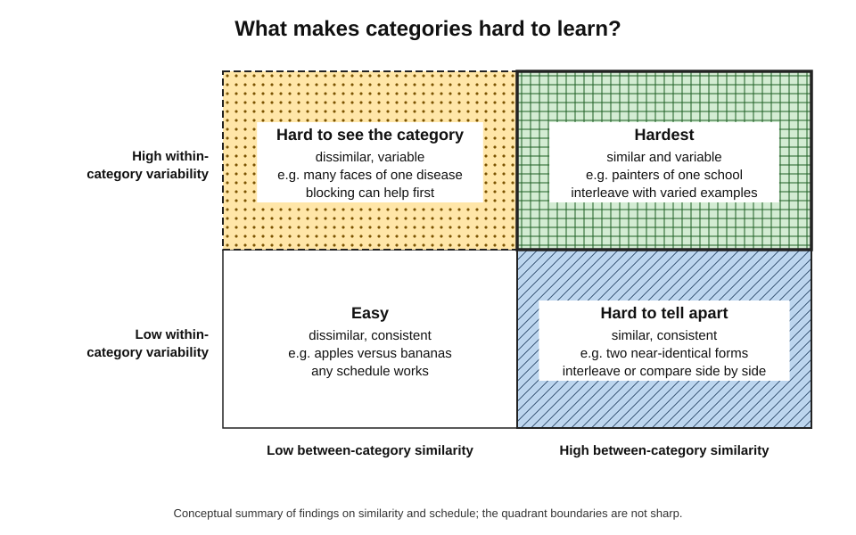
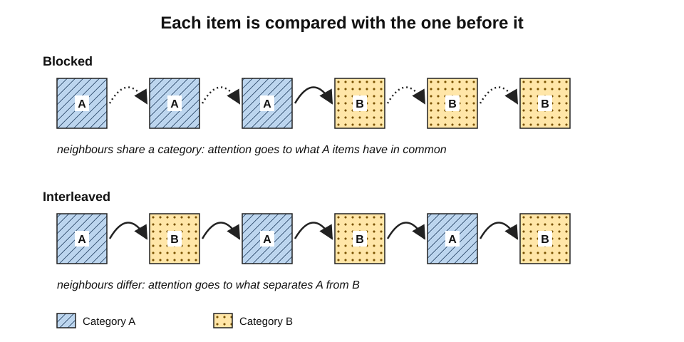
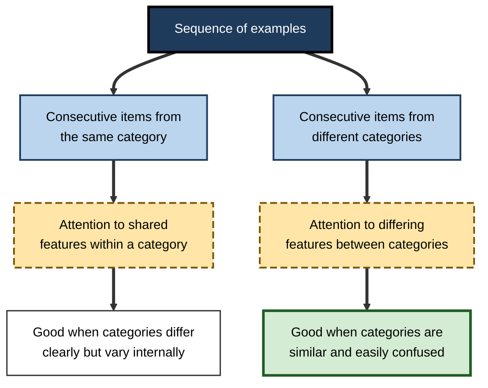
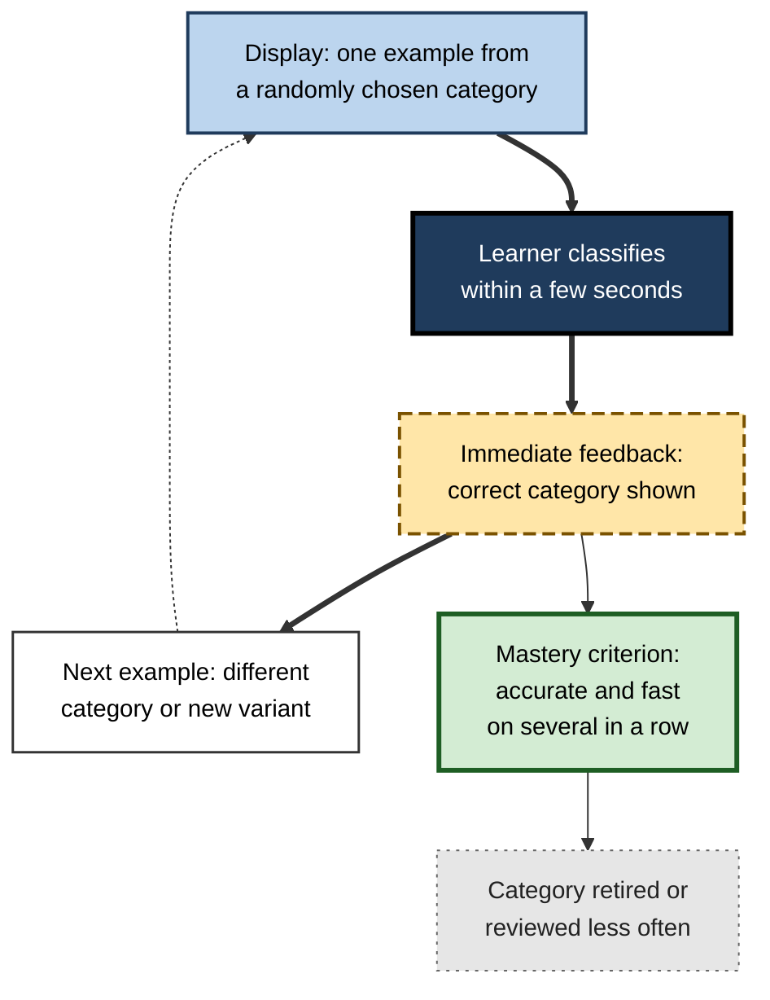
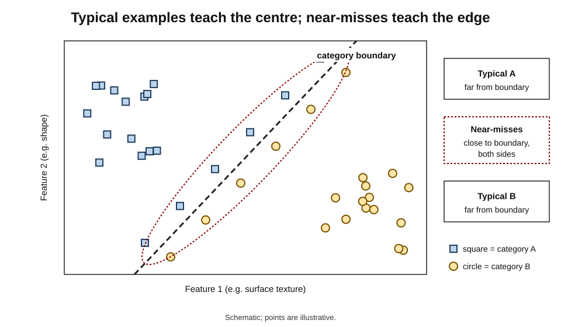
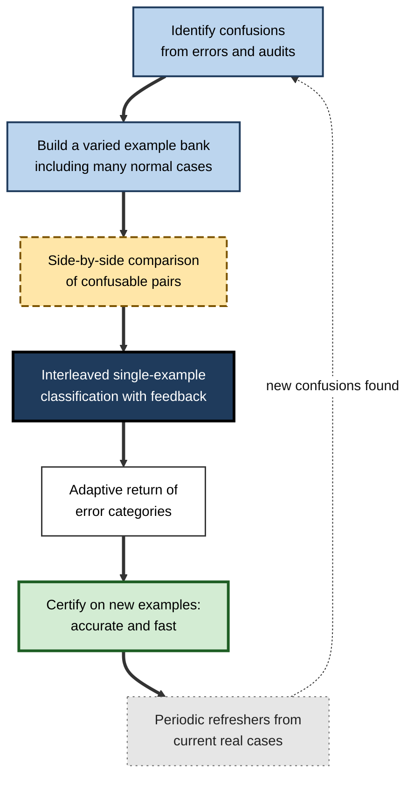

# E.8. Interleaving and Discrimination Learning

An experienced birdwatcher glances at a small brown bird and says "dunnock, not sparrow" before a beginner has found it in the hedge. A dermatologist distinguishes a harmless seborrhoeic keratosis from a melanoma in seconds. A fraud analyst flags one transaction among thousands that look the same to everyone else.

None of them could easily state every rule they use. What they have learned is to **discriminate** — to see the differences that matter between things that look alike — and the way examples were arranged while they learned is one of the strongest influences on how well that skill develops.

> **Definition — Discrimination learning:** learning to respond differently to stimuli or cases that are similar, by becoming sensitive to the features that distinguish them.

> **Definition — Category learning:** learning to assign new examples to the correct category, usually from experience of examples with feedback rather than from explicit rules.

**Why it matters**

- Much professional expertise is **discrimination**: diagnosis, inspection, triage, authentication, classification, risk assessment.
- Discrimination is where interleaving's benefits are **largest and most reliable**.
- Understanding the mechanism — **discriminative contrast** — explains when interleaving will help and when blocking is better.
- It also explains how to build training that **accelerates expert perception**, a goal of medical education, security, manufacturing and many other fields.

---

## Discrimination as a Learning Problem

### Features that matter and features that do not

- **Diagnostic feature** — a feature that differs reliably between categories.
  - *e.g.* the irregular border of a melanoma compared with the "stuck-on" appearance of a keratosis.
- **Characteristic feature** — a feature typical of a category but shared with others.
  - *e.g.* brown colour, common to both lesions.
- **Irrelevant variation** — differences among examples that do not bear on the category.
  - *e.g.* the lighting of a photograph; the patient's skin tone (which must still be accounted for).

> **Definition — Diagnostic feature:** a feature whose value reliably distinguishes members of one category from members of another.

> **Key point:** a learner who attends to **characteristic** features can describe each category well and still be unable to tell them apart. Discrimination requires attention to **diagnostic** features.

### Two dimensions of difficulty

- **Between-category similarity** — how alike members of different categories are.
  - High: two painters of the same school; atrial flutter and atrial fibrillation.
- **Within-category variability** — how different members of the same category are from each other.
  - High: the many appearances of pneumonia on a chest X-ray; the many styles of phishing email.
- Categories that are both **similar to each other** and **variable within** are the hardest — and the ones where training design matters most.

**Figure 1.** Between-category similarity and within-category variability, and the schedule each tends to favour.

### Family resemblance

- **Eleanor Rosch (1970s)** showed that most natural categories are not defined by a single necessary feature but by **family resemblance** — overlapping sets of features, none shared by all members.
- Such categories are learned mainly through **examples**, not definitions.
- Their boundaries are learned by **seeing examples close to the boundary**, from both sides.

> **Definition — Family resemblance:** a structure in which members of a category share overlapping features without any single feature being common to all.

| | Characteristic feature | Diagnostic feature |
|---|---|---|
| Definition | Typical of a category | Distinguishes it from neighbours |
| Learned best by | Seeing many members together | Comparing members of different categories |
| Favoured schedule | Blocked | Interleaved or side by side |
| Typical error if unlearned | Cannot describe what a category is like | Confuses similar categories |
| Example (birds) | Small, brown, hops on the ground | Fine pointed bill versus thick seed-eating bill |

---

## The Discriminative-Contrast Hypothesis

### The idea

- When an example of one category is followed by an example of another, the learner naturally **compares** them.
- Comparison draws attention to **what differs** — the diagnostic features.
- Blocked sequences invite comparison only **within** a category, highlighting what members share.

> **Definition — Discriminative-contrast hypothesis:** the proposal that interleaving improves category learning because juxtaposing examples of different categories highlights the features that distinguish them.

**Figure 2.** What a learner compares under blocked and interleaved sequences.

### Testing contrast against spacing

- Because interleaving also **spaces** the examples of each category, its benefit might come from spacing alone.
- Three lines of evidence point to contrast as a main cause in category learning.

**Study card — Kang and Pashler (2012)**

- **Painters' styles** learned under blocked, interleaved, **spaced-but-blocked** (filler between paintings) and **simultaneous** (side-by-side) presentation.
- Spaced-but-blocked did **not** beat blocked; simultaneous matched interleaved.
- **Conclusion:** juxtaposition, not spacing, carried the benefit.

**Study card — Birnbaum, Kornell, Bjork and Bjork (2013)**

- **Material:** photographs of birds from several families.
- **Design:** interleaved and blocked sequences, with variations in which **unrelated trivia questions** were inserted between consecutive birds.
- **Result:** inserting trivia between interleaved birds **reduced** the interleaving benefit.
- **Conclusion:** the benefit depends on **consecutive** examples of different categories — the chance to compare them directly — supporting the discrimination account.

**Study card — Wahlheim, Dunlosky and Jacoby (2011)**

- **Material:** bird families.
- **Results:** interleaving improved classification of new birds; learners' judgements during study did not anticipate the benefit.
- **Contribution:** extended the effect to natural categories and confirmed the metacognitive blind spot.

> **Watch out:** "contrast, not spacing" is a conclusion about **visual category learning**. In mathematics, Foster and colleagues (2019) found **both** contrast and spacing contribute; the balance depends on the task.

---

## Sequential Attention Theory

### Attention follows the sequence

- **Paulo Carvalho and Robert Goldstone** developed **sequential attention theory** to explain when blocking or interleaving wins.
  - When consecutive items belong to the **same** category, attention shifts towards their **shared** features.
  - When consecutive items belong to **different** categories, attention shifts towards their **differing** features.
- Learning follows attention: what is attended is encoded and remembered.
- Their 2017 studies showed directly that the order of study changed **which features** learners attended to and later remembered.

### Similarity decides

- **High between-category similarity:** the diagnostic differences are subtle and hard to find → interleaving, which directs attention to differences, helps more.
- **Low between-category similarity:** differences are obvious, but what unites a variable category may be subtle → blocking, which directs attention to commonalities, can help more.

> **Key point:** neither schedule is "better" in general. Each **highlights a different kind of information**, and the right choice depends on which kind the learner is missing.

**Figure 3.** Sequential attention theory: sequence directs attention, which shapes learning.

---

## Rule-Based and Similarity-Based Categories

### Two kinds of category structure

- **Rule-based categories** — membership can be stated in a simple verbal rule.
  - *e.g.* "Invoices over ₹10 lakh need director approval"; "lines thicker than 3 mm belong to category A".
- **Information-integration categories** — membership depends on combining several features in a way that is hard to put into words.
  - *e.g.* recognising a colleague's handwriting; telling a ripe mango by look and feel; spotting an unhealthy-looking patient.
- **F. Gregory Ashby and W. Todd Maddox** argued that these two kinds of category are learned by partly different systems — an explicit, rule-testing system and an implicit, procedural system.

> **Definition — Information-integration category:** a category whose membership depends on integrating information from several dimensions in a way that is difficult to describe verbally.

**Study card — Noh, Yan, Bjork and Maddox (2016)**

- **Design:** participants learned either **rule-based** or **information-integration** categories under blocked or interleaved schedules.
- **Results:**
  - **rule-based** categories were learned better with **blocking**;
  - **information-integration** categories were learned better with **interleaving**.
- **Interpretation:** blocking helps the explicit system test and confirm a rule by holding one category in view; interleaving helps the implicit system integrate features across contrasting examples.

| | Rule-based category | Explanatory feedback | Feedback giving the reason, such as the diagnostic feature. |
| Information-integration category |
|---|---|---|
| Can the rule be stated? | Yes, simply | Not easily |
| Main learning system | Explicit hypothesis testing | Implicit, procedural integration |
| Schedule favoured (Noh and colleagues) | Blocked | Interleaved |
| Professional example | Expense-policy categories | Clinical "gestalt"; visual inspection |
| Training tip | State the rule, then practise | Many varied examples with feedback |

> **Watch out:** this finding comes from a small number of laboratory studies with artificial stimuli. It is a useful heuristic, not a law: real professional categories often mix statable rules and unstatable patterns.

---

## Perceptual Learning

### Learning to see

- **Eleanor Gibson (1969)** described perceptual learning as **differentiation**: with experience, people come to pick up **distinctive features** that were always present but went unnoticed.
  - The expert does not see more; the expert sees **what matters**.
- Perceptual learning is largely **implicit** and is driven by **classification with feedback** across many varied examples.

> **Definition — Perceptual learning:** experience-driven improvement in the ability to extract information from the senses, especially to detect the features that distinguish categories.

### Perceptual learning modules

- **Philip Kellman and colleagues** developed **perceptual learning modules (PLMs)** — computer-based training consisting of many short classification trials, each with immediate feedback, drawn from **mixed** categories and **highly varied** examples.
- They have been applied to:
  - **mathematics** — recognising the structure of equations, graphs and fraction representations;
  - **medicine** — skin-lesion morphology in dermatology, histopathology slides, ECGs, echocardiograms;
  - **aviation** — reading flight instruments.
- Reported results include large gains in classification **accuracy and speed** after short training, with transfer to new examples.

**Figure 4.** The trial cycle of a perceptual learning module.

- **Key design features of such training:**
  - **interleaved** categories on almost every trial;
  - **high variability** of examples within each category;
  - **brief exposure** to encourage pattern pick-up rather than slow analysis;
  - **immediate feedback**;
  - **adaptive sequencing** — categories the learner gets wrong return sooner.

> **In practice:** much of what experts call "clinical eye" or "an instinct for it" is perceptual learning. Training that compresses years of incidental exposure into hours of interleaved, feedback-rich classification can accelerate it.

---

## Boundaries, Near-Misses and Feedback

### Where categories meet

- Most examples of a category are **typical** and easy; errors cluster at the **boundary**, where examples of neighbouring categories resemble each other.
- Training dominated by typical examples teaches the **centre** of each category but leaves the **boundary** vague.
- **Near-misses** — examples just on either side of the boundary — carry the most information about where it lies.

**Figure 5.** Typical examples and near-misses in a space of two features.

> **Key point:** a training set should be **rich in near-misses**. Typical examples teach what a category is; near-misses teach where it ends.

### Feedback that teaches the boundary

- **Outcome feedback** — "correct" or "incorrect" — tells the learner that a boundary was crossed.
- **Explanatory feedback** — "incorrect: this is a cold joint; note the dull, grainy surface" — tells the learner **which feature** places the example across the boundary.
- In category learning, classification **with** feedback generally outperforms passive viewing of labelled examples, because each decision is a test of the learner's current boundary.
- **Confident errors** deserve the most attention: they show a boundary the learner believes in but which is wrong.

> **Definition — Explanatory feedback:** feedback that gives not only the correct answer but the reason, such as the diagnostic feature that should have been noticed.

### Contrasting cases before explanation

**Study card — Schwartz and Bransford (1998)**

- **Participants:** university students learning concepts in cognitive psychology.
- **Design:** some students analysed **contrasting cases** — sets of simplified experimental data that differed in systematic ways — before hearing a lecture; others summarised a text or simply attended the lecture.
- **Result:** students who first analysed the contrasting cases learned **more from the later lecture** and made better predictions about new experiments.
- **Conclusion:** comparing contrasting cases prepares learners to notice features that an explanation then makes sense of — a "time for telling" comes after differentiation.

> **Definition — Contrasting cases:** carefully chosen examples that differ in a few key respects, presented together so that learners notice the features that matter.

| Training element | What it teaches | Common failure |
|---|---|---|
| Typical examples | The centre of each category | Overused; boundary left vague |
| Near-misses | Where the boundary lies | Missing from most training sets |
| Varied examples | Which variation is irrelevant | Examples too uniform, so false cues are learned |
| Contrasting cases | Which features matter, before explanation | Replaced by a lecture alone |
| Explanatory feedback | Why an example belongs where it does | Only "right" or "wrong" given |

---

## Discrimination Without a Teacher

Many professionals learn categories on the job with little structured training. Interleaving can still be built into self-directed learning.

### Self-directed discrimination practice

- **Collect a personal case library** — examples of each category met at work, labelled once the outcome is known.
  - *e.g.* a junior auditor keeps anonymised examples of revenue-recognition issues and of acceptable but unusual transactions.
- **Review it mixed** — shuffle the library and classify each case before checking the label.
- **Ask for the near-misses** — when a senior colleague says "this looks like X but isn't", record the case and the reason.
- **Seek outcome information** — discrimination improves only if the learner eventually learns which call was right.
  - Without outcome feedback, confidence can grow while accuracy does not.

> **Watch out:** experience without feedback does not reliably build discrimination. Robin Hogarth's distinction between **kind** learning environments (rapid, accurate feedback) and **wicked** ones (delayed, misleading or absent feedback) explains why some experienced professionals remain poor at telling categories apart: their environment never told them when they were wrong.

> **Definition — Wicked learning environment:** a setting in which feedback is delayed, missing or misleading, so that experience can produce confident but inaccurate judgement.

> **In practice:** a simple test of any discrimination training set is to ask an expert to sort it. If the expert finds most items trivially easy, the set lacks near-misses; if experts disagree on many items, the categories or the labels need clarifying before novices are trained on them.

---

## Discrimination Training in Medicine

**Study card — Hatala, Brooks and Norman (2003)**

- **Participants:** medical students learning to interpret electrocardiograms (ECGs).
- **Design:** after instruction, students practised either with examples of each diagnosis grouped separately or with **mixed** examples that placed **contrasting** diagnoses together.
- **Result:** the mixed, contrastive practice produced **better diagnostic accuracy** on **new** ECGs.
- **Conclusion:** clinical discrimination improves when practice requires distinguishing between diagnoses, not only recognising each one.

- **Dermatology and histopathology** — interleaved image training is widely studied, with generally positive results for classifying new images.
- **The pattern across studies:** benefits are largest for diagnoses that are **commonly confused** with each other.

> **Remember:** in diagnostic training, the unit of practice is not "a disease" but "a **differential**" — the set of conditions that must be told apart.

---

## Designing Training for Discrimination

### Principles

1. **Define the contrast sets** — the groups of categories that are confused in practice.
2. **Vary the examples widely within each category** — different patients, devices, lighting, writers, contexts — so that irrelevant variation is not mistaken for a diagnostic feature.
3. **Include near-misses from both sides of each boundary.**
4. **Start with side-by-side comparison** for the most confusable pairs, naming the diagnostic features.
5. **Move to sequential interleaving** — single, unlabelled examples from mixed categories.
6. **Give immediate feedback** that points to the diagnostic feature.
7. **Retire mastered categories slowly** and bring confused ones back sooner.
8. **Test on new examples**, never the training ones.

> **Mnemonic — "CVN-SSF-RT":** Contrast sets, Variety, Near-misses — Side-by-side, Sequential, Feedback — Retire slowly, Test on new.

### Worked example (illustrative): training analysts to classify suspicious emails

- **Situation:** a security operations team receives reports of suspicious emails. New analysts must classify each as **credential phishing**, **invoice (payment) fraud**, **malware delivery**, **marketing spam** or **legitimate**. They confuse invoice fraud with legitimate supplier emails, and spam with phishing.

1. **Contrast sets:** (invoice fraud, legitimate supplier email); (credential phishing, marketing spam); (malware delivery, legitimate attachment).
2. **Example bank:** 300 anonymised real emails, at least 40 per category, varied in sender, language, layout and lure.
3. **Side-by-side session (30 minutes):** pairs from each contrast set displayed together; analysts list the diagnostic features.
4. **Interleaved classification (two 30-minute sessions):** single emails in random order, unlabelled; analysts classify within a minute and name the decisive feature.
5. **Feedback:** the correct category and the diagnostic feature highlighted.
6. **Adaptive return:** emails from categories with errors return sooner.
7. **Test:** 50 **new** emails a fortnight later.

| Category pair | Characteristic features (shared) | Diagnostic features |
|---|---|---|
| Invoice fraud vs legitimate supplier email | Supplier name, invoice attached, payment request | Change of bank details; urgency; reply-to address differs from sender |
| Credential phishing vs marketing spam | Brand logos, links, promotional tone | Link to a login page on a look-alike domain; request to "verify account" |
| Malware delivery vs legitimate attachment | Attached document, business context | Macro-enabled or archive file; unexpected sender; mismatch between text and attachment |

> **Watch out:** if every training example of invoice fraud contains a spelling mistake, analysts will learn "spelling mistake = fraud" — an irrelevant feature. **Variety within each category** prevents such false cues.

---

## Discrimination in Professional Expertise

### Where it appears

- **Clinical diagnosis** — differentials in imaging, ECGs, skin lesions, pathology slides.
- **Manufacturing quality** — distinguishing harmless cosmetic variation from functional defects.
- **Finance and fraud** — distinguishing unusual but legitimate transactions from fraudulent ones.
- **Cybersecurity** — triaging alerts: true attacks, misconfigurations and benign anomalies.
- **Law** — distinguishing cases on their facts from precedents that look similar.
- **Data labelling** — human annotators training and evaluating AI systems must apply category boundaries consistently.

> **In practice:** when AI tools pre-classify cases, human experts increasingly review the **borderline** ones. Training for that role should be built almost entirely from **near-misses** — the cases the AI finds hardest.

> **Example:** wine tasters, coffee graders and tea blenders train by **triangle tests** and mixed flights — three or more samples tasted together, one of which differs — rather than by tasting many samples of one variety in a row. The format forces comparison, and each judgement is checked against the known answer, so the taster learns which sensory differences are reliable and which are noise.

> **Remember:** in every field the same three ingredients recur — **mixed** examples, **varied** examples and **feedback that names the diagnostic feature**.

### Case study (illustrative): solder-joint inspection on an electronics line

- **Situation:** an electronics manufacturer trained new inspectors to classify solder joints on circuit boards as acceptable or as one of several defects — insufficient solder, bridging, cold joint, voiding — using a reference manual organised **one defect per chapter**, each with a page of images.
- **Problem:** new inspectors had high **false-reject** rates on harmless cosmetic variation and missed cold joints, which resemble acceptable joints. Experienced inspectors disagreed with their calls frequently.
- **Diagnosis:**
  - training images were grouped by defect, so trainees learned what each defect **looked like** but not how it **differed** from acceptable joints and from other defects;
  - acceptable joints were barely represented in training, so harmless variation looked suspicious;
  - feedback came only from occasional audits weeks later.
- **Actions:**
  1. A bank of 600 labelled images, with **acceptable joints making up a large share** and wide variation in board type, lighting and angle.
  2. **Side-by-side comparison cards** for the main confusions: cold joint versus acceptable; minor voiding versus acceptable.
  3. A **perceptual-learning-style drill**: images shown singly, in random order across all categories, for a few seconds each, with immediate feedback naming the diagnostic feature.
  4. Categories with errors **returned sooner**; inspectors certified only after accurate, fast classification of new images.
  5. **Monthly refresher drills** using images from recent production.
- **Result:**
  - agreement between new and experienced inspectors rose substantially;
  - false rejects fell, and audit-detected misses of cold joints declined;
  - new inspectors reached independent working sooner.
- **Side effects:** building and labelling the image bank required senior inspectors' time; some disagreements among seniors were exposed and had to be resolved, improving the standard itself.
- **Lesson:** inspection skill is discrimination skill; it is trained by **mixed, varied, feedback-rich classification**, not by studying one defect at a time.

**Figure 6.** Building a discrimination training programme.

---

## Open Questions

- **How much of the interleaving benefit is contrast, and how much spacing or retrieval?**
  - The balance appears to differ between visual categories, mathematics and motor skills.
- **How can between-category similarity be measured before training?**
  - Similarity predicts the best schedule, but practical, reliable measures are lacking.
- **Do rule-based and information-integration distinctions hold for professional categories?**
  - Evidence comes from artificial stimuli; real categories mix both.
- **How large and durable are perceptual-learning gains in real practice?**
  - Short-term gains are well documented; long-term effects on diagnostic accuracy in practice are less well studied.
- **Can expert intuition be fully captured in training sets?**
  - Experts often cannot articulate their diagnostic features, so the examples and near-misses they choose for trainees may miss what they actually use; methods for eliciting and checking such features are still developing.
- **How should humans be trained to work alongside AI classifiers?**
  - Training on near-misses is plausible; evidence on the best design is only beginning.

---

## Summary

- **Discrimination learning** is learning to tell similar things apart; **category learning** is assigning new examples to categories from experience.
- **Diagnostic** features distinguish categories; **characteristic** features are typical but shared. Discrimination requires attention to diagnostic features.
- Difficulty depends on **between-category similarity** and **within-category variability**; natural categories have **family resemblance** structure (Rosch).
- **Discriminative-contrast hypothesis:** juxtaposing different categories highlights differences. Evidence: Kang and Pashler (2012); Birnbaum and colleagues (2013); Wahlheim and colleagues (2011). In maths, spacing also contributes.
- **Sequential attention theory** (Carvalho and Goldstone): same-category sequences draw attention to similarities, different-category sequences to differences; **similarity decides** which schedule helps.
- **Rule-based** categories may favour blocking; **information-integration** categories favour interleaving (Noh and colleagues, 2016) — a laboratory heuristic.
- **Perceptual learning** (Gibson: differentiation) is accelerated by **perceptual learning modules**: mixed categories, high variability, brief exposure, immediate feedback, adaptive sequencing (Kellman).
- In medicine, **contrastive mixed practice** improves diagnostic accuracy (Hatala, Brooks and Norman, 2003); the unit of practice is the **differential**.
- Errors cluster at **boundaries**: training needs **near-misses**, **explanatory feedback** and **contrasting cases** before explanation (Schwartz and Bransford, 1998); experience in **wicked** environments without feedback does not build discrimination.
- Design: contrast sets, variety, near-misses, side-by-side then sequential, feedback, slow retirement, testing on new examples.

---

## Self-Check

1. Define discrimination learning and category learning.
2. Distinguish diagnostic from characteristic features, with an example from your own field.
3. Explain between-category similarity and within-category variability, and identify the hardest combination.
4. What is family resemblance, and what does it imply for how categories are learned?
5. State the discriminative-contrast hypothesis and describe two studies supporting it.
6. Explain sequential attention theory and why it predicts that blocking sometimes wins.
7. What did Noh and colleagues (2016) find about rule-based and information-integration categories?
8. What is perceptual learning, according to Eleanor Gibson?
9. List five design features of perceptual learning modules.
10. Describe Hatala, Brooks and Norman's (2003) study and its implication for clinical teaching.
11. Why must examples vary widely within each category during discrimination training?
12. A hospital trains nurses to recognise pressure ulcer stages using a booklet with one stage per page. Propose a better training design.
13. An AI tool flags suspicious transactions; human reviewers check its flags. How would you design the reviewers' training?
14. Why are near-misses more informative than typical examples, and what kind of feedback should accompany them?
15. A senior claims assessor with twenty years of experience is confident but often wrong on borderline fraud cases. Using the idea of wicked learning environments, explain how this can happen and what would help.

### Answer Key

1. Discrimination learning: learning to respond differently to similar stimuli by becoming sensitive to distinguishing features. Category learning: learning to assign new examples to the right category, usually from examples with feedback.
2. Diagnostic features reliably differ between categories; characteristic features are typical but shared. E.g. in invoice fraud, a changed bank account is diagnostic; the supplier's logo is characteristic.
3. Between-category similarity is how alike different categories are; within-category variability is how different members of one category are. Categories that are similar to each other and highly variable within are hardest.
4. Members share overlapping features with no single defining one. Such categories are learned from many examples, and their boundaries from examples near the boundary on both sides.
5. Juxtaposing examples of different categories highlights their differences. Kang and Pashler (2012): spacing alone did not help but simultaneous presentation matched interleaving. Birnbaum and colleagues (2013): inserting trivia between interleaved birds reduced the benefit.
6. Same-category sequences direct attention to shared features; different-category sequences to differing features. When categories are dissimilar but internally variable, the shared features are what is hard to learn, so blocking helps.
7. Rule-based categories were learned better with blocking, information-integration categories with interleaving.
8. Differentiation: with experience people pick up distinctive features that were always present but unnoticed — learning to see what matters.
9. Interleaved categories, high variability within categories, brief exposure, immediate feedback, adaptive sequencing (and mastery criteria based on accuracy and speed).
10. Medical students practised ECG interpretation with contrasting diagnoses mixed together or with diagnoses grouped separately; mixed contrastive practice gave better accuracy on new ECGs. Clinical teaching should practise differentials, not single diagnoses.
11. Otherwise learners may treat irrelevant features shared by the training examples (lighting, layout, a spelling error) as diagnostic, and fail on new examples.
12. Build a varied image bank of each stage and of healthy skin; start with side-by-side comparisons of adjacent stages naming the diagnostic features; then practise single images in random order with immediate feedback; return confused stages sooner; certify on new images; run periodic refreshers.
13. Train on near-miss cases the AI finds hardest — legitimate unusual transactions and subtle fraud — interleaved and unlabelled, with feedback naming the diagnostic features; include cases where the AI was wrong in both directions; test on new cases; refresh with recent real flags.
14. Near-misses lie close to the boundary between categories, so they show precisely where it is; typical examples only show the centre. They should come with explanatory feedback naming the feature that places each case on its side of the boundary.
15. If the assessor rarely learns the true outcome of borderline cases, or learns it late, experience builds confidence without correcting errors. Systematic outcome feedback, review of a mixed library of resolved borderline cases, and calibration exercises with explanatory feedback would help.

---

## Glossary

| Term | Meaning |
|---|---|
| Category learning | Learning to assign new examples to categories. |
| Characteristic feature | Feature typical of a category but shared with others. |
| Diagnostic feature | Feature that reliably distinguishes categories. |
| Contrasting cases | Examples differing in a few key respects, studied together. |
| Differential | The set of conditions or categories that must be told apart in a case. |
| Differentiation | Gibson's account of perceptual learning as picking up distinctive features. |
| Discrimination learning | Learning to respond differently to similar stimuli. |
| Discriminative-contrast hypothesis | Proposal that juxtaposing categories highlights their differences. |
| Family resemblance | Overlapping features without a single defining one. |
| Explanatory feedback | Feedback giving the reason, such as the diagnostic feature. |
| Information-integration category | Category requiring integration of several dimensions, hard to verbalise. |
| Perceptual learning | Improvement in extracting distinguishing information from the senses. |
| Perceptual learning module | Training of many brief, mixed classification trials with feedback. |
| Rule-based category | Category definable by a simple verbal rule. |
| Sequential attention theory | Account that sequence directs attention to similarities or differences. |
| Wicked learning environment | Setting with delayed, missing or misleading feedback. |
| Within-category variability | How much members of one category differ from each other. |
