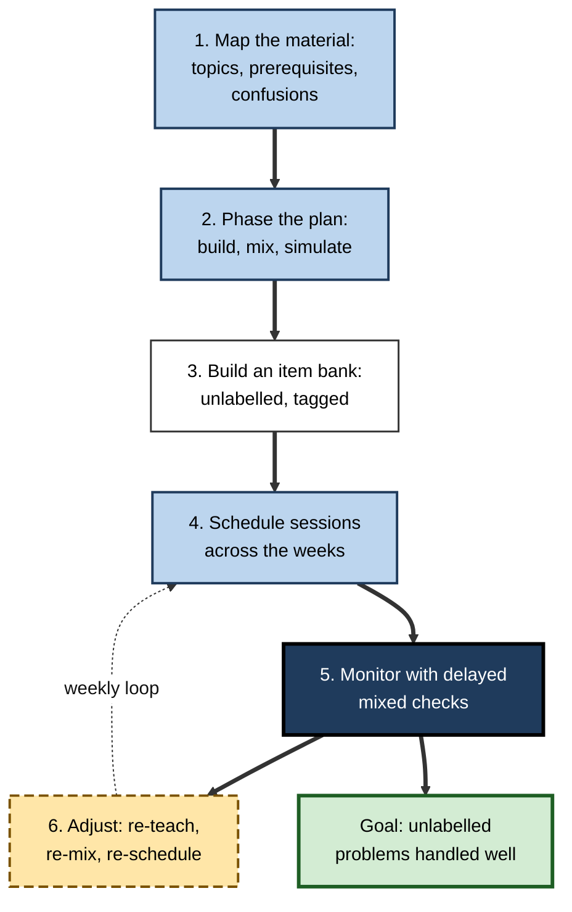
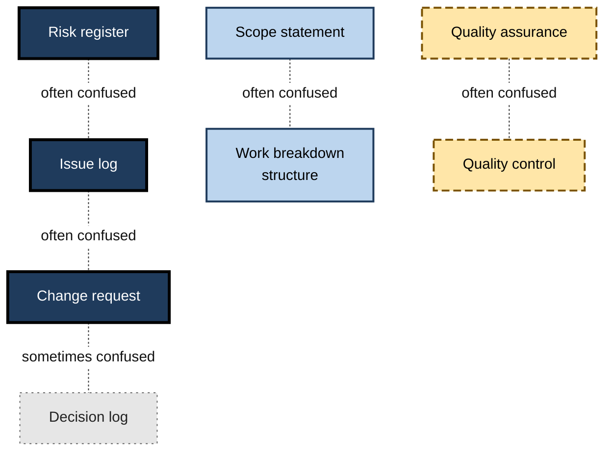
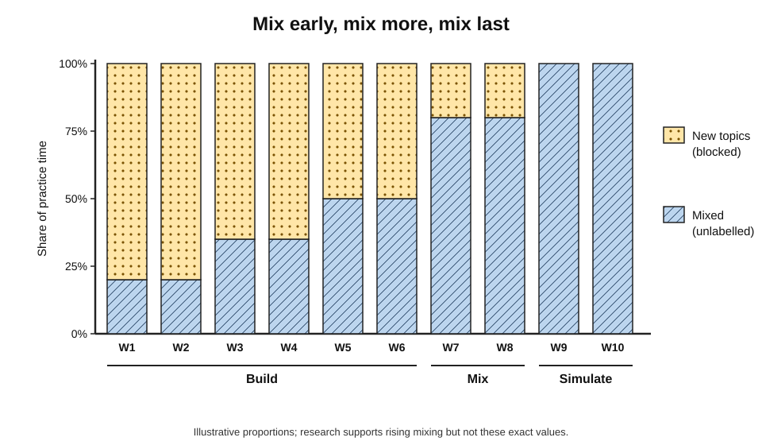
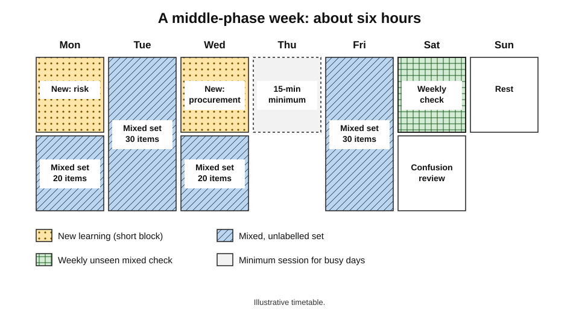
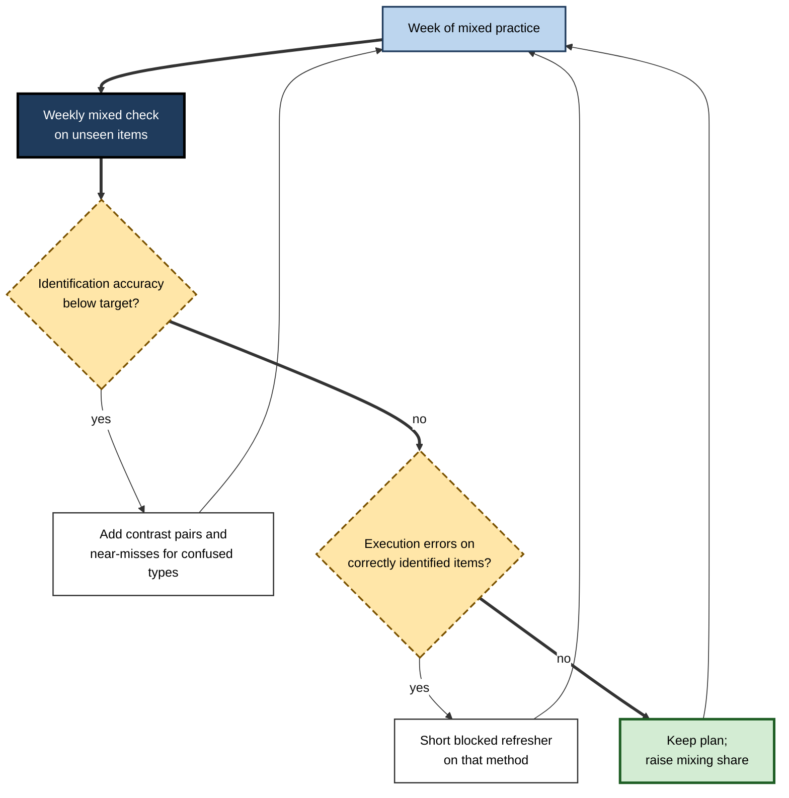
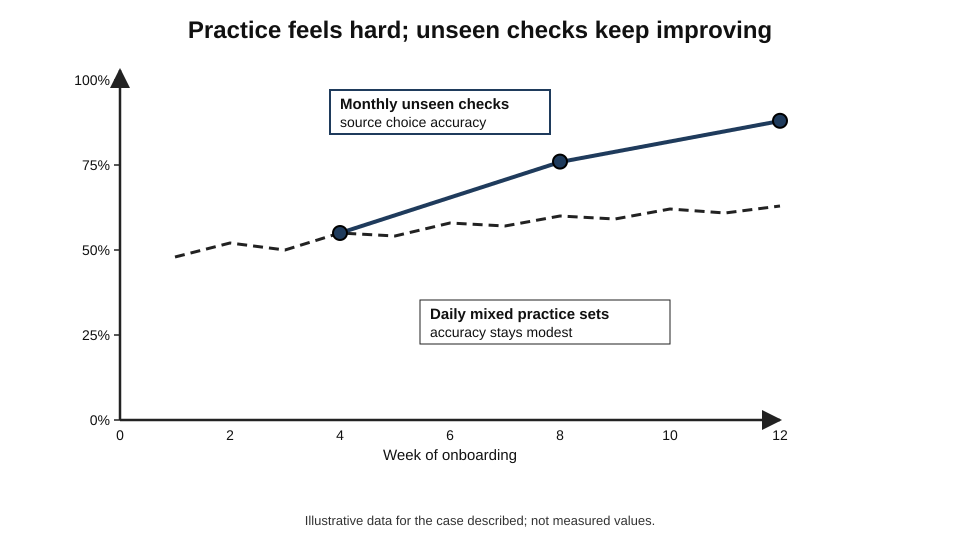

# E.9. Building Interleaving Into Study Plans

A project manager has ten weeks to prepare for a certification exam. She buys a study guide with twelve chapters and plans to read one a week, answering each chapter's questions as she goes, then to "do some practice exams" in the last fortnight. The plan is tidy, easy to follow and almost entirely **blocked**: for ten weeks every question she answers will announce its own topic.

Turning such a plan into one that builds the skill the exam actually tests is not a matter of good intentions but of **plan design**.

> **Definition — Study plan:** a deliberate arrangement of what will be studied, when, how and in what order, over the period available before a goal such as an examination, a certification or a new role.

> **Definition — Interleaved study plan:** a study plan in which related types of material are deliberately mixed in practice, with the proportion of mixing rising as competence grows, and with progress judged by delayed, mixed checks.

**Why it matters**

- Most learners accept interleaving in principle but fail to apply it, because their plans are built around **chapters, modules and weeks** — natural blocks.
- A plan must decide **what** to mix, **when** to begin, **how much**, and **how** to tell whether it is working; leaving any of these to improvisation usually means reverting to blocks.
- A sound plan protects the learner from the feeling that interleaving is not working, by **measuring** the right things.
- The same planning method serves an individual preparing for an exam, a manager onboarding a team and a teacher designing a course.

---

## From Principle to Plan

### The decisions a plan must make

- **What to mix** — which types or topics form contrast sets.
- **When to start mixing** — after what amount of first learning.
- **How much to mix** — the share of practice that is interleaved, and how it changes over time.
- **Where the items come from** — a bank of unlabelled practice material.
- **When each session happens** — the weekly schedule.
- **How progress is judged** — the checks that show whether learning is happening.
- **How the plan adapts** — rules for changing it in response to the checks.

**Figure 1.** The planning sequence for an interleaved study plan.

> **Mnemonic — "MAP-BANK-CHECK":** **map** and phase the material, build the **bank** and schedule, **check** and adjust.

---

## Step 1: Map the Material

### Topic inventory

- List every topic, problem type or skill the goal requires, at the level of **distinct methods or categories**.
  - Too coarse: "Statistics".
  - Useful: "independent t-test", "paired t-test", "chi-square test of independence", "one-way ANOVA".
- Note for each topic its **weight** in the goal (exam marks, frequency in the job).

### Prerequisite map

- Some topics depend on others; these must be learned in order.
  - *e.g.* hypothesis testing before choosing among particular tests.
- The prerequisite order fixes the **sequence of first learning**; interleaving operates on top of it.

### Confusability map

- For each topic, ask: **with what is it most likely to be confused?**
- Evidence comes from:
  - practice-question errors and their explanations;
  - the examiner's reports or common-mistakes sections of study guides;
  - experienced colleagues ("everyone mixes up X and Y");
  - topics with similar names, formulas or surface features.
- Pairs and groups of confusable topics become the plan's **contrast sets**.

**Figure 2.** A confusability map for project-management exam topics.

| Topic | Prerequisites | Confused with | Weight |
|---|---|---|---|
| Risk register | Risk concepts | Issue log | High |
| Issue log | Risk concepts | Risk register; change request | Medium |
| Change request | Scope baseline | Issue log; decision log | High |
| Scope statement | Requirements | Work breakdown structure | High |
| Quality assurance | Quality concepts | Quality control | Medium |

> **Key point:** the confusability map is the **heart of an interleaved plan**. Without it, mixing is random; with it, mixing targets exactly the distinctions the learner will be tested on.

---

## Step 2: Phase the Plan

### Three phases

- **Build** — first learning of each topic in prerequisite order, with explanation, worked examples and short blocked practice.
  - Interleaving begins early but modestly: a few mixed items of earlier topics in each session.
- **Mix** — the main body of practice is interleaved within contrast sets and across topics, unlabelled, with feedback.
- **Simulate** — practice in the exact form of the goal: full mixed exams, realistic work tasks, timed.

### The rising share of mixed practice

- Early weeks — mostly new learning with a **small** mixed component (perhaps a fifth of practice time).
- Middle weeks — **most** practice mixed.
- Final weeks — almost **all** practice mixed and exam-like.

**Figure 3.** The share of blocked and mixed practice across a ten-week plan.

> **Remember:** **mix early, mix more, mix last.** Mixing should never wait for the final fortnight; it should start in week one at a small dose and grow.

> **Watch out:** "I'll cover everything first, then do mixed practice" is the most common planning error. By the time mixing begins, early topics have faded and there is too little time to practise identification.

---

## Step 3: Build the Item Bank

### What the bank needs

- **Enough items per type** — at least ten to fifteen per type for practice, more for heavily weighted topics.
- **Unlabelled presentation** — items stored with tags (topic, difficulty, source) but presented without them.
- **Near-miss items** for each contrast set.
- **A reserve of unseen items** for checks, never used in practice.
- **Answers with reasons**, including which feature identifies the type.

### Where items come from

- End-of-chapter questions from several chapters, pooled.
- Question banks with a mixed or custom mode.
- Past papers and sample exams.
- Real work examples, anonymised — tickets, cases, documents.
- Items written by the learner or by colleagues (writing near-misses is itself excellent practice).
- AI-generated items — useful for volume, but they must be **checked**, because generated questions may contain errors or reveal the topic in their wording.

> **In practice:** a simple spreadsheet with one row per item — question reference, topic tag, contrast set, difficulty, last attempted, result — is enough to draw mixed sets and to see which types are weak.

| Bank feature | Why it matters | Common shortcut that fails |
|---|---|---|
| Many items per type | Each type must recur often | Relying on one chapter's five questions |
| Unlabelled presentation | Identification must be practised | Working straight from chapter headings |
| Near-misses | Boundaries must be learned | Only typical, easy items |
| Reserve of unseen items | Checks must measure learning, not memory of items | Reusing practice items for checks |
| Answers with reasons | Feedback must teach the distinguishing feature | Answer letters only |

---

## Step 4: Schedule the Sessions

### Weekly structure

- **Several short sessions** rather than one long one — four 45-minute sessions usually beat one three-hour session.
- **Each session** combines new learning (in the build phase), a mixed set and a brief review of confusions.
- **Earlier topics return** across the week, so that each recurs every few days.
- **A weekly mixed check** — a short set of unseen, mixed items at the end of the week.

**Figure 4.** A sample week in the middle phase of a ten-week plan.

### Fitting the plan into a working life

- **Anchor sessions to existing routines** — the commute, the first half-hour after work, a fixed weekend slot.
- **Plan short "minimum" sessions** — fifteen minutes of mixed items — for busy days, so that the rotation is not broken.
- **Use if–then plans** for obstacles.
  - *e.g.* "If a meeting runs late on Tuesday, I will do a 15-minute mixed set on the train."

> **Definition — Implementation intention (Peter Gollwitzer):** an if–then plan linking a specific situation to a specific action ("If X happens, I will do Y"), which reliably increases the chance that intended actions are carried out.

> **Key point:** a plan that depends on long, uninterrupted evenings will fail in a busy week. Short mixed sets are ideal for interleaving precisely because they are **portable**.

---

## Step 5: Monitor With the Right Measures

### What to measure

- **Mixed-check accuracy** — the score on the weekly set of **unseen, mixed** items. The main measure of learning.
- **Identification accuracy** — the proportion of items where the **type** was identified correctly, even if the solution failed.
- **Confusion pairs** — which types are mistaken for which, from a confusion log.
- **Time per item** — falling time with stable accuracy indicates growing fluency.
- **Practice accuracy** — recorded, but **not** used to judge progress.

> **Watch out:** practice accuracy on mixed sets will usually be **lower** than on blocked chapter questions. A learner who tracks only practice accuracy will conclude that the plan is failing at exactly the moment it is working.

**Figure 5.** The weekly monitoring and adjustment loop.

### Adjustment rules

| Signal from the weekly check | Likely cause | Adjustment |
|---|---|---|
| Wrong type chosen, specific pairs | Boundary not learned | Side-by-side comparison of the pair; more near-misses; place the pair adjacently |
| Right type, wrong execution | Method not yet secure | Short blocked refresher, then back to mixing |
| Many items left blank | Overload or anxiety | Smaller mixed sets; include confident anchors; check prerequisites |
| Early topics declining | Too long between returns | Shorten their cycle in the schedule |
| Steady improvement, low errors | Plan working | Increase mixing share, add timing |

> **Remember:** **wrong type → contrast; wrong method → refresher; blanks → shrink; fading → return sooner; success → harder.**

---

## Step 6: Maintain and Extend

- **After the goal** — an exam passed, an onboarding completed — knowledge fades unless it is used.
- **A maintenance plan** keeps a small mixed set in the routine — perhaps one short set a week — drawing on everything learned.
- **For ongoing professional development**, a running bank of real cases from work provides an endless source of unlabelled items.

> **In practice:** many professionals who pass a demanding exam keep a "monthly mixed dozen" — twelve mixed questions or cases each month — to stop the knowledge decaying before it is needed in practice.

---

## A One-Page Plan

Long plans are rarely followed. The essentials of an interleaved plan fit on one page.

### The template

- **Goal and date** — what must be achieved, by when, in what form.
  - *e.g.* "Pass the certification exam on 15 March: 180 mixed multiple-choice questions, four hours."
- **Topic list** — distinct methods or categories, with weights.
- **Contrast sets** — three to six groups of confusable topics.
- **Phase dates** — when build, mix and simulate begin.
- **Weekly pattern** — number and length of sessions; the minimum session for busy days.
- **Item sources** — where practice and check items come from.
- **Weekly check** — day, size, and where unseen items are kept.
- **Adjustment rules** — the five rules for responding to the check.
- **If–then plans** — two or three for predictable obstacles.

> **In practice:** pinning the one-page plan next to the desk, or keeping it as the first tab of the tracking spreadsheet, makes it easy to see at a glance whether the week's sessions, checks and adjustments are happening.

### Worked example (illustrative): a one-page plan for a semester of statistics

| Element | Content |
|---|---|
| Goal | End-of-semester exam, mixed problems; target 70% |
| Topics | Descriptives; probability rules; binomial; normal; sampling distributions; confidence intervals; t-tests (one-sample, independent, paired); chi-square; correlation; regression |
| Contrast sets | Independent vs paired t-test; binomial vs normal approximation; confidence interval vs hypothesis test; correlation vs regression |
| Phases | Build weeks 1–9 with mixed sections in every problem sheet; mix weeks 10–12; simulate weeks 13–14 |
| Weekly pattern | Three 50-minute sessions plus one 15-minute "which test?" card drill |
| Items | Course problem sheets pooled; textbook exercises; past papers; self-written near-misses |
| Weekly check | Friday: 10 unseen mixed items from a reserve set |
| Adjustment rules | Wrong test → contrast pair; wrong calculation → refresher; fading → shorter cycle |
| If–then | "If a lab report is due, I do the card drill only"; "If I miss Friday, the check moves to Sunday morning" |

---

## Interleaving Among the Other Planned Techniques

A complete plan usually contains more than interleaving. The parts fit together rather than compete.

- **Retrieval** — practising by answering questions rather than re-reading; interleaved sets are already retrieval practice, so the two combine naturally.
- **Spacing** — returning to each topic across days and weeks; the rotation built into the schedule supplies it.
- **Explanation and worked examples** — needed in the build phase before mixing can work.
- **Elaboration and self-explanation** — asking "why does this method fit this problem?" deepens the feature-to-method link that interleaving trains.

> **Key point:** interleaving is the part of the plan that decides **order**. It works best inside a plan that also gets **timing**, **retrieval** and **understanding** right.

---

## Plans Made for Others

### Managers and team leads

- **Map confusions from real work** — error logs, rework, escalations and the judgement of senior staff.
- **Turn real cases into the item bank** — anonymised tickets, documents, calls, code reviews.
- **Build short mixed practice into the working week** — ten minutes at a stand-up, a weekly case review.
- **Measure unaided performance on real tasks** — rather than course completion.

### Teachers and course designers

- **Keep lessons by topic, make practice mixed** — homework and problem sheets with mixed sections.
- **Make assessments cumulative and unlabelled.**
- **Publish the plan's logic to students** — why sheets contain old topics and why scores will feel lower.
- **Use class-wide confusion data** — common confusions in marking guide the next week's mixed items.

### Learning platforms and AI tutors

- **Default to mixed review** after the first exposure to each topic.
- **Track identification separately** from answer accuracy.
- **Use confusion data adaptively** — items from confused pairs returned sooner and placed adjacently.
- **Report delayed, mixed performance** to the learner, so that the felt dip is balanced by visible progress.

> **Watch out:** an AI assistant asked "make me a study plan" will often produce a chapter-by-chapter schedule, because that is how most plans look. Asking explicitly for **contrast sets, rising mixing and weekly unseen checks** produces a very different plan.

> **Watch out:** a plan copied from someone else — a colleague's timetable, a template from a course provider — carries their contrast sets, not the learner's own. The confusability map must be rebuilt from the learner's own errors after the first two weekly checks.

---

## Plans for Different Situations

| Situation | Contrast sets | Phasing | Key measure |
|---|---|---|---|
| Professional exam in 3 months | From syllabus and common-mistakes guides | Build weeks 1–6 with growing mixing; mix weeks 7–10; simulate weeks 11–12 | Weekly mixed checks; mock exams |
| University semester course | From lecture topics and past papers | Mixed review in every weekly problem set; cumulative revision from mid-term | Cumulative quizzes |
| Onboarding a new team member | From real error logs and senior colleagues | Short blocked introduction per system; mixed real tasks from week two | Unaided real tasks after a delay |
| Continuing professional development | From recent cases and incidents | Mostly mixed from the start | Quality of real work; periodic case reviews |
| Teacher designing a course | From known student misconceptions | Lessons by topic; homework mixed; tests cumulative | Delayed unannounced tests |

---

## Worked Example (illustrative): A Ten-Week Certification Plan

- **Situation:** a project manager has ten weeks before a project-management certification exam, about six hours a week, a study guide of twelve chapters and access to a question bank with a mixed mode. Her confusability map (Figure 2) identifies four contrast sets.

### The plan

| Weeks | Phase | New learning | Mixed practice | Checks |
|---|---|---|---|---|
| 1–2 | Build | Chapters 1–3 (initiation, scope, schedule) | 20% of time: mixed items from chapters covered so far | Week 2: 20 unseen mixed items |
| 3–4 | Build | Chapters 4–7 (cost, quality, resources, communications) | 35%: mixed, with quality assurance/quality control pair adjacent | Weekly 20-item check |
| 5–6 | Build/mix | Chapters 8–12 (risk, procurement, stakeholders, integration, change) | 50%: risk/issue/change set emphasised | Weekly check; confusion log review |
| 7–8 | Mix | Gaps only | 80%: mixed sets of 30–40 items across all chapters | Weekly 40-item check |
| 9–10 | Simulate | None | Full timed mock exams; review of every error by type | Two full mocks |

### How the plan handles a problem

1. **Week 5 check:** identification accuracy 85%, but the confusion log shows **risk register versus issue log** confused in a third of relevant items.
2. **Adjustment:** two side-by-side comparison exercises — the same project facts described as a risk (uncertain future event) and as an issue (event that has occurred) — and ten near-miss items for the pair.
3. **Week 6 check:** confusion on the pair falls sharply; execution errors on procurement items appear.
4. **Adjustment:** a 30-minute blocked refresher on contract types, then procurement items back into the mix.

> **Formula — Identification accuracy:** items with the type correctly identified ÷ items attempted. Example: 34 ÷ 40 = **85%**. Tracked separately from overall accuracy, it shows whether the plan is building discrimination.

> **Watch out:** the weekly checks must use **unseen** items. Repeating items from practice measures memory of those items, not the ability to handle new questions.

---

## Obstacles and How Plans Survive Them

- **The dip in practice scores** — expected; plan the explanation into week one and track the right measures.
- **Scarce materials** — pool questions from several sources; write near-misses; ask colleagues for real examples.
- **Over-planning** — a plan so detailed that it collapses after one bad week. Keep the core rules simple: mixed sets every session, weekly unseen check, confusion log.
- **Unequal topic difficulty** — give hard topics more slots in the rotation rather than separate blocks.
- **Isolation** — study partners can exchange unlabelled items and check each other's identification.
- **Loss of motivation** — track identification accuracy and weekly check scores; both rise even when practice feels hard.

> **Example (illustrative):** a finance trainee falls ill for a week in the middle of her plan. Instead of restarting the chapter sequence, she keeps the rotation: on her return, the first session is a mixed set across everything studied so far, which shows at once which topics faded during the break. Those topics receive extra slots for a fortnight, and the plan continues without a block of catching up.

> **Key point:** the purpose of the plan is not to predict every session but to ensure that, whatever happens, **mixing, feedback and delayed checks keep happening**.

---

## Case Study (illustrative): An Analytics Team's Onboarding Plan

- **Situation:** an analytics team in a retail bank hired four graduate analysts. The team lead's onboarding consisted of reading internal documentation module by module — data warehouse, customer tables, product tables, regulatory reports — followed by "learning on the job".
- **Problem:** after two months the graduates could answer questions about any single module but routinely chose the **wrong data source** for business questions, used outdated tables and misapplied regulatory definitions (for example of an "active customer"), causing rework for senior analysts.
- **Diagnosis:**
  - all learning had been blocked by module;
  - no one had mapped which data sources and definitions were confused;
  - there was no check of unaided performance on mixed, realistic questions.
- **Actions:**
  1. **Map:** senior analysts listed the twelve most common confusions — similar tables, competing definitions, near-identical metrics.
  2. **Phase:** documentation modules were kept for the first week; from week two each day began with a **mixed set of five real past business questions**, unlabelled, each requiring the graduate to name the data source and definition before writing a query.
  3. **Bank:** a shared sheet of 120 anonymised past questions, tagged by source and confusion, with model answers explaining the choice.
  4. **Schedule:** daily 30-minute mixed sets; a weekly review meeting on confusions.
  5. **Monitor:** a monthly check of ten unseen questions, scored for source choice and query correctness.
  6. **Adjust:** confusions appearing in checks led to side-by-side comparison sessions run by a senior analyst.
- **Result:**
  - graduates' early daily sets were slow and error-prone, and two complained that it felt like "being tested all the time";
  - by the third month, source-choice accuracy on unseen questions was high, and rework requests from senior analysts had fallen markedly;
  - the question bank became a permanent onboarding asset for later hires.
- **Side effects:** senior analysts spent several hours building the bank and running reviews — time recovered within weeks through reduced rework.
- **Lesson:** the plan, not the documentation, determined whether graduates learned to **choose** — and choosing was the job.

**Figure 6.** Weekly check results in the onboarding case (illustrative).

---

## Open Questions

- **What share of mixed practice is best at each stage?**
  - The rising-share principle is well motivated; precise proportions are not established by research.
- **How should plans be personalised?**
  - Adaptive systems could adjust mixing from each learner's confusion data; few have been evaluated rigorously.
- **How can learners be helped to stick to interleaved plans?**
  - Belief in blocking is persistent; the best combination of explanation, measurement and social support is unclear.
- **How should interleaving be combined with other planned techniques?**
  - Plans usually combine mixing, spacing and self-testing; how to weight them for a given goal is a matter of judgement rather than evidence.
- **How much planning is too much?**
  - Simple rules seem more robust than detailed timetables, but the trade-off between structure and flexibility in self-directed plans has hardly been studied.
- **Can AI-generated items be trusted for interleaved banks?**
  - They promise volume and variety, but quality control and the risk of revealing the topic in wording are unresolved.

---

## Summary

- An **interleaved study plan** decides **what** to mix, **when** to start, **how much**, **where items come from**, **when sessions happen**, **how progress is judged** and **how the plan adapts**.
- **Step 1 — Map:** topic inventory at the level of distinct methods; **prerequisite** map for order; **confusability** map for contrast sets.
- **Step 2 — Phase:** **build → mix → simulate**, with the share of mixed practice **rising** from the first week: mix early, mix more, mix last.
- **Step 3 — Bank:** many unlabelled items per type, near-misses, a **reserve of unseen items**, answers with reasons.
- **Step 4 — Schedule:** several short sessions a week, earlier topics returning every few days, a weekly mixed check, **implementation intentions** for busy days.
- **Step 5 — Monitor:** weekly **unseen mixed checks**, **identification accuracy**, confusion pairs, time per item; never judge by practice accuracy.
- **Adjust:** wrong type → contrast; wrong method → refresher; blanks → shrink; fading → return sooner; success → harder.
- A **one-page plan** — goal, topics, contrast sets, phases, weekly pattern, items, check, rules, if–then plans — is enough; interleaving decides **order** within a plan that also handles timing, retrieval and understanding.
- **Step 6 — Maintain:** a small recurring mixed set keeps knowledge alive after the goal.

---

## Self-Check

1. List the seven decisions an interleaved study plan must make.
2. Why should topics be inventoried at the level of distinct methods or categories?
3. What is a confusability map, how is it built, and why is it central to the plan?
4. Describe the three phases of an interleaved plan and how the share of mixed practice changes.
5. Why is "cover everything first, then mix" a poor plan?
6. What features should an item bank have, and why must some items be held in reserve?
7. What is an implementation intention? Write one for a busy learner.
8. Which measures should a learner track weekly, and which should not be used to judge progress?
9. The weekly check shows correct identification but frequent calculation errors on one type. What should change?
10. Define identification accuracy and calculate it for 27 correct identifications in 30 items.
11. A learner's early topics are declining in weekly checks. What adjustment is indicated?
12. A team lead wants to onboard new support engineers who misroute tickets between similar products. Outline an interleaved onboarding plan using the six steps.
13. List the elements of a one-page interleaved plan.
14. What should a learner ask for when using an AI assistant to draft an interleaved plan, and why?

### Answer Key

1. What to mix; when to start mixing; how much to mix and how this changes; where items come from; when sessions happen; how progress is judged; how the plan adapts.
2. Because interleaving targets the choice between methods or categories; coarse topics such as "statistics" hide the specific distinctions that must be practised.
3. A map of which topics are likely to be confused, built from practice errors, examiners' reports, colleagues' experience and look-alike features. It defines the contrast sets, so mixing targets the distinctions that matter rather than being random.
4. Build (first learning with modest mixing), mix (most practice interleaved), simulate (exam-like mixed practice). The share of mixed practice rises from a small proportion in early weeks to nearly all practice at the end.
5. Early topics fade before mixing starts, and there is too little time left to practise identification; the learner meets mixed questions for the first time just before the exam.
6. Many items per type; unlabelled presentation with tags; near-misses; answers with reasons; and a reserve of unseen items, because checks on practised items measure memory of those items rather than learning.
7. An if–then plan linking a situation to an action. Example: "If I get home after 8 p.m., I will do a 15-minute mixed set before dinner instead of the full session."
8. Track unseen mixed-check accuracy, identification accuracy, confusion pairs and time per item. Practice accuracy should be recorded but not used to judge progress.
9. Give a short blocked refresher on that method, then return the type to mixed practice.
10. Items with the type correctly identified divided by items attempted: 27 ÷ 30 = 90%.
11. Shorten the cycle for those topics so they return more often in the schedule.
12. Map: list products and issue types; ask senior engineers which are confused; build contrast sets. Phase: brief product-by-product introduction, then daily mixed ticket sets from week two, then shadowing on live queues. Bank: anonymised real tickets tagged by product and issue, with explanations. Schedule: daily short mixed sets, weekly confusion review. Monitor: weekly unseen ticket checks scored for routing accuracy. Adjust: side-by-side comparisons for confused products; refreshers for resolution steps.
13. Goal and date; topic list with weights; contrast sets; phase dates; weekly pattern with a minimum session; item sources; weekly check; adjustment rules; if–then plans.
14. Contrast sets, a rising share of mixed practice from the first week, a bank of unlabelled items with a reserve for checks, and weekly unseen mixed checks — because by default assistants tend to produce chapter-by-chapter, blocked schedules.

---

## Glossary

| Term | Meaning |
|---|---|
| Build phase | Period of first learning with modest mixing. |
| Confusability map | A record of which topics are likely to be confused with which. |
| Contrast set | A group of confusable topics practised together. |
| Identification accuracy | Proportion of items whose type was identified correctly. |
| Implementation intention | An if–then plan linking a situation to an action. |
| Interleaved study plan | A plan that mixes related material, with rising mixing and delayed mixed checks. |
| One-page plan | A compact summary of goal, topics, contrast sets, phases, schedule, checks and rules. |
| Item bank | A stock of tagged, unlabelled practice and check items. |
| Maintenance plan | Small recurring mixed practice after a goal is reached. |
| Mix phase | Period in which most practice is interleaved. |
| Prerequisite map | A record of which topics must be learned before others. |
| Simulate phase | Final period of practice in the exact form of the goal. |
| Study plan | A deliberate arrangement of what, when and how to study. |
| Weekly mixed check | A short test on unseen, mixed items used to judge progress. |
