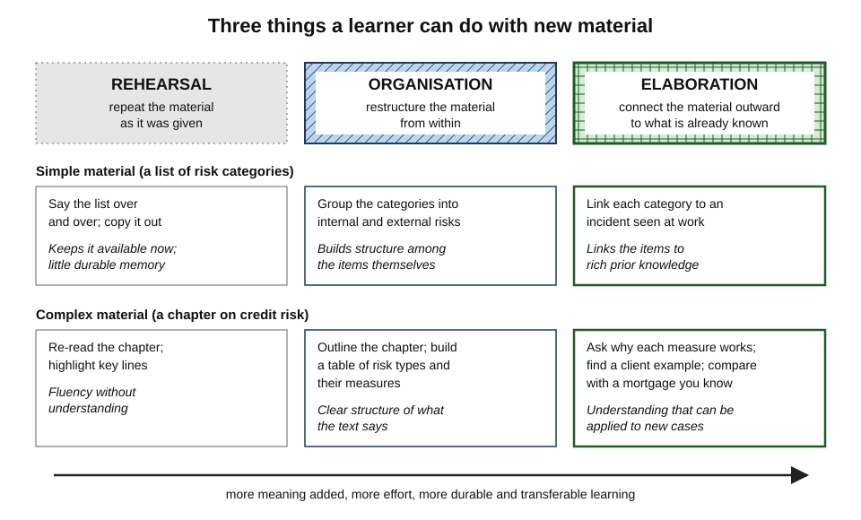
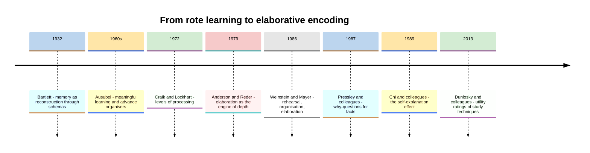
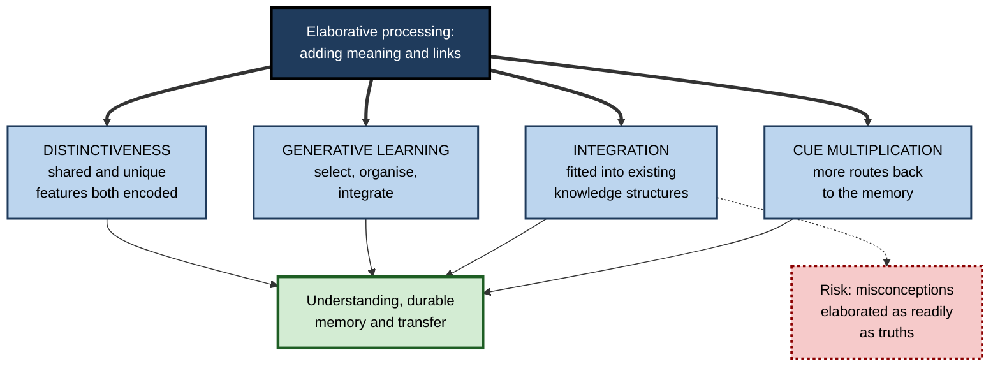
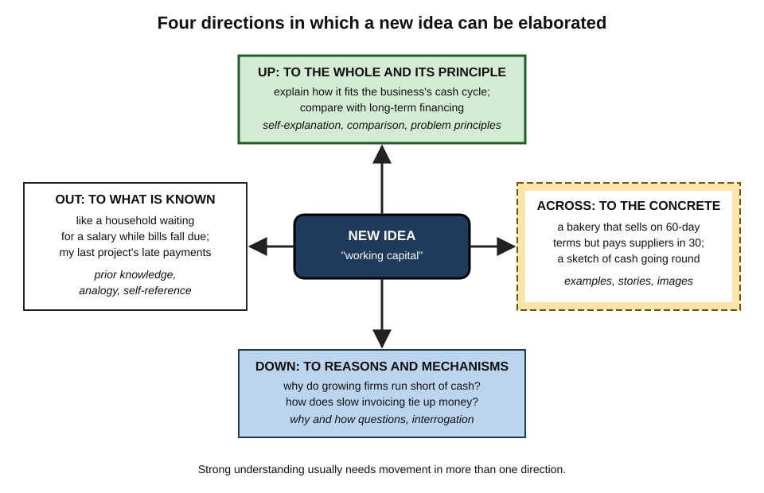
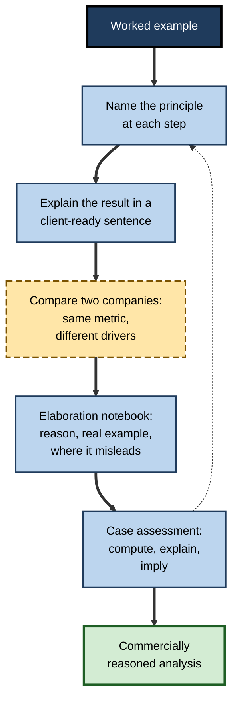
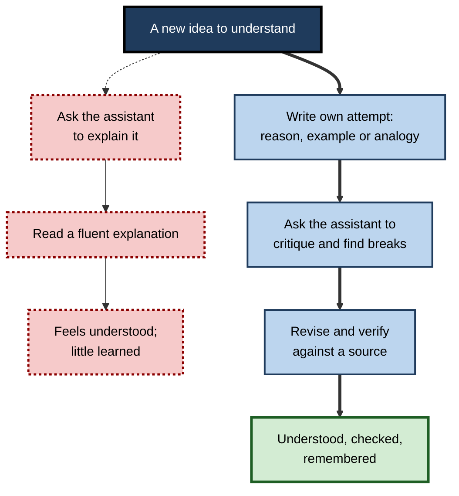

# F. Elaboration

A fact read once and left alone is among the most fragile things in memory. The same fact, asked about — *why is this so? what is it like? where have I seen it? what follows from it?* — becomes part of a web of knowledge that holds it in place and brings it back when needed.

Elaboration is the name for that work: the learner adding meaning to new material until it connects with what is already known. It is old in practice and young in science, and it explains much of the difference between people who remember and use what they study and people who merely recognise it.

> **Definition — Elaboration:** the cognitive process, and the family of study strategies built on it, in which a learner adds meaningful information to new material — reasons, mechanisms, examples, comparisons, images, implications and links to prior knowledge — so that the material is understood, integrated with existing knowledge and made easier to retrieve and apply.

**Why it matters**

- Understanding is, in large part, **elaboration achieved**: to understand something is to know how it connects to other things.
- Elaboration explains why **time spent** and **intention to learn** predict learning so poorly — what matters is what the mind does with the material.
- It is the strategy family most directly aimed at **transfer**: the use of knowledge in situations that do not look like the ones it was learned in.
- It is cheap, flexible and applicable to any material — facts, concepts, texts, procedures, cases — yet most learners rarely do it unprompted.
- In professional work, the habit of elaboration distinguishes people who can **apply** rules, models and procedures to new cases from those who can only **follow** them.
- In an age of AI assistants that can supply explanations instantly, the question of **who does the elaborating** has become central to whether people learn at all.

---

## The Idea and Its Scope

### What makes processing "elaborative"

- **Something is added** — the learner produces information that was not in the material: a reason, an example, a link, an inference.
- **The addition is meaningful** — it connects to the material's content, not to its appearance.
- **The addition connects outward** — to prior knowledge, other ideas, other cases or the learner's own experience.
- **The addition is precise** — it explains why details belong, rather than merely adding words.

> **Key point:** elaboration is defined by **connection**. Repeating a fact makes it familiar; elaborating it makes it **meaningful**, and meaning is what memory holds on to.

### Three families of learning strategy

- **Claire Ellen Weinstein and Richard Mayer (1986)** classified cognitive learning strategies into three families, a classification still widely used:
  - **Rehearsal** — repeating material as given: reciting, copying, re-reading.
  - **Organisation** — restructuring the material internally: outlining, grouping, tabulating.
  - **Elaboration** — connecting the material outward: paraphrasing with meaning, generating examples, asking why, relating to experience, building analogies.
- They also identified **comprehension monitoring** and **affective** strategies; the three cognitive families are the core.

**Figure 1.** Rehearsal, organisation and elaboration applied to simple and complex material.

### What elaboration is not

- **Not retrieval practice** — retrieval brings back what was learned; elaboration adds to it. The two are complementary and, in good study, interleaved.
- **Not re-reading** — re-reading increases fluency without adding links.
- **Not summarising** — summarising condenses what a text says; elaboration goes beyond it. Summarising in one's own words can be partly elaborative, but its purpose is compression.
- **Not generation for its own sake** — producing something (a word, an answer) helps memory; elaboration is the subset of generation that produces **meaningful connections**.
- **Not decoration** — vivid but irrelevant additions (seductive details, decorative images) attract attention without building understanding.

| | Rehearsal | Organisation | Elaboration | Retrieval practice |
|---|---|---|---|---|
| **Core act** | Repeat | Restructure | Connect outward | Recall from memory |
| **Adds information?** | No | Structure only | Yes — reasons, examples, links | No — reactivates |
| **Main benefit** | Short-term availability | Coherent structure | Understanding, cues, transfer | Durable access |
| **Typical activity** | Re-reading, copying | Outlining, tables | Why-questions, examples, analogies, explanation | Self-testing, free recall |
| **Typical failure** | Fluency mistaken for knowledge | Structure without meaning | Wrong or vague additions | Recall without understanding |

---

## Origins and History

### Long roots

- **Classical rhetoric** taught memory through vivid images and places, and through linking new matter to what the orator already knew.
- **Frederic Bartlett (1932)** showed that people remember stories by fitting them into existing **schemas** — memory as reconstruction through prior knowledge, for better and worse.
- **David Ausubel (1960s)** argued that **meaningful learning** — relating new material non-arbitrarily to what is known — differs in kind from rote learning, and that what the learner already knows is the most important factor in learning.

### The cognitive revolution and after

**Figure 2.** Milestones in the study of elaboration.

- **Fergus Craik and Robert Lockhart (1972)** proposed that memory depends on **depth of processing** — meaning-based processing leaves more durable traces than processing of appearance or sound.
- **John Anderson and Lynne Reder (1979)** argued that "depth" works through **elaboration**: deeper processing generates more elaborations, and each elaboration is an extra, redundant route by which the memory can later be reached.
- **Nancy Stein and John Bransford (1979)** showed that elaborations help only when they are **precise** — when they explain why a detail belongs.
- **Michael Pressley and colleagues (1987)** turned that insight into a technique: asking learners **why** a fact is true improved memory for it, often as much as or more than supplying the explanation.
- **Michelene Chi and colleagues (1989)** found that the students who learned most from worked examples were those who **explained** each step to themselves — the start of a large literature on self-explanation.
- **Dedre Gentner (1983)** and later work on **analogy** and **comparison** showed how mapping structure from known to new domains, and comparing cases, builds transferable principles.
- **John Dunlosky and colleagues (2013)** rated elaborative interrogation and self-explanation as **moderate-utility** techniques — reliably helpful, but conditional and more costly in time than the top-rated retrieval and spacing.

> **Key point:** elaboration research moved from a theory of **why** meaning aids memory (levels of processing, elaboration theory) to a set of **techniques** with measured effects and known limits.

---

## The Central Frameworks

### Elaboration as cue multiplication

- **Each elaboration is a link** between the new item and something already in memory.
- **More links mean more retrieval routes**: if one cue fails, another may succeed.
- **Precise links** — those that explain — are worth more than arbitrary ones, because they also allow the item to be **reconstructed** by reasoning when direct recall fails.

### Integration and schemas

- New information is understood by being **assimilated** to existing knowledge structures and, when it does not fit, by **accommodating** them.
- Elaboration is the deliberate version of this process: actively finding where the new fits, and noticing where it does not.
- Prior knowledge therefore both **enables** elaboration and **biases** it — misconceptions are elaborated as readily as correct knowledge.

### Generative learning

- **Richard Mayer** and **Logan Fiorella** describe learning as three processes: **selecting** relevant information, **organising** it into a coherent structure and **integrating** it with prior knowledge.
- Organisation strategies serve the second; elaboration strategies serve the third — the step that turns a coherent representation of the material into **knowledge the learner can use**.

### Elaboration and distinctiveness

- **Relational elaboration** — noting what an item shares with others — builds structure.
- **Item-specific elaboration** — noting what makes an item unique — prevents confusion.
- Memory is best when both are present; many effective techniques (comparisons, near misses, contrastive why-questions) supply both at once.

**Figure 3.** How the central frameworks combine to explain elaboration's effects.

> **Remember:** elaboration works because it **adds routes** (cues), **finds a place** (integration), **completes understanding** (generative integration) and **sharpens boundaries** (distinctiveness) — and it fails when the place found is wrong.

---

## Methods and How They Fit Together

The many elaboration techniques can be organised by the **direction** in which they connect a new idea.

**Figure 4.** Four directions in which a new idea can be elaborated.

### Down: to reasons and mechanisms

- Asking **why** a stated fact is true — the technique known as elaborative interrogation — binds the fact to a reason the learner can reconstruct; asking **how** something works exposes the causal chain and punctures the illusion of understanding.
- These methods suit **facts, rules and mechanisms**, and depend heavily on the learner knowing enough to answer.

### Out: to what is already known

- Deliberately relating new material to **prior knowledge**, to **personal experience** and, through **analogy**, to familiar domains imports a ready-made structure — which must then be checked for where it breaks.
- These methods suit **new fields** and are the career changer's main asset.

### Across: to the concrete

- **Examples** (including near misses and boundary cases), **stories** and **images** turn abstractions into cases that can be recognised and remembered; verbal and visual elaboration each carry relations the other handles poorly.
- These methods suit **concepts, categories and processes**, and are most powerful when the concrete case is varied and checked against the abstract definition.

### Up: to the whole and its principles

- **Explaining** material in one's own words — self-explanation — fills gaps and repairs mental models; in reading it builds a **situation model** of what the text describes; in problem solving it links each step to its **principle**; **comparison** of cases and methods extracts what they share.
- These methods suit **connected material** — texts, arguments, procedures and systems — and drive transfer most directly.

### Interaction between directions

- **Directions reinforce one another.** A why-question often produces an analogy; an example often reveals a principle; an explanation often requires a sketch.
- **Different materials favour different directions**, and routines that embed the right prompts at the right points make elaboration habitual rather than occasional.
- **Elaboration and retrieval combine.** Elaboration done at study time, then re-explained from memory later, outperforms either alone for core concepts.

> **Key point:** mature practice does not pick one technique; it moves an idea in **several directions** — reasons, connections, cases and principles — in proportions suited to the material and the learner's expertise.

---

## The Evidence in Outline

### What is well established

- **Meaning beats appearance.** Processing material for meaning produces far better memory than processing its surface, and intention to learn adds little once the kind of processing is fixed — one of the most replicated findings in memory research.
- **Precise elaboration helps; imprecise elaboration does not.** Additions that explain why details belong improve memory; arbitrary additions can hurt.
- **Self-explanation helps understanding.** A meta-analysis by Kiran Bisra and colleagues (2018) of 64 research reports found a moderate average benefit (g ≈ 0.55) for prompting learners to self-explain.
- **Why-questions help fact learning.** Meta-analytic estimates for elaborative interrogation are also moderate, around half a standard deviation.
- **Examples help concept learning.** Studying varied concrete examples improves the ability to classify new instances; the finding has been replicated.
- **Comparison helps transfer.** Comparing two cases that share a principle markedly improves later use of the principle compared with studying the same cases separately.

### What is qualified

- **Prior knowledge** — almost every elaboration technique works better with more relevant knowledge; for complete beginners, provided explanations and examples often beat generated ones.
- **Accuracy** — learners' own explanations and examples are often wrong, and learners judge them poorly; checking against a source is essential.
- **Time** — elaboration is slower than re-reading and sometimes slower than retrieval for the same gain; selective use is efficient use.
- **Durability** — many studies test within days; long-delay evidence is thinner.
- **Transfer** — benefits are clearest on tests of understanding and near transfer; far transfer is harder to show for any technique.

### What is contested

- **Elaboration versus retrieval** — some studies find retrieval practice outperforms elaborative activities done with the material in view (notably concept mapping); critics question the comparisons; most researchers now recommend **elaborating, then retrieving with explanation**.
- **Concrete versus generic representations** — claims that abstract symbols transfer better than concrete examples have had mixed replication.
- **Mental imagery and drawing** — benefits are real for concrete material and with support, but unsupported drawing can overload learners.

| Technique family | Strength of evidence | Main condition | Main risk |
|---|---|---|---|
| **Why-questions about facts** | Moderate, consistent | Learner can generate reasons | Wrong reasons stored confidently |
| **Self-explanation** | Moderate, broad | Specific prompts; checked explanations | Restatement passing as explanation |
| **Examples and near misses** | Strong for provided examples | Varied, accurate examples | Generated examples unchecked |
| **Analogy and comparison** | Strong for comparison of cases | Mapping made explicit; breaks found | Over-mapping, misconceptions |
| **Story and imagery** | Strong for memory of lists and narratives | Causal links true; images interactive | Vivid but false; narrative fallacy |
| **Connecting to prior knowledge** | Strong in principle; methods vary | Knowledge active during study | Activating misconceptions |

---

## The Landmark Debates

### Elaboration or retrieval?

- **One view** — Jeffrey Karpicke and colleagues have argued that retrieval practice produces learning through mechanisms distinct from elaboration, and that elaborative studying with the material available is a weaker use of time.
- **Another view** — Shana Carpenter's **elaborative retrieval hypothesis** proposes that retrieval is itself partly elaborative: searching memory activates related information that becomes linked to the target.
- **The practical settlement** — both effects are real and combinable. For core material: elaborate when first studying; retrieve later, and make retrieval questions ask for **explanations** rather than names.

### Generate or be told?

- **Generating** reasons, examples and explanations builds more links and exposes gaps.
- **Being told** — studying an expert's explanation or examples — is faster and more accurate, especially for novices.
- **The settlement** — **attempt, then compare**: a brief attempt prepares the learner to notice what the expert explanation adds, and the comparison catches errors.

### Is deeper always better?

- **Transfer-appropriate processing** showed that the best processing is the one that matches later use; "deep" wins when later use requires meaning — which in professional life it nearly always does.
- **The settlement** — elaborate in ways that match how knowledge will be used: scenarios for decisions, problems for procedures, explanations for advising others.

### Does elaboration spread misconceptions?

- Elaboration integrates new material with what is known — including what is known wrongly. Analogies import false relations; stories smooth over uncertainty; confident explanations entrench errors.
- **The settlement** — elaboration must include a **check**: against the source, an expert, a counter-example or the question "where does this break?".

---

## Elaboration Across Expertise

### Novices, intermediates and experts

- **Novices** lack the knowledge to elaborate richly; they benefit most from **provided** explanations, examples and analogies, plus light prompts (naming the principle, one why-question per key fact).
- **Intermediate learners** gain most from **prompted generation** — why-questions, self-explanation, generated examples checked against expert ones — because they know enough to answer and not yet enough to do it automatically.
- **Experts** elaborate within their domain automatically; prompts add little and detailed support can hinder (the **expertise reversal effect**). Their elaboration shifts to **boundary cases, failure conditions and cross-domain connections**.

> **Key point:** elaboration support should **fade** as expertise grows — from being given meaning, to being prompted to make it, to making it unprompted.

### Elaboration in organisations

- **Templates** — bug fixes with "principle violated", regulatory summaries with "why the regulator acted", project closures with "what we would do differently" — build elaboration into routine work.
- **Libraries of cases, near misses and stories** — shared example spaces accumulate judgement faster than individuals could.
- **Explain-it cultures** — teams in which proposals are written as narratives and decisions are explained invite elaboration from everyone involved.

### Worked example: re-designing a one-hour onboarding module

- **Situation:** a bank's one-hour onboarding module on anti-money-laundering rules consists of 30 slides of rules and a 10-question quiz.

| Minutes | Original | Re-designed with elaboration |
|---|---|---|
| 0–10 | Slides 1–8: definitions | A real (anonymised) case of laundering through a small business; learners predict what went wrong |
| 10–25 | Slides 9–20: rules and thresholds | Each key rule followed by "Why would this rule exist?" — learners write a one-line reason, then see the regulator's rationale |
| 25–40 | Slides 21–30: red flags | Red flags taught through pairs: a suspicious and a near-miss innocent transaction; learners say which feature differs |
| 40–50 | — | Learners explain, in their own words, how the case at the start would have been caught |
| 50–60 | 10-question recall quiz | Five scenario questions in new wording, answered with a reason |

1. **Down** — why-questions anchor each rule to its purpose.
2. **Across** — a story and paired examples make red flags concrete and distinct.
3. **Up** — explaining the opening case integrates rules into a whole.
4. **Retrieval with explanation** — scenario questions require meaning, not matching.

- **Conclusion:** the content is the same; the processing it demands is transformed.

> **Watch out:** the re-designed module **feels** harder and may score lower on immediate satisfaction. Judge it by delayed, scenario-based performance — the measure that matches its purpose.

### Case study: a consulting firm's analyst induction

- **Situation:** a strategy consultancy ran a two-week induction for new analysts covering financial analysis, market sizing and client communication.
- **Problem:** analysts passed end-of-induction tests but, on their first engagements, produced analyses that were technically correct and commercially naive — they could compute a margin but not explain what drove it.
- **Diagnosis:**
  - induction content was taught as procedures with worked examples, read passively;
  - no session required analysts to explain **why** a number behaved as it did, to connect it to a business, or to compare cases;
  - tests measured computation, not explanation.
- **Actions:**
  1. Every worked example was paired with prompts to name the principle behind each step and to explain the result in one sentence a client would understand.
  2. Each module included **two contrasting company cases** — same metric, different drivers — compared side by side.
  3. Analysts kept an **elaboration notebook**: for each concept, a reason, an example from a real company and a "where it misleads" note.
  4. The final assessment became a short case: compute, explain the drivers, and state one implication for the client.
- **Result:** engagement managers rated new analysts' first deliverables as markedly stronger on commercial reasoning; the elaboration notebooks became a reference many analysts kept using.
- **Side effects:** induction days felt longer; a few analysts struggled with open-ended explanation and needed model answers.
- **Lesson:** procedures produced **competence at computation**; elaboration produced **understanding of what the numbers meant** — the capability clients pay for.

**Figure 5.** The redesigned induction combined elaboration in several directions with an assessment that demanded it.

---

## Elaboration and Artificial Intelligence

- **The central risk** — AI assistants can elaborate on the learner's behalf: explain any concept, generate examples, offer analogies, summarise texts. The learner reads elaborations rather than producing them, and the mechanism that builds understanding is bypassed while the feeling of understanding grows.
- **The central opportunity** — the same tools can **check** a learner's elaborations instantly: critique an explanation, classify generated examples, find where an analogy breaks, generate near misses or erroneous examples to diagnose. The most persistent weakness of self-generated elaboration — unchecked errors — becomes cheap to fix.
- **The design principle** — **attempt first, then consult**: the learner generates the reason, example, analogy or explanation; the tool critiques; the learner revises and verifies anything important against an authoritative source.
- **The professional stake** — judgement about AI outputs depends on the professional's own elaborated knowledge. Someone who has never built their own understanding of why a rule exists cannot tell when a fluent machine explanation of it is wrong.

> **In practice:** a useful personal rule is that no AI explanation is read until one's own one-sentence attempt has been written down. The attempt takes seconds; it preserves most of the learning.

**Figure 6.** Productive and unproductive sequences for elaborating with an AI assistant.

---

## What Distinguishes Expert Practice

- **Experts elaborate selectively.** They skim what fits and slow down at what surprises; novices spread effort evenly or not at all.
- **Experts elaborate at the level of principle.** Their reasons, examples and comparisons are organised by deep structure rather than surface features.
- **Experts look for breaks.** Every analogy, explanation and example is held with its limits — where it stops working.
- **Experts check.** They treat their own fluent explanations as hypotheses and test them against evidence, colleagues and counter-examples.
- **Experts move between representations.** They can turn a sentence into a sketch, a sketch into a sentence, a case into a principle and a principle into a case.
- **Experts build elaboration into their environment.** Templates, case libraries, narrative documents and explain-it conversations make elaboration routine for whole teams.

> **Key point:** at the highest level, elaboration stops being a study technique and becomes a **way of thinking** — the habit of asking of any new idea why it holds, what it connects to, what it looks like in a real case and where it fails.

---

## Open Questions

- **What is the best balance of elaboration and retrieval?**
  - Both help and they combine; how to divide limited study time between them for different materials and learners is not well established.
- **How can learners check their own elaborations at scale?**
  - Learners judge their own examples and explanations poorly; expert examples and AI critique help, but reliable, scalable feedback is still developing.
- **How durable are elaboration benefits?**
  - Many effects are measured over days; evidence over months and years, in real courses and workplaces, is thinner.
- **Can elaboration become a lasting habit?**
  - Prompted elaboration helps in the moment; whether training produces spontaneous elaboration long after prompts are removed is unclear.
- **How should elaboration support adapt to expertise in real time?**
  - The expertise reversal effect implies that prompts should fade; detecting the right moment automatically is an open design problem.
- **What will pervasive AI do to human elaboration?**
  - Tools that check elaborations could make learning more efficient; tools that supply them could make it rarer. Which use dominates will shape professional expertise for a generation.

---

## Summary

- **Elaboration** = adding meaningful information — reasons, mechanisms, examples, comparisons, images, implications, links — to new material so it is understood, integrated and retrievable. It is defined by **connection**.
- **Weinstein and Mayer (1986):** rehearsal repeats, organisation restructures, **elaboration connects outward**. Elaboration is distinct from retrieval, re-reading, summarising and decoration.
- History: **Bartlett** (schemas), **Ausubel** (meaningful learning), **Craik and Lockhart** (depth), **Anderson and Reder** (elaboration as the engine of depth), **Stein and Bransford** (precision), **Pressley** (why-questions), **Chi** (self-explanation), **Gentner** (analogy and comparison), **Dunlosky** (moderate utility).
- Frameworks: **cue multiplication**, **integration** with schemas, **generative learning** (select, organise, integrate), **relational and item-specific** elaboration.
- Methods move ideas in **four directions**: **down** to reasons, **out** to prior knowledge and analogies, **across** to examples, stories and images, **up** to explanations, principles and comparisons.
- Evidence: meaning beats appearance; precise elaboration helps; **self-explanation** and **why-questions** give moderate benefits (around half a standard deviation); examples and comparison are strong. Qualified by **prior knowledge, accuracy, time, durability, transfer**. Contested: elaboration versus retrieval; concrete versus generic.
- Debates settle on: **elaborate, then retrieve with explanation**; **attempt, then compare**; elaborate in ways that **match later use**; always **check for breaks**.
- Support should **fade with expertise**. Organisations embed elaboration in templates, case libraries and explain-it cultures. With AI: **attempt first, then consult**.

---

## Self-Check

1. Define elaboration and state the four features that make processing elaborative.
2. Distinguish rehearsal, organisation and elaboration with an example of each for the same material.
3. How does elaboration differ from retrieval practice, and why are both needed?
4. What did Anderson and Reder (1979) add to levels-of-processing theory?
5. What did Stein and Bransford (1979) show about precision, and why does it matter for study?
6. Explain cue multiplication and integration as mechanisms of elaboration.
7. Describe the four directions of elaboration and give a technique for each.
8. Summarise what is well established, what is qualified and what is contested in the evidence.
9. Explain the debate between elaboration and retrieval and its practical settlement.
10. How should elaboration support change from novice to expert, and why?
11. Why can elaboration spread misconceptions, and what is the remedy?
12. A colleague uses an AI assistant to explain every new concept before reading the source. What is lost, and what sequence would you recommend?
13. Redesign a 45-minute product-training session that currently consists of slides and a recall quiz, using elaboration in at least three directions.
14. What distinguishes expert elaboration from novice elaboration?

### Answer Key

1. Adding meaningful information to new material so it is understood, integrated and retrievable. Features: something is added; the addition is meaningful; it connects outward; it is precise.
2. For a list of five project risks: rehearsal — reciting the list; organisation — grouping risks into technical and commercial; elaboration — linking each risk to a past project where it occurred and saying why it arose.
3. Retrieval brings back what was learned, strengthening access; elaboration adds meaning and links. Understood material can be forgotten without retrieval; retrieved material can be misunderstood without elaboration.
4. They argued that depth works through elaboration: deeper processing produces more elaborations, each a redundant retrieval route, so "depth" is explained by the number and quality of elaborations.
5. Only precise elaborations — those explaining why a detail belongs — improved memory; imprecise additions did not and could hurt. Study elaborations must explain, not merely add words.
6. Cue multiplication: each elaboration is a link and an extra route to the memory, so retrieval has more chances to succeed. Integration: new material is fitted into existing knowledge structures, making it meaningful and usable — and making misconceptions a risk.
7. Down to reasons — why and how questions; out to what is known — analogy and prior-knowledge links; across to the concrete — examples, stories, images; up to principles — self-explanation, comparison, principle-naming.
8. Established: meaning beats appearance; precise elaboration helps; self-explanation and why-questions give moderate benefits; examples and comparison are strong. Qualified: prior knowledge, accuracy, time, durability, transfer. Contested: elaboration versus retrieval; concrete versus generic representations; unsupported drawing.
9. One view holds that retrieval works through distinct mechanisms and beats book-open elaboration; another that retrieval is itself partly elaborative. Settlement: elaborate when first studying, then retrieve later with questions that require explanation.
10. Novices: provided explanations and examples with light prompts. Intermediates: prompted generation checked against expert models. Experts: little prompting; boundary cases, failure conditions and cross-domain links. Support fades because experts elaborate automatically and detailed support becomes redundant or harmful.
11. Elaboration integrates new material with existing knowledge, including wrong knowledge; analogies import false relations, stories hide uncertainty, explanations entrench errors. Remedy: check elaborations against sources, experts and counter-examples; ask where each breaks.
12. The colleague's own generation of reasons and connections — the mechanism of learning — is skipped, and fluent explanations create a false sense of understanding. Recommend: write a one-sentence attempt first, ask the assistant to critique it and find breaks, revise, and verify against the source.
13. *e.g.* Open with a customer problem story (across); for each key feature, have participants write why it exists before the product manager explains (down); compare the product with a familiar competitor and state where the comparison breaks (out); end with participants explaining how the product would solve the opening problem (up); replace the recall quiz with scenario questions answered with reasons.
14. Experts elaborate selectively, at the level of principle, with attention to breaks and limits, check their own explanations, move freely between representations and build elaboration into their working environment; novices elaborate rarely, at the surface and without checking.

---

## Glossary

| Term | Meaning |
|---|---|
| Accommodation | Changing existing knowledge structures to fit information that does not fit them. |
| Analogy | Mapping relations from a familiar domain onto a new one. |
| Assimilation | Fitting new information into existing knowledge structures. |
| Cue multiplication | The increase in retrieval routes produced by each elaborative link. |
| Elaboration | Adding meaningful information to new material so it is understood, integrated and retrievable. |
| Elaborative interrogation | Asking and answering why a stated fact is true. |
| Elaborative retrieval hypothesis | The proposal that retrieval activates and links related information, making it partly elaborative. |
| Expertise reversal effect | Support that helps novices but hinders more expert learners. |
| Generative learning | Learning through selecting, organising and integrating information. |
| Item-specific elaboration | Encoding what makes an item unique. |
| Levels of processing | The theory that memory depends on the depth at which material is processed. |
| Meaningful learning | Relating new material non-arbitrarily to existing knowledge. |
| Organisation strategy | Restructuring material internally, as in outlining or tabulating. |
| Precise elaboration | An addition that explains why a detail belongs. |
| Rehearsal strategy | Repeating material as given. |
| Relational elaboration | Encoding what an item shares with others. |
| Retrieval practice | Recalling studied material from memory to strengthen it. |
| Schema | An organised structure of knowledge about a type of thing or event. |
| Self-explanation | Explaining to oneself what material means and how its parts fit together. |
| Transfer | Applying learning in situations different from those in which it was learned. |
| Transfer-appropriate processing | The principle that memory is best when study processing matches later use. |
