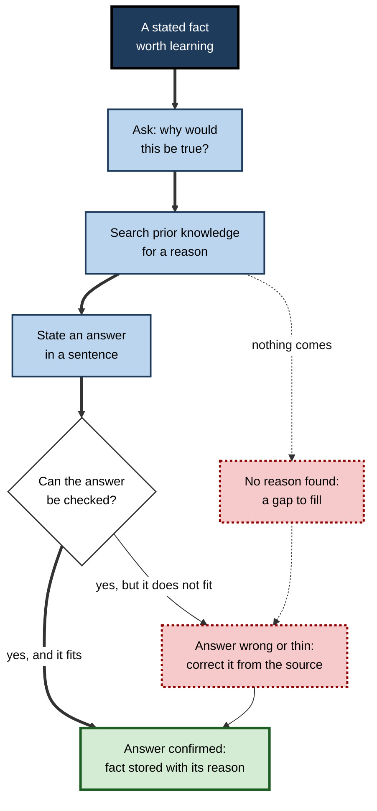
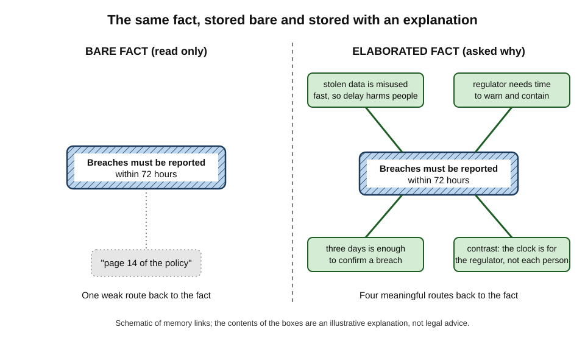
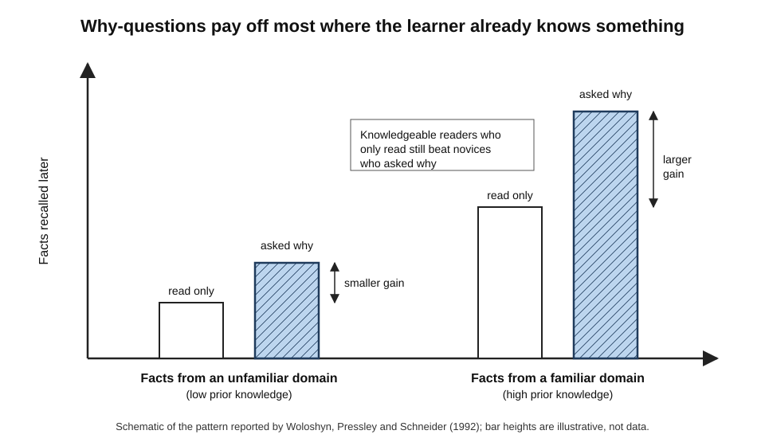
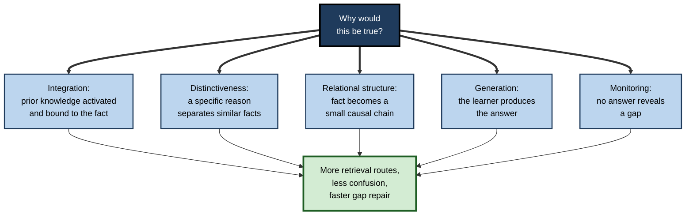
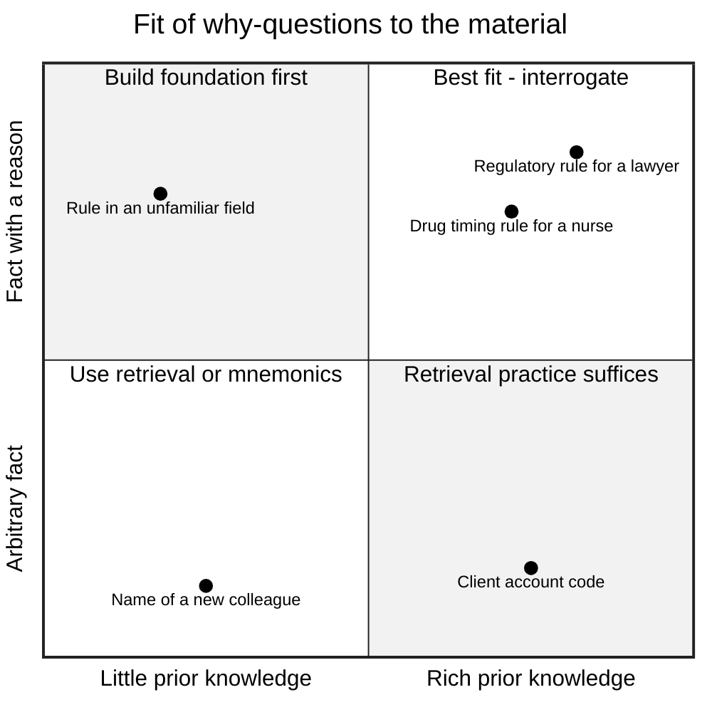
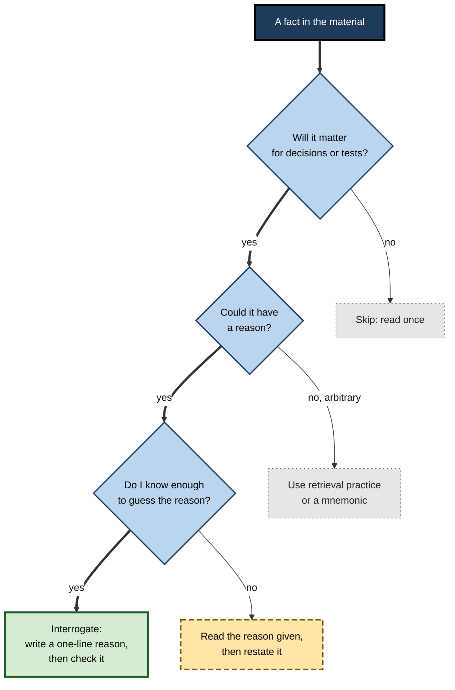

# F.1. Elaborative Interrogation Defined

A new analyst reads that personal-data breaches must be reported to the regulator within 72 hours. One colleague underlines the sentence and moves on; another pauses and asks, "Why 72 hours — why not a week, or immediately?" A month later the first remembers "some deadline"; the second remembers the number, the reason for it and the cases where it applies. The difference was a single question.

> **Definition — Elaborative interrogation:** a study strategy in which the learner, on meeting a stated fact or claim, asks "Why would this be true?" (or "Why does this make sense?") and answers the question from their own knowledge before moving on.

**Why it matters**

- It turns **isolated facts** — the hardest kind of material to retain — into facts that are **anchored to reasons** the learner already understands.
- It costs nothing: no software, no cards, no partner; only a question and a few seconds of thought.
- It is one of the few strategies tested specifically on the **fact-heavy learning** that fills professional life: regulations, product specifications, clinical guidelines, market facts, policy rules.
- It exposes the gaps in a learner's understanding at the moment they read, not weeks later in an examination or a client meeting.
- Its limits are well mapped, so it can be used with judgement rather than faith.

---

## The Core Idea

### Elaboration and its interrogative form

Elaboration is the wider family to which elaborative interrogation belongs.

> **Definition — Elaboration:** adding meaningful information to new material — reasons, examples, links, implications, comparisons — so that it becomes connected to what the learner already knows.

- **Elaboration in general** can take many forms: generating examples, building analogies, explaining in one's own words, relating a point to personal experience.
- **Elaborative interrogation** is the form driven by a **question about cause or justification**.
  - The question is aimed at a **fact or claim**, not at a whole procedure.
  - The answer must come from the learner, not from the text.
- **The essential move** has three parts:
  1. **Notice** a statement worth learning.
  2. **Ask** why it is, or might be, true.
  3. **Answer** using prior knowledge — then check the answer if a source is available.

> **Key point:** elaborative interrogation does not add new information from outside; it **recruits knowledge the learner already holds** and binds the new fact to it.

**Figure 1.** The elaborative interrogation cycle applied to a single fact.

### What it is not

- **Not re-reading** — re-reading repeats the same words; interrogation forces new connections.
- **Not paraphrasing** — rewording a fact keeps it at the same level; interrogation asks for the *reason behind* it.
- **Not self-testing** — retrieval practice asks "What was the fact?"; interrogation asks "Why is the fact so?". The two are complementary.
- **Not self-explanation** in the strict sense — self-explanation asks how each step of a procedure, example or argument follows from what came before. The boundary is fuzzy, but the research traditions differ.

| | Elaborative interrogation | Self-explanation | Retrieval practice | Re-reading |
|---|---|---|---|---|
| **Target** | A single fact or claim | A sequence: steps, worked examples, arguments | Previously studied material | The text itself |
| **Prompt** | "Why is this true?" | "How does this step follow? What principle does it use?" | "What do I remember?" | None |
| **Main source of the answer** | Prior knowledge | The material plus prior knowledge | Memory of the material | The page |
| **Best for** | Facts, rules, specifications | Procedures, problem solving, causal systems | Durable recall of anything | Little, beyond a first pass |
| **Main risk** | Wrong reasons stored with the fact | Vague, unchecked explanations | Wrong answers if no feedback | Fluency mistaken for knowledge |

> **Watch out:** many guides use "elaboration", "elaborative interrogation" and "self-explanation" interchangeably. They overlap, but the evidence for one does not automatically transfer to the others.

### A fact before and after interrogation

- **Bare fact:** "In most deciduous trees, leaves change colour in autumn."
- **Why?** Because the tree stops producing chlorophyll as days shorten, so the green fades and the yellow and orange pigments already present become visible.
- **What the learner now holds:**
  - the fact;
  - a cause (chlorophyll breakdown);
  - a trigger (shorter days);
  - an implication (the yellows were there all summer, hidden);
  - a link to earlier knowledge of photosynthesis.

**Figure 2.** The same fact stored bare and stored with an explanation.

---

## Where the Technique Came From

### Arbitrary sentences and precise elaboration

The technique grew out of a 1970s question: why are some additions to a sentence helpful and others useless?

**Study card — Stein and Bransford (1979)**

- **Design:** students learned simple sentences of the form "The fat man read the sign."
  - **Base only** — the sentence alone.
  - **Imprecise elaboration** — an addition that did not explain the man's role, *e.g.* "…that was two feet high".
  - **Precise elaboration** — an addition that made the adjective meaningful, *e.g.* "…warning about the thin ice".
  - **Self-generated** — students wrote their own additions.
- **Results:**
  - Precise elaborations improved memory for which man did what; imprecise ones did not, and could even hurt.
  - Self-generated elaborations helped only when they were themselves precise.
- **Conclusion:** elaboration works when it **explains why** a detail belongs, not merely when it adds words.

> **Definition — Precise elaboration:** an addition to a fact that makes its details non-arbitrary by explaining how they fit together.

### Pressley and the "why" question

**Study card — Pressley, McDaniel, Turnure, Wood and Ahmad (1987)**

- **Design:** university students learned sentences such as "The hungry man got into the car."
  - **Reading** — read each sentence.
  - **Provided elaboration** — read the sentence with a precise explanation supplied by the experimenter.
  - **Elaborative interrogation** — read the sentence and answered "Why did that man do that?"
- **Results:** students who answered why-questions remembered far more of the pairings than those who only read, and did at least as well as — often better than — those who were handed a precise explanation.
- **Conclusion:** asking learners to generate the reason is a powerful, cheap substitute for supplying it.

> **Key point:** the 1987 result established the two claims that still define the technique — **why-questions beat reading**, and **generating a reason can beat being given one**.

### From sentences to real facts

- **Animal facts** — studies with children and adults used facts about animals (*e.g.* habitat, diet, behaviour); answering why-questions improved recall of which animal had which property.
- **Facts about places** — the decisive study used facts about regions:

**Study card — Woloshyn, Pressley and Schneider (1992)**

- **Design:** Canadian and German university students learned facts about Canadian provinces and German states.
  - Each learner therefore met one **familiar** domain and one **unfamiliar** domain.
  - Half answered why-questions; half read with instructions to understand.
- **Results:**
  - Elaborative interrogation improved learning in both domains.
  - The benefit was **larger in the familiar domain**.
  - High-knowledge readers who only read still outperformed low-knowledge learners who interrogated.
- **Conclusion:** the technique **amplifies** prior knowledge; it does not replace it.

**Figure 3.** Prior knowledge and the benefit of elaborative interrogation.

- **Science texts** — later work moved to textbook prose. A study of university biology students reading textbook material (Smith, Holliday and Austin, 2010) reported better comprehension when they answered why-questions while reading.
- **Longer and more complex material** — results became more variable as texts grew longer and more technical; the technique remains best supported for **fact-dense** material.

---

## How Elaborative Interrogation Works

Several mechanisms operate at once; researchers disagree mainly about their relative weight.

### Integration with prior knowledge

- Answering "why?" requires **activating** related knowledge in long-term memory.
- The new fact is then encoded **together with** that knowledge.
- Later, any part of the activated knowledge can serve as a **retrieval cue**.

> **Example:** a pharmacist learning that a drug must be taken on an empty stomach asks why, recalls that food reduces its absorption, and stores the rule with "absorption" — a cue that will also come to mind with other drugs.

### Distinctiveness

- Many facts are confusable: similar provinces, similar products, similar regulations.
- A **reason** is usually specific to its fact, so it makes the fact **distinct** from its neighbours.
- Reed Hunt and colleagues' work on distinctive and relational processing suggests memory is best when learners notice both how items are **related** and how they **differ**; why-questions supply both.

> **Definition — Distinctiveness:** the degree to which a memory is encoded with features that set it apart from similar memories, reducing confusion at retrieval.

### Relational structure

- A fact with a reason is a small **causal chain**, not a single point.
- Causal chains are better remembered than lists because each link implies the next.

### Generation and effort

- Producing an answer is an act of **generation**; generated information is generally remembered better than information read passively.
- The effort is modest — a few seconds per fact — which keeps the cost low.

### Monitoring

- A why-question that cannot be answered is a **signal**: the learner lacks a piece of foundation.
- The technique therefore doubles as a **comprehension check**, prompting the learner to look up, ask or flag.

**Figure 4.** Five mechanisms through which a why-question improves memory for a fact.

> **Watch out:** it is tempting to say the technique works because it is "deep processing". That label describes the outcome rather than explaining it; the more specific mechanisms above make testable predictions, which the label alone does not.

---

## The Evidence and Its Limits

### Overall strength

- **Dunlosky and colleagues (2013)** rated elaborative interrogation **moderate utility**: reliable for fact learning, less tested on complex material, long delays and real courses.
- **Donoghue and Hattie (2021)**, in a meta-analysis of the same family of techniques, reported an average effect for elaborative interrogation in the region of **half a standard deviation** — a moderate effect.
- **A 2024 meta-analysis of elaborative strategy instruction** found benefits for memory tasks that remained, though smaller, after adjusting for publication bias.

> **Key point:** the evidence supports a **real, moderate** benefit for learning facts, with the size depending heavily on the learner and the material.

### Boundary conditions

| Condition | Benefit tends to be **larger** when… | Benefit tends to be **smaller or absent** when… |
|---|---|---|
| **Learner knowledge** | The learner knows enough to produce plausible reasons | The domain is almost wholly new |
| **Material** | Facts have causes, purposes or justifications | Facts are arbitrary (codes, names, dates with no logic) |
| **Text length** | Short passages or discrete fact lists | Long, dense chapters where questioning every sentence becomes tiring |
| **Answer accuracy** | Answers are checked against a source | Answers are wrong and never corrected |
| **Outcome measured** | Cued recall of the facts | Free recall of a whole text, or far transfer |
| **Learner age** | Older children, adolescents and adults | Very young children without relevant knowledge |

### Learners of different ages and abilities

- **Children** — benefits appear from the later primary years upward, provided the facts concern things the children know about (animals, everyday objects); younger children often answer with stories rather than reasons.
- **Adolescents and adults** — the bulk of the evidence; benefits are consistent for fact lists and short texts.
- **Learners with weaker reading skills** — why-questions can still help, but answers are thinner; supplying a model answer for the first few facts raises quality.
- **Experts reading in their own field** — less studied. Gains are likely for genuinely new facts; for facts that fit their knowledge at once, experts probably elaborate spontaneously, leaving less for a prompt to add.

> **Key point:** the prompt adds most when the learner **can** answer but **would not** have asked unprompted.

### The prior-knowledge threshold

- **Below the threshold**, learners produce no answer, a vague answer ("because that's the rule") or a wrong one.
- **Above it**, each question links the fact to a rich network, and gains grow.
- **Practical reading:** the technique is a **second-pass** strategy for an unfamiliar field — most useful once a foundation exists.

### Wrong answers

- A plausible but **incorrect** reason can be stored with the fact and make it feel more certain than it should.
- **Remedy:** where a source, an expert or a reference exists, compare the generated reason with it; where none exists, mark the reason as a **hypothesis**.

> **Watch out:** confidence rises after interrogation because the fact now "makes sense". That feeling is not evidence the reason is right. A well-told wrong explanation is more memorable — and more dangerous — than an unexplained fact.

### Time and fatigue

- Interrogating every sentence of a long chapter is slow and tedious; studies on longer texts report learners skipping or giving minimal answers.
- **Selective use** — on the facts that matter and are not obvious — preserves the benefit at a fraction of the cost.

### Arbitrary facts

- Some facts have no reason the learner could reach: telephone codes, the name of a client's chief executive, a product SKU format.
- For these, why-questions waste time; **retrieval practice** and, for some items, **mnemonics** are better tools.

**Figure 5.** Where elaborative interrogation fits, by the learner's knowledge and the kind of fact.

### Generated versus provided reasons

- **When generation wins** — the learner knows enough to construct a precise reason; producing it builds more links than reading it.
- **When provision wins** — the learner cannot reach a precise reason; a supplied explanation avoids wasted time and wrong reasons.
- **A hybrid** — attempt a reason first, then read the expert reason and compare. The attempt prepares the learner to notice what the expert reason adds.

> **Key point:** the choice is not "generate or be told" but **"attempt, then compare"** — the attempt is cheap, and the comparison catches errors.

---

## Doing It Well

### The standard prompts

- **Fact-focused:** "Why would this be true?"
- **Comparative:** "Why would this be true of X but not of Y?"
- **Purpose:** "Why would someone design it this way?"
- **Consequence:** "Why does this matter — what would happen if it were not so?"

> **Remember:** a good why-question names the **specific** fact and, where possible, a **contrast** — "Why does this province have the most hydroelectric power, rather than its neighbour?"

### Answer quality

- **A good answer**
  - states a **mechanism**, cause or purpose;
  - uses a concept the learner already understood before the reading;
  - is short enough to say in a breath.
- **A weak answer**
  - restates the fact ("because breaches must be reported quickly");
  - appeals to authority ("because the regulation says so");
  - is a vague gesture ("for safety reasons").

| Answer to "Why must breaches be reported within 72 hours?" | Type | Value |
|---|---|---|
| "Because that is what the rule says." | Authority | None — no new link |
| "So that they are reported quickly." | Restatement | None — circular |
| "For data protection." | Vague | Low — no mechanism |
| "Because stolen data can be misused within days, so the regulator needs to act while harm can still be limited." | Mechanism | High — links to misuse, harm and the regulator's role |

### Selecting what to interrogate

- **Interrogate:** facts that are central, surprising, easily confused with neighbours, or likely to be needed in decisions.
- **Skip:** trivia, facts already understood, arbitrary identifiers.
- **Batch:** in a dense text, interrogate one key claim per paragraph rather than every sentence.

**Figure 6.** Deciding whether to interrogate a fact.

### Spoken, written or silent

- **Silent** answering is fastest but easiest to fake — a vague feeling of "I see why" passes as an answer.
- **Written** answering is slowest but makes thin answers visible and leaves a record to check.
- **Spoken** answering, to oneself or a partner, sits between the two.

> **In practice:** many professionals write a single-line reason in the margin or in a notes column next to each key fact. The line can later be turned into a retrieval question: "Why does the 72-hour rule exist?"

### Combining with other strategies

- **With retrieval practice** — first interrogate while learning; later self-test on both the fact and the reason.
- **With spacing** — revisit the reason on later days; a reason that no longer comes to mind signals a weak link.
- **With examples** — after answering why, generating one instance where the fact applies extends the elaboration.

### Worked example: learning a cloud-cost rule

- **Situation:** a junior engineer reads that "data transfer *into* a major cloud provider is usually free, but transfer *out* is charged".

1. **Notice** — the fact is surprising and will matter for architecture decisions.
2. **Ask** — "Why would a provider charge for data leaving but not entering?"
3. **Search prior knowledge** — the engineer knows providers compete for customers and that moving large datasets is expensive.
4. **Answer** — "Free entry attracts customers' data; charging for exit makes it costly to leave or to serve data elsewhere, which keeps workloads on the platform."
5. **Check** — a senior colleague confirms the commercial logic and adds that network infrastructure costs are also part of it.
6. **Extend** — the engineer adds a contrast: "So designs that keep processing near the data avoid exit charges."

- **Result:** the fact is now linked to **pricing strategy**, **lock-in** and **architecture design** — three cues that will bring it to mind in a design review.

> **Watch out:** step 5 matters. The engineer's first answer was partly right; without the check, the purely commercial explanation would have been stored as the whole story.

---

## Elaborative Interrogation at Work

### Where it fits

- **Onboarding** — new staff absorb large volumes of organisational facts: approval limits, escalation routes, product rules. Asking why each exists makes them memorable and reveals which are historical accidents.
- **Compliance and regulation** — rules are easier to apply to new situations when their **purpose** is known.
- **Clinical practice** — guideline thresholds (*e.g.* when to escalate a deteriorating patient) are better retained and better applied when their physiological rationale is understood.
- **Sales and product knowledge** — knowing why a feature exists lets a representative answer questions the script did not anticipate.
- **Finance** — accounting rules learned with their rationale (*e.g.* why prudence leads to recognising losses earlier than gains) transfer better to unusual transactions.

> **In practice:** a rule whose purpose is understood can be applied to a case it was not written for. A rule learned without its purpose can only be matched to cases that look like the examples.

### How experts interrogate

- **Beyond "why is it true?"** experts habitually add two further questions:
  - **"When would it stop being true?"** — the boundary of the rule;
  - **"How do we know?"** — the evidence or authority behind the claim.
- **They ask for mechanism, not motive.** A novice answers "the company wants this"; an expert answers "this prevents double-counting at month end".
- **They link across levels.** A senior clinician connects a dosage rule to pharmacology, to patient safety history and to the hospital's own incident record.
- **They tolerate "I don't know yet".** An unanswered why-question is logged as an open item rather than papered over with a plausible story.

> **Example:** a junior auditor learns that revenue on a multi-year licence is recognised over time. The novice why: "because the standard says so". The expert why: "because the vendor's obligation — updates and support — is delivered over time, so revenue follows performance; if the licence were a one-off transfer with nothing further owed, recognition would happen at a point in time".

### The organisational benefit

- When many people ask why a rule exists, some rules turn out to have **no current reason**.
- Elaborative interrogation therefore has a side effect: it surfaces **obsolete procedures** and invites their review.

### Elaborative interrogation and AI assistants

- **The risk:** asking an AI assistant "Why is this true?" hands over the very step that produces the learning; the learner reads an explanation instead of generating one.
- **The better sequence:**
  1. generate an answer first, in writing;
  2. then ask the assistant to **critique** it or supply what is missing;
  3. correct the stored reason.
- **The extra caution:** AI explanations can be fluent and wrong; a confident machine-written reason has all the dangers of a confident self-generated one.

> **Key point:** the benefit comes from the **learner's** search of memory. Any tool that supplies the answer first removes the mechanism.

### Case study: product facts for a support team

- **Situation:** a software company's support team had to learn about 150 product facts each quarter — limits, defaults, compatibility rules.
- **Problem:** agents passed an immediate quiz but gave wrong answers to customers weeks later; similar limits were confused.
- **Diagnosis:**
  - facts were taught as a flat list in a slide deck;
  - nothing distinguished one limit from another;
  - agents could not answer "why?" when customers asked.
- **Actions:**
  1. For each release, product managers marked the 30 facts most often asked about.
  2. In training, agents wrote a one-line reason for each before the product manager explained it.
  3. Mismatches between agents' reasons and the real reasons were discussed in the session.
  4. The reasons were added to the internal knowledge base beside each fact.
  5. Weekly short quizzes asked for both the fact and its reason.
- **Result:** fewer confused answers in quality reviews; agents could answer follow-up "why?" questions; several facts were found to be legacy limits and were removed in the next release.
- **Side effects:** training sessions took longer; some agents initially found writing reasons slow.
- **Lesson:** interrogating a **selected** set of facts, with **checked** answers, changed both learning and the product.

---

## Open Questions

- **How well does the technique scale to long, complex texts?**
  - Most strong evidence uses short sentences or fact lists; results on full textbook chapters and multi-week courses are more variable.
- **How long do the benefits last?**
  - Many studies test within days; fewer test after months, and those that do give a mixed picture.
- **Can learners be trained to answer well without supervision?**
  - Answer quality predicts benefit, yet learners are poor judges of their own answers; how to build that judgement is unclear.
- **What is the right balance between generating and being told?**
  - Generating can beat being given a reason, but only above a knowledge threshold; how to detect that threshold in a learner, in real time, is unresolved.
- **How does AI change the picture?**
  - Assistants can check generated reasons instantly, which could reduce the risk of storing wrong reasons — or can tempt learners to skip generation altogether.

---

## Summary

- **Elaborative interrogation** = asking "Why would this be true?" about a stated fact and answering from prior knowledge.
- It belongs to the wider family of **elaboration** — adding meaningful links to new material — and differs from **self-explanation** (steps and procedures), **retrieval practice** (recalling) and **re-reading**.
- Origins: **Stein and Bransford (1979)** — only **precise** elaborations help; **Pressley et al. (1987)** — why-questions beat reading and can beat being given the reason; **Woloshyn et al. (1992)** — benefits are **larger with more prior knowledge**.
- Mechanisms: **integration** with prior knowledge, **distinctiveness**, **relational structure**, **generation** and **monitoring**.
- Evidence: a **moderate**, reliable benefit for fact learning (around half a standard deviation in meta-analysis); weaker for long complex texts, free recall and transfer.
- Limits: a **prior-knowledge threshold**, risk of **wrong reasons**, **time and fatigue**, uselessness for **arbitrary facts**.
- Do it well: specific, contrastive questions; **mechanism-level** answers; **selective** use; write answers; **check** them; combine with retrieval and spacing.
- At work it suits onboarding, compliance, clinical rules and product knowledge, and it surfaces obsolete rules. With AI, **generate first, then check**.

---

## Self-Check

1. Define elaborative interrogation and state its three essential steps.
2. How does elaborative interrogation differ from self-explanation and from retrieval practice?
3. What did Stein and Bransford (1979) show about precise and imprecise elaboration?
4. Describe the design and two main findings of Pressley and colleagues (1987).
5. What did Woloshyn, Pressley and Schneider (1992) find, and what does it imply for a complete beginner?
6. Explain two mechanisms by which a why-question improves memory for a fact.
7. Why is "because that is the rule" a poor answer to a why-question?
8. Give three conditions under which the technique's benefit tends to shrink.
9. Why can a wrong self-generated reason be worse than no reason at all?
10. A learner must memorise 40 client account codes. Is elaborative interrogation a good choice? What would be better?
11. Describe a sound way to use an AI assistant alongside elaborative interrogation.
12. A team lead plans to have new hires answer why-questions about every sentence of a 60-page policy manual. Evaluate the plan and propose a better one.
13. How can elaborative interrogation benefit an organisation beyond individual learning?

### Answer Key

1. Asking "Why would this be true?" about a stated fact and answering from prior knowledge. Steps: notice a fact worth learning; ask why it is true; answer from what one knows (then check if possible).
2. Elaborative interrogation targets single facts or claims and asks for their reason. Self-explanation targets sequences — steps, worked examples, arguments — and asks how each part follows. Retrieval practice asks what was learned, not why it holds; it strengthens access rather than adding links.
3. Additions that explained why a detail fitted (precise) improved memory; additions that merely added words (imprecise) did not and could hurt; learners' own additions helped only when precise.
4. Students learned sentences such as "The hungry man got into the car" by reading, by reading with a supplied precise explanation, or by answering "Why did that man do that?". Why-questions beat reading, and matched or beat being given the explanation.
5. Why-questions helped in both familiar and unfamiliar domains but more in the familiar one, and high-knowledge readers who only read still beat low-knowledge questioners. A beginner gains less and should build a foundation first, using the technique on a second pass.
6. Integration: answering activates related knowledge that is stored with the fact and later serves as a cue. Distinctiveness: a specific reason sets the fact apart from similar facts, reducing confusion. (Also: relational structure, generation, monitoring.)
7. It appeals to authority and adds no mechanism, so it creates no new link to prior knowledge — it is circular.
8. Low prior knowledge; arbitrary facts; long dense texts; uncorrected wrong answers; outcomes measured by free recall or far transfer.
9. It is stored with the fact, makes the fact feel well understood and raises confidence, so the error is harder to notice and may be applied to new cases.
10. No — codes are arbitrary and have no reason to find. Spaced retrieval practice (and possibly a mnemonic for a few) would be better.
11. Write one's own answer first, then ask the assistant to critique it or add what is missing, and verify any correction — so the generation step stays with the learner and wrong reasons are caught.
12. Interrogating every sentence is tiring, slow and invites minimal answers; new hires may lack the knowledge to answer many questions. Better: pick the key rules, have hires write reasons for those, check them against an expert's reasons in discussion, store the reasons beside the rules, and quiz on both later.
13. Asking why rules exist surfaces rules with no current justification, prompting review of obsolete procedures, and builds a shared record of the reasons behind rules.

---

## Glossary

| Term | Meaning |
|---|---|
| Cued recall | Recalling information in response to a partial prompt. |
| Distinctiveness | Encoding features that set a memory apart from similar ones. |
| Elaboration | Adding meaningful information that links new material to existing knowledge. |
| Elaborative interrogation | Asking and answering "Why would this be true?" about a stated fact. |
| Free recall | Recalling information without cues. |
| Generation | Producing information oneself rather than reading it, which usually improves memory. |
| Imprecise elaboration | An addition to a fact that adds words without explaining how its details fit. |
| Integration | Binding new information to activated prior knowledge during encoding. |
| Monitoring | Tracking one's own understanding while learning. |
| Precise elaboration | An addition that explains why a fact's details belong together. |
| Prior knowledge | What a learner already knows about a domain before new study. |
| Relational processing | Encoding how items relate to one another. |
| Retrieval cue | Any information that helps bring a memory back. |
| Retrieval practice | Recalling studied material from memory in order to strengthen it. |
| Self-explanation | Explaining to oneself how each step or part of material follows from what came before. |
