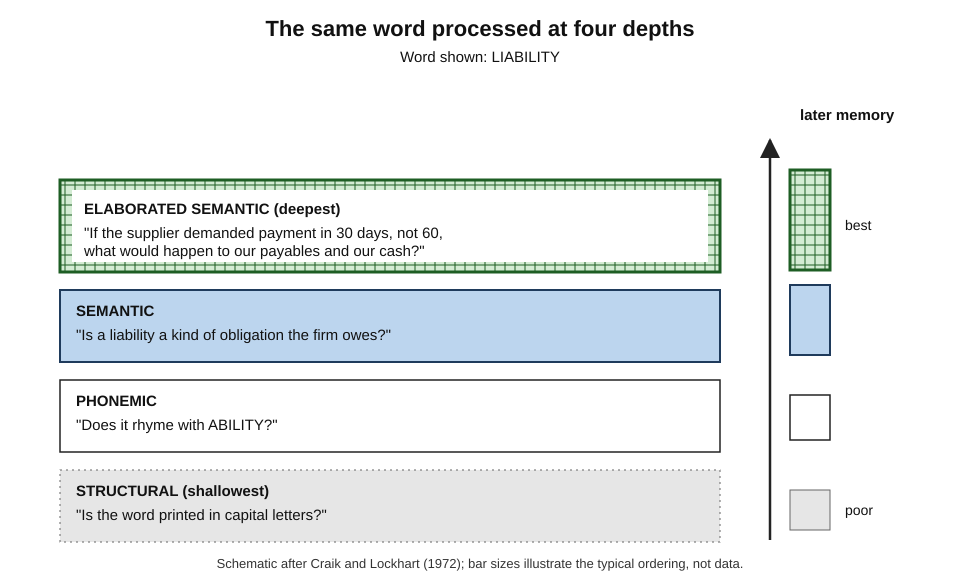
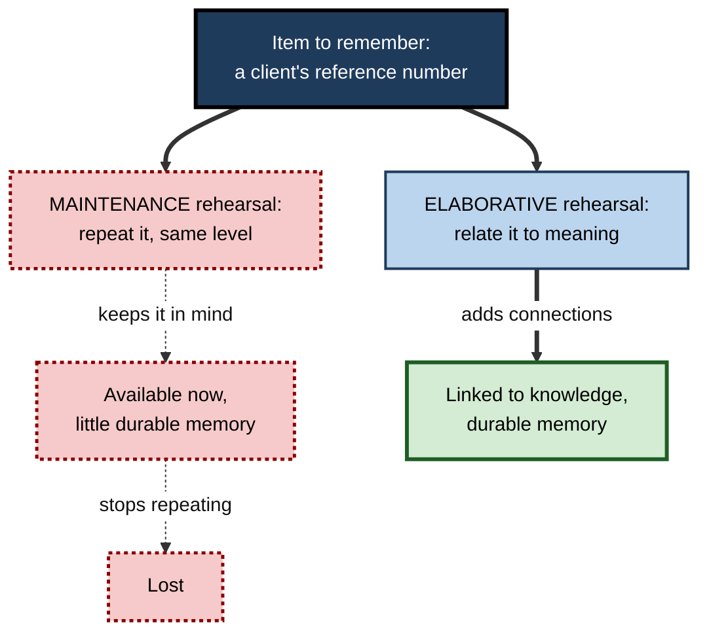
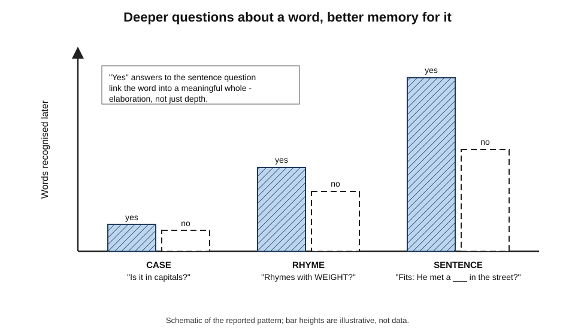
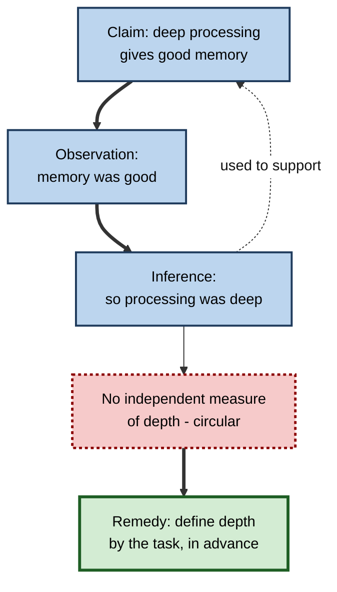
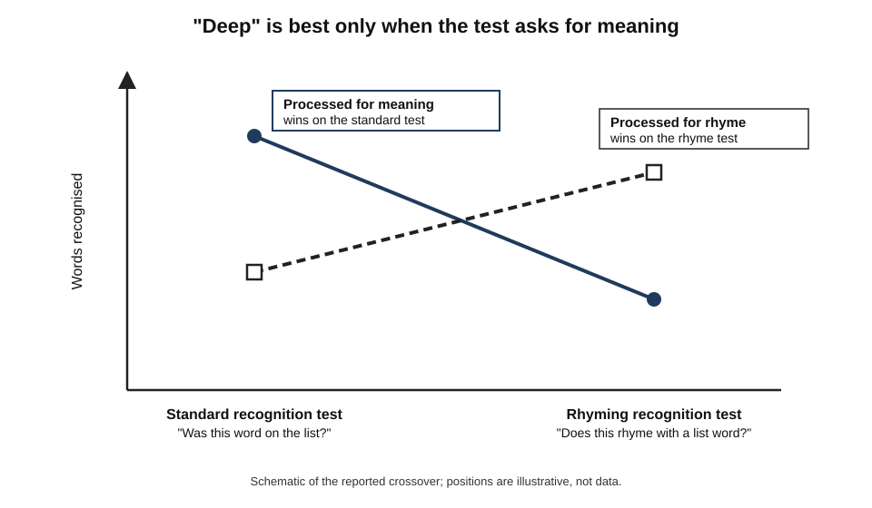
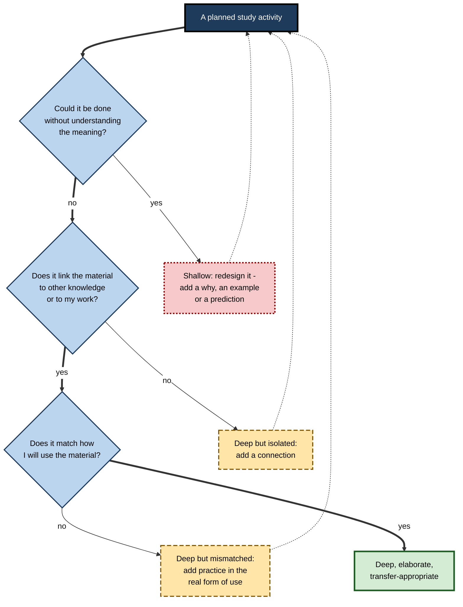

# F.10. Depth of Processing Theory

Two colleagues proofread the same twenty-page proposal. One checks every page for typing errors; the other checks whether every claim is supported and every number adds up. Both read every word. A week later, only the second can say what the proposal argued. The first processed the words as **shapes**; the second processed them as **meaning**. The difference in what each remembered was not a matter of time, effort or intention — it was a matter of **depth**.

> **Definition — Levels of processing:** the theory, proposed by Fergus Craik and Robert Lockhart in 1972, that how well something is remembered depends on the **depth** at which it was processed — from shallow analysis of physical features to deep analysis of meaning — rather than on separate memory stores or the mere amount of rehearsal.

> **Definition — Depth of processing:** the degree to which information is analysed for meaning and related to existing knowledge, rather than for its surface features such as appearance or sound.

**Why it matters**

- It explains why **intending** to learn, **spending time** and **repeating** often fail: what matters is the kind of processing the learner does.
- It gave study advice its central maxim — **process for meaning** — and gave researchers a framework that produced decades of experiments.
- Its limits are equally instructive: "deep" is not always best, depth is hard to measure, and memory also depends on how it will be **used**.
- For anyone designing study, training or documentation, the theory supplies a simple test of any activity: *what kind of processing does this make the learner do?*

---

## The Original Theory

### The background

- In the late 1960s, memory was usually described by **multi-store models**: information passed from sensory memory to a short-term store to a long-term store, with **rehearsal** moving it along.
- **Craik and Lockhart (1972)** proposed a different emphasis:
  - memory is a **by-product of perceptual and cognitive processing**, not the result of placing items in stores;
  - processing runs from **shallow** (physical features) to **deep** (meaning);
  - **deeper** processing leaves **more durable** memory traces.

### The levels

- **Structural (orthographic)** — what the item looks like: letters, case, typeface.
- **Phonemic** — what it sounds like: rhymes, syllables.
- **Semantic** — what it means: category, definition, relation to other ideas.
- **Elaborated semantic** — meaning richly connected to other knowledge: implications, examples, personal relevance.

**Figure 1.** The same word processed at four depths.

> **Key point:** depth is about **what the mind does with** an item, not how long it looks at it.

### Two kinds of rehearsal

- **Maintenance rehearsal (Type I)** — repeating an item to keep it in mind, at the same level of processing.
  - *e.g.* repeating a phone number until it is dialled.
- **Elaborative rehearsal (Type II)** — processing the item more deeply, relating it to meaning and other knowledge.
  - *e.g.* noticing that the number's last four digits are the year a relative was born.
- **The claim:** maintenance rehearsal keeps an item available but adds little to long-term memory; elaborative rehearsal strengthens it.

**Study card — Craik and Watkins (1973)**

- **Design:** participants heard lists of words and had to keep track of the most recent word beginning with a given letter. By varying the lists, the researchers controlled how long each word was held in mind — some for a moment, some for many seconds.
- **Results:** on a surprise recall test, **longer maintenance** produced little or no improvement in recall.
- **Conclusion:** merely holding an item in mind — repeating it — does not by itself build durable memory.
- **Later qualification:** maintenance rehearsal can modestly improve **recognition**, though it does little for recall.

**Figure 2.** Maintenance rehearsal compared with elaborative rehearsal.

---

## The Classic Evidence

### Intention is not enough

**Study card — Hyde and Jenkins (1969, 1973)**

- **Design:** participants saw lists of words and performed an **orienting task** on each:
  - **shallow** — check whether the word contained a particular letter, or count its letters;
  - **deep** — rate how pleasant or unpleasant the word was.
- Some participants were told there would be a memory test (**intentional learning**); others were not (**incidental learning**).
- **Results:**
  - Words rated for pleasantness were recalled **far better** than words checked for letters.
  - Being warned about the test made **little difference** once the orienting task was fixed.
- **Conclusion:** what learners **do** with material matters far more than whether they **intend** to remember it.

> **Definition — Orienting task:** a task that directs how a learner processes an item, used in experiments to control the type and depth of processing.

> **Watch out:** "I really tried to learn it" is not evidence of learning. Trying hard while copying notes or re-reading is still shallow processing; intention without meaningful processing changes little.

### Questions of increasing depth

**Study card — Craik and Tulving (1975)**

- **Design:** participants answered a question about each word, then later took a surprise memory test.
  - **Case** — "Is the word in capital letters?"
  - **Rhyme** — "Does the word rhyme with WEIGHT?"
  - **Sentence** — "Would the word fit the sentence: He met a ___ in the street?"
- **Results:**
  - Memory rose steeply from case to rhyme to sentence questions.
  - For sentence questions, words answered **"yes"** were remembered better than words answered **"no"**.
  - When the case task was made **slower and harder** than the sentence task, sentence-processed words were still remembered better — so time spent was not the explanation.
  - **More elaborate** sentence frames produced better memory than simple ones.
- **Conclusion:** meaning-based processing is powerful — and especially when the item is **integrated** into a meaningful structure ("yes" answers; richer sentences).

**Figure 3.** Recognition of words by type of orienting question and answer.

> **Key point:** the "yes" advantage showed that depth alone was not the whole story. Words that **fitted** a meaningful context were **elaborated** and **integrated**; words that did not fit were processed semantically but left unconnected.

### From depth to elaboration and distinctiveness

- **Elaboration** — the richness of the connections formed during processing. Two items processed at the same semantic level can differ greatly in how much is linked to them.
- **Distinctiveness** — how much an item's encoding sets it apart from others. A deeply processed item that is also distinctive is easiest to find at retrieval.
  - **Reed Hunt and Gilles Einstein (1981)** distinguished **relational processing** (what items have in common) from **item-specific processing** (what makes each unique) and showed that memory is best when both are present.
- **Craik's later view** (2002) — the original theory remains useful as a framework, but "depth" is best understood as the degree of **meaningful, elaborate and distinctive** encoding.

| Concept | What it adds | Example in studying |
|---|---|---|
| **Depth** | Meaning rather than surface | Asking what a term means rather than how it is spelt |
| **Elaboration** | Richness of links to other knowledge | Relating a new accounting rule to three past transactions |
| **Distinctiveness** | Features that separate the item from similar ones | Noting how this rule differs from a similar one |
| **Congruity** | Fit with a meaningful context | Placing a fact into an explanation where it belongs |
| **Self-reference** | Relating the item to oneself | "When have I seen this happen in my own work?" |

---

## Criticisms and Refinements

### The circularity problem

- **Alan Baddeley (1978)** and **Michael Eysenck (1978)** pointed out a central weakness:
  - deep processing is said to produce good memory;
  - but depth is often **inferred from** good memory;
  - without an **independent measure** of depth, the theory risks becoming circular.
- Attempts to measure depth independently — processing time, judged meaningfulness, effort — did not consistently line up with memory, as the Craik and Tulving timing result showed.

**Figure 4.** The circularity objection to levels of processing.

- **The practical remedy** — in most research and in study design, depth is defined **in advance by the task**: letter-checking is shallow, judging meaning is deep. That avoids circularity for practical purposes, even if it leaves the theoretical construct loose.

### Transfer-appropriate processing

**Study card — Morris, Bransford and Franks (1977)**

- **Design:** participants processed words either **semantically** ("Does the word fit this sentence?") or **phonemically** ("Does it rhyme with…?"), then took one of two tests:
  - a **standard recognition** test — "Was this word on the list?";
  - a **rhyming recognition** test — "Does this word rhyme with a word on the list?".
- **Results:**
  - On the **standard** test, semantic processing won, as levels of processing predicts.
  - On the **rhyming** test, **phonemic** processing won.
- **Conclusion:** the value of a type of processing depends on its **match** with what the test demands — **transfer-appropriate processing**.

**Figure 5.** Transfer-appropriate processing: the best encoding depends on the test.

> **Key point:** "deep is better" holds **when later use requires meaning** — which in professional life it usually does. But the deeper principle is **match study processing to later use**.

### Retrieval matters too

- **Encoding specificity** — Endel Tulving and Donald Thomson (1973) showed that a cue helps retrieval only if it was part of the original encoding. Depth at encoding is not enough; the right **cues** must be present at retrieval.
- **Implication:** deep processing helps partly because it creates **more and richer cues** — which is another way of saying elaboration.

### Implicit memory

- Some forms of memory are largely **unaffected** by depth.
  - **Perceptual priming** — faster identification of a word seen before, shown in tasks such as completing word fragments — depends on surface features and is little helped by semantic processing (shown by Larry Jacoby and Mark Dallas, 1981, among others).
- **Implication:** levels of processing describes **conscious recollection** well; it does not describe every kind of memory.

| Criticism | Core point | Status today |
|---|---|---|
| **Circularity** | Depth inferred from memory | Addressed in practice by defining depth via tasks |
| **Transfer-appropriate processing** | Best processing depends on the test | Accepted; refines rather than refutes the theory |
| **Encoding specificity** | Retrieval cues must match encoding | Accepted; complements the theory |
| **Implicit memory** | Some memory ignores depth | Accepted; limits the theory's scope |
| **Time and effort confounds** | Deep tasks may simply take longer | Largely answered by Craik and Tulving's timing controls |

---

## Extensions

### Self-reference

- **Timothy Rogers, Nicholas Kuiper and William Kirker (1977)** asked people whether adjectives described **themselves**; those words were remembered better than words judged for meaning alone.
- **Cynthia Symons and Blair Johnson (1997)**, in a meta-analysis, confirmed a reliable **self-reference effect**, attributing it to the self being a highly elaborate and organised body of knowledge.
- **For study:** "How does this apply to me or my work?" is a cheap route to deep, elaborate encoding.

### Survival processing

- **James Nairne, Sarah Thompson and Josefa Pandeirada (2007)** found that rating words for their relevance to surviving in grasslands — finding food and water, avoiding predators — produced better recall than many classic deep tasks, including pleasantness ratings and self-reference.
- **Interpretation is debated:** an evolutionary account (memory tuned to fitness-relevant information) competes with accounts based on rich elaboration and planning that the scenario invites.

### The brain at encoding

- **Shitij Kapur and colleagues (1994)**, using PET imaging, found more activity in the **left inferior prefrontal cortex** when people made semantic judgements about words than when they checked letters — and semantic judgements also produced better memory.
- **Subsequent-memory studies** — Anthony Wagner and colleagues (1998) used fMRI to show that activity in left prefrontal and medial temporal regions **while studying a word** predicted whether it would later be remembered.
- **Lesson:** deep, elaborative encoding has a measurable neural signature; what the brain does at study time partly determines what is remembered.

### What depth is not

- **Not time.** A slow, laborious letter-counting task is still shallow; Craik and Tulving's timing control showed that longer processing at a shallow level does not catch up.
- **Not effort.** Effort helps only when it is spent on meaning. Copying a dense page by hand is effortful and shallow.
- **Not intention.** Hyde and Jenkins showed that wanting to remember adds little once the orienting task is fixed.
- **Not difficulty of material.** Hard material can be processed shallowly (memorising a formula's symbols) and easy material deeply (asking why a simple rule exists).
- **Not a feeling.** Re-reading produces a sense of understanding — fluency — without deep processing; the feeling and the depth are separate.

> **Remember:** depth is defined by **the question the mind is answering** about the material, not by how long, how hard or how keenly it works.

### Depth and expertise

- **Experts process their own domain deeply by default.** A chess master sees a position as plans and threats, not as pieces; an experienced auditor reads a ledger as patterns of risk, not as numbers. Prompts to "think about meaning" add less for them.
- **Novices default to surface processing**, because they lack the knowledge that makes meaning visible. Orienting tasks help them most.
- **Experts outside their domain** are novices again; a brilliant surgeon reading a tax return processes it as shallowly as anyone.
- **The expert blind spot** — experts who teach often forget that learners cannot yet see the meaning they see, and so present material in forms that invite shallow processing. Building explicit orienting tasks into teaching compensates.

---

## Depth of Processing in Studying

### Shallow and deep study activities

| Study activity | Typical depth | Why |
|---|---|---|
| Copying notes word for word | Shallow | Attention on form, not meaning |
| Highlighting while reading | Usually shallow | Marking is quick and can be done without thought |
| Re-reading for familiarity | Shallow to moderate | Recognition of words, little new processing |
| Rote repetition of definitions | Shallow (maintenance) | Same level, no new links |
| Summarising in own words | Moderate | Requires meaning, but may stay near the text |
| Explaining why and how | Deep | Requires causes and links |
| Applying to a new case | Deep | Requires meaning plus transfer |
| Relating to one's own work | Deep and elaborate | Uses the rich self-knowledge network |

> **Remember:** an activity's depth is set by the **question it forces the mind to answer**. "What does it look like?" is shallow; "What does it mean, and what follows?" is deep.

### Turning shallow tasks into deep ones

- **Copying** → "Rewrite the paragraph as a cause-and-effect chain."
- **Highlighting** → "Highlight only sentences you could explain to a colleague, and write the reason in the margin."
- **Re-reading** → "Before re-reading, write what you think the section says; then check."
- **Memorising a definition** → "Give one example, one non-example and one consequence."
- **Watching a demonstration** → "Predict each step before it is shown."

**Figure 6.** Checking how deeply a study activity makes the learner process material.

### Worked example (illustrative): redesigning a study plan for a certification

- **Situation:** a project manager preparing for a professional certification plans to study by re-reading the official guide and copying key terms onto cards.

| Original activity | Depth | Redesigned activity | Depth gained |
|---|---|---|---|
| Re-read each chapter twice | Shallow to moderate | Read once; after each section write two lines: what it means and where it applies on the current project | Semantic plus self-reference |
| Copy 200 terms onto cards | Shallow | For each term, write the definition in own words, a project example and how it differs from a similar term | Elaboration plus distinctiveness |
| Highlight process diagrams | Shallow | Redraw each process from memory and explain each hand-off | Deep, generative |
| Read sample questions and answers | Moderate | Attempt sample scenario questions first, then compare reasoning with the answer | Transfer-appropriate (matches exam) |

1. **Diagnose** — each activity was asked "Could I do this without understanding?" — three of four could.
2. **Redesign** — each was changed so that meaning, connection or application was required.
3. **Match** — because the exam uses scenario questions, scenario practice was added (transfer-appropriate processing).
4. **Combine** — the deep activities were spread over weeks and mixed with self-testing.

- **Conclusion:** the study time stayed roughly the same; the **kind of processing** changed.

> **Watch out:** deep processing makes study **feel** slower and harder than copying and re-reading. That feeling is a sign the processing is working, not a sign it is failing.

---

## Depth of Processing at Work

### Training design

- **Click-through e-learning** — screens that can be passed by clicking "next" invite structural processing at best.
- **Orienting tasks for adults** — training can embed tasks that force meaning: "Decide whether this email is phishing and say which clue told you"; "Choose which of these three clauses best protects the company and explain why".
- **Questions that cannot be answered by matching words** — assessment items that require meaning ensure that training produces deep processing.

> **In practice:** a quick audit of any training module is to list every learner action and ask of each, "Could this be done correctly by someone who did not understand the content?" Every "yes" marks a place where processing can stay shallow — and where the module needs a decision, an explanation or a prediction.

### Documentation and communication

- **Documents read for compliance** are often processed shallowly — skimmed for signatures and dates.
- **Writers can induce depth**: start with a question the reader cares about, give a concrete case, ask the reader to decide something.

### Case study (illustrative): product-knowledge training for a pharmaceutical sales team

- **Situation:** sales representatives completed online modules on new medicines — mechanism, indications, contraindications, dosing — followed by a multiple-choice test.
- **Problem:** pass rates were high, but in field visits representatives could not answer physicians' questions beyond the scripted messages, and regulatory reviewers noted inaccurate statements about contraindications.
- **Diagnosis:**
  - the modules were slides with text, passable by clicking through;
  - test questions repeated phrases from the slides, so they could be answered by **surface matching**;
  - nothing required representatives to process the **meaning** of a contraindication or apply it to a patient.
- **Actions:**
  1. Each module opened with a short **physician question** to be answered at the end.
  2. Slides were interleaved with **orienting tasks**: "Explain to a colleague why this drug should not be used with X"; "Which of these three patients would be excluded, and why?"
  3. Test items were rewritten as **patient scenarios** using different wording from the slides.
  4. Representatives recorded a two-minute spoken explanation of the mechanism, reviewed by a medical adviser.
- **Result:** scenario-test scores were initially lower than the old pass rates but rose over successive modules; reviewers recorded fewer inaccurate statements in field audits; physicians' feedback on representatives' knowledge improved.
- **Side effects:** modules took longer; some representatives disliked being recorded.
- **Lesson:** the information did not change; the **processing demanded** of learners did — and with it what they could do.

### Depth and AI tools

- **AI summaries** let a reader skip the processing of meaning; reading a summary is often shallower than reading the original with questions in mind.
- **AI as an orienting-task generator** — an assistant can turn any text into deep questions ("What would change if…?", "Which example contradicts this?"), which the learner then answers.
- **The principle holds** — whatever the tool, memory depends on what the learner's own mind does with the material.

---

## Open Questions

- **Can depth be measured independently of memory?**
  - Neural markers and task definitions help, but a general, independent measure of "depth" does not exist.
- **Is "depth" one dimension or several?**
  - Elaboration, distinctiveness, congruity and self-reference may be separate factors; how they combine is not settled.
- **Why does survival processing work so well?**
  - Evolutionary and elaboration-based explanations both have support; the debate continues.
- **How large are depth effects in real study over long delays?**
  - Laboratory effects are large for word lists; effects of redesigning real study activities are positive but less often measured over months.
- **How should depth be built into self-paced digital learning?**
  - Embedded orienting tasks help, but learners can often skip or game them; designs that make meaning-processing unavoidable without frustrating learners are still being developed.
- **Does constant access to AI summaries make habitual processing shallower?**
  - Plausible, but untested on any scale.

---

## Summary

- **Levels of processing** (Craik and Lockhart, 1972): memory depends on **depth** — structural, phonemic, semantic, elaborated semantic — not on stores or mere rehearsal.
- **Maintenance rehearsal** keeps items available but adds little to recall (**Craik and Watkins, 1973**); **elaborative rehearsal** builds durable memory.
- **Hyde and Jenkins (1969, 1973):** the **orienting task** matters; **intention** to learn adds little. **Craik and Tulving (1975):** case < rhyme < sentence; "yes" answers and richer sentences better — **elaboration and congruity**, not time.
- Refinements: **elaboration** and **distinctiveness** (Hunt and Einstein, 1981); Craik (2002) sees depth as meaningful, elaborate, distinctive encoding.
- Criticisms: **circularity** (Baddeley; Eysenck); **transfer-appropriate processing** (Morris, Bransford and Franks, 1977) — the best processing matches the test; **encoding specificity** (Tulving and Thomson); **implicit memory** is little affected by depth.
- Extensions: **self-reference** (Rogers et al., 1977; Symons and Johnson, 1997), **survival processing** (Nairne et al., 2007 — interpretation debated); neural signatures of deep encoding (Kapur et al., 1994; Wagner et al., 1998).
- For study: judge every activity by the **question it forces** — redesign shallow tasks to require meaning, connection and use that matches the real task.
- At work: design **orienting tasks** into training and assessment; scenario questions in new wording; AI as a generator of deep questions, not a substitute for processing.

---

## Self-Check

1. State the central claim of levels-of-processing theory and how it differed from multi-store models.
2. Name the levels of processing and give an example question for each.
3. Distinguish maintenance from elaborative rehearsal, and describe the evidence from Craik and Watkins (1973).
4. What did Hyde and Jenkins find about intentional and incidental learning, and why is it important for study?
5. Describe Craik and Tulving (1975). What did the "yes" advantage and the timing control show?
6. How do elaboration and distinctiveness refine the idea of depth?
7. Explain the circularity criticism and how it is addressed in practice.
8. Describe the Morris, Bransford and Franks (1977) experiment and its implication.
9. What is encoding specificity, and how does it relate to depth?
10. Why does levels of processing not apply to perceptual priming?
11. What is the self-reference effect, and how can a professional use it?
12. Classify these as shallow or deep, and redesign the shallow ones: copying slides; answering "what would happen if"; highlighting; relating a concept to one's last project.
13. A compliance course is passed by clicking through slides and answering questions that repeat slide wording. Diagnose it with levels of processing and propose three changes.
14. Explain why depth of processing is not the same as time, effort or intention, with an example of each.
15. Why do orienting tasks typically help novices more than experts, and what is the expert blind spot?

### Answer Key

1. Memory is a by-product of processing, and deeper (meaning-based) processing yields more durable memory. Multi-store models emphasised transfer between stores through rehearsal; levels of processing emphasised the kind of processing.
2. Structural — "Is it in capitals?"; phonemic — "Does it rhyme with…?"; semantic — "Is it a kind of…?"; elaborated semantic — "How does it apply to our situation?"
3. Maintenance: repeating at the same level to keep an item in mind; elaborative: relating it to meaning and knowledge. Craik and Watkins varied how long words were held in mind; longer maintenance barely improved later recall.
4. The orienting task (letter-checking versus pleasantness rating) strongly affected recall; being told about the test made little difference. What learners do with material matters more than their intention.
5. Words were judged for case, rhyme or sentence fit; memory rose from case to rhyme to sentence. "Yes" answers to sentence questions were remembered better, showing integration into a meaningful context matters; making the case task slower did not help it, showing time was not the cause.
6. Elaboration is the richness of links formed; distinctiveness is what sets an item apart. Two items processed at the same "depth" differ in memorability according to how elaborately and distinctively they were encoded.
7. Depth is inferred from good memory, which is then explained by depth — circular. In practice, depth is defined in advance by the task (letter-checking shallow, meaning judgement deep).
8. Words processed for meaning were better recognised on a standard test; words processed for rhyme were better recognised on a rhyming test. The best encoding matches what the test demands — transfer-appropriate processing.
9. A retrieval cue helps only if it was part of the original encoding. Deep, elaborate encoding creates more and richer cues, which is part of why it helps.
10. Perceptual priming depends on surface features of the item and is little affected by semantic processing; the theory describes conscious recollection, not all memory.
11. Better memory for material related to oneself. A professional can ask, for each new concept, "Where has this shown up in my own work, and what would I do differently now?"
12. Copying slides — shallow → rewrite as a cause-and-effect chain. "What would happen if" — deep. Highlighting — usually shallow → highlight only what one can explain and note why. Relating to one's last project — deep and elaborate.
13. The course allows structural processing and surface matching, so little meaning is processed. Changes: embed orienting tasks requiring decisions with reasons; rewrite questions as scenarios in new wording; open each module with a real dilemma to be resolved at the end.
14. Time: a slow letter-counting task stays shallow. Effort: copying a page by hand is hard but shallow. Intention: wanting to remember adds little if the task processes only surface features (Hyde and Jenkins). Depth is set by whether meaning is processed.
15. Experts already process their domain for meaning automatically, so prompts add little; novices lack the knowledge to see meaning and default to surface processing. The expert blind spot is experts' tendency, when teaching, to forget that learners cannot yet see the meaning and to present material in ways that invite shallow processing.

---

## Glossary

| Term | Meaning |
|---|---|
| Congruity | The fit between an item and the context in which it is processed. |
| Depth of processing | The degree to which information is analysed for meaning rather than surface features. |
| Elaborative rehearsal | Processing an item more deeply by relating it to meaning and knowledge. |
| Encoding specificity | The principle that a retrieval cue helps only if it was part of the original encoding. |
| Expert blind spot | Experts' tendency to forget what novices cannot yet see, and to teach accordingly. |
| Fluency | The subjective ease of processing, often mistaken for understanding. |
| Incidental learning | Learning that occurs without intention to remember. |
| Intentional learning | Learning with the explicit aim of remembering. |
| Item-specific processing | Encoding what makes an item unique. |
| Levels of processing | Craik and Lockhart's theory that memory depends on depth of processing. |
| Maintenance rehearsal | Repeating an item at the same level to keep it in mind. |
| Multi-store model | A model of memory as information moving between separate stores. |
| Orienting task | A task that controls how an item is processed. |
| Perceptual priming | Faster identification of an item seen before, based on its surface features. |
| Phonemic processing | Processing an item's sound. |
| Relational processing | Encoding what items have in common. |
| Self-reference effect | Better memory for material related to oneself. |
| Semantic processing | Processing an item's meaning. |
| Structural processing | Processing an item's physical appearance. |
| Subsequent-memory effect | Brain activity during study that predicts later remembering. |
| Survival processing | Rating items for relevance to survival, which produces strong recall. |
| Transfer-appropriate processing | The principle that memory is best when study processing matches test demands. |
