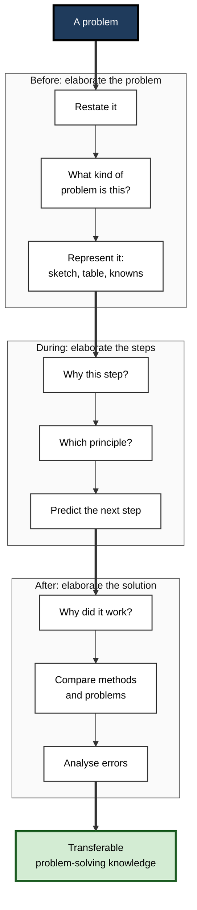
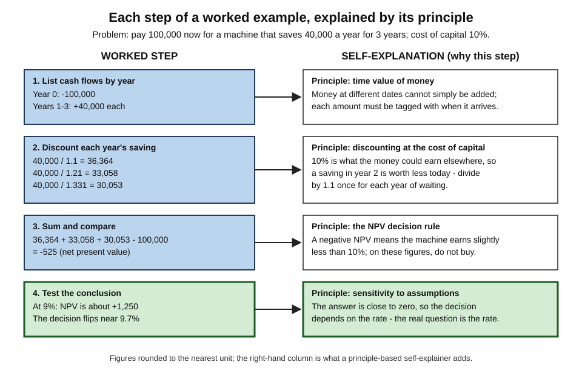
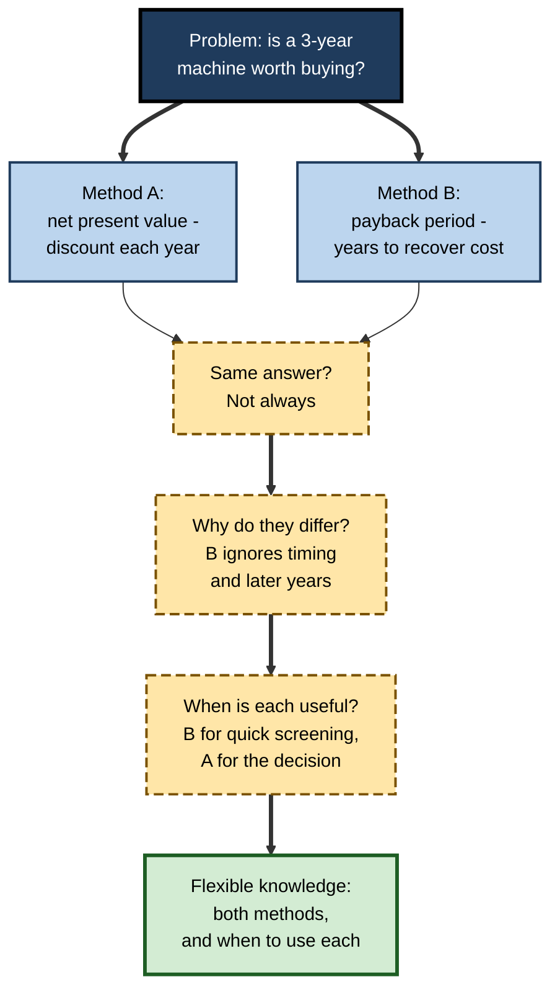
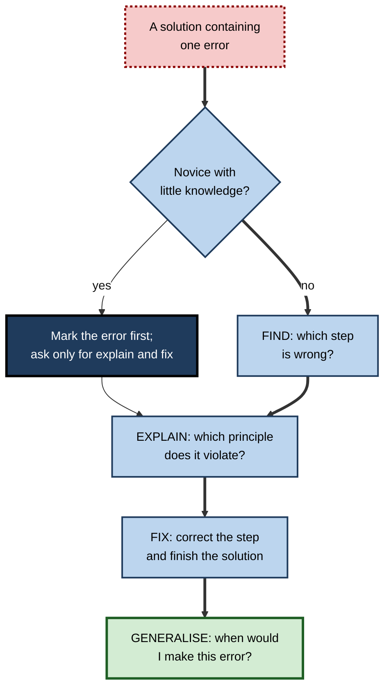
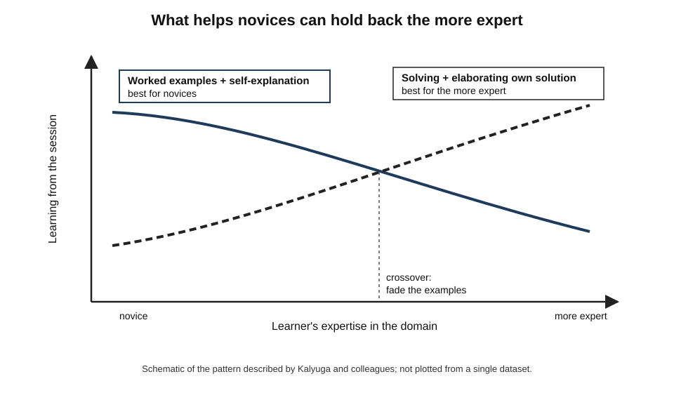
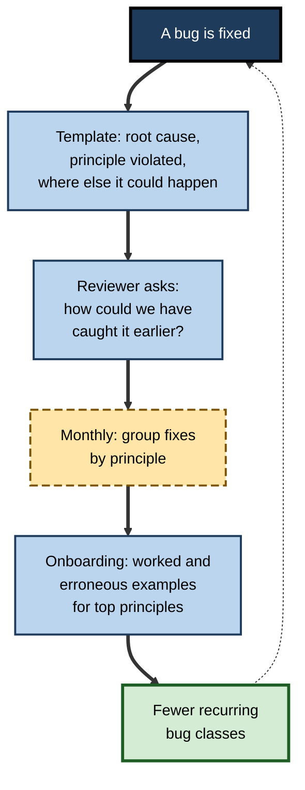

# F.11. Elaboration in Problem Solving

Two trainee analysts each work through twenty practice problems on discounted cash flow. The first races through, checks each answer against the key, and moves on. The second does fewer problems but, for each worked example and each of her own solutions, writes one line beside every step: *why this step, which principle*. On the exam, the problems look different from the practice set. The first analyst recognises none of them; the second recognises the principles in all of them.

Solving problems is not, by itself, the same as **learning from** problems. Elaboration is what turns one into the other.

> **Definition — Elaboration in problem solving:** adding explanations, principles, comparisons and reflections to worked examples and to one's own solutions — so that what is learned is the reasoning and its underlying principles, not just the answer to a particular problem.

**Why it matters**

- Professionals are paid to solve problems they have not seen before; practice only helps if it builds knowledge that **transfers** to new problems.
- Learners who simply solve or read solutions tend to learn **surface procedures** tied to the look of the practice problems.
- Elaborating examples and solutions — explaining steps, naming principles, comparing methods, analysing errors — is among the best-evidenced ways to build **transferable** problem-solving knowledge.
- It costs little: the same problems, studied differently.
- It also changes with expertise: what helps a novice can hinder an expert, so the elaboration must fit the learner's stage.

---

## Where Elaboration Enters Problem Solving

### Three moments

- **Before solving — elaborating the problem**
  - Restating the problem in one's own words.
  - Identifying what kind of problem it is — which principle or model applies.
  - Representing it: a sketch, a table, a list of knowns and unknowns.
- **During solving — elaborating the steps**
  - Explaining why each step is taken and what it achieves.
  - Predicting the next step before taking it.
  - Checking each step against the principle that justifies it.
- **After solving — elaborating the solution**
  - Looking back: why did this work? Where else would it work?
  - Comparing with other methods or other problems.
  - Analysing errors, one's own and others'.

> **Key point:** most learners elaborate at **none** of these moments; they read the problem, apply a procedure and check the answer.

**Figure 1.** The three moments at which elaboration can enter problem solving.

### Elaborating the problem before solving

- **Restating** — putting the problem in one's own words forces the learner to decide what is actually being asked; many errors come from solving a different problem from the one set.
- **Classifying** — "What kind of problem is this? Which principle governs it?" is the novice's deliberate version of the expert's automatic deep-structure recognition.
- **Representing** — a sketch, a table of knowns and unknowns, a timeline or a small diagram externalises the problem so its structure can be inspected.
- **Monitoring** — Alan Schoenfeld's studies of mathematical problem solving in the 1980s found that students often committed early to an approach and pursued it for many minutes without checking progress, while experts paused regularly to ask, "Is this working? Should I change approach?" Elaborating the plan — saying why it should work — makes such checks natural.
- **Recalling an analogue** — asking "Have I seen a problem with the same structure?" can unlock a method; spontaneous recall of such analogues is rare, which is why the question is worth asking explicitly.

> **Key point:** time spent elaborating the problem is rarely wasted; it is often the difference between solving the right problem and solving a convenient one.

### Surface and deep problem representations

**Study card — Chi, Feltovich and Glaser (1981)**

- **Design:** physics experts (graduate students and faculty) and novices (undergraduates who had completed a course) sorted physics problems into groups of their choice and explained their groupings.
- **Results:**
  - **Novices** grouped problems by **surface features** — "inclined planes", "springs", "pulleys".
  - **Experts** grouped them by **underlying principles** — "conservation of energy", "Newton's second law".
- **Conclusion:** expertise consists largely of representing problems by their **deep structure**. Elaborating problems in terms of principles is how a learner builds such representations.

> **Definition — Deep structure (of a problem):** the principles and relations that determine how a problem can be solved, as opposed to its surface story and objects.

---

## Elaborating Worked Examples

### Why worked examples, and why they are not enough

- **The worked-example effect** — John Sweller and Graham Cooper (1985) found that novices learned algebra procedures more efficiently by studying worked examples than by solving equivalent problems unaided, because unaided solving overloads working memory with search.
- **The catch:** examples can be read **passively** — the learner follows each line, feels it makes sense and learns little. The benefit depends on how the example is processed.

### Self-explaining examples

- **Chi and colleagues (1989)** found that students who learned most from mechanics examples explained each step to themselves — why it was done, which principle it used — while weaker students paraphrased or read on.
- **Alexander Renkl (1997)** identified successful patterns:
  - **principle-based explanations** — linking steps to domain principles;
  - **goal-operator explanations** — stating what goal each step serves;
  - **anticipative reasoning** — predicting the next step before reading it.
- **Unsuccessful patterns** — passive reading, superficial paraphrase, few explanations.

**Figure 2.** A worked example with principle-based self-explanations beside each step.

### Self-explanations and instructional explanations

- **Providing explanations** — instructors often add their own explanations to worked examples.
- **Jörg Wittwer and Alexander Renkl (2008)** reviewed why such **instructional explanations** often help less than expected: learners read them passively, they may not address the learner's actual gap, and they can displace the learner's own explanation.
- **When provided explanations help** — when they are **brief**, address a **specific** gap, come **after** the learner has tried, and are followed by a task that requires using them.
- **Implication for self-study:** try to explain a step first; read the provided explanation only if stuck or to check; then restate it in one's own words.

### Prompting and fading

**Study card — Atkinson, Renkl and Merrill (2003)**

- **Design:** university students learned probability with worked examples that were **gradually faded** — later examples had steps left for the learner to complete — with or without **prompts to identify the principle** behind each step.
- **Results:** combining **fading** with **self-explanation prompts** produced better learning and transfer than fading alone.
- **Conclusion:** asking learners to name the principle at each step makes the transition from studying examples to solving problems more effective.

> **Definition — Fading:** gradually removing steps from worked examples so that learners complete more of each solution themselves, moving from studying to solving.

### Explaining by reference

**Study card — Aleven and Koedinger (2002)**

- **Design:** school pupils learned geometry with a computer-based tutor.
  - **Explain group** — after each problem step, selected the **theorem or rule** that justified it, from a glossary.
  - **Control group** — solved the same problems without explaining.
- **Results:** the explain group showed **better understanding** and **better transfer** to problems requiring explanation of reasoning, without needing more time overall.
- **Conclusion:** even a light form of elaboration — naming the principle behind each step — shifts learning from procedures towards understanding.

> **In practice:** the cheapest form of problem-solving elaboration is a margin note naming the **principle** beside each step: "time value", "matching principle", "Ohm's law", "precedence rule". It takes seconds and changes what is learned.

---

## Elaborating by Comparison

### Comparing solution methods

**Study card — Rittle-Johnson and Star (2007)**

- **Design:** school pupils learned to solve linear equations.
  - **Compare group** — studied **two different solution methods** for the same equation side by side and answered questions comparing them.
  - **Sequential group** — studied the same methods one at a time.
- **Results:** the compare group gained more **procedural knowledge** and more **flexibility** — knowing more than one method and when each is efficient — with similar conceptual gains.
- **Conclusion:** comparing methods makes visible **why** each works and **when** each is better.

**Figure 3.** Comparing two solution methods for the same problem.

### Comparing problems

- **Pairs with the same principle and different surfaces** — two problems that look unrelated but are solved the same way teach the principle (analogical encoding).
- **Pairs with the same surface and different principles** — two problems that look alike but need different methods guard against surface-based choices.
  - *e.g.* two inventory problems, one solved by reorder-point logic, the other by a capacity constraint.

### Comparing correct and incorrect solutions

**Study card — Durkin and Rittle-Johnson (2012)**

- **Design:** school pupils learning decimals compared either **two correct examples** or a **correct and an incorrect example** of the same problem type.
- **Results:** pupils comparing correct with incorrect examples gained more **conceptual knowledge** and showed fewer **misconceptions** afterwards.
- **Conclusion:** seeing why a wrong method fails sharpens understanding of why the right one succeeds.

---

## Elaborating Errors

### Erroneous examples

- **Erroneous examples** are worked solutions containing a deliberate error that the learner must find, explain and fix.
- **Evidence:**
  - Tatjana Große and Alexander Renkl (2007) found that erroneous examples helped learners with **more prior knowledge** reach **far transfer**, but did not help — and could confuse — learners with little knowledge unless the error was **marked**.
  - Classroom studies of erroneous examples in mathematics (*e.g.* work by Bruce McLaren and colleagues on decimals) have reported benefits that show up particularly on **delayed** tests.
- **Mechanism:** explaining an error requires knowing the principle well enough to see where it was violated.

**Figure 4.** Studying an erroneous example: find, explain, fix and generalise.

### Elaborating one's own errors

- **Error explanation** — after a mistake, write: what I did, why I did it, which principle I violated, what cue should have told me.
- **Error logs** — a running list of one's own error types; over time it reveals patterns (misreading the question, sign errors, wrong model choice).
- **The point** — an error explained is a lesson; an error merely corrected is likely to recur.

> **Watch out:** checking an answer against a key and moving on when it is wrong is one of the least effective ways to use errors. The learning lies in **explaining** the error, not in **noticing** it.

---

## Looking Back

### Pólya's fourth step

- **George Pólya**, in *How to Solve It* (1945), described four phases of problem solving: **understand** the problem, **devise a plan**, **carry out** the plan, **look back**.
- **Looking back** includes:
  - checking the result and the argument;
  - asking whether the result could be derived differently;
  - asking whether the method or result can be used for **other problems**.
- Pólya observed that students usually skip this phase — and with it most of the learning.

### Reflection questions after solving

1. **What was the key insight?** — the step that made the problem solvable.
2. **Which principle did the solution use?**
3. **What made this problem hard?** — the feature that blocked progress.
4. **Where would this method fail?**
5. **What would I do differently next time?**

> **Mnemonic — "KPHFD: Keep Principles Handy For Decisions":** Key insight, Principle, Hard part, Failure conditions, Do differently.

### After-action reviews

- The **after-action review**, developed in the United States Army and widely adopted in organisations, asks four questions after an operation: What was supposed to happen? What actually happened? Why was there a difference? What can be learned?
- It is **looking back** made routine and collective — elaboration of a solved (or failed) real problem.

| | Solving only | Solving plus elaboration |
|---|---|---|
| **What is learned** | The answer and a procedure tied to this problem | The principle, the method and when to use it |
| **Transfer to new-looking problems** | Weak | Stronger |
| **Response to errors** | Correct and move on | Explain, generalise, log |
| **Time per problem** | Shorter | Longer |
| **Problems needed to learn** | Many | Fewer |
| **Typical feeling** | Productive, fast | Slower, more effortful |

---

## Fitting Elaboration to Expertise

### The expertise reversal effect

- **Slava Kalyuga and colleagues** showed that instructional support that helps novices — worked examples, detailed explanations — can become **redundant** and even harmful for more expert learners, who must process information they no longer need.
- **For elaboration:**
  - **Novices** — study and self-explain worked examples; elaborate the principle behind each step; use marked errors.
  - **Intermediate learners** — faded examples; compare methods; find unmarked errors.
  - **More expert learners** — solve problems unaided and elaborate their **own** solutions; compare with expert solutions; analyse failure conditions.

**Figure 5.** The expertise reversal effect for examples and problem solving.

> **Remember:** the more a learner knows, the less they should be **given** and the more they should **elaborate their own** work.

### Matching elaboration techniques to stage

| Learner stage | Main activity | Elaboration that helps | Elaboration to avoid |
|---|---|---|---|
| **Novice** | Studying worked examples | Principle-naming, goal explanations, marked errors | Unmarked error hunts, long open-ended reflection |
| **Intermediate** | Faded examples, guided problems | Method comparison, prediction, unmarked errors | Rereading full examples already understood |
| **Advanced** | Unaided problems | Own-solution explanation, failure conditions, expert comparison | Studying fully worked examples |
| **Expert** | Real, novel problems | After-action review, teaching others, edge cases | Detailed step-by-step prompts |

---

## Elaboration in Professional Problem Solving

### Common workplace forms

- **Debugging** — "rubber duck debugging", a practice described by Andrew Hunt and David Thomas in *The Pragmatic Programmer* (1999), in which a programmer explains code line by line to an inanimate listener; the explanation often reveals the bug.
- **Clinical reasoning** — clinicians articulate a differential diagnosis and the reasoning for and against each possibility; supervisors ask "What would make you change your mind?"
- **Consulting and analysis** — structuring a problem into hypotheses and naming the evidence that would confirm or refute each.
- **Engineering design reviews** — explaining why each design choice was made and how it would fail.
- **Post-incident reviews** — explaining causes, contributing factors and what would have prevented them.

> **In practice:** the question "Why did that work?" is asked far less often at work than "Why did that fail?" — yet successes explained are as instructive as failures, and less defensive to discuss.

### Ill-structured problems

- Most workplace problems are **ill-structured** — Herbert Simon's term for problems whose goals, constraints and acceptable solutions are not fully specified in advance: "How should we enter this market?", "Which supplier should we choose?", "How should this team be reorganised?"
- **Elaboration here means making the hidden structure explicit:**
  - stating the **assumptions** behind each option;
  - naming the **criteria** by which a solution will be judged;
  - generating **alternatives** before choosing;
  - writing the **argument** for the chosen option and the strongest argument against it.
- **The pre-mortem** — a technique described by Gary Klein (2007): before committing to a plan, the team imagines that it has failed and each member explains **why**. Explaining a hypothetical failure is elaboration aimed at weaknesses that optimism hides.

> **Definition — Ill-structured problem:** a problem whose goals, constraints or criteria for a good solution are not fully defined, so that framing the problem is part of solving it.

### Worked example: a junior analyst learning from a pricing problem

- **Situation:** a junior analyst is asked whether a 10% price cut on a product line would raise profit. A senior colleague solves it; the junior studies the solution.

1. **Restate** — "Will the extra units sold at the lower price bring in more contribution than the margin lost on units we would have sold anyway?"
2. **Classify** — "This is a break-even volume problem: compare contribution before and after."
3. **Self-explain each step of the senior's solution:**
   - "Contribution per unit falls from 40 to 30 (price 100 → 90, variable cost 60)" — *principle: contribution margin is price minus variable cost; fixed costs do not change with the decision.*
   - "Current volume 1,000 → contribution 40,000; to match, need 40,000 ÷ 30 ≈ 1,334 units" — *principle: break-even volume for the new margin.*
   - "Volume must rise by about 33% for a 10% price cut" — *principle: the lower the margin, the more volume is needed; this is why price cuts are dangerous for low-margin products.*
4. **Compare methods** — the junior also tries percentage-change reasoning: required volume rise = price cut ÷ (margin % − price cut) = 10 ÷ (40 − 10) = 33% — same answer, faster.
5. **Look back** — "Where would this fail? If the price cut triggers competitor cuts, volume will not rise as estimated; if variable cost changes with volume, the margin assumption fails."

- **Result:** the junior now holds a **principle** (required volume rise for a price cut) and two **methods**, plus the **conditions** under which the analysis breaks.

> **Formula — Volume increase needed to keep contribution after a price cut:** required rise = cut ÷ (contribution margin − cut), all as percentages of the original price. Example: margin 40%, cut 10% → 10 ÷ (40 − 10) = **33%**.

> **Watch out:** the most common error is to compare **revenue** before and after rather than **contribution**. Revenue can rise while profit falls; the self-explanation "fixed costs do not change, so compare contribution" is what prevents it.

### Case study: an engineering team that explained its fixes

- **Situation:** a software team fixed bugs quickly, but similar bugs kept recurring in different parts of the system.
- **Problem:** each fix was correct; nothing was learned from it. New engineers repeated mistakes that senior engineers had fixed months before.
- **Diagnosis:**
  - pull requests for bug fixes described **what** changed, not **why** the bug occurred;
  - there was no record of the principle violated (*e.g.* "time zones not normalised before comparison");
  - fixes were reviewed for correctness, not for understanding.
- **Actions:**
  1. The bug-fix template added three required fields: **root cause in one sentence**, **principle violated**, **where else this could happen**.
  2. Reviewers asked one elaborative question per fix: "How would we have caught this earlier?"
  3. Monthly, the team grouped fixes by **principle** rather than by component and discussed the largest group.
  4. For the most common principles, a short worked example and an erroneous example were added to onboarding.
- **Result:** within two quarters, recurrence of the most common bug classes fell noticeably; new engineers cited the onboarding examples when reviewing code.
- **Side effects:** fixes took slightly longer to submit; some engineers initially wrote vague principles ("be careful with dates") until reviewers asked for specifics.
- **Lesson:** grouping problems by **principle** — the expert's representation — and explaining each fix turned a stream of solved problems into a body of knowledge.

**Figure 6.** How explained fixes became shared, principle-based knowledge in the case study.

### Elaboration and AI assistants in problem solving

- **The risk** — an assistant that produces complete solutions removes the very steps that build problem-solving knowledge; the learner studies answers rather than reasoning.
- **Productive uses:**
  1. solve or attempt first; then ask the assistant to **critique** the reasoning and name the principle at each step;
  2. ask it to generate an **erroneous example** for the learner to diagnose;
  3. ask for a **second method** and compare the two;
  4. ask "Where would this solution fail?" and check the answer.
- **Calibration** — assistants can be wrong in plausible ways; verifying the principle against a trusted source remains necessary.

---

## Open Questions

- **How much elaboration is optimal per problem?**
  - Elaboration improves learning per problem but costs time; the best balance between more problems and deeper elaboration is not well established outside a few domains.
- **When do erroneous examples help beginners?**
  - Results are mixed; marking errors helps, but how much knowledge is needed before unmarked errors become productive is unclear.
- **Does elaboration transfer as a habit?**
  - Learners trained to self-explain in one domain do not always do so in another; how to build a general habit is unresolved.
- **How should elaboration adapt in real time?**
  - Expertise reversal implies that support should fade as competence grows; automatic, reliable detection of the right moment is still developing in tutoring systems.
- **What do AI solvers do to learning from problems?**
  - Early evidence suggests unrestricted answer-giving harms independent learning while hint-giving designs reduce the harm; the long-term effects on expertise are unknown.

---

## Summary

- **Elaboration in problem solving** adds explanations, principles, comparisons and reflections to examples and solutions, so that **principles** rather than answers are learned.
- It enters **before** (restate, classify, represent), **during** (why this step, which principle, predict) and **after** (why it worked, compare, analyse errors).
- **Chi, Feltovich and Glaser (1981):** experts represent problems by **deep structure**, novices by surface.
- **Worked-example effect** (Sweller and Cooper, 1985) — but examples must be **self-explained** (Chi et al., 1989; Renkl, 1997). **Fading plus principle prompts** (Atkinson, Renkl and Merrill, 2003); **explaining by reference** to theorems (Aleven and Koedinger, 2002).
- **Comparison:** of methods (Rittle-Johnson and Star, 2007 — more flexibility), of problems (same principle/different surface and vice versa), of correct and incorrect solutions (Durkin and Rittle-Johnson, 2012).
- **Errors:** erroneous examples help learners with enough knowledge, especially on delayed tests; mark errors for novices (Große and Renkl, 2007). Explain one's own errors; keep an error log.
- **Look back** (Pólya); reflect with **Key insight, Principle, Hard part, Failure conditions, Do differently**; **after-action reviews** at work.
- **Expertise reversal** (Kalyuga): novices self-explain examples; experts elaborate their own solutions.
- At work: rubber-duck debugging, clinical reasoning, design and incident reviews; group fixes by **principle**. With AI: attempt first, then ask for critique, errors to diagnose, alternative methods and failure conditions.

---

## Self-Check

1. Define elaboration in problem solving and name the three moments at which it can occur.
2. What did Chi, Feltovich and Glaser (1981) find about how experts and novices sort problems?
3. What is the worked-example effect, and why is it not enough on its own?
4. Describe Renkl's successful and unsuccessful self-explanation patterns.
5. What did Atkinson, Renkl and Merrill (2003) show about fading and prompts?
6. Describe "explaining by reference" and the Aleven and Koedinger (2002) result.
7. What did Rittle-Johnson and Star (2007) find, and why does comparing methods help?
8. When do erroneous examples help, and when should errors be marked?
9. Explain Pólya's "look back" phase and give three reflection questions.
10. What is the expertise reversal effect, and how should elaboration change as a learner gains expertise?
11. A learner checks answers against a key and moves on when wrong. What should they do instead?
12. A shop sells a product at 50 with a variable cost of 35. By what percentage must volume rise to keep contribution unchanged after a 5% price cut? Show the reasoning and one self-explanation.
13. Design a bug-fix or incident template that builds elaboration into routine problem solving.
14. What did Schoenfeld observe about how students and experts monitor their problem solving, and how does elaborating the plan help?
15. Why do instructional explanations added to worked examples often help less than expected, and when do they help?

### Answer Key

1. Adding explanations, principles, comparisons and reflections to examples and solutions so the reasoning and principles are learned. Before solving (restate, classify, represent), during (explain steps, name principles, predict), after (look back, compare, analyse errors).
2. Novices grouped by surface features such as "inclined planes"; experts grouped by underlying principles such as conservation of energy. Expertise is largely deep-structure representation.
3. Novices learn more efficiently from studying worked examples than from unaided solving, which overloads working memory. Examples can be read passively; benefit depends on self-explaining them.
4. Successful: principle-based explanations, goal-operator explanations, anticipative reasoning. Unsuccessful: passive reading, superficial paraphrase, few explanations.
5. Faded worked examples combined with prompts to identify each step's principle produced better learning and transfer than fading alone.
6. Naming the theorem or rule that justifies each step. Pupils using a geometry tutor who did this gained better understanding and transfer than those who only solved, without needing more time overall.
7. Pupils comparing two solution methods side by side gained more procedural knowledge and flexibility than those studying the methods sequentially. Comparison reveals why each method works and when each is efficient.
8. They help learners with enough prior knowledge, especially for far transfer and on delayed tests. For novices, errors should be marked so learners can focus on explaining and fixing.
9. After solving, check the result and argument, consider other methods and ask where else the method applies. Questions: What was the key insight? Which principle did it use? Where would it fail?
10. Support that helps novices becomes redundant or harmful for more expert learners. Novices: self-explain worked examples; intermediates: faded examples, method comparison, unmarked errors; advanced: elaborate own solutions and compare with experts.
11. Explain each error — what was done, why, which principle it violated, what cue was missed — and record the error type in a log to spot patterns.
12. Contribution margin = 50 − 35 = 15, i.e. 30% of price. Cut = 5% of price. Required rise = 5 ÷ (30 − 5) = 20%. Check: new price 47.50, new margin 12.50; 15 ÷ 12.50 = 1.2 → 20% more units. Self-explanation: "Fixed costs are unchanged by the decision, so compare contribution, not revenue; the lower margin means more units are needed."
13. *e.g.* Fields: one-sentence root cause; principle violated; how it could have been caught earlier; where else the same error could occur; a test or check added to prevent recurrence. Reviewers must ask one "why" question; fixes are grouped monthly by principle.
14. Students committed early to an approach and pursued it without checking progress; experts paused to ask whether it was working and changed course. Stating why a plan should work creates natural checkpoints against which progress can be judged.
15. Learners read them passively, they may not address the learner's actual gap, and they can displace self-explanation (Wittwer and Renkl, 2008). They help when brief, targeted at a specific gap, given after the learner has tried, and followed by a task requiring their use.

---

## Glossary

| Term | Meaning |
|---|---|
| After-action review | A structured review asking what was intended, what happened, why, and what can be learned. |
| Anticipative reasoning | Predicting the next step of a solution before seeing it. |
| Deep structure | The principles and relations that determine how a problem is solved. |
| Erroneous example | A worked solution containing an error for the learner to find, explain and fix. |
| Error log | A record of one's own errors by type, used to reveal patterns. |
| Expertise reversal effect | Support that helps novices but hinders more expert learners. |
| Explaining by reference | Justifying each solution step by naming the rule or theorem it uses. |
| Fading | Gradually removing worked steps so learners complete more of each solution. |
| Goal-operator explanation | Explaining what goal a step serves and how it achieves it. |
| Ill-structured problem | A problem whose goals, constraints or solution criteria are not fully defined. |
| Instructional explanation | An explanation supplied by an instructor or text rather than generated by the learner. |
| Looking back | Pólya's final phase: checking, seeking other methods and generalising. |
| Monitoring | Checking during problem solving whether the chosen approach is making progress. |
| Pre-mortem | Imagining a plan has failed and explaining why, before committing to it. |
| Principle-based explanation | Linking a solution step to the domain principle that justifies it. |
| Rubber duck debugging | Explaining code line by line to an inanimate listener to find errors. |
| Surface features | The story, objects and wording of a problem, as opposed to its structure. |
| Worked example | A problem presented with its full step-by-step solution. |
| Worked-example effect | Novices learning more efficiently from studying worked examples than from unaided solving. |
