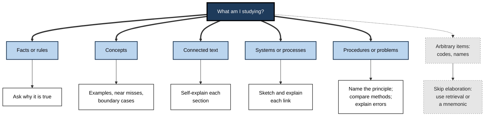
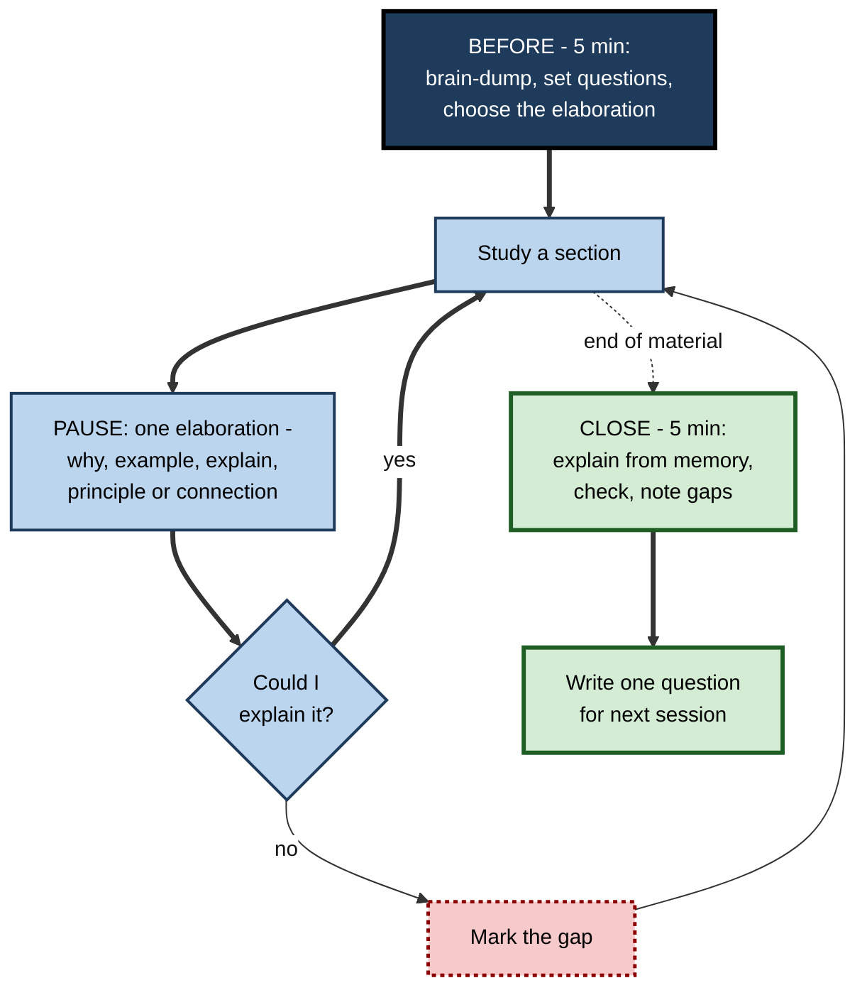
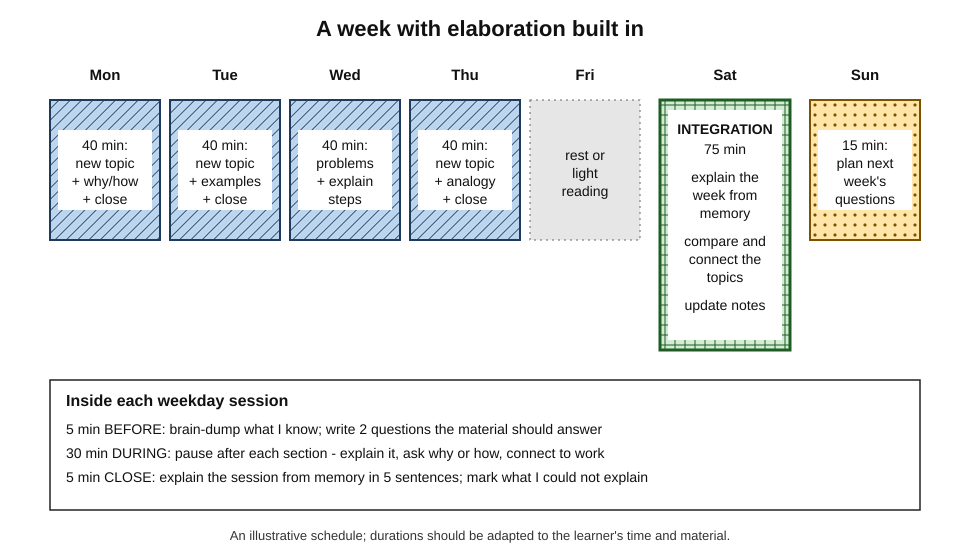
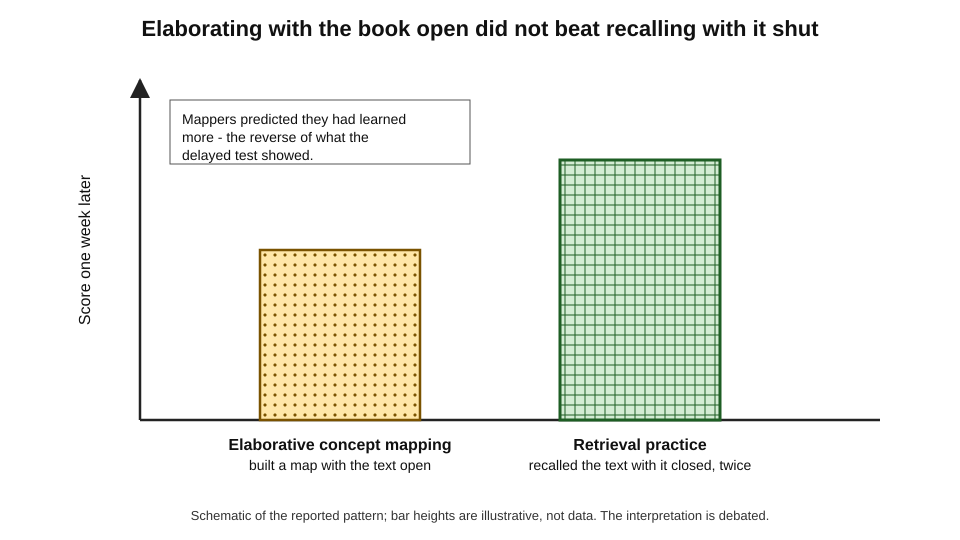
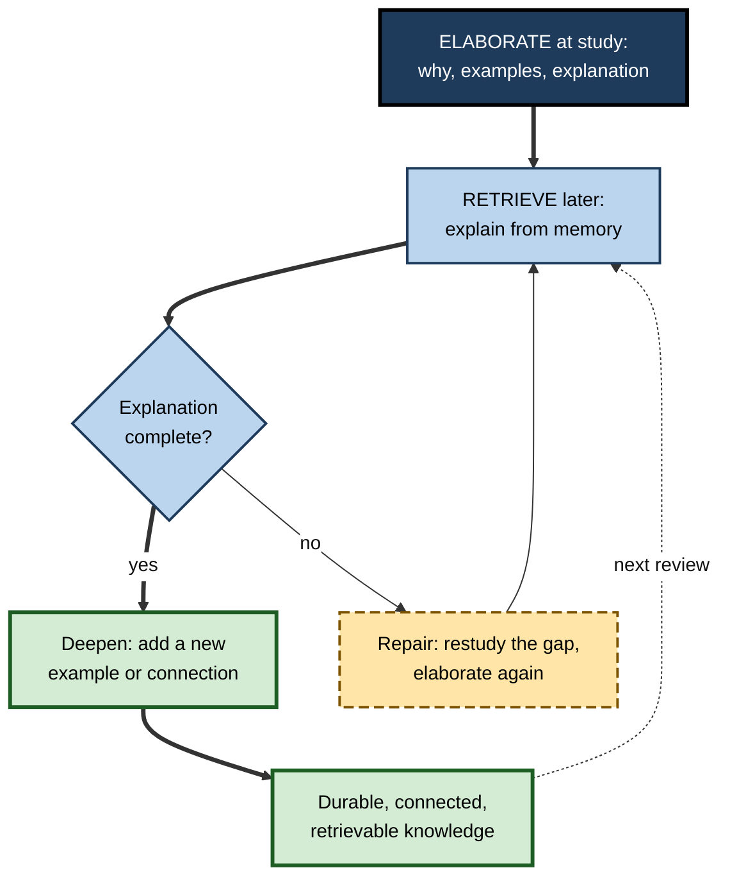
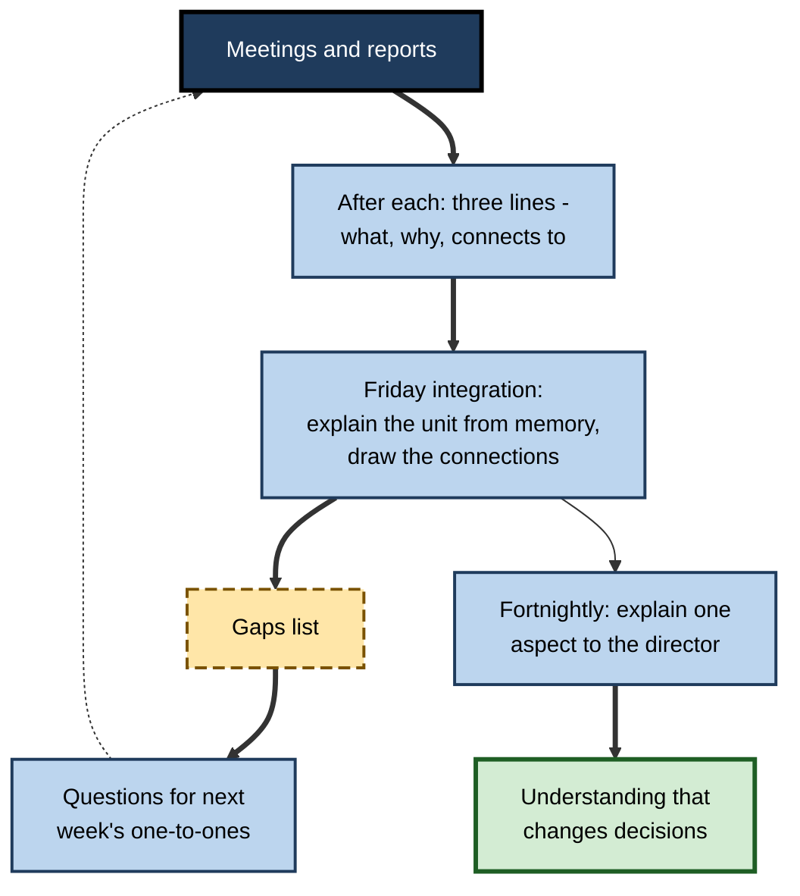

# F.12. Building Elaboration Into Study Routines

Most people who learn about elaboration agree that it works and then never quite do it. They intend to ask why while reading, to generate examples, to explain each step — and then, tired at the end of a working day, they read the chapter, highlight a few lines and close the book.

Knowledge of a strategy does not make it a habit. Elaboration pays off only when it is built into the **structure** of how study happens: prompts placed where they cannot be skipped, time allotted where it matters most, and a check that shows whether it is working.

> **Definition — Study routine:** a recurring, planned pattern of study activities — what is done before, during and after each session, and across a week — that runs largely without fresh decisions each time.

> **Definition — Embedded elaboration:** elaboration built into the materials, schedule and habits of study, so that it happens by default rather than by remembering to do it.

**Why it matters**

- Elaboration strategies have good evidence but are **effortful and slow**, so they are the first to be dropped under time pressure.
- Elaboration that is done occasionally helps occasionally; elaboration that is routine compounds — every topic becomes more connected to every other.
- Not all material deserves the same elaboration; a routine decides **where** elaboration is worth its cost.
- Elaboration works best **combined** with retrieval and spacing; a routine is the natural place to combine them.
- For working professionals, study time is scarce and fragmented; only a routine designed for that reality survives.

---

## What a Good Routine Has to Solve

### The problems

- **Forgetting to elaborate** — under fatigue, learners default to re-reading.
- **Elaborating everything** — slow, exhausting and soon abandoned.
- **Elaborating without checking** — wrong explanations stored with confidence.
- **Elaborating without retrieving** — understanding built but not made retrievable later.
- **No evidence of progress** — without a check, the routine feels like effort with no return.

### The design principles

- **Prompts at fixed points** — elaboration questions placed where the eye will meet them: at the end of each section, in a notes template, on a card.
- **Selective depth** — elaborate the central, the confusable and the surprising; read the rest once.
- **Close every session with an explanation from memory** — combining elaboration with retrieval.
- **A regular integration session** — connecting topics to one another, not just to prior knowledge.
- **A visible check** — a short delayed test, including at least one application question, to show whether the routine works.

> **Mnemonic — "PSCIV":** Prompts, Selectivity, Close from memory, Integration, Verification.

---

## Choosing the Elaboration for the Material

### Matching strategy to content

| Material | Best elaboration | Prompt to embed | Watch for |
|---|---|---|---|
| **Facts and rules** | Elaborative interrogation | "Why would this be true?" | Arbitrary facts — use retrieval instead |
| **Concepts and categories** | Examples, non-examples, near misses | "One instance, one near miss" | Only typical examples |
| **Connected text and arguments** | Self-explanation | "What does this add, and how does it follow?" | Restating instead of explaining |
| **Processes and systems** | Sketch plus explanation; protagonist's journey | "Draw it; explain each arrow" | Pretty diagrams with no logic |
| **Procedures and problems** | Principle-naming; method comparison; error analysis | "Which principle licenses this step?" | Checking answers and moving on |
| **New fields** | Connection to prior knowledge; analogy with breaks | "This is like… except…" | Over-mapping old knowledge |

**Figure 1.** Selecting an elaboration strategy for the material being studied.

### Deciding where to elaborate

- **Elaborate:** central ideas, ideas likely to be confused with neighbours, ideas that surprised, ideas that will be used in decisions.
- **Read once:** background, illustrations, ideas already understood.
- **Retrieve rather than elaborate:** arbitrary facts that have no reasons to find.

> **Key point:** a routine that elaborates **a third** of the material well is far better than one that tries to elaborate all of it and is abandoned in a fortnight.

---

## The Session

### Before: five minutes

- **Brain-dump** — list what is already known about the subject.
- **Set two or three questions** the session should answer.
- **Choose the elaboration** for the material (Figure 1).

### During: the pause points

- **Pause after each section** (or each problem) and do one elaboration:
  - answer one why or how question;
  - generate one example and one near miss;
  - explain the section in two sentences;
  - name the principle behind a step;
  - write one "this connects to…" line.
- **Mark** anything that cannot be explained — it is the session's most valuable output.

### Close: five minutes, from memory

- **Close the book** and explain the session's content in five sentences, including at least one connection to earlier material or to work.
- **Check** the explanation against the material; correct and note gaps.
- **Write** one question for the next session to answer.

> **Remember:** the **close from memory** is the single most valuable habit in the routine — it combines elaboration with retrieval and exposes what did not stick.

**Figure 2.** The structure of a single study session with elaboration built in.

---

## The Week

### The integration session

- **Once a week**, a longer session connects the week's material:
  - explain each topic from memory;
  - compare topics — what is alike, what differs, which principle links them;
  - write a short synthesis or draw a single diagram that includes them all;
  - update older notes in the light of new material.
- **Why it matters:** daily elaboration connects new material to **prior knowledge**; integration connects new topics to **each other**, building the structure that marks expertise.

**Figure 3.** A weekly rhythm of elaboration for a working professional.

### Spacing the elaboration

- Elaboration and spacing combine naturally: an idea elaborated on Monday and re-explained from memory on Saturday is both deepened and spaced.
- **Return visits** are a chance to elaborate further — a new example, a new connection — not just to repeat the old explanation.
- The scheduling of reviews is a subject in its own right; for elaboration, the point is that each return should add something.

### Keeping the record

- **Elaboration notes** — a running document or notebook organised by topic, holding:
  - the one-line reasons (why it is true);
  - examples and near misses;
  - the best self-explanation of each key idea;
  - the analogies used and their breaks;
  - the gaps still open.
- **Linked notes** — some learners keep notes as small, linked units, each recording one idea and its links to others; the act of deciding which notes a new note connects to is itself elaboration. Claims about the productivity of particular note systems are mostly anecdotal; the active ingredient is the **linking**.

---

## Combining Elaboration with Retrieval

### Why both are needed

- **Elaboration** builds meaningful connections at study time.
- **Retrieval** strengthens access to what was learned and shows what is missing.
- **Neither substitutes for the other**: understood material can still be forgotten; retrieved material can still be misunderstood.

### The concept-mapping comparison

**Study card — Karpicke and Blunt (2011)**

- **Design:** university students studied science texts.
  - **Elaborative concept mapping** — built a concept map of the text with the text available.
  - **Retrieval practice** — read the text, then recalled as much as they could with it closed, twice.
- **Results:** a week later, the **retrieval group** did better on both **verbatim** and **inference** questions — and even on a test that required drawing a concept map. Students who mapped **predicted** they had learned more.
- **Conclusion:** an elaborative activity done with the material in view can produce less durable learning than retrieval.
- **Debate:** critics argued that the concept mapping was done by students with little mapping experience and under time limits that suited retrieval; later studies broadly supported a retrieval advantage, and the combination — **retrieval-based concept mapping**, building a map from memory — has shown promise.

**Figure 4.** Retrieval practice compared with elaborative concept mapping on a delayed test.

> **Watch out:** elaboration done **with the book open** can feel deep while leaving memory weak. The routine must include elaboration **from memory** — explaining, mapping or connecting with the material closed.

### Elaborative retrieval

- **Shana Carpenter (2009)** proposed the **elaborative retrieval hypothesis**: retrieving an answer, especially from a weak cue, activates related information, which becomes linked to the answer — so retrieval is itself partly elaborative.
- **Practical consequence:** retrieval questions that require **explanation** ("Why does X cause Y?") combine both benefits better than questions that require only a name or a number.

**Figure 5.** A cycle that combines elaboration and retrieval across sessions.

| | Elaboration only | Retrieval only | Elaboration then retrieval from memory |
|---|---|---|---|
| **Understanding** | Strong at study time | Can stay shallow | Strong |
| **Durability** | Moderate | Strong | Strong |
| **Detects gaps** | Partly | Yes | Yes, including gaps in understanding |
| **Main risk** | Book-open fluency | Rote recall without meaning | Time cost |
| **Best use** | First encounter with material | Arbitrary facts; later reviews | Core concepts and principles |

---

## Making the Routine Stick

### Implementation intentions

- **Peter Gollwitzer** showed that plans in **if–then** form ("If I finish a section, then I write one why-answer") are carried out far more reliably than general intentions; a meta-analysis by Gollwitzer and Paschal Sheeran (2006) found a medium-to-large average effect on goal attainment.
- **For elaboration:** attach each prompt to a cue that will certainly occur — the end of a section, the start of a commute, closing the laptop.

> **Example:** "When I close a chapter, then — before anything else — I explain it in five sentences from memory." "When I solve a problem, then I write the principle beside the answer."

### Embedding prompts in materials

- **A notes template** with columns for *idea*, *why*, *example*, *connection* and *gap* makes elaboration the default act of note-taking.
- **Questions written into the margins** of a document before reading turn reading into answering.
- **Problem sets** with a required "principle" line beside each answer.

### Reducing the cost

- **Short is sustainable** — one sentence per elaboration; five sentences for a close.
- **Spoken is faster** — explaining aloud on a walk or a commute counts.
- **Batch the writing** — capture elaborations roughly during study and tidy them in the integration session.

### Checking that it works

- **Delayed self-tests** — a few questions a week later, including at least one that asks for application or explanation.
- **Explanation quality** — once a month, compare an explanation written now with one written a month ago; it should be more principled and more connected.
- **Behavioural evidence** — fewer moments at work of "I read about this but cannot explain it".

> **In practice:** keeping a simple log of "questions I could not answer at the close" is one of the most informative measures of a routine. A shrinking list means the routine is working; a list that repeats the same gaps means the elaboration is not reaching them.

### A prompt card

> **Remember — ten elaboration prompts for any session:**
> 1. Why would this be true?
> 2. How exactly does this work?
> 3. What is one example — and one near miss?
> 4. How does this follow from what came before?
> 5. Which principle is at work here?
> 6. What is this like, and where does the likeness break?
> 7. How does this differ from the idea it is most easily confused with?
> 8. Where have I seen this in my own work?
> 9. What would happen if it were not so?
> 10. What can I still not explain?

---

## Adapting the Routine

### To the time available

- **Fifteen minutes a day** — one section, two pause-point elaborations, a two-minute spoken close; integration shrinks to twenty minutes at the weekend.
- **Intensive preparation** (an examination in a few weeks) — more problem sessions with principle-naming and error explanation; integration twice a week; the close from memory becomes a full page.
- **Learning on the job** — no formal sessions; the routine attaches to work events: three lines after each meeting, a five-sentence explanation after each document, a weekly fifteen-minute review.

### To the learner's stage

- **Novices** — more structure: provided examples before generated ones, model explanations to compare with, prompts at every section.
- **Intermediate learners** — fewer prompts; more comparison of methods and concepts; generated examples checked against expert ones.
- **Advanced learners** — elaboration shifts towards boundary cases, failure conditions and connections across fields; prompts become self-set questions.
- **The general rule** — as competence grows, the routine should hand more of the elaboration over to the learner and remove scaffolds that have become redundant.

### To the kind of goal

- **Understanding for decisions** — emphasise why-questions, mechanisms and failure conditions.
- **Examination performance** — add transfer-appropriate practice: questions in the format and wording style of the examination, answered from memory, with explanations.
- **Teaching or advising others** — emphasise analogies with stated breaks, examples suited to the audience and explanations at several levels of detail.

| Situation | Daily core | Weekly core | Main risk |
|---|---|---|---|
| **15 minutes a day** | One section, two elaborations, spoken close | 20-minute integration | Skipping the close |
| **Intensive exam preparation** | Problems with principles and error explanation | Two integration sessions; timed scenario sets | Elaboration crowding out retrieval practice |
| **Learning on the job** | Three lines after meetings and documents | 15-minute review of links and gaps | Information without explanation |
| **Novice in a new field** | Provided examples, model explanations | Comparison with expert summaries | Generating wrong examples unchecked |
| **Experienced professional** | Boundary cases, failure conditions | Cross-field connections | Assuming knowledge is complete |

---

## Common Failures

### Elaboration without retrieval later

- Material understood well in the session is never revisited from memory; months later the understanding has faded along with the facts.
- **Remedy:** every elaborated idea appears again, as an explanation question, in a later review.

### Elaboration theatre

- Beautiful notes, coloured diagrams and long explanations produced with the book open — effortful, satisfying and weakly remembered.
- **Remedy:** at least one elaboration per session done **from memory**.

### Elaborating the trivial

- Generating examples for terms already understood; asking why of obvious facts.
- **Remedy:** elaborate only the central, confusable, surprising and decision-relevant.

### Never checking

- Explanations and examples stored without comparison with a source or an expert.
- **Remedy:** a weekly check of a few explanations against the material or a model answer.

### Outsourcing to tools

- Asking an AI assistant to explain, exemplify or connect — and reading the result.
- **Remedy:** the learner's attempt comes first; tools critique, check and supply what is missing.

### Abandonment

- Routines designed for ideal weeks fail in real ones.
- **Remedy:** a **minimum version** — even on the worst day, a two-minute close from memory — keeps the habit alive.

| Failure | Symptom | Remedy |
|---|---|---|
| **Elaboration theatre** | Rich notes, poor recall | Elaborate from memory at the close |
| **Elaborating everything** | Slow sessions, abandoned routine | Select the central and confusable |
| **Never checking** | Confident, wrong explanations | Weekly comparison with a source |
| **Outsourcing to AI** | Fluent reading, little learning | Attempt first; tool critiques |
| **No minimum version** | Routine collapses in busy weeks | Two-minute close on bad days |

---

## Elaboration Routines at Work

### The professional's learning-from-work routine

- **After meetings and tasks** — three lines: what happened, why it happened that way, what it connects to.
- **After reading** a report, regulation or paper — a five-sentence explanation from memory and one implication for current work.
- **Weekly** — a fifteen-minute review: which new idea of the week links to which older one; which gaps remain.
- **Quarterly** — a written synthesis of what has been learned in the main area of development.

### Team routines

- **Explain-it sessions** — a team member explains a concept or incident; colleagues ask why and how.
- **Templates with elaboration fields** — bug fixes with "principle violated"; regulatory summaries with "why the regulator did this"; project closures with "what we would do differently".
- **Shared example libraries** — boundary cases and near misses collected over time.

### Study partners

- **Alternating explainer and questioner** — one partner explains a section from memory; the other asks only why, how and "what would happen if"; roles swap each section.
- **Example exchange** — each partner brings one example and one near miss for the week's concepts; the other classifies them and says why.
- **Disagreement as a resource** — when partners' explanations differ, the difference marks exactly where one or both understandings are incomplete; resolving it against the source is high-value elaboration.
- **Keep it short and structured** — unstructured study groups drift into re-reading notes together or general conversation; a fixed agenda of explain, question, classify keeps the elaboration.

> **Key point:** a partner is valuable mainly as a **source of questions** the learner would not have asked alone.

### Worked example (illustrative): a weekly plan for a certification candidate

- **Situation:** a finance professional has five hours a week for six months to prepare for a professional examination.

| Day | Time | Activity | Elaboration built in |
|---|---|---|---|
| Monday | 45 min | New reading section | Why-questions at each pause; five-sentence close from memory |
| Tuesday | 45 min | Concepts from Monday's reading | Examples, near misses and boundary cases for the three key concepts |
| Wednesday | 45 min | Practice problems | Principle named beside each step; one error explained |
| Thursday | 45 min | New reading section | Self-explanation of each section; connection to own job |
| Friday | — | Rest or light review | Optional spoken explanation on the commute |
| Saturday | 75 min | Integration | Explain the week from memory; compare topics; one synthesis diagram; update notes |
| Sunday | 15 min | Planning | Write next week's questions; list gaps from the close log |

1. **Selectivity** — each new section is skimmed first; only key ideas get full elaboration.
2. **Retrieval** — every session closes from memory; Saturday starts from memory.
3. **Problems** — Wednesday's problems are drawn from earlier weeks as well as the current one, so earlier principles are revisited.
4. **Check** — every fourth Saturday, a timed set of past questions includes scenario items in unfamiliar wording.

- **Conclusion:** the plan uses the same five hours a less structured learner would spend re-reading, but nearly every activity forces meaning, connection or explanation.

> **Watch out:** the plan fails if Saturday's integration is skipped in busy weeks. The minimum version — fifteen minutes explaining the week from memory — must survive even when the rest does not.

### Case study (illustrative): a new manager learning a business unit

- **Situation:** an engineer promoted to manage a product unit had to learn its finances, customers, contracts and people within three months.
- **Problem:** after six weeks of reading reports and attending meetings, she felt busy and informed but could not answer her director's questions about why margins differed between product lines.
- **Diagnosis:**
  - she was consuming information — a **textbase** of facts — without elaborating it;
  - nothing connected the finance reports to the customer meetings or the contracts;
  - she had no record of what she could and could not explain.
- **Actions:**
  1. After each meeting or report, she wrote three lines: what, why, connects to.
  2. Each Friday afternoon she held a 45-minute integration session: explain the unit's economics from memory on one page; draw how customers, contracts and margins connect; list gaps.
  3. Gaps became questions for the following week's one-to-ones with finance and sales leads.
  4. Every fortnight she explained one aspect of the unit to her director, inviting challenge.
- **Result:** within four weeks she could explain the margin differences (contract terms and support costs, not pricing as assumed) and had identified a loss-making support arrangement nobody had connected to the figures.
- **Side effects:** the routine took about two hours a week; some meetings felt slower because she asked more why-questions.
- **Lesson:** information alone produced **familiarity**; a routine of elaboration, integration and explanation produced **understanding** that changed decisions.

**Figure 6.** The new manager's elaboration routine in the case study.

---

## Open Questions

- **What is the best ratio of elaboration to retrieval?**
  - Both help and they combine, but how to divide limited time between them for different materials is not well established.
- **Do elaboration routines persist?**
  - Short studies show benefits of prompted elaboration; whether learners keep elaborating once prompts are removed, months later, is less clear.
- **How should routines adapt as expertise grows?**
  - Novices benefit from structured prompts; experts may elaborate automatically, and prompts may become redundant — the point at which to withdraw them is unknown.
- **Which note-keeping practices genuinely help?**
  - Linked-note systems are popular and plausible, but controlled evidence on their effect on learning is scarce.
- **How will AI change study routines?**
  - Tools that critique a learner's explanations could make checking cheap; tools that supply explanations could make elaboration rare. Which use will dominate is open.

---

## Summary

- A **study routine** is a recurring, planned pattern of study; **embedded elaboration** makes elaboration happen by default.
- Routines must solve five problems: **forgetting to elaborate, elaborating everything, never checking, never retrieving, no evidence of progress**. Design with **Prompts, Selectivity, Close from memory, Integration, Verification**.
- **Match the strategy to the material**: why-questions for facts, examples for concepts, self-explanation for text, sketch-and-explain for systems, principles and errors for problems, analogies for new fields; skip elaboration for arbitrary items.
- **Session:** five minutes before (brain-dump, questions), pauses during (one elaboration per section), five minutes after (**explain from memory**, check, next question).
- **Week:** a longer **integration session** connects topics; returns add new elaboration; keep **elaboration notes**.
- **Combine with retrieval:** **Karpicke and Blunt (2011)** — retrieval beat book-open concept mapping on a delayed test (interpretation debated); **elaborative retrieval** (Carpenter, 2009) — explanation questions combine both.
- Make it stick with **implementation intentions** (Gollwitzer), **prompts in materials** and a **minimum version**; check with delayed tests, explanation quality and a gaps log.
- Avoid **elaboration theatre**, trivial elaboration, never checking, outsourcing to AI and abandonment.
- At work: three-line notes after meetings, weekly reviews, team templates with elaboration fields, explain-it sessions.

---

## Self-Check

1. Define a study routine and embedded elaboration.
2. List the five problems a good elaboration routine must solve.
3. Which elaboration would you embed for: (a) a list of regulatory deadlines with reasons; (b) a new concept such as "moral hazard"; (c) a network architecture; (d) arbitrary product codes?
4. Why is elaborating everything a poor strategy, and how should a learner decide where to elaborate?
5. Describe the before, during and close parts of a session with elaboration built in.
6. What is an integration session, and why is it needed in addition to daily elaboration?
7. Describe Karpicke and Blunt (2011), the main criticism, and the practical lesson.
8. What is the elaborative retrieval hypothesis, and how does it shape the design of review questions?
9. What is an implementation intention? Write two for elaboration.
10. What is elaboration theatre, and how is it prevented?
11. Why should a routine have a minimum version?
12. How can a learner check whether an elaboration routine is working?
13. Design a two-hour-a-week elaboration routine for a professional learning a new software platform at work.
14. How should an elaboration routine change as a learner moves from novice to advanced?
15. A professional has only fifteen minutes a day. What should the routine keep, and what can it drop?

### Answer Key

1. A recurring, planned pattern of study activities that runs without fresh decisions each time. Embedded elaboration is elaboration built into materials, schedule and habits so it happens by default.
2. Forgetting to elaborate; elaborating everything; elaborating without checking; elaborating without retrieving; having no evidence of progress.
3. (a) Why-questions for each deadline's reason. (b) Examples, near misses and boundary cases. (c) A sketch with each link explained in words. (d) No elaboration — retrieval practice or a mnemonic.
4. It is slow and exhausting and leads to abandonment. Elaborate the central, the confusable, the surprising and the decision-relevant; read the rest once; use retrieval for arbitrary items.
5. Before: brain-dump what is known, set two or three questions, choose the elaboration. During: after each section, one elaboration (why, example, explanation, principle or connection) and mark what cannot be explained. Close: explain the session from memory in five sentences, check, note gaps and write a question for next time.
6. A longer weekly session that explains the week's topics from memory, compares and connects them, produces a synthesis and updates notes. Daily elaboration links new material to prior knowledge; integration links topics to each other.
7. Students who practised free recall outperformed students who built concept maps with the text open, on verbatim and inference questions a week later, although mappers predicted the opposite. Critics argued that inexperienced mappers and time limits disadvantaged mapping. Lesson: include elaboration from memory, not only with the book open; retrieval-based mapping combines both.
8. Retrieving, especially from weak cues, activates related information that becomes linked to the answer, so retrieval is partly elaborative. Review questions should ask for explanations ("why does…?"), not just names or numbers.
9. An if–then plan linking a behaviour to a cue. *e.g.* "If I finish a section, then I write one why-answer." "If I close the laptop after study, then I explain the session aloud in five sentences."
10. Producing rich, attractive elaborations with the material in view that feel deep but are weakly remembered. Prevent it by doing at least one elaboration per session from memory.
11. Real weeks are busier than planned; without a minimum version (such as a two-minute close from memory) the routine collapses and the habit is lost.
12. Delayed self-tests including application questions; comparing current explanations with older ones for depth and connection; tracking a shrinking log of questions that could not be answered; noticing fewer "read but cannot explain" moments at work.
13. *e.g.* Three 30-minute sessions: explore one feature, with pauses to explain why it is designed that way and to connect it to current tasks, closing with a five-sentence explanation from memory; one 30-minute integration session: sketch how the features connect, explain each link, compare with the vendor's architecture, list gaps and turn them into questions for a colleague.
14. Novices need more structure — provided examples, model explanations, prompts at every section. Intermediate learners need fewer prompts and more comparison and checked generation. Advanced learners elaborate boundary cases, failure conditions and cross-field connections with self-set questions. Scaffolds that have become redundant should be removed.
15. Keep one section of new material, two pause-point elaborations on its central ideas and a short close from memory, plus a brief weekly integration. Drop elaboration of peripheral material, lengthy written notes and elaborate diagrams.

---

## Glossary

| Term | Meaning |
|---|---|
| Close from memory | Ending a study session by explaining its content without the material. |
| Elaboration notes | A running record of reasons, examples, explanations, analogies and gaps by topic. |
| Elaboration theatre | Elaborate-looking study done with the material in view that leaves memory weak. |
| Elaborative retrieval hypothesis | The proposal that retrieval activates related information, making it partly elaborative. |
| Embedded elaboration | Elaboration built into materials, schedule and habits so it happens by default. |
| Implementation intention | An if–then plan linking a behaviour to a specific cue. |
| Integration session | A regular longer session that connects recently studied topics to each other. |
| Minimum version | The smallest form of a routine that is kept even in the busiest weeks. |
| Pause point | A fixed point in study at which an elaboration is performed. |
| Retrieval-based concept mapping | Building a concept map from memory rather than with the material open. |
| Selective elaboration | Elaborating only central, confusable, surprising or decision-relevant material. |
| Study routine | A recurring, planned pattern of study activities. |
