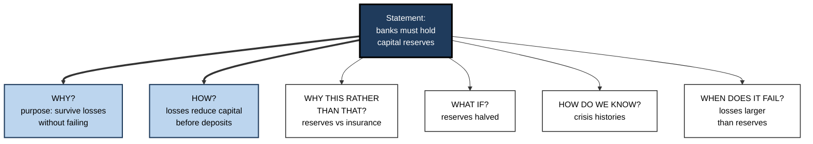
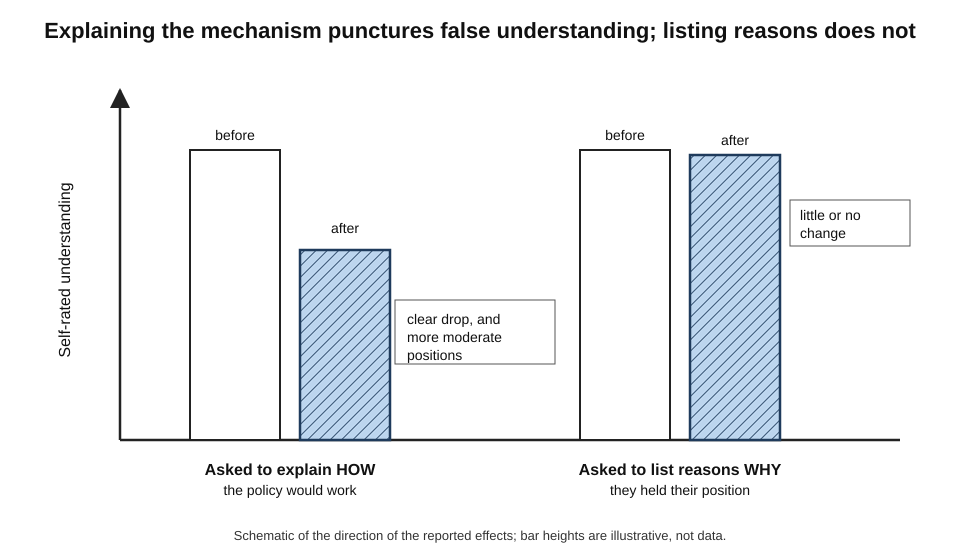
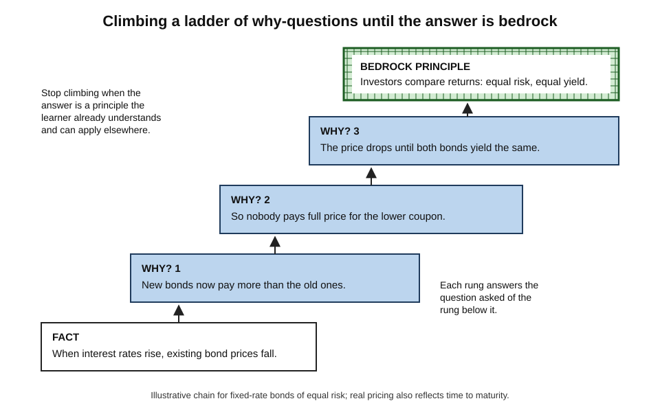
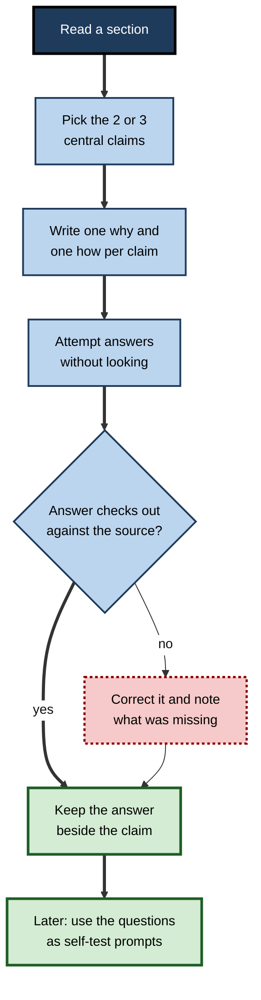
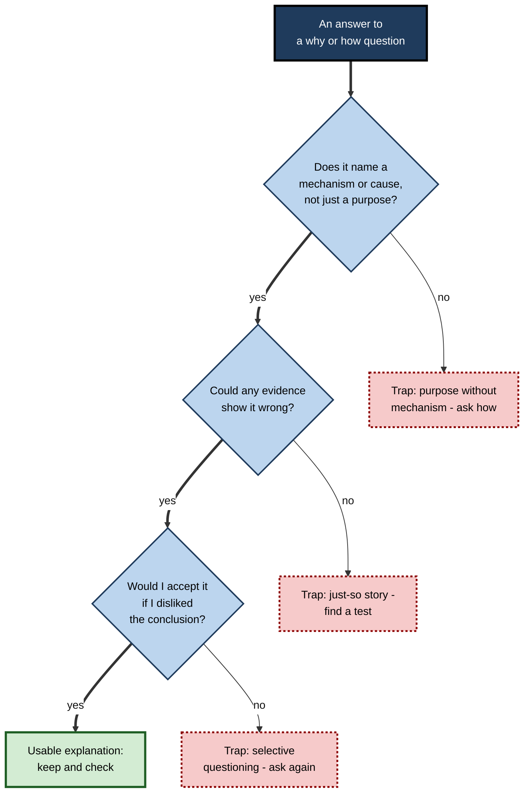
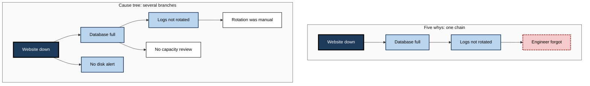

# F.2. Asking Why and How Questions

A four-year-old asks "Why is the sky blue?", hears "because it is", and asks again. An auditor reads that a subsidiary's margins doubled and asks how. A software engineer reads that a cache made a service faster and asks how exactly — and discovers it also made some answers stale. In each case the question does the learning: it forces the mind to look for a cause or a mechanism that the bare statement did not supply.

> **Definition — Why-question:** a question that asks for the cause, reason, purpose or justification of a fact, event or decision.

> **Definition — How-question:** a question that asks for the mechanism, process or method by which something happens or is done.

**Why it matters**

- Why and how are the two question words that most reliably demand **explanation** rather than recall, and explanation is what turns information into understanding.
- They are the everyday engine of **elaboration**: every other elaborative strategy — examples, analogies, connections — is easier once a cause or mechanism is in view.
- The quality of the question largely determines the quality of what is learned; a vague why produces a vague answer.
- In professional work, the habit of asking why and how separates people who can **apply** rules from those who can only **follow** them.

---

## The Family of Explanatory Questions

### Why and how compared

The two questions overlap but pull in different directions.

| | Why-question | How-question |
|---|---|---|
| **Asks for** | A cause, reason, purpose or justification | A mechanism, sequence or method |
| **Typical answer** | "Because…" or "In order to…" | "First… then… which causes…" |
| **Points the learner towards** | Motives, functions, principles | Parts, steps, causal links |
| **Example** | "Why do banks hold capital reserves?" | "How does a capital reserve absorb a loss?" |
| **Typical weakness** | Answered with a motive or slogan | Answered with a list of steps without causes |

> **Key point:** why-questions find the **point** of a thing; how-questions find its **working parts**. Understanding usually needs both.

### The wider family

- **What if…?** — counterfactual: "What if the reserve were half as large?"
- **What if not…?** — removal: "What would happen without this step?"
- **Why this rather than that?** — contrastive: "Why fixed-rate rather than variable-rate?"
- **How do we know?** — evidential: "What evidence shows that this drug lowers risk?"
- **When does it stop being true?** — boundary: "Under what conditions does this rule fail?"
- **How is this like…?** — relational: "How is a reserve like a car's crumple zone?"

> **Remember:** research on tutoring (Arthur Graesser and Natalie Person, 1994) found that learners ask few questions, and that the ones linked with understanding are the deep, explanatory kind — why, how, what if, what if not — rather than who, what, when and where.

**Figure 1.** The family of explanatory questions around a single statement.

---

## Kinds of Why

A single why can be asked in several senses. Confusing them is a common source of unsatisfying answers.

### Four senses of "because"

- **Aristotle's four causes** remain a useful map of the senses of why:
  - **Material** — what it is made of: "Why does the bridge flex? Because it is steel."
  - **Formal** — what form or structure it has: "Because it is a suspension design."
  - **Efficient** — what brought it about: "Because the wind loads it."
  - **Final** — what it is for: "Because flexing spreads the load and prevents cracking."
- **Modern usage** mostly collapses these into two families:
  - **causal** why (efficient cause: what produced it);
  - **teleological** or functional why (final cause: what it is for).

### Four questions from biology

- **Niko Tinbergen (1963)** argued that any behaviour in an animal raises four different why-questions:
  - **Mechanism** — how does it work, here and now?
  - **Development** — how did it arise in this individual's life?
  - **Function** — what is it good for — why does it help survival?
  - **Evolution** — how did it arise in the species' history?
- **The lesson for any field:** a complete explanation often needs several kinds of why, and an argument that "the real reason" is one of them is often a confusion of levels.

| Kind of why | Asks | Example: "Why does the firm hold a weekly risk meeting?" |
|---|---|---|
| **Mechanism** | What makes it happen now? | The calendar invite and the chief risk officer's mandate |
| **Development** | How did it come to exist here? | It started after a near-miss in 2019 |
| **Function** | What does it achieve? | It surfaces emerging risks before they compound |
| **Justification** | What makes it right or required? | The regulator expects documented risk oversight |

> **Watch out:** answering a **function** question with a **mechanism** answer ("because the invite is in the calendar") is technically true and explains nothing. When an answer feels empty, check whether it answers the right kind of why.

### Contrastive why

- **Peter Lipton** argued that most real why-questions are implicitly **contrastive**: "Why P rather than Q?"
  - "Why did the project overrun?" is clearer as "Why did *this* project overrun when the similar one last year did not?"
- **The contrast narrows the search.** Causes shared by both cases drop out; only the differences remain as candidate explanations.

> **In practice:** when a why-question produces a long list of possible causes, add a contrast — "rather than what?" — and most of the list disappears.

---

## Kinds of How

### Mechanism and procedure

- **Mechanism-how** asks how something *works*: "How does a vaccine produce immunity?"
  - Answer: a chain of causal links between parts.
- **Procedure-how** asks how something is *done*: "How is a vaccine trial run?"
  - Answer: a sequence of steps, ideally with the purpose of each.
- **The trap:** a procedure answer can look like understanding while containing no mechanism — a recipe without chemistry.

### The illusion of explanatory depth

- People believe they understand everyday devices and systems far better than they do; trying to explain **how** they work reveals the gap (Leonid Rozenblit and Frank Keil, 2002).
- **How-questions are the antidote**: they demand the causal chain, step by step.

**Study card — Fernbach, Rogers, Fox and Sloman (2013)**

- **Design:** adults rated their understanding of political policies (such as a cap-and-trade scheme for carbon emissions) and their positions on them.
  - **Mechanism group** — explained, step by step, **how** the policy would work.
  - **Reasons group** — listed **reasons why** they held their position.
- **Results:**
  - The mechanism group's rated understanding **fell**, and their positions became **more moderate**.
  - Listing reasons produced **little or no** such change.
- **Conclusion:** a how-question exposes the limits of one's knowledge in a way a why-question about one's own position does not.

**Figure 2.** Explaining how compared with listing reasons why.

> **Key point:** "Why do I believe this?" invites justification and can **entrench** a view. "How exactly does this work?" invites mechanism and tends to **reveal gaps**. For learning, the second is often more productive.

> **Watch out:** the drop in rated understanding after explaining how is a robust finding, but the effect on **political attitudes** is contested — a large replication by Jarret Crawford and John Ruscio (2021) did not find that explaining policies made people more moderate. Treat the attitude finding as unsettled.

---

## Asking Good Questions

### What makes a why or how question productive

- **Specific** — it names the exact fact or step: not "Why is inflation bad?" but "Why does unexpected inflation hurt people on fixed pensions?"
- **Answerable** — the learner has, or can find, the knowledge to attempt it.
- **Explanation-seeking** — it cannot be answered by pointing at the page.
- **Contrastive where useful** — it says "rather than what".
- **Layered** — its answer invites a further question.

| Weak question | Problem | Stronger version |
|---|---|---|
| "Why is security important?" | Too broad; invites a slogan | "Why does storing passwords as salted hashes stop an attacker who steals the database?" |
| "How does marketing work?" | Unanswerable as asked | "How does a free trial increase paid conversions compared with a discount?" |
| "Why did sales fall?" | No contrast; too many candidates | "Why did sales fall in the north region but not the south this quarter?" |
| "What is a mutex?" | Asks for definition only | "How does a mutex stop two threads corrupting the same record?" |
| "Why do we do code review?" | Function only, easy answer | "How does code review catch bugs that automated tests miss — and which bugs does it miss?" |

### Question ladders

- A **why-ladder** asks why of each answer in turn, climbing from the surface fact towards a principle.
- **The stopping rule:** stop when the answer is a principle the learner already understands and can use elsewhere — **bedrock**.
  - Stopping too early leaves the fact unconnected.
  - Climbing too far drifts into philosophy or physics the task does not need.

**Figure 3.** A ladder of why-questions climbing from a surface fact to a bedrock principle.

### Answering honestly

- **Attempt before searching.** The attempt is where the elaboration happens; looking up first turns the question into reading.
- **Write the answer in one or two sentences.** If it cannot be written, it is not yet understood.
- **Mark uncertainty.** "I think…" or "probably…" flags a hypothesis to check.
- **Check and correct.** Compare with the text, an expert or a reference; store the corrected answer.

> **Mnemonic — ASK:** Attempt, State, Check, Keep.

### A study routine built on why and how

**Figure 4.** A routine for generating and answering why and how questions while studying.

---

## Where Questions Come From

### Children as natural questioners

- Young children ask a great many why and how questions, and they are not satisfied by just any answer.
- **Study card — Frazier, Gelman and Wellman (2009)**
  - **Design:** analysed conversations between preschool children and adults, plus a laboratory study in which children asked how and why questions and received either explanatory or non-explanatory answers.
  - **Results:** when given a real explanation, children tended to accept it or ask a follow-up; when given a non-explanation, they were more likely to **repeat the question** or offer their own explanation.
  - **Conclusion:** children's why-questions are genuine searches for explanation, not attention-seeking.
- **The adult problem:** school and work often reward quick answers over questions, and the habit fades. Deliberate why and how questioning restores it.

### Questions triggered by anomaly

- Questions arise most naturally when something is **surprising** — a result that contradicts expectation.
- **Implication for study:** a learner who never finds anything surprising is probably not comparing the material with what they already believe. Asking "What did I expect here?" before reading creates the expectations that generate questions.

### Questions from structure

- **Headings** turned into how and why questions ("Causes of the 2008 crisis" → "How did mortgage defaults become a banking crisis?").
- **Diagrams** — "How does each arrow work?"
- **Numbers** — "Why this number rather than double or half?"
- **Rules** — "Why does this rule exist, and when does it not apply?"

> **Example:** a junior consultant reading a client's annual report turns the line "operating margin rose to 14%" into three questions: "Why did it rise?", "How much came from price rather than cost?", "Why 14% rather than the industry's 10%?"

### Why and how across disciplines

Each field has its own characteristic explanatory questions, and expertise includes knowing which ones the field expects.

- **Natural sciences** — mechanism dominates: "How does the reaction proceed? What would change if the temperature doubled?"
- **History** — why-questions about causes compete with how-questions about process and contingency: "Why did the war start?" sits beside "How did a local crisis become a general war in five weeks?". Historians also ask how events looked to people at the time, who did not know the outcome.
- **Mathematics** — "Why does this proof work?" (which step carries the weight) and "How could anyone have found it?" — the second, emphasised by George Pólya, turns a finished proof into a lesson in problem solving.
- **Law** — "Why does this rule exist?" (its policy) and "How does it apply to these facts?" (its operation); good lawyers move constantly between the two.
- **Economics and business** — "How does the money flow?" and "Why would a rational actor do this?" — the second is a powerful but sometimes misleading question, because real actors are not always rational.
- **Engineering** — "How does it fail?" is often more useful than "How does it work?", because failure modes drive design.

> **Example:** a graduate in a policy unit learns that a tax credit is "means-tested". The economist's how: "How does the credit change as income rises — is there a point where earning more leaves a family worse off?" That one question reveals the poverty-trap problem that drives most debate about such credits.

---

## When Questions Go Wrong

Why and how questions are powerful, but several predictable failures turn them into sources of error.

### Purpose where there is none

- **Teleological bias** — the tendency to explain things by their purpose even when no purpose exists.
  - Deborah Kelemen's research found that young children readily accept explanations such as "rocks are pointy so animals can scratch on them".
  - Kelemen and Evelyn Rosset (2009) found that adults, too, accept more such explanations when forced to answer quickly.
- **In professional life** — "Why does the market do this?" invites a story about what the market "wants"; often the honest answer is an aggregate of many independent choices with no single purpose.

### Just-so stories

- A plausible why-answer that fits the facts but has never been tested — named after Rudyard Kipling's tales of how the leopard got its spots.
- **The danger:** the answer feels satisfying, is easy to remember and blocks further enquiry.
- **Remedy:** ask "How would I know if this explanation were wrong?" If nothing could show it wrong, it is a story, not yet an explanation.

### Selective questioning

- People scrutinise conclusions they **dislike** far more than conclusions they welcome — a pattern called **disconfirmation bias** (Kari Edwards and Edward Smith, 1996).
- **Result:** why and how are asked of the unwelcome report, while the welcome one passes unquestioned.
- **Remedy:** apply the same question set to both — especially the most important one, "How do we know?".

### Endless regress and question overload

- Every answer can be met with another why; without a stopping rule the ladder never ends.
- Asking a dozen questions about every paragraph exhausts attention and produces thin answers to all of them.
- **Remedy:** two or three questions per key claim; stop at bedrock.

> **Definition — Teleological bias:** a tendency to explain objects and events by the purpose they appear to serve, even when they were not designed for any purpose.

**Figure 5.** Testing an answer to a why or how question for the common traps.

---

## Why and How at Work

### Root-cause analysis and the five whys

- **Taiichi Ohno**, architect of the Toyota Production System, popularised asking "why?" about five times to move from a symptom to a root cause.
  - *e.g.* the machine stopped → a fuse blew → the bearing was overloaded → it was not lubricated → the oil pump was worn → no maintenance schedule covered the pump.
- **Strength:** simple, quick and pushes past the first convenient answer.
- **Weaknesses:**
  - follows a **single chain** when most failures have several interacting causes;
  - different teams asking the same whys reach different roots;
  - tends to stop at **a person** ("operator error") rather than the system that allowed the error.

| | Five whys | Cause tree (or fishbone) |
|---|---|---|
| **Shape** | One linear chain | Branching tree of contributing causes |
| **Speed** | Fast | Slower |
| **Best for** | Simple failures with one dominant cause | Complex incidents with several interacting causes |
| **Main risk** | Picking one plausible chain and missing others | Long lists without priority |
| **Question used at each node** | "Why?" | "Why?" plus "What else contributed?" and "How did this get past our controls?" |

**Figure 6.** A single chain of whys compared with a branching cause tree for the same incident.

> **Watch out:** a chain of whys that ends in a person's name has usually stopped one or two steps too soon. Asking "How did the system let this happen?" turns blame into a fixable cause.

### Other professional uses

- **Requirements and product work** — asking why a feature is wanted reveals the underlying need, which may be met more simply; asking how users will use it reveals edge cases.
- **Consulting** — engagement teams break a client question into why and how sub-questions to structure analysis.
- **Medicine** — clinicians ask "How does this explain all the findings?" to test a diagnosis against the whole picture.
- **Law** — "Why does this clause exist?" reveals the risk it allocates; "How would it operate if the supplier went insolvent?" tests it.
- **Software** — code reviewers ask "How does this handle a null input?" and "Why this data structure rather than a map?"
- **Finance** — analysts ask "How exactly does this business make money?" before trusting a forecast.

> **In practice:** experienced professionals ask **how** of claims made by others and **why** of their own plans — the first exposes hand-waving, the second exposes assumptions.

### Asking why of other people

- **Tone matters.** "Why did you do that?" can sound like an accusation; "What led to that choice?" or "How did you approach it?" invites the same explanation without defensiveness.
- **Psychological safety** — Amy Edmondson's term for a shared belief that a team is safe for interpersonal risk-taking — strongly affects whether junior staff ask why and how of seniors. Where it is low, questions go unasked and errors go unchallenged.
- **Experts as sources.** The richest answers to why-questions about a workplace usually live in experienced colleagues' heads. Asking "Why do we do it this way?" of a long-serving colleague often yields the history, the failure that prompted the rule and the exceptions nobody wrote down.
- **Questions as signals.** A well-formed how-question signals that the asker has thought about the problem; a vague one signals the opposite. Preparing questions before a meeting with an expert improves both the answers and the impression.

> **In practice:** a useful opening with a subject-matter expert is "What do newcomers usually misunderstand about this — and why?" It invites exactly the explanations a learner most needs.

### Questions and AI assistants

- **AI as an answer machine** removes the attempt step: the learner reads a fluent explanation and feels understanding.
- **AI as a questioner** can help: an assistant can be instructed to ask the learner why and how questions about a text and to probe weak answers.
- **AI as a checker**: after writing an answer, the learner asks the assistant what is missing or wrong — then verifies the response.

### Worked example: interrogating a performance claim

- **Situation:** a product manager reads in a vendor brochure that a recommendation engine "increases basket size by 12%".

| Step | Question | Answer attempted | What it revealed |
|---|---|---|---|
| 1 | **How** would recommendations increase basket size? | They suggest add-ons customers had not considered | A plausible mechanism exists |
| 2 | **Why** 12% rather than 2% or 30%? | Unknown — no context given | The figure has no stated baseline |
| 3 | **How do we know?** | Possibly a client case study | Evidence quality unclear |
| 4 | **Why** this client rather than ours? | Their range is wider; more add-ons exist | Effect may not transfer |
| 5 | **When would it fail?** | Small baskets of staple items | Boundary for the firm's own business |

- **Conclusion:** five questions turned a marketing claim into a test plan — an A/B trial on the product categories most like the vendor's case.

> **Watch out:** the most important question in the sequence was the contrastive one (step 4). Without it, the manager would have accepted a mechanism that is real but may not apply.

### Case study: an incident review that asked how

- **Situation:** a payments team suffered a failed overnight batch that delayed salaries for several hundred customers.
- **First review:** five whys ended at "the on-call engineer missed an alert"; the action was "remind engineers to watch alerts".
- **Problem:** a similar failure recurred within two months.
- **Second review — actions:**
  1. For each why-answer, the facilitator also asked **how** — "How did the alert reach the engineer? How could it be missed?"
  2. The team discovered the alert went to a shared inbox, was one of hundreds of low-value alerts, and had no escalation.
  3. They asked a contrastive why: "Why did the daytime batch, with the same code, never fail this way?" — daytime runs had a person watching dashboards.
  4. Actions: alert reduction, paging for critical batches, automatic retry, and a dashboard check in the handover.
- **Result:** no recurrence over the following year; alert volume fell sharply.
- **Lesson:** **why** found a culprit; **how** and **why-rather-than** found the system.

---

## Open Questions

- **Can question-asking be taught durably to adults?**
  - Short training improves the questions people ask in the session; whether the habit lasts months without prompts is less clear.
- **Which kinds of why help most for which material?**
  - Most studies treat "why" as one question; the effects of asking for function versus mechanism versus justification are largely unexplored.
- **How far does the illusion-of-depth effect generalise?**
  - The drop in rated understanding after explaining how is robust; its effects on attitudes and decisions are less consistent.
- **Do AI questioners help or hinder?**
  - Assistants that ask probing questions are easy to build; whether they build learners' own questioning habits, or replace them, is unknown.

---

## Summary

- **Why-questions** ask for cause, reason, purpose or justification; **how-questions** ask for mechanism, process or method. Understanding usually needs both.
- The wider family includes **what if, what if not, why this rather than that, how do we know** and **when does it fail**; deep explanatory questions are linked with understanding, yet learners ask few of them.
- **Kinds of why:** Aristotle's material, formal, efficient and final causes; **Tinbergen's** mechanism, development, function and evolution; **contrastive** why (Lipton) narrows the search for causes.
- **Kinds of how:** mechanism versus procedure. How-questions puncture the **illusion of explanatory depth**; **Fernbach et al. (2013)** found that explaining how a policy works lowered rated understanding and moderated views, while listing reasons did not.
- **Good questions** are specific, answerable, explanation-seeking, contrastive and layered. **Why-ladders** climb to a **bedrock** principle. Answer with **ASK** — Attempt, State, Check, Keep.
- Questions come naturally from **anomaly**; creating expectations before reading generates them.
- At work: **five whys** (fast, but single-chain and blame-prone) versus **cause trees**; uses in requirements, consulting, medicine, law, software and finance. With AI, use it as **questioner and checker**, not as answer machine.

---

## Self-Check

1. Distinguish a why-question from a how-question, with an example of each about the same topic.
2. Name four members of the wider family of explanatory questions besides why and how.
3. What are Tinbergen's four questions, and what general lesson do they teach about explanation?
4. Why does adding a contrast ("rather than what?") make a why-question more useful?
5. What is the difference between a mechanism-how and a procedure-how, and what trap does the difference reveal?
6. Describe Fernbach and colleagues' (2013) study and explain why it matters for learners.
7. Rewrite "Why is customer retention important?" as a stronger, specific, contrastive question.
8. What is a why-ladder, and when should the learner stop climbing?
9. Explain the ASK routine and why the first step matters.
10. Give two weaknesses of the five whys and a remedy for each.
11. A colleague's root-cause analysis ends with "the analyst made a typo". What questions should be asked next?
12. Describe one productive and one unproductive way of using an AI assistant with why and how questions.
13. A vendor claims its tool "cuts onboarding time in half". Write five questions that would test the claim.

### Answer Key

1. Why asks for cause or purpose; how asks for mechanism or method. *e.g.* "Why do we encrypt laptops?" (to protect data if a device is lost) versus "How does disk encryption stop a thief reading the data?" (the data is stored scrambled and needs a key the thief lacks).
2. What if; what if not; why this rather than that; how do we know; when does it stop being true; how is this like something else.
3. Mechanism, development, function and evolution. A full explanation often needs several kinds of why; arguing that one is "the real reason" often confuses levels of explanation.
4. Causes shared by both cases are eliminated, leaving the differences as candidate explanations; the question becomes answerable and focused.
5. Mechanism-how explains how something works through causal links; procedure-how lists steps for doing it. A procedure can be known without any understanding of why it works — a recipe without chemistry.
6. People rated their understanding of policies, then either explained how a policy works or listed reasons for their position. Explaining the mechanism lowered rated understanding and moderated positions; listing reasons did not. For learners, how-questions expose gaps that justification hides. (The attitude effect is less consistently replicated than the understanding effect.)
7. *e.g.* "Why does losing 5% of existing customers cost us more profit than failing to win 5% more new ones, given our acquisition costs?"
8. A sequence of why-questions, each asked of the previous answer, climbing from a fact to a principle. Stop at bedrock: a principle already understood and usable elsewhere.
9. Attempt an answer, State it in a sentence, Check it, Keep the corrected version. The attempt is where elaboration happens; looking up first turns the question into reading.
10. Single chain → also ask "What else contributed?" and draw a cause tree. Stops at a person → ask "How did the system allow this?". (Also: different teams reach different roots → review the chain with several people.)
11. How did the typo get through — was there validation, review, a test? Why did the same process not fail before — what changed? How many other places could the same error occur? What would make the error impossible rather than unlikely?
12. Productive: write one's own answer first, then ask the assistant to critique it, or ask it to quiz one with why and how questions. Unproductive: asking it the why-question and reading its answer without attempting first.
13. *e.g.* How does the tool shorten onboarding? Half of what baseline, measured how? How do we know — what study, which clients? Why would it work for us rather than only for them? When does it not work — which roles or teams?

---

## Glossary

| Term | Meaning |
|---|---|
| Bedrock principle | The point in a why-ladder where the answer is a principle already understood. |
| Cause tree | A branching diagram of the contributing causes of an outcome. |
| Contrastive question | A why-question of the form "why P rather than Q?". |
| Counterfactual question | A question about what would happen if something were different. |
| Deep question | A question asking for explanation, such as why, how or what if. |
| Disconfirmation bias | Scrutinising unwelcome conclusions more harshly than welcome ones. |
| Efficient cause | What brings something about. |
| Final cause | What something is for; its purpose. |
| Five whys | Asking why repeatedly, about five times, to move from symptom to root cause. |
| How-question | A question asking for mechanism, process or method. |
| Illusion of explanatory depth | Believing one understands how something works better than one does. |
| Just-so story | A plausible but untested explanation that fits the facts. |
| Mechanism | The parts and causal links by which something works. |
| Psychological safety | A shared belief that a team is safe for interpersonal risk-taking. |
| Root-cause analysis | A structured search for the underlying causes of a problem. |
| Teleological bias | A tendency to explain things by purpose even when none exists. |
| Teleological explanation | An explanation in terms of purpose or function. |
| Why-ladder | A sequence of why-questions, each asked of the previous answer. |
| Why-question | A question asking for cause, reason, purpose or justification. |
