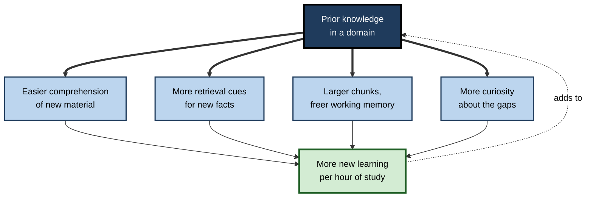
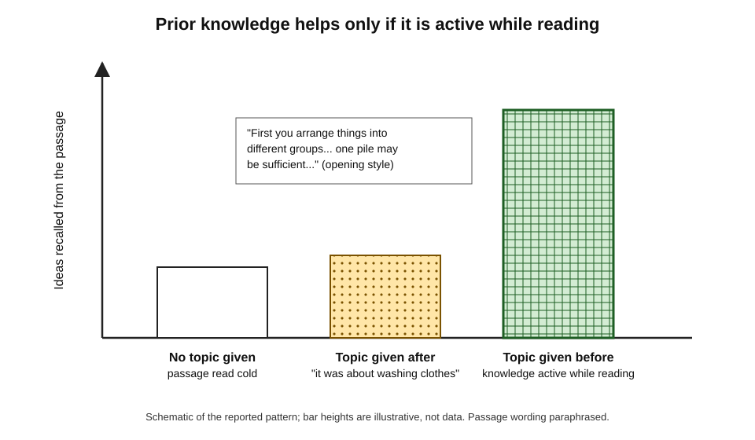
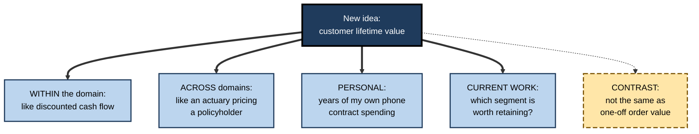
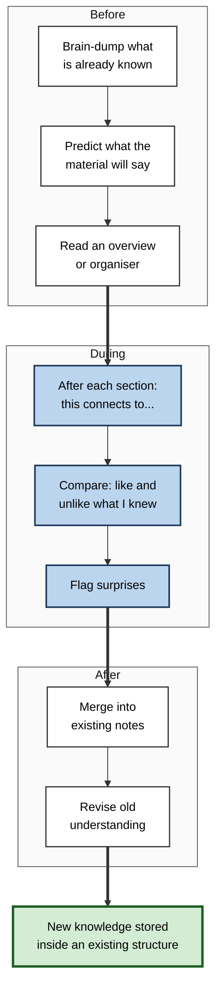
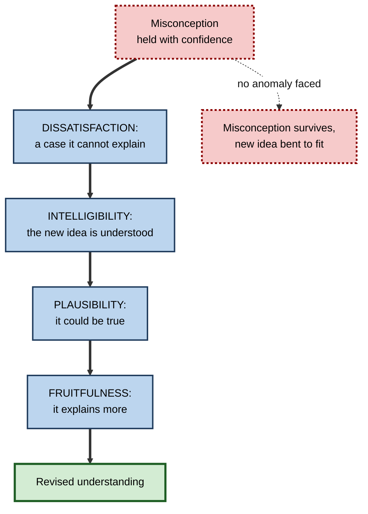
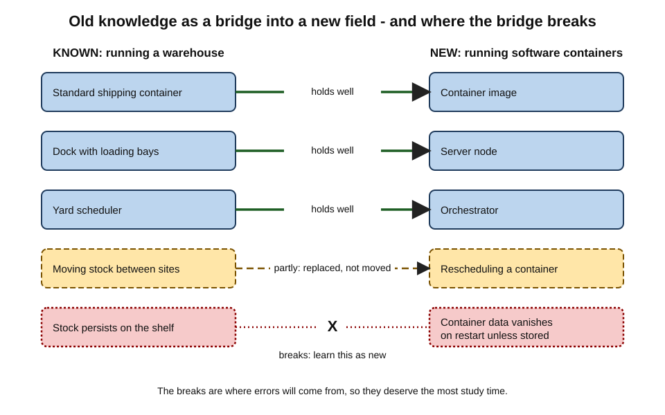

# F.3. Connecting New to Prior Knowledge

Two new hires sit through the same briefing on how the firm hedges currency risk. One spent five years in a bank's treasury; the other studied history. An hour later the first can explain the strategy and spot a flaw in it; the second has a page of notes and a vague sense of forward contracts. The briefing was identical. What differed was what each brought into the room — and whether they used it.

> **Definition — Prior knowledge:** everything a learner already knows, believes or can do that is relevant to new material — facts, concepts, skills, experiences and misconceptions alike.

> **Definition — Connecting to prior knowledge:** the deliberate act of relating new information to what is already known — noting similarities, differences, causes, examples and implications — so that the new material is understood and stored as part of an existing structure.

**Why it matters**

- Prior knowledge is the **strongest single predictor** of how much a learner gains from new study in a field.
- New information that connects to nothing is hard to understand, quickly forgotten and rarely used.
- Most learners **possess** relevant knowledge but **fail to use** it unless prompted; connecting deliberately closes that gap.
- Prior knowledge is double-edged: when it is wrong, connecting to it can distort new learning — so the skill includes knowing when to **revise** what is known.
- For career changers and professionals entering new domains, old expertise is the largest asset they bring, if it is mapped carefully onto the new field.

---

## Why What Is Known Decides What Is Learned

### The central claim

- **David Ausubel (1968)** put it bluntly: the most important single factor influencing learning is what the learner already knows; ascertain this and teach accordingly.
- **Three reasons** prior knowledge dominates:
  - **Comprehension** — new material can only be understood in terms of concepts the learner already has.
  - **Encoding** — new facts attach to existing structures, which supply many retrieval cues.
  - **Capacity** — familiar material is grouped into larger chunks, freeing working memory for what is new.

### Evidence from reading

**Study card — Recht and Leslie (1988)**

- **Design:** school pupils were grouped by **reading ability** (high or low) and by **knowledge of baseball** (high or low). All read a passage describing part of a baseball game and then recalled and re-enacted it.
- **Results:**
  - Baseball knowledge had a large effect on comprehension and recall.
  - **Poor readers who knew baseball** performed as well as or better than **good readers who did not**.
- **Conclusion:** domain knowledge can matter more than general reading skill for understanding a text.

> **Key point:** much of what looks like general "ability" in a subject is the effect of **specific prior knowledge**.

### Evidence from memory

**Study card — Chase and Simon (1973)**

- **Design:** chess players of different strength viewed a board for a few seconds and reconstructed it.
  - Some positions came from real games; others were pieces placed at random.
- **Results:**
  - Masters reconstructed **real** positions far better than novices.
  - On **random** positions the advantage largely disappeared.
- **Conclusion:** experts do not have better memories in general; they recognise meaningful **chunks** built from prior knowledge. (Later studies found a small residual expert advantage even for random boards, but the main pattern holds.)

**Study card — Witherby and Carpenter (2022), "the rich get richer"**

- **Design:** adults with differing knowledge of cooking and of American football answered questions in both domains and received feedback, then were tested on the new information.
- **Results:**
  - People learned **more new information** in the domain where they already knew more.
  - Curiosity about the answers rose with prior knowledge and partly explained the effect.
- **Conclusion:** knowledge makes further knowledge easier to acquire — a **Matthew effect** in learning.

**Figure 1.** How prior knowledge amplifies new learning over time.

### Knowledge must be active, not merely present

- Possessing relevant knowledge is not enough; it must be **activated** at the time of learning.

**Study card — Bransford and Johnson (1972)**

- **Design:** students heard a deliberately vague passage that began, in effect, "The procedure is actually quite simple. First you arrange things into different groups…".
  - **No topic** — heard the passage alone.
  - **Topic after** — told afterwards that it was about washing clothes.
  - **Topic before** — told the topic before hearing it.
- **Results:** the **topic-before** group rated the passage far more comprehensible and recalled far more of it; telling the topic **afterwards** helped little.
- **Conclusion:** everyone knew how to wash clothes; only those whose knowledge was **switched on during** listening could use it.

**Figure 2.** Recall of a vague passage when its topic was given before, after or not at all.

> **Remember:** prior knowledge helps learning only when it is **activated before or during** study, not after.

---

## How New Knowledge Attaches to Old

### Assimilation and accommodation

- **Jean Piaget** described two processes:
  - **Assimilation** — new information is fitted into an existing structure without changing it.
    - *e.g.* a finance graduate learns a new type of bond and files it under "fixed income".
  - **Accommodation** — the existing structure changes to fit information that does not fit.
    - *e.g.* the same graduate learns that some "bonds" behave like equities and revises the category.
- **Connecting to prior knowledge** supports both: it reveals where new material fits and where it does not.

### Anchoring ideas

- **Ausubel's subsumption theory** proposed that meaningful learning occurs when new material is linked to **relevant anchoring ideas** already present.
  - **Derivative subsumption** — the new item is an example of a known idea.
  - **Correlative subsumption** — the new item extends or modifies the known idea.
  - **Superordinate learning** — a new, more general idea is learned that organises several known ones.
  - **Combinatorial learning** — the new idea is related to known ideas without being above or below them, often by analogy.
- **Rote learning**, by contrast, stores material without anchoring — easily learned for a test, quickly forgotten.

> **Definition — Meaningful learning (Ausubel):** learning in which new information is non-arbitrarily related to relevant concepts already in the learner's knowledge.

| | Rote learning | Meaningful learning |
|---|---|---|
| **Link to prior knowledge** | Arbitrary or none | Explicit and non-arbitrary |
| **Example** | Memorising a definition word for word | Explaining the definition with a known example and a contrast |
| **Speed of initial learning** | Often faster | Often slower |
| **Retention** | Poor beyond the short term | Good over the long term |
| **Transfer** | Limited to matching cases | Extends to new cases |
| **Risk** | Inert knowledge | Distortion by misconceptions |

### Schemas in brief

- A **schema** is an organised structure of knowledge about a type of thing or event — a restaurant visit, a sales pipeline, a balance sheet.
- New information that fits a schema is understood quickly and remembered, sometimes with schema-typical details that were never present.
- Schema theory is a field in its own right; for studying, its key lesson is that **connecting means finding the right schema** and noticing what does not fit it.

---

## Kinds of Connection

### Five directions to connect

- **Within the domain** — to earlier topics in the same subject.
  - *e.g.* "Present value uses the same discounting as the bond pricing learned last week."
- **Across domains** — to knowledge from another field.
  - *e.g.* "Queuing in a call centre behaves like traffic on a motorway."
- **To personal experience** — to events in one's own life.
  - *e.g.* "This is why my last project's estimate slipped."
- **To current work** — to a live problem.
  - *e.g.* "This explains the churn spike in our March cohort."
- **By contrast** — to something it is *not*.
  - *e.g.* "Unlike a loan, equity has no repayment date."

> **Mnemonic — "WAPCC":** Within, Across, Personal, Current work, Contrast — five directions for connecting.

**Figure 3.** Five directions in which a new idea can be connected to existing knowledge.

### Strength of connections

- **Weak connection** — "this reminds me of something".
- **Moderate connection** — "this is like X because both involve Y".
- **Strong connection** — "this is like X in respects A and B, unlike X in respect C, and that difference explains D".

> **Key point:** the most useful connections specify **how** the new idea relates — similarity, difference, cause, instance, implication — not merely **that** it relates.

### Personal relevance

- Relating material to oneself is a particularly powerful connection: words judged for whether they describe oneself are remembered better than words judged for meaning alone (the **self-reference effect**, first reported by Rogers, Kuiper and Kirker in 1977).
- **The limit:** personal connections help memory, but they can also make a learner overweight their own experience as evidence.

---

## Activating What Is Known

### Before study

- **Brain-dump the topic** — two minutes listing everything already known about the subject.
- **Predict** — "What do I expect this chapter to say?"
- **Know–Want–Learned (K-W-L)** — a classroom method devised by Donna Ogle (1986): note what is known, what one wants to know, and later what was learned.
- **Pretest** — attempt questions before studying; even wrong answers prime the relevant knowledge.
- **Advance organisers** — short introductory material at a higher level of abstraction that supplies anchoring ideas before detail.

**Study card — Ausubel (1960), advance organisers**

- **Design:** university students read a long passage on the metallurgical properties of steel.
  - **Organiser group** — first read a short, abstract introduction to the general principles involved.
  - **Control group** — first read a historical introduction of similar length.
- **Results:** the organiser group retained more of the passage on later tests.
- **Conclusion:** supplying an anchoring framework before detail improves meaningful learning.
- **Later evidence:** meta-analyses (*e.g.* Luiten, Ames and Ackerson, 1980) found the benefit to be **real but small** on average, larger when the organiser is genuinely more general than the material and the material is unfamiliar.

> **Definition — Advance organiser:** introductory material, more general and abstract than the content that follows, that provides anchoring ideas for new learning.

### During study

- **Pause and connect** — after each section, write one sentence beginning "This connects to…".
- **Translate** — re-express new terms in familiar vocabulary.
- **Compare** — "How is this like and unlike what I knew?"
- **Flag surprises** — anything that contradicts expectation marks a place where prior knowledge needs revision.

### After study

- **Integrate notes** — add new material to existing notes on related topics rather than in a separate file that will never be revisited.
- **Update old summaries** — revise earlier understanding in light of what was learned.
- **Cross-reference** — in a personal knowledge base, link the new note to the older notes it connects with.

**Figure 4.** Activating and using prior knowledge before, during and after a study session.

---

## Knowing What One Knows

### Taking stock before a new field

- **Inventory** — list the concepts in the new field's syllabus or table of contents and mark each: *know well*, *know a little*, *new*, *probably misunderstand*.
- **Probe with questions, not with feelings** — "Can I explain this to a colleague?" is a better test than "Does this term look familiar?".
- **Sample past papers or real tasks** — attempting a few shows where foundations are missing faster than reading the syllabus.
- **Ask an expert what newcomers usually get wrong** — the answer is a list of the field's common misconceptions.

> **Watch out:** familiarity is not knowledge. Recognising a term ("I've heard of standard deviation") is far easier than using it, so self-inventories based on recognition **overstate** prior knowledge.

### Thin and rich knowledge

- **Thin knowledge** — isolated facts and terms with few links.
  - Provides little to connect to; new learning stays fragile.
- **Rich knowledge** — concepts linked by causes, examples and contrasts.
  - Provides many anchors; new learning attaches quickly.
- **Implication:** time spent making foundational knowledge **rich** pays off in every later topic — the compounding effect described by the rich-get-richer finding.

### How experts connect

- **They connect by principle, not by surface.** A novice links a new case to old cases that *look* similar; an expert links it to cases that *work* similarly. (Michelene Chi, Paul Feltovich and Robert Glaser, 1981, found that physics experts sorted problems by underlying principle, novices by surface features such as "inclined planes".)
- **They connect automatically.** Connections that a novice must make deliberately happen without effort for an expert — which is why experts often cannot explain how they understood something so quickly.
- **They notice what does not fit.** An expert's rich structure makes anomalies stand out; a novice, lacking expectations, passes over them.
- **They maintain multiple connections.** An experienced lawyer links a new judgment to the statute, to earlier cases, to the client's position and to likely future disputes — four networks at once.

> **Key point:** deliberate connecting is how a novice builds, over time, the automatic connecting that marks expertise.

---

## When Prior Knowledge Is Wrong

### Misconceptions

- Learners arrive with **intuitive theories** built from experience — often coherent, useful in daily life and wrong.
  - *e.g.* "Heavier objects fall faster"; "a moving object needs a force to keep it moving"; "more features always means a better product"; "interest rates and bond prices rise together".
- **Connecting** new material to a misconception can **distort** it: the learner reinterprets the correct idea to fit the wrong one.
  - *e.g.* a student who believes the seasons are caused by the Earth's distance from the Sun may hear about axial tilt and conclude that the tilt brings one hemisphere "closer".

> **Definition — Misconception:** a belief, often coherent and confidently held, that conflicts with established knowledge in a field.

> **Watch out:** "activate prior knowledge" is standard advice, but activating a **misconception** without challenging it can **strengthen** the error. Activation must be followed by checking.

### Conceptual change

**Posner, Strike, Hewson and Gertzog (1982)** proposed that a learner replaces a misconception only when four conditions hold:

1. **Dissatisfaction** — the existing idea is seen to fail.
2. **Intelligibility** — the new idea is understood.
3. **Plausibility** — the new idea seems possibly true.
4. **Fruitfulness** — the new idea explains more or opens new possibilities.

> **Mnemonic — "DIPF: Do I Prefer Facts?":** Dissatisfaction, Intelligibility, Plausibility, Fruitfulness.

**Figure 5.** The four conditions for replacing a misconception.

### Refutation

- **Refutation texts** state a common misconception, explicitly say it is wrong, and explain the correct idea.
- Reviews of science-education research have repeatedly found refutation texts more effective than standard expository texts for changing misconceptions.
- **For self-study:** when learning something that contradicts what was believed, write the old belief down, state why it is wrong, and state the new understanding — a personal refutation text.

### Interference from what is known

- **Proactive interference** — old learning disrupts new learning of similar material.
  - *e.g.* a developer fluent in one programming language keeps using its syntax in a new one.
- **Negative transfer** — old habits applied where they no longer fit.
  - *e.g.* a manager promoted from sales keeps closing deals rather than coaching the team.
- **Remedy:** explicitly map **where the old knowledge breaks** in the new setting.

---

## Prior Knowledge at Work

### Career changers and the translation table

- Professionals entering a new field bring deep knowledge from the old one.
- **The translation table** maps known concepts to new ones and marks where each mapping holds, partly holds or breaks.

**Figure 6.** Mapping known warehouse concepts onto software containers, and where the mapping breaks.

> **In practice:** the rows where the mapping **breaks** are the ones most likely to cause errors, because the learner's intuition confidently points the wrong way. They deserve the most deliberate study.

### Worked example: a clinician learning health economics

- **Situation:** a hospital doctor moving into a health-technology assessment role must learn cost-effectiveness analysis.

| New concept | Prior knowledge to connect | How the connection runs | Where it breaks |
|---|---|---|---|
| Quality-adjusted life year (QALY) | Clinical outcomes, quality-of-life scales | A QALY combines length and quality of life into one outcome, like a composite clinical endpoint | Values are population averages, not an individual patient's view |
| Incremental cost-effectiveness ratio | Comparing two treatments in a trial | Extra cost divided by extra benefit of the new treatment over the old | Requires costs, which clinical trials rarely collect |
| Discounting future outcomes | Clinical prognosis over years | Future costs and benefits are weighted less than present ones | Clinicians rarely think of a future year of life as "worth less" |
| Sensitivity analysis | Confidence intervals | Testing how conclusions change as uncertain inputs vary | Covers model assumptions, not just sampling error |

1. **Activate** — list relevant clinical knowledge: trials, endpoints, quality-of-life measures.
2. **Map** — connect each economic concept to its nearest clinical relative.
3. **Mark breaks** — note where clinical intuition misleads (discounting is the most counter-intuitive).
4. **Study the breaks** — spend most effort on discounting and on the meaning of population-level values.

- **Conclusion:** the doctor learns the field faster than a non-clinician because most concepts attach to familiar ones, and avoids the classic errors by targeting the breaks.

> **Watch out:** the strongest temptation is to treat the QALY as just another clinical endpoint. The mapping holds for arithmetic and breaks for ethics; missing the break leads to naive conclusions.

### Designing training that uses prior knowledge

- **Diagnose** — find out what learners already know before designing content; a short survey or pre-quiz is enough.
- **Bridge** — open with familiar cases and connect new concepts to them explicitly.
- **Differentiate** — experienced staff need less scaffolding and more challenge (the **expertise reversal effect**: support that helps novices can hinder experts).
- **Confront misconceptions** — identify the common wrong beliefs in the domain and address them directly.

### Case study: retraining accountants as data analysts

- **Situation:** a finance department retrained six management accountants as data analysts.
- **Problem:** a generic data-analysis course, designed for graduates, moved slowly through material the accountants found trivial and quickly through material they found baffling.
- **Diagnosis:**
  - the course assumed no prior knowledge;
  - accountants already knew reconciliation, variance analysis, ledgers and spreadsheet logic;
  - they lacked relational database concepts and statistical inference.
- **Actions:**
  1. Each module opened with a **translation table** — a database join compared with a spreadsheet lookup; a primary key with an account code; a query filter with a ledger extract.
  2. Breaks were marked explicitly — *e.g.* "a join can multiply rows; a lookup never does".
  3. Statistical inference was taught through **variance analysis**, which the accountants knew well, then contrasted: "a variance is a difference; significance asks whether it is likely to be noise".
  4. Learners kept a running note: "what I knew, what transferred, what was new".
- **Result:** the group reached independent work in roughly half the time the generic course had planned; the most common early error — duplicated rows from joins — had been anticipated and was rare.
- **Lesson:** prior knowledge is an asset only when it is **mapped deliberately**, including where it fails.

### Prior knowledge and AI tools

- **Personalised bridging** — an AI assistant can be asked to explain a new concept in terms of a field the learner knows ("Explain a database index to an accountant"). This can speed comprehension.
- **The risk** — the assistant does the connecting; the learner reads a bridge rather than building one. The analogy may also be subtly wrong.
- **The better sequence** — the learner proposes their own mapping, then asks the assistant where it breaks.

---

## Open Questions

- **Why does prior knowledge make new learning easier — and in what proportions?**
  - Better comprehension, richer cues, freed working memory and greater curiosity all contribute; their relative weight is not known and may vary by domain.
- **When does activating prior knowledge backfire?**
  - Activation helps on average, but can entrench misconceptions; reliable methods for predicting which learners hold which misconceptions are limited.
- **How can learners judge their own prior knowledge?**
  - People often over-estimate what they know; self-assessment as a guide to where to start is unreliable.
- **Can the "rich get richer" gap be narrowed?**
  - If knowledge compounds, early gaps widen. Whether targeted foundation-building can close them at scale is unresolved.
- **What happens when AI supplies all the bridges?**
  - Tailored explanations may help immediate comprehension; whether learners who never build their own connections develop weaker, less transferable knowledge is not yet known.

---

## Summary

- **Prior knowledge** is everything relevant a learner already knows or believes; **connecting** is relating new material to it deliberately.
- It is the **strongest predictor** of new learning (Ausubel): it aids comprehension, encoding and working-memory capacity, and raises curiosity — the **rich get richer** (Witherby and Carpenter).
- **Recht and Leslie (1988):** domain knowledge outweighed reading ability. **Chase and Simon (1973):** expert memory depends on meaningful chunks.
- Knowledge must be **active** during learning: **Bransford and Johnson (1972)** — topic before reading transformed comprehension; topic after did little.
- New learning attaches by **assimilation** and **accommodation** (Piaget), and to **anchoring ideas** (Ausubel); **meaningful** learning outlasts **rote** learning.
- Connect in five directions — **Within, Across, Personal, Current work, Contrast** — and specify *how* ideas relate.
- **Activate** before study (brain-dump, prediction, K-W-L, pretest, advance organisers — small but real benefit), **connect** during, **integrate** after.
- Wrong prior knowledge distorts learning: **misconceptions** need **conceptual change** (dissatisfaction, intelligibility, plausibility, fruitfulness) and **refutation**; watch for **proactive interference** and **negative transfer**.
- At work: **translation tables** for career changers — study the **breaks**; design training from a diagnosis of what learners know.

---

## Self-Check

1. Define prior knowledge and explain why it includes misconceptions.
2. Give three reasons prior knowledge makes new learning easier.
3. What did Recht and Leslie (1988) find, and what does it imply about "general ability"?
4. Why did Chase and Simon's masters lose most of their advantage on random positions?
5. Describe Bransford and Johnson's (1972) experiment and its practical lesson for studying.
6. Distinguish assimilation from accommodation with a workplace example of each.
7. Name the five directions of connection and give an example of a strong (rather than weak) connection.
8. What is an advance organiser, and how strong is the evidence for it?
9. Why can activating prior knowledge sometimes harm learning?
10. List the four conditions for conceptual change and apply them to correcting a colleague's belief that "more features always make a better product".
11. What is a translation table, and why do its "breaks" deserve the most attention?
12. A trainer plans the same introductory course for new graduates and for experienced staff moving across from another department. What would you advise?
13. How should a learner use an AI assistant to connect a new concept to their existing knowledge without losing the benefit of making the connection?
14. Why does a self-inventory based on whether terms look familiar overstate prior knowledge, and what is a better test?
15. How do experts' connections differ from novices', according to Chi, Feltovich and Glaser (1981), and what does that imply for deliberate connecting?

### Answer Key

1. Everything a learner already knows, believes or can do that is relevant to new material. Misconceptions are included because they are part of what the learner brings and they shape how new material is interpreted — often more strongly than correct knowledge.
2. It aids comprehension (new material is interpreted through known concepts); it supplies retrieval cues (new facts attach to existing structures); it frees working memory through chunking. (Also: it raises curiosity.)
3. Poor readers who knew baseball understood and recalled a baseball passage as well as or better than good readers who did not. Much of what looks like general ability is the effect of specific domain knowledge.
4. Their advantage came from recognising meaningful chunks — familiar patterns from real games. Random positions contain few such patterns, so prior knowledge could not help.
5. A vague passage about washing clothes was understood and recalled far better when the topic was given before listening; giving it afterwards helped little. Activate relevant knowledge before reading — preview, predict, brain-dump.
6. Assimilation: a new expense category is filed under existing approval rules. Accommodation: learning that a new client type breaks those rules forces the learner to revise their understanding of how approvals work.
7. Within the domain, across domains, personal experience, current work, contrast. Strong: "Customer lifetime value is like discounted cash flow because both sum future amounts weighted for time; unlike a cash-flow model, it also needs a retention rate, which is why churn matters so much."
8. Introductory material more general than the content that follows, supplying anchoring ideas. Meta-analyses find a real but small average benefit, larger when the organiser is genuinely more general and the material unfamiliar.
9. If the activated knowledge is a misconception and is not challenged, new information may be bent to fit it, strengthening the error.
10. Dissatisfaction: show a case where more features reduced sales (complexity, confusion). Intelligibility: explain the alternative — value depends on fit to the customer's job. Plausibility: link to their experience of over-complicated tools. Fruitfulness: show that the new view explains more cases and suggests better prioritisation.
11. A mapping of known concepts from an old field onto new ones, marking where each holds, partly holds or breaks. Breaks are where intuition confidently points the wrong way, so they produce the most errors.
12. Diagnose prior knowledge first. Give graduates more structure and foundations; give experienced staff translation tables from their old department's concepts, less scaffolding and more challenge (expertise reversal), and target the misconceptions likely from their background.
13. Write one's own mapping first ("this is like X because…"), then ask the assistant where the mapping breaks or what it misses, and verify the response.
14. Recognition is much easier than use, so familiar-looking terms feel known even when they cannot be explained or applied. Better tests: explain the concept aloud or in writing, or attempt a real task or past question.
15. Experts sorted physics problems by underlying principle, novices by surface features. Deliberate connecting should therefore link new material to cases that work the same way, not merely ones that look alike — practising the principle-based connections experts make automatically.

---

## Glossary

| Term | Meaning |
|---|---|
| Accommodation | Changing an existing knowledge structure to fit information that does not fit it. |
| Activation | Bringing relevant prior knowledge to mind before or during learning. |
| Advance organiser | Introductory material, more general than what follows, that supplies anchoring ideas. |
| Anchoring idea | An existing concept to which new material is linked in meaningful learning. |
| Assimilation | Fitting new information into an existing knowledge structure without changing it. |
| Chunk | A meaningful unit of grouped information held as one item in memory. |
| Conceptual change | The replacement or restructuring of a misconception by a better concept. |
| Expertise reversal effect | Support that helps novices but hinders more knowledgeable learners. |
| K-W-L | A method noting what is Known, what one Wants to know and what was Learned. |
| Matthew effect | The tendency for those who already have more to gain more; in learning, "the rich get richer". |
| Meaningful learning | Learning in which new information is non-arbitrarily related to existing concepts. |
| Misconception | A confidently held belief that conflicts with established knowledge. |
| Negative transfer | Applying old learning where it no longer fits, harming performance. |
| Prior knowledge | Everything relevant a learner already knows, believes or can do. |
| Proactive interference | Old learning disrupting new learning of similar material. |
| Refutation text | Text that states a misconception, rejects it and explains the correct idea. |
| Rich knowledge | Concepts linked by causes, examples and contrasts, offering many anchors. |
| Rote learning | Storing material without meaningful links to existing knowledge. |
| Schema | An organised structure of knowledge about a type of thing or event. |
| Self-reference effect | Better memory for information related to oneself. |
| Thin knowledge | Isolated facts and terms with few links. |
| Translation table | A mapping of known concepts onto a new field, marking where each mapping holds or breaks. |
