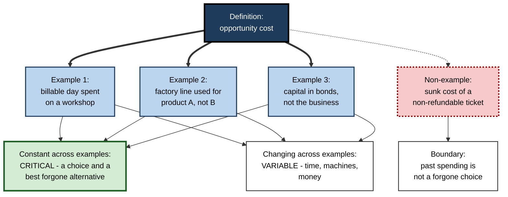
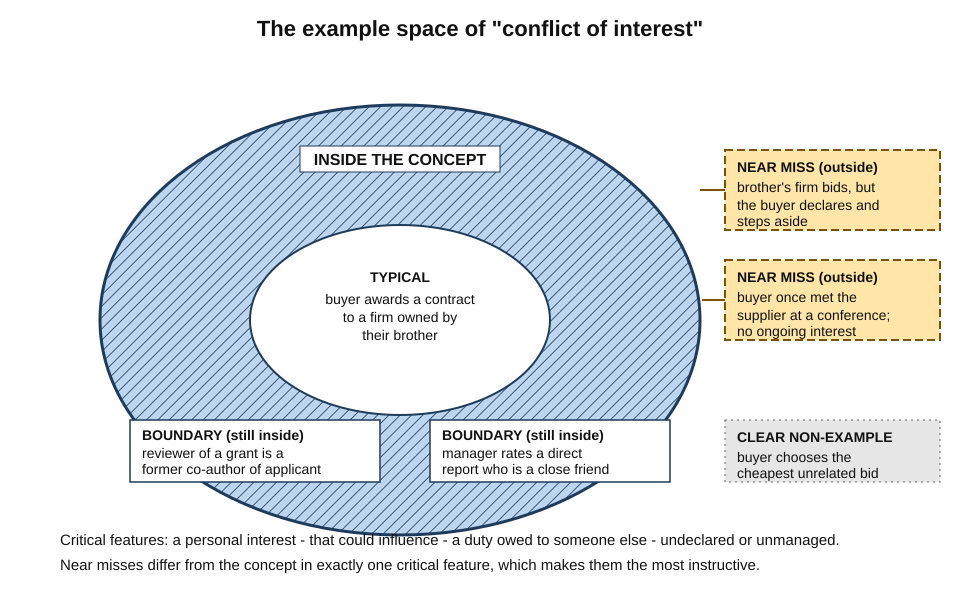
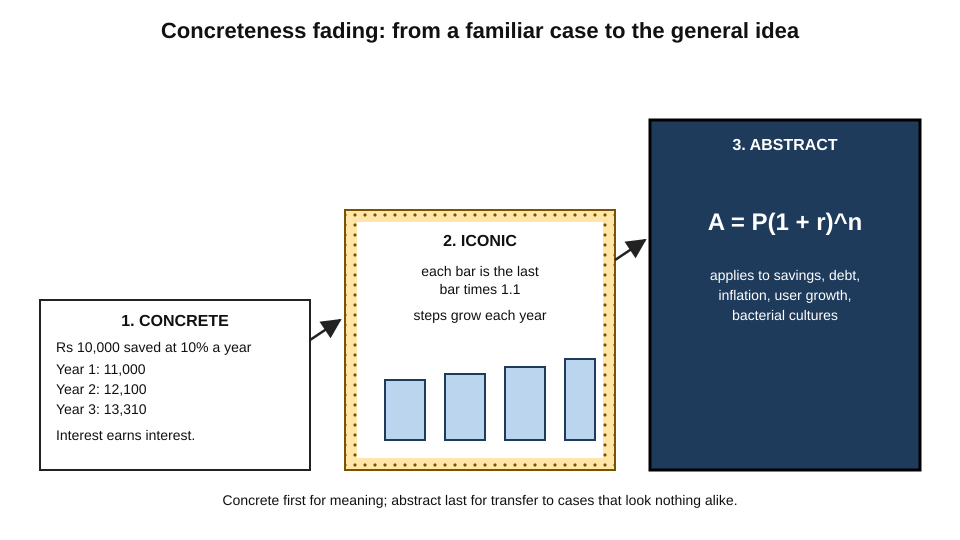
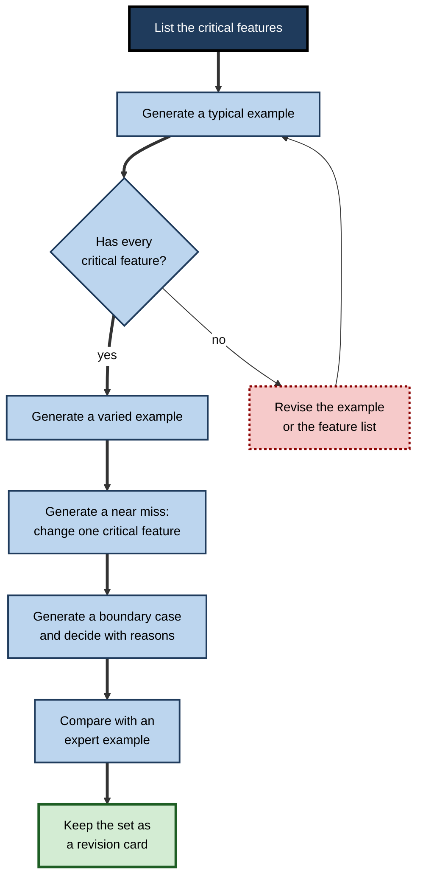
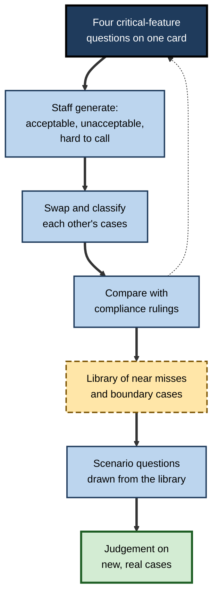
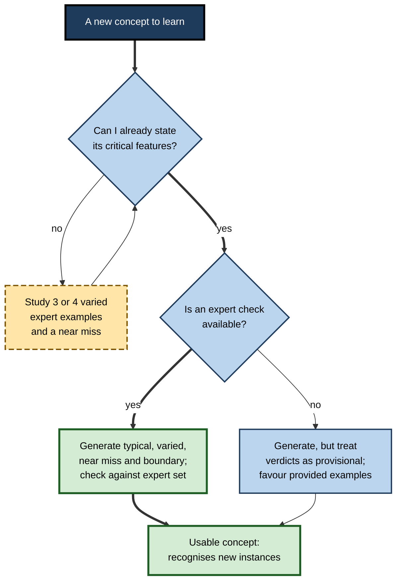

# F.4. Generating Examples for Concepts

A trainee auditor can recite the definition of "materiality" word for word, yet cannot say whether a misstated delivery charge on one invoice is material. A colleague who cannot quite recite the definition has, over the past month, collected a dozen cases from real files — some clearly material, some clearly not, a few on the line. Asked about the invoice, she answers in seconds. A definition names a concept; examples are what let a person **recognise** and **use** it.

> **Definition — Concept:** a mental category that groups things, events or ideas sharing certain features — "conflict of interest", "opportunity cost", "race condition", "sepsis".

> **Definition — Generating examples:** an elaboration strategy in which the learner produces their own instances of a concept — and, ideally, non-examples and borderline cases — and checks each against the concept's defining features.

**Why it matters**

- Most professional knowledge is **conceptual**: categories that must be applied to new, messy cases that never appeared in training.
- A definition alone rarely transfers; learners who can only recite definitions fail to recognise new instances.
- Examples translate abstract features into **concrete, memorable** cases tied to the learner's own experience.
- Generating examples is also a **diagnostic**: a learner who cannot produce a correct example does not yet understand the concept, however fluent their definition.
- The evidence carries a twist: generating examples is not automatically better than studying good examples provided by an expert. Knowing **when** to generate and when to study is part of the skill.

---

## How Concepts Are Learned from Examples

### Definitions, features and instances

- **Definition** — a statement of the concept's **critical features**: the properties every instance must have.
  - *e.g.* **opportunity cost** — the value of the best alternative given up when a choice is made.
- **Critical features** — necessary properties.
  - *e.g.* a choice is made; alternatives exist; the cost is the value of the **best** forgone alternative.
- **Variable features** — properties instances may or may not have.
  - *e.g.* whether money is involved; whether the alternative is a purchase, a use of time or a use of a machine.
- **Instance (example)** — a specific case that has all critical features.
  - *e.g.* "A consultant who spends Friday on an internal workshop gives up the fee she could have billed — that fee is the opportunity cost."
- **Non-example** — a case that lacks at least one critical feature.
  - *e.g.* "Money already spent on a non-refundable ticket" — a sunk cost, not an opportunity cost.

> **Definition — Critical feature:** a property that every instance of a concept must have; lacking it makes a case a non-example.

> **Definition — Non-example:** a case that resembles a concept but lacks at least one critical feature.

### Why examples teach what definitions cannot

- **Definitions are compressed.** Words such as "best alternative" or "could influence" carry meaning only once the learner has seen what they look like.
- **Examples show variation.** Seeing several different instances shows which features are critical (constant across instances) and which are variable (they change).
- **Non-examples show boundaries.** A case that looks similar but is not an instance shows exactly where the concept ends.
- **Examples connect to experience.** A generated example is drawn from the learner's own knowledge, so it comes with ready-made links.

### Variation theory

- **Ference Marton's variation theory** holds that a learner discerns a feature only when it **varies** against a background that stays the same.
  - To see that "colour" is a feature, one must see objects that differ in colour but not in shape.
  - To see that "undeclared" is critical to a conflict of interest, one must see two otherwise identical cases — one declared, one not.
- **Implication:** a set of examples teaches best when it varies **one feature at a time**, so each feature's role is visible.

**Figure 1.** How a set of examples reveals a concept's critical and variable features.

---

## Kinds of Example

### The example space

- Every concept has an **example space**: the whole range of its possible instances, from typical to unusual.
  - **Anne Watson and John Mason** (2005), working in mathematics education, showed that learners' example spaces are often narrow — they think of a few stereotyped instances — and that asking for "another, and another, and one nobody else would think of" widens them.
- **A narrow example space** produces brittle understanding: the learner recognises only cases that resemble the stereotype.

| Kind of example | What it is | What it teaches | Example for "conflict of interest" |
|---|---|---|---|
| **Typical (prototype)** | A clear, central instance | The core of the concept | A buyer awards a contract to a brother's firm |
| **Boundary** | An instance near the edge that still qualifies | How far the concept stretches | A grant reviewer who once co-authored with the applicant |
| **Near miss** | A non-example differing in one critical feature | Exactly which feature matters | The same buyer declares the interest and steps aside |
| **Clear non-example** | A case obviously outside | Contrast; little new insight | A buyer chooses the cheapest unrelated bid |
| **Counter-example** | A case that disproves a proposed rule | Corrects an over-simple definition | "All gifts create conflicts" — a pen at a conference does not, under most policies |

> **Definition — Near miss:** a non-example that differs from a true instance in only one critical feature. The term comes from Patrick Winston's 1970 work on how a computer program could learn concepts such as "arch" from examples.

**Figure 2.** The example space of a concept: typical cases, boundary cases, near misses and non-examples.

> **Key point:** typical examples make a concept **memorable**; boundary cases and near misses make it **usable**. Most learners generate only the first kind.

### Well-defined and fuzzy concepts

- **Well-defined concepts** have crisp critical features — "prime number", "finance lease" under a given accounting standard. Examples can be checked mechanically against the definition.
- **Fuzzy concepts** have no single set of necessary features — "good leadership", "agile team", "game". Ludwig Wittgenstein called the pattern **family resemblance**: members share overlapping features, but no feature is shared by all. Eleanor Rosch's research in the 1970s showed that people treat such categories as having **graded membership** — a robin is a "better" bird than a penguin.
- **Implication for generating examples:**
  - for well-defined concepts, the feature check is decisive;
  - for fuzzy concepts, examples matter even more, because there is no definition to fall back on — expertise *is* a well-calibrated set of exemplars and the reasons for judging them.

> **Watch out:** many professional concepts that are written as if well-defined ("material", "reasonable", "high risk") behave as fuzzy concepts in practice. Treating them as crisp leads to false confidence at the boundary.

### Concrete and abstract

- **Concrete examples** — specific, imageable, often from everyday life.
  - Easy to understand and remember.
  - Risk: learners attend to **surface** details (the brother, the contract) rather than the structure.
- **Abstract or generic representations** — symbols, diagrams, formal statements.
  - Harder to grasp, but stripped of distracting detail and so potentially easier to transfer.
- **Concreteness fading** — begin concrete, move through a simplified diagram, end abstract (reviewed by Emily Fyfe, Nicole McNeil, Ji Son and Robert Goldstone, 2014).
  - Gives meaning first and generality last.

**Figure 3.** Concreteness fading from a familiar case to the general idea.

> **Watch out:** a much-cited 2008 study by Jennifer Kaminski, Vladimir Sloutsky and Andrew Heckler reported that students who learned a mathematical concept through **generic symbols** transferred it better than those who learned through concrete examples. Later attempts to reproduce and extend the finding produced mixed results, and the size of the advantage appears to depend on the task. The safe conclusion is not "avoid concrete examples" but "do not stop at them".

---

## The Evidence on Examples

### Provided examples help concept learning

**Study card — Rawson, Thomas and Jacoby (2015)**

- **Design:** university students learned definitions of abstract psychology concepts.
  - Some studied the definitions alone, with repetition.
  - Others studied the definitions together with several concrete examples of each concept.
- **Test:** classify **new, previously unseen** examples by concept.
- **Results:** studying examples substantially improved the ability to classify new examples.
- **Conclusion:** examples build the ability to **recognise** instances — the core of conceptual understanding.
- **Replication:** a 2024 replication by Alexia Micallef and Philip Newton reproduced the benefit of concrete examples for learning abstract concepts.

### Generating versus studying examples

**Study card — Zamary and Rawson (2018), example generation**

- **Question:** is generating one's own examples more effective than studying examples supplied by an expert?
- **Design:** learners studied definitions of declarative concepts and then either generated their own examples, studied provided examples, or combined the two, before a test requiring classification of new examples.
- **Results:** generating examples was **not more effective** than studying provided examples and took **more time**, making it the less efficient choice in these conditions.
- **Conclusion:** generation is not a free bonus; its value depends on the quality of what is generated and on the alternative available.

**Study card — Zamary, Rawson and Dunlosky (2016), judging example quality**

- **Design:** learners generated examples of new concepts and judged the quality of their own examples.
- **Results:** judgements were **poor and overconfident** — learners often rated incorrect examples as correct — and simple feedback did not fix the problem.
- **Follow-up:** later work from the same research group found that comparing one's example against an **expert example** improved learners' judgements of their own examples, whereas lists of the definition's key ideas did not help as much.
- **Conclusion:** generated examples need an **external check**; learners cannot reliably mark their own.

> **Key point:** the evidence supports **examples** strongly. It supports **self-generated** examples more conditionally — when the learner has enough knowledge to generate correct ones, and when they are checked.

| | Studying provided examples | Generating one's own examples |
|---|---|---|
| **Accuracy of examples** | High, if chosen by an expert | Variable; often includes wrong examples |
| **Time cost** | Low | Higher |
| **Links to personal knowledge** | Fewer | More |
| **Diagnostic value** | Low — reveals little about the learner | High — wrong examples expose misunderstanding |
| **Best stage of learning** | Early, when the concept is new | Later, once the concept is partly understood |
| **Main risk** | Passive reading of examples | Storing wrong examples with confidence |

### Why generation can still pay

- **Diagnosis** — an attempt to generate reveals misunderstanding immediately, which provided examples never do.
- **Personalisation** — a learner's own example comes from their work or life and is more likely to come to mind when a similar case appears.
- **Transfer to the real task** — professionals must recognise instances in their own context; generating from that context rehearses the actual skill.
- **Combination** — studying expert examples **then** generating new ones, checked against the experts', combines accuracy with personal links.

### Mechanisms

- **Abstraction by comparison** — encountering several instances invites the learner to notice what they share; the shared structure becomes the concept. A single example, however vivid, cannot show what is shared.
- **Exemplar storage** — some theories of categorisation hold that people classify new cases partly by similarity to **stored exemplars**, not only by checking a definition. On this view, a rich store of varied examples *is* much of what knowing a concept means.
- **Prototype formation** — other theories propose that people abstract a **prototype**, an average of the instances seen. A biased set of examples produces a biased prototype — for instance, a "typical fraudster" that looks nothing like most real fraudsters.
- **Retrieval routes** — each example is a separate cue. A professional facing a new case is reminded of the concept because the case resembles one of the stored examples.
- **Generation effects** — producing an example is a generative act, which usually strengthens memory; but the evidence above shows this benefit can be outweighed by poor example quality and time cost.

> **Key point:** whichever theory of categorisation is right, the practical prescription is the same — a **varied, accurate** set of examples, including cases near the boundary, is what allows recognition of new instances.

### Examples over a career

- **Professionals accumulate example spaces** — a senior underwriter has seen thousands of risks; a senior nurse has seen many presentations of deterioration.
- **Unexamined accumulation is slow and biased** — people remember dramatic cases and forget routine ones, so their mental "typical case" drifts away from reality.
- **Deliberate libraries correct this** — teams that record hard cases, with the ruling and the reason, build shared example spaces faster and more accurately than individuals relying on memory.

---

## Generating Examples Well

### A procedure

1. **State the critical features** of the concept as a short list.
2. **Generate a typical example** from one's own experience or work.
3. **Check it feature by feature** — does it have every critical feature?
4. **Generate a varied example** — change a variable feature (a different setting, scale or medium).
5. **Generate a near miss** — change exactly one critical feature and confirm the case falls outside.
6. **Generate a boundary case** — one that is hard to classify, and decide with reasons.
7. **Compare with an expert example or reference** — correct any errors.
8. **Keep the best set** — two instances, one near miss, one boundary case — as a revision card.

> **Mnemonic — "TV-NBC":** Typical, Varied, Near miss, Boundary, Compare.

**Figure 4.** A procedure for generating and checking a set of examples for a concept.

### Checking an example

- **Feature check** — tick each critical feature; any missing feature makes it a non-example.
- **Swap test** — replace the surface details (people, industry, sums) and ask whether it is still an instance; if not, the example depended on surface, not structure.
- **Explain it** — state in one sentence **why** it is an instance; a correct example with a wrong reason is a warning sign.
- **External check** — compare with a textbook example, an expert or a colleague.

### Worked example (illustrative): generating examples of confirmation bias

- **Situation:** a junior product analyst is learning cognitive biases for a decision-quality course.
- **Definition given:** confirmation bias — the tendency to search for, interpret and recall information in ways that support existing beliefs.
- **Critical features:** (a) an existing belief; (b) information handled selectively; (c) the selection favours the belief.

| Attempt | Example generated | Feature check | Verdict |
|---|---|---|---|
| 1 | "I believed the new feature would boost retention, so I only looked at the cohort where it did." | (a) yes (b) yes (c) yes | **Instance — typical** |
| 2 | "I didn't check the data at all because I was busy." | (a) unclear (b) no selection (c) no | **Non-example** — this is neglect, not biased selection |
| 3 | "My manager dismissed a negative customer survey as 'unrepresentative' but cited a positive one." | (a) yes (b) yes, interpretation (c) yes | **Instance — varied** (interpretation rather than search) |
| 4 | "I believed the feature would help, ran a pre-registered test, and the result disappointed me." | (a) yes (b) no — selection prevented (c) no | **Near miss** — belief present, selection blocked by design |
| 5 | "An investor keeps a losing share because selling would mean admitting a mistake." | (a) yes (b) partly (c) yes, but driven by loss aversion and ego | **Boundary** — overlaps other biases; arguable |

- **Conclusion:** attempt 2 revealed a misunderstanding (confusing bias with carelessness) that reading definitions would never have exposed; attempt 4 showed which feature — selective handling — is critical.

> **Watch out:** the analyst's first instinct was to generate five versions of attempt 1 with different products. Five typical examples teach much less than one typical, one varied, one near miss and one boundary case.

### Common errors

- **Copying** — changing only the names in a textbook example; the structure, and the learning, stay the same.
- **Missing a feature** — an example that has most but not all critical features, accepted because it "feels right".
- **Over-stretching** — classifying anything vaguely related as an instance ("everything is confirmation bias").
- **Only typical cases** — narrow example space, poor recognition of unusual cases.
- **Memorable but misleading** — a vivid story that illustrates a secondary feature and obscures the critical one.

---

## Examples in Professional Practice

### Where concept recognition is the job

- **Compliance and ethics** — "Is this gift a bribe? Is this relationship a conflict?" Policies give definitions; decisions require recognising instances.
- **Medicine** — diagnostic categories are concepts; clinicians build example spaces of how a condition **presents**, including atypical presentations (*e.g.* heart attack without chest pain).
- **Law** — legal tests (negligence, reasonable foreseeability) are taught through cases, and lawyers argue by placing a new case relative to decided ones — typical, boundary or distinguishable.
- **Software engineering** — design patterns and anti-patterns ("leaky abstraction", "race condition") are recognised in code only after seeing many instances.
- **Finance and accounting** — "Is this lease a finance lease? Is this expense capital?" — classification decisions with real money attached.
- **Management** — "Is this behaviour harassment, or robust feedback?" — boundary cases are where training most often fails.

> **In practice:** expert practitioners carry large, well-organised example spaces built over years. A deliberate example-generation habit compresses that process by producing boundary cases that would otherwise take years to meet.

### Hypotheticals in professional education

- **Law schools** have long taught by hypotheticals: "Suppose the buyer had declared the interest — does the result change?"
- **Medical teaching** uses "what if this patient were 80, not 30?" to vary one feature at a time.
- **The common structure** is variation theory in practice: hold everything constant except one feature and ask whether the classification changes.

### Case study (illustrative): gifts-and-hospitality training at a manufacturer

- **Situation:** a manufacturer's procurement staff completed annual anti-bribery e-learning with a definition, a policy summary and a ten-question multiple-choice quiz.
- **Problem:** internal audit found frequent misclassification — some staff refused trivial items while accepting lavish hospitality from suppliers in live tenders.
- **Diagnosis:**
  - the quiz used only clear cases ("a cash envelope" — obviously a bribe);
  - staff had never been asked to classify **boundary cases**;
  - the critical feature — **potential to influence a decision** — was buried in the policy text.
- **Actions:**
  1. The policy's critical features were reduced to four questions on a single card: value, timing relative to decisions, openness, and reciprocity.
  2. In workshops, staff **generated** examples from their own experience — one acceptable, one unacceptable, one hard to call.
  3. Groups exchanged examples and classified each other's, then compared with the compliance team's rulings.
  4. The hardest cases were collected into a growing library of **near misses** and boundary cases.
  5. The annual quiz was replaced by short scenario questions drawn from the library.
- **Result:** audit misclassifications fell markedly the following year; staff asked compliance more questions about genuinely hard cases and fewer about trivial ones.
- **Side effects:** workshops took longer than e-learning; some generated examples revealed real past breaches that had to be handled sensitively.
- **Lesson:** a definition plus clear examples produced **knowledge of the rule**; generated near misses and boundary cases produced **judgement**.

**Figure 5.** How the redesigned training built judgement from generated examples.

### Examples and AI assistants

- **Abundant provided examples** — an assistant can produce dozens of examples, near misses and boundary cases in seconds, removing the main cost of the "provided examples" approach.
- **Quality varies** — generated examples may miss a critical feature or blur two concepts; an expert check remains necessary for high-stakes concepts.
- **A productive division of labour:**
  1. the learner generates their own set first;
  2. the assistant classifies them and explains each verdict;
  3. the learner asks for near misses for any feature they misjudged;
  4. disputed verdicts are checked against an authoritative source.

> **Watch out:** a learner who only reads machine-generated examples is back to studying provided examples — useful, but without the diagnostic benefit of their own attempts.

---

## Matching the Strategy to the Learner

**Figure 6.** When to study provided examples and when to generate one's own.

- **Novices** — start with provided examples, varied one feature at a time, including a near miss.
- **Intermediate learners** — generate, then compare with an expert set; most of the benefit of generation is here.
- **Advanced learners** — generate boundary cases and counter-examples to test the definition itself; this is where definitions get refined.

---

## Open Questions

- **When exactly does generating beat studying?**
  - Laboratory studies with short definitions find little advantage for generation; settings where personal relevance and diagnosis matter more — such as workplace judgement — are rarely tested.
- **How can learners judge their own examples?**
  - Learners are poor judges and simple feedback does not fix it; comparison with expert examples helps, but the best scalable method is unclear.
- **How many examples, and how varied?**
  - Variation theory gives principles; precise guidance on the number and spacing of examples for different kinds of concept is lacking.
- **Concrete or generic?**
  - Concreteness fading has good support in mathematics and science; its value for social and professional concepts is less studied, and the generic-symbols debate is unresolved.
- **What do AI-generated example libraries do to expertise?**
  - Abundant examples could speed the building of example spaces — or reduce the effortful attempts that expose misunderstanding.

---

## Summary

- A **concept** is a category defined by **critical features**; **variable features** differ among instances. **Examples** have all critical features; **non-examples** lack at least one.
- Examples teach what definitions cannot: they show **variation**, **boundaries** and **links to experience**. **Variation theory** (Marton): features are discerned when they vary against a constant background.
- The **example space** includes **typical**, **boundary**, **near-miss**, **non-example** and **counter-example** cases. Typical cases make concepts memorable; boundary cases and near misses make them usable.
- **Concreteness fading** moves from concrete to iconic to abstract; the claim that generic symbols beat concrete examples is **contested**.
- Evidence: **provided examples** reliably improve classification of new instances (**Rawson, Thomas and Jacoby, 2015**; replicated 2024). **Generating** examples is **not automatically better** and takes longer (**Zamary and Rawson**); learners **judge their own examples poorly** (**Zamary, Rawson and Dunlosky, 2016**), though comparison with expert examples helps.
- Generate well with **TV-NBC** — Typical, Varied, Near miss, Boundary, Compare — and check by features, swap test, explanation and external comparison.
- At work, concept recognition drives compliance, diagnosis, legal tests, design patterns and accounting classification. Build **libraries of near misses and boundary cases**. With AI: **generate first, then have the set classified and checked**.

---

## Self-Check

1. Distinguish a critical feature from a variable feature, using a concept from your own field.
2. Why does knowing a definition not guarantee that a learner can recognise new instances?
3. Explain variation theory and how it should shape a set of examples.
4. What is a near miss, and why is it often more instructive than a clear non-example?
5. Describe Rawson, Thomas and Jacoby (2015) and its replication status.
6. What did research comparing generated and provided examples find, and how should that change a learner's approach?
7. Why do learners need an external check on their own examples?
8. Describe concreteness fading and the caution attached to the generic-symbols finding.
9. List the steps of TV-NBC and apply them to the concept "sunk cost".
10. A colleague generates six examples of "technical debt", all about rushed code. What is wrong with the set, and how should it be improved?
11. What is the swap test, and what error does it detect?
12. A compliance team's quiz contains only obvious cases. Why does this fail, and what would you change?
13. Design a sequence for using an AI assistant to build an example space for "material misstatement".

### Answer Key

1. Critical features are necessary for every instance; variable features may differ. *e.g.* for "phishing", critical: a deceptive message, an attempt to obtain information or action; variable: email or text, a bank or a colleague as the impersonated sender.
2. Definitions are compressed; terms in them gain meaning only through cases. Without seeing variation and boundaries, the learner cannot tell which features of a new case matter.
3. A feature is noticed only when it varies against a background that stays constant. Examples should vary one feature at a time — including pairs identical except in one critical feature.
4. A non-example differing from an instance in only one critical feature. It shows exactly which feature makes the difference, whereas a clear non-example differs in many ways and teaches little.
5. Students studying definitions with several concrete examples classified new, unseen examples much better than those studying definitions alone. A 2024 replication (Micallef and Newton) reproduced the benefit.
6. Generating was not more effective than studying expert examples and took longer. A learner should study good examples first when the concept is new, then generate and check against expert examples once the concept is partly understood.
7. Learners' judgements of their own examples are poor and overconfident; wrong examples get rated correct, and simple feedback does not fix this. Comparing with expert examples improves accuracy.
8. Start with a concrete case, move to a simplified diagram, end with the abstract form — meaning first, generality last. The 2008 claim that generic symbols transfer better has had mixed replication; do not avoid concrete examples, but do not stop at them.
9. Typical: paying for a cinema ticket, then staying through a bad film because "it's paid for". Varied: continuing a failing IT project because of money already spent. Near miss: a refundable deposit (it can still be recovered, so it is not sunk). Boundary: training already given to an employee who might leave. Compare against a textbook treatment.
10. All six are typical and share surface features, giving a narrow example space. Add varied cases (outdated architecture, missing tests, documentation debt), a near miss (a deliberate, documented shortcut with a repayment plan — arguably managed debt) and a boundary case.
11. Replace surface details (names, industry, amounts) and check whether the case is still an instance. It detects examples that depend on surface features rather than the concept's structure.
12. Obvious cases test knowledge of the rule, not judgement; real errors happen at boundaries. Replace them with scenario questions built from near misses and boundary cases, ideally generated by staff and ruled on by compliance.
13. Write the critical features; generate one's own typical, varied, near-miss and boundary cases; ask the assistant to classify each and explain why; ask for further near misses for any misjudged feature; check disputed verdicts against the auditing standard or a senior auditor; keep the final set as a revision card.

---

## Glossary

| Term | Meaning |
|---|---|
| Boundary case | An instance near the edge of a concept that still qualifies. |
| Concept | A mental category grouping things that share certain features. |
| Concreteness fading | Teaching that moves from concrete examples through simplified representations to abstract forms. |
| Counter-example | A case that disproves a proposed rule or definition. |
| Critical feature | A property every instance of a concept must have. |
| Example generation | Producing one's own instances of a concept. |
| Example space | The full range of possible instances of a concept. |
| Exemplar | A stored instance used to classify new cases by similarity. |
| Family resemblance | A category whose members share overlapping features, none common to all. |
| Graded membership | The degree to which an instance is a good member of a category. |
| Instance | A specific case that has all a concept's critical features. |
| Near miss | A non-example differing from an instance in only one critical feature. |
| Non-example | A case that lacks at least one critical feature of a concept. |
| Prototype | A typical, central instance of a concept. |
| Swap test | Changing an example's surface details to check whether it still qualifies. |
| Variable feature | A property that may differ among instances of a concept. |
| Variation theory | The view that features are discerned when they vary against a constant background. |
