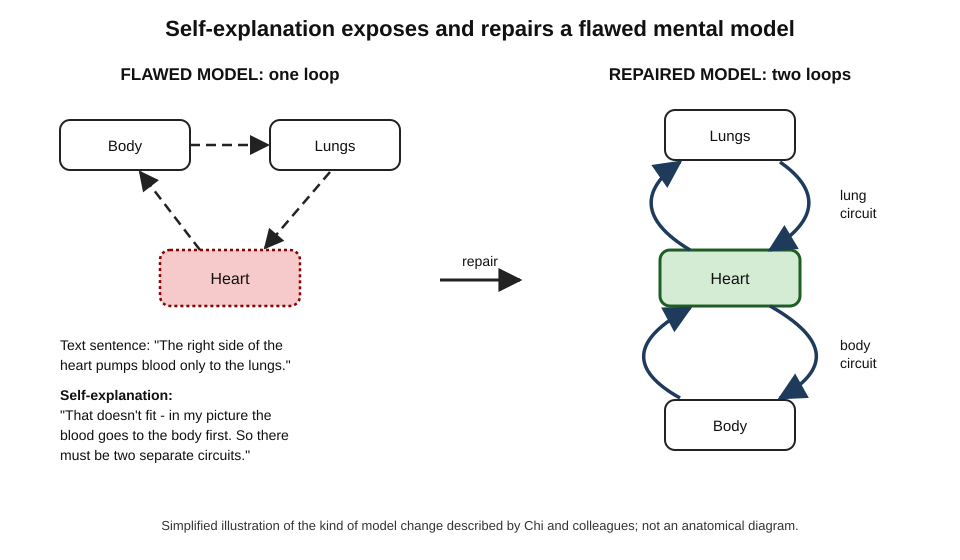
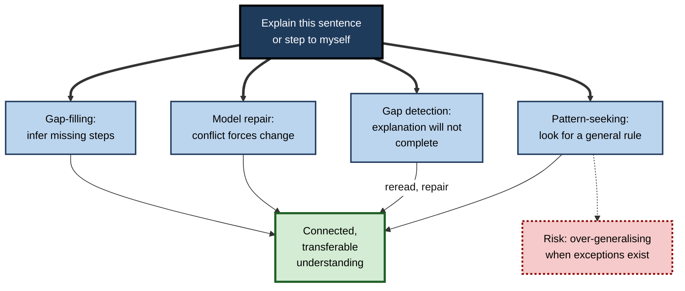
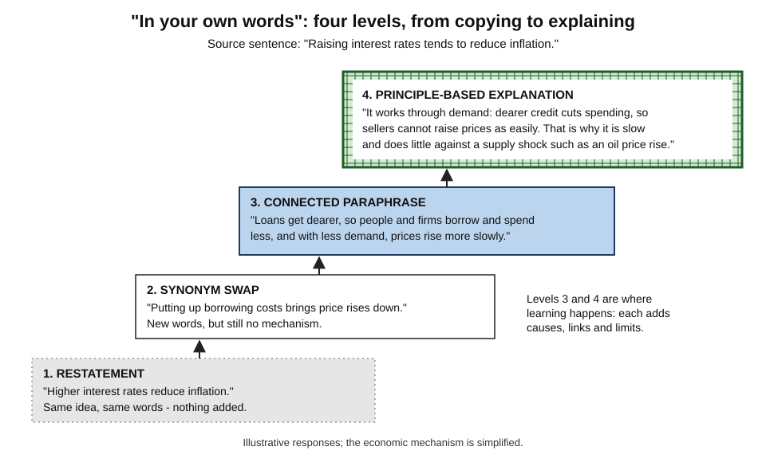
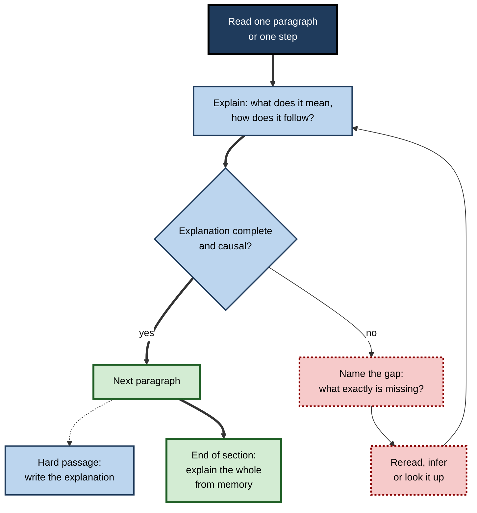
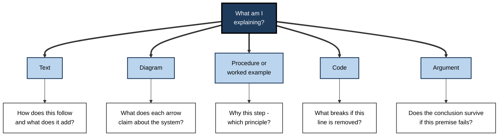
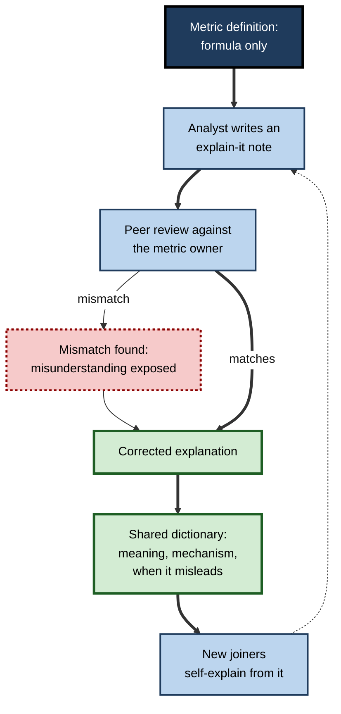

# F.5. Explaining Concepts in Own Words

Two junior analysts read the same page on how a central bank uses interest rates. The first highlights three sentences. The second stops after each paragraph and says, "So what that means is…" — and twice cannot finish the sentence, so she rereads and works out the missing step. A week later only the second can explain why rate rises take a year or more to bite. The difference was the act of **explaining the material to herself in her own words**.

> **Definition — Self-explanation:** generating explanations for oneself of what material means and how its parts fit together — why a statement holds, how it follows from earlier statements, how it connects to what is already known — while studying it.

> **Definition — Explaining in one's own words:** expressing a concept in language the learner has produced, rather than copied, in a way that makes its meaning, causes and connections explicit.

**Why it matters**

- Explaining forces the learner to **build** a coherent understanding rather than store sentences.
- It reveals **gaps** at the moment they occur: an explanation that cannot be completed marks exactly what is not yet understood.
- It is one of the best-supported elaboration strategies, with a **moderate, reliable** benefit across many subjects.
- It costs nothing but time, and it can be used with any material: textbooks, standards, code, contracts, reports.
- Most learners do it rarely and poorly unless prompted — so knowing **how** to do it well matters more than knowing that it works.

---

## What Self-Explanation Is

### The core act

- **Pause** after a sentence, paragraph, diagram or step.
- **Explain** — to oneself, aloud, in writing or silently — what it means and why it is so.
- **Connect** — relate it to earlier material and to prior knowledge.
- **Notice** — when the explanation fails, identify what is missing.
- **Repair** — reread, infer or look up the missing piece, then explain again.

> **Key point:** self-explanation is aimed at **oneself**. Its purpose is to construct understanding, not to communicate it to others — though the two often overlap.

### Self-explanation and its neighbours

| | Self-explanation | Paraphrasing | Summarising | Explaining to others |
|---|---|---|---|---|
| **Main purpose** | Build understanding | Re-express meaning | Condense to main ideas | Communicate understanding |
| **Adds information?** | Yes — inferences, causes, links | Little | No — removes detail | Often, for the audience |
| **Unit** | Sentence, step, diagram | Sentence or passage | Whole text | Whole topic |
| **Typical signal of success** | "Now I see why" | Accurate rewording | Short, complete gist | Audience understands |
| **Typical failure** | Restating the text | Swapping synonyms | Copying topic sentences | Performing without checking |

- **Paraphrasing and summarising** preserve or condense meaning; **self-explanation** goes beyond the text by adding inferences.
- **Teaching others** adds an audience and its questions; its learning benefits draw partly on the same mechanism.
- **Elaborative interrogation** asks why a single fact is true; self-explanation works through **connected** material — a chain of reasoning, a procedure or a system.

### The ICAP view in one sentence

- Michelene Chi's ICAP framework ranks engagement as passive, active, constructive and interactive; self-explanation is the classic **constructive** activity, because the learner produces something that goes beyond the material given.

---

## The Self-Explanation Effect

### The discovery

**Study card — Chi, Bassok, Lewis, Reimann and Glaser (1989)**

- **Design:** university students studied worked examples in mechanics, thinking aloud, then solved problems.
- **Results:**
  - **Good learners** produced many more self-explanations — refining conditions, explaining why each step was taken, relating steps to principles.
  - **Poor learners** mostly paraphrased or read on, and reported understanding more often — they did not notice what they missed.
- **Conclusion:** what learners **say to themselves** while studying examples predicts how much they learn from them.

### From correlation to cause

**Study card — Chi, de Leeuw, Chiu and LaVancher (1994)**

- **Design:** school pupils of around 13–14 read a textbook passage on the human circulatory system, one sentence at a time.
  - **Prompted group** — asked to explain each sentence to themselves, aloud.
  - **Control group** — read the passage twice.
- **Results:**
  - The prompted group gained more, especially on **complex questions** requiring inference.
  - Among prompted pupils, those who produced many explanations were far more likely to reach the **correct mental model** — two separate circuits — than those who produced few.
- **Conclusion:** prompting self-explanation **causes** better understanding, not merely accompanies it.

**Figure 1.** Self-explaining a sentence that contradicts a flawed mental model.

### How large and how general

- **Bisra, Liu, Nesbit, Salimi and Winne (2018)** combined 69 effect sizes from 64 research reports in which learners were prompted to self-explain.
  - **Average benefit:** g ≈ 0.55 compared with learners who were not prompted — a **moderate** effect.
  - Benefits appeared across subjects (mathematics, science, reading, programming), age groups and media.
  - Learning gains were generally stronger when explanations were **elicited for specific content** rather than requested in vague, general terms.
- **Dunlosky and colleagues (2013)** rated self-explanation **moderate utility**: robust benefits, but a significant time cost and dependence on the quality of prompts.

> **Key point:** self-explanation is not a trick of one laboratory; its benefit is **moderate, broad and causal** — provided the explanations are genuine.

### Individual differences

- **Alexander Renkl (1997)** studied how learners self-explained worked examples and identified distinct profiles:
  - **Principle-based explainers** — linked steps to the underlying principles; learned well.
  - **Anticipative reasoners** — predicted the next step before reading it; learned well.
  - **Passive or superficial explainers** — said little or merely restated; learned poorly.
- **Implication:** *what kind* of explanation a learner produces matters as much as *whether* they explain.

---

## Why Explaining Works

### Generating inferences

- Texts are never complete; authors leave out steps they consider obvious.
- Self-explanation **fills the gaps** with inferences: "If the right side pumps only to the lungs, the blood must come back to the left side before going to the body."
- These inferences become part of the learner's knowledge, so the learner knows more than the text stated.

### Repairing mental models

- Chi (2000) proposed a **dual-process** account:
  - **Gap-filling** — adding missing pieces;
  - **Model repair** — when a sentence conflicts with the learner's existing mental model, explaining the conflict forces the model to change.
- Without explanation, conflicts often pass unnoticed: the learner reads the correct sentence and keeps the wrong model.

> **Definition — Mental model:** an internal representation of how a system works — its parts, their relationships and how changes propagate — which can be used to reason and predict.

### Detecting gaps

- An explanation that will not complete is a **signal** that understanding is missing.
- Passive reading gives no such signal; the eye moves on and the feeling of understanding persists.
- This is why good explainers in Chi's 1989 study reported **fewer** feelings of understanding than poor ones: they were noticing more of what they did not know.

### Integration and organisation

- Explaining relates each new statement to earlier ones, building a **connected structure**.
- Connected knowledge is retrieved more easily and transferred more readily than isolated statements.

### Discovering general patterns

**Study card — Williams and Lombrozo (2010)**

- **Design:** adults studied images of novel items (fictional robots) belonging to two categories. Some were asked to **explain** why each item belonged to its category; others **described** the items or thought aloud.
- **Results:** explainers were more likely to discover a **subtle, general rule** that explained every item, rather than relying on a salient but imperfect feature.
- **Conclusion:** explaining pushes learners towards **broad, unifying patterns**.

**Study card — Williams, Lombrozo and Rehder (2013)**

- **Design:** similar category-learning tasks, but the general pattern had **exceptions**.
- **Results:** explainers again found the pattern — and then **over-generalised**, persisting with it when exceptions appeared and learning the exceptions more slowly.
- **Conclusion:** explanation's search for unifying patterns is a strength when patterns are real and a hazard when the domain is irregular.

> **Watch out:** explaining makes learners favour **neat, general explanations**. In domains full of exceptions — tax law, irregular verbs, clinical edge cases — a learner must deliberately ask, "Where does my explanation fail?"

**Figure 2.** How self-explanation produces understanding — and its built-in risk.

---

## Explaining Well

### Levels of "own words"

- "Put it in your own words" can mean four very different things:
  1. **Restatement** — the same idea in nearly the same words.
  2. **Synonym swap** — new words, same content, no mechanism.
  3. **Connected paraphrase** — the idea with its causal links made explicit.
  4. **Principle-based explanation** — the mechanism, its link to a general principle, and its limits.
- Only levels 3 and 4 produce substantial learning; levels 1 and 2 feel productive and are not.

**Figure 3.** Four levels of putting a statement in one's own words.

### Marks of a good explanation

- **Causal** — says what produces what ("because", "so", "which means").
- **Principled** — names the general idea at work.
- **Connected** — refers back to earlier material.
- **Bounded** — says when it stops applying.
- **Testable** — makes a prediction one could check.

> **Mnemonic — "CPCBT: Can People Collect Better Truths?":** Causal, Principled, Connected, Bounded, Testable.

### Prompts that work

| Prompt type | Example | Strength | Weakness |
|---|---|---|---|
| **Open** | "Explain this paragraph to yourself." | Flexible; any material | Easy to answer superficially |
| **Focused** | "What principle justifies this step?" | Directs attention to the key relation | Must be written for each material |
| **Gap-finding** | "What does this assume that it does not say?" | Generates inferences | Can feel unanswerable to novices |
| **Comparative** | "How does this differ from the previous case?" | Builds distinctions | Needs a suitable comparison |
| **Predictive** | "Before reading on — what happens next, and why?" | Anticipative reasoning | Slower |
| **Menu-based** | "Which principle applies: A, B or C? Why?" | Supports novices | Less generative |

> **In practice:** for self-study, the most useful single prompt is often **"What does this mean, and how does it follow from what came before?"** — open enough for any material, specific enough to resist restatement.

### Spoken, written and silent

- **Silent** — fastest, but the easiest to fake; a vague "yes, I get it" substitutes for an explanation.
- **Spoken** — harder to fake; most of the classic studies used think-aloud explanations.
- **Written** — slowest; leaves a record that can be checked and reused, and makes thin explanations visible.
- **A practical mix** — speak through most material, write explanations for the hardest passages.

### A routine for study sessions

**Figure 4.** A routine for self-explaining while studying a text.

### Worked example: self-explaining a passage on vaccines

- **Passage:** "Vaccines expose the immune system to a harmless form of a pathogen. Memory cells formed in response allow a faster, stronger reaction on later exposure. Some vaccines require boosters."

| Sentence | Weak self-explanation | Strong self-explanation |
|---|---|---|
| 1 | "Vaccines expose you to a harmless pathogen." | "So the body gets to practise against the pathogen without the danger of the disease — like a fire drill." |
| 2 | "Memory cells make the reaction faster." | "The first response is slow because the right cells must be found and multiplied; memory cells skip that search, so the second response starts sooner — before the infection gets established." |
| 3 | "Some need boosters." | "If memory cells or antibodies decline over time, protection fades, so a booster must re-stimulate them. That predicts boosters for vaccines whose protection wanes — I should check whether that is the reason, or whether the pathogen changes." |

- **What the strong version did:**
  - inferred the **reason** for speed (no search phase);
  - connected to a familiar **analogy** (fire drill);
  - made a **prediction** and flagged it for checking;
  - noticed an alternative explanation (the pathogen changes), which is the case for some vaccines such as influenza.

> **Watch out:** the weak explanations are not wrong — they are **restatements**. They produce the feeling of having studied with almost none of the learning.

---

## Explaining Different Kinds of Material

The core act is the same everywhere; what changes is what needs explaining.

- **Expository text** — explain how each sentence follows from the last and what it adds to the overall picture.
  - Prompt: "What does this add, and how does it connect to the previous point?"
- **Diagrams** — explain what each element and arrow stands for and what the diagram as a whole claims.
  - Shaaron Ainsworth and Andrea Th. Loizou (2003) found that students who self-explained a **diagram** of the circulatory system generated more explanations and learned more than students who self-explained an equivalent **text** — diagrams seem to invite inference because they leave relations implicit.
- **Worked examples and procedures** — explain why each step is taken and which principle licenses it.
  - Prompt: "Why this step here — what goal does it serve?"
- **Code** — explain what each block does, what state it changes and why it is written this way rather than another.
  - Prompt: "What would break if this line were removed?"
- **Arguments** — explain how each premise supports the conclusion and which premise carries the most weight.
  - Prompt: "If this premise were false, would the conclusion still follow?"
- **Data and charts** — explain what the pattern shows, what produced it and what it does not show.
  - Prompt: "What story explains this shape, and what else could?"

**Figure 5.** Matching the self-explanation prompt to the kind of material.

### Training learners to self-explain

- Because many learners self-explain poorly, researchers have tested **training**:
  - **Katerine Bielaczyc, Peter Pirolli and Ann Brown (1995)** trained university students to self-explain and to monitor their understanding while learning computer programming from texts and examples; trained students learned more than a control group.
  - **Danielle McNamara's Self-Explanation Reading Training (SERT)**, later automated as the iSTART tutoring system, teaches readers a small set of explanation strategies — paraphrasing, bridging inferences, using prior knowledge, predicting — and has been found especially helpful for readers with less prior knowledge.
- **Common elements** of successful training:
  1. a clear description of what a good explanation contains;
  2. modelled examples of strong and weak explanations;
  3. practice with feedback on one's own explanations;
  4. gradual withdrawal of prompts.

> **Key point:** self-explanation is a **skill**. It improves with modelling, practice and feedback, and the untrained version is usually much weaker than the trained one.

---

## Limits and Failure Modes

### When explaining helps less

- **Very low prior knowledge** — learners cannot generate meaningful inferences and produce restatements or errors; more structured prompts or worked explanations help.
- **Simple material** — for isolated facts, explaining adds little beyond what elaborative interrogation or retrieval would.
- **High time pressure** — explaining roughly doubles study time for dense material; it must be targeted.
- **Exception-heavy domains** — the pull towards general explanations can mislead (Williams, Lombrozo and Rehder).

### Wrong explanations

- A learner can explain fluently and wrongly. Without checking, the wrong explanation is consolidated.
- **Remedy:** check explanations against the source, a model explanation, an expert or worked solutions — especially at the end of each section.

### Illusions of understanding

- People overrate how well they understand how things work — the **illusion of explanatory depth**. Attempting a full explanation is one of the few reliable ways to puncture it.
- But a **partial** explanation can make the illusion worse: the learner explains the easy part and feels the whole is understood.

> **Remember:** the test of an explanation is not "does it feel clear?" but **"could I use it to predict, solve or teach something new?"**

### Comparison of conditions

| Condition | Self-explanation works well | Self-explanation works poorly |
|---|---|---|
| **Prior knowledge** | Moderate — enough to infer | Very low — only restatement possible |
| **Material** | Connected: systems, arguments, procedures | Isolated facts and lists |
| **Prompts** | Specific to the content | Vague ("explain this") |
| **Checking** | Explanations compared with a source | Never checked |
| **Domain** | Regular, principled | Exception-heavy, without attention to exceptions |

---

## Explaining in Professional Work

### Where it matters

- **Engineering** — reading a codebase by explaining each module's purpose and data flow to oneself; reviewers who explain the change in their own words find more defects than those who skim.
- **Law** — a junior lawyer restates a clause's operation in plain language ("if the supplier is late twice, we can terminate without paying") to check it is understood.
- **Medicine** — clinicians explain a patient's presentation as a causal story linking all findings; findings the story cannot explain are clues.
- **Finance** — analysts explain each line of a model in words ("this cell grows revenue by last year's rate less churn") before trusting its outputs.
- **Consulting and management** — writing a short narrative explanation of a recommendation before building slides exposes missing logic that bullet points hide.

> **In practice:** some organisations require proposals as **written narratives** rather than slides precisely because full sentences force the author to explain connections that bullet points let them skip.

### How experts explain to themselves

- **They explain selectively.** Experts skim what fits their knowledge and slow down sharply at anything surprising; novices spread effort evenly or not at all.
- **They explain at the level of principle.** Asked what a passage means, an expert answers with the principle ("this is a liquidity problem, not a solvency one"); a novice answers with the surface ("the bank ran out of cash").
- **They look for what the explanation predicts.** An expert's self-explanation usually ends with an implication — "so we should see X in the next quarter's figures" — which turns understanding into a check.
- **They keep a running list of what they cannot yet explain.** Unexplained items are treated as the most valuable part of the reading.

### Writing as explanation

- Writing an explanation of a concept for an internal wiki, a design document or a hand-over note is a powerful form of self-explanation with a useful by-product.
- **The effect on the writer:** gaps surface as sentences that cannot be finished.
- **The effect on the organisation:** explanations accumulate as shared knowledge.

### Explaining and AI tools

- **The temptation** — asking an assistant to "explain this in simple terms" replaces the learner's explanation with the machine's; the learner reads a fluent explanation and feels they understand.
- **Better uses:**
  1. explain first, in writing; then ask the assistant to critique the explanation and point out gaps or errors;
  2. ask the assistant to play a confused learner who asks "why?" after each sentence;
  3. ask for a model explanation **after** one's own attempt, then compare the two point by point.
- **Caution** — AI explanations can be confidently wrong; the comparison step must include checking against an authoritative source for anything important.

### Case study (illustrative): making new metrics understood in an analytics team

- **Situation:** an e-commerce company introduced a set of new customer metrics (*e.g.* a contribution-margin-based lifetime value). Definitions were published in a metric dictionary.
- **Problem:** analysts used the metrics in reports but misinterpreted them; two senior meetings were derailed by contradictory explanations of the same number.
- **Diagnosis:**
  - analysts had read the definitions but never explained them;
  - the dictionary stated formulas without saying **why** each component was included or **when** the metric misled.
- **Actions:**
  1. Each analyst wrote a one-paragraph "explain-it" note for two metrics: what it means, how each component works, and one situation where it misleads.
  2. Notes were peer-reviewed against the metric owner's explanation; discrepancies were discussed.
  3. The best explanations, with their "when it misleads" lines, were added to the dictionary.
  4. New joiners now self-explain three metrics in their first fortnight.
- **Result:** contradictory interpretations in reports fell sharply; the "when it misleads" lines prevented at least one major misreading during a promotional period.
- **Side effects:** writing took more time than expected; some analysts disliked having explanations reviewed by peers.
- **Lesson:** a definition is information; a **self-generated, checked explanation** is understanding — and, once shared, documentation.

**Figure 6.** How individual explanations became shared understanding in the case study.

---

## Open Questions

- **What is the best prompt for which learner?**
  - Specific prompts generally beat general ones, but how to tailor prompts to a learner's knowledge, automatically and in real time, is unresolved.
- **Spoken or written?**
  - Most foundational studies used think-aloud explanations; whether writing produces the same benefit for the same time is not settled.
- **How can learners check their own explanations?**
  - Self-assessment of explanation quality is weak; scalable feedback (peer review, model explanations, AI critique) needs better evidence.
- **How much does the effect fade over time?**
  - Many studies test soon after learning; long-delay evidence is thinner.
- **Does AI-generated explanation help or hurt?**
  - Reading a machine explanation may aid comprehension now while removing the constructive work that builds lasting understanding; careful comparisons are only beginning.

---

## Summary

- **Self-explanation** = generating explanations for oneself of what material means and how it fits together. It **adds** inferences, unlike paraphrasing (re-expressing) and summarising (condensing).
- **Chi et al. (1989):** good learners self-explained worked examples far more. **Chi et al. (1994):** prompting pupils to self-explain a circulatory-system text **caused** better understanding and more correct mental models.
- **Bisra et al. (2018):** across 64 reports, prompted self-explanation produced a **moderate** benefit (g ≈ 0.55), stronger with content-specific prompts. **Renkl (1997):** principle-based explainers and anticipative reasoners learn most.
- Mechanisms: **gap-filling inferences**, **mental-model repair**, **gap detection**, **integration** and **pattern discovery** (Williams and Lombrozo) — with a risk of **over-generalising** where exceptions exist.
- "Own words" has four levels — **restatement, synonym swap, connected paraphrase, principle-based explanation**; only the last two teach much. Good explanations are **Causal, Principled, Connected, Bounded, Testable**.
- Use **specific prompts**; speak most, write the hardest; **check** explanations against a source.
- Limits: low prior knowledge, simple facts, time cost, exception-heavy domains, wrong but fluent explanations, partial explanations that deepen the illusion of understanding.
- At work: reading code, clauses, cases and models; **written narratives**; shared explanations as documentation. With AI: **explain first, then ask for critique**.

---

## Self-Check

1. Define self-explanation and distinguish it from paraphrasing and summarising.
2. What did Chi and colleagues (1989) observe about good and poor learners studying worked examples?
3. Why was the 1994 circulatory-system study important for establishing cause rather than correlation?
4. What did the Bisra et al. (2018) meta-analysis find?
5. Describe Renkl's profiles of successful and unsuccessful self-explainers.
6. Explain gap-filling and model repair, with an example of each.
7. Why did good learners in Chi's 1989 study report fewer feelings of understanding than poor learners?
8. What did Williams and Lombrozo (2010) and Williams, Lombrozo and Rehder (2013) show, and what does it mean for studying tax rules?
9. Give the four levels of putting something "in your own words" and say which produce learning.
10. Rewrite the vague prompt "Explain this" as a focused prompt for a paragraph on how depreciation works.
11. A learner self-explains confidently but has never checked any explanation. What is the risk, and what should they do?
12. Describe two ways of using an AI assistant that preserve the benefits of self-explanation.
13. A team lead wants new engineers to "read the codebase" in their first week. Design a self-explanation routine for the task.
14. Why might self-explaining a diagram produce more learning than self-explaining an equivalent text?
15. What elements do successful self-explanation training programmes share?

### Answer Key

1. Generating explanations for oneself of what material means and how its parts fit together. Paraphrasing re-expresses meaning without adding; summarising condenses to main ideas; self-explanation adds inferences, causes and connections beyond the text.
2. Good learners produced many self-explanations — refining conditions, justifying steps, linking to principles — while poor learners paraphrased or read on and more often claimed to understand.
3. Learners were randomly assigned to be prompted to self-explain or to read twice; the prompted group learned more, showing that self-explaining causes the benefit rather than merely being something good learners happen to do.
4. Across 69 effect sizes from 64 reports, prompting self-explanation produced a moderate average benefit (g ≈ 0.55), across subjects and ages, generally stronger when prompts targeted specific content.
5. Successful: principle-based explainers (link steps to principles) and anticipative reasoners (predict next steps). Unsuccessful: passive or superficial explainers who say little or restate.
6. Gap-filling: inferring a missing step — "blood must return to the heart before going to the body". Model repair: a sentence conflicts with one's model ("right side pumps only to the lungs" against a one-loop model), and explaining the conflict forces the model to change.
7. Because they were detecting gaps and misunderstandings as they explained, whereas poor learners, not explaining, had no signal that anything was missing.
8. Explaining helped learners discover subtle general rules, but also led them to over-generalise and learn exceptions more slowly when patterns had exceptions. In tax rules, full of exceptions, a learner should explicitly ask where each explanation fails.
9. Restatement, synonym swap, connected paraphrase, principle-based explanation. Mainly the last two.
10. *e.g.* "Why does spreading an asset's cost over its useful life give a truer picture of profit than expensing it at purchase — and when would the straight-line method misstate it?"
11. Wrong explanations are consolidated and feel certain. They should compare explanations with the source, model answers or an expert, especially at the end of each section.
12. Write one's own explanation first, then ask the assistant to critique it and identify gaps; or ask the assistant to act as a questioner asking "why?" after each sentence. (Also: compare one's attempt with a model explanation point by point, verifying against an authoritative source.)
13. *e.g.* For each module: read its entry point; explain in writing, in three or four sentences, what it does, what data flows in and out, and why it is designed that way; mark anything that cannot be explained; check notes with a senior engineer; at the end of the week, explain from memory how a request flows through the system.
14. Diagrams leave many relations implicit, so learners must infer what arrows and positions mean; that invites more explanations (Ainsworth and Loizou, 2003). Text states relations in words, which can be read without inference.
15. A description of good explanations, modelled strong and weak examples, practice with feedback on the learner's own explanations, and gradual withdrawal of prompts.

---

## Glossary

| Term | Meaning |
|---|---|
| Anticipative reasoning | Predicting the next step of an example before reading it. |
| Bridging inference | An inference that links a sentence to earlier information in a text. |
| Connected paraphrase | Re-expression of an idea that makes its causal links explicit. |
| Constructive activity | A learning activity that produces output going beyond the material given. |
| Gap-filling | Inferring information a text leaves out. |
| ICAP framework | Chi's ranking of engagement as passive, active, constructive and interactive. |
| Illusion of explanatory depth | Overrating how well one understands how something works. |
| Mental model | An internal representation of how a system works, used to reason and predict. |
| Model repair | Changing a mental model when explanation exposes a conflict with new information. |
| Over-generalisation | Applying a general pattern to cases that are exceptions. |
| Paraphrasing | Re-expressing meaning in different words. |
| Principle-based explanation | An explanation linking material to a general principle, with its limits. |
| Restatement | Repeating an idea in nearly the same words. |
| Self-explanation effect | The finding that learners who self-explain learn more. |
| Self-explanation prompt | A question or instruction that elicits self-explanation. |
| Self-explanation | Explaining to oneself what material means and how it fits together. |
| SERT | Self-Explanation Reading Training: instruction in a small set of explanation strategies for readers. |
| Summarising | Condensing a text to its main ideas. |
| Think-aloud | Saying one's thoughts aloud while working, used in research and study. |
