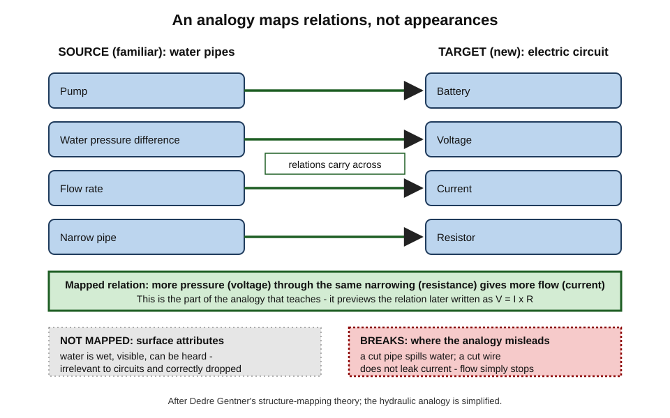
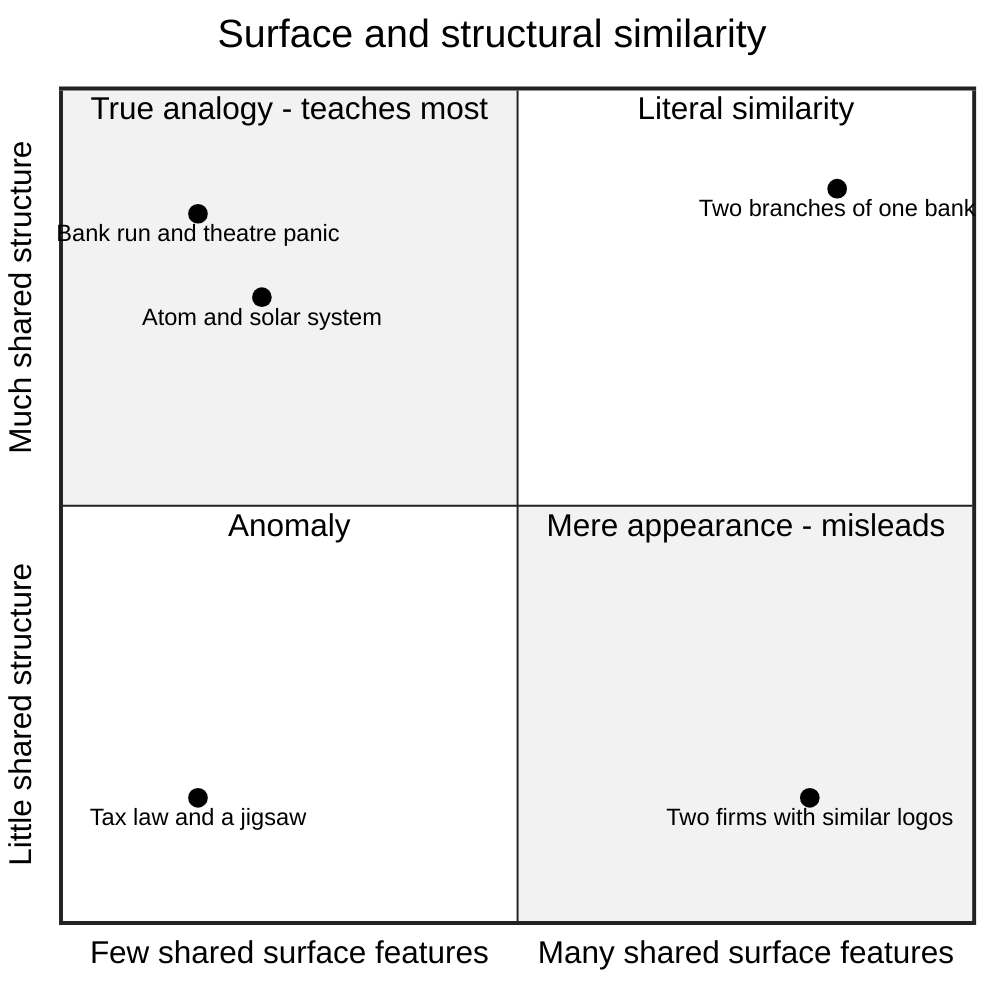
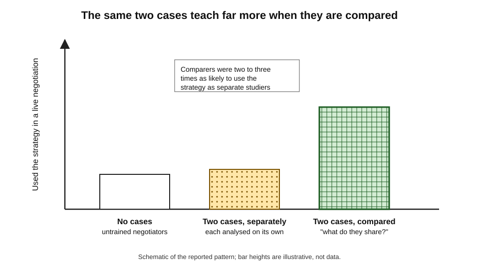
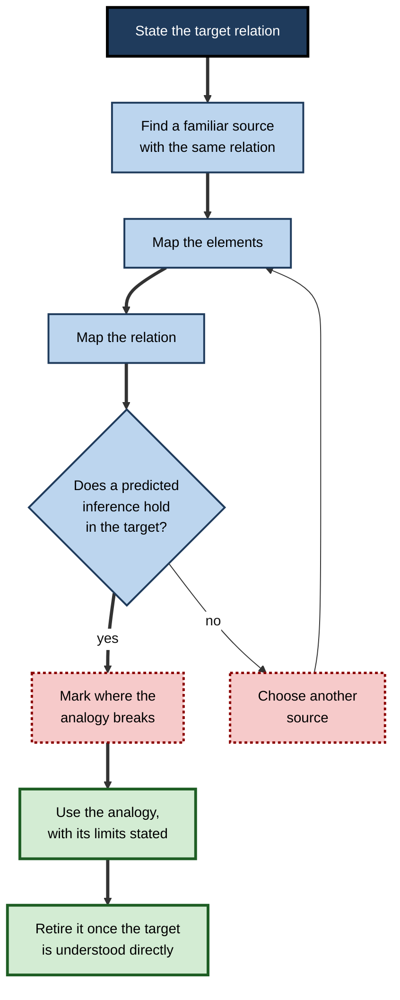
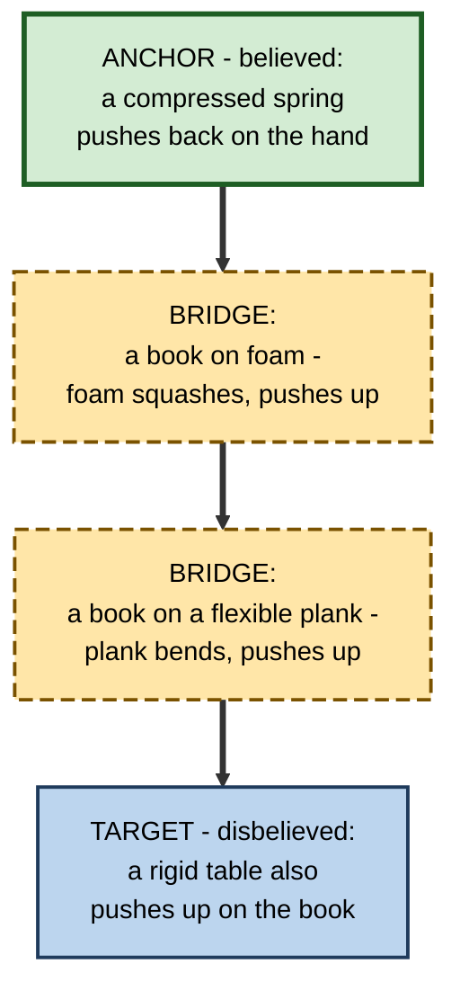
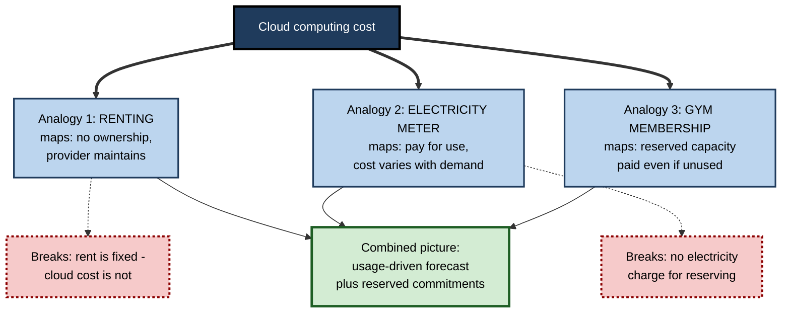

# F.6. Creating Analogies and Comparisons

A new product manager is told that a software platform's "API rate limit" is like a motorway toll booth: only so many cars per minute get through, the rest queue or are turned away. In ten seconds she understands more than a page of documentation gave her — and a week later she makes a mistake the analogy invited, assuming that paying more always buys a faster lane.

Analogies are among the most powerful tools for understanding something new, and among the most dangerous. The skill lies in building them deliberately, mapping them carefully and knowing where they break.

> **Definition — Analogy:** a comparison in which the **relations** among elements of a familiar domain (the **source**) are mapped onto a less familiar domain (the **target**), so that knowledge of the source helps understand the target.

> **Definition — Comparison (as a study strategy):** deliberately placing two or more cases, concepts or methods side by side to identify their shared structure and their differences.

**Why it matters**

- Analogy lets a learner use a whole body of existing knowledge to understand a new domain at once, rather than building understanding piece by piece.
- Comparing cases is one of the most reliable ways to extract the **principle** behind examples — and principles are what transfer to new situations.
- Much of expert reasoning — legal argument from precedent, clinical reasoning from similar patients, engineering design from earlier systems — is analogical.
- Analogies imported uncritically are a major source of **misconceptions**: the learner carries over relations that do not hold.
- In explaining to others — clients, stakeholders, juniors — a well-chosen analogy is often the difference between understanding and polite confusion.

---

## How Analogy Works

### Source, target and mapping

- **Source** — the familiar domain: water pipes, a toll booth, a library.
- **Target** — the new domain: electric circuits, rate limits, a database index.
- **Mapping** — the correspondences between elements and, crucially, between **relations**:
  - pump ↔ battery; pressure ↔ voltage; flow ↔ current; narrow pipe ↔ resistor;
  - "more pressure through the same narrowing gives more flow" ↔ "more voltage across the same resistance gives more current".
- **Inference** — knowledge about the source is projected onto the target: "If two pumps in series give more pressure, two batteries in series should give more voltage."

### Structure-mapping theory

- **Dedre Gentner (1983)** proposed that analogy is a mapping of **relational structure**, not of surface attributes.
  - **Attributes** — properties of single objects (water is wet; the Sun is hot and yellow).
  - **Relations** — links between objects (the Sun attracts the planets; the more massive body is orbited by the less massive one).
- **Systematicity principle** — people prefer mappings that carry over **connected systems of relations**, especially those linked by higher-order relations such as causation, over isolated matches.
  - The solar system ↔ atom analogy is powerful because a whole causal system (attraction causes orbiting) maps across, while attributes (hot, yellow) are dropped.

> **Key point:** a good analogy maps **how things relate**, not **what they look like**.

**Figure 1.** Structure mapping between water pipes and an electric circuit.

### Why analogies help learning

- **Borrowed structure** — the learner does not have to build the target's structure from nothing; a ready-made structure is imported and then corrected.
- **Inference generation** — once a mapping exists, the learner can ask "what else is true of the source?" and test it on the target, which is itself an elaborative act.
- **Memorability** — the source is already well stored, so the target acquires a strong retrieval route: recalling "the toll booth" brings back the rate limit.
- **Reduced load** — a familiar source is held as one chunk, freeing working memory to attend to what is new.
- **Abstraction** — when source and target differ in surface but share structure, the overlap *is* the abstract principle; noticing it is a step towards understanding the principle in its own right.

### How practitioners actually use analogy

- **Kevin Dunbar** observed molecular-biology laboratories in the 1990s, recording their meetings.
  - Scientists used analogies **frequently** — several in a typical meeting.
  - Most were **local**, drawn from closely related experiments or organisms, and used to fix problems and propose new experiments.
  - **Distant** analogies — from far-off domains — were used mainly to **explain** ideas to others.
- **Implication:** in expert work, near analogies do the problem-solving and far analogies do the communication; learners benefit from both but should not expect a far analogy to carry technical reasoning.

### Kinds of similarity

| | Shares surface features | Does not share surface features |
|---|---|---|
| **Shares relational structure** | **Literal similarity** — a new bank branch compared with an old one | **Analogy** — a bank run compared with a crowd fleeing a theatre |
| **Does not share relational structure** | **Mere appearance** — two firms with similar logos | **Anomaly** — no useful comparison |

- **Mere-appearance matches** are what people retrieve most easily from memory — and they mislead.
- **True analogies** are harder to notice but teach more, because the shared structure is all that remains when surfaces differ.

**Figure 2.** Four kinds of similarity by surface and structural overlap.

---

## The Evidence

### Different analogies teach different things

**Study card — Gentner and Gentner (1983), "flowing waters or teeming crowds"**

- **Design:** people learning about electric circuits were given, or already held, one of two analogies:
  - **water flowing** through pipes;
  - **a crowd moving** through corridors and gates.
- **Results:**
  - Those using the **water** analogy reasoned better about **batteries** — combining batteries is like combining pumps or reservoirs.
  - Those using the **crowd** analogy reasoned better about **resistors** — combining resistors is like combining gates or turnstiles.
- **Conclusion:** analogies are not mere decoration; the analogy a learner holds **shapes the inferences** they make, for better and worse.

> **Key point:** every analogy illuminates some relations and hides others. Choosing an analogy is choosing which inferences the learner will find easy.

### Noticing analogies is hard

- **Mary Gick and Keith Holyoak (1980)** gave people a story about an army capturing a fortress by splitting into small groups converging from all sides, then a medical problem about destroying a tumour with radiation without harming healthy tissue.
  - Few people spontaneously used the story; many more did once told it was relevant.
- **Lesson:** having a useful analogue in memory is not enough; learners often fail to **retrieve** it because the surfaces differ. Using analogies to solve problems is a field in its own right; for study, the point is that analogies must be made **explicit**.

### Comparison builds the principle

**Study card — Gentner, Loewenstein and Thompson (2003), analogical encoding**

- **Design:** management students and consultants learned a negotiation strategy (a contingent contract — agreeing terms that depend on a future event both sides disagree about) from two written cases.
  - **Separate** — each case analysed on its own.
  - **Compared** — the two cases analysed together, asked what they had in common.
  - **No cases** — a control group.
- **Results:**
  - Those who **compared** were **two to three times as likely** to use the strategy in a later face-to-face negotiation as those who studied the same cases separately.
  - Studying the cases separately was **little better than no cases at all**.
- **Conclusion:** comparing two examples draws out the shared principle — **analogical encoding** — and the principle, not the examples, is what transfers.

**Figure 3.** Comparing two cases compared with studying them separately.

> **Definition — Analogical encoding:** learning a principle by comparing two or more cases that share it, so that the common structure is abstracted from the differing surfaces.

### Contrasting cases prepare for learning

- **Daniel Schwartz and John Bransford (1998)** had students analyse **contrasting cases** — sets of results from memory experiments that differed in carefully chosen ways — before hearing a lecture.
  - Students who analysed contrasting cases and then heard the lecture predicted results of new experiments better than students who summarised a text chapter before the same lecture, and better than students who analysed the cases without the lecture.
- **Lesson:** comparison **prepares** learners to notice what an explanation is about; the explanation then lands on prepared ground.

### Analogies in real classrooms

- **Lindsey Richland, Osnat Zur and Keith Holyoak (2007)** analysed video of mathematics lessons in several countries.
  - Teachers everywhere used analogies frequently.
  - Teachers in Hong Kong and Japan provided more **cognitive supports** — making the source visible, using gestures to link corresponding parts, keeping both cases displayed together — than teachers in the United States.
- **Lesson:** an analogy merely **mentioned** is easily missed or misapplied; an analogy whose mapping is **shown** is far more useful.

---

## When Analogies Mislead

### Analogy-induced misconceptions

- **Rand Spiro and colleagues (1989)** studied medical students learning complex physiology and found that single, simple analogies led to persistent misconceptions — the learner imported relations from the source that did not hold in the target.
  - *e.g.* the "heart as a pump" analogy hides that the heart's own output depends on how much blood returns to it and on how its muscle is stretched — properties a simple mechanical pump does not have.
- **Remedy proposed:** **multiple analogies**, each covering aspects the others miss, plus explicit statements of where each fails.

### Typical failure modes

- **Over-mapping** — carrying over relations that do not hold.
  - *e.g.* "The economy is like a household budget, so the government must always balance its books" — ignores that a government issuing its own currency and setting taxes faces different constraints.
- **Surface capture** — choosing a source because it looks similar rather than because it works similarly.
- **Frozen analogy** — continuing to reason from the analogy long after the target is understood in its own terms.
- **Persuasion by analogy** — using a vivid analogy to win an argument the evidence does not support.

> **Watch out:** an analogy is a **hypothesis generator**, not evidence. "A start-up is like a rocket — it needs to reach escape velocity" may suggest a question about growth rates; it proves nothing about any particular firm.

### Finding the breaks

- For every analogy, ask:
  - **What maps?** — list correspondences.
  - **What relation carries over?** — state it explicitly.
  - **What does not map?** — attributes to drop.
  - **Where does it break?** — relations true of the source but false of the target.
  - **What inference would it tempt me to make wrongly?**

| Analogy | What maps well | Where it breaks | Wrong inference it invites |
|---|---|---|---|
| Computer memory as a desk | RAM is the desk surface; disk is the filing cabinet; work happens on the desk | A desk does not empty when the power goes | "My unsaved work is safe on the desk" |
| A virus spreading like gossip | Each carrier passes it to several others; growth is exponential early | Gossip spreads by choice; infection need not | "People will stop spreading it once they lose interest" |
| Technical debt as financial debt | Shortcuts now incur "interest" later; repayment is possible | No lender, no fixed rate, often invisible | "We can always repay it later at a known cost" |
| An immune system as an army | Detection, attack, memory of past enemies | No central command; much is local and chemical | "There is a general who can be targeted" |
| A firewall as a castle wall | Keeps outsiders out at the boundary | Modern threats often start inside or use trusted channels | "Inside the wall, everything is safe" |

---

## Creating Analogies and Comparisons

### Building an analogy step by step

1. **State the target relation** you want to understand — not the topic but the relation: "how a cache speeds up responses and why it can serve stale data".
2. **Search for a familiar source** with the same relation — a desk drawer of frequently used files; a shop's front shelf of best-sellers.
3. **Map the elements** explicitly: cache ↔ front shelf; database ↔ stockroom; request ↔ customer.
4. **Map the relation**: frequently requested items are kept close, so most requests are served quickly without a trip to the stockroom.
5. **Test with an inference**: "If the stockroom's price changes, the front shelf still shows the old label" — stale data. The inference holds.
6. **Find the break**: a shop assistant notices an old label; a cache does not unless told to expire entries.
7. **Use a second analogy** for what the first misses, if needed.
8. **Retire the analogy** once the target can be understood in its own terms.

> **Mnemonic — "STEM-TB":** State the relation, Think of a source, Elements mapped, Map the relation, Test an inference, find the Break.

**Figure 4.** Steps in building, testing and limiting an analogy.

### Bridging analogies

- **John Clement (1993)** tackled a stubborn misconception: many students deny that a table pushes up on a book resting on it.
  - **Anchor** — a hand pressing down on a spring: everyone agrees the spring pushes back.
  - **Bridges** — a book on a foam pad; a book on a flexible plank.
  - **Target** — a book on a rigid table: the table, too, deforms slightly and pushes back.
- **Lesson:** when the leap from source to target is too large to be believed, a chain of intermediate cases carries the learner across.

**Figure 5.** A bridging analogy from an accepted anchor to a disbelieved target.

### Building comparisons

- **Side-by-side tables** — list two or more concepts as columns and the same attributes as rows; gaps in the table reveal gaps in understanding.
- **Pairs that differ in one feature** — the sharpest comparisons hold everything constant except one critical difference.
- **Same structure, different surface** — two cases from different industries that work the same way, to extract the principle.
- **Same surface, different structure** — two cases that look alike but work differently, to guard against mere-appearance matching.

> **Remember:** compare for **structure** (what is common beneath different surfaces) **and** for **distinction** (what differs beneath similar surfaces). Both are needed.

### Learner-generated versus provided analogies

- **Provided analogies** chosen by experts tend to be accurate and well mapped; the learner may still absorb them passively.
- **Generated analogies** connect the target to the learner's own knowledge and expose understanding — a learner who cannot find any analogy for a relation often does not yet grasp it.
- **Evidence** for learner-generated analogies is thinner and more mixed than for provided analogies and for case comparison; generated analogies vary widely in quality.
- **Practical combination** — study one expert analogy, then generate a second from one's own domain, then compare their breaks.

### Worked example (illustrative): understanding a database index

- **Situation:** a junior analyst wants to understand why adding an index makes some queries much faster and slows down inserts.

| Step | Work |
|---|---|
| **Target relation** | Looking up rows by a column is slow without an index; an index speeds look-ups but must be updated on every insert |
| **Source** | The index at the back of a textbook |
| **Element mapping** | Table ↔ book; row ↔ page; indexed column ↔ index terms; index entry ↔ term with page numbers |
| **Relation mapping** | Finding a topic without an index means reading every page (a full scan); with an index, go straight to the listed pages |
| **Inference test** | "If a new chapter is added, the index must be updated" ↔ inserts must update the index — **holds**, and explains slower inserts |
| **Break** | A book has one index; a table can have several, each with a cost; a book index is sorted alphabetically, while database indexes use structures (such as balanced trees) that keep look-ups fast as data grows |
| **Second analogy** | A library card catalogue sorted by author and another by subject — explains multiple indexes |

- **Conclusion:** the analyst now predicts correctly that indexing every column would make writes slow and storage large — an inference the first analogy supported and the break refined.

> **Watch out:** the textbook analogy suggests indexes are always helpful for reading. For a query that returns most of the table, the database may ignore the index — as a reader wanting most of the book would just read it through.

---

## Analogies and Comparisons at Work

### Professional reasoning by analogy

- **Law** — common-law reasoning is explicitly analogical: is the present case **like** the precedent in the respects that mattered, or can it be **distinguished**?
- **Medicine** — clinicians compare a patient with prototypical cases and with memorable past patients; diagnostic errors often come from a vivid but misleading analogue.
- **Strategy and consulting** — "This market is like the airline industry in the 1980s" can open useful questions or import false certainty; Giovanni Gavetti and Jan Rivkin (2005) argued that managers use analogy constantly and should test the mapping before acting on it.
- **Engineering and design** — designers borrow solutions across domains (*e.g.* hook-and-loop fastener from burrs); the mapping must be checked against the new loads and conditions.
- **Teaching and explaining to stakeholders** — a single well-mapped analogy can make a technical risk understandable to a board.

> **In practice:** when presenting to a non-specialist audience, state the analogy, say in one sentence where it stops working, and then return to the real system. Audiences remember the analogy; the stated limit prevents them from reasoning from it too far.

> **In practice:** experienced professionals tend to use analogies in pairs — "it is like X in this respect, but like Y in that one" — precisely because they know every analogy breaks somewhere.

### Case study (illustrative): explaining cloud cost to a finance team

- **Situation:** an engineering lead had to help a finance team forecast cloud spending after a move from owned servers.
- **Problem:** finance staff, used to capital purchases depreciated over years, kept forecasting cloud costs as fixed monthly amounts; actual bills varied widely.
- **First analogy used:** "the cloud is like renting instead of buying" — accepted readily, but it **reinforced** the fixed-cost picture, since rent is fixed.
- **Diagnosis:** the analogy mapped "no ownership" correctly but carried over "fixed periodic payment", which does not hold.
- **Actions:**
  1. The engineer replaced it with **two** analogies: "like renting" for ownership and responsibility; "like an electricity meter" for the variable, usage-driven cost.
  2. A comparison table set owned servers, rent and metered utilities side by side on ownership, cost behaviour, forecasting driver and risk.
  3. Breaks were stated: "unlike electricity, some cloud services charge for capacity reserved even if unused".
  4. Finance staff then generated their own analogy for reserved capacity — a gym membership — and checked it with the engineer.
- **Result:** forecasts shifted to usage-based drivers; variance between forecast and bill fell substantially over the next two quarters.
- **Lesson:** the first analogy failed not because analogy is weak but because **one** analogy carried over the wrong relation; **paired analogies with stated breaks** fixed it.

**Figure 6.** Paired analogies covering different aspects of cloud cost.

### Analogies and AI assistants

- Assistants produce analogies on demand ("explain Kubernetes as if I were a restaurant manager") — a fast route to a first mapping.
- **Risks:** generated analogies are often fluent and **under-specified** — the mapping is implied, the breaks unstated.
- **Productive use:**
  1. ask for an analogy **and** an explicit element-by-element mapping;
  2. ask where it breaks and what wrong inference it invites;
  3. ask for a second analogy covering what the first misses;
  4. generate one's own analogy from one's own field and ask for critique.

---

## Open Questions

- **When should learners generate analogies rather than receive them?**
  - Generation connects to personal knowledge but quality varies; the conditions under which it beats well-chosen provided analogies are not well mapped.
- **How can analogy-induced misconceptions be predicted?**
  - Multiple analogies help, but there is no reliable method for anticipating which relations a learner will wrongly carry over.
- **Why are analogies so hard to retrieve spontaneously?**
  - Comparison during learning improves later retrieval, but most real-world analogies are still missed; how to train spontaneous noticing is unresolved.
- **How should analogies be retired?**
  - Experts eventually reason about the target directly; when and how a learner should drop the scaffolding has received little study.
- **What do AI-generated analogies do to understanding?**
  - Instant analogies may speed first understanding; whether they encourage shallow, uncorrected mappings is unknown.

---

## Summary

- An **analogy** maps the **relations** of a familiar **source** onto a new **target**; a **comparison** places cases side by side to reveal shared structure and differences.
- **Structure-mapping theory** (Gentner, 1983): analogy maps **relational structure**, preferring connected causal systems (**systematicity**), and drops surface attributes. Similarity can be **literal**, **analogical**, **mere appearance** or **anomalous**.
- **Gentner and Gentner (1983):** water and crowd analogies support different inferences about circuits — the analogy shapes reasoning. **Gick and Holyoak (1980):** useful analogues are often not noticed without a prompt.
- **Gentner, Loewenstein and Thompson (2003):** **comparing** two cases made later use of a negotiation strategy two to three times as likely as studying them separately — **analogical encoding**. **Schwartz and Bransford (1998):** **contrasting cases** prepare learners for explanation. **Richland et al. (2007):** analogies need visible **cognitive supports**.
- Analogies mislead through **over-mapping**, **surface capture**, **frozen analogies** and **persuasion**; **Spiro et al. (1989)** recommend **multiple analogies**. Always find the **break**.
- Build analogies with **STEM-TB**; use **bridging analogies** (Clement) for large leaps; compare for **structure and distinction**.
- At work, analogy drives legal, clinical, strategic and design reasoning; experts use **paired analogies with stated limits**. With AI, demand the mapping and the breaks.

---

## Self-Check

1. Define analogy and distinguish source, target and mapping.
2. What is the difference between attributes and relations, and which does a good analogy map?
3. Explain the systematicity principle with an example.
4. Distinguish literal similarity, analogy and mere appearance, with a professional example of each.
5. What did Gentner and Gentner (1983) find about water and crowd analogies, and what does it imply?
6. Describe Gentner, Loewenstein and Thompson (2003). Why was studying the two cases separately so ineffective?
7. What did Schwartz and Bransford (1998) show about contrasting cases?
8. What are cognitive supports for analogies, and why do they matter?
9. How can a single analogy create a misconception? Give an example and a remedy.
10. Apply STEM-TB to build an analogy for "a load balancer" and state where it breaks.
11. What is a bridging analogy, and when should it be used?
12. A colleague argues, "A company is like a family, so layoffs are a betrayal." Evaluate the argument as an analogy.
13. Design a comparison exercise for new staff learning the difference between a project and a programme.
14. Give three mechanisms by which an analogy helps a learner understand and remember a new domain.
15. What did Dunbar's observations of laboratory meetings reveal about local and distant analogies, and what follows for a learner?

### Answer Key

1. A comparison mapping the relations of a familiar domain onto a less familiar one. Source: the familiar domain. Target: the new domain. Mapping: correspondences between their elements and relations.
2. Attributes are properties of single objects (colour, size); relations link objects (attracts, causes, flows through). A good analogy maps relations.
3. People prefer mappings that carry over connected systems of relations, especially causal ones. *e.g.* solar system ↔ atom: "attraction causes orbiting" maps as a system; the Sun's heat does not.
4. Literal similarity: two branches of the same bank (surface and structure shared). Analogy: a bank run and a theatre panic (structure only). Mere appearance: two firms with similar logos (surface only).
5. Water-analogy users reasoned better about batteries; crowd-analogy users about resistors. The analogy one holds shapes which inferences are easy — choose analogies for the relations to be understood.
6. Negotiators learning a contingent-contract strategy who compared two cases were two to three times as likely to use it later than those who studied the cases separately; separate study was little better than none. Separately, each case's surface details dominate; comparison forces abstraction of the shared principle.
7. Students who analysed contrasting cases before a lecture predicted new experimental results better than those who summarised a text before the lecture, or analysed cases without it — comparison prepared them to understand the explanation.
8. Aids that make the mapping visible: displaying source and target together, pointing or gesturing between corresponding parts, making the source familiar first. Without them, analogies are missed or misapplied.
9. The learner imports a relation that holds in the source but not the target. *e.g.* "heart as a pump" hides that the heart's output depends on venous return. Remedy: multiple analogies and explicit statements of where each breaks.
10. *e.g.* Relation: spreading incoming requests across servers so none is overloaded. Source: a supermarket supervisor directing customers to the shortest checkout. Elements: customers ↔ requests; tills ↔ servers; supervisor ↔ load balancer. Inference: if a till closes, the supervisor redirects — holds (health checks). Break: customers can see queues and choose; requests cannot, and some must return to the same server for their session (sticky sessions).
11. A chain of intermediate cases from an accepted anchor to a disbelieved target. Use it when the target conflicts with intuition so strongly that a direct analogy is rejected.
12. Maps: loyalty, belonging, mutual obligation. Breaks: families do not hire and dismiss members, members are not paid, and firms must remain solvent to employ anyone. The analogy may usefully raise questions about obligations and how layoffs are handled, but it cannot settle whether layoffs are justified.
13. *e.g.* Give two real cases from the firm — a single system migration (project) and a multi-year digital transformation (programme). Have staff fill a side-by-side table on goal, duration, deliverables, governance and success measures; then show a near-identical pair differing only in whether benefits are realised across several projects; then ask them to classify three new initiatives and justify each.
14. Borrowed structure (the target's structure is imported, then corrected); inference generation (asking what else holds in the source and testing it); memorability (the well-stored source becomes a retrieval route). Also: reduced working-memory load and abstraction of the shared principle.
15. Scientists used analogies often; most were local — from closely related work — and did the problem-solving, while distant analogies were used mainly to explain to others. A learner should use near analogies for technical reasoning and treat far analogies as aids to understanding and communication, not as proof.

---

## Glossary

| Term | Meaning |
|---|---|
| Analogical encoding | Learning a principle by comparing cases that share it. |
| Analogy | A mapping of relations from a familiar source domain onto a target domain. |
| Anomaly | A comparison sharing neither surface nor structure. |
| Attribute | A property of a single object. |
| Bridging analogy | A chain of intermediate cases linking an accepted anchor to a disbelieved target. |
| Cognitive supports | Aids that make an analogy's mapping visible, such as side-by-side displays and gestures. |
| Contrasting cases | Cases differing in chosen features, analysed to reveal what matters. |
| Distant analogy | An analogy drawn from a far-removed domain, often used to explain. |
| Literal similarity | Similarity in both surface features and relational structure. |
| Local analogy | An analogy drawn from a closely related domain. |
| Mapping | The correspondences between elements and relations of source and target. |
| Mere-appearance match | Similarity in surface features without shared structure. |
| Multiple analogies | Using several analogies, each covering aspects the others miss. |
| Over-mapping | Carrying over relations from source to target that do not hold. |
| Relation | A link between objects, such as causes, attracts or flows through. |
| Source | The familiar domain in an analogy. |
| Structure-mapping theory | Gentner's theory that analogy maps relational structure, not attributes. |
| Systematicity | The preference for mapping connected systems of relations. |
| Target | The new domain an analogy helps to understand. |
