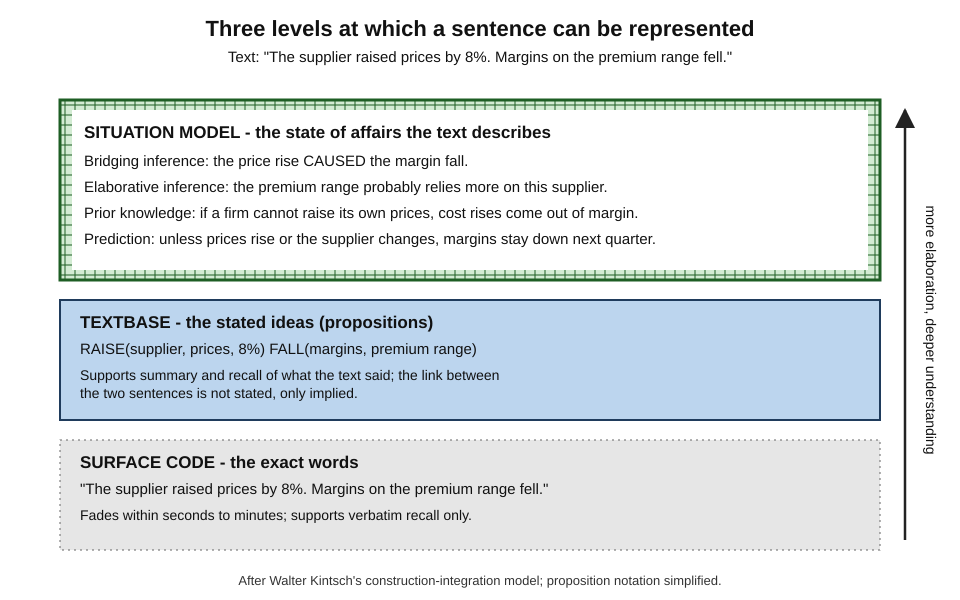
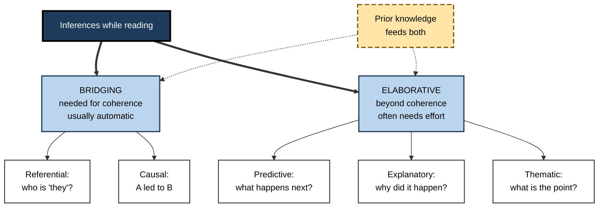
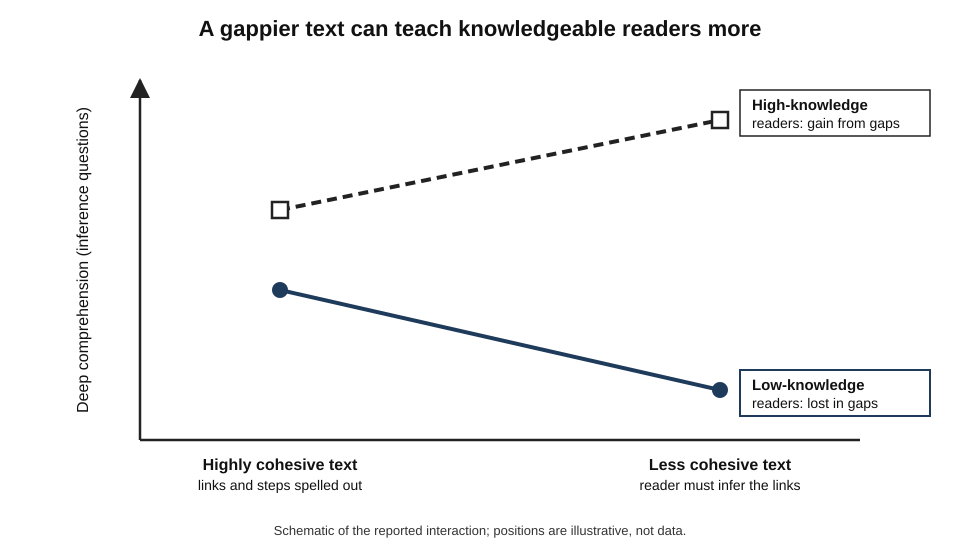
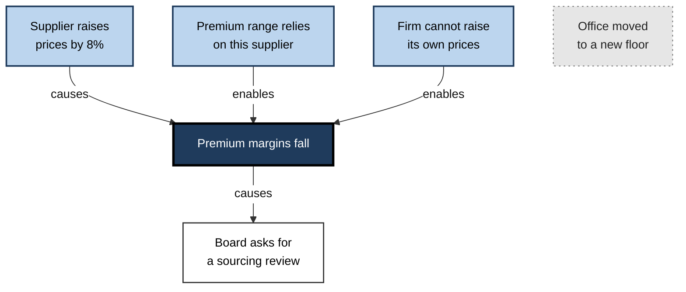
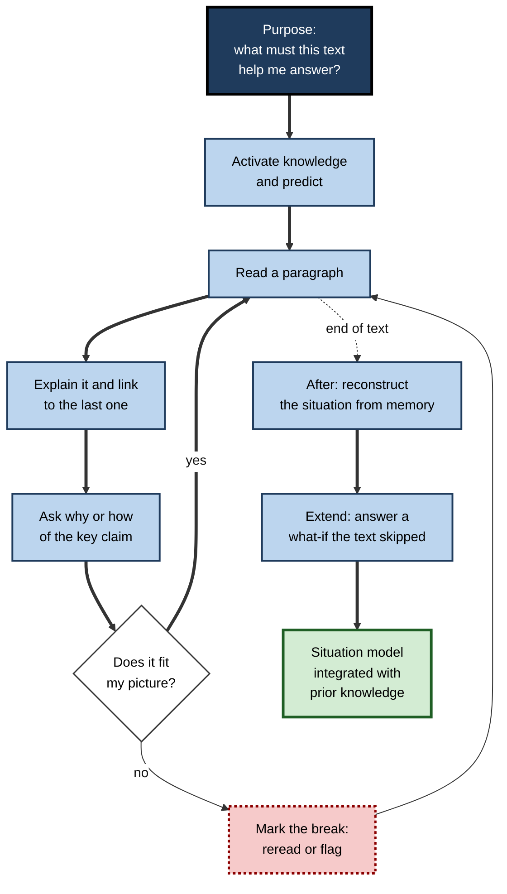
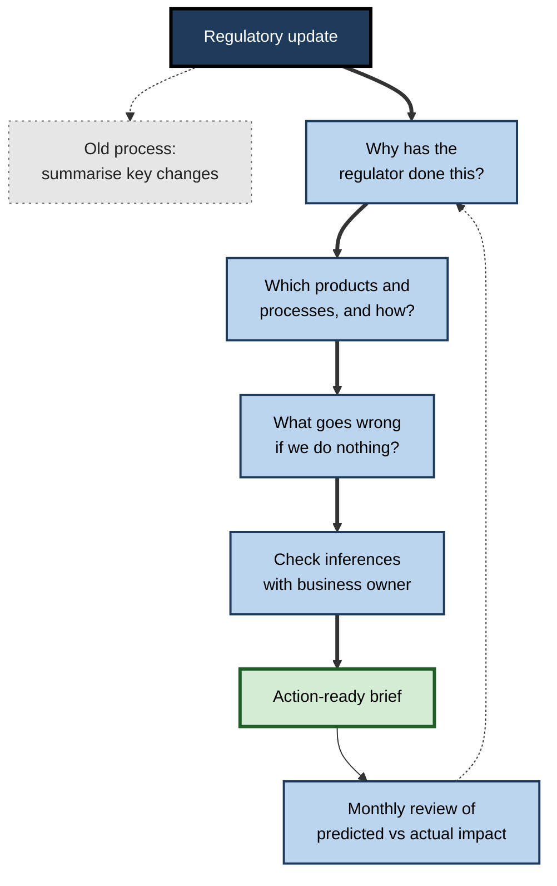

# F.7. Elaboration in Reading Comprehension

A consultant reads in a client's annual report: "The supplier raised prices by 8%. Margins on the premium range fell." Nothing in the text says the first caused the second; the reader supplies that link. A good reader also supplies more — that the premium range probably depends more on this supplier, that the firm could not pass the rise on, that margins will stay down unless something changes. None of this is written. All of it is what "understanding the report" means.

> **Definition — Reading comprehension:** the construction of a coherent mental representation of what a text describes, by combining the information in the text with the reader's prior knowledge.

> **Definition — Elaboration in reading:** the reader's addition of inferences, connections, examples, questions and implications that go beyond the words on the page, so that the text is integrated with existing knowledge.

**Why it matters**

- Texts are always incomplete; authors rely on readers to fill gaps. A reader who does not elaborate understands **less than the text means**.
- The difference between **remembering a text** and **learning from it** lies almost entirely in elaboration.
- Professionals spend a large share of their working time reading — reports, contracts, specifications, research, regulations — and decisions depend on what they **infer**, not only on what they read.
- Reading without elaboration produces fluent, confident and shallow understanding — the most dangerous kind.
- As AI tools summarise more text, the reader's own elaboration is the part that cannot be outsourced without losing understanding.

---

## What Readers Build

### Three levels of representation

**Walter Kintsch** and Teun van Dijk distinguished three levels at which a text is represented in memory:

- **Surface code** — the exact words and syntax.
  - Fades quickly; supports verbatim recall only.
- **Textbase** — the ideas the text states, as a network of propositions.
  - Supports summary and recall of what the text said.
- **Situation model** — a representation of the **state of affairs** the text describes, built from the textbase **plus** the reader's knowledge and inferences.
  - Supports reasoning, prediction, problem solving and transfer.

> **Definition — Situation model:** the reader's mental representation of the situation a text describes — not the text itself — integrating stated information with inferences and prior knowledge.

**Figure 1.** Three levels at which a sentence can be represented.

### Remembering a text and learning from it

- **Kintsch** drew a sharp distinction:
  - **Remembering the text** — reproducing its content; depends mainly on a good **textbase**.
  - **Learning from the text** — using its content in new situations; depends on a good **situation model**.
- **Tests reveal the difference:**
  - recall and summary questions measure the textbase;
  - inference, problem-solving and transfer questions measure the situation model.

| | Remembering the text | Learning from the text |
|---|---|---|
| **Representation** | Textbase | Situation model |
| **Typical test** | "What did the report say about margins?" | "What will happen to margins if the supplier raises prices again?" |
| **Needs elaboration?** | Little | A great deal |
| **Main source** | The text | The text plus prior knowledge and inference |
| **Lasts** | Weeks, fading | Longer, integrated with knowledge |
| **Typical study method** | Re-reading, summarising | Explaining, questioning, connecting |

> **Key point:** a reader can **remember** a text perfectly and still **not have learned from it**. Elaboration is what converts the first into the second.

### Construction and integration

- **Kintsch's construction-integration model (1988)** describes comprehension as two repeated phases:
  1. **Construction** — each sentence activates propositions and associated knowledge, loosely and generously, including irrelevant associations.
  2. **Integration** — a settling process strengthens the elements that fit together and suppresses those that do not, leaving a coherent representation.
- **Implication for study:** the reader's knowledge shapes **what is constructed**; deliberate elaboration shapes **what survives integration**.

---

## Inferences: the Engine of Comprehension

### Kinds of inference

- **Bridging inferences** — needed for the text to make sense; they link a sentence to earlier ones.
  - **Referential** — working out who or what "it", "they" or "the firm" refers to.
  - **Causal** — "The supplier raised prices. Margins fell." → the price rise caused the fall.
- **Elaborative inferences** — not needed for coherence but enrich the representation.
  - **Predictive** — what will happen next.
  - **Instrumental** — how something was done.
  - **Explanatory** — why it happened, beyond what the text says.
  - **Thematic** — the point or moral of the passage.
- **Knowledge-based inferences** — drawing on general or domain knowledge to supply missing facts.

> **Definition — Bridging inference:** an inference required to connect a sentence to earlier text so that the text is coherent.

> **Definition — Elaborative inference:** an inference that goes beyond what coherence requires, adding predictions, explanations or details from the reader's knowledge.

**Figure 2.** Kinds of inference readers draw while reading.

### How many inferences do readers make?

- **The minimalist view** — Gail McKoon and Roger Ratcliff (1992) argued that, during ordinary reading, readers **automatically** make only the inferences needed for local coherence, plus those based on easily available knowledge. Most elaborative inferences are **not** made unless the reader has a reason.
- **The constructionist view** — Arthur Graesser, Murray Singer and Tom Trabasso (1994) argued that readers engage in a **search after meaning**: they try to build a representation that fits their goals, is coherent at both local and global levels, and explains why things happen.
- **The reconciliation** — both are partly right. Readers make bridging inferences readily; elaborative inferences depend on **goals, knowledge and effort**.

> **Key point:** the inferences that matter most for learning — explanatory, predictive, thematic — are the ones readers **skip** unless they deliberately elaborate.

### Comprehension monitoring

- Readers often fail to notice what they do not understand.
  - **Ellen Markman (1979)** found that school children frequently failed to notice blatant contradictions in short passages, even when asked to help improve them.
  - Adults also miss inconsistencies when reading quickly or with low engagement.
- **Elaboration supports monitoring**: a reader who tries to explain or predict notices when the text does not fit.

---

## The Role of Knowledge

### Knowledge makes elaboration possible

- Elaborative inferences need knowledge; a reader with none cannot infer why a margin fell.
- This is why domain knowledge predicts comprehension so strongly — often more than general reading skill.

### Too easy can be too passive

**Study card — McNamara, Kintsch, Songer and Kintsch (1996)**

- **Design:** school pupils read versions of a biology text that differed in **cohesion**.
  - **High-cohesion** — links between sentences and ideas spelled out; terms explained; headings and connectives added.
  - **Low-cohesion** — the same content with links left implicit.
  - Pupils' prior knowledge of the topic was measured.
- **Results:**
  - **Low-knowledge readers** understood the **high-cohesion** text better on all measures.
  - **High-knowledge readers** did better on **deep comprehension** questions with the **low-cohesion** text.
- **Conclusion:** gaps that defeat a novice force a knowledgeable reader to elaborate, and the elaboration improves the situation model — the **reverse cohesion effect**.

**Figure 3.** The reverse cohesion effect: text cohesion and prior knowledge.

> **Watch out:** this is not a licence to write obscure texts. The effect depends on readers having the knowledge to fill the gaps and the motivation to try. For mixed audiences, clear text plus **prompts to elaborate** is a safer design than deliberate gaps.

### Stories and expository texts

- **Narratives are easier to elaborate.** Readers bring rich knowledge of goals, actions and consequences, so causal inferences come almost free.
  - **Tom Trabasso and Paul van den Broek (1985)** represented stories as **causal networks** and found that statements with **more causal connections** to other statements were better recalled and judged more important.
- **Expository texts are harder.** Their logic — classification, mechanism, argument — draws on knowledge many readers lack, so fewer inferences arise spontaneously.
- **Implication:** for expository material, the reader can deliberately **build the causal network** that a story provides automatically — asking, of each statement, "What causes this, and what does it cause?"

**Figure 4.** A text represented as a causal network rather than a list of statements.

- In the network, the margin fall has four causal links and is central; the office move has none and is, correctly, forgotten first.

### How expert readers read

- **Michael Pressley and Peter Afflerbach (1995)** reviewed think-aloud studies of skilled readers and described **constructively responsive reading**: experts preview, set goals, predict, relate the text to prior knowledge, evaluate claims and monitor understanding — continuously and flexibly.
- **Sam Wineburg (1991)** compared historians and able school students reading the same historical documents.
  - Historians **sourced** each document (who wrote it, when, why), **contextualised** it (what was happening then) and **corroborated** it against other documents.
  - Students read the documents as neutral information and rarely asked who wrote them.
- **What the students lacked** was not reading skill but the habit of asking the discipline's questions. Later classroom programmes that taught sourcing, contextualisation and corroboration explicitly — such as the document-based history curriculum evaluated by Avishag Reisman (2012) — reported gains in historical thinking and in general reading comprehension.
- **Lesson:** expert reading is elaboration organised by the **questions of the discipline**. A lawyer, an auditor and an engineer reading the same incident report ask different questions and build different situation models.

> **In practice:** each profession has its own reading questions — "Who bears the risk?" (law), "Is this figure supported?" (audit), "What failed first?" (engineering), "What does the patient need now?" (medicine). Learning a profession includes learning to read with its questions.

---

## Elaborative Reading Strategies

### Before reading

- **Activate knowledge** — "What do I already know about the subject?"
- **Set a purpose** — "What question should this text help me answer?" A purpose determines which inferences are worth making.
- **Predict** — "What is this text likely to argue?"

### During reading

- **Explain** — after each paragraph, say what it means and how it connects to the previous one.
- **Ask why and how** — of key claims and steps.
- **Connect** — text-to-self (own experience), text-to-text (other reading), text-to-world (current events or work).
- **Predict** — before turning a page or starting a new section, anticipate what comes next and why.
- **Notice breaks** — mark points where the explanation fails or the text contradicts what was expected.

### After reading

- **Reconstruct the situation** — explain the state of affairs from memory, not the order of the text.
- **Apply** — answer a "what if" question the text did not address.
- **Integrate** — add the main ideas to existing notes and revise earlier understanding.

> **Mnemonic — "PEACE":** Purpose, Explain, Ask, Connect, Extend — the elaborative reader's sequence.

**Figure 5.** An elaborative reading cycle before, during and after a text.

### Questioning the author

- **Isabel Beck, Margaret McKeown and colleagues (1997)** developed **Questioning the Author**, an approach that treats a text as the fallible work of an author rather than an authority.
- **Typical queries:**
  - "What is the author trying to say here?"
  - "What does the author mean by that?"
  - "How does this connect with what the author told us before?"
  - "Does that make sense? Did the author explain it clearly?"
  - "What did the author leave out that we need to know?"
- **Why it elaborates:** the queries push readers past the textbase towards the author's intended situation model — and towards noticing gaps the author left.

> **In practice:** "What did the author leave out?" is the single most productive question for professional reading. In contracts it finds unallocated risks; in research it finds unreported conditions; in vendor documents it finds what the product does not do.

### Training readers to self-explain

- **Danielle McNamara's Self-Explanation Reading Training (SERT)** teaches readers to self-explain using a small set of strategies: comprehension monitoring, paraphrasing, bridging inferences, prediction and elaboration from prior knowledge.
- The training, and its automated version (iSTART), has been found to help particularly **readers with less prior knowledge**, who otherwise struggle to generate inferences, and to improve comprehension of science texts.

### Reciprocal teaching in brief

- **Annemarie Palincsar and Ann Brown (1984)** taught pupils to take turns leading a group through four activities: **predicting, questioning, clarifying and summarising**. Reviews have found reliable comprehension gains. Three of the four activities are elaborative; the method shows how elaboration can be structured socially.

### Comparison of reading approaches

| Approach | What the reader does | Level built | Typical outcome |
|---|---|---|---|
| **Re-reading** | Reads again | Surface and textbase | Fluency, weak inference |
| **Highlighting** | Marks key words | Textbase, selectively | Little gain unless trained |
| **Summarising** | Condenses main ideas | Textbase | Good for gist, moderate for inference |
| **Self-explaining** | Explains each part and link | Situation model | Strong inference and transfer |
| **Questioning the author** | Interrogates intent and gaps | Situation model | Better critical comprehension |
| **Predict and check** | Anticipates, then compares | Situation model | Better monitoring and engagement |

---

## When Elaboration Goes Wrong in Reading

### Seductive details

- **Seductive details** are interesting but irrelevant additions — anecdotes, vivid stories, striking images.
  - Ruth Garner and colleagues (1989) and Shannon Harp and Richard Mayer (1998) found that adding such details to science texts **reduced** recall of the main ideas and problem-solving transfer.
  - Later meta-analysis has generally confirmed a negative effect, though its size varies.
- **For readers:** elaborations that attach to **side details** rather than to the central structure can crowd out what matters.

> **Definition — Seductive details:** interesting but irrelevant material that attracts attention away from a text's central ideas.

### Elaborating the wrong model

- A reader with a misconception elaborates **within** it, reading the correct text as support for the error.
  - *e.g.* a reader convinced that "tariffs are paid by foreign exporters" reads an article on tariffs and elaborates every sentence to fit that view, missing that domestic importers pay them.
- **Remedy:** when a text seems to say something surprising, treat the surprise as a signal to **check** one's model, not to explain it away.

### Over-elaboration

- Adding inferences the author did not intend and the evidence does not support.
  - *e.g.* reading a cautious research abstract and inferring a definitive causal claim.
- **Remedy:** separate **what the text says** from **what I infer**, and label inferences as such in notes.

### Elaboration under time pressure

- Elaborative reading is slower; in a stack of documents, elaborating every page is impossible.
- **Remedy:** skim for structure first, then elaborate where the reader's purpose demands — the key clause, the central finding, the decision paragraph.

> **Watch out:** speed-reading claims that promise full comprehension at many times normal speed are not supported; comprehension falls as speed rises beyond normal reading rates, largely because there is no time to elaborate.

---

## Elaborative Reading at Work

### Professional texts and their key inferences

- **Contracts** — "What happens if…?" scenarios: late delivery, insolvency, change of control. The text states rules; the reader must elaborate the situations.
- **Financial reports** — linking figures across statements: why cash flow differs from profit, what a provision implies about future risk.
- **Research papers** — inferring what the design does and does not allow one to conclude; what population the result applies to.
- **Technical documentation** — reconstructing how the system behaves, not just what each setting is called.
- **Regulations** — inferring the purpose of each requirement to apply it to cases the text did not foresee.
- **Emails and briefs** — inferring what the sender needs, which is often not what they wrote.

### Worked example (illustrative): elaborating a paragraph from a policy report

- **Text:** "Remote-working uptake has stabilised at around two days a week. Office occupancy on Mondays and Fridays remains low. Several firms are reducing floor space at lease renewal."

| Sentence | What the text says (textbase) | Bridging inference | Elaborative inference | Question raised |
|---|---|---|---|---|
| 1 | Remote work averages about two days a week | — | Hybrid working has become the norm, not a temporary response | Is the average hiding a split between fully remote and fully office staff? |
| 2 | Monday and Friday occupancy is low | People choose those days to work remotely | Midweek days may be crowded while the office is half-empty overall | How do firms plan capacity for peak days? |
| 3 | Firms reduce space at renewal | Because space is under-used | Commercial landlords face lower demand; city-centre services that depend on office workers may suffer | Will reduced space cause problems on peak days? |

- **Situation model built:** a picture of uneven weekly demand, falling average need, and consequences beyond the firms themselves — none of which the paragraph states.
- **Conclusion:** a reader asked "Should our firm cut space by 40% because average use is 60%?" can now answer "Not without checking peak-day demand" — a judgement only the elaborated model supports.

> **Watch out:** the elaborative inferences in column four are plausible, not proven. A careful reader records them as **hypotheses to check**, not as facts the report established.

### Case study (illustrative): regulatory updates in a compliance team

- **Situation:** a bank's compliance analysts read monthly regulatory updates and summarised them for business teams.
- **Problem:** summaries were accurate but unhelpful; business teams asked repeatedly, "So what do we need to do?" Two requirements were implemented late because nobody had worked out what they meant for existing products.
- **Diagnosis:**
  - analysts were building good **textbases** (what the rule says) but not **situation models** (what it means for the bank's products, processes and customers);
  - the summary template asked for "key changes" only.
- **Actions:**
  1. The template added three elaborative prompts: "Why has the regulator done this?", "Which of our products or processes does it touch, and how?", and "What will go wrong if we do nothing?".
  2. Analysts answered the prompts before writing the summary, then checked their inferences with the relevant business owner.
  3. Monthly reviews compared analysts' predictions of impact with what actually happened.
  4. New analysts were trained with worked examples of strong and weak elaborations.
- **Result:** business teams' follow-up questions fell markedly; no requirement was implemented late in the following year; analysts reported understanding the regulation better themselves.
- **Side effects:** each update took longer to process; some inferences proved wrong and had to be corrected — which the review step caught.
- **Lesson:** a summary transmits the **text**; elaborative prompts produce the **situation**, which is what action requires.

**Figure 6.** The redesigned reading process in the compliance case.

### Reading, summaries and AI

- **AI summaries** produce a compressed **textbase** quickly and often accurately. They do not produce the reader's **situation model**.
- **The risk:** reading only summaries gives the feeling of having understood a document while the reader has made none of the inferences that understanding requires — and cannot tell which details the summary dropped.
- **Better uses:**
  1. read and elaborate the key sections oneself; use a summary to check nothing major was missed;
  2. ask an assistant "What does this text leave unstated?" or "What would a sceptical reader question?" — then verify against the text;
  3. ask it to generate "what if" scenarios, and work out the answers oneself before reading its view.

> **Key point:** a summary can replace **reading** for some purposes; it cannot replace **comprehension**, because comprehension is what the reader adds.

---

## Open Questions

- **Can discipline-specific reading questions be taught quickly to new professionals?**
  - History education shows such habits can be taught to students; whether short workplace training produces the same shift in how new lawyers, auditors or engineers read is largely untested.
- **How far can elaborative reading be trained in adults?**
  - Programmes such as SERT show gains, mostly in students; evidence for experienced professionals reading complex workplace texts is thin.
- **When should texts be easier, and when harder?**
  - The reverse cohesion effect shows that ease can reduce deep learning for knowledgeable readers; designing texts for mixed audiences remains an open problem.
- **Which inferences do skilled readers make spontaneously?**
  - The minimalist–constructionist debate is largely resolved in principle but not in detail; which elaborative inferences are routine for experts in a domain is little studied.
- **How does screen reading affect elaboration?**
  - Some studies find poorer comprehension on screens, especially under time pressure, possibly because readers skim and elaborate less; the size and causes are still debated.
- **What does pervasive AI summarisation do to comprehension skill?**
  - If readers increasingly consume summaries, the practice that builds situation-model skills may decline; the long-term effect is unknown.

---

## Summary

- **Comprehension** = constructing a coherent representation of what a text describes; **elaboration** adds the inferences, connections and implications that the text leaves unstated.
- Three levels (Kintsch and van Dijk): **surface code**, **textbase**, **situation model**. Remembering a text needs a textbase; **learning from** it needs a situation model, built by elaboration.
- **Construction-integration** (Kintsch, 1988): knowledge shapes what is activated; integration keeps what fits.
- **Bridging inferences** (referential, causal) are usually automatic; **elaborative inferences** (predictive, explanatory, thematic) often need effort. **Minimalist** (McKoon and Ratcliff) and **constructionist** (Graesser, Singer and Trabasso) views are reconciled by goals and knowledge.
- Readers often fail to **monitor** comprehension (Markman, 1979); elaboration helps them notice gaps.
- **Reverse cohesion effect** (McNamara et al., 1996): low-knowledge readers need cohesive texts; high-knowledge readers learn more deeply from texts that force inference.
- Strategies: **PEACE** — Purpose, Explain, Ask, Connect, Extend; **Questioning the Author**; **SERT**; reciprocal teaching.
- Pitfalls: **seductive details**, elaborating a **wrong model**, **over-elaboration**, time pressure; speed-reading cannot preserve comprehension.
- At work: elaborate contracts, reports, research and regulations into **situation models**; summaries transmit text, elaboration produces understanding. With AI: summaries for checking, not for replacing comprehension.

---

## Self-Check

1. Define reading comprehension and elaboration in reading.
2. Describe the three levels of text representation and what each supports.
3. Distinguish remembering a text from learning from it, with a test question for each.
4. What happens in the construction and integration phases of Kintsch's model?
5. Distinguish bridging from elaborative inferences, with examples.
6. Summarise the minimalist and constructionist views of inference and how they are reconciled.
7. What did Markman (1979) find, and why does elaboration help?
8. Describe the reverse cohesion effect and its practical caution.
9. Apply PEACE to reading a supplier's service-level agreement.
10. Give three "Questioning the Author" queries and explain why the approach elaborates.
11. What are seductive details, and how should a reader respond to them?
12. A colleague reads only AI summaries of long reports. What does she lose, and how could she use summaries better?
13. Take the sentence "Customer complaints rose after the new billing system launched." List one bridging inference, two elaborative inferences and one question a careful reader should ask.
14. Why are narratives usually easier to elaborate than expository texts, and how can a reader compensate with expository material?
15. What did Wineburg (1991) find when historians and students read the same documents, and what is the general lesson for professional reading?

### Answer Key

1. Comprehension: constructing a coherent mental representation of what a text describes, combining the text with prior knowledge. Elaboration in reading: adding inferences, connections, examples, questions and implications beyond the words, integrating the text with existing knowledge.
2. Surface code — exact words; verbatim recall, fades fast. Textbase — stated propositions; summary and recall. Situation model — the described state of affairs plus inferences and knowledge; reasoning, prediction, transfer.
3. Remembering: reproducing content ("What did the report say about margins?"). Learning: using it in new situations ("What will happen to margins if the supplier raises prices again?").
4. Construction: each sentence activates propositions and associated knowledge loosely, including irrelevant associations. Integration: elements that fit together are strengthened, others suppressed, leaving a coherent representation.
5. Bridging inferences are needed for coherence — *e.g.* "it" refers to the firm; the price rise caused the margin fall. Elaborative inferences go beyond coherence — *e.g.* predicting that margins will stay low; inferring why the supplier raised prices.
6. Minimalist: readers automatically make only inferences needed for local coherence and those from readily available knowledge. Constructionist: readers search for meaning that fits their goals, is coherent locally and globally, and explains events. Reconciled: bridging inferences are routine; elaborative ones depend on goals, knowledge and effort.
7. Children often failed to notice blatant contradictions in passages. Elaboration — trying to explain or predict — makes inconsistencies visible because they break the explanation.
8. High-knowledge readers learned more deeply from less cohesive texts that forced inference, while low-knowledge readers needed cohesive texts. Caution: it depends on knowledge and motivation; for mixed audiences, clear text with prompts to elaborate is safer than deliberately gappy writing.
9. Purpose: decide whether the agreement protects us in an outage. Explain: restate each clause's effect. Ask: why is the credit capped; how is downtime measured? Connect: compare with past incidents and other suppliers' terms. Extend: what happens in a six-hour outage at month end?
10. "What is the author trying to say?", "How does this connect to what came before?", "What did the author leave out?" They treat the text as fallible and push readers past what is stated to intended meaning and gaps.
11. Interesting but irrelevant material that draws attention from the main ideas and can reduce recall and transfer. Note it if useful but anchor elaborations to the central structure, not to the side story.
12. She gets a textbase but builds no situation model; she makes none of the inferences that understanding needs and cannot tell what the summary omitted. Better: read and elaborate key sections herself and use the summary as a check; ask the assistant what the report leaves unstated and verify against the text.
13. Bridging: the new billing system caused the rise in complaints. Elaborative: bills may have been wrong or confusing; customers may have been charged twice during migration. Question: did complaints rise for billing reasons specifically, or for unrelated reasons at the same time?
14. Readers bring rich knowledge of goals, actions and consequences to stories, so causal inferences come easily; statements with more causal links are better recalled (Trabasso and van den Broek, 1985). For expository texts, the reader can deliberately build the causal network by asking of each statement what causes it and what it causes.
15. Historians sourced, contextualised and corroborated each document; students treated documents as neutral information. Expert reading is elaboration organised by the questions of the discipline, so learning a profession includes learning its reading questions.

---

## Glossary

| Term | Meaning |
|---|---|
| Bridging inference | An inference needed to connect a sentence to earlier text for coherence. |
| Causal network | A representation of a text as statements linked by causal relations. |
| Cohesion | The degree to which a text makes links between its ideas explicit. |
| Comprehension monitoring | Tracking whether one understands what one is reading. |
| Construction-integration model | Kintsch's model of comprehension as loose activation followed by settling into a coherent representation. |
| Constructionist view | The view that readers search for meaning, making inferences that serve goals, coherence and explanation. |
| Constructively responsive reading | Skilled reading that flexibly combines previewing, predicting, relating, evaluating and monitoring. |
| Elaborative inference | An inference beyond what coherence requires, adding predictions, explanations or details. |
| Minimalist view | The view that readers automatically make only inferences needed for local coherence. |
| Questioning the Author | An approach in which readers query an author's intent, clarity and omissions. |
| Reciprocal teaching | A group method of predicting, questioning, clarifying and summarising text. |
| Reverse cohesion effect | High-knowledge readers learning more deeply from less cohesive texts. |
| Seductive details | Interesting but irrelevant material that distracts from main ideas. |
| Situation model | A mental representation of the situation a text describes, integrating inferences and knowledge. |
| Sourcing | Asking who produced a document, when and why, before trusting its content. |
| Surface code | The exact words and syntax of a text as held in memory. |
| Textbase | The network of ideas a text explicitly states. |
