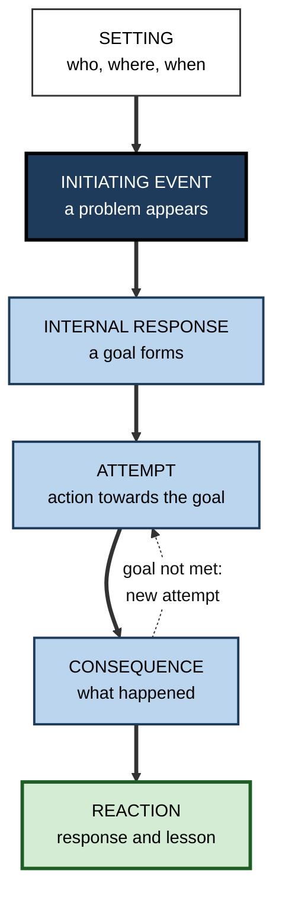
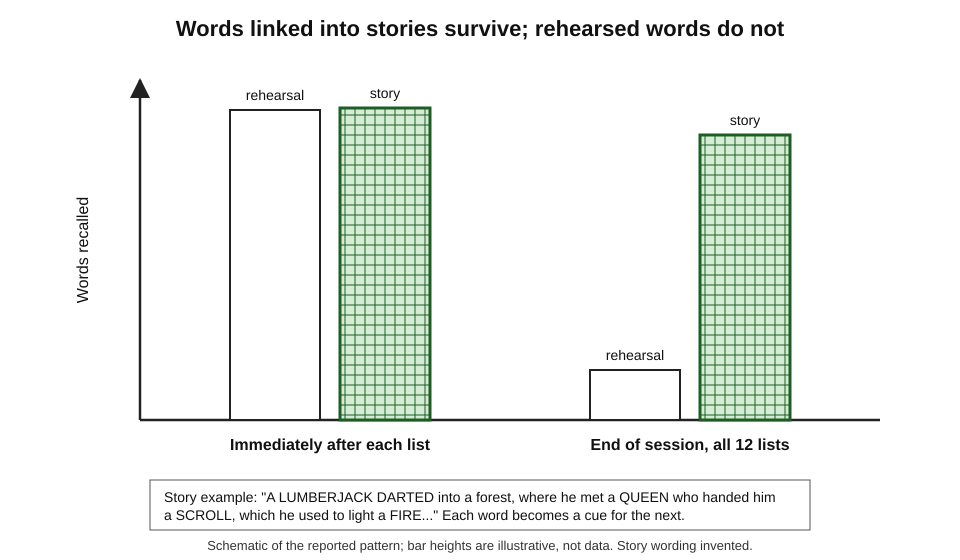
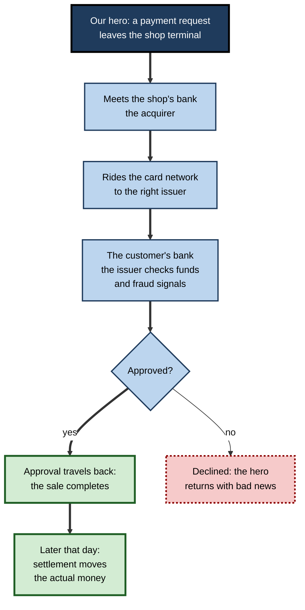
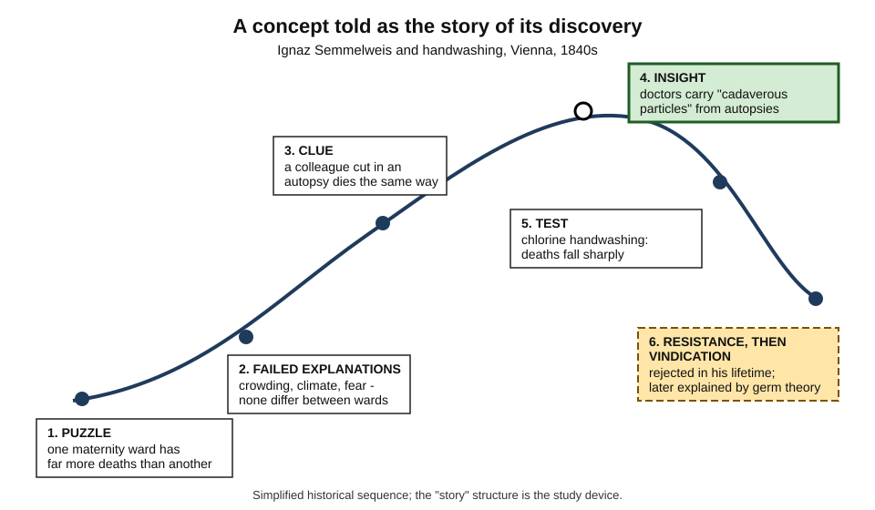
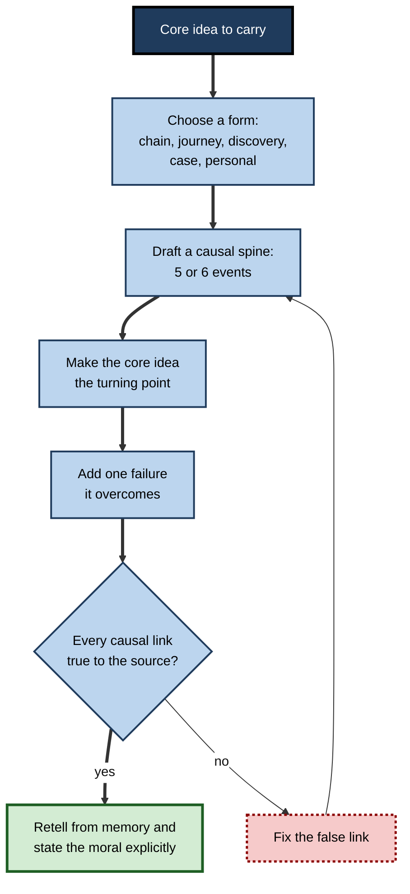
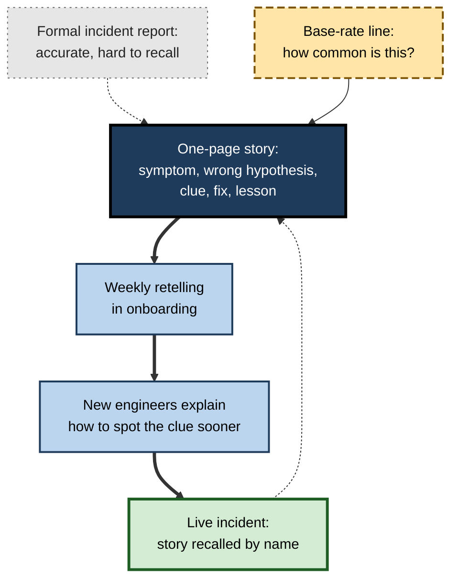

# F.8. Story-Based Elaboration Techniques

Ask a group of professionals what they remember from an induction day and they rarely recall the slides on values or the organisation chart. They recall the story the chief executive told about the customer who nearly left, or the engineer who described the night the payment system failed. Stories stick where lists slide off. That is not a quirk of attention but a feature of how memory is organised — and it can be used deliberately to learn material that does not come as a story.

> **Definition — Story-based elaboration:** turning material to be learned into a narrative — with agents, goals, events, causes and consequences — or linking items through an invented story, so that the material inherits the memorability and coherence of narrative.

> **Definition — Narrative:** an account of connected events in time, typically involving agents with goals, obstacles, actions and outcomes linked by cause.

**Why it matters**

- Narratives are understood faster and remembered better than equivalent expository text — a pattern found repeatedly across age groups.
- A story supplies **causal links** between items, and causal links are what make memories retrievable and coherent.
- Much professional knowledge is naturally narrative — incidents, cases, client histories, project post-mortems — and experts store and share it as stories.
- Material that is not a story — a process, a list, a regulation, the logic of a discovery — can often be **recast** as one with large gains in memory.
- Stories also carry risks: they can be vivid and wrong, they hide uncertainty, and they invite the mind to see causes where there are none. Using them well means using them knowingly.

---

## Why Stories Are Remembered

### The privileged status of story

- **Daniel Willingham (2004)** described stories as **psychologically privileged**: they are easier to understand, more interesting and better remembered than other forms carrying the same information.
- **A meta-analysis by Raymond Mar and colleagues (2021)** comparing narrative and expository texts found that narratives were, on average, **better remembered and better understood** — a moderate advantage across many studies.

### What a story provides

- **Causal structure** — each event is caused by earlier ones and causes later ones; recalling one event cues the next.
- **Goals and agents** — readers track what characters want and whether they get it; goals organise events into a meaningful whole.
- **A familiar schema** — everyone knows how stories go (setting, problem, attempts, outcome), so the structure itself is a retrieval plan.
- **Emotion and interest** — suspense, conflict and resolution hold attention and engage emotional memory.
- **Concreteness** — specific people, places and actions are easy to imagine and remember.

> **Mnemonic — "CGSEC":** Causes, Goals, Schema, Emotion, Concreteness — the five reasons stories stick.

### Story grammar

- **Jean Mandler and Nancy Johnson (1977)** and **Nancy Stein and Christine Glenn (1979)** described the regular structure of simple stories — a **story grammar**:
  - **Setting** — characters, place, time.
  - **Initiating event** — something happens that creates a problem or opportunity.
  - **Internal response** — the character's goal or reaction.
  - **Attempt** — action towards the goal.
  - **Consequence** — the result of the attempt.
  - **Reaction** — the character's response; often a lesson.
- **Readers recall stories in grammar order** even when told out of order, and recall falls when stories violate the structure.

**Figure 1.** The parts of a story grammar and how they connect.

### Transportation and belief

- **Melanie Green and Timothy Brock (2000)** described **narrative transportation** — becoming absorbed in a story, losing awareness of one's surroundings and feeling the events as if present.
  - Readers who were more transported came to hold **beliefs more consistent with the story** and were **less likely to notice false notes** or to argue against it.
- **For learning, this cuts both ways:**
  - absorption increases attention and memory;
  - it also **lowers critical scrutiny**, so errors embedded in a gripping story are accepted more readily than the same errors in plain prose.

> **Definition — Narrative transportation:** absorption in a story to the point that the reader's attention, imagery and feelings are focused on the narrative world, often reducing critical evaluation.

### Stories and situation models

- Reading or hearing a story builds a **situation model** of the events — who is where, wanting what, causing what.
- **Event boundaries** — moments where a goal changes, a new character appears or the scene shifts — divide the model into episodes; research on event segmentation suggests memory is organised around such boundaries.
- **Practical consequence:** a learning story with **clear episodes** (each stage of a process as a distinct scene) gives memory natural handles; a story that blurs stages together loses that advantage.

> **Key point:** stories are memorable because they hand memory a ready-made **causal, goal-driven, episodic** structure — exactly what deliberate elaboration otherwise has to build.

---

## The Evidence for Story Techniques

### Linking items through a story

**Study card — Bower and Clark (1969), narrative chaining**

- **Design:** university students learned twelve lists of ten unrelated nouns.
  - **Story group** — linked each list into a short invented story in which the words appeared in order.
  - **Control group** — studied for the same time, using their own methods.
- **Results:**
  - Immediately after each list, both groups recalled nearly every word.
  - At the end of the session, asked to recall all twelve lists, the **story group recalled the large majority** of the words; the **control group recalled only a small fraction**.
- **Conclusion:** binding items into a causal, imageable narrative turns a set of separate items into one connected memory that resists interference from other lists.

**Figure 2.** Recall after narrative chaining compared with rehearsal.

> **Definition — Narrative chaining:** linking a list of items, in order, into an invented story so that each item cues the next.

### Causal connections and memory

- **Tom Trabasso and Paul van den Broek (1985)** showed that, within stories, events with **more causal links** to other events are better remembered and judged more important.
- **Implication:** the memorability of a story comes from its **causal web**, not from its being "a story" in the abstract. A story whose events are merely listed in time order ("and then… and then…") gains far less.

> **Key point:** to borrow the power of story, a learner must supply **causes**, not just sequence.

### Reconstruction and distortion

**Study card — Bartlett (1932), "The War of the Ghosts"**

- **Design:** English participants read a Native American folk tale with unfamiliar events and logic, then retold it after various delays, sometimes repeatedly.
- **Results:** retellings became **shorter**, **more conventional** and more like familiar English stories; puzzling elements were **omitted** or **rationalised** into something that made sense to the reader.
- **Conclusion:** memory for stories is **reconstructive** — it is shaped by the rememberer's own schemas.

> **Watch out:** the same story schema that makes stories memorable also **distorts** them. A learner who turns a technical process into a story may, on recall, "remember" the version that makes most narrative sense rather than the version that is true.

---

## Story Techniques for Study

### Narrative chaining for ordered lists

- **Use for:** sequences that must be recalled in order with little intrinsic logic — the stages of a regulatory filing, the steps of a protocol, the layers of a model.
- **Method:**
  1. Turn each item into a concrete image or character.
  2. Link item 1 to item 2 through an action, item 2 to item 3, and so on.
  3. Make the actions vivid, causal and, if helpful, absurd.
  4. Rehearse the story once or twice, then recall the items from it.
- **Limit:** chaining preserves **order and identity**; it does not explain the items. For material with real logic, a causal story of the real process is better.

### The protagonist's journey

- **Use for:** processes and systems — anything that "flows".
- **Method:** pick an entity that moves through the system and narrate its journey from its point of view.
  - *e.g.* a red blood cell's circuit; a customer order from click to delivery; an invoice from receipt to payment; a data packet from laptop to server.
- **Why it works:** the protagonist supplies a **goal** (to arrive), **obstacles** (checks, failures, queues) and **causal links** (each stage enables the next).

**Figure 3.** A card payment told as a protagonist's journey.

### The discovery story

- **Use for:** concepts and principles that seem arbitrary when stated but make sense once the problem they solved is known.
- **Method:** tell the concept as the story of its discovery — the **puzzle**, the **failed explanations**, the **clue**, the **insight**, the **test**, the **reception**.
- **Why it works:** the learner experiences the concept as the answer to a question, which supplies a reason for each element; the failed explanations become **near misses** that sharpen understanding.

**Figure 4.** A concept told as the story of its discovery.

> **Example:** "Why must hospital staff wash hands between patients?" is a rule. Told as the story of Ignaz Semmelweis in 1840s Vienna — a ward with puzzlingly high deaths, explanations that failed, a colleague's death after an autopsy cut, the insight about contamination, the dramatic fall in deaths with chlorine washing, and the long rejection that followed — the rule becomes unforgettable and its reason inseparable from it.

### Case narratives

- **Use for:** judgement-based knowledge — management, law, medicine, ethics, consulting.
- **Method:** study or write a case as a story: situation, complication, decision, outcome, lesson.
- **Why it works:** the case binds abstract principles to a memorable sequence; recalling the case recalls the principle.
- **Combine with comparison:** two cases sharing a principle, compared, teach the principle better than either alone.

### Personal narratives

- **Use for:** connecting material to one's own experience.
- **Method:** recall or construct a story from one's own life or work that illustrates the concept — "the time I fell for sunk cost on a failing project".
- **Why it works:** personal stories are rich in emotion, detail and causal links, and relate the concept to the self.

### Comparing story techniques

| Technique | Best for | What the story supplies | Main limitation |
|---|---|---|---|
| **Narrative chaining** | Ordered lists with little logic | Order and cues between items | Explains nothing; absurd links |
| **Protagonist's journey** | Processes and systems | Goal, sequence, obstacles, causes | Can personify falsely ("the packet wants") |
| **Discovery story** | Principles, rules, theories | Reasons for each element; near misses | Historical simplification |
| **Case narrative** | Judgement and application | Context, decision, consequence | One vivid case can be over-generalised |
| **Personal narrative** | Linking concepts to experience | Emotion, self-relevance | Personal experience is weak evidence |

---

## Building a Good Learning Story

### Principles

- **Keep the causal spine true.** Invented decoration is fine; invented causes are not — unless the story is a pure mnemonic for a list.
- **Make the key idea the turning point.** The concept to be learned should be the insight, the obstacle or the resolution — not a side detail.
- **Use concrete agents and actions.** "The invoice is stopped at the three-way match because the quantity on the delivery note disagrees with the order" beats "invoices are validated".
- **Include a failure.** A failed attempt (a near miss) shows why the correct step is needed.
- **Keep it short.** A learning story should be retellable in a minute.

### A procedure

1. **Identify the core idea** — the one thing the story must carry.
2. **Choose the form** — chaining, journey, discovery, case or personal.
3. **Draft the spine** — five or six events linked by "because" or "so".
4. **Place the core idea** at the turning point.
5. **Add one failure** or obstacle that the core idea overcomes.
6. **Check against the source** — is every causal link true?
7. **Retell from memory** — then extract the principle explicitly in one sentence.

> **Remember:** a learning story ends with the **moral stated explicitly**. Without it, learners remember the story and miss the point.

**Figure 5.** Building a learning story and checking it against the source.

### Worked example: learning the stages of a credit decision

- **Situation:** a new loan officer must learn the bank's six-stage credit process: application, identity checks, credit scoring, affordability assessment, underwriter review, offer.
- **Bare list:** six labels, easily confused with similar processes elsewhere.
- **Story built (protagonist's journey):**
  1. **Setting** — Priya, a café owner, applies for a loan to buy an espresso machine.
  2. **Initiating event** — her application arrives; the bank must decide whether to trust a stranger.
  3. **First obstacle** — *identity checks*: is Priya really Priya, and is the money clean? (Fraud and money-laundering checks come first because there is no point scoring a fake applicant.)
  4. **Second obstacle** — *credit scoring*: has she repaid before? Her score is good.
  5. **Third obstacle** — *affordability*: can the café's cash flow carry the repayments? Here she nearly fails — winter takings are low.
  6. **Turning point** — *underwriter review*: a human looks beyond the numbers, sees a signed catering contract, and approves with a seasonal repayment plan.
  7. **Outcome** — *offer*: the terms reflect the risk found.
  8. **Moral** — scoring says whether someone **has** repaid; affordability says whether they **can**; the underwriter judges what the numbers miss.
- **Check:** the officer confirms with a senior colleague that the order and the reasons are correct.
- **Result:** the officer recalls the stages in order, knows **why** each comes where it does and has a vivid case for the most error-prone stage (affordability).

> **Watch out:** the near-failure at affordability is invented, but it is invented to match a **real** feature of the process. A story that invented a stage, or put the stages in a convenient but wrong order, would be memorable and harmful.

---

## The Risks of Stories

### Vivid and wrong

- A story's memorability is independent of its truth. A false explanation told as a good story outlives a true explanation told as a list.
- **Remedy:** check every causal claim in a learning story against a source before rehearsing it.

### Seeing causes that are not there

- **The narrative fallacy** — Nassim Nicholas Taleb's term for the tendency to fit a causal story to a sequence of events, making the past seem more explicable and predictable than it was.
  - *e.g.* a company's success is told as the inevitable result of its founder's vision, ignoring luck, timing and the many similar firms that failed.
- **Hindsight bias** reinforces it: once the outcome is known, the story leading to it feels obvious.

> **Definition — Narrative fallacy:** the tendency to construct causal stories that explain past events more neatly than the evidence supports.

### One story outweighing the data

- **The identifiable victim effect** — Deborah Small, George Loewenstein and Paul Slovic (2007) found that people gave more to help a single named, pictured child than in response to statistics about millions in need; presenting the statistics alongside the story even **reduced** giving.
- **In learning and decisions** — a single dramatic case can outweigh base rates: a clinician who once missed a rare diagnosis may over-test for it for years.
- **Remedy:** pair each story with the **numbers** that show how typical it is.

### Stories hide uncertainty

- A story moves smoothly from cause to effect; real evidence is often partial, probabilistic and contested.
- **Remedy:** in professional learning, attach to each story a short statement of **how sure we are** and **what else could explain it**.

| Risk | How it shows up | Countermeasure |
|---|---|---|
| **Vivid but false** | A memorable explanation that is wrong | Check each causal link against a source |
| **Narrative fallacy** | Past events explained too neatly | Ask what else happened that the story leaves out |
| **Identifiable-case bias** | One case outweighs the base rate | Pair the story with the numbers |
| **Hidden uncertainty** | Smooth story, shaky evidence | State confidence and alternatives explicitly |
| **Reconstructive drift** | Retold story drifts towards convention | Re-read the source occasionally; keep a written version |

---

## Stories in Professional Learning

### How experts store experience

- **Julian Orr's** ethnography of photocopier repair technicians, published in 1996, found that technicians diagnosed difficult machines largely through **war stories** told over breakfast and on calls — stories of past faults, odd symptoms and what finally worked. The manuals described machines; the stories described **how machines actually failed**.
- **Gary Klein's** studies of experienced firefighters, nurses and military commanders, using interviews built around specific past incidents, found that experts recognise situations by their resemblance to **stored episodes** and mentally simulate how events would unfold — knowledge that lives in narrative form.
- **Implication:** in many fields, much tacit expertise is organised as a library of stories; deliberately collecting and studying them speeds its transfer.

### Organisational storytelling

- **Stephen Denning**, then at the World Bank, described in 2001 how a short true story — a health worker in a remote Zambian town finding treatment information through a distant agency's website — persuaded colleagues of the value of knowledge sharing where reports had failed. He called such stories **springboard stories**: brief, true and open enough for listeners to imagine their own versions.
- **Case method** — business, law and medical schools teach through case narratives because cases carry context and judgement that principles alone do not.
- **Post-incident narratives** — engineering and safety organisations write incidents as timelines and stories so that the lessons are remembered and shared.

> **In practice:** the most useful organisational stories are **short, true, specific** and end with the **lesson stated** — "and that is why we always confirm the backup restores, not just that it ran".

### Case study: incident stories in a site-reliability team

- **Situation:** a cloud platform's reliability team had a large library of formal incident reports, each with timeline, root cause and actions.
- **Problem:** new engineers read the reports during onboarding but, months later, repeated mistakes that the reports described; in reviews they could recall that "something like this happened before" but not what or why.
- **Diagnosis:**
  - reports were written as **neutral records** — accurate but hard to remember;
  - the key insight in each was buried among timestamps and log excerpts;
  - nothing linked an incident to the decision a reader would face.
- **Actions:**
  1. For each of the twenty most instructive incidents, a senior engineer wrote a **one-page story**: the setting, the first odd symptom, the wrong hypothesis the team pursued, the clue, the fix, and an explicit **lesson**.
  2. Each story was paired with a **base-rate line** — how often this class of failure occurred.
  3. Onboarding sessions retold one story a week; new engineers then explained how they would have spotted the clue sooner.
  4. When a live incident resembled a stored story, the on-call engineer linked it in the incident channel.
- **Result:** reviewers noticed engineers referring to stories by name during live incidents ("this looks like the certificate-expiry Friday"); repeated mistakes of the twenty documented kinds fell over the following year.
- **Side effects:** writing stories took senior time; one story's dramatic framing led engineers to over-suspect a rare fault until the base-rate line was added.
- **Lesson:** the **same knowledge**, recast as stories with an explicit lesson and a base rate, became retrievable at the moment it was needed.

**Figure 6.** How incident records became retrievable stories in the case study.

### Stories and AI tools

- **Generating stories** — an assistant can turn a dry process into a protagonist's journey or a discovery story in seconds.
- **The danger** — generated stories are fluent and may invent causes, dates or details; for historical discovery stories in particular, invented "facts" are common.
- **Productive use:**
  1. write the causal spine oneself from the source;
  2. ask the assistant to make it vivid without changing any causal link;
  3. check every factual claim it adds;
  4. retell the story from memory and state the moral.

---

## Open Questions

- **When do story techniques beat other elaboration techniques?**
  - Narrative advantages are clear for memory; whether recasting expository material as story improves **transfer** as much as self-explanation or comparison is less clear.
- **How much fiction is acceptable in a learning story?**
  - Invented details aid memory; the point at which they begin to distort understanding has not been mapped.
- **Do stories help experts as much as novices?**
  - Novices gain structure from stories; experts may already hold the structure, and stories may add mainly emotion and persuasion.
- **How can the narrative fallacy be guarded against without losing the power of story?**
  - Pairing stories with base rates and uncertainty helps in principle; how well it works in practice is little studied.
- **What happens when stories are machine-generated at scale?**
  - Abundant, fluent stories may speed learning or may flood learners with plausible inventions; evidence is lacking.

---

## Summary

- **Story-based elaboration** recasts material as **narrative** — agents, goals, events, causes, outcomes — or links items through an invented story.
- Stories are **psychologically privileged** (Willingham); narratives are better remembered and understood than expository texts (Mar et al., 2021 meta-analysis). They provide **Causes, Goals, Schema, Emotion and Concreteness**.
- **Story grammar:** setting, initiating event, internal response, attempt, consequence, reaction.
- **Bower and Clark (1969):** **narrative chaining** preserved far more words across twelve lists than rehearsal. **Trabasso and van den Broek (1985):** events with more **causal links** are better recalled. **Bartlett (1932):** story memory is **reconstructive** and drifts towards the familiar.
- Techniques: **narrative chaining**, **protagonist's journey**, **discovery story**, **case narrative**, **personal narrative**. Keep the causal spine true, make the core idea the turning point, include a failure, keep it short, **state the moral**.
- Risks: **vivid but false**, **narrative fallacy**, **identifiable-case bias** (Small, Loewenstein and Slovic), hidden uncertainty, reconstructive drift — counter with source checks, base rates and confidence statements.
- At work: expertise lives in **stories** (Orr's technicians, Klein's experts); **springboard stories** (Denning), case method and incident narratives transfer it. With AI: write the spine, let the tool add colour, check every fact.

---

## Self-Check

1. Define story-based elaboration and give three forms it can take.
2. Name five features that make stories memorable.
3. List the parts of a story grammar.
4. Describe Bower and Clark (1969) and explain why the story group's advantage appeared only at the end of the session.
5. What did Trabasso and van den Broek find about causal links, and what does it imply for building learning stories?
6. What did Bartlett's "War of the Ghosts" study show, and why is it a warning for story-based study?
7. Explain the protagonist's journey technique and apply it to how an email reaches its recipient.
8. Why is a discovery story especially useful for learning a rule that seems arbitrary?
9. Why should a learning story end with its moral stated explicitly?
10. What is the narrative fallacy? Give a business example.
11. Describe the identifiable victim effect and its implication for learning from cases.
12. What did Orr's study of photocopier technicians show about expert knowledge?
13. A trainer wants to teach a ten-step data-protection procedure. When would narrative chaining be appropriate, and when would a protagonist's journey be better?
14. What is narrative transportation, and why is it a double-edged effect for learners?
15. Why should a learning story about a process have clearly separated episodes?

### Answer Key

1. Recasting material as a narrative with agents, goals, causes and outcomes, or linking items through an invented story. Forms: narrative chaining, protagonist's journey, discovery story, case narrative, personal narrative.
2. Causal structure, goals and agents, a familiar schema, emotion and interest, concreteness.
3. Setting, initiating event, internal response, attempt, consequence, reaction.
4. Students learned twelve ten-word lists; one group linked each list into a story. Immediately after each list both groups recalled almost everything, but at the end the story group recalled the large majority of words and the control group a small fraction. The story bound each list into one connected memory resistant to interference from the other lists, which only matters over time and many lists.
5. Events with more causal links were better recalled and judged more important. Learning stories should be built on causes ("because", "so"), not mere sequence.
6. Retellings of an unfamiliar story became shorter and more conventional, with puzzling parts omitted or rationalised. Story memory is reconstructive; a learner may later remember the narratively sensible version rather than the accurate one.
7. Narrate the journey of one entity through a system from its point of view. *e.g.* the email leaves the laptop, is handed to the sending mail server, which looks up the recipient domain's mail server, is checked for spam and authenticity on arrival, is filed in the recipient's mailbox and finally fetched when they open their client.
8. It presents the rule as the answer to a puzzle, so each element has a reason; failed explanations act as near misses that sharpen why the rule is right.
9. Learners otherwise remember the story but miss or misidentify the point; stating the moral links the memorable narrative to the principle.
10. Fitting a neat causal story to past events, making them seem more explicable than they were. *e.g.* explaining a firm's success entirely by its founder's genius while ignoring luck, timing and similar firms that failed.
11. People respond more to a single identifiable case than to statistics about many. A single vivid case can outweigh base rates in learning and decisions; pair stories with the numbers showing how typical they are.
12. Technicians diagnosed difficult faults largely through shared war stories of past failures — expert knowledge of how machines actually fail lived in narrative form, beyond the manuals.
13. Chaining suits an order that must be recalled exactly but has little internal logic. If the steps have real reasons — each check protecting against a risk — a protagonist's journey (a customer's data moving through the procedure) is better, because it carries the reasons as well as the order.
14. Absorption in a story that focuses attention and feeling on its world. It improves attention and memory, but lowers critical scrutiny, so errors in a gripping story are accepted more readily (Green and Brock, 2000).
15. Memory appears to be organised around event boundaries; distinct scenes for each stage give memory natural handles, whereas a story that blurs stages together loses that structure.

---

## Glossary

| Term | Meaning |
|---|---|
| Case narrative | A case presented as a story of situation, decision, outcome and lesson. |
| Causal network | A representation of a story's events and the causal links between them. |
| Discovery story | A concept presented as the story of the problem it solved and how it was found. |
| Event boundary | A point in a narrative where goals, characters or scenes change, dividing it into episodes. |
| Hindsight bias | The tendency to see past outcomes as more predictable than they were. |
| Identifiable victim effect | Greater response to a single identifiable case than to statistics about many. |
| Narrative chaining | Linking a list of items into an invented story so each cues the next. |
| Narrative fallacy | Constructing causal stories that explain past events too neatly. |
| Narrative transportation | Absorption in a story that focuses attention and feeling on its world and reduces critical evaluation. |
| Narrative | An account of connected events involving agents, goals and causes. |
| Protagonist's journey | Narrating a process from the viewpoint of an entity moving through it. |
| Reconstructive memory | Memory that rebuilds past events using schemas, rather than replaying them. |
| Springboard story | A brief, true story that helps listeners imagine applying an idea in their own context. |
| Story grammar | The regular structure of simple stories: setting, initiating event, response, attempt, consequence, reaction. |
| Story-based elaboration | Recasting material as narrative to improve understanding and memory. |
| War story | An informal story of a past problem and its solution, shared among practitioners. |
