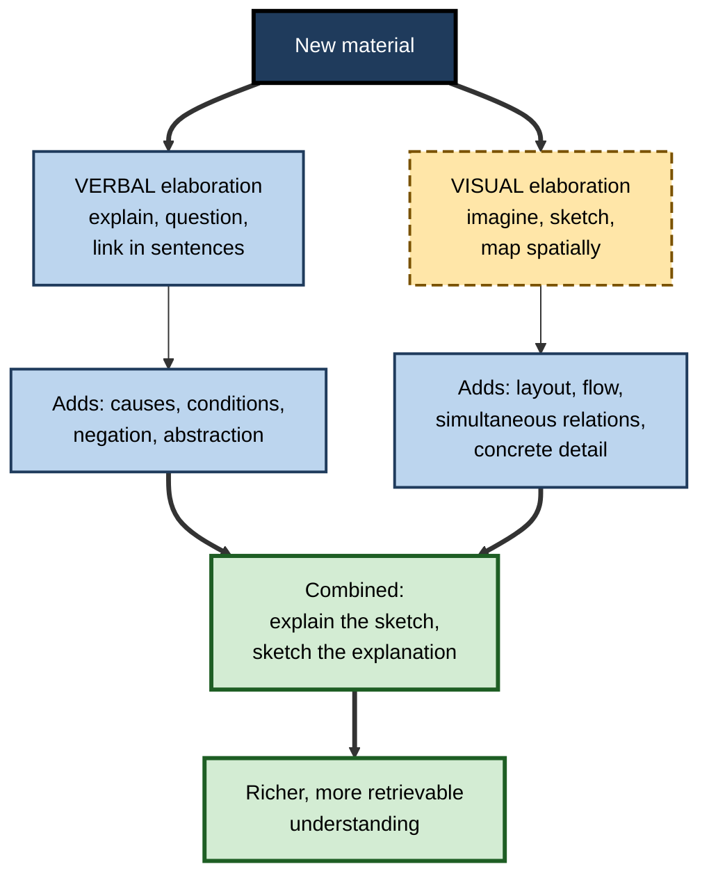
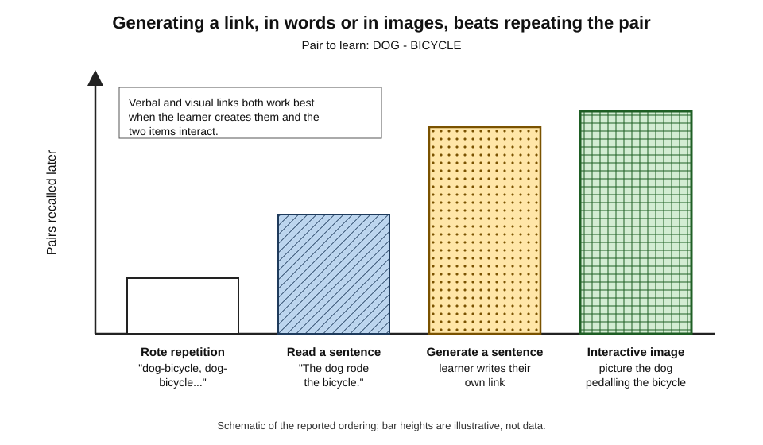
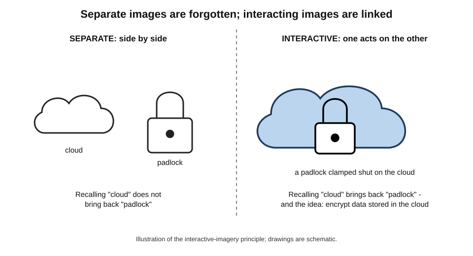
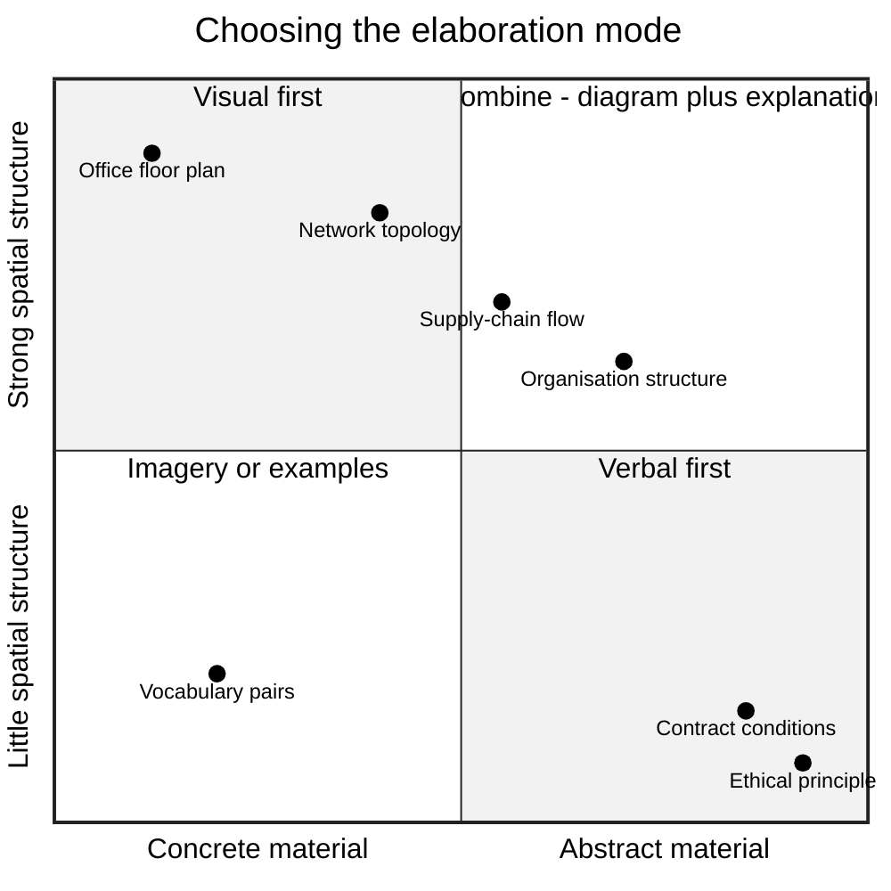
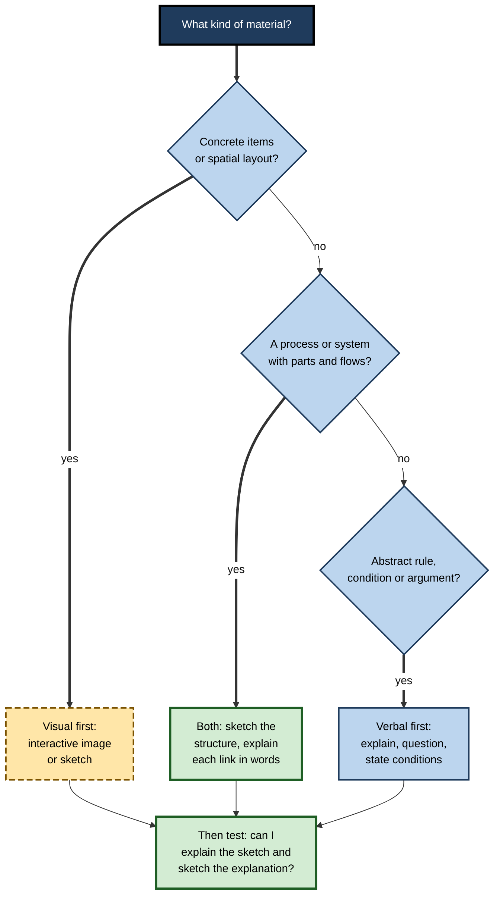
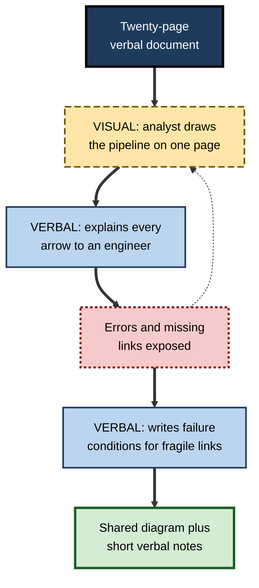

# F.9. Verbal Elaboration vs. Visual Elaboration

Two engineers are learning how a new authentication service works. One writes a paragraph explaining each step — the user signs in, the identity provider issues a token, the application checks its signature. The other sketches boxes and arrows on a whiteboard and talks to herself as she draws. Both are elaborating: adding meaning to what they read. But they are doing it in different modes, and the modes are good at different things. Knowing which to use, and when to combine them, is part of studying well.

> **Definition — Verbal elaboration:** elaborating new material in words — explanations, sentences linking items, questions and answers, examples described in language.

> **Definition — Visual elaboration:** elaborating new material in images — forming mental pictures, imagining items interacting, drawing sketches or diagrams, or mapping relations spatially.

**Why it matters**

- Verbal and visual elaboration engage different kinds of representation, and each captures some relations better than the other.
- Visual elaboration can be very powerful for **concrete** and **spatial** material and for linking items; verbal elaboration is stronger for **abstract**, **logical** and **causal** reasoning.
- Combining the two, well, often beats either alone; combining them badly adds effort without benefit.
- Popular advice that people are "visual learners" or "verbal learners" and should study only in their preferred mode is **not supported** by evidence — a misconception that wastes study time.
- In professional work, the ability to move between a sentence and a sketch — to explain a diagram and to draw an explanation — is a mark of deep understanding.

---

## Two Modes of Elaboration

### What each mode does

- **Verbal elaboration**
  - Adds **propositions**: statements of cause, condition, purpose, contrast.
  - Handles **abstraction**, **negation** ("not", "unless"), **quantifiers** ("all", "some") and **logical structure** naturally.
  - *e.g.* "A token proves identity only if its signature can be checked against the provider's public key; an unsigned token proves nothing."
- **Visual elaboration**
  - Adds **spatial and pictorial structure**: positions, shapes, flows, containment, proximity.
  - Handles **simultaneous relations** — many parts seen at once — and **concrete detail** naturally.
  - *e.g.* boxes for user, application and identity provider, with arrows showing the token's path.

> **Key point:** words are good at **why** and **if**; pictures are good at **where**, **what connects to what** and **how it looks**. Most understanding needs both.

### A note on theory

- The idea that verbal and imagery-based representations are distinct but connected is most associated with **Allan Paivio's dual coding theory**, which proposed separate verbal and non-verbal systems whose combination strengthens memory. The theory and its design implications form a large subject of their own; here the concern is narrower — **elaboration** in each mode, and how to choose.

**Figure 1.** Two routes of elaboration and what each adds.

---

## The Evidence on Each Mode

### Linking items: words versus images

**Study card — Bower and Winzenz (1970)**

- **Design:** adults learned pairs of concrete nouns (such as DOG–BICYCLE) by one of four methods:
  - **rote repetition** of the pair;
  - **reading a sentence** that linked the two;
  - **generating a sentence** of their own;
  - **forming a mental image** of the two items interacting.
- **Results:** recall was lowest after repetition, higher after reading a sentence, and highest after **generating a sentence** or **forming an interactive image**.
- **Conclusion:** both verbal and visual elaboration beat repetition; **self-generated** links in either mode were strongest, with imagery especially effective for concrete items.

**Figure 2.** Recall of word pairs after four learning methods.

### Interaction is what matters

- **Gordon Bower (1970)** found that imagining two items **interacting** (a dog pedalling a bicycle) produced far better memory than imagining them **separately**, side by side — even though both involve imagery.
- **The verbal parallel:** a sentence linking items through an action ("the dog rode the bicycle") helps more than a sentence that merely mentions both ("the dog and the bicycle").
- **The principle:** elaboration in any mode works by **relating** items; the mode is a vehicle.

**Figure 3.** Separate images compared with an interactive image.

### Bizarreness

- It is widely believed that **bizarre** images are more memorable.
- **Mark McDaniel and Gilles Einstein (1986)** found that bizarre images helped mainly when a list mixed bizarre and ordinary items — the bizarre ones stood out — and helped little or not at all when every image was bizarre.

> **Watch out:** "make it weird and you'll remember it" is only half true. Distinctiveness, not bizarreness as such, drives the benefit, and a list of uniformly strange images loses it.

### The keyword method

- **Richard Atkinson and Michael Raugh (1975)** taught foreign vocabulary with a **keyword** — an English word that sounds like the foreign word — and an **interactive image** linking the keyword to the meaning.
  - *e.g.* Spanish *carta* (letter) → keyword "cart" → image of a cart loaded with letters.
- **Results:** large immediate gains in vocabulary recall.
- **Limits:** later research found the advantage can shrink or disappear after longer delays, and the method suits concrete, imageable words better than abstract ones. Dunlosky and colleagues (2013) rated it **low utility** overall for these reasons.

> **Definition — Keyword method:** a mnemonic that links an unfamiliar word to a familiar sound-alike word and then links that word to the meaning through an interactive image.

### Imagery while reading

- Instructing readers to form mental images of a text helps when the text describes **concrete, imageable** content (a scene, a mechanism, a route) and helps little for abstract argument.
- Dunlosky and colleagues (2013) rated **imagery for text** low utility because benefits were limited to imageable materials and short delays.
- **Detlev Leutner, Claudia Leopold and Elke Sumfleth (2009)** found that, for a science text, instructing students to **imagine** the content improved comprehension, whereas instructing them to **draw** it without support **reduced** comprehension — apparently because drawing added a heavy load for learners not skilled at it.

### Drawing

- **The drawing effect** — Jeffrey Wammes, Melissa Meade and Myra Fernandes (2016) found that drawing a word's meaning produced better later recall than writing the word repeatedly or listing its features — a robust effect in their experiments, including for older adults.
- **Learner-generated drawing of science texts** — reviews of generative learning strategies (Logan Fiorella and Richard Mayer, 2016) found drawing to be beneficial on average, **especially when** learners are given support: a partial drawing to complete, a list of elements to include, or a comparison with an expert drawing.
- **Without support**, drawing can absorb effort in artistry rather than meaning, and errors in the drawing go unnoticed.

| Visual technique | Typical benefit | Conditions for benefit | Main risk |
|---|---|---|---|
| **Interactive imagery for pairs** | Large | Concrete items; images link items | Weak for abstract items |
| **Keyword method** | Large immediately, may fade | Imageable vocabulary; short to medium delays | Faster forgetting; narrow scope |
| **Imagery while reading** | Small to moderate | Concrete, spatial texts | Little help for abstract argument |
| **Drawing a word's meaning** | Moderate to large | Single concepts or words | Not tested much on complex material |
| **Drawing a text's content** | Moderate on average | Support provided; learners checked | Overload; uncorrected errors |

---

## Why Each Mode Works

### What words do well

- **Propositions** — sentences state relations explicitly: "A causes B unless C". Each proposition is a link in a network that can be retrieved and reasoned with.
- **Abstraction and logic** — language handles "all", "some", "not", "only if" and "probably" with ease; these are the joints of most professional rules and arguments.
- **Generation** — composing a sentence is an act of construction; self-generated sentences were as effective as images for word pairs in the classic studies.
- **Sequence** — language is linear, which suits step-by-step reasoning but strains when many relations hold at once.

### What pictures do well

- **The concreteness effect** — concrete, imageable words are remembered better than abstract ones; Paivio attributed this to concrete items being coded both verbally and as images.
- **Computational efficiency** — **Jill Larkin and Herbert Simon (1987)** argued that a diagram can be "worth ten thousand words" not because it contains more information but because it **groups information by location**: everything about one component sits in one place, so the reader finds related facts without searching, and many inferences become simple perception.
- **Mental simulation** — **Mary Hegarty (1992)** found that people reason about mechanical systems such as pulleys by mentally animating them, component by component, along the chain of causation; a good diagram supports that simulation.
- **Simultaneity** — a picture shows many relations at once; the eye can move freely among them.

> **Key point:** words make relations **explicit**; pictures make relations **findable**. Elaboration is strongest when relations are both.

### The body as a third channel

- **Gesture** — Susan Goldin-Meadow and colleagues found that children who were encouraged to gesture while explaining mathematical equivalence problems learned more, and retained it better, than children told not to gesture; gesture appears to carry spatial ideas the learner cannot yet put into words.
- **Enactment** — acting out a process (walking through a workflow, role-playing a negotiation) adds motor and spatial elaboration; it is listed among generative learning strategies alongside drawing and imagining.
- **Spatial memory** — the ancient **method of loci**, placing items to be remembered along an imagined route, exploits the strength of spatial memory; it is highly effective for ordered lists but, like other mnemonics, adds little understanding of the items.

**Figure 4.** Where verbal, visual and combined elaboration fit, by the abstractness and spatial structure of the material.

---

## Choosing Between the Modes

### What the material calls for

- **Concrete objects and pairs** — visual elaboration excels: interactive images, sketches.
- **Spatial layouts and routes** — visual: maps, floor plans, network diagrams.
- **Flows and processes** — both: a flow sketch for sequence and structure, words for the reason behind each step.
- **Causal mechanisms** — verbal for the logic ("because", "unless"), visual for the arrangement of parts.
- **Abstract principles, definitions and arguments** — verbal: negation, conditions and quantifiers are hard to draw.
- **Comparisons across several attributes** — a table, which is both verbal and spatial.

**Figure 5.** Choosing an elaboration mode according to the material.

### Head-to-head comparison

| | Verbal elaboration | Visual elaboration |
|---|---|---|
| **Strengths** | Logic, conditions, negation, abstraction, precision | Layout, simultaneity, concreteness, linking items |
| **Typical forms** | Self-explanation, why-questions, linking sentences, examples in words | Interactive images, sketches, flow diagrams, spatial maps |
| **Best material** | Principles, definitions, arguments, legal and policy rules | Objects, places, mechanisms, networks, pairs |
| **Speed** | Fast to produce; slow for complex structures | Fast for structures; slow if artistry intrudes |
| **Typical failure** | Long text that hides structure | Pretty picture with no causal logic |
| **Check** | "Can I draw what I just explained?" | "Can I explain every arrow?" |

### Combining the modes

- **Explain the sketch** — after drawing, say or write what every box and arrow means and why it is there.
- **Sketch the explanation** — after writing an explanation, draw its structure; if it cannot be drawn, its structure may be unclear.
- **Label with verbs** — arrows labelled "causes", "checks", "sends to" carry verbal meaning inside a visual frame.
- **Keep both brief** — a quick sketch and a short explanation beat an elaborate drawing or a long essay.

> **Remember:** the strongest elaboration moves **back and forth** between words and pictures — each exposes gaps in the other.

> **Mnemonic — "Draw it, say it; say it, draw it."** Every sketch gets an explanation; every explanation gets a sketch.

### Worked example: learning how a vaccine-cold chain works

- **Situation:** a logistics analyst joining a public-health supply team must learn the vaccine **cold chain** — the system that keeps vaccines at safe temperatures from manufacturer to patient.

1. **Verbal first** — she writes: "Vaccines lose potency if too warm or, for some, if frozen. So every stage — factory, national store, regional store, clinic, outreach — must keep them in range, and every hand-over is a risk point."
2. **Visual next** — she sketches five boxes in a line with arrows between them, a thermometer icon at each box, and a warning mark on each arrow.
3. **Explain the sketch** — she labels each arrow with what can go wrong: "truck delayed", "door left open", "power cut at clinic".
4. **Notice a gap** — sketching reveals that she has not shown **monitoring**: how anyone would know the range was breached. She adds temperature loggers and vial indicators that change colour after heat exposure.
5. **Sketch the explanation's condition** — "some vaccines must not freeze" is hard to draw; she keeps it in words as a note beside the clinic box, where freezing in domestic-style fridges is a known risk.

| Element | Captured better verbally | Captured better visually |
|---|---|---|
| Why temperature matters | Yes — "potency lost if…" | — |
| Sequence of stores | — | Yes — boxes in order |
| Risk at hand-overs | Partly | Yes — marks on arrows |
| Monitoring points | — | Yes — revealed as a gap |
| "Must not freeze" condition | Yes — a condition with exceptions | Hard to draw |

- **Conclusion:** neither mode alone produced the full picture; each exposed what the other missed.

---

## Misconceptions and Limits

### The learning-styles myth

- **The claim:** people are "visual", "auditory" or "verbal" learners and learn best when instruction or study matches their style.
- **The evidence:** **Harold Pashler, Mark McDaniel, Doug Rohrer and Robert Bjork (2008)** reviewed the literature for the decisive test — people of different supposed styles randomly assigned to matching or mismatching instruction — and found **virtually no support** for the matching ("meshing") hypothesis. Later reviews reached the same conclusion.
- **What is true:**
  - people have **preferences**, which are real but do not predict benefit from matching;
  - **material** has a natural mode — maps are visual, arguments verbal — which matters for everyone;
  - **combining** modes helps most learners.

> **Watch out:** believing oneself a "visual learner" can lead to avoiding verbal elaboration of abstract material — exactly where verbal elaboration is most needed. Choose the mode by the **material and goal**, not by a supposed personal style.

### "A picture is always better"

- **Decorative images** — pictures that look relevant but carry none of the structure to be learned — add little and can distract, much as seductive details do in text.
- **Pictures of the wrong thing** — a photograph of a server room does nothing for understanding how a request is routed; a three-box flow sketch does.
- **The test** — a visual elaboration earns its place only if it shows a **relation** the learner needs: a sequence, a containment, a cause, a comparison. Otherwise words are faster and clearer.

### Variation in imagery ability

- People differ greatly in the vividness of their mental imagery.
- **Aphantasia** — a term popularised by Adam Zeman and colleagues in 2015 for the absence, or near absence, of voluntary visual imagery — affects a minority of people, who report little or no "mind's eye".
- **Implication:** instructions to "picture it" do little for such learners; **drawing**, external diagrams and verbal elaboration remain fully available.

### Visual elaboration and cognitive load

- Building a mental image of a complex system while also reading about it can overload working memory.
- **Drawing** shifts the image outside the head but adds motor and planning demands.
- **Remedy:** start with a simple partial diagram or a provided template; add detail gradually.

### Verbal elaboration and hidden structure

- Long verbal explanations can hide the structure of a system: the reader follows each sentence but cannot see how the parts fit together.
- **Remedy:** after a long explanation, sketch it; if the sketch is a tangle, the explanation probably needs reorganising.

---

## Verbal and Visual Elaboration at Work

### Professional habits

- **Architects and engineers** — sketch to think; annotations carry the conditions and reasons.
- **Consultants** — use whiteboard sketches in workshops and then write the "storyline" of a recommendation; each form tests the other.
- **Software teams** — draw system diagrams in design reviews; a reviewer who asks "what happens on this arrow if the service is down?" adds verbal elaboration to visual structure.
- **Clinicians** — sketch anatomy or timelines when explaining to patients and colleagues; write the reasoning in notes.
- **Lawyers** — draw relationship and transaction diagrams for complex deals, and keep the conditions in words, because legal conditions rarely draw well.

> **In practice:** in design reviews, a useful discipline is that **every arrow on a diagram must be explainable in one sentence**. Arrows that cannot be explained usually mark misunderstanding or hidden complexity.

### Representational fluency

- **Robert Kozma and Joel Russell (1997)** compared expert chemists and chemistry students working with different representations of the same phenomena — equations, molecular animations, graphs, video of reactions.
  - **Experts** moved fluidly between representations, grouping them by the underlying chemistry and explaining one in terms of another.
  - **Students** grouped representations by surface appearance and found it hard to translate between them.
- **Implication:** expertise includes **representational fluency** — the ability to express the same understanding in words, symbols and pictures and to translate among them. Deliberately alternating verbal and visual elaboration is practice in exactly that skill.

> **Definition — Representational fluency:** the ability to express an idea in several forms — verbal, symbolic, visual — and to translate accurately between them.

> **In practice:** a quick test of a junior colleague's understanding is to hand them a diagram and ask for a paragraph, or hand them a paragraph and ask for a diagram. Difficulty translating in either direction usually marks the edge of their understanding.

### Case study: onboarding analysts to a data pipeline

- **Situation:** a retail company's data team onboarded new analysts with a twenty-page written description of its data pipeline — sources, transformations, schedules and quality checks.
- **Problem:** analysts read the document but, months later, still asked where particular figures came from and broke reports by misunderstanding dependencies.
- **Diagnosis:**
  - the document was purely verbal; dependencies across many components were hard to hold in mind from text;
  - the one existing diagram was a dense, unlabelled chart nobody could explain.
- **Actions:**
  1. New analysts were asked to **draw** the pipeline from the document, on one page, before meeting a senior engineer.
  2. In the meeting, they **explained every arrow** aloud; the engineer corrected errors and added missing links.
  3. Each analyst then wrote a **one-paragraph explanation** of the three most fragile dependencies — the conditions under which they fail.
  4. The best drawings and explanations replaced the old diagram in the documentation.
- **Result:** dependency-related report breaks fell substantially; new analysts reached independent work sooner; the documentation now contained both a clear diagram and short verbal notes of failure conditions.
- **Side effects:** some analysts were anxious about drawing; providing a template with source and destination boxes already placed reduced the anxiety.
- **Lesson:** moving between **drawing** and **explaining** exposed misunderstandings that reading alone had concealed.

**Figure 6.** Alternating visual and verbal elaboration in the onboarding case.

### Visual and verbal elaboration with AI tools

- **Diagram generation** — assistants can draw diagrams from text descriptions; useful as a check, but a generated diagram removes the learner's own structuring work.
- **Better sequence:**
  1. sketch first, from one's own understanding;
  2. ask the assistant to generate a diagram from the source;
  3. compare the two and explain every difference;
  4. write a short verbal note on the conditions neither diagram shows.
- **Text-to-image tools** can produce vivid images for interactive-imagery mnemonics, but the self-generated image is usually the more memorable one — and the act of generating it is part of the benefit.

---

## Open Questions

- **When does drawing help and when does it hurt?**
  - Supported drawing generally helps; unsupported drawing can overload. The precise conditions — learner skill, material complexity, time — are not fully mapped.
- **How durable are imagery-based gains?**
  - Some imagery mnemonics show large immediate effects that shrink over weeks; long-delay evidence is limited.
- **Can representational fluency be trained directly?**
  - Experts translate easily between words, symbols and pictures; whether structured alternation between modes builds that fluency faster than ordinary study is little tested outside science education.
- **Is the mode or the generation doing the work?**
  - Many comparisons confound mode with generation; self-generated verbal links can rival imagery. How much benefit is specific to visual processing is debated.
- **How should instruction adapt to differences in imagery ability?**
  - Aphantasia shows wide variation; whether imagery instructions should be replaced by drawing or verbal strategies for low-imagery learners has received little study.
- **What do AI-generated visuals do to learning?**
  - Instant diagrams and images may help comprehension while reducing the generative work that builds memory; evidence is only beginning.

---

## Summary

- **Verbal elaboration** adds meaning in words — causes, conditions, negation, abstraction. **Visual elaboration** adds meaning in images — layout, flow, simultaneous relations, concreteness.
- Words are good at **why** and **if**; pictures at **where** and **what connects to what**. Dual coding theory (Paivio) underlies the idea of separate but linked codes.
- **Bower and Winzenz (1970):** generated sentences and interactive images both beat repetition and reading a sentence. **Bower (1970):** images help when items **interact**. **McDaniel and Einstein (1986):** bizarreness helps mainly through **distinctiveness** in mixed lists.
- **Keyword method** (Atkinson and Raugh, 1975): large immediate gains, possible fading, narrow scope — rated low utility. **Imagery for text** helps for concrete material only. **Imagining** can beat **unsupported drawing** (Leutner et al., 2009); **drawing a word** improves recall (Wammes et al., 2016); **supported drawing** helps comprehension.
- Choose the mode by **material**: concrete and spatial → visual; abstract and conditional → verbal; systems → both. **Explain the sketch; sketch the explanation.**
- The **learning-styles** matching claim is unsupported (Pashler et al., 2008); choose by material, not by style. Imagery ability varies (**aphantasia**); drawing and words remain available.
- Experts show **representational fluency** (Kozma and Russell, 1997), translating freely between words, symbols and pictures.
- At work: sketches and storylines test each other; every arrow should be explainable in a sentence. With AI: draw first, compare with generated diagrams, explain the differences.

---

## Self-Check

1. Define verbal and visual elaboration and give a strength of each.
2. Describe Bower and Winzenz (1970) and its main conclusion.
3. Why do interactive images work better than separate images?
4. What did McDaniel and Einstein (1986) find about bizarre images?
5. Explain the keyword method and why it was rated low utility despite large immediate effects.
6. What did Leutner, Leopold and Sumfleth (2009) find about imagining and drawing, and why?
7. Under what conditions does learner-generated drawing help comprehension?
8. Which mode would you choose first for: (a) a network topology; (b) the conditions for a valid contract; (c) how a heat pump works? Why?
9. What is the learning-styles meshing hypothesis, and what does the evidence show?
10. What is aphantasia, and what does it imply for study advice?
11. Explain "explain the sketch; sketch the explanation" with an example.
12. A colleague's system diagram has twenty unlabelled arrows. What would you ask, and why?
13. Design a study routine combining both modes for learning the structure and logic of a company's organisational approval process.
14. According to Larkin and Simon (1987), why can a diagram be more useful than text containing the same information?
15. What did Goldin-Meadow and colleagues find about gesture, and what does it suggest about elaboration?

### Answer Key

1. Verbal: elaborating in words — strong for causes, conditions, negation and abstraction. Visual: elaborating in images — strong for layout, flow, simultaneous relations and concrete detail.
2. People learned noun pairs by repetition, reading a linking sentence, generating a sentence or forming an interactive image. Generated sentences and interactive images produced the best recall; repetition the worst. Self-generated links in either mode are strongest.
3. Elaboration works by relating items; an interactive image binds the two into one memory so one cues the other, while separate images leave them unconnected.
4. Bizarre images helped mainly in mixed lists where they stood out, and little when all images were bizarre — the benefit comes from distinctiveness.
5. A foreign word is linked to a sound-alike familiar keyword, which is linked to the meaning by an interactive image. Immediate gains are large, but they can fade after longer delays and the method suits mainly concrete vocabulary.
6. Imagining a science text's content improved comprehension; unsupported drawing reduced it, apparently because drawing imposed a heavy extra load on learners not skilled at it.
7. When learners are supported — partial drawings to complete, lists of elements, comparison with expert drawings — and when drawings are checked for errors.
8. (a) Visual — spatial structure and connections. (b) Verbal — conditions, exceptions and negation do not draw well. (c) Both — a sketch of components and refrigerant flow, with words for why compressing and expanding the fluid moves heat.
9. The claim that instruction matched to a learner's preferred style improves learning. Reviews (Pashler et al., 2008, and later) found virtually no support from properly designed tests; choose modes by material and combine them.
10. The absence or near absence of voluntary visual imagery. "Picture it" advice helps such learners little; drawing, external diagrams and verbal elaboration remain effective.
11. After drawing a sales funnel, explain each stage transition in words ("leads become opportunities when a budget is confirmed"); after writing an explanation of a refund policy, sketch its decision structure — if it cannot be drawn clearly, the logic may be unclear.
12. Ask what each arrow means — data flow, dependency, call, ownership — and what happens on it when a component fails. Unlabelled arrows hide meaning and often hide misunderstanding.
13. *e.g.* Read the policy; sketch the approval path with roles as boxes and decisions as diamonds; explain every arrow aloud; write the conditions and thresholds in words beside each decision; compare with an expert's diagram; a few days later, redraw from memory and re-explain.
14. A diagram groups information by location, so related facts are found together without search and many inferences become matters of perception; the information is the same, but the computation is cheaper.
15. Children encouraged to gesture while explaining maths problems learned and retained more; gesture can carry spatial ideas the learner cannot yet put into words, adding a third, bodily channel of elaboration.

---

## Glossary

| Term | Meaning |
|---|---|
| Aphantasia | The absence or near absence of voluntary visual imagery. |
| Bizarreness effect | Better memory for bizarre images, mainly when they stand out among ordinary ones. |
| Concreteness effect | Better memory for concrete, imageable words than for abstract ones. |
| Decorative image | A picture that looks relevant but carries none of the structure to be learned. |
| Distinctiveness | Features that set a memory apart from similar memories. |
| Drawing effect | Better recall of words whose meanings were drawn rather than written. |
| Dual coding theory | Paivio's theory that verbal and non-verbal codes are separate but linked, and that combining them aids memory. |
| Enactment | Acting out material physically as a way of elaborating it. |
| Interactive imagery | Imagining items acting on or with one another, which links them in memory. |
| Keyword method | A mnemonic linking a foreign word to a sound-alike keyword and the keyword to the meaning by an image. |
| Learner-generated drawing | Drawing the content of material as a study strategy. |
| Learning styles | The claimed tendency for individuals to learn best in a preferred sensory mode. |
| Mental simulation | Reasoning about a system by imagining its parts moving in sequence. |
| Meshing hypothesis | The claim that matching instruction to learning style improves learning. |
| Method of loci | A mnemonic placing items along an imagined familiar route. |
| Representational fluency | The ability to express an idea in several forms and translate between them. |
| Verbal elaboration | Elaborating new material in words. |
| Visual elaboration | Elaborating new material in images, sketches or spatial layouts. |
