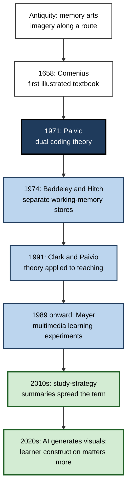
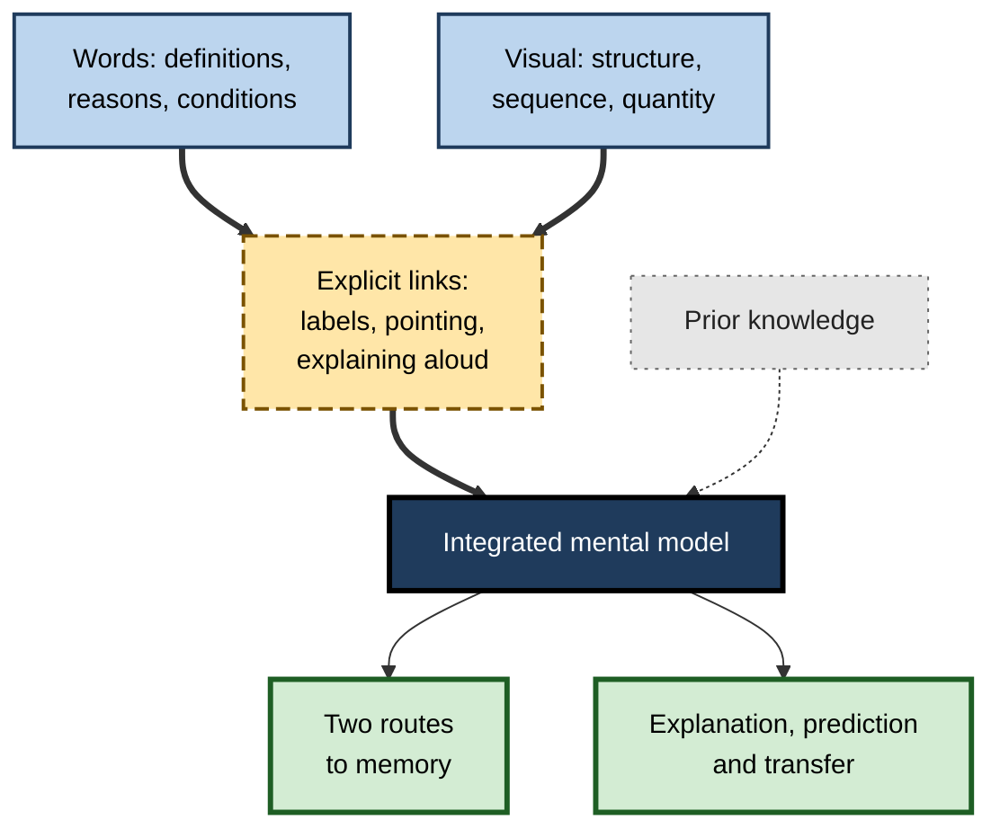
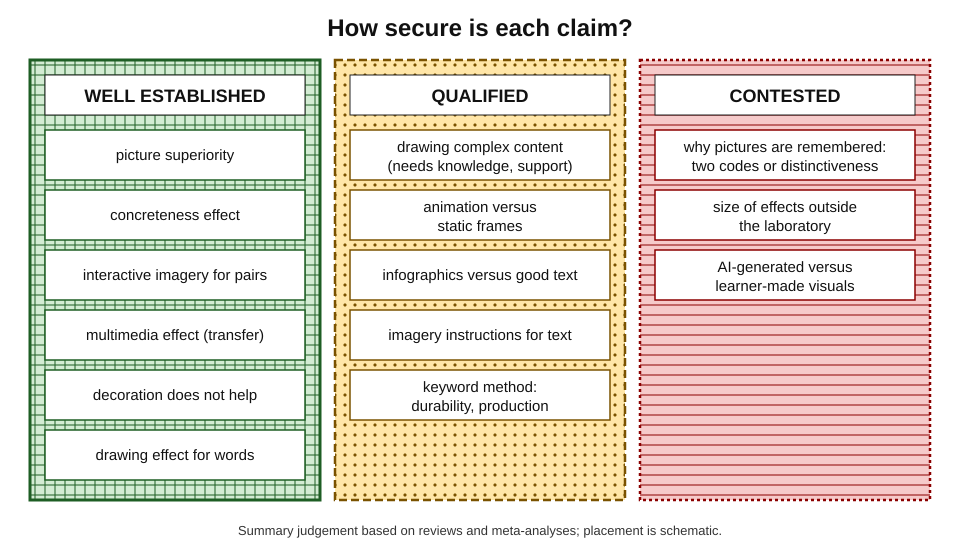
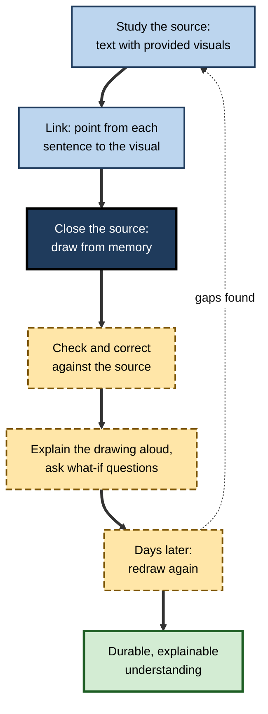
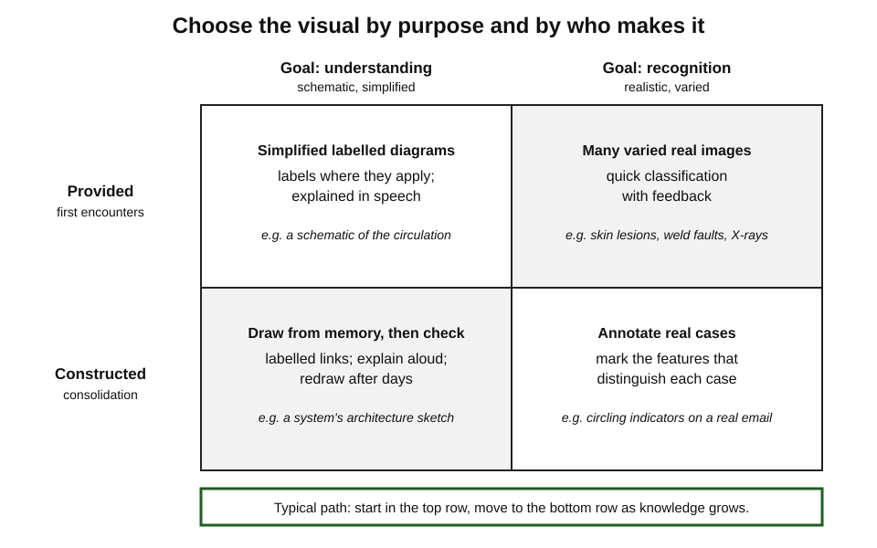
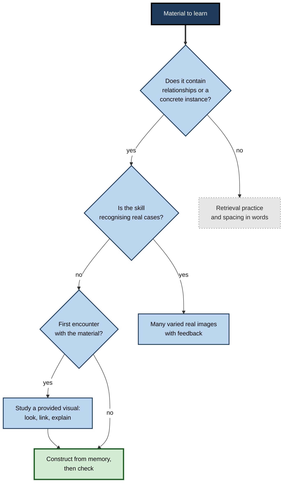

# G. Dual Coding

Ask an experienced engineer to explain how a system works and, within a minute, she reaches for a pen. Ask a seasoned barrister to explain a complex dispute and he sketches the parties and a line of dates. Ask a good doctor to explain a diagnosis and a quick drawing of the organ appears on the back of a form. Experts in almost every field think and explain with **words and pictures together**.

For learners, this habit is not a matter of style. Combining verbal and visual representations — and, above all, **constructing** them — is one of the best-supported ways of understanding complex material and remembering it.

> **Definition — Dual coding:** representing what is being learned in both **verbal** form (spoken or written words) and **visual** form (pictures, diagrams, graphs, maps, timelines, sketches), with explicit links between them, so that each supports and completes the other.

**Why it matters**

- Much of what professionals must learn is made of **relationships** — structures, processes, causes, comparisons, quantities — that words alone convey slowly and imprecisely.
- Visuals reduce the burden on limited working memory by holding structure on the page.
- Two linked codes give two routes to memory.
- Constructing a visual forces the selection and organisation that produce understanding, and exposes what has not been understood.
- Dual coding is also one of the most **misunderstood** study strategies: decoration, duplication and the myth of "visual learners" are all mistaken for it.

---

## The Idea and Its Scope

### Three ingredients

- **Two representations of the same content** — words and a visual that both concern what must be learned, not merely the topic.
- **A visual that carries information** — structure, sequence, cause, comparison, quantity, space or a concrete instance that the words convey poorly.
- **Explicit links** — the learner connects each part of the visual with its words: labels, captions, pointing, explaining aloud.

> **Key point:** dual coding is defined by **meaningful, linked** representation, not by the presence of a picture. A page with an icon beside every word is not dual-coded; a rough labelled sketch of how three ideas affect one another is.

### What it is and is not

- **Not decoration** — attractive images that do not show content add nothing and can distract.
- **Not duplication** — the same paragraph read aloud while it is displayed costs attention without adding meaning.
- **Not a learning style** — the advice applies to essentially all learners; the claim that people learn best in a preferred "visual" or "verbal" mode is not supported by evidence.
- **Not only looking** — studying a provided diagram is useful, but drawing one's own, from memory, is usually more powerful.
- **Not only for visual subjects** — law, finance, management and the humanities have relationships that can be drawn.

| | Using provided visuals | Constructing one's own visuals |
|---|---|---|
| What the learner does | Reads, inspects and links a diagram to text | Selects content, chooses a form, draws and labels |
| Main benefit | Faster understanding of structure; external memory | Deeper processing; gaps revealed; retrieval if from memory |
| Main risk | Glancing without integrating | Load on novices; decoration; copying |
| Best for | First encounters with complex systems | Consolidation and checking understanding |
| Typical example | A textbook's labelled diagram of the heart | A sketch of the heart's circulation drawn from memory |

---

## Origins and History

### Ancient and early modern practice

- **Memory arts** — Greek and Roman orators used vivid imagery placed along imagined routes to memorise speeches, a practice attributed by Cicero to Simonides of Ceos.
- **Illustrated learning** — John Amos Comenius's *Orbis Sensualium Pictus* (1658) paired numbered pictures with words in Latin and the vernacular and is widely regarded as the first illustrated textbook for children.
- **Scientific illustration** — from Vesalius's anatomy (1543) to engineering drawings, explanation in the sciences has long depended on images tied to text.
- **Explanatory graphics** — Playfair's charts (1786), Nightingale's polar-area diagrams (1858) and Minard's map of Napoleon's march (1869) showed how a single well-designed graphic could make an argument visible.

### The scientific account

- **Allan Paivio**, at the University of Western Ontario, proposed **dual coding theory** in *Imagery and Verbal Processes* (1971): the mind has a **verbal** system and a **nonverbal (imagery)** system, separate but linked, and information coded in both is remembered better. The theory explained why concrete words and pictures are remembered better than abstract words, and gave imagery a respectable place in experimental psychology after decades of neglect.
- **Alan Baddeley and Graham Hitch (1974)** described working memory with separate components for speech-based and visuospatial information — limited channels that can be overloaded, or used together.
- **James Clark and Allan Paivio (1991)** applied the theory to education: concrete examples, illustrations, imagery and mnemonics all work partly by adding a second code.
- **Richard Mayer** and colleagues, from the late 1980s, ran hundreds of experiments showing that people learn more deeply from words and relevant pictures than from words alone — and specifying when combinations help or harm.

### From research to study advice

- **Learning-science summaries** in the 2010s — including the six strategies distilled by Yana Weinstein, Christopher Madan and Megan Sumeracki (2018) (spacing, retrieval practice, elaboration, interleaving, concrete examples and dual coding) — brought the term into widespread use among teachers and learners.
- **The popularity had costs:** "dual coding" was often reduced to adding icons and pictures to everything — a misreading that later writers on the subject worked hard to correct.

**Figure 1.** Milestones in the development of dual coding as a learning principle.

---

## The Central Model

### Two codes, linked

- **Verbal code** — sequential, precise, good at conditions, negation, qualification and abstract statement.
- **Visual code** — simultaneous, spatial, good at structure, relation, pattern, quantity and layout.
- **Referential links** — naming a picture, picturing a word — connect the two; the more explicit and practised the links, the more each code can retrieve the other.
- **Integration** — the learner combines the verbal and visual models with each other and with prior knowledge into one **mental model** that supports explanation and prediction.

**Figure 2.** The core model of dual coding: two linked codes integrated into one understanding.

### What each code does best

| Content | Better in words | Better in a visual | Best combined as |
|---|---|---|---|
| Definitions and conditions | Exact wording, "unless", "only if" | — | Words, with a concrete example pictured |
| Structure of a system | Slow to describe | Parts and arrangement at a glance | Labelled diagram plus function of each part |
| Process over time | Order of steps | Order, branches, timing | Sequence or flowchart with reasons in words |
| Cause and effect | Mechanism and evidence | Chains and feedback loops | Causal diagram plus explanation |
| Quantity and pattern | Exact figures | Trends, comparisons, distributions | Chart plus a sentence stating the finding |
| Abstract term | General statement | Hard unless by analogy | Words plus a concrete case or visual metaphor |

> **Remember:** let **visuals carry structure** and **words carry reasons**. A combination is strong when each does the job it is good at.

---

## Why Dual Coding Works

- **Two retrieval routes** — an item held verbally and visually can be recalled through either; this underlies the strong memory advantage for pictures and concrete words.
- **Separate channels** — speech-based and visuospatial information draw on partly separate working-memory resources, so a diagram explained in speech can be processed with less competition than a diagram explained by dense text. The two channels share a central capacity, however, so overload is still possible.
- **Computational efficiency** — Jill Larkin and Herbert Simon (1987) showed that a diagram containing the same information as a text can be far easier to use, because related information sits together and relations can be seen rather than inferred.
- **External memory** — a diagram on the page holds the structure so working memory can be used for reasoning.
- **Generative processing** — constructing a visual requires selecting, organising and integrating, the processes that produce understanding; learner-generated drawing from science texts produced an average benefit of about **d = 0.70** in one meta-analysis.
- **Metacognitive exposure** — a drawing makes gaps and errors visible in a way that a re-read paragraph does not.

> **Watch out:** the mechanisms are distinct. Two memory routes help **recall**; integration and construction help **understanding**. A picture that only adds a second route to a fact will not by itself produce the ability to explain or apply.

---

## The Evidence in Outline

### What is well established

- **Picture superiority** — pictures are remembered better than words; long-term recognition memory for pictures is vast.
- **The concreteness effect** — concrete words and passages are remembered and understood better than abstract ones.
- **Interactive imagery** — linking two items in one imagined scene greatly improves paired-associate learning.
- **The multimedia effect** — words plus relevant explanatory pictures produce deeper learning than words alone, especially on transfer tests and for learners with little prior knowledge.
- **Decoration does not help** — decorative pictures have essentially no benefit; interesting but irrelevant additions ("seductive details") reduce learning on average.
- **The drawing effect** — drawing the meaning of words or definitions makes them markedly more memorable than writing them.

### What is qualified

- **Drawing to learn complex content** helps when learners have enough knowledge and support; unsupported drawing can overload.
- **Animation** helps most for motor and procedural skills; for mechanisms, equivalent static frames often perform as well.
- **Infographics** compared with good text give mixed results, depending on design.
- **Imagery instructions for text** help mainly for concrete, picturable material.
- **The keyword method** produces large initial gains for vocabulary, with doubts about durability and productive use.

### What is contested

- **Why** pictures are remembered better — dual coding, distinctiveness or faster access to meaning. Recent work, including studies with people who have little or no visual imagery (aphantasia), challenges the pure dual-coding explanation, though not the effect itself.
- **How well laboratory effects scale** to long courses, workplaces and self-directed study.
- **Whether AI-generated visuals** preserve the benefits of learner-made ones.

**Figure 3.** The strength of evidence for the main claims about dual coding.

---

## Methods and How They Fit Together

### Two families of practice

- **Studying with provided visuals** — reading diagrams, charts and illustrations alongside text, linking each part to its words, and explaining them aloud. The underlying architecture — two partly separate channels, each of limited capacity — explains why a diagram with speech often beats a diagram with dense text.
- **Constructing visuals** — producing one's own diagrams, maps, sketches and sequences. This family carries most of the learning benefit, because the learner does the selecting and organising.

### Choosing the form

The form of a visual should follow the **relationship** that matters in the content. Networks of ideas call for diagrams with labelled links, change over time for scaled sequences, branching procedures for flowcharts, and arbitrary word–meaning links for interactive images later consolidated by retrieval; visual notes of talks and one-message data graphics apply the same logic to live input and to evidence.

> **Key point:** asking "**what relationship must be seen?**" before drawing anything prevents most poor visuals — the decorative picture, the list in boxes, the chart that shows the wrong comparison.

### Interaction with other strategies

- **With retrieval practice** — drawing a diagram **from memory** combines retrieval with organisation; it is one of the strongest ways to use dual coding.
- **With spacing** — redrawing key visuals after a day, a week and a month consolidates them.
- **With elaboration** — explaining a diagram aloud ("this causes that because…") is elaboration anchored in structure.
- **With interleaving** — sketching the relevant visual before each mixed practice problem helps learners identify the problem type.
- **With concrete examples** — a pictured case grounds an abstract principle.

**Figure 4.** The cycle of using and constructing visuals, combined with retrieval and spacing.

> **Mnemonic — "LOOK, LINK, DRAW, CHECK":** look at the provided visual, link it to the words, draw it from memory, check and correct.

---

## The Landmark Debates

### Two codes or distinctiveness?

- **The dual-coding account** — pictures are remembered well because they are spontaneously named and so carry two codes.
- **The distinctiveness account** — pictures differ from one another more than words do, and distinctive items stand out in memory.
- **Recent evidence** — when words were made comparably distinctive, the picture advantage disappeared in at least one carefully controlled study (Higdon and colleagues, 2025); people with aphantasia still show picture superiority.
- **Practical consequence:** whichever explanation wins, the advice converges — make key items **meaningful, concrete and distinctive**.

### Dual coding versus learning styles

- **The confusion** — because dual coding mentions "visual" and "verbal", it is often mistaken for the claim that some people are visual learners.
- **The distinction** — dual coding describes an architecture shared by everyone; the learning-styles hypothesis, that matching teaching to a preferred modality improves learning, has repeatedly failed controlled tests.
- **For practice:** recommend words plus meaningful visuals to **all** learners, adapting complexity to prior knowledge and spatial ability rather than to stated preference.

### Decoration masquerading as dual coding

- **The trend** — teaching and training materials filled with icons, stock photographs and clip art under the banner of dual coding.
- **The critique** — icons usually illustrate the **topic**, not the **idea**; decorative and seductive images add load and sometimes reduce learning.
- **The standard** — a visual must show a relationship or concrete instance that the words convey poorly.

### Making visuals or receiving them

- **For construction** — drawing and mapping engage generative processing and make understanding visible; constructing concept maps tends to help more than studying provided ones.
- **Against** — construction is slow and can overload novices; drawing with the source open is less effective than retrieval practice.
- **Resolution** — provide good visuals for first encounters; ask learners to **construct from memory** for consolidation; support novices with partial drawings or provided elements.

### Realism versus schematic

- **Simplified diagrams** often produce better understanding than detailed, realistic ones because they show the relations that matter.
- **Realistic images** are essential when the skill is **recognition** — a skin lesion, a fault on an X-ray, a counterfeit note.
- **Resolution** — choose by purpose: schematic for understanding mechanisms; realistic and varied for perceptual skills.

| Debate | Position A | Position B | Current balance |
|---|---|---|---|
| Why pictures are remembered | Two codes | Distinctiveness | Effect secure; dual-coding explanation weakened |
| Who benefits | Visual learners | Everyone | Everyone; adapt to knowledge, not preference |
| What counts | Any picture | Only meaningful visuals | Only meaningful, linked visuals |
| Make or receive | Construct | Study provided | Provide first, construct from memory later |
| Realism | Realistic | Schematic | Depends on whether the goal is understanding or recognition |

---

## Dual Coding at Scale

### In education

- **Textbooks and courses** that integrate labelled diagrams with text, place captions where they apply, and avoid decoration support deeper learning.
- **Teachers who draw** while explaining — building a diagram step by step — model both the content and the act of representation.
- **Assessment** that asks learners to draw and explain diagrams reveals understanding that multiple-choice items miss.

### In organisations

- **Onboarding** — new staff learn systems, processes and organisations faster when they draw them from memory and have the drawings reviewed.
- **Procedures and job aids** — flowcharts and annotated photographs reduce errors where procedures branch or are rarely performed.
- **Communication standards** — action headlines with one visual per slide; charts with a sentence stating the finding; shared diagram conventions across functions.
- **Customer and public communication** — icon arrays for risk, labelled diagrams in patient information, one-page explanations of products.

### Worked example: learning a new operational method

**Situation:** an operations manager moving into a manufacturing plant has six weeks to learn **lean** methods well enough to lead improvement projects. Her current plan is to read two books and watch a video course.

| Week | Content | Dual-coded activity | Combined with |
|---|---|---|---|
| 1 | The seven wastes | Walk the line; photograph an example of each waste; label each photo with the waste and its cost | Recall the seven wastes from the photos two days later |
| 2 | Value stream mapping | Draw the current-state map of one product line from observation, with times | Explain the map aloud to a supervisor; correct |
| 3 | Flow and pull | Sketch a frame sequence of a kanban loop: card, signal, replenishment | Redraw from memory; predict what happens if a card is lost |
| 4 | Standard work | Turn one written procedure into a flowchart; test it with operators | Revise after observing real practice |
| 5 | Root-cause analysis | Build a fishbone diagram for a recurring defect with the team | Verify causes with data |
| 6 | Review | Redraw all five key visuals from memory on one page | Teach the page to a new team leader |

1. **Each visual matches the relationship**: photographs for recognition, maps for flow, frames for a loop, flowcharts for procedure, fishbone for causes.
2. **Words carry definitions, reasons and conditions** — beside each visual.
3. **Construction, retrieval and spacing are built in.**

- **Conclusion:** instead of reading about lean, the manager builds the field's standard visuals herself, tests them against reality and retrieves them over time.

> **Watch out:** the same plan done with photographs copied from the internet and maps downloaded from the books would look similar and teach far less. The value lies in **constructing** from the real plant and from memory.

### Case study: route knowledge for train drivers

- **Situation:** a rail operator trained new drivers to learn the **routes** they would drive — signals, speed restrictions, gradients, stations and hazards over hundreds of kilometres.
- **Problem:** route learning relied on riding in the cab with an experienced driver and studying written route descriptions. It was slow, inconsistent and hard to assess; some trainees passed route checks but later missed restrictions.
- **Diagnosis:**
  - written descriptions listed features in order but gave no picture of the route;
  - cab rides provided realistic experience but no structure, and could not be paused or repeated;
  - trainees had few opportunities to **retrieve** the route before driving it.
- **Actions:**
  1. Produced **forward-facing video** of each route, with on-screen labels added only at key points (signals, restriction boards) and a short spoken commentary.
  2. Created **route diagrams** — a simplified line showing stations, signals and speed limits, with a **gradient profile** beneath.
  3. Trainees **drew the route diagram from memory**, section by section, then checked it against the official diagram.
  4. Assessment combined video clips paused before a feature ("what comes next, and what speed?") with cab observation.
- **Result:** the operator reported more consistent route assessments and shorter route-learning time for new drivers, with experienced drivers using the materials to refresh rarely driven routes.
- **Caveats:** route learning also depends on supervised driving experience, which remained; the operator's evaluation was internal.
- **Lesson:** realistic video for **recognition**, schematic diagrams for **structure**, drawing from memory for **retrieval**, and short labels rather than dense text — the main principles of dual coding — worked together at organisational scale.

**Figure 5.** Matching the kind of visual to the purpose: understanding or recognition, provided or constructed.

---

## Barriers and How They Are Overcome

- **"I can't draw."** — Drawing skill does not predict the memory benefit of drawing; boxes, arrows and stick figures suffice. A small personal set of icons can be learned in an hour.
- **Time** — constructing visuals is slower than reading. Reserve it for content with relationships that must be understood; use retrieval practice for isolated facts.
- **Unfamiliar conventions** — each field's diagrams have rules; teach and learn them explicitly.
- **Stakeholder preference for decoration** — show that fewer, meaningful visuals teach more; evaluate by delayed performance, not by how rich materials look.
- **Novice overload** — provide partial drawings, element sets or worked diagrams before asking for full construction.
- **Tool distraction** — diagramming software invites styling; for learning, pen and paper or a simple stylus often keep attention on content.

> **In practice:** the cheapest high-value habit is a **two-minute sketch from memory** at the end of every reading or meeting — the three to five boxes that matter and the arrows between them.

---

## Dual Coding in the Age of AI

### What has changed

- **Visuals are now cheap.** AI tools can turn any text into a diagram, infographic, slide deck or illustration in seconds.
- **AI tutors** can explain with diagrams, generate image-based practice and comment on a learner's sketch.

### What has not changed

- **The learning comes from the processing.** Selecting what matters, choosing a form and drawing the links are what build understanding; a generated diagram skips them.
- **Accuracy still needs a human with knowledge.** Generated visuals can contain reversed arrows, invented components, wrong anatomy, illegible labels and stereotyped depictions of people.
- **Fluency is still deceptive.** A polished diagram feels understood.

### A productive pattern

1. **Draw first** — one's own sketch from memory.
2. **Generate second** — an AI version, as a comparison.
3. **Compare** — list and investigate every difference.
4. **Verify** — check against authoritative sources.
5. **Redraw** — from memory, later.

**Figure 6.** Deciding when and how to use a visual while studying.

> **Watch out:** "I generated a diagram of the chapter" is not studying, any more than "I highlighted the chapter" is. The tool did the organising; the learner must still think, draw and retrieve.

---

## What Distinguishes Expert Practice

- **Experts choose the visual by the relationship**, not by habit — a timeline for a dispute, a flowchart for a procedure, a causal loop for a system.
- **They sketch fast and rough**, revise often and treat drawings as thinking tools rather than artworks.
- **They label every arrow** and keep conventions consistent.
- **They put reasons, conditions and judgement in words** beside the visual.
- **They translate between representations** — equation, graph, diagram, sentence — and know each one's blind spots.
- **They design for others' understanding**: one message per graphic, honest scales, labels where they apply, nothing decorative.
- **They use repetition deliberately** — for access, language support or novices — and remove it as expertise grows.
- **They know the evidence boundaries** and do not repeat myths about visual learners or the speed of visual processing.

---

## Open Questions

- **What explains picture superiority?**
  - Dual coding, distinctiveness and faster semantic access all have support; new controlled studies and research on aphantasia have reopened the question.
- **How large are the benefits outside the laboratory?**
  - Most experiments use short lessons and immediate tests; evidence from long courses and workplaces is thinner.
- **How should construction and support be balanced?**
  - Novices need scaffolds; experts need freedom; the best way to fade support is not well mapped.
- **What do AI-generated visuals do to learning?**
  - They may help learners who cannot draw or may remove the generative step that produces understanding; good evidence is only beginning.
- **Which fields benefit most?**
  - Evidence is strongest in science, mathematics and medicine; law, management and the humanities are much less studied.

---

## Summary

- **Dual coding** = representing content in **words and meaningful visuals**, with **explicit links**, so each supports the other.
- **It is not** decoration, duplication or a learning style; it applies to essentially all learners.
- **History:** memory arts; Comenius (1658); scientific and statistical graphics; **Paivio's dual coding theory** (1971); Baddeley and Hitch's working memory (1974); Clark and Paivio (1991); Mayer's multimedia research; 2010s study-strategy summaries.
- **Core model:** verbal code (precise, sequential) + visual code (spatial, simultaneous) + referential links → an integrated mental model. **Visuals carry structure; words carry reasons.**
- **Mechanisms:** two retrieval routes; partly separate channels; computational efficiency (Larkin and Simon); external memory; generative processing (drawing from science texts, d ≈ 0.70); exposure of gaps.
- **Evidence:** well established — picture superiority, concreteness, interactive imagery, the multimedia effect, no benefit from decoration, the drawing effect. Qualified — drawing complex content, animation, infographics, imagery for text, keyword method. Contested — why picture superiority occurs; scale-up; AI visuals.
- **Methods:** study provided visuals (look, link, explain) and construct one's own (from memory, then check); choose the form by the relationship; combine with retrieval, spacing, elaboration and interleaving.
- **Debates:** two codes versus distinctiveness; dual coding versus learning styles; decoration; making versus receiving; realism versus schematic.
- **At scale:** onboarding by drawing, flowcharts and annotated job aids, assertion-style communication, icon arrays for risk; the train-driver route-knowledge case.
- **AI era:** draw first, generate second, compare, verify, redraw.

---

## Self-Check

1. Define dual coding and name its three ingredients.
2. Why is a page of icons beside every term not dual coding?
3. Distinguish using provided visuals from constructing one's own, and say when each is most useful.
4. Outline the contributions of Paivio (1971), Baddeley and Hitch (1974) and Mayer to the scientific basis of dual coding.
5. For each, say whether words or a visual should carry it: the conditions of an exemption; the layout of a network; the trend in monthly sales; the reason a policy exists.
6. Explain three mechanisms by which dual coding helps, distinguishing those that aid recall from those that aid understanding.
7. Which claims about dual coding are well established, which qualified and which contested?
8. How does dual coding combine with retrieval practice and spacing?
9. Summarise the debate over why pictures are remembered better, and its practical consequence.
10. A colleague says, "Dual coding is for visual learners." Correct this.
11. In the lean worked example, why does each week use a different kind of visual?
12. In the route-knowledge case, identify which elements served recognition, structure and retrieval.
13. Design a four-week dual-coding plan for learning a new body of regulation in your field.
14. A manager plans to have AI generate diagrams for every training module to "save learners time". Advise them.

### Answer Key

1. Representing content in words and meaningful visuals with explicit links. Ingredients: two representations of the same content; a visual that carries information; explicit links.
2. Icons illustrate topics, not ideas; they carry no structure or relationship and add nothing the words lack.
3. Provided visuals — for first encounters with complex material, studied by linking and explaining. Constructed visuals — for consolidation and checking, ideally from memory; more generative but slower and harder for novices.
4. Paivio — two linked representational systems; dual-coded items remembered better. Baddeley and Hitch — separate speech-based and visuospatial working-memory stores with limited capacity. Mayer — words plus relevant pictures produce deeper learning, with conditions for when combinations help or harm.
5. Conditions — words; layout — visual; trend — visual (with a sentence stating the finding); reason — words.
6. Recall: two retrieval routes. Understanding: computational efficiency (relations visible), integration into a mental model, generative construction (also external memory; exposure of gaps).
7. Established: picture superiority, concreteness, interactive imagery, multimedia effect, no benefit from decoration, drawing effect. Qualified: drawing complex content, animation, infographics, imagery for text, keyword method. Contested: why pictures are remembered better; scale-up; AI visuals.
8. Draw diagrams from memory (retrieval plus organisation), check them, and redraw after increasing intervals (spacing).
9. Dual coding says pictures gain two codes; distinctiveness says pictures differ more from one another. Controlled studies and aphantasia research weaken the dual-coding explanation. Practically: make key items meaningful, concrete and distinctive.
10. Dual coding describes an architecture shared by all; the learning-styles hypothesis has failed controlled tests. Use words plus meaningful visuals for everyone, adapting to prior knowledge, not preference.
11. Each week's content has a different relationship — recognition, flow, loop, procedure, causes — and the visual form follows the relationship.
12. Recognition — forward-facing video; structure — route diagrams with gradient profiles; retrieval — drawing the route from memory and paused-video prediction.
13. *e.g.* Week 1: a structure diagram of the regulation's parts and definitions; Week 2: flowcharts of key obligations and exemptions, tested with cases; Week 3: a timeline of compliance deadlines; Week 4: redraw all from memory and explain them to a colleague; words carry conditions and reasons throughout.
14. Generated diagrams may be useful for communication, but they skip the selecting and organising that produce learning and may contain errors. Provide verified diagrams for first encounters, then require learners to draw their own from memory and compare with the reference.

---

## Glossary

| Term | Meaning |
|---|---|
| Concreteness effect | Better memory and comprehension for concrete than abstract material. |
| Decorative visual | An image related to the topic but carrying no content. |
| Distinctiveness | The degree to which an item stands out from others, aiding memory. |
| Drawing effect | Better memory for information whose meaning has been drawn. |
| Dual coding | Representing content in words and meaningful visuals with explicit links. |
| Dual coding theory | Paivio's theory of linked verbal and nonverbal representational systems. |
| Generative processing | Selecting, organising and integrating information, as in constructing a visual. |
| Integration | Combining verbal and visual models with each other and with prior knowledge. |
| Interactive imagery | Linking items in one imagined scene in which they act on each other. |
| Learning styles hypothesis | The unsupported claim that matching teaching to a preferred modality improves learning. |
| Multimedia effect | Deeper learning from words and relevant pictures than from words alone. |
| Picture superiority effect | Better memory for pictures than for the corresponding words. |
| Referential link | A connection between a word and an image representing the same thing. |
| Seductive details | Interesting but irrelevant additions that reduce learning. |
| Working memory | A limited system holding and manipulating information during thinking. |
