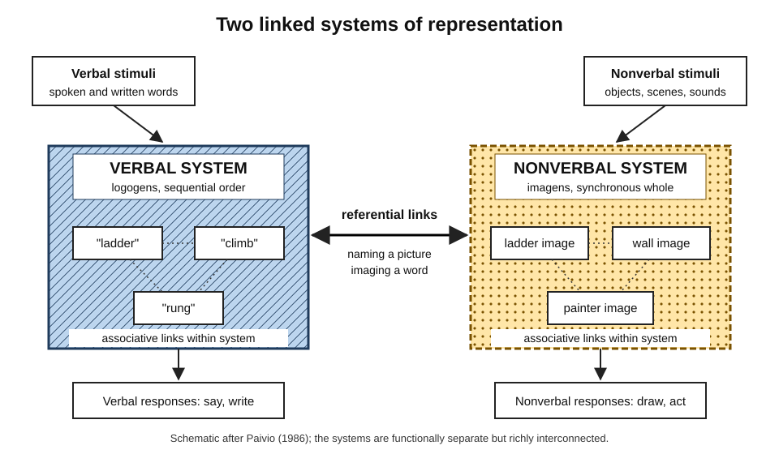
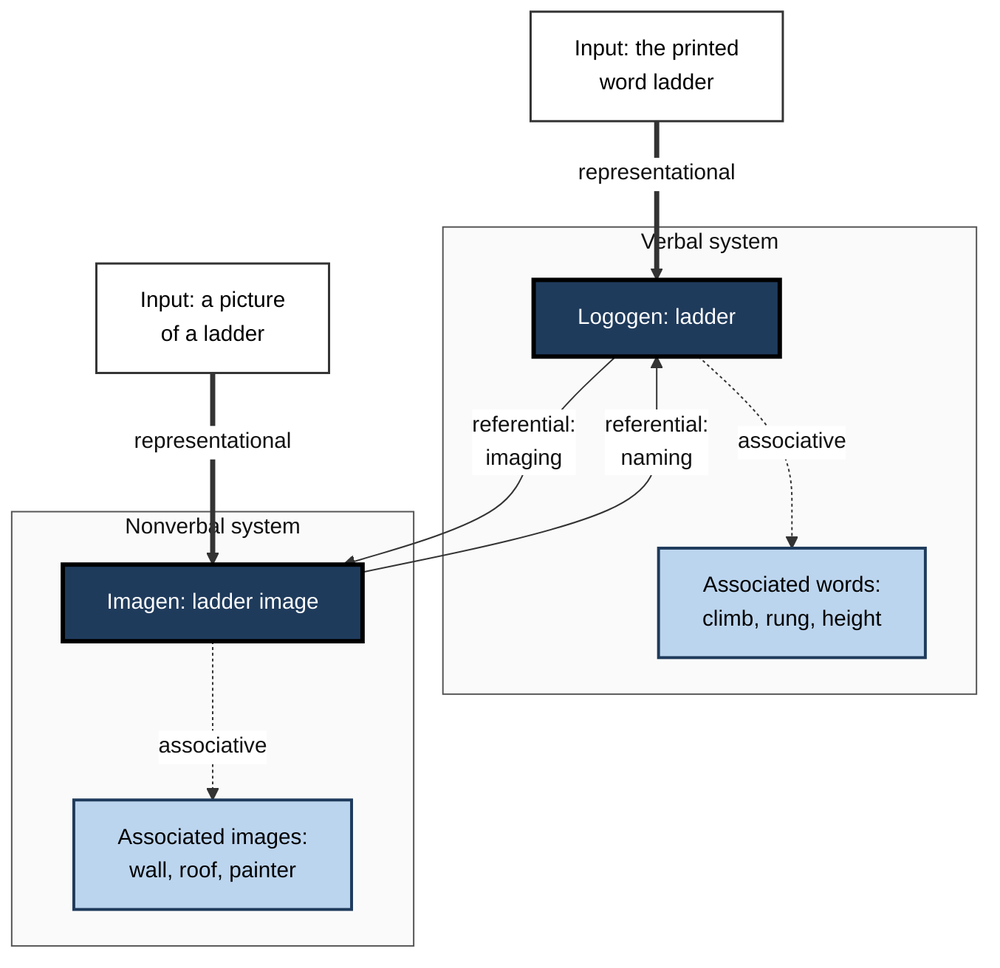
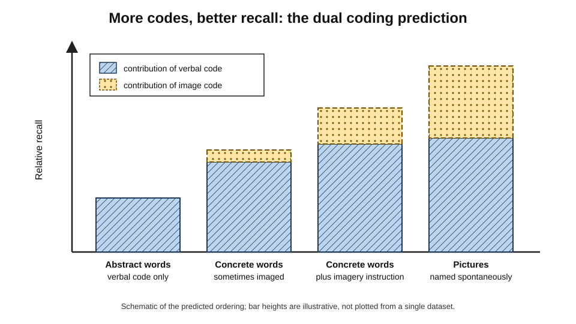
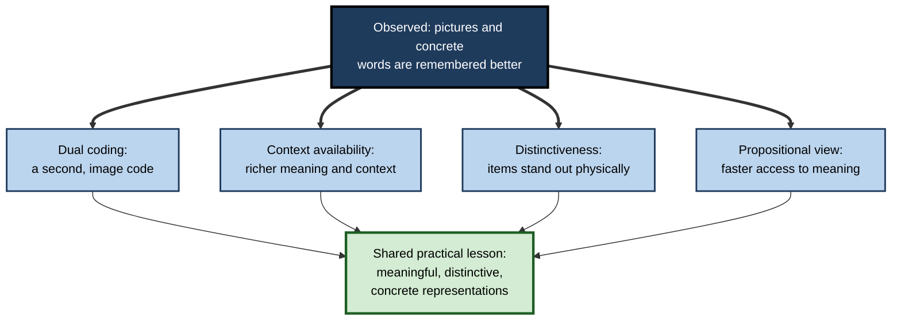
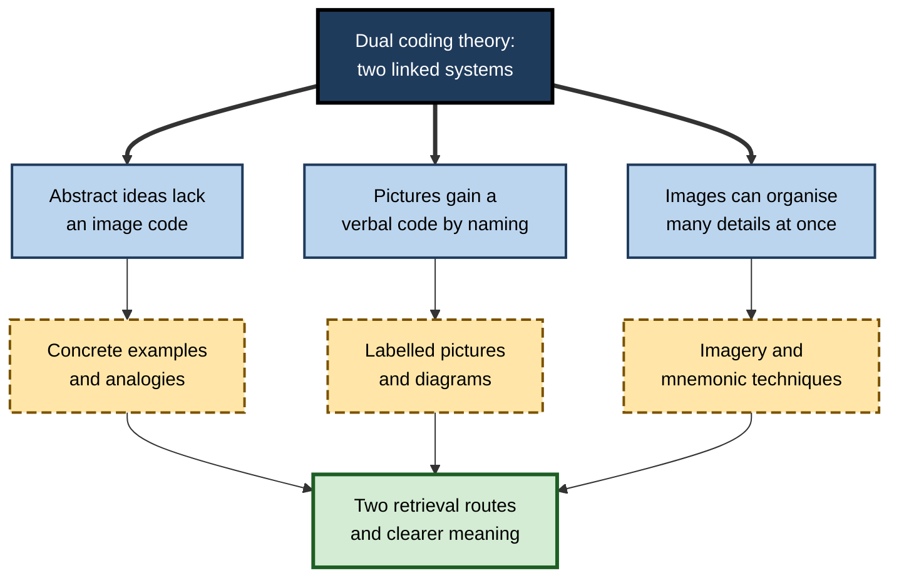

# G.1. Paivio's Dual Coding Theory

Ask a group of people to remember the words *elephant*, *justice*, *ladder* and *theory*, and a day later most will recall *elephant* and *ladder* far more readily than *justice* and *theory*. Show them pictures of an elephant and a ladder instead of the words, and recall improves again. A Canadian psychologist, Allan Paivio, spent five decades explaining why: the mind keeps **two different kinds of code**, one for language and one for things that can be seen, heard and handled — and what is stored in both is remembered best.

> **Definition — Dual coding theory (DCT):** Allan Paivio's theory that cognition uses two separate but interconnected systems — a **verbal system** specialised for language and a **nonverbal (imagery) system** specialised for objects and events — and that information represented in both systems is more memorable and more usable than information represented in one.

**Why it matters**

- It is the main theoretical origin of the widely used study advice to **combine words with visuals**.
- It explains a cluster of robust memory findings: the **concreteness effect**, the **imagery effect** and much of the **picture superiority effect**.
- It gave psychology one of its first testable accounts of **mental imagery**, after decades in which imagery was treated as unscientific.
- It shapes practice in textbook design, advertising, interface design, safety signage, language teaching and presentation craft.
- Its limits matter as much as its claims: several of its classic predictions now have rival explanations, and the professional who uses it should know which parts are secure.

---

## The Problem the Theory Solved

### Imagery before Paivio

- **Ancient practice, modern neglect.**
  - Greek and Roman orators memorised speeches by imagining vivid images placed along a familiar route — the **method of loci**, attributed by Cicero to the poet Simonides of Ceos.
  - Early experimental psychology (Wilhelm Wundt, Edward Titchener) studied images through introspection.
  - **Behaviourism** (from John B. Watson, 1913) rejected unobservable mental contents; for roughly forty years imagery was close to a forbidden topic in Anglo-American psychology.
- **The cognitive revolution of the 1950s–60s** reopened the inside of the mind — but mainly through **verbal** and computational models of memory.
- **Paivio's contribution** was to bring imagery back with experimental rigour: he measured it, manipulated it and made predictions that could fail.

### Allan Paivio in brief

- **Who:** Allan Paivio (1925–2016), psychologist at the University of Western Ontario.
- **Key works:**
  - *Imagery and Verbal Processes* (1971) — the first full statement of the theory;
  - *Mental Representations: A Dual Coding Approach* (1986) — the mature version;
  - *Mind and Its Evolution: A Dual Coding Theoretical Approach* (2007) — extension to evolution and the brain.
- **With educational researchers:** James Clark and Paivio (1991) applied the theory to teaching; Mark Sadoski and Paivio (2001, revised 2013) applied it to reading and writing.

> **Key point:** dual coding theory began as an explanation of laboratory memory data and only later became a theory of education. Its educational claims rest on its memory claims.

---

## Two Systems of Representation

### The verbal system

- **What it holds:** representations of language — words as heard, read, spoken and written.
- **Units:** **logogens** — Paivio borrowed the term from John Morton's model of word recognition.
  - Each logogen stands for a word or word-like unit (including morphemes and familiar phrases).
  - Separate logogens exist for different sensory forms of the same word: the sound of "ladder", the printed shape of *ladder*, the motor programme for writing it.
- **Organisation:** **sequential** — language unfolds one element after another, and verbal memory preserves order well.
  - *e.g.* a telephone number, a sentence, the steps of a recited procedure.

### The nonverbal system

- **What it holds:** representations of objects, scenes, events, sounds, textures, smells and actions — the non-linguistic world.
- **Units:** **imagens** — units that generate mental images.
  - Each imagen corresponds to a natural object or part of one, at varying sizes from a single feature to a whole scene.
- **Organisation:** **synchronous** or **parallel** — the parts of an image are available together and can be scanned, rotated or zoomed.
  - *e.g.* picturing the layout of an office floor and "seeing" where the fire exits are.
- **Not only visual:** Paivio insisted the nonverbal system includes auditory, haptic (touch), and motor imagery — the sound of a car engine misfiring is a nonverbal representation.

> **Definition — Logogen:** in dual coding theory, a unit of verbal representation that corresponds to a word or word-like element in a particular sensory form.

> **Definition — Imagen:** in dual coding theory, a unit of nonverbal representation that can generate a mental image of an object, scene or event.

### Modality and code are different things

- **Sensory modality** — the channel through which information arrives: eyes, ears, touch.
- **Representational code** — the system in which it is stored: verbal or nonverbal.
- The two dimensions cross:

| | Verbal code | Nonverbal code |
|---|---|---|
| Visual modality | Printed or written words | Pictures, scenes, faces, diagrams |
| Auditory modality | Spoken words | Environmental sounds, music, tone of voice |
| Haptic modality | Braille | The feel of objects, textures |
| Motor modality | Writing and speaking movements | Gestures, manipulations, skilled actions |

> **Watch out:** "visual" is not the same as "nonverbal". A printed paragraph arrives through the eyes but is stored **verbally**. A study page made of dense text is visually presented yet single-coded.

**Figure 1.** The two systems of dual coding theory and the connections between them.

---

## Three Kinds of Processing

Paivio described three levels at which the two systems work, from the simplest activation to complex chains of association.

### Representational processing

- **Direct activation** of a system by input of its own kind.
  - A printed word activates a logogen; a picture activates an imagen.
- **Recognition** happens here: knowing that *ladder* is a familiar word, or that an object is a ladder.

### Referential processing

- **Cross-activation between systems.**
  - **Naming:** seeing a picture of a ladder activates the logogen "ladder".
  - **Imaging:** reading the word *ladder* activates the image of a ladder.
- **Referential connections** are many-to-many:
  - one image can be named in several ways (*ladder*, *step-ladder*, *rungs*);
  - one word can evoke several images.
- **Asymmetry:** pictures are named more reliably and automatically than words are imaged. This asymmetry becomes important in explaining why pictures are remembered well.

### Associative processing

- **Activation within a system.**
  - **Verbal associations:** *ladder* → *climb*, *rung*, *snakes and ladders*.
  - **Image associations:** a ladder image → a wall, a roof, a painter.
- Complex thinking — reasoning, problem-solving, comprehension — involves chains of all three kinds of processing.

**Figure 2.** Representational, referential and associative processing for the word and picture "ladder".

> **Remember:** **R-R-A** — **R**epresentational (within-system recognition), **R**eferential (between systems), **A**ssociative (within-system spreading).

---

## The Central Predictions

### Additivity: two codes are better than one

- **Claim:** if an item is stored in both systems, the two memory traces are **independent and additive** — either can support recall, so the chance of recall rises.
- **Analogy:** two separate keys to the same door; losing one does not lock the learner out.

> **Formula — Additive independent codes (idealised):** if the chance of retrieving through the verbal code is *v* and through the image code is *i*, and the codes are independent, the chance of retrieving through at least one is 1 − (1 − *v*)(1 − *i*). With *v* = 0.40 and *i* = 0.30: 1 − (0.60 × 0.70) = 1 − 0.42 = **0.58**. The formula is a teaching idealisation of Paivio's additivity claim, not a fitted model.

**Study card — Paivio and Csapo (1973)**

- **Design:** participants saw pictures and words under different instructions and were later given surprise free-recall tests.
  - Some words were to be **imaged**; some pictures were to be **named**; some items were presented twice in the same or different forms.
- **Results:**
  - imaging words improved their recall, roughly as much as a second presentation;
  - pictures were recalled better than words;
  - a picture plus its name produced recall consistent with the **sum** of separate verbal and image contributions.
- **Conclusion:** the authors argued that verbal and image codes contribute **independently and additively** to memory, and that pictures are well remembered because they are usually given both codes.

### The concreteness effect

- **Finding:** words for concrete things (*hammer*, *river*) are remembered better than words for abstract ideas (*truth*, *policy*).
- **Paivio's measure:** the **imagery value** of words — how easily they arouse an image.
  - **Paivio, Yuille and Madigan (1968)** published ratings of concreteness, imagery and meaningfulness for 925 English nouns.
  - Imagery ratings predicted recall better than meaningfulness or frequency did.
- **DCT explanation:** concrete words can be imaged and so gain a second code; abstract words mostly have only verbal codes.

> **Definition — Concreteness effect:** the finding that concrete words and sentences are remembered and understood more readily than abstract ones.

> **Definition — Imageability:** the ease and speed with which a word evokes a mental image; closely related to, but not identical with, concreteness.

### The conceptual peg hypothesis

- **Finding from paired-associate learning** (learning pairs such as *table–justice* so that one word cues the other): the **imageability of the cue word** matters more than that of the response word.
- **Explanation:** a concrete cue acts as a **peg** on which an image linking both items can be hung and later retrieved.
- **Practical echo:** mnemonic systems that hang new information on concrete images — the method of loci, peg-word systems, the keyword method — exploit this asymmetry.

### Picture superiority

- **Finding:** pictures are generally remembered better than their names, on both recall and recognition.
- **Recognition capacity is vast:**
  - **Roger Shepard (1967)** showed participants several hundred pictures; immediate recognition was close to perfect, better than for words or sentences.
  - **Lionel Standing (1973)** showed participants up to **10,000** pictures over several days; recognition remained very high, and memory for vivid pictures was better than for ordinary ones.
- **DCT explanation:** pictures are **spontaneously named**, so they acquire a verbal code as well as an image code; words are less often spontaneously imaged.

> **Definition — Picture superiority effect:** the finding that pictures are remembered better than words referring to the same things.

**Figure 3.** The ordering of recall predicted by dual coding theory: abstract words, concrete words, imaged words and pictures.

### Selective interference

- **Logic:** if verbal and visual processing use separate systems, a visual secondary task should disrupt visual thinking more than verbal thinking, and vice versa.
- **Lee Brooks (1968):**
  - participants held either a **sentence** or a **line drawing of a block letter** in mind and answered questions about it;
  - they responded either **verbally** ("yes", "no") or by **pointing** to printed Y and N marks scattered on a page;
  - pointing — a visuospatial response — slowed questions about the drawing; speaking slowed questions about the sentence.
- **Conclusion:** the pattern fits two partly separate systems, each vulnerable to interference of its own kind.

---

## Worked Example: Predicting What Will Be Remembered

**Situation:** a training designer must teach new compliance staff twelve terms, and wants to predict which will be hardest to retain.

| Term | Concrete or abstract? | Easy to image? | DCT prediction | Design response |
|---|---|---|---|---|
| Shredder | Concrete | Yes | Easy | A photograph is enough |
| Badge reader | Concrete | Yes | Easy | Label a photo of the actual device |
| Data controller | Abstract role | Weakly | Moderate | Pair with an image of a named person in a role |
| Legitimate interest | Abstract | No | Hard | Create a concrete scenario image and a diagram of the balancing test |
| Proportionality | Abstract | No | Hard | Use a balance-scale visual metaphor plus a worked case |

1. **Classify** each term by concreteness and imageability.
2. **Predict** that abstract, low-imagery terms will be forgotten first.
3. **Supply a nonverbal code** where none exists naturally — a concrete example, a scene, a diagram of relations, or a visual metaphor.
4. **Check** that the image carries the *meaning* of the term, not merely a decoration associated with it.

- **Conclusion:** dual coding theory does not say "add pictures everywhere"; it says **abstract material lacks a second code and benefits most when a meaningful one is built**.

> **Watch out:** a stock photograph of a handshake attached to "legitimate interest" adds an image but not a meaningful referential link. The learner remembers the handshake and not the concept.

---

## Rival Explanations and Debates

### The imagery debate

- **Zenon Pylyshyn (1973)** argued that images are not a separate format at all: all knowledge is stored as abstract **propositions**, and the experience of imagery is an epiphenomenon.
- **John Anderson and Gordon Bower (1973)** built influential propositional network models of memory.
- **Defenders of genuine imagery** answered with experiments showing picture-like properties:
  - **Roger Shepard and Jacqueline Metzler (1971)** — the time needed to judge whether two drawn 3-D shapes were the same rose steadily with the angle of rotation between them, as if the shapes were mentally rotated;
  - **Stephen Kosslyn, Thomas Ball and Brian Reiser (1978)** — the time to scan between two points on a memorised map rose with the distance between them.
- **Critics' reply:** participants may simply know how long real rotation or scanning takes and simulate it (**tacit knowledge** explanation).
- **Status:** the debate was never fully settled; most researchers now accept that the brain uses **multiple formats**, including depictive ones, but disagree on how separate they are.

### Context availability and concreteness

- **Paula Schwanenflugel and colleagues (1980s–90s)** proposed that concrete words are easier because they come with **more readily available context** — it is easier to think of a situation in which *hammer* appears than one in which *justice* does.
- When abstract sentences are given a supportive context, the concreteness advantage often shrinks.
- **Implication:** some of the concreteness effect may come from richer **semantic** knowledge, not a separate image code.

### Distinctiveness and picture superiority

- **Sensory–semantic account (Douglas Nelson and colleagues, 1976):** pictures are more **physically distinctive** than words — every word is a string of similar letters, whereas pictures differ greatly in shape — and pictures reach meaning faster.
- **Distinctiveness account:** items stand out in memory when they differ from their neighbours.
- **Recent challenges:**
  - **Kate Higdon, Ian Neath, Aimée Surprenant and Tyler Ensor (2025)** reported that the picture advantage disappeared when plain pictures were compared with words made similarly distinctive, and concluded that distinctiveness, not dual coding, explains the effect.
  - Studies of people with **aphantasia** — who report little or no voluntary visual imagery — have found that they still show picture superiority, which is awkward for an account that relies on generating images.

> **Watch out:** picture superiority itself is robust; **why** it occurs is contested. A practitioner can rely on the effect while staying cautious about the dual-coding explanation of it.

| | Dual coding theory | Propositional theory | Context availability | Distinctiveness accounts |
|---|---|---|---|---|
| Core claim | Two separate representational systems | One abstract code; images are by-products | Concrete items have richer accessible context | Items unlike their neighbours stand out |
| Explains concreteness by | An added image code | Richer propositions | Easier retrieval of contexts | Concrete words are more varied |
| Explains picture superiority by | Pictures are named, so dual-coded | Faster access to meaning | Not its main target | Pictures differ more physically |
| Weak spot | Effects shrink with context or distinctiveness controls | Struggles with rotation and scanning data | Says little about pictures | Less developed for complex learning |
| Educational advice | Build meaningful image codes | Build meaningful structure | Provide examples and context | Make key items distinctive |

**Figure 4.** Competing explanations for why pictures and concrete words are remembered well.

> **Key point:** the rival theories disagree about **mechanism** but converge on **practice** — meaningful, concrete and distinctive representations are remembered better than abstract, uniform ones.

### Evidence from the brain

- **Imageability effects** appear in neuroimaging: concrete words tend to engage, in addition to language regions, areas associated with perception and object knowledge; abstract words rely more heavily on language-related regions.
- **Patient studies:** some people with brain damage lose the ability to name pictures while understanding words, or vice versa, consistent with partly separable systems.
- **Caution:** brain data show **overlapping, distributed** networks rather than two neat boxes; they are compatible with dual coding but do not prove it over its rivals.

---

## From Laboratory to Classroom and Workplace

### Clark and Paivio (1991): dual coding and education

- **Argument:** DCT explains many established teaching practices:
  - using **concrete examples** for abstract ideas;
  - **illustrated texts** and diagrams;
  - **imagery instructions** ("picture this…");
  - **mnemonic** techniques;
  - **analogies** and visual metaphors.
- **Implications drawn:**
  - concreteness aids comprehension, not only memory;
  - imagery can support **organisation** — a single image can hold together many verbal details;
  - affective responses (interest, emotion) are linked more strongly to concrete, imageable material.

### Sadoski and Paivio: reading and writing

- **Mark Sadoski** and colleagues studied texts that differed in concreteness:
  - more concrete passages were rated more comprehensible and interesting and were recalled better;
  - readers reported spontaneous imagery during reading of concrete narrative.
- **Implication for writers:** abstract explanation becomes more memorable when anchored in **specific, picturable cases**.

> **In practice:** a policy writer who must explain "segregation of duties" will be understood better by opening with "the person who approves an invoice must not be the person who pays it" — a scene the reader can picture — than with the abstract definition.

**Figure 5.** How dual coding theory translates into teaching and study design.

### Imagery instructions and their limits

- **Instructing learners to form images** reliably improves memory for **concrete word lists** and paired associates.
- **For complex text**, the benefit is weaker and depends on how imageable the text is.
  - John Dunlosky and colleagues' 2013 review of study techniques rated **imagery use for text learning** as **low utility**: benefits were mostly confined to imagery-friendly texts and short delays.
- **Why:** much of what professionals must learn — tax rules, statistical reasoning, legal tests — is not naturally picturable. The image code must then come from **constructed visuals** (diagrams, graphs, schematic scenes), not spontaneous imagery.

> **Watch out:** "visualise it" is weak advice for abstract material. "Draw the relationships between these four rules" gives the nonverbal system something concrete to hold.

### Relation to multimedia learning research

- **Richard Mayer's** cognitive theory of multimedia learning adopted DCT's two-system idea and combined it with limited working memory and active processing.
- His **multimedia principle** — people learn more deeply from words and pictures than from words alone — is the best-known modern descendant of Paivio's work.
- The design principles that grew from that research belong mainly to cognitive load theory and instructional design; dual coding supplies their starting assumption.

---

## Dual Coding in Professional Practice

### Where the theory is used

- **Advertising and branding** — logos paired with names; concrete, imageable slogans; mascots.
  - Brand names that are concrete words (*Apple*, *Shell*) come with a ready image code.
- **User interfaces** — icons **with** text labels rather than icons or labels alone.
  - Icons alone are often ambiguous; labels alone are slower to scan.
- **Safety and public information** — pictograms with short words on signage, medicine labels and evacuation plans.
- **Medicine** — anatomical drawings learned alongside terminology; patients given labelled diagrams of procedures.
- **Engineering and software** — architecture diagrams paired with written design decisions.
- **Presentations** — one image that carries the argument plus a short spoken explanation, rather than slides of bullet points.

> **In practice:** when a term will be used daily, give it a **standard image** across all materials — the same icon for "customer data" in every diagram and dashboard — so that the referential link is strengthened by repetition rather than re-learnt each time.

### Case study: re-coding a maintenance procedure

- **Situation:** a regional water utility trained field technicians on a 14-step valve-isolation procedure from a text manual.
- **Problem:** audits found steps done out of order and two steps regularly omitted; technicians said the manual was "hard to remember in the field".
- **Diagnosis:**
  - the procedure was written in abstract terms ("ensure upstream isolation is confirmed");
  - the critical steps had **no image code** — nothing a technician could picture at the valve chamber;
  - the order of steps relied entirely on verbal sequence memory.
- **Actions:**
  1. Photographed each step at a real valve chamber, with the technician's hands in shot.
  2. Rewrote each step as a short concrete instruction placed directly beside its photograph.
  3. Grouped the 14 steps into four stages, each with a simple pictogram.
  4. In training, asked technicians to **sketch** the four stages from memory, then check them against the sheet.
- **Result:** at the next audit cycle, out-of-order errors and omissions fell noticeably; new starters reached sign-off sooner.
- **Caveats:** the redesign also shortened the procedure and added practice, so the improvement cannot be credited to dual coding alone.
- **Lesson:** abstract instructions lacked a second code; **concrete photographs tightly paired with words**, plus learner sketching, supplied one.

### What experts do differently

- **They choose the image for its meaning.** The picture should depict the **relationship** or **mechanism** that matters, not the topic in general.
- **They make the link explicit.** Labels, captions and spoken explanation tie each visual element to its word.
- **They reserve images for what is hard.** Concrete material is already dual-coded; the effort is spent on abstract, high-value ideas.
- **They test from both directions.** Can the learner name the picture? Can they draw the idea from its name?
- **They know the evidence boundaries.** Memory for lists and concrete items is the strongest evidence base; claims about complex understanding rest more on multimedia research than on DCT itself.

> **Watch out:** dual coding theory is sometimes confused with the claim that people are "visual learners" or "verbal learners". DCT is about how **all** minds represent information; the learning-styles idea of matching teaching to a preferred modality is not supported by evidence.

> **Watch out:** figures such as "people remember 80% of what they see but 20% of what they read" are routinely attributed to research on visual learning. No study supports them; they should not be repeated.

---

## Open Questions

- **Is the verbal–nonverbal division fundamental or a convenient simplification?**
  - Neural evidence shows many interacting systems; whether two is the right number of codes is unresolved.
- **What explains picture superiority?**
  - Dual coding, distinctiveness and faster semantic access all have support; recent controlled studies and research with people with aphantasia have weakened the pure dual-coding account.
- **How much of the concreteness effect is about images?**
  - Context availability and the richer semantic networks of concrete words may explain much of it.
- **Does dual coding scale from word lists to expertise?**
  - Most direct DCT evidence comes from simple memory tasks; the leap to learning complex professional knowledge relies on later multimedia research.
- **What happens when the image comes ready-made?**
  - With AI tools that generate pictures instantly, it is unclear whether learner-chosen or learner-made images retain an advantage over supplied ones in everyday study.

---

## Summary

- **Dual coding theory** (Allan Paivio, 1971, 1986): the mind uses a **verbal system** (logogens; sequential) and a **nonverbal system** (imagens; synchronous), separate but interconnected.
- **Modality differs from code** — printed words are visual but verbal; sounds and textures can be nonverbal.
- **Three kinds of processing:** **representational** (within-system recognition), **referential** (naming and imaging across systems) and **associative** (spreading within a system).
- **Central predictions:** dual-coded items are remembered better (**additivity**, Paivio and Csapo, 1973); **concreteness effect**; **conceptual peg** effect of imageable cues; **picture superiority** (Shepard, 1967; Standing, 1973); **selective interference** (Brooks, 1968).
- **Rivals:** propositional theory (Pylyshyn), context availability (Schwanenflugel) and distinctiveness accounts; the picture superiority **effect** is robust but its **explanation** is contested.
- **Education:** Clark and Paivio (1991) linked DCT to concrete examples, illustrations, imagery and mnemonics; imagery instructions help for concrete material but are weak for abstract text.
- **Practice:** build **meaningful** image codes for abstract, high-value ideas; link words and images explicitly; keep images consistent; avoid decorative pictures and learning-styles thinking.

---

## Self-Check

1. Define dual coding theory in one sentence and name its two systems and their units.
2. Why is a printed paragraph described as visually presented but verbally coded?
3. Distinguish representational, referential and associative processing using the word "bridge".
4. State the additivity hypothesis and calculate the idealised chance of retrieval when *v* = 0.5 and *i* = 0.2.
5. What is the concreteness effect, and how does DCT explain it?
6. What is the conceptual peg hypothesis, and which mnemonic techniques depend on it?
7. Describe Standing's (1973) study and what it showed about memory for pictures.
8. Describe Brooks's (1968) experiment and explain why it supports separate systems.
9. Give two rival explanations of picture superiority and the evidence that challenges the dual-coding account.
10. Why did Dunlosky and colleagues rate imagery for text learning as low utility, and what does a practitioner do instead for abstract material?
11. A manager says: "Our team are visual learners, so dual coding means giving them pictures and skipping the text." Correct this.
12. You must teach "materiality" to new audit trainees. Design a dual-coded explanation and explain why it should work.
13. A slide deck uses a different icon for "customer" on every slide. What does DCT predict, and what would you change?

### Answer Key

1. Cognition uses two interconnected systems — a verbal system of **logogens** for language and a nonverbal system of **imagens** for objects and events — and information coded in both is better remembered and used.
2. It arrives through the eyes (visual modality) but is stored as language (verbal code); modality and code are separate dimensions.
3. Representational: the printed word *bridge* activates its logogen, or a photo activates its imagen. Referential: seeing the photo and naming it "bridge", or reading the word and picturing a bridge. Associative: *bridge* → *river*, *span*; a bridge image → water, cars.
4. Two independent, additive codes give two routes to retrieval. 1 − (0.5 × 0.8) = 1 − 0.4 = **0.6**.
5. Concrete words are remembered better than abstract ones; DCT says concrete words can be imaged and so gain a second, nonverbal code.
6. The imageability of the **cue** in a pair matters most because a concrete cue acts as a peg for a linking image; the method of loci, peg-word systems and the keyword method rely on it.
7. Participants viewed up to 10,000 pictures over several days and still recognised a very high proportion later, with vivid pictures best — long-term picture memory has enormous capacity.
8. Holding a drawing in mind was slowed by a pointing (visuospatial) response, holding a sentence by a spoken response; interference was specific to the kind of representation, suggesting separate systems.
9. **Distinctiveness** (pictures vary more physically) and **faster access to meaning** (sensory–semantic account). Challenges: the effect disappeared when words were made as distinctive as plain pictures (Higdon and colleagues, 2025); people with aphantasia still show the effect.
10. Benefits appeared mainly for imagery-friendly texts and short delays; much professional content is not naturally picturable. Use **constructed** visuals — diagrams of relationships, concrete scenarios, graphs — rather than relying on spontaneous imagery.
11. DCT is about how all minds represent information; it recommends **words and meaningful visuals together**, not pictures instead of text. Matching teaching to a supposed visual or verbal style is not supported by evidence.
12. *e.g.* a concrete scene (an error of 50 rupees in a crore-rupee account versus a 5-crore error), a threshold diagram showing a line above which errors change a decision, labels tying "materiality" to the threshold, and a worked case; this provides an image code for an abstract term and links it explicitly to the word.
13. Inconsistent icons weaken the referential link because each must be learned anew; choose one icon for "customer", label it at first use and keep it constant.

---

## Glossary

| Term | Meaning |
|---|---|
| Additivity hypothesis | The claim that verbal and image codes contribute independently and additively to memory. |
| Aphantasia | Reported absence or severe weakness of voluntary visual imagery. |
| Associative processing | Activation spreading within one system, among words or among images. |
| Concreteness effect | Better memory and comprehension for concrete than abstract words and sentences. |
| Conceptual peg hypothesis | The idea that an imageable cue word acts as a peg for retrieving an associated item. |
| Context availability | The account that concrete words are easier because relevant contexts come to mind more readily. |
| Distinctiveness | The degree to which an item differs from others around it, aiding memory. |
| Dual coding theory | Paivio's theory of two interconnected representational systems, verbal and nonverbal. |
| Imageability | The ease with which a word evokes a mental image. |
| Imagen | A unit of nonverbal representation that generates images. |
| Logogen | A unit of verbal representation corresponding to a word in a particular form. |
| Method of loci | A mnemonic placing images of items along a familiar route. |
| Nonverbal system | The system representing objects, scenes, sounds, textures and actions. |
| Picture superiority effect | Better memory for pictures than for the corresponding words. |
| Propositional theory | The view that all knowledge is stored in abstract, language-like propositions. |
| Referential processing | Activation across systems: naming pictures and imaging words. |
| Representational processing | Direct activation of a system by input of its own kind. |
| Selective interference | Disruption of a task by a secondary task using the same kind of representation. |
| Verbal system | The system representing language in its spoken, written and heard forms. |
