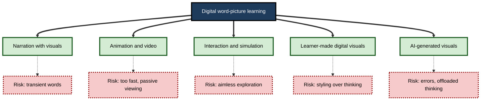
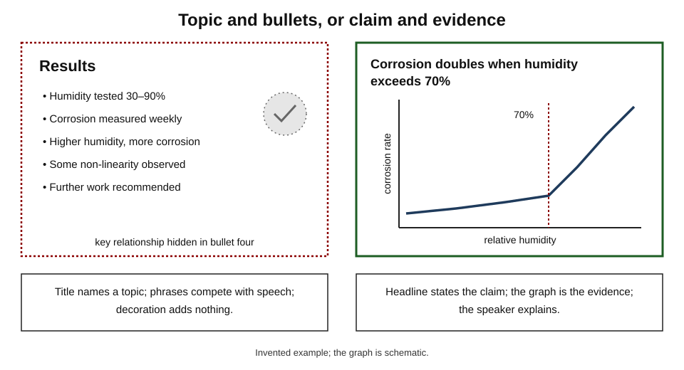
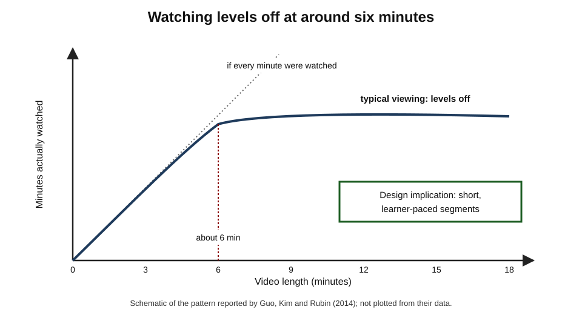
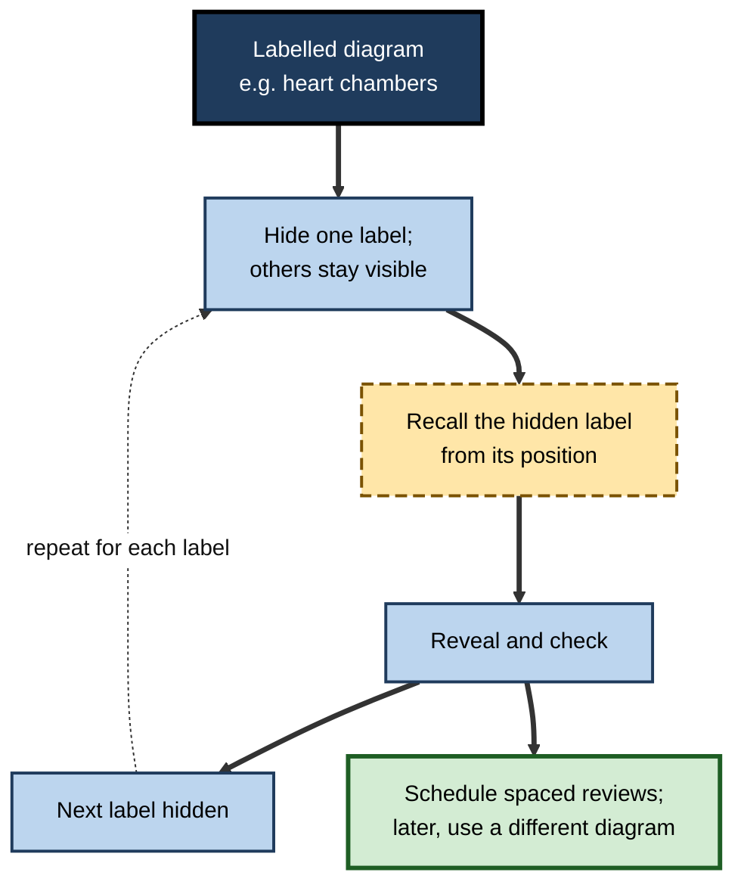
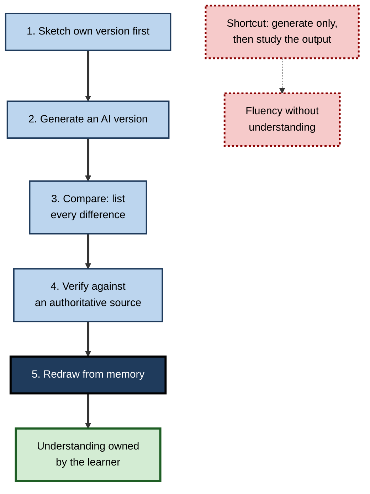

# G.10. Dual Coding in Digital Learning

A global firm launches a compulsory e-learning module. Each screen shows a stock photograph of smiling colleagues, three paragraphs of policy text, and a narrator who reads the paragraphs aloud. Completion rates are excellent; a month later, almost nobody can apply the policy.

A second team rebuilds the module. Each screen now shows one annotated diagram or realistic scenario, a short narrated explanation, and a question the learner must answer before continuing. The module is shorter; learners rate it slightly "harder" — and their performance on unseen cases a month later is far better. Both modules were "multimedia". Only one used words and visuals in a way that matches how minds learn.

> **Definition — Digital learning:** learning through screens and networked tools — e-learning modules, video, slides, simulations, apps, virtual and augmented reality, and AI assistants.

> **Definition — Multimedia learning environment:** any digital setting in which learners receive or create combinations of words (spoken or written) and pictures (static or dynamic) in order to learn.

**Why it matters**

- Most professional training and much self-directed study now happen on screens.
- Digital tools make it cheap to add pictures, narration, animation and interaction — and equally cheap to add clutter.
- Many principles for combining words and visuals were discovered in digital experiments and apply directly.
- New tools — immersive reality, generative AI — raise fresh questions about which visual experiences produce learning.
- Learners also create their own digital study materials: slides, flashcards, videos, notes, diagrams.

---

## What Digital Media Add

### New possibilities

- **Narration** — words can be spoken while the eyes stay on a visual.
- **Dynamic visuals** — animation and video show motion and change directly.
- **Interactivity** — learners can pause, replay, explore, manipulate variables and answer questions.
- **Linked representations** — a graph, an equation and a simulation can update together.
- **Learner creation** — drawing on tablets, recording explanations, building diagrams that can be rearranged.
- **Personalisation and scale** — content can adapt to the learner, reach thousands and generate data on use.
- **Generation on demand** — AI can produce images, diagrams and explanations instantly.

### New risks

- **Transience** — narration and animation disappear as they play; learners cannot look back at what they missed.
- **Pacing set by the system** — slides and videos may run faster than understanding.
- **Clutter** — decorative images, background music, animated transitions.
- **Passivity** — watching feels like learning; little generative processing may occur.
- **Fragmentation** — small screens, scrolling and pop-ups break the spatial layout that diagrams rely on.

**Figure 1.** What digital media add to word–picture learning, and the risks that come with each addition.

---

## Design Principles in Brief

Richard Mayer and colleagues, together with researchers in cognitive load theory, derived a set of principles for multimedia instruction from many controlled experiments. Each deserves only a line here; their boundaries matter as much as the rules.

| Principle | In one line | Main boundary |
|---|---|---|
| Multimedia | Words plus relevant pictures beat words alone | Pictures must be relevant |
| Coherence | Cut interesting but irrelevant material | Strongest for novices |
| Signalling | Highlight the essential structure | Too many cues cancel out |
| Spatial contiguity | Put labels next to what they describe | Matters most for complex visuals |
| Temporal contiguity | Narrate as the visual appears, not before or after | Short segments only |
| Segmenting | Break a continuous lesson into learner-paced parts | Benefits shrink for experts |
| Pre-training | Teach names and parts before the process | Useful when terms are new |
| Modality | Explain a diagram by speech, not on-screen text | Reverses for long or complex text |
| Redundancy | Do not show the same full text as is being spoken | Short key words can help |
| Personalisation | Conversational style beats formal style | Effect is modest |

> **Key point:** these principles share one logic — **spend learners' limited attention on processing that builds understanding**. The details belong to instructional design; the logic applies to any learner making their own materials.

---

## Slides

### The problem with bullet-point slides

- **Edward Tufte**, in an essay titled *The Cognitive Style of PowerPoint* (2003), argued that bullet-point slides fragment reasoning into disconnected phrases and hide relationships.
- **The Columbia shuttle accident investigation** (2003) criticised an engineering slide in which the crucial uncertainty about foam damage was buried in a low-level bullet beneath a reassuring headline.
- **Typical bullet slide:** a topic title ("Results"), five bullets of phrases, decorative clip art — words in two places (screen and speech), no visual that shows the relationship.

### The assertion–evidence approach

- **Michael Alley**, an engineering-communication researcher, advocated slides with:
  - a **sentence headline** stating the main assertion ("Corrosion doubles when humidity exceeds 70%");
  - **visual evidence** beneath it — a graph, photograph, diagram or equation — rather than bullets;
  - the **speaker** supplying the explanation.
- **Joanna Garner and Michael Alley (2013)** found that students who viewed assertion–evidence slides understood engineering content better than those viewing traditional bullet-point slides, and held fewer misconceptions.

**Figure 2.** A bullet-point slide compared with an assertion–evidence slide on the same content.

> **In practice:** write each slide's headline as the sentence a listener should remember. If the headline cannot be written, the slide has no point yet.

### Slides for one's own study

- **Lecture slides are not notes.** Re-reading them is passive; they lack the explanation that was spoken.
- **Better uses:**
  - cover the body of each slide and **explain** what it must have shown from the headline;
  - redraw the key diagram from memory;
  - turn the deck into a **one-page** visual summary.

---

## Video

### What keeps viewers engaged

**Study card — Guo, Kim and Rubin (2014)**

- **Design:** analysis of about **6.9 million** video-watching sessions on the edX online-course platform, linking engagement to video features.
- **Results:**
  - engagement time levelled off at around **six minutes**, whatever the video's length — longer videos were often abandoned;
  - videos in which the instructor **drew and wrote** on a tablet (in the style made popular by Khan Academy) held attention better than slides alone;
  - videos that mixed a talking head with slides were more engaging than slides alone;
  - videos recorded informally, with an enthusiastic speaker, outperformed polished studio lectures.
- **Conclusion:** short segments, live drawing and a human presence support engagement. Engagement is not learning — but it is a precondition.

### Watching the instructor draw

- **Logan Fiorella and Richard Mayer (2016)** compared learners who watched an instructor **progressively draw** diagrams while explaining with learners who saw the **completed** diagrams with the same narration.
  - Watching the drawing unfold generally supported better learning, particularly when the instructor's hand was visible guiding attention.
- **Why it may work:**
  - the drawing builds **in step with the explanation** (temporal contiguity);
  - the moving hand **signals** where to look;
  - learners see the diagram's **construction**, not just its final form.

> **Watch out:** watching someone draw is still **watching**. Learning improves further when the learner **pauses and draws** the next part themselves, then compares with the instructor.

### Speed and control

- **Pausing and replaying** let learners overcome transience; learner-paced segments generally beat continuous videos.
- **Playback speed:** some studies report little loss of immediate comprehension at moderately faster speeds for simple lectures; losses appear for complex or visually dense material and on delayed tests. The evidence is still developing.

### Taking notes from video

- **Pause at segment boundaries** — when the topic changes, stop and sketch the segment's main structure before moving on.
- **Capture the visual, not the speech** — redraw the key diagram in simplified form; write only the explanation that the diagram cannot show.
- **Predict before playing** — before an explanation, pause and guess what comes next; then watch to check.
- **Close with a sketch from memory** — at the end, without replaying, draw the whole lesson's structure on one page.
- **Avoid transcription** — typing what the presenter says while watching splits attention and produces verbatim notes with little processing.

**Figure 3.** Viewer engagement in relation to video length.

---

## Animations, Simulations and Immersive Media

### Animation

- **Animation helps most** when it directly shows the motion that must be learned — a surgical technique, a mechanical assembly — and when learners can control its pace.
- **For explaining mechanisms**, a sequence of static frames is often as effective as animation.

### Interactive simulations

- **PhET simulations**, founded by the physicist **Carl Wieman** at the University of Colorado Boulder in 2002, let learners manipulate variables in physics, chemistry and mathematics models — for example, changing resistance in a circuit and seeing current change.
- **Why they help:** linked representations (a picture of the circuit, a graph, a number) update together, so learners see the **relationship** between formats.
- **Risk:** without guiding questions, learners may play rather than investigate.

> **In practice:** pair a simulation with a **prediction task** — "What will happen to the current if resistance doubles? Predict, then test" — so that the visual experience answers a question the learner has already committed to.

### Virtual and augmented reality

**Study card — Makransky, Terkildsen and Mayer (2019)**

- **Design:** university students learned from a science laboratory simulation either on a desktop computer or in an immersive **virtual-reality** headset.
- **Results:**
  - students in virtual reality reported **more presence** — a stronger feeling of being there;
  - but they **learned less** and showed **higher cognitive load**, measured with brain recordings.
- **Conclusion:** immersion can increase enjoyment and presence while overloading learners with sensory detail — a digital version of the seductive-details problem.

- **Augmented reality** overlays labels and instructions on the real world — for example, showing maintenance steps on the actual machine.
  - It applies the principle of **spatial contiguity** directly: the word appears on the object.
  - Evidence is promising for procedural tasks, but depends heavily on design quality.

| | Desktop video and diagrams | Interactive simulation | Immersive virtual reality | Augmented reality |
|---|---|---|---|---|
| Strength | Cheap, controllable, clear | Shows relationships through manipulation | Presence, rehearsal of rare situations | Labels on real objects |
| Main risk | Passive viewing | Aimless play | Overload and distraction | Clutter in the field of view |
| Best use | Explaining concepts and mechanisms | Exploring cause and effect | Practising spatial or dangerous tasks | Guiding procedures in place |
| Cost | Low | Moderate | High | Moderate to high |

---

## Screens, Reading and Diagrams

- **Reading on screen versus paper:** a meta-analysis by **Pablo Delgado, Cristina Vargas, Rakefet Ackerman and Ladislao Salmerón (2018)** found a small but consistent advantage for **paper** in comprehension of informational texts, larger under time pressure, and growing rather than shrinking over the years studied.
  - One proposed explanation: people read screens more quickly and shallowly, and are more **overconfident** about their understanding.
- **Diagrams on small screens:**
  - scrolling separates labels from the parts they describe;
  - zooming loses the overview;
  - spatial memory for "where on the page" is weaker when the page keeps moving.
- **Implication for learners:** study complex diagrams on a large screen or on paper; when using a phone, redraw the diagram so that its layout is held in one view.

---

## Learners Creating Digital Visuals

### Tools

- **Tablets with styluses** — handwriting and sketching with undo, rearranging and searchable notes.
- **Digital whiteboards** — shared canvases for diagrams in groups.
- **Diagramming software** — clean boxes and arrows; risk of spending effort on alignment.
- **Diagrams as code** — tools such as Mermaid and PlantUML turn short text descriptions into diagrams; popular with engineers because diagrams live beside code and update easily.
- **Flashcard software with images** — including **image occlusion**, in which labels on a diagram are hidden and must be recalled.

### Image occlusion

- **Method:** take a labelled diagram (an anatomy plate, an architecture diagram), hide each label in turn, and recall it from the surrounding structure.
- **Why it works:** it combines the **spatial structure** of the diagram with **retrieval practice** of each label.
- **Caution:** recalling a label in one fixed diagram may not transfer to recognising the structure elsewhere; vary the diagrams over time.

**Figure 4.** Image occlusion: turning a labelled diagram into retrieval practice.

### Explaining on screen

- **Recording a short explanation** — drawing on a tablet while talking, as if teaching — combines self-explanation, drawing and retrieval.
- Learners who **prepare to teach** and then actually explain tend to learn more than those who only study; recording a two-minute explanation makes this easy to do alone.

### Audio-only learning

- **Podcasts and audiobooks** use only the verbal–auditory channel; nothing visual anchors the structure.
- **Strengths:** they fill time when eyes are busy (commuting, exercise) and suit narrative, interview and argument.
- **Weaknesses:** structure, numbers and relationships are hard to hold; attention drifts; there is no page to return to.
- **Making audio dual-coded afterwards:**
  - stop at the end of an episode and **sketch** its argument from memory — three to five boxes and arrows;
  - for technical audio, find or draw the diagram the speaker is describing;
  - keep a running **one-page map** for a series, adding each episode's main idea.

> **In practice:** treat audio as a **first exposure** rather than as study. The learning happens when the listener later retrieves and structures what they heard.

### Online meetings and webinars

- **Shared screens** carry the visual channel; the speaker's voice carries the verbal one — a natural pairing when the screen shows a diagram rather than a document to be read.
- **Chat panels** compete with speech in the verbal channel; reading chat while listening is the digital form of reading one text while hearing another.
- **Annotation tools** — drawing on a shared screen, pointing with a cursor — are digital **signalling** and can guide attention powerfully.
- **Good practice for presenters:** show one visual at a time; point to the part being discussed; pause for chat rather than talking over it.
- **Good practice for participants:** keep a sketch of the structure being discussed; save chat reading for pauses.

---

## Designing One's Own Digital Study Materials

### Principles carried over

- **One idea per screen or card** — the digital equivalent of one point per slide.
- **Words where they apply** — labels on diagrams, not legends at the bottom.
- **No decoration** — templates, backgrounds and stock images add load without meaning.
- **Retrieval built in** — cards, hidden labels, questions before answers.
- **Consistency** — the same icon or colour for the same concept across all materials.

### Digital notebooks

- **Linked notes** — tools that let notes link to one another can hold a diagram on one page and its explanation on another; the risk is **split attention** across pages.
- **Embedding diagrams beside text** — keep the sketch and its explanation in the same view.
- **Search** — handwriting and diagram labels that can be searched make visual notes reusable.
- **Version history** — saving earlier versions of a diagram shows how understanding has changed, which is itself useful for reflection.

### Flashcards with images

- **Good uses:** anatomy and equipment identification (picture → name), diagram labels (image occlusion), visual discrimination (which rash, which fault pattern).
- **Poor uses:** decorative images on word cards, or pictures that give away the answer on the cue side.
- **Design rule:** the image should be **the question** when the skill is visual recognition, and **absent** from the cue side when the skill is recalling meaning from a word.

| | Good digital study material | Poor digital study material |
|---|---|---|
| Visual | Diagram, real image or graph that carries content | Stock image, template decoration |
| Words | Short labels placed on the visual; explanation nearby | Paragraphs copied from the source |
| Learner activity | Answer, recall, redraw, predict | Read, scroll, click "next" |
| Layout | One idea per view | Several ideas crammed or split across views |
| Review | Spaced retrieval | Re-reading |

> **Remember:** in digital study materials, the question to ask of every element is the same as on paper — **what does this help me do with my mind?**

---

## Generative AI and Visual Learning

### What has changed

- **Instant visuals** — AI tools can turn text into diagrams, infographics, images and slide decks in seconds.
- **AI tutors** — can explain with diagrams, generate practice questions about an image, or check a learner's sketch.

### The risks

- **Accuracy** — generated images and diagrams can contain plausible errors: reversed arrows, invented components, wrong anatomy, illegible or misspelt labels.
  - A 2025 content analysis of nearly three hundred AI-generated images depicting STEM occupations found frequent distortions (for example, of hands and eyes) and substantial gender and racial bias.
- **Fluency without understanding** — a polished generated diagram looks authoritative and feels understood.
- **Offloaded generation** — the selecting, organising and drawing that produce learning are done by the tool.

### Good practice

1. **Think first** — sketch or outline the visual before generating anything.
2. **Generate second** — use the tool for an alternative version or a cleaner layout.
3. **Compare** — investigate every difference between the learner's version and the tool's.
4. **Verify** — check every label, arrow and number against an authoritative source.
5. **Test** — close everything and redraw from memory.

**Figure 5.** Using AI-generated visuals without giving away the learning.

> **Watch out:** "I generated a diagram of it" is the digital equivalent of "I highlighted it". The tool did the organising; the learner must still do the thinking.

---

## Accessibility

- **Alternative text** — every meaningful image needs a text description of its **content and point**, not "image of a chart".
- **Captions** — essential for deaf and hard-of-hearing learners; also helpful for second-language learners and noisy environments.
  - Captions are a recognised exception to the advice against duplicating narration with on-screen text: for these learners the duplication supports comprehension.
- **Audio description** — for video in which essential information is shown but not spoken.
- **Contrast and colour** — the Web Content Accessibility Guidelines (version 2.2, published in 2023) require sufficient contrast and forbid relying on colour alone to convey meaning.
- **Keyboard and screen-reader access** — interactive visuals must be operable without a mouse.

> **Key point:** accessible design is good dual coding. A clear text alternative forces the designer to state what the visual is **for** — a test many visuals fail.

---

## Worked Example (illustrative): Redesigning an E-Learning Screen

**Situation:** a screen in a data-protection module explains "lawful bases for processing personal data". It currently shows a stock photograph of a laptop, six paragraphs of text and narration that reads the text aloud.

| Element | Before | After |
|---|---|---|
| Headline | "Lawful bases" | "Every use of personal data needs one of six lawful bases" |
| Visual | Stock photograph of a laptop | A diagram of six labelled boxes around "processing", each with a one-line example |
| Text on screen | Six paragraphs | Six short labels and examples inside the diagram |
| Narration | Reads the paragraphs | Explains when each basis applies, while each box is highlighted in turn |
| Interaction | "Next" button | A short scenario: "A gym wants to send marketing emails. Which basis?" with feedback |
| Pacing | Automatic | Learner-paced segments |
| Accessibility | No alternative text | Alternative text describing the six bases; captions for narration |

1. **Remove the decorative photograph** (coherence).
2. **Replace paragraphs with an organising diagram** (multimedia; organisational picture).
3. **Explain by narration** with highlighting in step (modality; signalling; temporal contiguity).
4. **Avoid reading on-screen text aloud** (redundancy), keeping only short labels.
5. **Add a scenario question** so learners must apply the idea.
6. **Add alternative text and captions.**

- **Conclusion:** the redesigned screen carries the **structure** visually, the **explanation** verbally and the **application** through a question — all within one view.

> **Watch out:** stakeholders often judge e-learning by how "rich" it looks. Fewer, better-chosen elements usually teach more.

---

## Case Study (illustrative): Safety Micro-Videos in an Engineering Firm

- **Situation:** an engineering services company produced a library of 20-minute safety videos for field technicians, filmed as studio presentations with slides.
- **Problem:** viewing analytics showed most technicians stopped watching within the first few minutes; incident reviews found the same procedural errors recurring.
- **Diagnosis:**
  - videos were long, slide-heavy and paced for the presenter, not the learner;
  - procedures were described verbally with bullet slides instead of being **shown**;
  - there was no point at which technicians had to recall or apply anything.
- **Actions:**
  1. Split each video into **three- to six-minute segments**, each covering one procedure or hazard.
  2. Filmed procedures **at real sites** from the technician's viewpoint, with short narrated explanations and labels on key equipment.
  3. Added **progressive sketching** by an experienced engineer to explain hidden mechanisms (such as stored energy in a spring system).
  4. Ended each segment with a **"what would you do?"** clip of a real situation, paused for the viewer to answer before the expert's response.
  5. Provided captions and transcripts for noisy sites and second-language speakers.
- **Result:** viewing completion rose sharply; supervisors reported that technicians referred to specific segments in toolbox talks; the recurring procedural errors became less frequent over the next year.
- **Caveats:** the firm also introduced supervisor observations at the same time, which contributed to the change.
- **Lesson:** short, learner-controlled segments that **show** the real task, **draw** what cannot be seen and **require** a decision turned passive viewing into learning.

---

## Open Questions

- **How should generative AI visuals be used in study?**
  - Evidence on whether they help or hinder learning compared with learner-made sketches is only beginning to appear.
- **When does immersion help?**
  - Virtual reality can overload learners in some studies yet may help for spatial and hazardous tasks; the boundary conditions are being mapped.
- **Why is paper reading often better than screen reading?**
  - Shallower processing, overconfidence and layout instability have all been proposed; the relative weight of each is unclear.
- **What playback speeds are acceptable?**
  - Results differ by content complexity and test delay; firm guidance is premature.
- **How do principles derived from short laboratory lessons scale?**
  - Most multimedia experiments use lessons of minutes; long courses, workplace systems and self-directed learning are less studied.

---

## Summary

- **Digital learning** adds narration, dynamic visuals, interaction, linked representations, learner creation and AI generation — and risks of transience, system pacing, clutter, passivity and fragmentation.
- **Multimedia principles** (multimedia, coherence, signalling, contiguity, segmenting, pre-training, modality, redundancy, personalisation) share one logic: spend attention on processing that builds understanding.
- **Slides:** bullet slides fragment reasoning (Tufte; the Columbia investigation); **assertion–evidence** slides — sentence headline plus visual evidence — improved comprehension (Garner and Alley, 2013).
- **Video:** engagement levels off around six minutes; tablet drawing and human presence help (Guo, Kim and Rubin, 2014); watching an instructor draw supports learning (Fiorella and Mayer, 2016) — drawing oneself helps more.
- **Simulations** link representations (PhET); pair them with predictions. **Immersive VR** raised presence but lowered learning in one key study (Makransky and colleagues, 2019). **AR** puts labels on objects.
- **Screens:** small paper advantage for comprehension (Delgado and colleagues, 2018); study complex diagrams on large views or redraw them.
- **Learner tools:** tablets, whiteboards, diagrams as code, **image occlusion** flashcards, recorded explanations.
- **Generative AI:** sketch first, generate second, compare, verify, redraw; beware errors, bias and fluency without understanding.
- **Accessibility:** alternative text, captions (a justified exception to the redundancy advice), audio description, contrast, no colour-only meaning.

---

## Self-Check

1. Name four things digital media add to learning with words and pictures, and the risk attached to each.
2. Explain the common logic of the multimedia design principles in one sentence.
3. What did Tufte and the Columbia investigation criticise about bullet-point slides?
4. Describe an assertion–evidence slide and the finding of Garner and Alley (2013).
5. Summarise Guo, Kim and Rubin's (2014) findings and their implications for making study videos.
6. Why might watching an instructor draw help learning, and what would help even more?
7. What did Makransky and colleagues (2019) find about virtual reality, and how does it relate to seductive details?
8. Why should complex diagrams not be studied mainly on a phone screen?
9. Explain image occlusion and one limitation.
10. Design a five-step routine for using an AI diagram generator while studying a chapter on supply-chain finance.
11. Redesign this e-learning screen: a photo of a handshake, four paragraphs on conflicts of interest, narration reading the paragraphs, a "Next" button.
12. Why are captions an exception to the advice against duplicating narration with on-screen text?

### Answer Key

1. Narration — transience; animation — passive viewing, too fast; interaction — aimless exploration; AI generation — errors and offloaded thinking (also learner-made visuals — styling over thinking).
2. Spend learners' limited attention on processing that builds understanding, not on irrelevant, duplicated or badly arranged material.
3. Bullets fragment reasoning into disconnected phrases and bury crucial qualifications; in the Columbia case, a key uncertainty about foam damage was hidden in a low-level bullet under a reassuring headline.
4. A sentence headline stating the assertion, supported by visual evidence rather than bullets; students viewing such slides understood engineering content better and held fewer misconceptions.
5. Engagement levelled off around six minutes; tablet drawing, talking heads mixed with slides and informal enthusiasm held attention better. Make short segments, draw live, show a human presence.
6. The drawing builds in step with the explanation, the hand signals where to look, and the construction is visible. Pausing to draw the next part oneself and comparing would help more.
7. VR increased presence but reduced learning and raised cognitive load; immersive detail acts like seductive details, drawing resources away from the content.
8. Scrolling separates labels from parts, zooming loses the overview and spatial memory is weakened; use a large view or redraw the diagram to hold it in one view.
9. Labels on a diagram are hidden in turn and recalled from the structure, then checked and spaced. Limitation: recall may be tied to that particular diagram; vary diagrams over time.
10. Sketch the financing flow first; generate an AI version; list every difference; verify each against the textbook or regulation; close everything and redraw from memory a day later.
11. Remove the handshake; write a sentence headline ("A conflict of interest exists when personal interests could influence a work decision"); show a diagram or realistic scenario with three types of conflict labelled; narrate the explanation while highlighting each; keep only short labels on screen; add a scenario question with feedback; provide alternative text and captions.
12. For deaf, hard-of-hearing and many second-language learners, captions provide access to or support comprehension of the spoken words; the duplication serves a need rather than adding load.

---

## Glossary

| Term | Meaning |
|---|---|
| Alternative text | A text description of an image's content and purpose for screen-reader users. |
| Assertion–evidence slide | A slide with a sentence headline and visual evidence instead of bullets. |
| Augmented reality | Digital information overlaid on a view of the real world. |
| Captions | On-screen text of spoken words in video. |
| Diagrams as code | Producing diagrams from short text descriptions in tools such as Mermaid. |
| Digital learning | Learning through screens and networked tools. |
| Image occlusion | Hiding labels on a diagram so they must be recalled. |
| Immersive virtual reality | A headset-based environment that surrounds the user's senses. |
| Learner pacing | Control by the learner over when a lesson moves on. |
| Multimedia learning environment | A digital setting combining words and pictures for learning. |
| Presence | The feeling of being inside a virtual environment. |
| Segmenting | Breaking a continuous lesson into learner-paced parts. |
| Simulation | An interactive model whose variables learners can manipulate. |
| Transience | The disappearance of spoken or animated information as it plays. |
