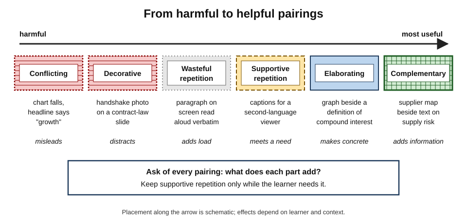
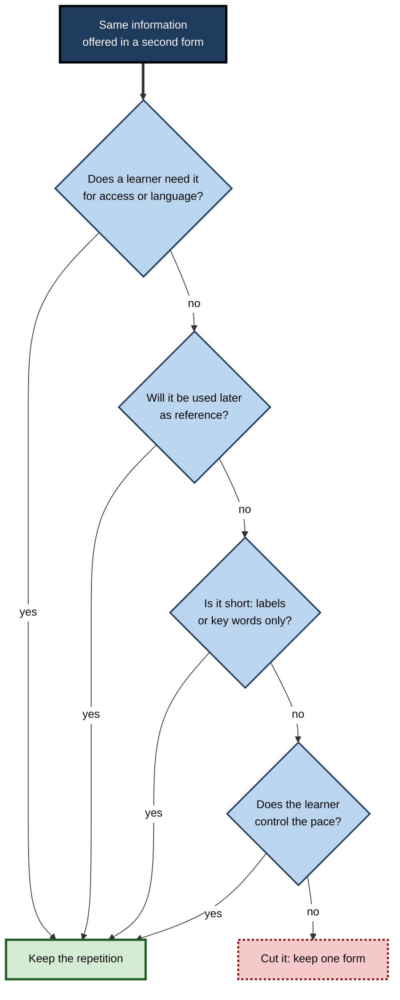
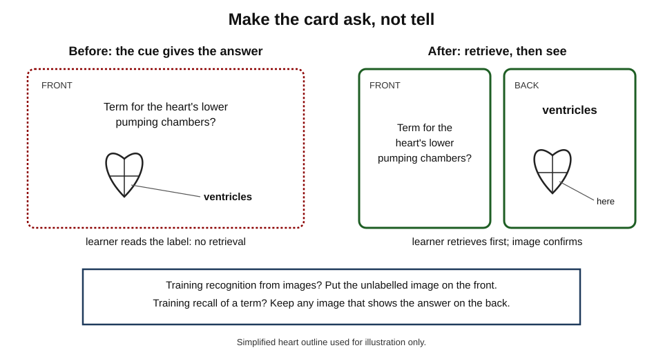
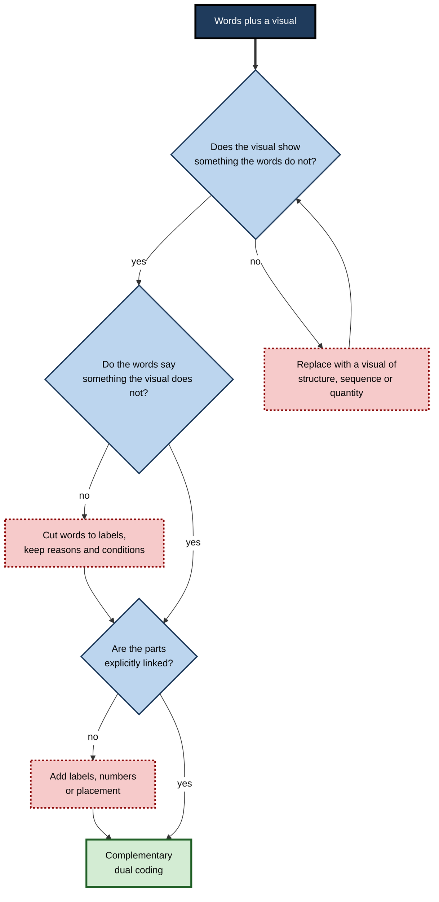
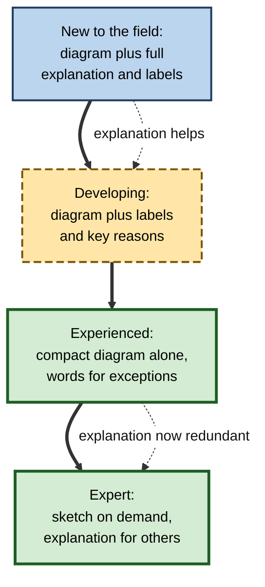

# G.11. Avoiding Redundant Dual Coding

A revision sheet for an economics course has a small icon beside every term: a coin beside "money", a factory beside "production", a shopping trolley beside "consumption". It looks carefully "dual-coded". Yet the icons say nothing the words do not already say, and the one relationship that students struggle with — how a fall in consumption feeds back into production and employment — appears nowhere, in words or pictures.

Adding a picture to a word is easy. Adding a picture that **adds meaning** is harder, and it is the only kind that helps.

> **Definition — Redundant dual coding:** pairing words and visuals that **repeat** each other, **decorate** each other or **compete** with each other, so that the learner spends effort processing both without gaining understanding or memory that either alone would not provide.

> **Definition — Redundancy effect:** the finding, from cognitive load research, that presenting the same information in two forms at once — most commonly identical text on screen and in narration — can reduce learning compared with one form, because the duplicate must still be processed and reconciled.

**Why it matters**

- Dual coding has become popular advice; much of what is labelled "dual coding" in study materials is decoration or duplication.
- Redundant combinations cost time to make and attention to use, while giving a false sense of thoroughness.
- Learners who can tell a **complementary** visual from a redundant one make better study materials and choose better resources.
- The same judgement applies at work — in slides, reports, dashboards and interfaces.

---

## Not Every Picture Is Dual Coding

### What dual coding requires

- **Two codes for the same meaning** — a verbal and a nonverbal representation of the **content to be learned**.
- **A referential link** — the learner connects each part of the visual to its words.
- **A visual that carries information** — structure, relationship, sequence, quantity or a concrete instance that the words alone convey poorly.

### The "icon wallpaper" problem

- **Symptom:** a small picture beside every term, heading or bullet.
- **Why it happens:** popular summaries of learning science made "dual coding" a slogan; adding icons is quick and looks compliant.
- **Why it fails:**
  - the icon usually represents the **topic**, not the **idea** — a coin for "money" says nothing about what money **does**;
  - many icons are generic; the same light bulb stands for "idea", "insight", "innovation" and "energy";
  - icons draw attention away from the text and add nothing to retrieve.
- **Practitioners' warning:** writers who promote dual coding to teachers, such as the designer **Oliver Caviglioli** in *Dual Coding with Teachers* (2019), stress that the visual must show **relationships and structure**, not decorate words.

> **Key point:** the test of dual coding is not "Is there a picture?" but "**Does the picture represent the meaning in a way the words do not?**"

---

## Kinds of Word–Picture Relationship

### Six relationships

- **Complementary** — each carries information the other lacks.
  - *e.g.* text explains why a supply chain is fragile; a map shows that three critical suppliers are in one flood-prone region.
- **Elaborating** — the visual makes the same idea concrete or structured.
  - *e.g.* a definition of "compound interest" beside a graph of a balance growing faster each year.
- **Supportive repetition** — the same information in two forms, deliberately, for a learner who needs it.
  - *e.g.* captions for a second-language viewer; labels repeated in a legend for reference.
- **Wasteful repetition** — the same information twice in the **same channel**, for no learner need.
  - *e.g.* a slide showing a full paragraph that the presenter reads aloud word for word.
- **Decorative** — the visual is related to the topic but not to the content.
  - *e.g.* a stock photograph of a handshake on a slide about contract law.
- **Conflicting** — words and visual disagree or suggest different things.
  - *e.g.* a chart that shows a fall while the headline claims growth; an arrow pointing the wrong way.

| Relationship | Adds meaning? | Typical effect on learning | When acceptable |
|---|---|---|---|
| Complementary | Yes — each adds | Strong benefit | Almost always |
| Elaborating | Yes — concreteness or structure | Benefit, especially for novices | Usually |
| Supportive repetition | No new content | Helps specific learners or uses | For access, reference or second-language support |
| Wasteful repetition | No | Can reduce learning | Rarely |
| Decorative | No | None, or harm through distraction | Brand or tone needs, kept minimal |
| Conflicting | Misleading | Harm | Never |

**Figure 1.** A spectrum of word–picture relationships from harmful to most useful.

---

## Why Redundancy Costs

### Processing the duplicate

- **Both forms must be processed.** The learner cannot simply ignore one; reading and listening, or looking and reading, both take resources.
- **They must be reconciled.** The learner checks whether the picture and words say the same thing — work that produces no new understanding.
- **They run at different speeds.** People read faster than a narrator speaks; reading ahead and then waiting, or falling behind, both disrupt processing.

### The research in brief

- **The redundancy effect** was established by **Slava Kalyuga, Paul Chandler and John Sweller** in the late 1990s, and by **Richard Mayer, Julie Heiser and Steve Lonn (2001)**, who found that adding on-screen text identical to the narration of an animation reduced transfer.
- **Seductive details** — interesting but irrelevant additions — reduce learning on average (a 2020 meta-analysis found about g = −0.33).
- **Expertise reversal** — explanation that helps a novice becomes redundant, and can hinder, once the learner already knows it.

> **Remember:** **duplication costs, decoration distracts, conflict misleads.** Only information that **adds** pays its way.

### When duplication helps

- **Second-language learners** — captions and transcripts support comprehension of speech.
- **Deaf and hard-of-hearing learners** — captions provide access.
- **Short key words** with narration — a few labels on screen can help learners follow structure without the cost of full text.
- **Reference materials** — learners who will return to a document later may need the full text even if they first heard it.
- **Noisy or interrupted settings** — written backup for speech.
- **Self-paced reading-along** — when the learner controls the pace, reading and listening together is less costly.
- **Accessibility alternatives** — alternative text duplicates a visual's content in words by design, for those who cannot see it.

**Figure 2.** Deciding whether repeating information in a second form will help.

---

## Redundancy in One's Own Study Materials

### Common forms

- **Icons beside every term** — topic pictures that add no meaning.
- **Flashcards that give the answer away** — a picture of a heart on the front of a card asking for the word "cardiac"; the learner recognises the picture instead of retrieving the term.
- **Diagrams copied with full text inside** — a beautifully redrawn textbook figure with the original paragraphs pasted into its boxes.
- **Rainbow notes** — every line highlighted or colour-coded, so colour carries no signal.
- **Mind maps of whole sentences** — the spatial form wrapped around linear prose.
- **Multiple visuals showing the same aspect** — three slightly different drawings of the same structure, none showing a different relationship.
- **Re-drawing an already clear diagram** — copying for its own sake, with no selection or transformation.

> **Watch out:** the time spent making decorative or duplicated materials feels productive. It is often time taken from retrieval practice, which reliably improves learning.

### The cue crutch on flashcards

- **The problem:** when the cue side contains a picture of the answer, the learner practises **recognising the picture**, not **retrieving the word or idea**.
- **Evidence:** studies of vocabulary learning with pictures have found that pictures can make learners **overconfident** without improving learning of the new word.
- **The fix:** decide what the card is training:
  - **recognition skill** (identify the structure in an image) → the image is the **question**, the name is the answer;
  - **recall of meaning** from a term → only the term on the front; the image may appear on the **back** with the answer;
  - **recall of a term** from its meaning → a definition or scenario on the front, the term on the back.

**Figure 3.** A flashcard whose image gives away the answer, redesigned so that the learner must retrieve it.

### Redundancy in one's own explanations

- **Self-explanation that restates** — saying "this box is the supplier, this box is the factory" adds nothing a label does not already say.
- **Self-explanation that adds** — saying "the factory depends on one supplier, so a delay there stops production" states a relationship the diagram implies but does not explain.
- **Summaries that repeat diagrams** — a paragraph beneath a sketch that lists the sketch's boxes duplicates it; a paragraph that states **why** the structure matters complements it.
- **Rule of thumb:** when explaining a visual, speak or write about **causes, conditions, consequences and exceptions** — the things the picture cannot hold.

> **Example (illustrative):** under a sketch of a company's group structure, the weak note reads "Parent owns A, B and C." The strong note reads "Because the parent owns only 60% of C, C's profits are shared with minority shareholders — so consolidated profit overstates what belongs to the parent."

### Multiple representations that do add

- **Not all repetition is redundant.** Shaaron Ainsworth's work on multiple representations shows that different representations of the **same topic** help when each shows a **different aspect** — a table for exact values, a graph for trend, an equation for the general law.
- **The difference from redundancy:** each representation **complements** the others; the learner learns by **translating** between them.
- **The test:** if covering one representation loses no information or insight, it is redundant.

---

## The Information Test

Three questions decide whether a word–picture combination earns its place.

1. **What does the visual show that the words do not?**
   - If nothing — remove or replace the visual.
2. **What do the words say that the visual does not?**
   - If nothing — shorten the words to labels or remove them.
3. **Does each part connect explicitly to the other?**
   - If not — add labels, numbering or placement that ties them together.

**Figure 4.** The information test applied to a word–picture combination.

> **Mnemonic — "ADD":** a visual must **A**dd information, the words must **D**o a different job, and the two must be **D**irectly linked.

---

## Worked Example (illustrative): Auditing a Revision Sheet

**Situation:** a student's one-page revision sheet on **monetary policy** contains:

- a title with a bank icon;
- eight terms, each with an icon (a coin for "money supply", a percentage sign for "interest rate", a rising arrow for "inflation");
- three paragraphs copied from the textbook;
- a pasted textbook diagram of the transmission mechanism, unlabelled by the student.

| Element | Information test | Verdict | Action |
|---|---|---|---|
| Bank icon in title | Adds nothing | Decorative | Remove |
| Eight term icons | Show topics, not meaning | Decorative | Remove; keep terms with one-line definitions |
| Copied paragraphs | Repeat the textbook | Wasteful repetition | Replace with three sentences in the student's own words |
| Pasted diagram | Shows the mechanism, but not linked to the text | Potentially complementary | Redraw from memory; label each arrow with its effect |
| Missing element | The feedback from inflation expectations to wage demands | Gap | Add a loop to the diagram with a one-line explanation |

1. **Strip** decoration and duplication.
2. **Rebuild** the one visual that carries structure, in the student's own hand, from memory.
3. **Label** every arrow with a verb ("raises", "reduces", "feeds into").
4. **Write** the reasons and conditions in short sentences beside the diagram.
5. **Add** the missing relationship that the student previously misunderstood.

- **Conclusion:** the new sheet has **fewer** visual elements but far more **visual information** — and making it involved selection, organisation and retrieval.

> **Watch out:** a revision sheet's quality is shown by what the student can **reproduce** from it after a delay, not by how complete it looks.

---

## Over-Coding: Too Many Signals at Once

### When every feature means something — or nothing

- **Over-coding** — using many colours, fonts, icons, borders and highlights on one page, each intended to "code" something.
- **Problems:**
  - the learner must remember the **key** to the codes, adding a memory task unrelated to the content;
  - codes compete for attention, so nothing stands out;
  - inconsistent use (red means "important" on one page and "risk" on another) produces confusion.
- **Pre-attentive pop-out** works only when **one** element differs from the rest; ten highlighted items in a paragraph are effectively none.

### Coding systems that work

- **Few codes** — two or three colours or symbols, each with one fixed meaning across all notes.
  - *e.g.* one colour for definitions, one for examples, one for questions still open.
- **Meaningful codes** — the code says something about the content's role, not its topic.
- **Redundant coding by design** — where a code matters, pair colour with a **second cue** (a symbol, position or label), so meaning survives monochrome copies and colour-vision differences. This is supportive, not wasteful, repetition.
- **Sparse emphasis** — reserve bold or highlight for the few phrases that must be retrieved.

> **In practice:** a learner can test a coding system by covering the key: if the meaning of each colour or symbol cannot be stated instantly, the system is too complex to help.

| | Over-coded notes | Well-coded notes |
|---|---|---|
| Number of colours or symbols | Six or more | Two or three |
| Meaning of each | Varies or forgotten | Fixed across all notes |
| Proportion highlighted | Much of the page | A few key phrases |
| Effect on review | Eye wanders; nothing stands out | Key items found at a glance |
| Survives a monochrome copy | No | Yes — a second cue backs up colour |

---

## Judging Resources Made by Others

### Signs of redundant design in courses, books and videos

- **Narrators who read the slides** word for word.
- **Background music** under speech, or animated transitions between every point.
- **Stock photographs** that illustrate the topic, not the idea.
- **Every page of a book** opening with a decorative illustration and closing with a "key facts" box that repeats the page.
- **Animated characters** or game elements unrelated to the content.
- **Duplicate summaries** — the same content as an infographic, a bullet list and a paragraph, side by side.

### Coping strategies for learners

- **Choose one channel** — turn off on-screen subtitles that duplicate clear narration (unless they are needed for language or access); or mute the video and read the transcript at one's own pace.
- **Mute music** where the player allows; otherwise use the transcript.
- **Skip decorative sections** and go straight to the diagrams and worked examples.
- **Extract the one useful visual** from a cluttered resource and redraw it cleanly in one's own notes.
- **Prefer resources** that show explanatory diagrams, real examples and practice questions over those rich in decoration.

> **Watch out:** a resource's **production value** is not evidence of its **learning value**. Plain resources with good diagrams and practice often teach more than polished, decorated ones.

### Worked example (illustrative): a team briefing deck

**Situation:** an engineer prepares a twelve-slide briefing on a new deployment process for colleagues. Draft slides each have a title, five bullets, a clip-art icon and a background image; the engineer plans to read the bullets aloud.

| Draft element | Problem | Revision |
|---|---|---|
| Topic titles ("Overview", "Steps") | No point stated | Sentence headlines ("Deployments now need two approvals before release") |
| Five bullets per slide, read aloud | Wasteful repetition | One diagram per slide; speaker explains |
| Clip-art icons | Decorative | Removed |
| Background image | Visual noise behind text | Plain background |
| Process described across four slides | Split attention across slides | One flowchart of the process on a single slide, revisited and highlighted step by step |
| No handout | Detail lost after the talk | A one-page written reference with the full steps |

- **Conclusion:** the talk now pairs a **visual of the process** with **spoken explanation**, and puts the **detailed text** where it is useful — in a reference document — rather than on screen.

---

## Redundancy at Work

### Presentations

- **Reading slides aloud** — the most common form of wasteful repetition in professional life.
  - *Fix:* slide shows the visual and a headline; the speaker supplies the explanation; detailed text goes in a handout.
- **Full scripts on screen** for "people who cannot attend" — better provided as a separate written document.

### Reports and board packs

- **Charts with paragraphs that restate every number** — "Revenue rose from 120 to 132, an increase of 10%; costs rose from 90 to 95…".
  - *Fix:* the chart shows the numbers; the text says **what they mean** — the cause, the implication, the decision required.

### Dashboards

- **Triple coding** — the same metric as a number, a gauge and a traffic-light colour.
  - *Fix:* one clear encoding per metric, with a comparison (target, last period) and a short annotation where action is needed.

### Interfaces

- **Icon plus label** is **useful** redundancy for new users: the label teaches the icon.
- **Over time**, experienced users rely on the icon; well-designed software lets labels be hidden or shown.
- **The same principle** applies to learning materials: supportive repetition early, fading as expertise grows.

**Figure 5.** Fading supportive repetition as expertise grows.

### Case study (illustrative): rewriting a board pack

- **Situation:** a manufacturing group's monthly board pack ran to 80 pages: each page had a chart and a paragraph beneath it restating the chart's values.
- **Problem:** directors complained they could not find the issues; meetings spent time on reading rather than deciding.
- **Diagnosis:**
  - the paragraphs **duplicated** the charts in words;
  - no page stated **why** a number had changed or **what** the board should do;
  - several charts used a traffic-light colour, a percentage and an arrow for the same metric.
- **Actions:**
  1. Each page gained an **action headline** stating the finding ("Margin fell 2 points because of energy costs in the two European plants").
  2. Paragraphs restating values were replaced by **two or three sentences** on cause, implication and decision.
  3. Each metric was shown **once**, with its target and prior period.
  4. Supporting tables moved to an appendix for reference.
- **Result:** the pack fell to about 30 pages; directors reported spending meeting time on decisions rather than clarification.
- **Caveats:** the change was judged by directors' and secretariat feedback, not formally measured.
- **Lesson:** replacing duplication with **complementary** words — the "so what" the chart cannot show — made both the visual and the text more useful.

---

## Why Redundant Materials Persist

- **They look thorough.** A page full of icons, colours and summaries signals effort to reviewers and managers.
- **They are liked.** Learners and stakeholders often rate decorated, duplicated materials as more engaging; liking and learning frequently diverge.
- **They feel easy.** Repetition makes content feel familiar — the fluency that learners mistake for understanding.
- **They are cheap to produce.** Templates, icon libraries and AI tools add decoration in seconds; selecting the one visual that carries meaning takes thought.
- **They are rarely tested.** Organisations measure completion and satisfaction, not delayed, unaided performance, so the cost of redundancy goes unseen.

> **Key point:** redundancy survives because its costs are **invisible** at the moment of use. Only delayed tests of understanding reveal them.

### AI and automatic redundancy

- **Generative tools** can attach an image, a summary and a set of bullet points to every paragraph automatically.
- **Auto-generated slide decks** often place an icon beside each bullet and a stock-style image on each slide — icon wallpaper at scale.
- **Automatic summaries** placed beside the original text create duplicate versions that learners may read instead of the source, or in addition to it.
- **Good practice:**
  - switch off automatic decoration where possible;
  - ask the tool for **one diagram of a specific relationship** rather than "an image for this slide";
  - apply the information test to every generated element before keeping it.

---

## What Experts Do Differently

- **They ask what each element is for** before adding it.
- **They let visuals carry structure and quantity, and words carry reasons, conditions and judgement.**
- **They use repetition on purpose** — for access, reference, language support or novices — and remove it when the need passes.
- **They prefer one good visual** to several weak ones, unless each shows a different aspect.
- **They check for conflict** — that headline, chart and text say the same thing.
- **They measure** materials by what users can do afterwards, not by how rich they look.

---

## Open Questions

- **Where exactly does helpful repetition end?**
  - Short key words help and full duplicate text harms; the boundary in between depends on pace, complexity and learner, and is not precisely mapped.
- **How large is the cost of icon-heavy study materials?**
  - Decorative icons are widespread in school and workplace materials, but there is little direct research on their cost in self-made study sheets.
- **When do multiple representations become redundant?**
  - Varied representations can deepen understanding, yet each adds load; how many, and in what sequence, is an open design question.
- **How should materials adapt as expertise grows?**
  - Fading supportive repetition is recommended, but practical methods to judge when a learner is ready are still developing.
- **Does AI make redundancy worse?**
  - Generative tools can attach images and summaries to everything at no cost; the effect on learners' attention and understanding is not yet known.

---

## Summary

- **Redundant dual coding** pairs words and visuals that repeat, decorate or compete — costing effort without adding understanding.
- **True dual coding** needs two codes for the **content**, a **referential link**, and a visual that **carries information** the words convey poorly.
- **Icon wallpaper** — a picture beside every term — illustrates topics, not ideas.
- **Six relationships:** complementary, elaborating, supportive repetition, wasteful repetition, decorative, conflicting.
- **Costs:** both forms must be processed and reconciled; they run at different speeds; seductive details and expertise reversal add harm.
- **Repetition helps** for access, second-language support, short key words, reference, noisy settings, self-paced reading and alternative text.
- **In study materials:** avoid icons for their own sake, flashcards that give the answer away (the **cue crutch**), copied text in diagrams, rainbow notes, and multiple visuals of the same aspect.
- **The information test (ADD):** the visual **adds**, the words **do a different job**, and the two are **directly linked**.
- **At work:** do not read slides aloud; write the "so what" beneath charts; code each metric once; fade supportive repetition as expertise grows.

---

## Self-Check

1. Define redundant dual coding and the redundancy effect.
2. What three conditions must a word–picture combination meet to count as genuine dual coding?
3. Why does "icon wallpaper" fail to help learning?
4. Classify each relationship: a chart of falling sales with the headline "Strong quarter"; captions on a lecture video for an international student; a slide paragraph read aloud; a map showing supplier locations beside text explaining supply risk.
5. Explain three reasons why processing duplicate information costs learners effort.
6. List five situations in which repetition across forms is helpful.
7. What is the cue crutch, and how should flashcards be designed to avoid it?
8. How do Ainsworth's multiple representations differ from redundancy?
9. Apply the information test (ADD) to a slide showing a photograph of a factory, the title "Operations", and four bullet points read aloud by the presenter.
10. A dashboard shows "Customer satisfaction: 82% (green, up arrow, smiling face)". Critique and redesign.
11. Why should supportive repetition fade as expertise grows? Give a workplace example.
12. A colleague says, "The more pictures, the better the dual coding." Respond with evidence and an alternative principle.

### Answer Key

1. Redundant dual coding — words and visuals that repeat, decorate or conflict, costing effort without adding understanding. Redundancy effect — presenting the same information in two forms at once, typically identical narration and on-screen text, can reduce learning.
2. Two codes for the content being learned; an explicit referential link between visual parts and words; a visual that carries information (structure, relationship, sequence, quantity, concrete instance) the words convey poorly.
3. Icons illustrate topics rather than ideas, are often generic and ambiguous, draw attention from the text, and add nothing to retrieve.
4. Conflicting; supportive repetition; wasteful repetition; complementary.
5. Both forms must be processed; they must be compared and reconciled; they run at different speeds (reading versus speech), forcing waiting or lagging.
6. Second-language support; deaf or hard-of-hearing access; short key words with narration; reference material for later use; noisy settings (also self-paced reading-along; alternative text).
7. The cue side contains the answer in another form, so the learner recognises rather than retrieves. Put only the term (or only the image, for recognition skills) on the front, with the answer and any supporting image on the back.
8. Each representation shows a different aspect of the same topic (exact values, trend, general law) and learning comes from translating between them; redundancy repeats the same information without adding anything.
9. Adds? The factory photograph adds nothing — replace it with a process diagram or chart of the key operational finding. Different job? Bullets duplicate speech — cut to a sentence headline stating the point. Linked? Narration should point to parts of the new visual.
10. Four codings of one value, none showing a comparison. Show the value once on a small trend line with the target and last period, and annotate the cause if action is needed.
11. Explanations that help novices become redundant for experts and can hinder them (expertise reversal). *e.g.* new analysts get a fully annotated data-model diagram; experienced analysts get the compact diagram alone.
12. Decorative pictures do not help and seductive details harm (about g = −0.33); duplicated forms add load. Principle: add a visual only when it carries information the words cannot — structure, sequence, quantity or a concrete instance — and link it explicitly.

---

## Glossary

| Term | Meaning |
|---|---|
| Complementary relationship | Words and visual each carrying information the other lacks. |
| Conflicting relationship | Words and visual that disagree or suggest different things. |
| Cue crutch | A flashcard cue that contains the answer, so the learner recognises rather than retrieves. |
| Decorative visual | A visual related to the topic but not to the content. |
| Elaborating relationship | A visual that makes an idea concrete or structured. |
| Expertise reversal effect | Support that helps novices but hinders experts. |
| Fading | Gradually removing support as a learner's expertise grows. |
| Icon wallpaper | Placing small pictures beside every term without adding meaning. |
| Information test | Checking that a visual adds information, words do a different job, and both are linked. |
| Redundancy effect | Reduced learning when the same information is presented twice at once. |
| Redundant dual coding | Words and visuals that repeat, decorate or compete without adding understanding. |
| Seductive details | Interesting but irrelevant additions that reduce learning. |
| Supportive repetition | Deliberate duplication across forms to meet a specific learner need. |
| Wasteful repetition | Duplication in the same channel that serves no learner need. |
