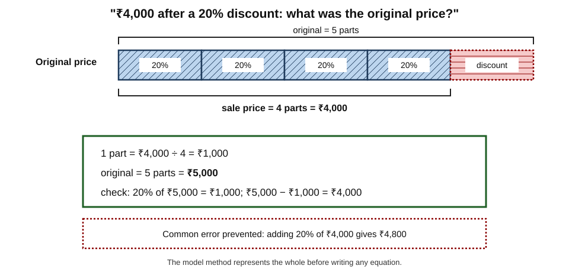
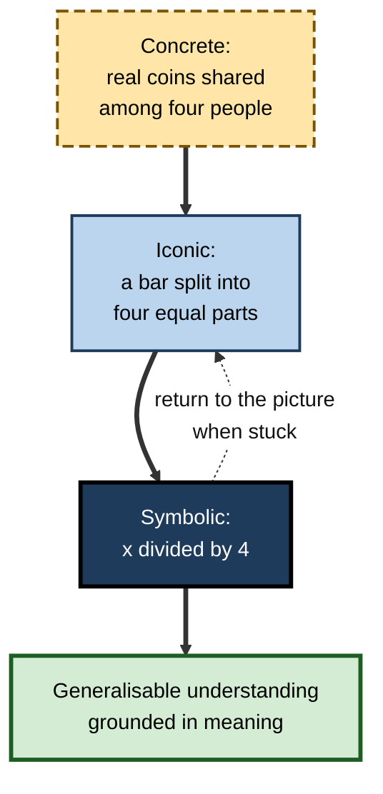
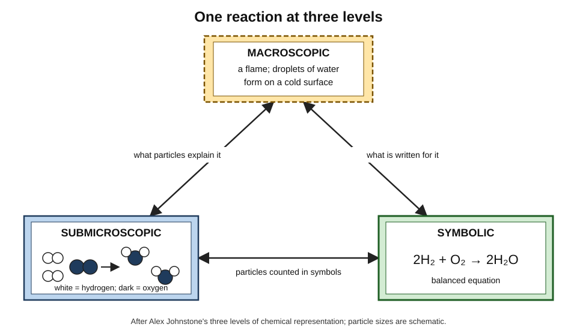
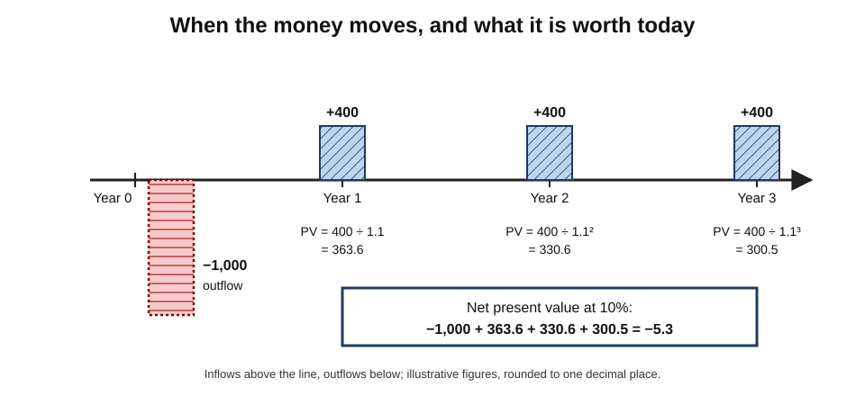
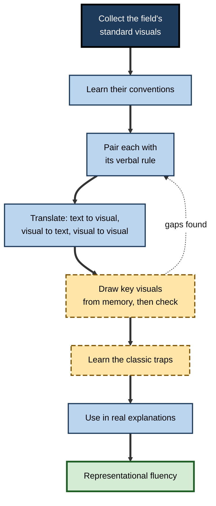

# G.12. Applying Dual Coding Across Subjects

An engineer who moves into corporate finance finds that the visual habits that served her well — circuit diagrams, flowcharts, cross-sections — do not map onto discounted cash flows, legal-entity structures or balance sheets. Within months she discovers that finance has its own visual language: cash-flow timelines, T-accounts, bridge charts, entity diagrams. Once she learns to read and draw them, the subject opens up.

The principle of pairing words with meaningful visuals is universal. **Which** visuals carry meaning, and what they must show, differ from field to field.

> **Definition — Disciplinary representation:** a visual form developed within a field to show its characteristic relationships — such as free-body diagrams in physics, structural formulae in chemistry, timelines in history or T-accounts in accounting.

> **Definition — Representational fluency:** the ability to read, create and translate between a field's representations — moving, for example, from an equation to a graph to a verbal explanation of the same idea.

**Why it matters**

- Every professional field has visual conventions that newcomers must learn; failing to learn them slows understanding.
- Choosing the right visual for a subject's **typical relationships** is the core skill of dual coding in practice.
- Some visuals carry misconceptions as well as understanding; knowing a field's classic visual traps prevents errors.
- Cross-functional work demands translating representations between fields — a valuable and rare professional capability.

---

## What Travels and What Does Not

### Principles that apply everywhere

- **Show relationships, not topics.** The visual must carry structure, sequence, cause, comparison, quantity or a concrete instance.
- **Label and link.** Words tie each visual element to its meaning.
- **Words carry conditions and reasons.** Exceptions, qualifications and arguments stay verbal.
- **Construct, then check.** Drawing from memory and comparing with the source builds understanding.
- **Avoid decoration and duplication.**

### Conventions that are field-specific

- **Arrows** mean force in physics, reaction direction in chemistry, energy flow in ecology, money flow in finance, dependency in software.
- **Up** means higher energy in an energy diagram, later in a vertical timeline, senior in an organisation chart, more in a bar chart.
- **Boxes** are classes in software, accounts in accounting, compartments in pharmacology, entities in law.

> **Watch out:** a learner who carries one field's conventions into another misreads confidently. On meeting a new field's diagram, the first question is "**What do the arrows, boxes and positions mean here?**"

### Experts translate between representations

- **Robert Kozma and Joel Russell (1997)** found that expert chemists grouped different representations of the same phenomenon — an equation, a molecular animation, a graph — by their **underlying chemistry**, and moved fluently between them. Students grouped them by **surface features**, such as "all the graphs together".
- **Implication:** expertise is not knowing one representation well but **linking several**, each showing a different aspect.

---

## Mathematics

### Key visuals

- **Number line** — order, distance, negative numbers, fractions as positions.
- **Bar model** — the **model method** taught in Singapore primary schools since the 1980s represents quantities in word problems as bars, making part–whole and comparison relationships visible before algebra.
- **Area model** — multiplication and algebraic expansion as rectangles: (a + b)(c + d) as four smaller areas.
- **Graphs** — functions as shapes; rate of change as slope; area under a curve as accumulation.
- **Geometric diagrams** — proofs and constructions.

**Figure 1.** A bar model for a percentage problem.

> **Example:** "A jacket costs ₹4,000 after a 20% discount. What was the original price?" A bar of five equal parts shows that the discounted price is four parts; one part is ₹1,000; the original is five parts, **₹5,000**. Learners who simply take 20% of ₹4,000 and add it (getting ₹4,800) make the classic error the bar model prevents.

### Concreteness fading

- **Jerome Bruner (1966)** described three modes of representation: **enactive** (action), **iconic** (images) and **symbolic** (abstract symbols).
- **Emily Fyfe, Nicole McNeil, Ji Son and Robert Goldstone (2014)** reviewed evidence for **concreteness fading**: starting with concrete materials or pictures, moving to simplified icons, then to abstract symbols.
  - This progression often beat either concrete-only or abstract-only instruction, because learners gained both grounding and generalisable symbols.
- **For professionals:** a new quantitative method (say, a statistical model) is learned faster when introduced with a concrete case, then a schematic diagram, then the formal notation.

**Figure 2.** Concreteness fading from a concrete case to abstract symbols.

### Visual traps in mathematics

- **Graphs read as pictures** — a rising distance–time line read as "going uphill".
- **Diagrams drawn to look special** — an isosceles-looking triangle leads to an unjustified assumption.
- **Misleading scales** — logarithmic axes read as linear.

---

## The Sciences

### Johnstone's triangle

- **Alex Johnstone**, a chemistry educator at the University of Glasgow, argued (1982, developed in 1991) that chemistry is understood at three levels at once:
  - **macroscopic** — what can be seen and touched (a solution turning blue);
  - **submicroscopic** — particles, atoms and molecules;
  - **symbolic** — formulae, equations and graphs.
- **Novices struggle** because teaching often jumps between levels without making the links explicit.
- **Dual-coding response:** pair each symbolic equation with a **particle diagram** and a description of what would be **observed**.

**Figure 3.** Johnstone's three levels of chemical representation for one reaction.

### Physics and engineering

- **Free-body diagrams** — every force on an object as a labelled arrow from its point of action.
- **Circuit diagrams** — standard symbols with current direction and values.
- **Energy diagrams** — levels and transitions.
- **Trap:** drawing a force that does not exist (a "force of motion" in the direction of travel) — a classic misconception that a free-body diagram exposes when the learner must name the source of every arrow.

### Biology and medicine

- **Labelled drawings** of structures — cells, organs, anatomy.
- **Cycles** — the cardiac cycle, the cell cycle, nutrient cycles.
- **Pathway diagrams** — metabolic or signalling pathways; often overwhelming, best learned in segments.
- **Image banks for recognition** — dermatology, radiology, histology and electrocardiograms are learned largely by **seeing many varied examples**.
  - **Perceptual learning modules**, developed by **Philip Kellman** and colleagues, present many quick classification trials with feedback; studies in fields such as dermatology and electrocardiogram interpretation have reported improved accuracy and speed of recognition.

> **Watch out:** a famous diagram trap — textbook pictures of Earth's orbit drawn as a highly stretched ellipse encourage the misconception that seasons are caused by distance from the Sun. Earth's orbit is nearly circular; seasons arise from the tilt of its axis. Scale distortions in diagrams teach real errors.

---

## History and the Social Sciences

- **Timelines** — order, overlap and duration; parallel tracks for different regions or themes.
- **Maps** — territory, movement, trade, battle; maps across time show change.
- **Causal diagrams** — long-term, short-term and trigger causes of an event.
- **Source images** — paintings, photographs, cartoons and posters as evidence, read critically for purpose and audience.
- **Social-science graphs and models** — supply and demand, population pyramids, network diagrams of relationships.
- **Traps:**
  - **anachronistic maps** showing modern borders for earlier periods;
  - **neat causal diagrams** that make history look inevitable;
  - **images taken as neutral records** rather than as sources with a viewpoint.

> **In practice:** in history, pair every timeline with a short paragraph on **why** — the timeline shows sequence; the argument about causes is verbal and contestable.

---

## Languages and Literature

- **Vocabulary** — pictures for concrete words; keyword images and gestures for arbitrary ones; always with saying the word aloud.
- **Grammar** — visual sentence structure:
  - **Reed–Kellogg diagrams**, introduced by Alonzo Reed and Brainerd Kellogg in 1877, set out the parts of a sentence on lines;
  - **tree diagrams** from linguistics show how phrases nest.
- **Literature** — story maps, character-relationship diagrams, and plot structure diagrams such as **Gustav Freytag's pyramid** (1863): exposition, rising action, climax, falling action, resolution.
- **Trap:** reducing a complex text to a neat plot diagram can hide ambiguity, theme and style — the things literary study values most.

---

## Law

- **Chronologies** — the backbone of litigation and investigations.
- **Party and relationship diagrams** — who contracted with whom; group structures.
- **Legal tests as decision trees** — elements that must each be satisfied (for negligence: duty, breach, causation, damage).
- **Statute maps** — how sections and definitions refer to each other.
- **Transaction structure charts** — flows of money, assets and obligations in a deal.
- **Traps:**
  - a decision tree can make a test look mechanical when each element involves **judgement** and case law;
  - diagrams of complex structures quickly go out of date as deals change.

### Nursing and allied health

- **Body maps** — marking the location of pain, wounds or pressure injuries on an outline of the body, paired with written descriptions.
- **Observation charts** — vital signs plotted over time so that deterioration appears as a visible trend; many early-warning charts colour or shade zones that trigger escalation.
- **Care pathways** — flowcharts of assessment and treatment steps.
- **Patient education** — labelled diagrams and simple pictures for explaining procedures, medication timing and self-care, especially where literacy or language is a barrier.
- **Trap:** a chart that looks reassuring because most values sit in a "normal" band can hide a steady trend towards the threshold; reading trends, not single points, is the skill.

---

## Software, Data and Engineering

- **Architecture diagrams** at stated levels of zoom — context, containers, components.
- **Sequence diagrams** — messages between services over time.
- **Entity–relationship diagrams** — data structure and cardinality.
- **State diagrams** — the states an object can be in and the events that move it between them.
- **Data visualisation** — distributions, trends and comparisons for analysis and communication.
- **Why visuals matter here:** code is verbal and sequential; the **structure** of a system — what talks to what — is spatial and is far easier to grasp as a diagram.
- **Trap:** diagrams that drift from the real system; generated or "as designed" diagrams that do not match what is deployed.

---

## Finance, Accounting and Economics

- **Cash-flow timelines** — inflows above the line, outflows below, at each period; the standard tool for time-value-of-money problems.
- **T-accounts** — the left (debit) and right (credit) sides of an account, making double entry visible.
- **Bridge (waterfall) charts** — how a starting value moves to an ending value through positive and negative contributions.
- **Entity and ownership diagrams** — group structures, holdings and intercompany flows.
- **Economic models** — supply and demand curves, circular flow of income.

**Figure 4.** A cash-flow timeline for a simple investment.

> **Formula — Present value of the cash flows in Figure 4:** with a discount rate of 10%, PV = −1,000 + 400 ÷ 1.1 + 400 ÷ 1.1² + 400 ÷ 1.1³ = −1,000 + 363.6 + 330.6 + 300.5 = **−5.3** (rounded). The project is very slightly unattractive at 10%. The timeline shows *when* each amount occurs; the formula shows *what it is worth today*.

---

## Management and Strategy

- **2 × 2 matrices** — the **growth–share matrix** introduced by Bruce Henderson of the Boston Consulting Group around 1970 classified business units by market growth and relative share.
- **Stakeholder grids** — the **power–interest grid** associated with Aubrey Mendelow (1981) sorts stakeholders by influence and interest.
- **Value chain** — Michael Porter's (1985) diagram of primary and support activities that create value.
- **Organisation charts** — formal reporting lines; often contrasted with **network maps** of how work actually flows.
- **Trap:** 2 × 2 matrices force continuous variables into four boxes; useful for discussion, misleading if treated as precise.

---

## Arts, Music and Movement

- **Music notation** pairs a visual code (position on the stave, note shapes) with sound and movement — a long-established multi-code system.
- **Dance and sport** use video, diagrams of positions and plays, and **demonstration**: Albert Bandura's research on **observational learning** showed that people learn actions by watching models, particularly when they attend to, retain and rehearse what they see.
- **Visual arts** — sketchbooks combine drawing and annotation to develop and reflect on ideas.

---

## Comparing Fields

| Field | Key visual forms | What the visual carries | Classic trap |
|---|---|---|---|
| Mathematics | Number line, bar model, area model, graphs | Quantity, part–whole, change | Reading graphs as pictures |
| Chemistry | Particle diagrams, structural formulae | Links between observed, particle and symbolic levels | Jumping between levels without links |
| Physics | Free-body and circuit diagrams | Forces, flows and their sources | Drawing forces that do not exist |
| Biology and medicine | Labelled anatomy, cycles, pathways, image banks | Structure, process, recognisable patterns | Overloaded pathway diagrams |
| History | Timelines, maps, causal diagrams | Sequence, place, cause | Making events look inevitable |
| Languages and literature | Picture vocabulary, sentence diagrams, story maps | Meaning, structure, plot | Flattening ambiguity |
| Law | Chronologies, decision trees, party diagrams | Order, elements of a test, relationships | Making judgement look mechanical |
| Software and data | Architecture, sequence, entity–relationship diagrams | System structure and interactions | Diagrams drifting from reality |
| Finance and accounting | Cash-flow timelines, T-accounts, bridge charts | Timing, double entry, contributions to change | Ignoring sign and timing conventions |
| Management | 2 × 2 matrices, stakeholder grids, value chains | Positioning and priorities | False precision |

---

## Choosing Visuals by Kind of Knowledge

Across all fields, the kind of knowledge being learned is a better guide to the right visual than the subject's name.

- **Facts and terms** — arbitrary links between names and meanings.
  - *Visual:* labelled pictures of concrete things; interactive images or keywords for arbitrary terms.
  - *e.g.* names of bones; drug classes; legal terms of art.
- **Concepts** — categories with defining features.
  - *Visual:* contrasting examples and non-examples side by side; a hierarchy of related concepts.
  - *e.g.* what counts as a "contract" versus an "agreement to agree".
- **Structures** — parts and their arrangement.
  - *Visual:* labelled diagrams, trees, cross-sections, architecture diagrams.
  - *e.g.* a company's group structure; the layers of a network.
- **Processes and procedures** — steps and branches.
  - *Visual:* frame sequences, flowcharts, swimlanes.
  - *e.g.* a clinical pathway; a release process.
- **Causal principles** — how one change produces another.
  - *Visual:* causal chains and loops; graphs of relationships.
  - *e.g.* how interest rates affect demand; how fatigue affects error rates.
- **Quantities and patterns** — sizes, trends, distributions.
  - *Visual:* charts on common scales; icon arrays for frequencies.
  - *e.g.* survival rates; sales by region.
- **Perceptual skills** — recognising patterns in real stimuli.
  - *Visual:* many varied real images with feedback.
  - *e.g.* reading X-rays; spotting a forged signature; identifying a fault in a weld.
- **Judgement** — weighing factors in context.
  - *Visual:* limited; a matrix of factors can help organise thinking, but cases and discussion carry most of the learning.
  - *e.g.* deciding whether to settle a claim.

| Kind of knowledge | Best visual | Words carry | Typical misuse |
|---|---|---|---|
| Facts and terms | Labelled image, mnemonic image | The term and its exact meaning | Decorative icons |
| Concepts | Examples and non-examples | Defining features | A single prototypical picture |
| Structures | Labelled diagram | Function of each part | Excessive realism |
| Processes | Frames, flowcharts | Reasons for each step | Missing branches |
| Causal principles | Causal chain or graph | Mechanism and conditions | Implying certainty |
| Quantities | Chart on a common scale | Interpretation | Distorted scales |
| Perceptual skills | Many real images | Feature names and feedback | Too few, too similar examples |
| Judgement | Factor matrix | Reasoning and trade-offs | False precision |

> **Key point:** when entering a new field, classify what must be learned before choosing visuals. The same subject — say, cardiology — needs labelled anatomy (structure), flowcharts (procedure), graphs (quantity), image banks (perception) and cases (judgement).

### Learning new scripts and notations

- **New writing systems** — learning Devanagari, Arabic, Chinese characters or Cyrillic — are themselves visual codes paired with sounds.
  - Learners often benefit from **grouping** similar-looking characters and contrasting them deliberately.
  - Pictorial mnemonics that link a character's shape to its sound or meaning are widely used for initial learning, followed by extensive reading practice.
- **Technical notations** — chemical structures, musical scores, circuit symbols, mathematical notation — follow the same pattern: an initial phase of explicit pairing between symbol and meaning, then fluency through use.

---

## A Transferable Method for Any New Field

1. **Collect the field's standard visuals** — ask experts, look at textbooks, exams and real work products.
2. **Learn each one's conventions** — what arrows, boxes, positions and symbols mean.
3. **Pair each visual with its verbal rule** — "debits on the left", "every force has a source".
4. **Practise translating** — from text to visual, visual to text, and between two visuals of the same thing.
5. **Draw from memory** — reproduce the standard visuals for key topics, then check.
6. **Learn the classic traps** — the misconceptions each visual tends to create.
7. **Use the visuals in real tasks** — explain a problem to a colleague with a sketch.

> **Mnemonic — "COLT-DTU":** **C**ollect, c**O**nventions, **L**ink to verbal rules, **T**ranslate, **D**raw from memory, **T**raps, **U**se.

**Figure 5.** Learning the visual language of a new field.

---

## Worked Example (illustrative): A Week of Accountancy Study

**Situation:** a trainee accountant preparing for a financial-reporting exam has five topics this week: double entry, leases, deferred tax, group structures and cash-flow statements.

| Topic | Dual-coded study activity | What the visual carries | Verbal part |
|---|---|---|---|
| Double entry | Draw T-accounts for ten transactions from memory | Which accounts move and in which direction | The rule for each entry |
| Leases | Draw a timeline of lease payments and the liability balance | Timing and the unwinding of the liability | Recognition criteria and exemptions |
| Deferred tax | A two-column diagram of carrying amount versus tax base for each asset | Where temporary differences arise | Why the difference creates an asset or liability |
| Group structures | Entity diagrams with percentages owned | Control and non-controlling interests | Definitions of control and consolidation steps |
| Cash-flow statements | A bridge chart from profit to operating cash flow | Each adjustment's sign and size | Why each adjustment is made |

1. **Monday to Friday** — a single area each day: study the explanation, then draw the topic's visual from memory and check.
2. **Saturday** — mixed practice questions across all five topics, sketching the relevant visual before each answer.
3. **Next week** — redraw each topic's visual from memory before starting new material.

- **Conclusion:** each topic is paired with the visual its relationships require; words carry the rules and reasons; retrieval and mixing are built in.

> **Watch out:** the bridge chart and T-accounts depend on **sign conventions**. A learner who reverses a sign in a sketch learns the error vividly; always check sketches against a worked solution.

---

## Professional Practice Across Boundaries

### Translating between fields

- **Cross-functional teams** — engineers, analysts, lawyers, designers — each bring their own visual language.
- **Common failures:**
  - an engineer's architecture diagram means little to a lawyer assessing data flows;
  - a lawyer's structure chart omits the systems that implement it;
  - a finance model's assumptions are invisible to the operations team.
- **Good practice:**
  - agree a **shared diagram** for the problem at hand, using the simplest conventions everyone can read;
  - add a **legend** for any field-specific symbols;
  - have members from different fields **explain the diagram back** in their own terms.

### Case study (illustrative): a shared visual language in a graduate academy

- **Situation:** a professional-services firm ran a joint graduate academy for engineers, data analysts, lawyers and consultants who would later work together on regulatory technology projects.
- **Problem:** in early projects, graduates struggled to understand each other's work products; each group's diagrams were opaque to the others.
- **Diagnosis:**
  - each discipline had its own representations, and nobody had been taught to read the others';
  - joint project documents mixed conventions, so arrows and boxes meant different things on the same page.
- **Actions:**
  1. Introduced a **two-day module** in which each discipline taught its three most important visuals — an architecture diagram, a data-flow diagram, a legal-obligation map, a stakeholder grid — to the others.
  2. Built a **shared visual standard** for project documents: one meaning per arrow type, a legend on every diagram, levels of detail named.
  3. Ran joint case exercises in which mixed teams had to produce one diagram of a client problem that every member could explain.
- **Result:** project leads reported quicker alignment in later projects and fewer misunderstandings between disciplines in client documents.
- **Caveats:** the evaluation relied on project leads' reports, not controlled measurement.
- **Lesson:** dual coding across fields needs a **shared visual grammar**; teaching each other's representations is a fast route to working understanding.

### What experts do differently

- **They know their field's visuals by heart** — and can sketch them on demand.
- **They switch representations deliberately** — equation for precision, graph for pattern, diagram for structure, words for argument.
- **They anticipate misreadings** by learners and clients and design around them.
- **They teach the conventions explicitly** when working with newcomers or other disciplines.

---

## Open Questions

- **How much of representational competence transfers between fields?**
  - General habits (labelling, linking, checking) seem to transfer; specific conventions do not. How to teach the general skill efficiently is unclear.
- **Which fields benefit most from dual coding?**
  - Evidence is strongest in science, mathematics and medicine; law, management and the humanities are much less studied.
- **How should conventions be taught — up front or as encountered?**
  - Pre-training in conventions helps novices, but too much up-front notation can overwhelm; the best sequence is not settled.
- **Can perceptual learning methods spread beyond medicine?**
  - Rapid classification practice has improved pattern recognition in medical images; its value for, say, reading financial statements or code is largely untested.
- **How will AI-generated visuals affect disciplinary conventions?**
  - Generated diagrams may mix conventions or invent new ones; maintaining shared standards may become harder.

---

## Summary

- **Universal principles** — show relationships, label and link, keep conditions verbal, construct and check, avoid decoration — apply in every field; **conventions** (what arrows, boxes and positions mean) are field-specific.
- **Experts** link several representations by underlying meaning (Kozma and Russell, 1997); **representational fluency** is a core professional skill.
- **Mathematics:** number lines, the **bar model**, area models, graphs; **concreteness fading** (Bruner; Fyfe and colleagues, 2014).
- **Sciences:** **Johnstone's triangle** (macroscopic, submicroscopic, symbolic); free-body and circuit diagrams; labelled anatomy; **perceptual learning** for image recognition; beware scale distortions such as exaggerated orbits.
- **History:** timelines, maps, causal diagrams — with verbal argument about causes. **Languages and literature:** picture vocabulary, sentence diagrams, story maps, Freytag's pyramid.
- **Law:** chronologies, decision trees for legal tests, party diagrams — without hiding judgement. **Software:** architecture, sequence, entity–relationship and state diagrams.
- **Finance:** cash-flow timelines, T-accounts, bridge charts, entity diagrams. **Management:** 2 × 2 matrices, stakeholder grids, value chains — beware false precision.
- **Transferable method:** collect, learn conventions, link to verbal rules, translate, draw from memory, learn traps, use.
- **Across boundaries:** agree a shared visual grammar, add legends, explain diagrams back in each other's terms.

---

## Self-Check

1. Define disciplinary representation and representational fluency.
2. Give three examples of how the meaning of an arrow differs between fields.
3. What did Kozma and Russell (1997) find about experts and novices?
4. Solve with a bar model: "After a 25% increase, a salary is ₹50,000. What was it before?"
5. Explain concreteness fading using an example from your own field.
6. Describe Johnstone's three levels and why novices in chemistry struggle.
7. How does a free-body diagram expose a misconception about forces?
8. What misconception does an exaggerated diagram of Earth's orbit create?
9. Why should a history timeline be paired with verbal argument?
10. Draw (in words) a cash-flow timeline for an investment of ₹10,000 returning ₹6,000 at the end of each of two years. At 8%, is it worth making?
11. Why can a legal decision tree mislead a trainee?
12. You join a team in an unfamiliar field. Apply the transferable method to its visual language.
13. In a cross-functional project, a lawyer cannot follow the engineers' architecture diagram. What would you do?

### Answer Key

1. A visual form developed in a field to show its characteristic relationships; the ability to read, create and translate between a field's representations.
2. Physics — force; ecology — energy flow; finance — money flow (also chemistry — reaction direction; software — dependency).
3. Experts grouped representations by underlying chemistry and moved between them; novices grouped them by surface features.
4. The new salary is 5 parts of a bar where the old salary is 4 parts (each part 25%). One part = ₹50,000 ÷ 5 = ₹10,000; old salary = 4 parts = **₹40,000**.
5. Start concrete (a real customer's churn history), move to an iconic diagram (a funnel or survival curve), then to symbols (a churn-rate formula), returning to the picture when stuck.
6. Macroscopic (observed), submicroscopic (particles), symbolic (formulae); teaching jumps between levels without linking them, so learners cannot connect equations to particles or observations.
7. Each arrow must have a named source (gravity, contact, friction); a "force of motion" has no source, so the learner sees it should not be there.
8. That seasons are caused by changing distance from the Sun, rather than the tilt of Earth's axis.
9. A timeline shows sequence but invites the assumption that sequence equals cause and that events were inevitable; causes are argued and contested verbally.
10. Year 0: −10,000; year 1: +6,000; year 2: +6,000. PV = −10,000 + 6,000 ÷ 1.08 + 6,000 ÷ 1.08² = −10,000 + 5,555.6 + 5,144.0 = **+699.6**; positive, so worth making at 8%.
11. It makes each element look like a yes/no switch, hiding the judgement and case law involved in deciding, for example, whether a duty of care exists.
12. Collect the team's standard visuals; learn their conventions; pair each with its verbal rule; practise translating; draw them from memory; learn their classic traps; use them in explanations to colleagues.
13. Agree a shared, simpler diagram of the data flows relevant to the legal question; add a legend; have an engineer explain it in plain terms and the lawyer explain it back; add the legal obligations to the same diagram.

---

## Glossary

| Term | Meaning |
|---|---|
| Area model | Representing multiplication or algebraic expansion as areas of rectangles. |
| Bar model | Representing quantities in word problems as bars to show part–whole relations. |
| Bridge chart | A chart showing how a starting value changes to an ending value through contributions; also called a waterfall chart. |
| Cash-flow timeline | A timeline showing inflows and outflows at each period. |
| Concreteness fading | Moving from concrete materials to icons to abstract symbols. |
| Disciplinary representation | A visual form developed in a field to show its characteristic relationships. |
| Free-body diagram | A diagram of all forces acting on an object, each with its source. |
| Growth–share matrix | A 2 × 2 matrix classifying business units by market growth and relative share. |
| Johnstone's triangle | Macroscopic, submicroscopic and symbolic levels of chemical representation. |
| Observational learning | Learning by watching others perform actions. |
| Perceptual learning module | Training that presents many quick classification trials with feedback. |
| Power–interest grid | A grid sorting stakeholders by power and interest. |
| Representational fluency | The ability to read, create and translate between a field's representations. |
| T-account | A representation of an account with debits on the left and credits on the right. |
| Value chain | Porter's diagram of activities through which a firm creates value. |
