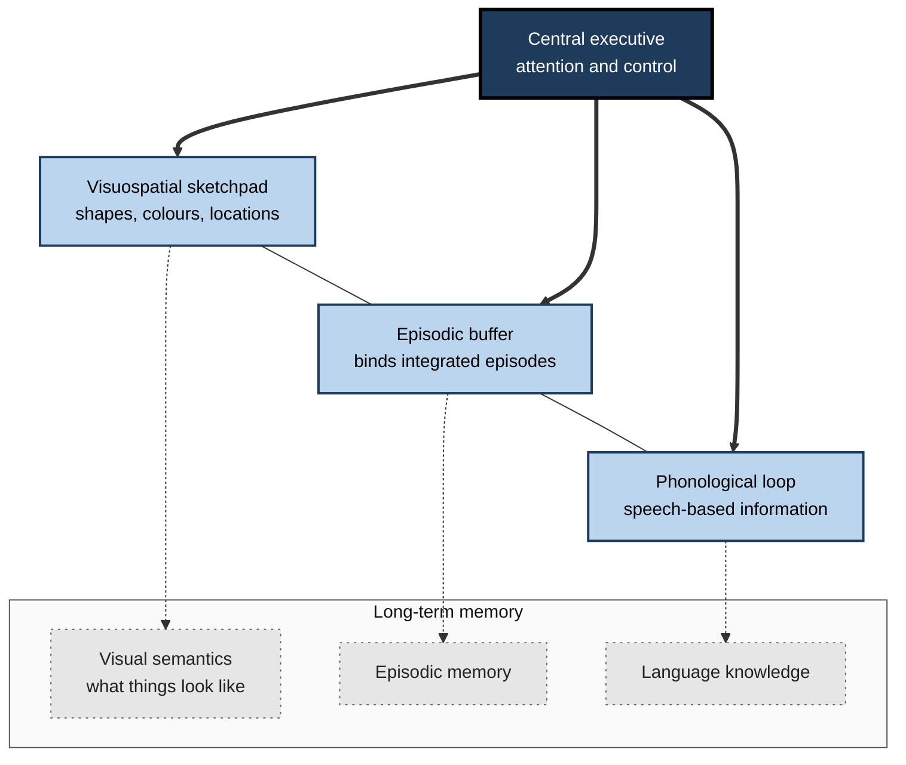
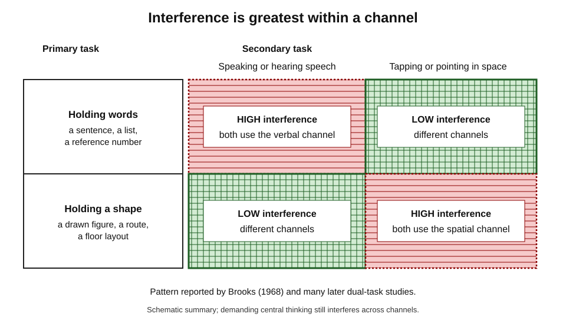
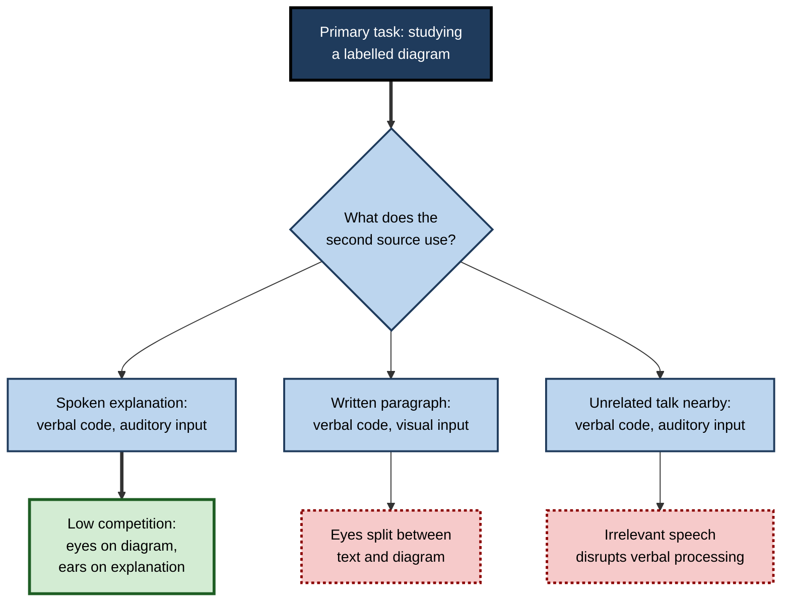
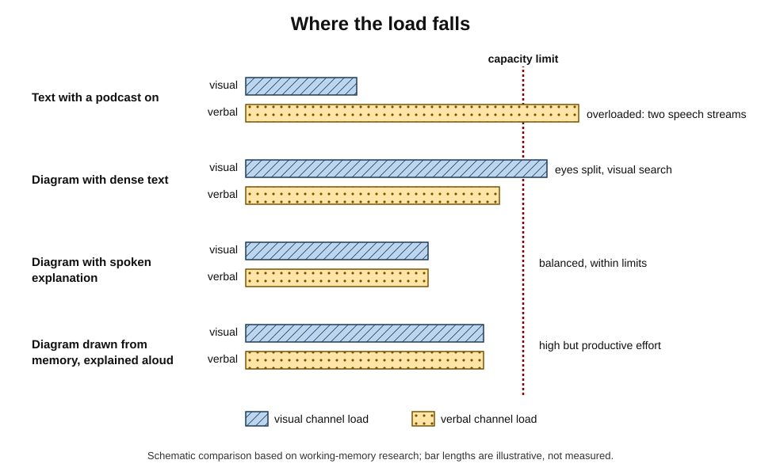
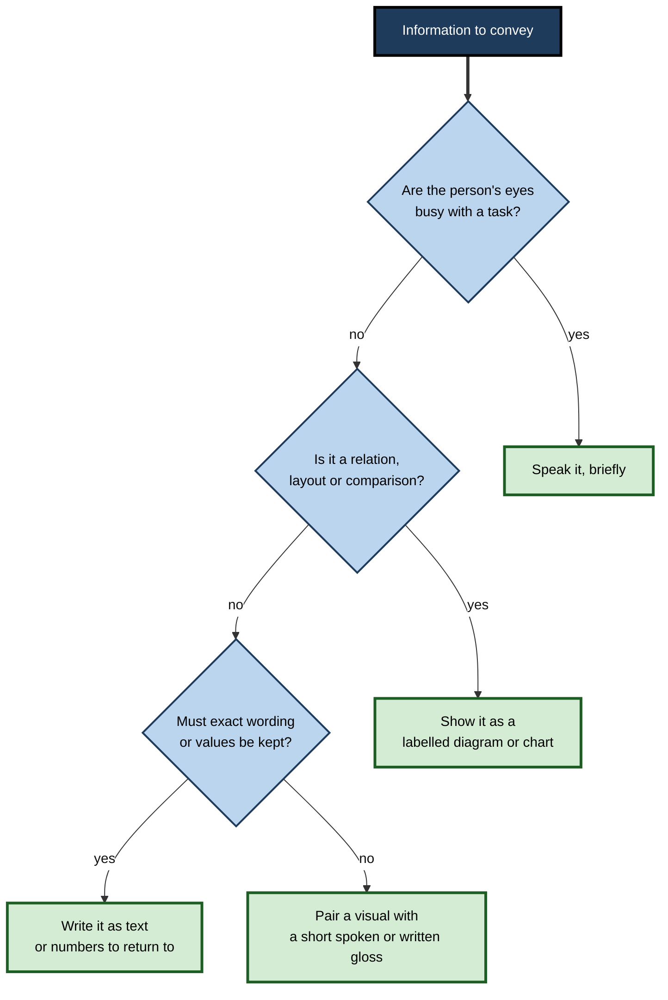

# G.2. Verbal and Visual Memory Channels

A driver can follow a satellite-navigation voice while watching the road, yet struggles to read a text message at the same time. A student can study a diagram while instrumental music plays, yet loses the thread of a paragraph when someone nearby is talking.

These everyday successes and failures reveal that the mind does not have one undifferentiated pool of attention and memory: it has **partly separate channels** for language and for visual and spatial information, each with its own limits.

> **Definition — Memory channel:** a partly independent subsystem of working memory and perception that handles one broad kind of information — chiefly **verbal–auditory** (language and speech sounds) or **visual–spatial** (shapes, images, locations and movement) — with its own limited capacity.

**Why it matters**

- It explains when combining words and visuals **adds** capacity and when it simply **overloads** one channel.
- It underlies the practical rule that a diagram explained by speech is often easier to follow than a diagram explained by dense text.
- It accounts for interference effects that every learner meets: background speech, multitasking, and reading while listening.
- It informs the design of dashboards, cockpits, control rooms, presentations and e-learning.
- It corrects a popular error: the existence of separate channels in **everyone** is not evidence for "visual learners" and "auditory learners".

---

## From One Store to Several

### The short-term store

- **Early models** — notably Richard Atkinson and Richard Shiffrin (1968) — described a single **short-term store** through which information passes on its way to long-term memory.
- **George Miller (1956)** popularised the idea of a limited span, "the magical number seven, plus or minus two".
  - Later work by **Nelson Cowan (2001)** argued that, once rehearsal and grouping are prevented, the true limit is closer to **about four chunks**.
- **The problem:** a single store could not explain why some patients with severely impaired short-term verbal memory could still learn new long-term information normally.
  - **Tim Shallice and Elizabeth Warrington (1970)** described patient **K.F.**, whose digit span was around two items yet whose long-term learning was largely intact.

### Baddeley and Hitch's working memory

- **Alan Baddeley and Graham Hitch (1974)** replaced the single store with **working memory**: a multi-component system for holding and manipulating information during thinking.
- **Original components:**
  - **central executive** — controls attention, switches between tasks and coordinates the subsystems;
  - **phonological loop** — holds speech-based information;
  - **visuospatial sketchpad** — holds visual and spatial information.
- **Addition:** Baddeley (2000) added the **episodic buffer** — a limited store that binds information from the subsystems and long-term memory into integrated episodes.

> **Definition — Working memory:** a limited-capacity system that temporarily holds and manipulates information needed for ongoing tasks such as comprehension, reasoning and learning.

**Figure 1.** The multi-component model of working memory.

---

## The Verbal Channel: the Phonological Loop

### Two parts

- **Phonological store** — holds speech sounds for about two seconds before they fade.
- **Articulatory rehearsal process** — "inner speech" that refreshes the store and converts printed words into sound-based codes.
  - *e.g.* repeating a booking reference under one's breath until it is typed in.

### The evidence for a sound-based store

- **Phonological similarity effect** — lists of similar-sounding letters or words (*B, D, G, P, T*; *man, mat, cap*) are recalled worse than dissimilar ones.
  - **Reuben Conrad (1964)** found that errors in recalling visually presented letters were mostly confusions between letters that **sound** alike, not ones that look alike.
  - **Baddeley (1966)** showed that similarity of sound harmed short-term recall far more than similarity of meaning.
- **Word length effect** — **Baddeley, Neil Thomson and Mary Buchanan (1975)** found that people recall fewer long words (*university*, *opportunity*) than short ones; span roughly matches what can be said in about two seconds.
- **Articulatory suppression** — repeating an irrelevant word ("the, the, the") blocks rehearsal; the word length effect then disappears and visually presented items can no longer be recoded into sound.
- **Irrelevant speech effect** — background speech, even in a language the listener does not understand, impairs serial recall of visually presented items.
  - First reported by **Colle and Welsh (1976)** and studied by **Pierre Salamé and Baddeley (1982)**.
  - Speech and changing-state sounds (such as lyrics) disrupt more than steady noise.

> **Remember:** the verbal channel is **sound-based**, **time-limited** (about two seconds of speech), **rehearsable** and **vulnerable to other speech**.

> **Example:** a student reading a contract clause while a nearby colleague talks on the telephone loses the thread repeatedly — not from lack of effort, but because the irrelevant speech competes for the phonological loop.

### Reading uses the verbal channel

- **Printed words** enter through the eyes but are converted to a sound-based code for holding and rehearsal.
- **Consequence:** text on a page and speech in the ear both compete, after initial perception, for the **verbal** channel.
- This is why reading a slide while listening to a speaker saying something different is so difficult.

---

## The Visual Channel: the Visuospatial Sketchpad

### Visual and spatial components

- **Robert Logie (1995)** proposed two sub-parts:
  - **visual cache** — a passive store for form and colour;
  - **inner scribe** — an active process that handles spatial and movement information and rehearses locations.
- **Evidence for the split:**
  - the **Corsi block task** (Philip Corsi, 1972) — tapping a sequence of blocks in order — measures **spatial-sequential** memory;
  - the **visual patterns test** — remembering which cells in a grid were filled — measures **visual** memory;
  - **Sergio Della Sala and colleagues (1999)** showed that some patients and some interference tasks affect one more than the other.

> **Definition — Visuospatial sketchpad:** the working-memory component that holds and manipulates visual information (shape, colour) and spatial information (location, movement).

### Visual working-memory capacity

- **Steven Luck and Edward Vogel (1997)** — people could hold about **three to four objects** in visual working memory, and each object could include several features (colour, orientation) without much extra cost.
- **Implication:** a diagram with four well-grouped parts can be held at once; one with fifteen ungrouped parts cannot, and must be inspected piece by piece.

### Spatial interference

- **Lee Brooks (1968)** found that pointing responses disrupted memory for a drawn shape while spoken responses disrupted memory for a sentence.
- **Spatial tapping** (tapping a pattern on a keypad) disrupts spatial memory and imagery but leaves verbal span largely unaffected.
- **Eye movements** and spatial attention are closely tied to spatial working memory; moving the eyes around a cluttered display competes with holding locations in mind.

### Imagery is represented spatially

- **Edoardo Bisiach and Claudio Luzzatti (1978)** asked patients with **unilateral neglect** (inattention to one side of space after right-hemisphere damage) to imagine Milan's cathedral square.
  - Imagining it from one end, they described buildings on only the right side of the imagined view.
  - Imagining it from the opposite end, they described the buildings they had previously omitted — and omitted the ones they had just described.
- **Conclusion:** mental images have a spatial layout that can be damaged like perceived space.

**Figure 2.** Selective interference: secondary tasks disrupt the channel they share.

---

## How the Channels Compare

| | Verbal channel | Visual–spatial channel |
|---|---|---|
| Typical content | Words, numbers, speech sounds, names | Shapes, layouts, locations, routes, motion |
| Organisation | Sequential: order is preserved naturally | Simultaneous: parts available together |
| Capacity limit | About two seconds of speech; about four chunks | About three to four objects |
| Rehearsal | Inner speech | Mental scanning and attention to locations |
| Disrupted by | Background speech, articulatory suppression, reading other text | Spatial tapping, irrelevant images, eye movements across clutter |
| Typical failure | Losing the order of steps; confusing similar names | Losing where things are; failing to see relations |
| Strength in learning | Precise statements, sequences, definitions | Relations, structure, proportions, movement |

> **Key point:** the channels are good at **different jobs**. Language carries precision and order; visuals carry structure and relation. Learning is strongest when each does the job it is good at.

---

## Beyond Working Memory: Long-Term Visual and Verbal Memory

### Enormous visual long-term memory

- **Timothy Brady, Talia Konkle, George Alvarez and Aude Oliva (2008)** showed participants about 2,500 photographs of objects over several hours.
  - At test, people distinguished seen objects not only from new objects but from the **same object in a different state** (for example, the same mug full or empty) with high accuracy.
- **Implication:** long-term visual memory stores far more detail than was once thought.

### Recognition is not understanding

- **Caution:** recognising that a picture has been seen is a far easier task than recalling what it means or using it to solve a problem.
- A learner may recognise every slide of a course and still be unable to explain the process it showed.

> **Watch out:** massive picture recognition is sometimes quoted as evidence that "images are processed 60,000 times faster than text". No study supports that figure; it should not be repeated.

### Two streams of visual processing

- **Leslie Ungerleider and Mortimer Mishkin (1982)** — two cortical pathways in monkeys:
  - **ventral ("what") stream** — object identity;
  - **dorsal ("where") stream** — location and spatial relations.
- **Melvyn Goodale and David Milner (1992)** reinterpreted the dorsal stream as serving **vision for action**.
- These pathways mirror the **visual** versus **spatial** distinction found in working-memory studies.

---

## Individual Differences

### Capacity differs

- **Working-memory capacity** varies between people and predicts reading comprehension, reasoning and learning from complex material.
- **Spatial ability** — measured by mental rotation and similar tasks — predicts success in learning from diagrams and three-dimensional models, especially in engineering, surgery and geosciences.
  - Learners with **low spatial ability** often benefit most from well-designed visual support, but can be overwhelmed by complex animations.

### Imagery differs

- **Aphantasia** — a term introduced by **Adam Zeman, Michaela Dewar and Sergio Della Sala (2015)** for the reported absence of voluntary visual imagery.
  - Many people with aphantasia perform normally on visual memory tasks, apparently using spatial or verbal strategies.
- **Hyperphantasia** — exceptionally vivid imagery at the other extreme.
- **Object versus spatial visualisers** — **Maria Kozhevnikov, Stephen Kosslyn and Jennifer Shephard (2005)** found that people who report strong imagery divide into those with vivid pictorial images (often artists) and those with strong spatial–schematic imagery (often scientists and engineers).

### Preference is not a learning style

- Questionnaires distinguishing "visualisers" from "verbalisers" capture real **preferences** and some **abilities**.
- But matching instruction to a preferred channel does not improve learning; well-designed words and visuals together help nearly all learners, whatever their stated preference.

> **Watch out:** "I am a visual learner" usually means "I like pictures". Channel research describes the architecture **every** mind shares; it does not sort people into types who learn only one way.

### Channels across the lifespan

- **Childhood:**
  - young children hold pictures largely as visual codes; from around the age of seven, they increasingly **name** pictures and rehearse the names verbally, so phonological similarity begins to affect their memory for pictures;
  - verbal and visuospatial span both grow through childhood and adolescence.
- **Ageing:**
  - working-memory capacity declines on average in later adulthood;
  - several studies suggest **visuospatial** tasks decline somewhat more steeply than verbal ones, though the size of the difference varies with the tasks used;
  - well-learned verbal knowledge (vocabulary, expertise) is largely preserved and can compensate.
- **Practical consequence:** older learners often benefit from **simpler, well-grouped** visuals and from explicit verbal labels that reduce visual search.

### The verbal channel as a language-learning device

**Study card — Papagno, Valentine and Baddeley (1991)**

- **Design:** adults learned word pairs either in their native language or pairs linking native words to **unfamiliar foreign words**, with or without **articulatory suppression** (repeating an irrelevant sound during learning).
- **Results:**
  - suppression **disrupted** learning of the foreign vocabulary;
  - it had little effect on learning native-language pairs, which could be linked through meaning.
- **Conclusion:** the phonological loop is especially important for learning **new sound forms**.

- **Baddeley, Susan Gathercole and Costanza Papagno (1998)** argued that the phonological loop evolved as a **language-learning device**:
  - children's ability to repeat nonsense words (**nonword repetition**) predicts their later vocabulary growth;
  - adults with larger phonological spans learn foreign vocabulary faster.

> **In practice:** when learning new technical terms, drug names or a foreign language, **say the words aloud** and avoid background speech. The sound form must be built in the verbal channel before meaning can be attached; a picture alone does not supply it.

### Measuring the channels

| Measure | Channel tested | What the person does | What it predicts |
|---|---|---|---|
| Digit span | Verbal storage | Repeats increasing strings of digits | Simple verbal short-term capacity |
| Nonword repetition | Phonological loop | Repeats invented words such as *blonterstaping* | New vocabulary learning |
| Corsi block span | Spatial-sequential | Taps blocks in the order shown | Route and layout memory |
| Visual patterns test | Visual storage | Reproduces filled cells in a grid | Memory for shapes and patterns |
| Reading span or operation span | Complex working memory | Processes sentences or sums while remembering words or letters | Reading comprehension, reasoning, learning from complex material |

- **Reading span** was introduced by **Meredyth Daneman and Patricia Carpenter (1980)**; **operation span** by **Marilyn Turner and Randall Engle (1989)**.
- **Complex span tasks** (storage plus processing) predict academic and professional learning better than simple span tasks, because they tax the central executive as well as a storage channel.

---

## Multiple Channels in Real Tasks

### Wickens's multiple resource theory

- **Christopher Wickens** (from 1984, refined in 2002 and 2008) developed a model widely used in human-factors engineering.
- **Resources differ on four dimensions:**
  - **stages** — perception and thinking versus responding;
  - **codes** — verbal versus spatial;
  - **modalities** — visual versus auditory input;
  - **visual channels** — focal (reading detail) versus ambient (peripheral orientation).
- **Prediction:** two tasks interfere more the more of these dimensions they share.
  - Listening to a spoken route instruction while driving shares fewer resources than reading one.

**Figure 3.** Two tasks interfere more when they share code and modality.

### Talking while driving

**Study card — Strayer and Johnston (2001)**

- **Design:** participants performed a simulated driving-like tracking task while either listening to the radio, listening to a book on tape, or holding a mobile-phone conversation (hand-held or hands-free).
- **Results:**
  - **conversation** — hand-held **or hands-free** — doubled the rate of missed signals and slowed reactions;
  - **listening** to radio or a book produced little impairment.
- **Conclusion:** the problem was not holding the phone but the **central demands of conversation** — generating and comprehending language competed with attention to the visual task.

> **Key point:** separate channels reduce competition at the **input** stage, but the **central executive** remains shared. Two tasks that each demand active thinking interfere even when they use different senses.

---

## The Dual-Channel Assumption in Learning

### From architecture to instruction

- Research on multimedia learning, led by **Richard Mayer** and by **John Sweller** and colleagues, built on the two-channel idea:
  - learners have separate channels for **auditory–verbal** and **visual–pictorial** information;
  - each channel has **limited capacity**;
  - learning requires **active processing** that selects, organises and integrates information across them.
- **The modality effect** — explaining a diagram with speech rather than on-screen text often improves learning — is the clearest instructional consequence (first shown by **Seyed Mousavi, Renae Low and John Sweller, 1995**). It holds best for short, system-paced explanations and can reverse for long or complex verbal content that learners need to reread.

> **Remember:** the instructional consequences are a matter for lesson design; the underlying fact is that **eyes and ears, words and pictures, draw on partly different limited resources**.

### What the channels imply for a learner studying alone

- **Let the visual channel carry structure.** Put relationships, layouts and sequences into a diagram so that verbal memory is not forced to hold them.
- **Let the verbal channel carry precision.** Keep exact definitions, conditions and numbers in words.
- **Avoid feeding the verbal channel twice.** Reading one text while listening to different speech forces both into the phonological loop.
- **Remove irrelevant speech when reading.** Lyrics, podcasts and nearby conversation cost more than instrumental music or steady noise.
- **Chunk visuals to about four groups.** A diagram with a few clear regions fits visual working memory.
- **Explain diagrams aloud.** Self-explaining a diagram while looking at it pairs the channels the way a good narrated explanation does.

**Figure 4.** Load on each channel in four common study arrangements.

---

## Worked Example: Re-planning a Study Session

**Situation:** an analyst preparing for a cloud-architecture certification studies on the train each evening. Their current routine and its channel demands:

| Activity | Visual channel | Verbal channel | Central demand | Diagnosis |
|---|---|---|---|---|
| Reading a dense design guide with a podcast on | Text (then recoded) | Text plus podcast speech | High | Two verbal streams compete; the podcast wins |
| Watching a narrated architecture video | Diagram | Narration | Moderate | Good pairing, if the analyst pauses to think |
| Copying network diagrams from the guide | Diagram | Little | Low | Visual work without meaning; little gain |
| Drawing a network diagram from memory, then explaining it aloud | Self-generated diagram | Self-explanation | High but productive | Strong: both channels and retrieval |

1. **Remove competing speech** — podcast off while reading; save it for walking, when the visual and verbal channels are otherwise free.
2. **Keep the narrated video** but pause after each segment to sketch what was shown.
3. **Replace copying** with drawing from memory, then checking against the source.
4. **Explain aloud** (or in a whisper) the role of each component while pointing at the sketch.

- **Conclusion:** the same 45 minutes now pairs the channels instead of overloading one, and adds retrieval.

> **Watch out:** "multitasking" study — reading with chat notifications, lyrics or television — feels efficient but places two verbal streams in one limited channel. The cost appears in later recall, not in the feeling of being busy.

---

## Channels in Professional Settings

### Designing for operators

- **Aviation** — critical warnings are often **spoken or tonal** because pilots' eyes are busy with displays; lower-priority information stays visual.
- **Medicine** — surgical teams use spoken read-backs ("closed-loop communication") so verbal confirmation does not require eyes to leave the field.
- **Control rooms** — alarm floods (many visual and audible alarms at once) overload both channels; good design prioritises, groups and suppresses.
- **Software and data** — dashboards that require reading many numbers impose verbal load; well-chosen charts move comparisons into the visual channel.

> **In practice:** when people must act while looking, give instructions **by ear**; when they must compare, give the comparison **to the eye** as a chart; when they must remember exact values, give them **in words or numbers** they can return to.

**Figure 5.** Choosing which channel should carry a piece of information.

### Presentations

- A speaker talking over a slide of dense text forces the audience either to read or to listen; most try both and do neither well.
- A slide that shows a **diagram or a single image**, while the speaker supplies the words, pairs the channels.
- Short **key phrases** on screen — labels, not paragraphs — can help listeners follow structure without competing heavily with speech.

### Case study: onboarding contact-centre advisers

- **Situation:** a utility company trained contact-centre advisers to handle billing disputes using a 30-page script and a multi-screen system.
- **Problem:** during live calls, advisers missed key customer statements and gave inconsistent answers; average handling time was long.
- **Diagnosis:**
  - during calls, advisers were **listening** to the customer (verbal–auditory) while **reading** long script paragraphs (verbal–visual) — two verbal streams at once;
  - the screens required searching across many small text fields — high visual search load;
  - training had been a series of reading assignments and quizzes.
- **Actions:**
  1. Converted the dispute process into a **one-page visual decision flow** with short labelled boxes, so advisers could see where they were without reading.
  2. Replaced script paragraphs with **three key phrases** per step.
  3. Re-arranged screen fields so that the dispute-relevant values sat together in one region.
  4. Trained with recorded calls: advisers **listened** while tracing their position on the flow with a finger, then explained their next step aloud.
- **Result:** after the change, supervisors reported fewer missed customer statements in call reviews and quicker time to independent handling for new advisers.
- **Caveats:** the redesign also simplified the policy itself; not every gain can be attributed to the channel changes.
- **Lesson:** when one channel must be kept for listening, move structure into the **visual** channel and strip verbal load to essentials.

### Signs of channel overload

- **Learners re-read the same line repeatedly** — verbal channel saturated.
- **Learners say "I can't see how it fits together"** — structure is trapped in text with no visual representation.
- **Learners track a diagram with a finger and lose their place** — visual search load too high; regroup or label.
- **Learners stop taking in a lecture while writing notes** — writing and listening compete for verbal processing.

---

## Open Questions

- **How separate are the channels really?**
  - Neural and behavioural data show partial independence with strong central interaction; the boundaries between "visual", "spatial" and "verbal" remain debated.
- **What is the role of the episodic buffer in learning?**
  - It is proposed to bind words and images into integrated episodes, but it has proved hard to study directly.
- **How do people with aphantasia learn from diagrams?**
  - Early evidence suggests they use spatial and verbal strategies effectively, but systematic research on their learning is young.
- **Does working-memory training increase channel capacity?**
  - Training improves the trained tasks, but meta-analyses have found little transfer to untrained reasoning or academic learning.
- **How do continuous audio and screen media alter channel use?**
  - Constant podcasts, notifications and split screens are new conditions; their long-term effects on study are not well understood.

---

## Summary

- The mind has **partly separate channels** for **verbal–auditory** and **visual–spatial** information, each of limited capacity.
- **Baddeley and Hitch (1974):** working memory = **central executive**, **phonological loop**, **visuospatial sketchpad**; the **episodic buffer** was added in 2000.
- **Phonological loop:** sound-based, about two seconds of speech, rehearsed by inner speech; shown by **phonological similarity**, **word length**, **articulatory suppression** and **irrelevant speech** effects.
- **Visuospatial sketchpad:** **visual cache** and **inner scribe** (Logie); capacity about three to four objects (Luck and Vogel); spatial interference; images have spatial layout (Bisiach and Luzzatti).
- **Printed text** is seen but processed **verbally**; text and speech compete.
- **Long-term visual memory** is vast (Brady and colleagues), but recognition is not understanding.
- **Individual differences** in capacity, spatial ability and imagery are real; **learning styles** are not supported.
- **Wickens's multiple resource theory:** tasks interfere more when they share stage, code and modality; the **central executive** is shared (Strayer and Johnston on phone conversations).
- **For study:** let visuals carry **structure**, words carry **precision**; avoid two verbal streams; remove irrelevant speech; group diagrams into a few chunks; explain diagrams aloud.

---

## Self-Check

1. Name the four components of Baddeley's working-memory model and the job of each.
2. What did patient K.F. show about memory structure?
3. Describe the phonological similarity and word length effects and what they reveal about the verbal channel.
4. Why does background speech harm reading more than steady noise does?
5. Distinguish the visual cache from the inner scribe, and name a task that measures each.
6. What did Bisiach and Luzzatti's study of neglect show about mental images?
7. Why is printed text said to compete with speech even though one is seen and one is heard?
8. Summarise Strayer and Johnston (2001) and explain why hands-free phones did not remove the impairment.
9. State Wickens's prediction about when two tasks interfere.
10. A colleague says separate channels prove that some people are visual learners. How would you respond?
11. A trainer's slides contain full paragraphs, which the trainer reads aloud while adding comments. Analyse the channel load and redesign the session.
12. A learner studies statistics with a lyrical playlist and a chat window open. Diagnose the problem and recommend changes grounded in channel research.
13. Why might a diagram with 15 unlabelled parts be harder to learn from than one with four labelled groups?

### Answer Key

1. **Central executive** — controls attention and coordinates; **phonological loop** — holds speech-based information; **visuospatial sketchpad** — holds visual and spatial information; **episodic buffer** — binds information into integrated episodes linked to long-term memory.
2. His short-term verbal span was tiny but long-term learning was largely normal, so short-term and long-term memory must be partly separate — undermining a single short-term gateway.
3. Similar-sounding items are recalled worse (similarity effect); long words are recalled worse than short ones (word length effect). Both show the store is **sound-based** and **time-limited**, refreshed by articulation.
4. Speech and changing-state sounds gain obligatory access to the phonological store and disrupt the order of verbal items; steady noise does not.
5. Visual cache — passive store of form and colour (visual patterns test); inner scribe — active spatial and movement rehearsal (Corsi block task).
6. Patients omitted the left side of an imagined scene from whichever viewpoint they imagined, so mental images have spatial structure that can be damaged like perceived space.
7. After perception, printed words are recoded into a sound-based code held in the phonological loop, the same channel that speech uses.
8. Conversation, hand-held or hands-free, doubled missed signals while listening to radio or a book did not; the demand came from central language processing, not from holding the phone.
9. Interference grows with the number of shared resource dimensions — stage, code (verbal or spatial), modality (visual or auditory) and visual channel.
10. The channels are part of **everyone's** architecture; people differ in capacity and preference, but matching instruction to a preferred channel has not been shown to improve learning. Words plus meaningful visuals help nearly everyone.
11. Reading paragraphs and hearing different spoken words both load the verbal channel, and reading aloud duplicates the text. Redesign: replace paragraphs with a diagram or key phrases, speak the explanation, and give a separate handout for reference.
12. Lyrics and chat place irrelevant verbal information in the channel needed for statistical reasoning. Turn off lyrics (instrumental or silence), close chat, and put relationships such as distributions into sketches explained aloud.
13. Visual working memory holds about three to four objects; fifteen ungrouped parts must be searched and re-held repeatedly, whereas four labelled groups fit capacity and link to words.

---

## Glossary

| Term | Meaning |
|---|---|
| Aphantasia | Reported absence of voluntary visual imagery. |
| Articulatory rehearsal | Inner speech that refreshes the phonological store. |
| Articulatory suppression | Repeating an irrelevant sound to block rehearsal. |
| Central executive | Working-memory component that controls attention and coordinates subsystems. |
| Corsi block task | A test of spatial-sequential memory using tapped sequences of blocks. |
| Dorsal stream | Visual pathway for location, spatial relations and action. |
| Episodic buffer | Working-memory store that binds information into integrated episodes. |
| Inner scribe | The active spatial and movement component of the visuospatial sketchpad. |
| Irrelevant speech effect | Disruption of verbal short-term memory by background speech. |
| Memory channel | A partly independent subsystem for one broad kind of information. |
| Modality effect | Better learning when a diagram is explained by speech rather than text, under suitable conditions. |
| Multiple resource theory | Wickens's model predicting interference from shared stages, codes and modalities. |
| Phonological loop | Working-memory component that holds speech-based information. |
| Phonological similarity effect | Poorer recall of similar-sounding items. |
| Spatial ability | Capacity to represent and manipulate spatial information, such as by mental rotation. |
| Ventral stream | Visual pathway for object identity. |
| Visual cache | The passive store for form and colour in the visuospatial sketchpad. |
| Visuospatial sketchpad | Working-memory component for visual and spatial information. |
| Word length effect | Poorer recall of long words than short ones. |
| Working memory | A limited system holding and manipulating information during thinking. |
