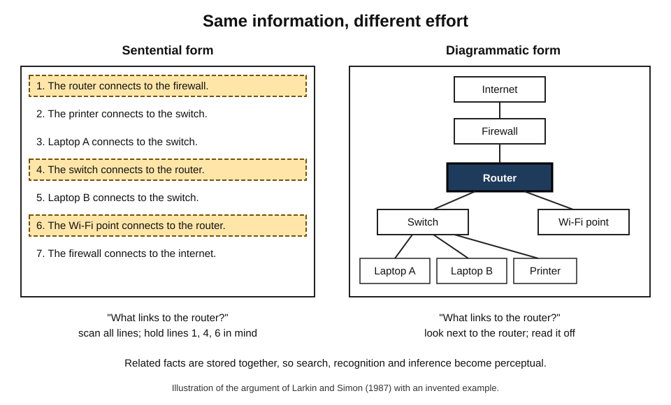
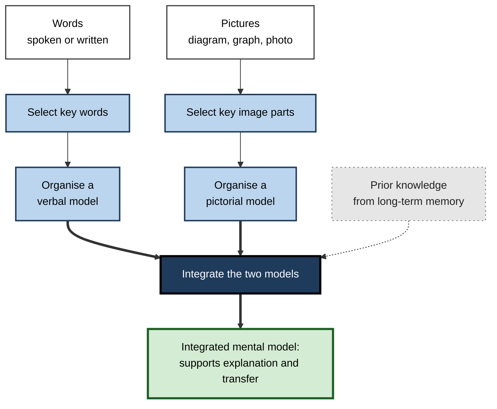
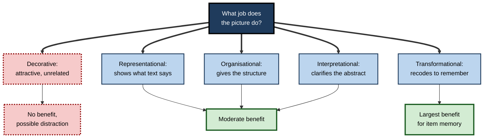
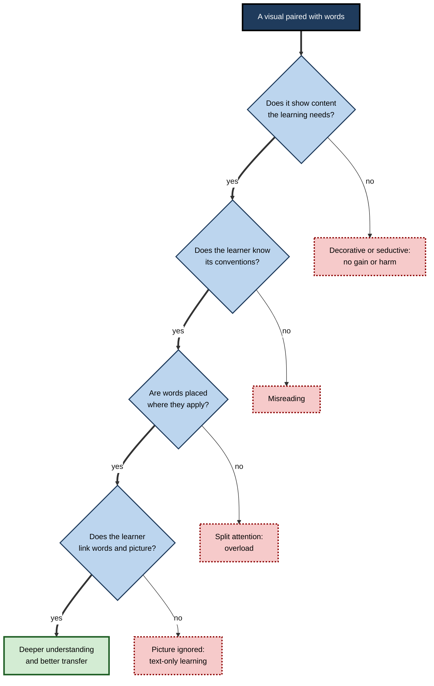
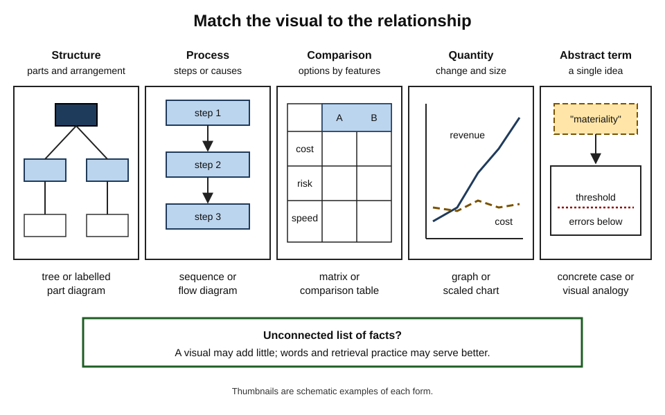

# G.3. Why Combining Visuals and Text Works

Two engineers read the same explanation of how a car's hydraulic brakes work. One reads four paragraphs of clear prose. The other reads the same paragraphs beside a labelled drawing that shows the pedal, piston, fluid and brake pads, with each step numbered.

A week later both can recite some facts, but only the second can answer "What would happen if there were air in the brake line?" The difference is not decoration or enjoyment: the words and the picture together built a **working mental model** that neither built alone.

> **Definition — Word–picture combination:** presenting or constructing an explanation in both **verbal form** (spoken or written words) and **visual form** (pictures, diagrams, graphs, maps) so that each carries part of the meaning and the learner integrates them into one understanding.

> **Definition — Multimedia effect:** the finding that people usually learn more deeply — especially as shown by transfer to new problems — from words and relevant pictures together than from words alone.

**Why it matters**

- It is one of the most consistent findings in educational psychology, replicated across sciences, engineering, medicine, history and procedural training.
- It explains **why** some visuals help a great deal, some help slightly and some harm learning.
- It gives a learner criteria for choosing and making visuals while studying, rather than adding pictures by habit.
- It underlies professional practice in technical writing, consulting, training design, patient information and data communication.

---

## The Basic Finding

### An old idea in teaching

- **John Amos Comenius**, the Czech educator, published *Orbis Sensualium Pictus* ("The Visible World in Pictures") in 1658 — widely regarded as the first illustrated textbook for children, pairing each picture with numbered labels and short sentences in Latin and the vernacular.
- **Anatomy, botany and engineering** relied for centuries on drawings paired with text: Andreas Vesalius's *De humani corporis fabrica* (1543) set a standard for illustrated scientific explanation.
- **What is new** is not the practice but the **evidence** about when and why it works, gathered since the 1970s.

### What words and pictures each do well

| | Words alone | Pictures alone | Words and pictures together |
|---|---|---|---|
| Precision about conditions, negation, exceptions | Strong — "unless", "only if", "not" | Weak — a picture cannot easily show "not" | Strong — words carry the qualifications |
| Showing spatial layout and structure | Weak — must be built in the mind | Strong — visible at once | Strong |
| Showing change over time and causation | Moderate — sequential sentences | Moderate — needs arrows or frames | Strong — frames plus causal words |
| Abstract general principles | Strong but hard to grasp | Weak unless by analogy | Strong — principle plus a concrete instance |
| Speed of first understanding | Slow for complex systems | Fast but can be misread | Fast and checkable |
| Risk | Abstraction without a model | Ambiguity and misreading | Overload if poorly arranged |

> **Key point:** words and pictures are not interchangeable codes for the same message. Each is good at **different parts of the meaning**, and combining them lets each cover the other's weaknesses.

### Early evidence from illustrated text

- **W. Howard Levie and Richard Lentz (1982)** reviewed decades of studies of illustrated text.
  - **Information that was illustrated** was learned considerably better when the picture was present.
  - **Information in the text that was not illustrated** was neither helped nor harmed.
  - Illustrations helped poor readers as well as good ones.
- **Implication:** pictures help learning of **what they depict**; they do not create a general glow that improves everything nearby.

### Mayer's explanatory illustrations

**Study card — Mayer (1989)**

- **Design:** students with little mechanical knowledge read explanations of how car brakes or bicycle pumps work.
  - One group read text alone.
  - Others read text accompanied by **labelled illustrations** showing each part and its state in each step of the process.
- **Results:**
  - the illustrated groups recalled more of the **explanatory** content (the cause-and-effect chain), not just more facts;
  - they also produced more solutions to **transfer** questions such as troubleshooting a faulty pump;
  - the advantage was clearest for learners with **low prior knowledge**.
- **Conclusion:** illustrations that show **how a system works** help learners build a mental model they can reason with.

- **Later work** by Mayer and colleagues repeated this pattern many times — in lessons on lightning, the heart, electric motors and more — with typically **large** effects in controlled laboratory comparisons, and smaller but meaningful effects in classrooms.

> **Key point:** the clearest benefit of combining words and pictures appears on tests of **understanding and transfer**, not on tests of verbatim recall. A good diagram does more for "Why?" and "What if?" than for "What was said?"

---

## Six Mechanisms

The benefit of combining words and visuals has several distinct causes. They often act together, and different visuals exploit different ones.

### 1. Two routes to memory

- **Dual coding** — information held both verbally and as an image has two independent retrieval routes (Allan Paivio's additivity hypothesis).
- **Most important for:** memory of concrete items, terms, names and facts.
- **Limit:** two routes help **recall**, but do not on their own produce understanding.

### 2. Computational efficiency: why a diagram can be worth ten thousand words

**Study card — Larkin and Simon (1987)**

- **Question:** if a diagram and a text contain exactly the same information, why is the diagram often easier to use?
- **Method:** a formal analysis of problems in physics (pulley systems) and geometry, comparing how a reasoner would work through a sentential (text-like) representation versus a diagrammatic one.
- **Findings:** the two representations were **informationally equivalent** but not **computationally equivalent**. The diagram helped in three ways:
  - **Search** — information needed together is located together, so less searching is needed;
  - **Recognition** — relations can be read off by perception (one pulley *is* below another) instead of being worked out;
  - **Inference** — many inferences become "free" perceptual judgements.
- **Conclusion:** a diagram is sometimes worth ten thousand words because of **how** it lets the mind work, not **what** it contains.

> **Definition — Computational equivalence:** two representations are computationally equivalent if the same inferences can be drawn from them with similar ease and speed. Representations can contain the same information and still differ greatly in how easy they are to use.

**Figure 1.** Locating related facts in a text compared with a diagram of the same system.

### 3. Building an integrated mental model

- **Mayer's cognitive theory of multimedia learning** describes three processes:
  - **Select** relevant words and relevant image elements;
  - **Organise** words into a verbal model and image elements into a pictorial model;
  - **Integrate** the two models with each other and with prior knowledge.
- **Wolfgang Schnotz and Maria Bannert (2003)** distinguished two kinds of representation:
  - **descriptive** — symbols with arbitrary structure (words, equations), good for abstract relations, negation and qualification;
  - **depictive** — icons whose structure mirrors what they show (pictures, maps, graphs), good for spatial and quantitative relations that can be "read off".
- **Integration is the step that produces understanding.** It requires mapping each word to its picture element and each depicted relation to its verbal explanation.

> **Mnemonic — "SOI":** **S**elect, **O**rganise, **I**ntegrate — learning from words and pictures happens only when all three occur.

**Figure 2.** Selecting, organising and integrating words and pictures into one mental model.

### 4. Complementary information

- **Shaaron Ainsworth (2006)** developed the **DeFT** framework (Design, Functions, Tasks) for learning with multiple representations. Combined representations serve three broad functions:
  - **Complement** — each carries different information, or supports different processes.
    - *e.g.* text explains *why* a valve opens; the diagram shows *where* it sits.
  - **Constrain** — one representation limits how the other is interpreted.
    - *e.g.* a picture of a specific circuit rules out misreadings of an ambiguous sentence.
  - **Construct** — together they help learners build an abstraction that neither shows alone.
    - *e.g.* a graph and an equation together reveal the general relationship between price and demand.
- **The flip side:** multiple representations also **cost** something — learners must understand each format and translate between them.

### 5. Externalised memory

- **Jiajie Zhang and Donald Norman (1994)** studied puzzles that were logically identical (versions of the Tower of Hanoi) but differed in how many rules were built into the **external** display.
  - When rules were embodied in the physical representation (for example, objects that physically could not be stacked wrongly), people solved the problems faster and with fewer errors.
- **Implication:** a diagram on the page acts as **external working memory**. The learner no longer has to hold every relation in mind; they can look.
- **For study:** sketching while reading offloads structure so working memory can be spent on understanding.

### 6. Guiding attention

- **Spatial layout signals importance and grouping.** A diagram shows at a glance which elements belong together and which is central.
- **Arrows, numbering and highlighting** direct the order of processing.
- **Caution:** this mechanism can work against learning when a visual draws attention to something interesting but irrelevant.

**The six mechanisms compared**

| Mechanism | Main benefit | Best supported by | Fails when |
|---|---|---|---|
| Two routes to memory | Recall of items and terms | Labelled pictures of concrete things | Pictures do not match the words |
| Computational efficiency | Faster, easier inference | Diagrams placing related elements together | The diagram's conventions are unfamiliar |
| Integrated mental model | Explanation and transfer | Explanatory diagrams paired with causal text | Learners look at one source and ignore the other |
| Complementary information | Fuller understanding | Each format doing what it does best | Formats repeat each other or conflict |
| Externalised memory | Reduced working-memory load | Persistent, well-organised visuals | The visual is transient or cluttered |
| Guiding attention | Focus on what matters | Clear hierarchy, arrows, grouping | Attention is drawn to irrelevant detail |

---

## What Pictures Do: Levin's Functions

**Joel Levin, Gary Anglin and Russell Carney (1987)** classified the jobs that pictures do in text and summarised their effects across many studies; Carney and Levin (2002) updated the review.

- **Decorative** — make a page attractive; little relation to content.
  - *e.g.* a stock photograph of a smiling team beside a paragraph on project governance.
  - **Effect:** essentially none on learning.
- **Representational** — depict what the text describes.
  - *e.g.* a photograph of the actual control panel described in the procedure.
  - **Effect:** moderate benefit.
- **Organisational** — give a framework that structures the content.
  - *e.g.* a map of a supply chain with each stage that the text discusses.
  - **Effect:** moderate benefit.
- **Interpretational** — clarify difficult or abstract content, often through analogy.
  - *e.g.* electrical current shown as water flowing through pipes of different widths.
  - **Effect:** moderate benefit.
- **Transformational** — recode information into a memorable form, often a mnemonic image.
  - *e.g.* an interactive image linking a foreign word's sound to its meaning.
  - **Effect:** the largest benefits in the reviewed studies, mainly on memory for specific items.

> **Mnemonic — "DROIT":** **D**ecorative, **R**epresentational, **O**rganisational, **I**nterpretational, **T**ransformational — and only the decorative one does nothing for learning.

**Figure 3.** The five functions of pictures and their typical effect on learning.

> **Watch out:** decorative pictures are not merely neutral. When they are interesting but irrelevant — **seductive details** — they can draw attention and prime the wrong topic. Ruth Harp and Richard Mayer (1998) showed that adding vivid, irrelevant illustrations to a lesson on lightning reduced transfer; a 2020 meta-analysis by Narayankripa Sundararajan and Olusola Adesope found an average harmful effect of about g = −0.33.

---

## When Combining Fails

### The learner does not integrate

- **Eye-tracking studies** show that many readers look at illustrations briefly or not at all, and spend most time on the text.
  - Children reading illustrated textbooks often glanced at pictures only fleetingly; better learners made more transitions between text and picture.
- **Implication:** a picture on the page is not a picture in the mind. Integration must be **prompted** or **practised**.

### The visual is too detailed

- **Kirsten Butcher (2006)** compared learning about the heart and circulatory system from text alone, text with **simplified** diagrams and text with more **detailed, realistic** diagrams.
  - Simplified diagrams supported more accurate mental models and more inferences than detailed ones.
- **Lesson:** realism is not the goal; **showing the relations that matter** is.

### The conventions are unfamiliar

- Arrows can mean *causes*, *moves to*, *becomes*, *is followed by* or *is part of*.
- Cross-sections, cutaways, exploded views and logarithmic scales all require **representational competence**.
- Learners who do not know the conventions can misread a diagram confidently.
  - *e.g.* reading a food web's arrows as "eats" when they mean "is eaten by" (energy flows to the eater).

> **Definition — Representational competence:** the ability to read, interpret, create and translate between the representations used in a field — its diagrams, graphs, notations and conventions.

### Prior knowledge changes the picture

- **Richard Mayer and Joan Gallini (1990)** — explanatory illustrations helped **low-knowledge** learners most; high-knowledge learners could build the model from text alone.
- **Expertise reversal** — for experts, extra explanation that duplicates what they already know can **reduce** learning, because it must still be processed (Slava Kalyuga and colleagues, 2003).
- **For a learner:** the more expert one becomes in a domain, the more a **compact diagram** alone serves, and the less one needs the full verbal explanation.

### Spatial ability matters

- **Richard Mayer and Valerie Sims (1994)** found that coordinated narration and animation helped learners with **high spatial ability** more than those with low spatial ability.
  - Their interpretation: high-spatial learners had capacity left over to build connections; low-spatial learners spent their resources simply holding the visual.
- **Implication:** learners who find diagrams hard benefit from **simpler** visuals, step-by-step build-up and explicit verbal pointers to each part.

### Graphs bring their own demands

- **Priti Shah and James Hoeffner (2002)** reviewed graph comprehension and concluded that understanding a graph depends on three things:
  - the **visual features** of the display (which relations stand out);
  - the reader's **knowledge of graph conventions** (axes, scales, legends);
  - the reader's **knowledge of the content**.
- **Common novice errors:**
  - reading a graph as a picture — a rising line on a distance–time graph read as "going uphill";
  - focusing on individual points rather than trends;
  - missing the scale, especially a truncated or logarithmic axis.
- **Lesson:** a graph supports learning only when the learner can **translate** it into a verbal statement ("demand falls as price rises, steeply at first").

> **Example:** a junior analyst shown a chart of customer churn by month reads the tallest bar as "the best month". The axis label — "customers lost" — is what the words were for. Writing the takeaway as a sentence above the chart prevents the misreading.

### Design faults

- **Separation** — a diagram on one page and its explanation on another forces learners to hold one while searching for the other (the **split-attention** effect described by Paul Chandler and John Sweller, 1991).
- **Duplication** — the same words spoken and printed in full can overload learners rather than help (the **redundancy** effect).
- **These are design principles** for instructional materials; for a learner they reduce to one rule: **put each label where it applies, and do not read and hear the same paragraph at once**.

**Figure 4.** Conditions under which combining words and visuals helps or fails.

---

## Studying With Words and Pictures

### The integrating learner

- **Shaaron Ainsworth and Andrea Loizou (2003)** asked students to learn about the circulatory system from either text or diagrams, while **self-explaining** aloud.
  - Students given diagrams generated **more self-explanations** and learned more.
- **Lesson:** diagrams invite inference; explaining a diagram aloud turns looking into thinking.

### A study routine for illustrated material

1. **Preview the visual** — what kind is it (structure, process, comparison, quantity)? What are its parts? What do the arrows mean?
2. **Read the text in chunks**, and after each chunk **find its place in the visual** — point to it.
3. **Explain the visual aloud** without the text: "Pressure on the pedal pushes the piston, which…".
4. **Ask a what-if question** of the visual: what if this part failed or doubled?
5. **Close both sources and redraw** the core of the visual from memory, labelling it.
6. **Check and correct** the redraw against the original.

> **Remember:** **look–link–explain–redraw**. A picture helps learning only after the learner has linked it to the words and used it to think.

### Where to add a visual of one's own

- **Text describes a structure** (parts and how they are arranged) → sketch the structure.
- **Text describes a process** (steps or causes over time) → sketch a sequence with arrows.
- **Text compares options** on several features → draw a matrix.
- **Text describes quantities changing** → sketch a rough graph.
- **Text is about a single abstract term** → find a concrete case or a visual analogy.
- **Text is a list of unconnected facts** → a visual may not help; retrieval practice may serve better.

**Figure 5.** Which visual form fits which kind of content.

---

## Worked Example: Three Versions of One Explanation

**Situation:** a bank's training team must explain **how a currency swap works** to new operations staff. Three drafts are considered.

| | Version A | Version B | Version C |
|---|---|---|---|
| Content | Three paragraphs of text | The same text, plus a photograph of a trading floor | The same text, cut by a third, beside a labelled diagram of two companies exchanging principal and interest over time |
| Picture function | — | Decorative | Organisational and interpretational |
| Predicted recall of terms | Moderate | Moderate | Higher |
| Predicted ability to answer "What happens at maturity?" | Low to moderate | Low | Higher |
| Risk | Abstract; hard to picture | Attention drawn to the photograph; may cue "trading" rather than "exchange of obligations" | Learners may misread arrows unless labelled "pays" and "receives" |

1. **Identify what is hard:** the flow of payments between two parties at three moments (start, during, end).
2. **Choose the form:** a sequence diagram with two parties and arrows at three time points.
3. **Label each arrow** with what is paid, in which currency, by whom.
4. **Cut text that the diagram now carries**; keep text for **why** each step happens and the risks.
5. **Add one what-if question:** "What changes if one party defaults halfway?"

- **Conclusion:** Version C should produce the best understanding, because the diagram carries **structure and sequence** while the text carries **reasons**, and the two are tightly linked.

> **Watch out:** Version B "looks more engaging" in reviews. Stakeholders often prefer decorative images; the evidence does not.

---

## Professional Practice

### How experts combine words and visuals

- **Technical writers** place a labelled illustration **next to** each procedural step and use the same names in both.
- **Consultants** build each slide around one visual claim and write an **action title** that states the conclusion the visual supports.
- **Clinicians** sketch the anatomy or the timeline of symptoms while explaining a diagnosis to a patient.
- **Engineers** keep architecture diagrams and written decision records side by side, each referring to the other's elements by the same names.
- **Data analysts** annotate charts with the specific point the reader should notice, rather than leaving interpretation to chance.

> **In practice:** use the **same name** for a thing in the words and in the visual. A component called "gateway" in the text and "API layer" on the diagram breaks the link the learner must make.

### Case study: security awareness that changed behaviour

- **Situation:** a professional-services firm ran an annual security-awareness module of text slides describing phishing indicators ("check the sender domain", "be wary of urgency").
- **Problem:** simulated phishing tests showed click rates barely changing year on year.
- **Diagnosis:**
  - indicators were described **abstractly**; staff could recite them but did not recognise them in real messages;
  - the slides used stock images of hooded hackers — **decorative** and possibly seductive;
  - there was no representation of what a real suspicious email **looks like**.
- **Actions:**
  1. Replaced each indicator slide with an **annotated screenshot** of a realistic phishing email, with callouts placed directly on the suspicious sender address, link and wording.
  2. Paired each callout with a one-sentence explanation of **why** it is suspicious.
  3. Added short practice: staff were shown unannotated emails and asked to mark the indicators themselves, then compared with the annotated version.
  4. Removed decorative images.
- **Result:** over the following simulated campaigns, click rates fell and reporting of suspicious emails rose.
- **Caveats:** the redesign added practice and feedback, which also contribute; the firm did not run a controlled comparison.
- **Lesson:** representational visuals **of the real thing**, tightly labelled and actively used, turned abstract rules into recognisable patterns.

### Measuring whether a combination works

- **Test transfer, not recall** — ask learners to explain, predict or troubleshoot.
- **Compare against a text-only version** where possible.
- **Watch how learners use the material** — do they look at the visual? Do they move between it and the text?
- **Ask learners to redraw** — what they omit shows what the visual failed to teach.

---

## Open Questions

- **How large is the benefit outside the laboratory?**
  - Laboratory effects are often large, but most studies use short lessons and immediate tests; effects in long courses and workplaces are smaller and less studied.
- **How can integration be taught?**
  - Training learners to move between text and pictures shows promise, but the best methods and their durability are not settled.
- **When do realistic visuals help?**
  - Simplified diagrams often beat realistic ones for understanding, yet some skills — recognising a skin lesion, a fault on an X-ray — need realism. Where the line falls is still debated.
- **What happens when AI generates the visual?**
  - Learners can now produce diagrams instantly from text; whether this preserves the benefits of selecting and organising, or bypasses them, is largely untested.
- **How do individual differences interact with format?**
  - Spatial ability and prior knowledge clearly matter; how to adapt combinations to them without falling into learning-styles thinking remains an open design problem.

---

## Summary

- Words plus relevant pictures usually produce **deeper learning** than words alone — the **multimedia effect** — especially on **transfer**.
- **Levie and Lentz (1982):** illustrations help learning of **illustrated** content only. **Mayer (1989):** labelled explanatory illustrations improved explanation and transfer, mainly for low-knowledge learners.
- **Six mechanisms:** two memory routes; **computational efficiency** (Larkin and Simon, 1987: search, recognition, inference); an **integrated mental model** (select–organise–integrate; descriptive and depictive representations); **complementary** information (Ainsworth's complement, constrain, construct); **externalised memory** (Zhang and Norman, 1994); **attention guidance**.
- **Levin's functions:** decorative (no effect), representational, organisational, interpretational (moderate), transformational (largest for item memory).
- **Failures:** seductive details (about g = −0.33), learners ignoring pictures, excessive realism (Butcher, 2006), unfamiliar conventions, expertise reversal, separated or duplicated words.
- **Study routine:** look–link–explain–redraw; choose the visual form that matches the content's relationships.
- **Practice:** use the same names in words and visuals, carry structure visually and reasons verbally, and test with transfer questions.

---

## Self-Check

1. State the multimedia effect and the kind of test on which it appears most clearly.
2. What did Levie and Lentz conclude about illustrated and non-illustrated content?
3. Describe Mayer's (1989) study and why low prior knowledge mattered.
4. Explain informational versus computational equivalence using Larkin and Simon's three advantages of diagrams.
5. Distinguish descriptive and depictive representations, with an example of what each does better.
6. Name Ainsworth's three functions of multiple representations and give a workplace example of each.
7. List Levin's five functions of pictures and the typical effect of each.
8. What are seductive details, and what did the 2020 meta-analysis find?
9. Why did simplified diagrams outperform detailed ones in Butcher's study?
10. A learner says, "The textbook had diagrams, so I've dual-coded it." What might have gone wrong, and what routine would you recommend?
11. You are explaining a supply-chain disruption to executives. Decide what goes in the visual and what goes in the words, and justify the split.
12. A senior engineer finds a beginner tutorial with full verbal explanations of every diagram tedious and learns little from it. Explain why.
13. Design a test that would show whether adding a diagram to a policy document improved understanding.

### Answer Key

1. People usually learn more deeply from words and relevant pictures than from words alone; it appears most clearly on **transfer** tests (explaining, predicting, troubleshooting).
2. Illustrations substantially improved learning of the information they depicted and had no effect on text content that was not illustrated.
3. Low-knowledge students learned brakes or pumps from text alone or text with labelled illustrations; illustrations improved explanatory recall and transfer. Low-knowledge learners cannot build the model from words alone; experts can.
4. Two representations can hold the same information (informational equivalence) but differ in ease of use (computational). Diagrams reduce **search** by locating related items together, allow **recognition** of relations by perception, and make some **inferences** free.
5. Descriptive (words, equations) — arbitrary symbols, good for abstract relations, negation, conditions. Depictive (pictures, graphs) — structure mirrors content, good for spatial and quantitative relations read off directly.
6. **Complement** — a procedure's text gives reasons, the photo shows the switch. **Constrain** — a picture of the specific form constrains how "box 7" is interpreted. **Construct** — a table and a chart of sales together reveal a seasonal pattern.
7. Decorative — none; representational, organisational, interpretational — moderate benefits; transformational — the largest, mainly for item memory.
8. Interesting but irrelevant additions to a lesson; they draw attention from the core content. Sundararajan and Adesope (2020) found an average harmful effect of about g = −0.33.
9. Simplified diagrams show the relations that matter without distracting detail, helping learners build an accurate mental model and draw inferences.
10. The learner may not have looked at, linked or used the diagrams. Recommend look–link–explain–redraw: point from text to visual, explain the visual aloud, redraw it from memory and check.
11. Visual: the network of suppliers, plants and markets with the disrupted node and flows (structure, location, quantity). Words: the cause, the options and the recommendation (reasons, conditions, judgement). Each format carries what it does best; labels use the same names as the text.
12. Expertise reversal: the explanation duplicates what the expert already knows, but must still be processed, adding load without benefit. A compact diagram alone suits them better.
13. Randomly give staff the policy with or without the diagram; after a delay, test with unseen scenarios requiring application (transfer), not recall of wording; compare scores and optionally ask both groups to sketch the process.

---

## Glossary

| Term | Meaning |
|---|---|
| Complement (function) | Two representations carrying different information or supporting different processes. |
| Computational equivalence | Representations that support the same inferences with similar ease. |
| Constrain (function) | One representation limiting the interpretation of another. |
| Construct (function) | Representations together supporting a deeper abstraction. |
| Decorative picture | An illustration with little relation to the content. |
| Depictive representation | A representation whose structure mirrors what it shows, such as a picture or graph. |
| Descriptive representation | A representation made of arbitrary symbols, such as words or equations. |
| Expertise reversal effect | Support that helps novices but hinders experts. |
| Informational equivalence | Representations containing the same information. |
| Integration | Linking verbal and pictorial models with each other and with prior knowledge. |
| Interpretational picture | An illustration that clarifies abstract or difficult content. |
| Multimedia effect | Deeper learning from words and relevant pictures than from words alone. |
| Organisational picture | An illustration that provides a structural framework for content. |
| Representational competence | The ability to read, create and translate a field's representations. |
| Representational picture | An illustration depicting what the text describes. |
| Seductive details | Interesting but irrelevant content that can reduce learning. |
| Split attention | Having to divide attention between physically separated, mutually dependent sources. |
| Transformational picture | An illustration that recodes information into a memorable form. |
| Transfer | Applying learning to new problems or situations. |
| Word–picture combination | Explaining in both verbal and visual form so that the learner integrates them. |
