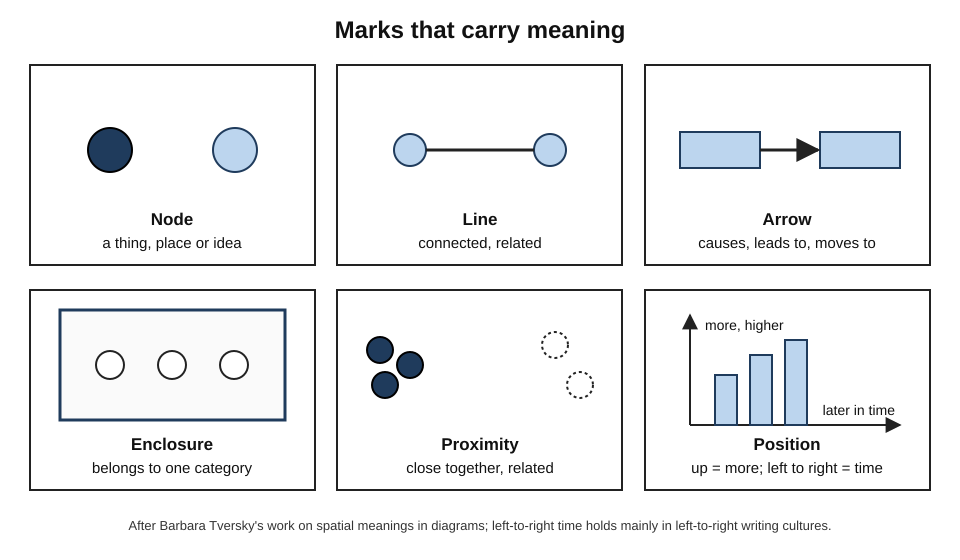
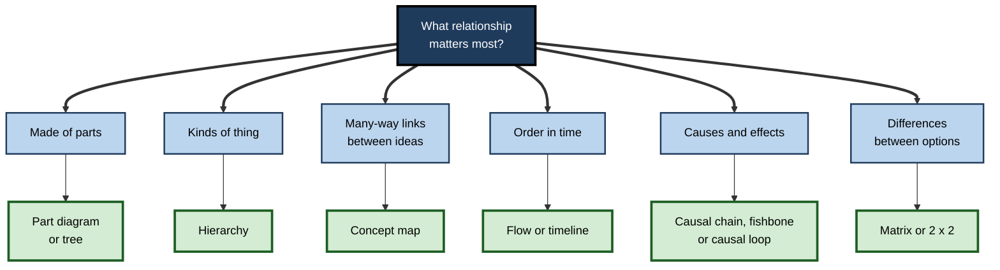
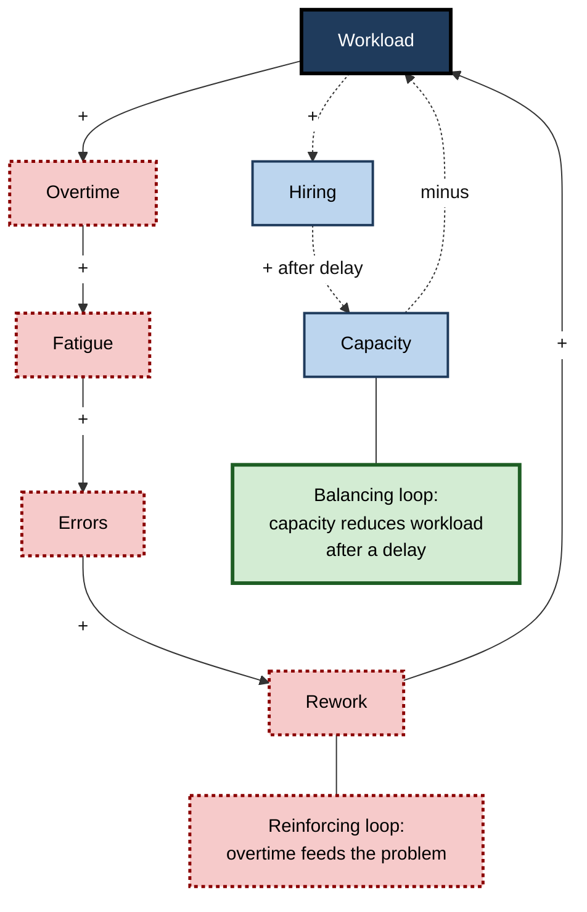
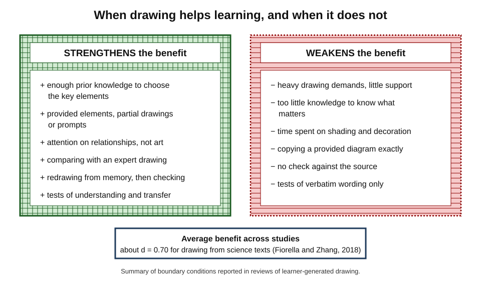
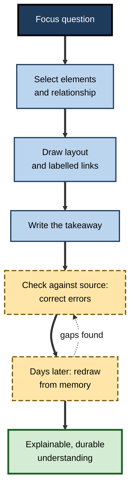
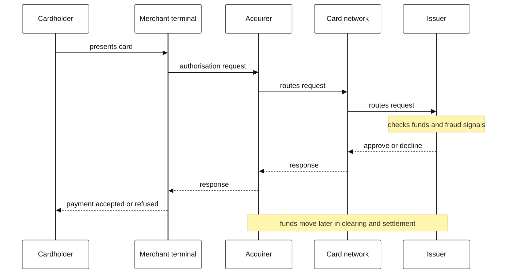

# G.4. Creating Concept Maps and Diagrams

A new analyst reads a forty-page description of how a payments business works and feels that it all makes sense. Asked to explain how a card payment is approved, they stall. A colleague hands them a pen and says: "Draw it." Within five minutes the gaps are obvious — where does the money actually move? Who decides to approve? — and within twenty, after rereading the right pages, the analyst has a diagram they can explain to anyone.

Drawing a diagram is not decoration added after understanding. Done well, it is **one of the most effective ways of reaching understanding**.

> **Definition — Learner-generated diagram:** a visual representation — a sketch, concept map, flow, matrix, graph or schematic — that a learner constructs **themselves** from text, speech or experience, in order to understand and remember the content.

> **Definition — Concept map:** a diagram of concepts in boxes linked by labelled arrows so that each concept–link–concept triple reads as a statement, usually arranged around a focus question.

**Why it matters**

- Constructing a diagram forces the learner to **select** the important ideas, **organise** them into a structure and **integrate** them with what they know.
- It makes misunderstanding **visible** — to the learner and to anyone who looks.
- Learner-generated drawing has moderate-to-large benefits in controlled studies of learning from science text.
- In professional life, the ability to draw a clear diagram of a system, process or argument is a mark of expertise and a powerful communication tool.

---

## Diagrams as Thinking Tools

### The visual vocabulary of diagrams

**Barbara Tversky**, a cognitive psychologist at Stanford University and Columbia, studied how people across cultures use space on a page to represent ideas. She found that a small vocabulary of marks carries broadly shared meanings:

- **Dots and nodes** — places, things or ideas.
- **Lines** — connections or paths between them.
- **Arrows** — direction: cause, movement, sequence, influence.
- **Boxes and enclosures** — containers: everything inside belongs to a category or system.
- **Proximity** — things placed close together are seen as related.
- **Vertical position** — up commonly means more, better, higher in a hierarchy or earlier in a chain of authority.
- **Horizontal position** — in cultures that write left to right, left-to-right commonly means earlier-to-later.

> **Key point:** people already "read" these spatial meanings without instruction. A good diagram **uses** them deliberately; a poor one violates them by accident — placing unrelated things close, or using arrows with different meanings on the same page.

**Figure 1.** The basic marks of diagrams and the meanings they usually carry.

### What drawing makes the mind do

- **Commitment** — prose can stay vague ("factors interact"); a diagram must show **which** factor connects to **which**, in which direction.
- **Completeness checks** — an empty space where a link should be is noticed in a way that a missing sentence is not.
- **Externalisation** — the diagram on the page holds the structure, freeing working memory for reasoning about it.
- **Revision** — a diagram can be inspected, compared with the source and redrawn, making learning an iterative process.

---

## A Family of Diagrams

### Choosing by relationship

The right diagram depends on the **kind of relationship** the content contains.

- **Part–whole** — what a system is made of.
  - *Forms:* labelled part diagram, exploded view, cutaway, tree.
  - *e.g.* the components of a server, the layers of skin.
- **Classification** — what kinds of thing exist.
  - *Forms:* hierarchy or taxonomy tree.
  - *e.g.* types of contract; classes of drugs.
- **Network of concepts** — how ideas relate in many directions.
  - *Forms:* concept map, system map.
  - *e.g.* how interest rates, inflation and employment influence each other.
- **Sequence and process** — what happens in what order.
  - *Forms:* flow diagram, numbered sequence, timeline.
  - *e.g.* the stages of a sale; an incident's history.
- **Cause and effect** — what produces what.
  - *Forms:* causal chain, fishbone (Ishikawa) diagram, causal loop diagram.
  - *e.g.* the causes of a production defect; feedback in a housing market.
- **Comparison** — how options differ.
  - *Forms:* matrix, comparison table, Venn diagram, 2 × 2 grid.
  - *e.g.* three cloud providers against cost, security and support.
- **Quantity** — how much and how it changes.
  - *Forms:* graph, bar chart, scatter plot.
  - *e.g.* cost per unit as volume grows.
- **Space** — where things are.
  - *Forms:* map, floor plan, cross-section.
  - *e.g.* the layout of a data centre; the anatomy of the knee.

> **Mnemonic — "People Can Not Simply Count Coins Quickly Somewhere":** **P**art–whole, **C**lassification, **N**etwork, **S**equence, **C**ause, **C**omparison, **Q**uantity, **S**pace.

**Figure 2.** Matching the relationship in the content to a diagram form.

### Concept maps in brief

- **Origin:** Joseph Novak's group at Cornell University in the 1970s, drawing on David Ausubel's theory of meaningful learning.
- **Distinctive feature:** every link carries a **label**, so the map is a set of checkable statements — "Interest rates *increase* borrowing costs".
- **Strength:** reveals whether the learner understands **relationships**, not just terms.
- **Evidence:** meta-analyses find that **constructing** concept maps benefits learning more than studying ready-made ones; building the map **from memory** adds the benefit of retrieval.
- **Typical fault:** maps of unlinked keywords radiating from a centre, which record topics but not understanding.

### Causal diagrams for systems

- **Fishbone diagram** — **Kaoru Ishikawa** (1960s, Japanese quality management): the problem at the "head", causes grouped by category along the "bones" (people, methods, machines, materials, measurement, environment).
- **Causal loop diagram** — from **system dynamics**, developed by **Jay Forrester** at MIT from the late 1950s:
  - variables linked by arrows marked **+** (move in the same direction) or **−** (move in opposite directions);
  - closed loops are **reinforcing** (amplify change) or **balancing** (resist change).
- **Why learners need them:** many professional errors come from linear thinking about systems with feedback — hiring to fix overload that new hires initially worsen, discounting that trains customers to wait for discounts.

> **Example:** a causal loop for staff burnout — *workload* **+** → *overtime* **+** → *fatigue* **+** → *errors* **+** → *rework* **+** → *workload*. Drawing it shows a **reinforcing loop**: the obvious fix (more overtime) feeds the problem.

**Figure 3.** A reinforcing loop of workload and rework, with a balancing loop through hiring.

---

## Drawing to Learn: the Evidence

### Early reviews

- **Peggy Van Meter and Joanna Garner (2005)** reviewed research on **learner-generated drawing** and proposed a **generative theory of drawing construction**:
  - learners **select** information from text;
  - **organise** it into a verbal model;
  - **construct** a corresponding nonverbal (image) model by drawing;
  - **integrate** the two.
- **Their conclusion:** drawing often helps — especially for understanding — **but only when learners are supported**, for example by prompts, partial drawings or comparison with an expert illustration.
- **Van Meter (2001)** found that children who drew while reading science text learned more when they were prompted to **compare their drawing with a provided illustration** and correct it.

### Drawing with support

**Study card — Schwamborn, Mayer, Thillmann, Leopold and Leutner (2010)**

- **Design:** secondary-school students read a science text on how detergents remove grease from clothes during washing.
  - One group read only.
  - Another drew pictures of the process while reading, using **provided background drawings and element pictures** (for example, a ready-drawn water molecule and grease particle) to place and arrange.
- **Results:**
  - drawers performed better on **transfer** tests and on tests of drawing the process;
  - the **accuracy** of students' drawings during learning predicted their later test performance.
- **Conclusion:** drawing helps when the mechanics of drawing are made easy, so that effort goes into **organising and integrating** rather than into artistic production. The predictive quality of drawings was termed the **prognostic drawing effect**.

> **Definition — Generative drawing effect:** better learning from text when learners construct drawings of its content, compared with only reading.

> **Definition — Prognostic drawing effect:** the finding that the quality of learners' drawings during study predicts how well they will perform on later tests.

### When drawing does not help

- **Too much load:** in one study by Detlev Leutner, Claudia Leopold and Elke Sumfleth (2009), students who were told to **imagine** the content of a chemistry text understood it better, whereas students told to **draw** it did not gain, and reported higher cognitive load.
- **Too little prior knowledge:** a learner who cannot yet identify the key elements draws the wrong things.
- **Too much attention to art:** time spent shading and decorating is time not spent thinking about relationships.
- **Copying instead of constructing:** reproducing a textbook diagram exactly involves little selection or organisation.

### The meta-analytic picture

**Study card — Fiorella and Zhang (2018)**

- **Design:** a review and meta-analysis of experiments on learning by drawing, focusing on studies in which learners drew while learning from **science texts**.
- **Results:**
  - across 15 such studies, drawing produced an average benefit of about **d = 0.70** compared with reading alone or non-generative activities;
  - benefits were larger when learners received **support** (such as provided elements, training or prompts) and when tests measured understanding and transfer;
  - benefits were smaller or absent when drawing demands were high and support was missing.
- **Conclusion:** learning by drawing is effective under the right **boundary conditions**: the learner must have enough knowledge and support to draw the important relationships.

**Figure 4.** Conditions that strengthen or weaken the benefit of drawing to learn.

### Drawing in science education

- **Shaaron Ainsworth, Vaughan Prain and Russell Tytler (2011)** argued that drawing should be a core activity in science education because it helps learners:
  - **engage** with the material;
  - learn the **representational conventions** of science;
  - **reason** — drawing is a way of working out ideas, not only displaying them;
  - **learn** — as a generative strategy;
  - **communicate** their understanding.
- **Logan Fiorella and Richard Mayer (2015)** placed drawing and mapping among eight evidence-based **generative learning strategies**, alongside summarising, imagining, self-testing, self-explaining, teaching and enacting.

> **Watch out:** "drawing helps" is not the same as "any drawing helps". The benefit comes from selecting, organising and integrating **relationships** — and it shrinks when drawing is decoration, copying or a struggle with the pen.

**Comparing ways of producing a diagram**

| | Copying a provided diagram | Drawing with the source open | Drawing from memory, then checking | Drawing with provided elements |
|---|---|---|---|---|
| Selection required | Little | Some | Much | Some |
| Organisation required | Little | Much | Much | Much |
| Retrieval | None | None | Strong | None or some |
| Load on drawing skill | Low | Moderate | Moderate | Low |
| Best use | Learning a field's conventions | First pass on new material | Consolidating and revealing gaps | Novices facing complex systems |
| Main risk | Passive reproduction | Becomes copying | Errors if unchecked | Learner relies on given pieces |

---

## Building a Diagram from Text

### A procedure

1. **Set a focus question** — what should the diagram answer? ("How is a card payment approved?")
2. **Identify the main relationship** — structure, sequence, cause, comparison, quantity or space.
3. **List the elements** — no more than about eight to twelve at first.
4. **Choose a layout** that matches the relationship — top-to-bottom for hierarchy, left-to-right for time, radial only if links truly run from one centre.
5. **Draw and label the links** — every arrow says what it means ("sends request to", "pays").
6. **Write the takeaway** — one sentence that states what the diagram shows.
7. **Check against the source** — correct errors in a different colour or pen.
8. **Later, redraw from memory** — then check again.

> **Remember:** **Question → Relationship → Elements → Layout → Links → Takeaway → Check → Redraw.**

**Figure 5.** The cycle of constructing, checking and redrawing a diagram.

### Worked example: how a card payment is approved

**Source text (summarised):** "When a cardholder pays a merchant, the merchant's payment terminal sends the transaction to the merchant's bank (the acquirer). The acquirer routes it through the card network to the cardholder's bank (the issuer), which checks the account and fraud signals and approves or declines. The response returns along the same path. Funds are moved later, in clearing and settlement."

1. **Focus question:** "Who does what, in what order, when a card payment is approved?"
2. **Relationship:** a **sequence of messages** between parties, plus a later money flow.
3. **Elements:** cardholder, merchant terminal, acquirer, card network, issuer.
4. **Layout:** parties as vertical lanes; messages as arrows over time — a sequence diagram.
5. **Links:** "authorisation request", "routes", "checks funds and fraud", "approve or decline".
6. **Takeaway:** "Approval is a message round-trip decided by the issuer; the money moves later."

**Figure 6.** A sequence diagram of card-payment authorisation drawn from the source text.

- **What the drawing revealed:** the analyst had assumed the card network approves payments; the diagram forced the question "who decides?" and the source said the **issuer**.
- **What the diagram leaves to words:** fraud rules, fees, chargebacks — conditions and exceptions that words handle better.

> **Watch out:** the most common error in a first diagram is **unlabelled arrows**. An arrow between "acquirer" and "issuer" could mean money, a message, a contract or ownership. Label every arrow until the convention is unmistakable.

### Judging a diagram's quality

- **Accurate** — every element and link is correct according to the source.
- **Sufficient** — it answers the focus question without important gaps.
- **Explicit** — links are labelled; directions are clear.
- **Structured** — the layout reflects the logic (time flows one way; hierarchy runs top-down).
- **Economical** — no element is there only for decoration.
- **Consistent** — the same symbol means the same thing everywhere.

| Feature | Weak diagram | Strong diagram |
|---|---|---|
| Focus | "Payments" | "Who approves a card payment, and when does money move?" |
| Elements | Twenty boxes, including logos | Five parties |
| Links | Unlabelled lines | Labelled, directional arrows |
| Layout | Scattered | Lanes left to right, time downward |
| Takeaway | None | One stated sentence |
| Evidence of understanding | Hard to judge | Every statement checkable |

---

## Common Faults and How to Fix Them

### Faults of content

- **Topic map instead of explanation** — boxes name topics ("Risk", "Controls", "Audit") but nothing says how they relate.
  - *Fix:* rewrite each link as a verb phrase; if no verb fits, the relationship is not understood yet.
- **Missing mechanism** — the diagram jumps from cause to final effect.
  - *e.g.* "Interest rates → inflation" with nothing between.
  - *Fix:* ask "how, exactly?" at each arrow until each step is a single, checkable claim.
- **One-way thinking** — no feedback where the system clearly has it.
  - *Fix:* for each effect, ask "does this, in turn, change anything earlier in the chain?"
- **Wrong grain** — some boxes are whole departments, others single fields in a database.
  - *Fix:* choose one level of detail per diagram; draw a separate diagram for the zoomed-in view.
- **Invented certainty** — every link looks equally firm.
  - *Fix:* mark contested or uncertain links with a question mark and a note.

### Faults of form

- **Arrows with mixed meanings** — some mean "causes", others "is part of", others "is followed by".
  - *Fix:* use one meaning per diagram, or distinguish meanings by label.
- **Crossing lines and spaghetti** — layout fights the logic.
  - *Fix:* redraw with the central element in the middle or at the top; group related elements before linking.
- **Decoration** — logos, clip art, colour used for beauty rather than meaning.
  - *Fix:* remove anything that does not answer the focus question.
- **No takeaway** — the reader must guess what the diagram shows.
  - *Fix:* write one sentence above it stating the point.

> **Key point:** most diagram faults are **thinking faults made visible**. That is the value of drawing: the fault is far easier to see and fix on paper than in a paragraph or in the mind.

### From rough sketch to clean diagram

- **First sketch** — fast, messy, with crossings and corrections; its purpose is thinking.
- **Second draft** — rearranged so the layout reflects the logic; arrows labelled.
- **Final version** (only if it will be shared) — consistent symbols, clear typography, a title that states the point.
- Most of the **learning** happens between the first and second drafts; most of the **communication value** is added in the final version.

> **Watch out:** learners who start with a diagramming application often spend their effort on alignment and styling. For learning, pen and paper — or a tablet with a stylus — usually keeps attention on content.

### Budgeting time for drawing

- **Drawing is slower than reading** — a diagram of a dense chapter may take twenty to forty minutes.
- **The cost is worth paying when:**
  - the content is a system, process or argument with many relationships;
  - the learner will need to reason with it later, not merely recognise it;
  - the diagram will be reused for revision or shared with others.
- **The cost is not worth paying when:**
  - the content is a list of independent facts (flashcards and retrieval serve better);
  - the learner already understands the structure and only needs to memorise details.
- **A useful rhythm:** read a section, close the source, sketch for five minutes, reopen and correct — rather than one long drawing session at the end of a chapter.

> **In practice:** a two-minute "napkin sketch" from memory at the end of each meeting or reading session — the three to five boxes that matter and the arrows between them — captures most of the benefit for little time.

### Learning the conventions of a field

- **Every discipline has diagram conventions** that newcomers must learn:
  - electrical circuit symbols; anatomical planes and sections; architectural plans and elevations; chemical structural formulae; Unified Modelling Language in software; organisation charts in management.
- **Novices read conventions literally or not at all.**
  - *e.g.* reading a cross-section as a view of the outside; reading an organisation chart's lines as physical proximity.
- **Robert Kozma and Joel Russell (1997)** found that expert chemists moved fluently between different representations of the same phenomenon (equations, molecular drawings, graphs, animations) and grouped them by **underlying meaning**, whereas students tended to group them by **surface appearance**.
- **For learners:** time spent explicitly learning "what this symbol means here" is not a detour; it is part of acquiring the field's **representational competence**.

### Diagramming with others

- **Shared whiteboards** — physical or online — turn a diagram into a meeting's working memory.
- **Benefits:**
  - disagreements become specific ("the arrow should go the other way");
  - quieter participants can contribute by adding to the drawing;
  - the group leaves with a shared model.
- **Risks:**
  - the person holding the pen controls the framing;
  - a diagram drawn by one person is understood by the others only superficially unless they explain it themselves.
- **Good practice:** pass the pen; ask each participant to explain one part of the diagram aloud; photograph versions as the model evolves.

---

## Professional Diagramming

### Diagrams as professional currency

- **Software architecture** — the **C4 model**, devised by Simon Brown, describes a system at four zoom levels: **context** (the system and its users), **containers** (applications and data stores), **components**, and **code**.
  - Teams that agree such levels avoid the common problem of diagrams mixing everything at once.
- **Data modelling** — **entity–relationship diagrams**, introduced by Peter Chen (1976), show entities, attributes and relationships with their cardinalities ("one customer has many orders").
- **Consulting and strategy** — issue trees, 2 × 2 matrices and value-chain diagrams compress an argument into a page.
- **Medicine** — clinicians sketch anatomy or the timeline of a patient's symptoms to reason and to explain.
- **Law** — party-relationship diagrams and transaction structure charts make complex deals intelligible to clients.
- **Operations** — process maps and fishbone diagrams structure improvement work.

> **In practice:** in a meeting, the person who goes to the whiteboard and draws the system often shapes the discussion. Drawing quickly, labelling clearly and inviting correction ("Is this right?") is a learnable professional skill.

### Diagrams and AI tools

- Text-to-diagram tools and AI assistants can now produce a flow or concept map from a document in seconds.
- **The trade-off:** a generated diagram may be accurate and useful for **communication**, but the learner skips the selecting and organising that produce the learning benefit.
- **A productive pattern:**
  1. draw one's own diagram first;
  2. then generate or consult another version;
  3. compare the two and investigate every difference.
- **Risks:** generated diagrams can contain plausible errors — arrows in the wrong direction, invented components — that a learner without their own model will not notice.

### Case study (illustrative): onboarding engineers by drawing

- **Situation:** a fintech company's new engineers spent their first month reading architecture documents and shadowing colleagues.
- **Problem:** after a month, many still could not explain how a transaction flowed through the platform; incident response by new joiners was slow.
- **Diagnosis:**
  - documentation was long and text-heavy, with a few dense diagrams mixing all levels of detail;
  - new engineers read but were never asked to **produce** an explanation.
- **Actions:**
  1. Each new engineer was given a **focus question** per week ("How does a refund flow through the system?").
  2. They drew a context-level and container-level diagram **from memory** on Friday, then checked it against the codebase and documentation.
  3. A senior engineer reviewed the drawing for fifteen minutes, asking "what happens if this fails?"
  4. Corrected diagrams were added to a shared library, with the newest version credited to its author.
- **Result:** within a few cohorts, new engineers reached independent on-call duties sooner; the shared diagram library also became the most-used documentation.
- **Caveats:** the senior review sessions added coaching time, and this contributed to the gains.
- **Lesson:** **producing** diagrams from memory, then checking and being questioned, built working mental models faster than reading accurate documents.

### What experts do differently

- **They start with the question**, not the subject.
- **They choose a level of detail** and stick to it — one diagram per zoom level.
- **They label arrows** and keep conventions consistent.
- **They sketch roughly and revise often** — a diagram is a tool for thinking, not a finished artwork.
- **They test the diagram** with "what if?" questions and with other people.
- **They know what the diagram cannot show** — conditions, exceptions, uncertainty — and put those in words.

---

## Open Questions

- **How much support is optimal?**
  - Provided elements and prompts help novices, but may reduce the generative work that produces learning. The best balance probably shifts with expertise and is not well mapped.
- **Is drawing better than imagining?**
  - Drawing externalises and can be checked; imagining is faster and lighter on load. Studies disagree on which is better and when.
- **Do benefits extend beyond science texts?**
  - Most rigorous drawing research uses short science passages; evidence for law, management or humanities content is thinner.
- **How should drawing be combined with retrieval?**
  - Drawing from memory appears to combine both benefits, but the optimal sequence and spacing remain to be established.
- **What do AI-generated diagrams do to learning?**
  - They make diagrams cheap but may remove the generative step; good classroom and workplace evidence is not yet available.

---

## Summary

- **Learner-generated diagrams** force selection, organisation and integration, make misunderstanding visible and externalise structure.
- **Visual vocabulary** (Tversky): nodes, lines, arrows, boxes, proximity, vertical and horizontal position carry broadly shared meanings.
- **Choose by relationship:** part–whole, classification, network, sequence, cause, comparison, quantity, space.
- **Concept maps** use labelled links; constructing them beats studying them, and building them from memory adds retrieval. **Fishbone** and **causal loop** diagrams expose causes and feedback.
- **Evidence:** drawing helps when supported (Van Meter and Garner, 2005; Schwamborn and colleagues, 2010); drawing quality predicts learning (**prognostic drawing effect**); average **d ≈ 0.70** for drawing from science texts (Fiorella and Zhang, 2018); benefits shrink with high load, low knowledge, copying or decoration.
- **Procedure:** question → relationship → elements → layout → labelled links → takeaway → check → redraw from memory.
- **Quality:** accurate, sufficient, explicit, structured, economical, consistent.
- **Professional practice:** C4 architecture levels, entity–relationship diagrams, consulting frameworks; draw first, then compare with AI-generated versions.

---

## Self-Check

1. Define a learner-generated diagram and explain three things drawing makes the mind do.
2. List five marks in the visual vocabulary of diagrams and what each usually means.
3. Match each content type to a diagram form: types of insurance policy; causes of late deliveries; options for a new office; a company's revenue over ten years.
4. What distinguishes a concept map from a list of keywords around a centre?
5. Draw (in words) a causal loop for "discounting trains customers to wait for discounts". Is it reinforcing or balancing?
6. Describe Schwamborn and colleagues' (2010) study and the two effects it demonstrated.
7. Why might drawing fail to help, as in Leutner and colleagues' (2009) study?
8. What did Fiorella and Zhang (2018) find, and what are the boundary conditions?
9. Compare drawing with the source open and drawing from memory. When would you use each?
10. Apply the eight-step procedure to "how a bill becomes law" in a parliamentary system.
11. A colleague's architecture diagram has twenty boxes, logos and unlabelled lines. Give specific feedback.
12. A learner generates concept maps of every chapter with an AI tool and studies them. What is lost, and what would you recommend?

### Answer Key

1. A visual representation constructed by the learner. Drawing forces **commitment** to specific links, exposes **gaps**, **externalises** structure to free working memory, and allows **revision**.
2. Nodes — things or ideas; lines — connections; arrows — direction, cause or sequence; boxes — containment or category; proximity — relatedness (also vertical position — hierarchy or quantity; horizontal — time).
3. Types of policy → hierarchy; causes → fishbone or causal chain; office options → matrix; revenue → line graph.
4. Labelled links that make each connection a checkable statement, structured around a focus question and with cross-links, rather than unlabelled associations.
5. Discounts → more sales now (+) → customers learn to expect discounts (+) → customers delay purchases at full price (+) → lower full-price sales (+) → pressure to discount (+) → discounts. It is **reinforcing**.
6. Students reading a text on detergents either read only or drew the process using provided elements; drawers did better on transfer (generative drawing effect), and the accuracy of their drawings predicted test scores (prognostic drawing effect).
7. Drawing imposed extra cognitive load that consumed resources needed for understanding; imagining achieved integration with less load.
8. Average d ≈ 0.70 across 15 science-text studies; benefits depend on enough prior knowledge, support that lowers drawing demands, attention to relationships, and tests of understanding.
9. Source open — a first pass on new material, building an accurate structure. From memory — consolidation, adding retrieval and revealing gaps; then check against the source.
10. Question: "What stages must a bill pass?" Relationship: sequence with decision points. Elements: introduction, readings, committee, other chamber, assent. Layout: top-to-bottom flow. Links: "passes to", "amended by", "returned to". Takeaway: "A bill becomes law only after both chambers agree the same text and it receives assent." Check against the source; redraw days later.
11. Set a focus question and level of detail; reduce to the containers needed; remove logos; label every arrow with what flows; lay out by flow direction; add a one-sentence takeaway.
12. The selecting, organising and integrating that produce learning — and the retrieval of building from memory. Recommend drawing their own map first, then comparing with the generated one and investigating differences.

---

## Glossary

| Term | Meaning |
|---|---|
| Balancing loop | A feedback loop that resists change and seeks equilibrium. |
| C4 model | A way of describing software architecture at four levels: context, containers, components, code. |
| Causal loop diagram | A diagram of variables connected by positive and negative influences forming feedback loops. |
| Concept map | A diagram of concepts linked by labelled arrows forming statements. |
| Entity–relationship diagram | A data-modelling diagram of entities, attributes and relationships. |
| Fishbone diagram | A cause-and-effect diagram grouping causes of a problem by category. |
| Focus question | The question a diagram is built to answer. |
| Generative drawing effect | Better learning from text when learners draw its content. |
| Generative learning strategy | An activity in which learners actively make sense of material by producing something. |
| Learner-generated diagram | A visual representation constructed by the learner. |
| Prognostic drawing effect | The finding that drawing quality during study predicts later test performance. |
| Proposition | A concept–link–concept statement that can be true or false. |
| Reinforcing loop | A feedback loop that amplifies change. |
| Sequence diagram | A diagram showing messages exchanged between parties over time. |
| Visual vocabulary | The basic marks of diagrams and their conventional meanings. |
