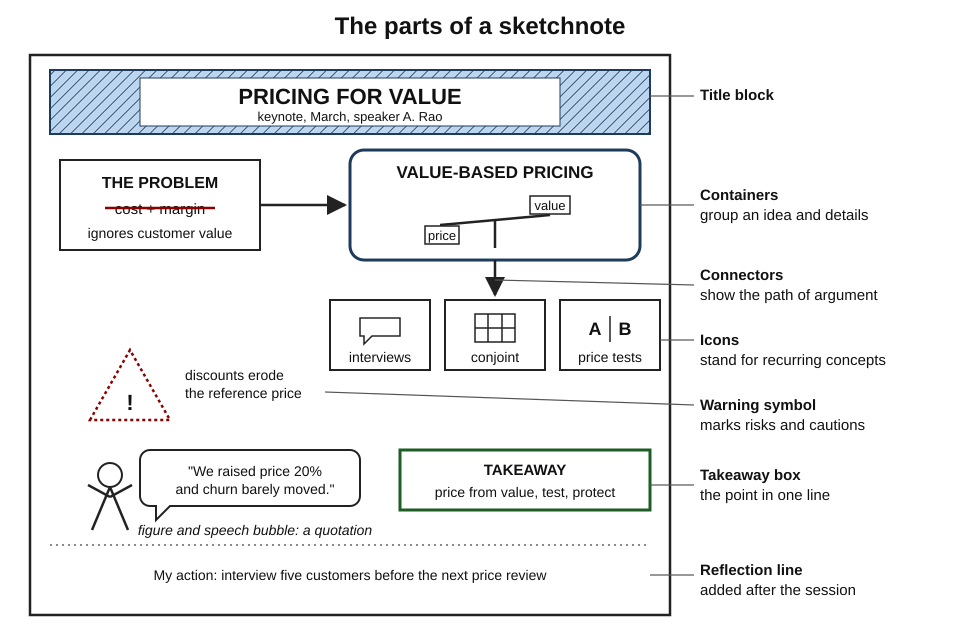
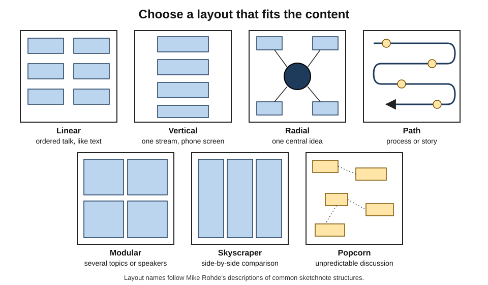
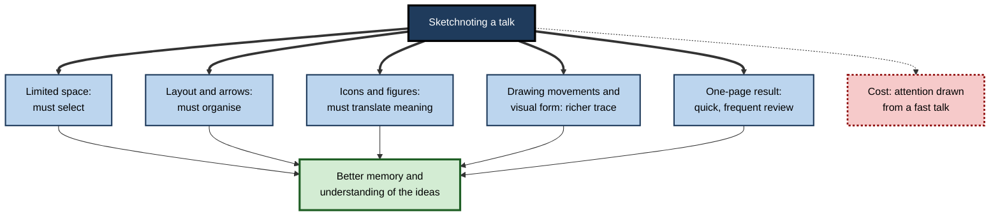
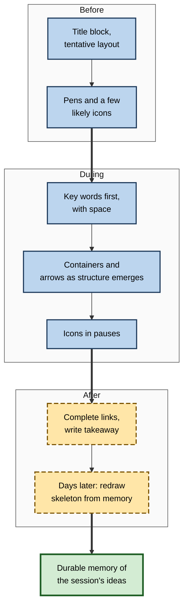
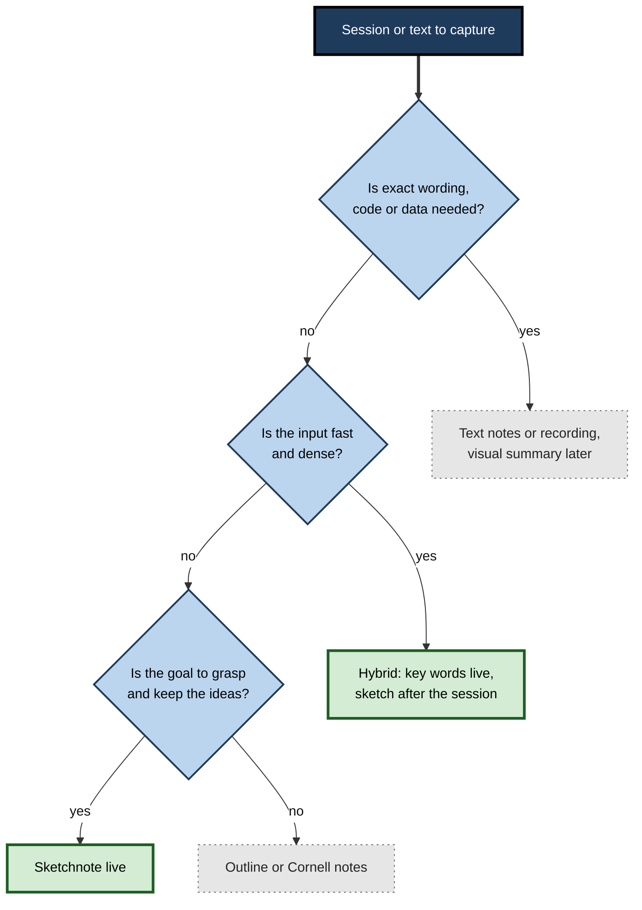

# G.5. Sketchnoting and Visual Notes

Two colleagues attend the same conference keynote. One types nearly every sentence into a laptop and ends with four pages of text. The other fills a single notebook page with a hand-lettered title, five boxed ideas, arrows linking them, a few stick figures and one quotation in a speech bubble. A month later, the first rarely opens the file; the second can still describe the talk's argument by looking at the page for ten seconds — and often without looking at all.

> **Definition — Sketchnote:** a page of notes that combines handwritten words, simple drawings, containers, arrows and deliberate layout to capture the **ideas and structure** of a talk, meeting, book or experience. The term was popularised by the designer Mike Rohde.

> **Definition — Visual note-taking:** any note-taking method that represents content using spatial layout and images as well as words; sketchnoting is one style of it.

**Why it matters**

- It turns note-taking from transcription into **selection and transformation** — the processes that produce learning.
- It applies the **drawing effect**, one of the more striking memory findings of recent years.
- It produces notes that are **fast to review**: structure and key points are visible at a glance.
- In organisations it underpins **graphic recording** of meetings and workshops, a growing professional practice.
- Its benefits are easily overstated; knowing the evidence and the costs separates good use from fashionable use.

---

## Origins

### Old practice

- **Scientific and artistic notebooks** have long mixed words and sketches.
  - **Leonardo da Vinci's** notebooks combine mirror-written notes with anatomical, mechanical and botanical drawings.
  - **Charles Darwin's** notebook of 1837 contains a small branching sketch beneath the words "I think" — an early diagram of common descent.
- **Engineers, architects and field scientists** have always sketched while thinking; the sketch was part of the reasoning, not an illustration of it.

### Modern movements

- **Graphic facilitation** — from the 1970s, **David Sibbet** and colleagues in San Francisco developed methods of drawing large wall charts during group meetings to help groups think, plan and decide.
- **Graphic recording** — artists capture a meeting or conference in real time on large panels, for participants to see and refer to.
- **Sketchnotes** — **Mike Rohde**, an American designer frustrated with dense, unreviewed notes, began making single-page visual summaries of talks; his *The Sketchnote Handbook* (2012) spread the practice widely among designers, developers, teachers and students.
- **Doodling advocacy** — writers such as **Sunni Brown** argued that doodling supports thinking rather than signalling inattention.

> **Key point:** the slogan of the sketchnote movement is **"ideas, not art"**. The aim is to capture and organise thinking; drawing skill is not required.

---

## The Anatomy of a Sketchnote

### Elements

- **Title block** — talk, speaker, date, place; often hand-lettered larger than the rest.
- **Text hierarchy** — three or four sizes or weights of lettering: titles, headings, key phrases, details.
- **Containers** — boxes, circles, clouds and banners that group an idea with its details.
- **Connectors** — arrows and lines showing sequence, cause or relationship.
- **Bullets and dividers** — dots, dashes and lines that separate items and sections.
- **Icons** — simple drawings standing for recurring concepts: a light bulb for an idea, a cylinder for a database, a clock for time.
- **People** — stick or "star" figures with simple expressions and postures.
- **Speech bubbles** — memorable quotations attributed to a speaker.
- **Emphasis** — one accent colour or shading, used for the key points only.

**Figure 1.** The main elements of a sketchnote page.

### Layout patterns

Rohde described several common layouts, chosen before or early in a session:

- **Linear** — left to right, top to bottom, like text.
- **Vertical** — one column running down the page.
- **Radial** — a central idea with branches around it.
- **Path** — a winding route through the page, suited to stories and journeys.
- **Modular** — the page divided into boxes, one per topic or speaker.
- **Skyscraper** — vertical columns side by side, suited to comparisons.
- **Popcorn** — ideas scattered where space allows, linked afterwards.

> **Remember:** choose the layout to match the talk. A **process** talk suits a path; a **panel** of three speakers suits a modular or skyscraper layout; a **single big idea** suits radial.

**Figure 2.** Seven common sketchnote layouts.

### A starter visual vocabulary

- **People:** a star figure (a circle head and a five-pointed body) can show standing, pointing, celebrating, puzzled.
- **Ideas and thinking:** light bulb, thought cloud, question mark.
- **Data and technology:** cylinder (database), rectangle with lines (document), screen, cloud.
- **Time and progress:** clock, calendar, arrow along a line, flag at the end.
- **Money and value:** coin, currency symbol, bar chart.
- **Risk and caution:** warning triangle, lightning bolt.
- **Goals:** target, mountain with flag.
- **Communication:** speech bubble, envelope, megaphone.

> **In practice:** build a **personal icon library** of about twenty icons for the concepts that recur in one's own field — a lawyer's library differs from a nurse's — and practise them until each takes under five seconds to draw.

---

## Why Visual Notes Can Work

### The drawing effect

**Study card — Wammes, Meade and Fernandes (2016)**

- **Design:** university students saw a list of simple, concrete words (such as *apple*) one at a time, with a few seconds for each.
  - For some words, they **drew** a picture of the word's meaning.
  - For others, they **wrote** the word out repeatedly.
  - In later experiments, drawing was compared with other strategies, such as listing the word's physical features or forming a mental image.
- **Results:**
  - on a surprise free-recall test, drawn words were recalled far more often than written words — in several experiments roughly **twice** as often;
  - the advantage held when the time available was short, when drawing was compared with other encoding strategies, and whether drawing and writing were mixed in one list or done in separate lists.
- **Conclusion:** drawing a word's meaning is a reliable, powerful way to make it memorable.

- **Myra Fernandes, Jeffrey Wammes and Melissa Meade (2018)** reviewed the research programme:
  - the drawing effect held for single words, pictures and textbook definitions;
  - drawing beat writing, semantic elaboration, visual imagery and looking at pictures;
  - the **quality** of the drawings — artistic skill — did not predict the size of the benefit;
  - the benefit was found in **older adults** too, sometimes larger than in younger ones.
- **Their explanation:** drawing integrates three kinds of code — **elaborative** (thinking about meaning), **pictorial** (the visual form) and **motor** (the movements of drawing) — into one rich memory trace.

> **Definition — Drawing effect:** the finding that drawing the meaning of information leads to better memory for it than writing it, imagining it or viewing a picture of it.

> **Watch out:** the drawing effect was established mainly with **single words and short definitions** studied for a few seconds each. Sketchnoting a lecture is a different task, with time pressure and complex content. The effect suggests a mechanism; it does not by itself prove that sketchnotes improve learning of whole lectures.

### Doodling and attention

**Study card — Andrade (2010)**

- **Design:** forty participants listened to a deliberately dull telephone message listing names of people coming to a party and places.
  - Half shaded shapes on a sheet while listening (doodling); half did not.
  - Neither group was told to remember the message.
- **Results:** on a surprise test, doodlers recalled about **29% more** information than non-doodlers.
- **Conclusion:** Jackie Andrade suggested that light doodling may reduce **daydreaming**, keeping attention closer to the task.

- **Caution:** a single study with a boring task; doodling unrelated shapes is not the same as drawing content, and doodling during a demanding task may well distract.

### Selection and transformation

- **Note-taking research** distinguishes two functions (Francis Di Vesta and a colleague, 1972):
  - **encoding** — the act of taking notes aids learning;
  - **external storage** — the notes aid later review.
- **Transcription** — copying words as fast as possible — gives little encoding benefit.
- **Sketchnoting forces transformation:**
  - there is no room for every word, so the note-taker must **select**;
  - each idea must be **placed** in relation to others, so they must **organise**;
  - many ideas become a picture or icon, so they must **translate** meaning into a new form.
- **Laptops and handwriting:** Pam Mueller and Daniel Oppenheimer (2014) reported that laptop users wrote more verbatim notes and did worse on conceptual questions than handwriters. Later replications, including a large one led by Heather Urry (2021), found the memory difference small or absent; the **verbatim transcription** problem, rather than the device, is the better-supported concern.

### Review value

- **A single page** holds a whole talk — review takes seconds, so it is likelier to happen.
- **Spatial memory** for where on the page an idea sat becomes a retrieval cue.
- **Structure is explicit** — boxes and arrows show the argument, not just the points.

**Figure 3.** How sketchnoting engages the processes that support memory.

---

## The Evidence and Its Limits

### What is known

- **Strong:** drawing single items' meanings improves memory for them (the drawing effect).
- **Moderately strong:** learner-generated drawing improves understanding of science texts when learners are supported.
- **Moderate:** generative, non-verbatim note-taking is better than transcription.
- **Weak but growing:** studies of sketchnoting as a whole method — mostly small classroom studies, often without random assignment, with mixed results.
  - Some report better delayed retention, for example in vocabulary learning; others find no difference from written notes.
  - Higher-quality sketchnotes — systematic, conceptually integrated — tend to be associated with better retention than superficially decorated ones.

### Costs

- **Attention during live input** — drawing takes time; a fast talk may outrun the note-taker, and content is missed.
- **Load on beginners** — until the visual vocabulary is fluent, deciding how to draw competes with understanding.
- **Decoration drift** — attractive lettering and colour can absorb effort with no learning benefit.
- **Perfectionism and social pressure** — polished sketchnotes shared online set an unrealistic standard; people who feel they "cannot draw" may avoid the method.
- **Poor for detail** — exact figures, legal wording, code and long lists are better captured in text.

> **Watch out:** claims such as "visuals are processed 60,000 times faster than text" or "90% of information transmitted to the brain is visual" circulate widely in sketchnoting materials. They have no credible research source. The case for visual notes rests on the drawing effect and on generative note-taking — not on these figures.

### Comparing note-taking methods

| | Linear notes | Outline | Cornell notes | Mind map | Sketchnote | Graphic recording |
|---|---|---|---|---|---|---|
| Form | Sentences in order | Indented headings | Notes column, cue column, summary | Radial keywords from a centre | Words, icons, containers, arrows on one page | Large real-time wall chart by a specialist |
| Speed during capture | Fast | Fast | Moderate | Moderate | Slower | Specialist skill |
| Shows structure | Weakly | Hierarchy only | Hierarchy plus cues | Radial associations | Flexible; any relationship | Group's discussion flow |
| Encourages selection | Little | Some | Some | Much | Much | Much (by the recorder) |
| Built-in retrieval | No | No | Yes — cue column | No | Only if redrawn | No |
| Best for | Detail, wording | Structured lectures | Revision-focused study | Brainstorming, overview | Talks, books, workshops to remember | Group sense-making |
| Main risk | Transcription | Shallow headings | Skipped summary | Unlabelled links | Decoration, missed content | Participants watch, not think |

---

## A Method That Works

### Before

1. **Prepare the page** — title block, date, speaker; pencil in a layout if the agenda is known.
2. **Prepare the tools** — a fine black pen for text, a thicker pen for headings and containers, one grey or single-colour marker for shading.
3. **Prime the vocabulary** — glance at the session description and sketch two or three icons likely to be needed.

### During

1. **Listen for structure** — signposts such as "three reasons", "first", "the key point is".
2. **Capture words first** — a short phrase for each key idea; leave space around it.
3. **Add containers and arrows** as relationships become clear.
4. **Draw icons in pauses** — when the speaker tells a story or repeats a point.
5. **Mark quotations** with speech bubbles only for genuinely memorable lines.
6. **Accept mess** — a misspelt word or crooked box is fine.

### After (within a day)

1. **Complete** — add missing links, shade the key points, write a one-line takeaway.
2. **Reflect** — add a small box: "What will I do with this?"
3. **Retrieve** — a few days later, without looking, redraw the skeleton of the page: the main boxes and arrows. Then compare.
4. **File** — photograph and tag the page so it can be found.

> **Mnemonic — "PLAN, CAPTURE, COMPLETE, RECALL":** prepare the page, capture key words in structure, complete and reflect within a day, recall by redrawing later.

**Figure 4.** The sketchnoting cycle: before, during and after a session.

### Sketchnoting from reading

- **Reading allows pausing**, so the time pressure of live talks disappears.
- **Method:**
  1. read a chapter section without notes;
  2. close the book and sketch the section's main ideas and their relations;
  3. reopen and correct;
  4. at the end of the chapter, combine the section sketches into one page.
- **Advantage:** this combines **retrieval** (sketching from memory) with **transformation** (turning words into structure and images).

### Choosing when to sketchnote

**Figure 5.** Deciding between sketchnotes and other forms of notes.

### Building the skill

- **Start with structure, not pictures.** For the first few sessions, use only text hierarchy, boxes and arrows.
- **Add icons gradually** — two or three new ones a week, drawn from the concepts that recur in one's work.
- **Practise lettering** — clear capitals for headings, ordinary handwriting for details; consistency matters more than beauty.
- **Rehearse on recordings** — sketchnote a recorded talk with the ability to pause, then try the same talk without pausing.
- **Review old pages** — notice which pages are still clear after a month and which are not, and why.
- **Collect, do not compare** — keep a personal archive; avoid measuring one's pages against polished examples shared online.

> **Key point:** fluency removes the cost. Once boxes, arrows and a few icons are automatic, sketchnoting takes little more effort than writing — and the effort that remains goes into **choosing and connecting ideas**.

### Visual notes across professions

- **Healthcare** — clinicians sketch a patient's timeline of symptoms or an anatomical diagram during handovers and teaching rounds.
- **Law** — trainees draw the parties, relationships and chronology of a case beside their written notes.
- **Engineering and software** — architecture sketches in design meetings; boxes-and-arrows summaries of technical talks.
- **Education** — teachers model sketchnoting so pupils learn to select and structure.
- **Consulting and management** — one-page visual summaries of interviews, workshops and strategy documents.

### Hybrid notes

- **Words remain the backbone.** Most effective visual notes are perhaps three-quarters words, with visuals used for structure and emphasis.
- **Mix freely:** a linear page with a few boxed key ideas, arrows between related points, and an icon beside each action is already a visual note.
- **Use digital tools** — tablets with styluses allow undo, rearranging and searching handwriting; the principle is unchanged.

### Using visual notes for revision

- **Cover and recall** — fold or cover half the page; recall what was in the hidden boxes from the visible structure and icons; uncover and check.
- **Redraw the skeleton** — from a blank page, reproduce only the containers, arrows and headings; details come second.
- **Explain the path** — talk through the page from start to finish without looking, as if presenting it to a colleague.
- **Connect pages** — after several sessions on related topics, draw one overview page linking the main ideas of each.
- **Spread the reviews** — return to the page after a day, a week and a month rather than rereading it repeatedly in one sitting.

> **Watch out:** admiring a finished sketchnote is rereading in disguise. The page becomes a learning tool only when it is used as a **prompt for recall** — when the learner tries to produce its content before looking at it.

---

## Worked Example: From Linear Notes to a Sketchnote

**Situation:** a product manager attends a 40-minute talk, "Pricing for Value". Their usual linear notes run to three pages.

**Linear notes (extract):** "Speaker says most firms price on cost-plus. Problem: ignores customer value. Value-based pricing: understand willingness to pay; segment customers; price differently by segment. Three tools: interviews, conjoint analysis, price tests. Warning: discounts erode reference price. Case: software firm raised price 20%, churn barely changed…"

**Converting to a sketchnote:**

1. **Identify structure:** problem (cost-plus) → alternative (value-based) → three tools → a warning → a case.
2. **Choose layout:** a **path** from problem to case.
3. **Containers:**
   - a box with a crossed-out "cost + margin" formula for the problem;
   - a large box "VALUE-BASED" with a simple scale icon weighing *price* against *value*.
4. **Three tools** as three small boxes along the path, each with an icon: a speech bubble (interviews), a grid (conjoint), an A/B split (tests).
5. **Warning** in a triangle: "discounts erode reference price".
6. **Case** as a star figure beside an upward arrow labelled "+20% price", and a flat line labelled "churn ≈ same".
7. **Takeaway** at the bottom: "Price from the customer's value, test it, protect it."

| | Linear notes | Sketchnote |
|---|---|---|
| Length | Three pages | One page |
| Structure visible at a glance | No | Yes — a path of five stages |
| Wording preserved | Much | Key phrases only |
| Time to review | Several minutes | Under a minute |
| Effort during the talk | Writing speed | Selecting and arranging |

- **Conclusion:** the sketchnote captures the **argument**, which the manager needs; detailed figures from the case can be noted in a corner or looked up later.

> **Watch out:** the sketchnote is only as good as its selection. A beautifully drawn page that misses the speaker's central claim is worse than plain notes that catch it.

---

## Visual Notes at Work

### Uses

- **Meetings** — a one-page visual record of decisions and actions, shared afterwards.
- **Workshops and strategy days** — graphic recording on a wall, so the group sees its own thinking.
- **Retrospectives** — a team draws its sprint as a path with highs, lows and obstacles.
- **User and customer research** — interview notes with quotations, pain points and a sketch of the customer's process.
- **Onboarding** — new joiners sketch the organisation, its products and processes as they learn.
- **Personal learning** — summarising books, courses and podcasts on one page each.

### Graphic recording as a profession

- **Graphic recorders** listen to a group and draw its discussion on large panels in real time.
- **Value:**
  - participants see their contributions captured, which can increase engagement;
  - the panel becomes a shared reference during and after the event;
  - patterns across many speakers become visible.
- **Limits:**
  - the recorder, not the participants, does the selecting and organising — so the **learning** benefit falls mainly on the recorder;
  - the recorder's interpretation can shape the group's memory of the event.

> **In practice:** a graphic recording works best for learning when participants are asked to **interact with it** — walking the wall, adding sticky notes, explaining a section to a colleague — rather than admiring it.

### Case study: interview notes in a product team

- **Situation:** a product team at a logistics software company ran twenty customer interviews a quarter. Notes were typed transcripts in a shared folder.
- **Problem:** few people read the transcripts; insights were lost; the same questions were asked repeatedly.
- **Diagnosis:**
  - transcripts were long, unstructured and **not transformed** — note-takers transcribed rather than selected;
  - there was no quick way for others to grasp an interview.
- **Actions:**
  1. Introduced a one-page **interview sketchnote template**: customer and role at top; their process drawn as a path; pain points marked with warning triangles; quotations in speech bubbles; opportunities in boxes at the bottom.
  2. Note-takers completed the page within an hour of each interview.
  3. Pages were pinned in a team space and reviewed at a fortnightly session, where each note-taker explained one page.
  4. Transcripts were kept for reference but no longer the primary record.
- **Result:** the team reported that more members read the interviews; recurring pain points were spotted sooner; note-takers said they understood customers' processes better.
- **Caveats:** outcomes were judged by the team itself, not measured against a control; the fortnightly review session was itself a new learning activity.
- **Lesson:** a constrained visual format forced **selection and structure** at capture and made review quick and social.

### Inclusion and fairness

- **Not everyone wants to draw.** Some learners have motor difficulties, anxiety about drawing, or simply prefer words.
- **Do not grade artistry.** If sketchnotes are used for assessment, criteria should concern ideas and structure.
- **Offer hybrids** — boxes and arrows with words count as visual notes.
- **Accessibility** — sketchnotes shared with others need a text summary for readers using screen readers.

---

## Open Questions

- **Does sketchnoting improve learning from whole lectures and books?**
  - The drawing effect is robust for single items; controlled studies of the full method are few, small and mixed.
- **How long does the beginner cost last?**
  - It is plausible that the load of drawing falls as the visual vocabulary becomes automatic, but this has not been well measured.
- **Is live sketchnoting or post-session sketchnoting better?**
  - Drawing after the session from memory may combine retrieval with transformation and avoid missing content; direct comparisons are scarce.
- **What drives the drawing effect?**
  - Elaborative, pictorial and motor contributions have each been proposed; their relative weight is still being studied.
- **Do digital and paper sketchnotes differ?**
  - The motor experience of a stylus is similar to a pen, but evidence comparing them for learning is limited.

---

## Summary

- **Sketchnotes** (Mike Rohde) combine handwritten words, simple drawings, containers, arrows and layout to capture **ideas and structure**; slogan: **ideas, not art**.
- **Roots:** scientific notebooks (Leonardo, Darwin), graphic facilitation (David Sibbet, 1970s), graphic recording.
- **Elements:** title, text hierarchy, containers, connectors, bullets, icons, people, speech bubbles, one accent. **Layouts:** linear, vertical, radial, path, modular, skyscraper, popcorn.
- **Drawing effect** (Wammes, Meade and Fernandes, 2016): drawing a word's meaning roughly doubled recall versus writing it in several experiments; artistry does not matter; found in older adults too.
- **Doodling** (Andrade, 2010): about 29% better recall of a dull message — a single study with a light task.
- **Transformation, not transcription:** sketchnotes force selection, organisation and translation; verbatim notes give little benefit.
- **Limits:** evidence for whole-method sketchnoting is small and mixed; costs include missed content, beginner load, decoration and unsuitability for detail; popular statistics about visual processing are baseless.
- **Method:** prepare → capture key words first → add structure and icons → complete within a day → redraw from memory later; sketchnote from reading by closing the book first.
- **At work:** meeting records, workshops, retrospectives, customer interviews, onboarding; graphic recordings help learning when participants interact with them.

---

## Self-Check

1. Define a sketchnote and explain the slogan "ideas, not art".
2. Name six elements of a sketchnote and three layout patterns, with the kind of talk each layout suits.
3. Describe the Wammes, Meade and Fernandes (2016) experiment and its main result.
4. What three kinds of code did Fernandes and colleagues propose that drawing integrates?
5. Why should the drawing effect not be taken as proof that sketchnoting lectures improves learning?
6. Summarise Andrade's (2010) doodling study and its limits.
7. Distinguish the encoding and external-storage functions of notes. How does sketchnoting serve each?
8. What did the replications of the laptop-versus-longhand study find, and what is the better-supported concern?
9. Give three costs of sketchnoting and how to reduce each.
10. Convert this into a sketchnote plan: "The speaker described four stages of team development — forming, storming, norming and performing — and warned that teams fall back to storming when membership changes."
11. A firm hires a graphic recorder for its strategy day and expects participants to remember more. Evaluate and improve the plan.
12. A colleague says: "I can't draw, so visual notes aren't for me." Respond using the evidence.

### Answer Key

1. A page of handwritten words, simple drawings, containers, arrows and layout capturing a session's ideas and structure. "Ideas, not art" — the aim is selection and organisation of thinking; drawing quality is irrelevant.
2. Elements: title block, text hierarchy, containers, connectors, icons, people, speech bubbles, accent. Layouts: path — a process or story; modular — a panel of speakers; radial — a single big idea (also skyscraper for comparisons).
3. Students drew or repeatedly wrote simple words for a few seconds each; on a surprise recall test, drawn words were recalled far more often — roughly twice as often in several experiments — and drawing also beat imagery and listing features.
4. Elaborative (meaning), pictorial (visual form) and motor (drawing movements).
5. It was shown mainly for single words and short definitions with unhurried encoding; sketchnoting lectures involves complex content, time pressure and attention costs not tested in those studies.
6. Doodling while listening to a dull message increased surprise recall by about 29%, perhaps by reducing daydreaming. One study, a boring task, unrelated doodles — not evidence that drawing during demanding tasks helps.
7. Encoding — taking notes helps learning; external storage — notes support later review. Sketchnoting forces selection and transformation (encoding) and produces a one-page record that is quick to review (storage).
8. The memory difference between laptop and longhand was small or absent; the better-supported concern is verbatim transcription, which reduces processing regardless of device.
9. Missed content — capture words first, add visuals in pauses or after; beginner load — practise a small icon library; decoration — limit to one accent and judge by ideas captured (also: unsuitable for detail — keep exact figures in text).
10. Layout: a path or cycle with four labelled stages and an icon each (handshake, lightning, agreed rules, rocket); an arrow from "performing" back to "storming" labelled "membership changes"; takeaway: "teams regress when members change — plan for it".
11. The recorder does the selecting and organising, so participants may gain little memory benefit. Improve by having participants walk the wall, explain sections to each other, add sticky notes, and sketch their own one-page summary at the end.
12. Artistic quality did not predict the drawing effect; simple boxes, arrows and stick figures suffice, and hybrid notes that are mostly words with structure still count. A small personal icon library can be learned in an hour.

---

## Glossary

| Term | Meaning |
|---|---|
| Container | A box, circle or shape grouping an idea with its details. |
| Connector | An arrow or line showing sequence or relationship on a page. |
| Cornell notes | A note format with a notes column, a cue column and a summary. |
| Doodling | Making drawings, often unrelated to content, while attending to something else. |
| Drawing effect | Better memory for information whose meaning has been drawn. |
| Encoding function | The learning benefit of the act of taking notes. |
| External storage function | The value of notes as a record for later review. |
| Graphic facilitation | Drawing during meetings to help a group think and decide. |
| Graphic recording | Real-time drawing of a meeting or event's content on large panels. |
| Icon library | A personal set of simple drawings for recurring concepts. |
| Sketchnote | A page of notes combining words, drawings, containers, arrows and layout. |
| Text hierarchy | Different sizes or weights of lettering showing levels of importance. |
| Transcription | Copying words verbatim rather than selecting and transforming them. |
| Visual note-taking | Note-taking that uses spatial layout and images as well as words. |
| Visual vocabulary | The set of icons and marks a note-taker can draw fluently. |
