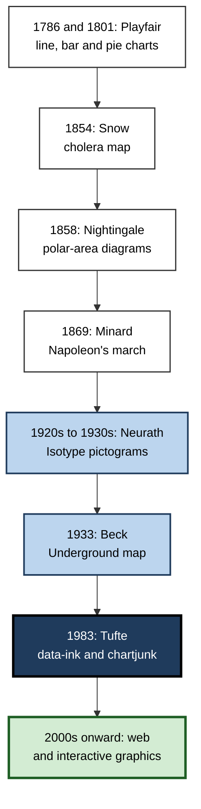
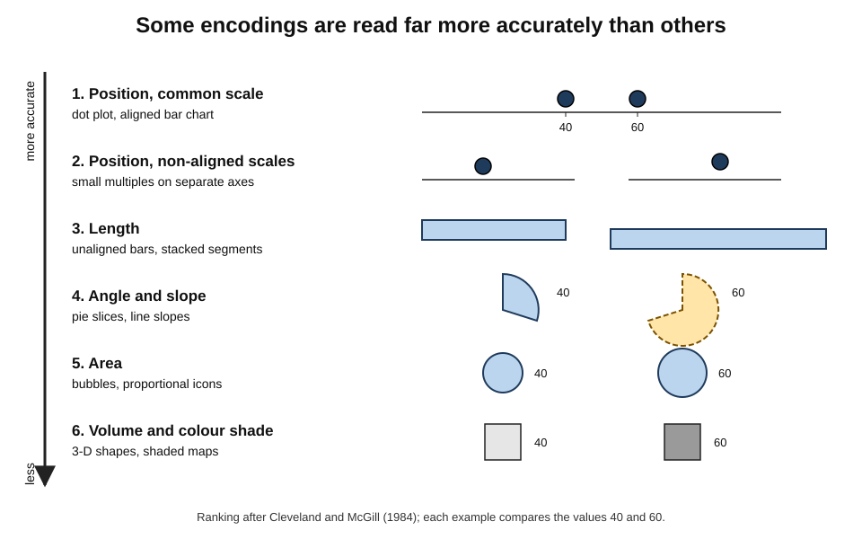
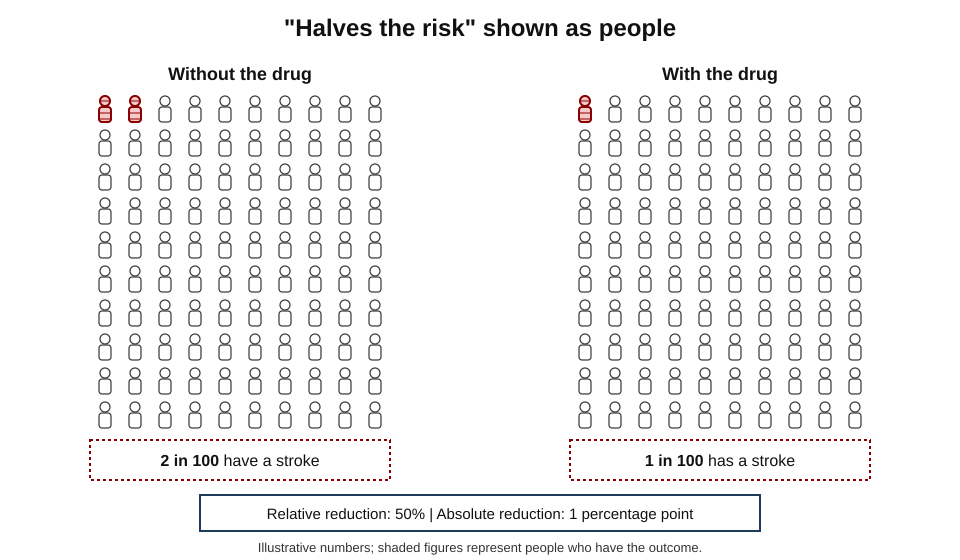
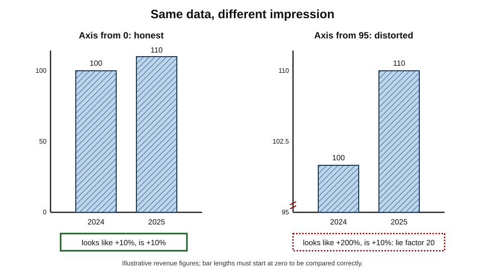
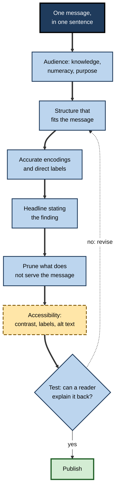

# G.6. Infographics for Learning

In March 2020, a simple chart spread around the world: two curves of infection over time, one tall and narrow, one low and wide, with a horizontal line marking hospital capacity. Millions of people who had never studied epidemiology understood in seconds why slowing transmission mattered, even if the total number of infections were similar. A paragraph could have said the same thing; the chart made it **visible, memorable and shareable**.

Yet the same years produced thousands of infographics that were colourful, widely shared and misleading, or that taught nothing at all. The difference lies in how they were designed and how they were used.

> **Definition — Infographic:** a designed visual composition that combines charts, diagrams, icons, images and short text to explain a topic or convey a message, usually on a single page or screen.

> **Definition — Data visualisation:** the graphical representation of data — numbers or categories — using visual encodings such as position, length, area and colour. Many infographics contain data visualisations; some contain none.

**Why it matters**

- Professionals increasingly receive and must produce **one-page visual explanations** — for executives, clients, patients and the public.
- A well-designed infographic can make structure and quantity understandable at a glance; a poor one can mislead with great confidence.
- For learners, **reading** infographics critically and **making** them from source material are both valuable skills.
- The research on how people perceive graphics gives clear, testable rules for design.

---

## A Short History

### Pioneers

- **William Playfair** (1759–1823), a Scottish engineer and economist, invented or popularised the **line graph** and **bar chart** in *The Commercial and Political Atlas* (1786) and the **pie chart** in 1801.
- **John Snow** (1854) mapped cholera deaths around Broad Street in London; the clustering around one water pump supported his argument that cholera spread through water.
- **Florence Nightingale** (1858) used **polar-area diagrams** to show that far more British soldiers in the Crimean War died from preventable disease than from wounds, persuading officials to reform military hospitals.
- **Charles Joseph Minard** (1869) drew Napoleon's 1812 Russian campaign as a band whose width showed the army's size, shrinking as it advanced and retreated, with temperature plotted beneath.

### The twentieth century

- **Harry Beck's London Underground map** (1933) abandoned geographic accuracy in favour of a clean **topological** diagram — showing connections and order rather than distance — and became the model for transit maps worldwide.
- **Otto Neurath**, with the designer **Gerd Arntz** and **Marie Neurath**, developed **Isotype** in Vienna in the 1920s and 1930s: standardised pictograms in which each icon represents a fixed quantity, so that social statistics could be read by the general public.
- **Edward Tufte**, in *The Visual Display of Quantitative Information* (1983), argued for maximising the **data-ink ratio** and attacked **chartjunk** — decoration that does not show data.
- **Nigel Holmes**, a graphics editor at *Time* magazine, became known for illustrated, embellished charts — the opposite pole of the debate Tufte began.

**Figure 1.** Milestones in the history of explanatory graphics.

> **Key point:** the classic graphics persuaded or explained because each showed **one important comparison** clearly — disease versus wounds, the pump versus elsewhere, the army's size versus distance. Clarity of purpose came before beauty.

---

## Kinds of Infographic

- **Statistical** — one or more charts showing data, with headline and annotation.
  - *e.g.* a one-page summary of a staff survey.
- **Explanatory** ("how it works") — a diagram showing a mechanism.
  - *e.g.* how a heat pump moves heat.
- **Process** — steps in order.
  - *e.g.* how to submit a grant application.
- **Timeline** — events placed along time.
  - *e.g.* the history of a regulation.
- **Comparison** — two or more options side by side.
  - *e.g.* fixed-rate and variable-rate mortgages.
- **Geographic** — information placed on a map.
  - *e.g.* regional sales or disease incidence.
- **Hierarchical** — levels or structures.
  - *e.g.* an organisation's governance.
- **List** — a set of tips or facts with icons.
  - *e.g.* "seven signs of a phishing email".

> **Watch out:** **list infographics** — a column of icons with sentences beside them — are the most common type and the least useful for learning. They look structured but often contain no relationships, so they add little beyond the words.

---

## How People Read Graphics

### Pre-attentive features

- **Anne Treisman's** research on visual search (from 1980) showed that some features "pop out" without effortful search: a single red item among blue ones, a tilted line among upright ones, a large item among small ones.
- **Implication:** an infographic can direct the eye to the one point that matters by making **only that** point different — in colour, size or position.
- **Corollary:** if everything is bold, coloured or large, nothing pops out.

### Gestalt grouping

- **Proximity** — items close together are seen as a group.
- **Similarity** — items alike in shape or shade are seen as related.
- **Enclosure** — items inside a boundary belong together.
- **Connection** — items joined by a line are seen as linked, more strongly than by proximity.
- **Continuity** — the eye follows smooth lines and paths.
- **Use:** group each statistic with its label and its explanation; separate sections with space or boxes rather than many lines.

### Accuracy of visual encodings

**Study card — Cleveland and McGill (1984)**

- **Design:** William Cleveland and Robert McGill, statisticians at Bell Laboratories, asked participants to judge the relative sizes of values shown by different graphical encodings — position along a scale, length, angle, area and others.
- **Results:** judgements were most accurate for **position along a common scale**, then position along non-aligned scales, then **length**, then **angle and slope**, then **area**, with **volume** and **colour shading** least accurate.
- **Conclusion:** choose encodings high on the ranking for the comparisons that matter most. Bar charts and dot plots (position, length) beat pie charts (angle, area) for precise comparison.

**Figure 2.** How accurately people judge quantities shown by different visual encodings.

> **Remember:** **position > length > angle > area > volume > shade.** If two numbers must be compared precisely, put them on a common scale.

### What makes a graphic memorable

**Study card — Borkin and colleagues (2013, 2016)**

- **Design:**
  - **2013:** over 2,000 real visualisations from news media, government reports, science journals and infographic websites were shown briefly to many online participants, who later indicated which they had seen.
  - **2016:** a follow-up tracked eye movements as participants studied visualisations and then asked them to write down everything they recalled.
- **Results:**
  - people were strikingly **consistent** in which graphics they remembered;
  - graphics with recognisable pictures, colour and unusual forms were more memorable than plain, common chart types;
  - **titles and text** attracted much attention; people's descriptions of a graphic's message drew heavily on its **title**;
  - graphics that were memorable at a glance were also, on the whole, those whose message was recalled best.
- **Conclusion:** the title and text are key to whether a graphic's **message** is remembered; visual distinctiveness affects whether the graphic itself is remembered.

### The embellishment debate

- **Tufte's position:** maximise data-ink; remove chartjunk; decoration distracts and can distort.
- **Scott Bateman and colleagues (2010):** compared plain charts with embellished, illustrated versions in the style of Nigel Holmes.
  - Immediate interpretation was **no less accurate** for embellished charts.
  - Recall of the charts' topic and message after two to three weeks was **better** for embellished charts.
- **Caveats:** a small study; the embellishments were relevant to the topic, not random decoration.
- **A reconciliation:** decoration that is **related to the message** can aid memory without harming accuracy; decoration that is **irrelevant** or that **distorts the data** harms understanding.

| | Minimalist (Tufte) view | Embellishment view | Learning-science view |
|---|---|---|---|
| Goal | Accurate reading of data | Engagement and memory | Durable understanding of the key message |
| Decoration | Remove all non-data ink | Use illustration to attract and help recall | Keep only decoration that carries the message |
| Strength | Precision; honesty | Memorability; reach | Combines accuracy with memorable framing |
| Risk | Dry; ignored by general audiences | Distortion; seductive details | Requires judgement about relevance |
| Best for | Expert readers, analysis | Public communication | Teaching and briefing |

---

## Infographics and Learning: the Evidence

### Mixed results

- **Comparisons of infographics with text** give varied results:
  - some studies, such as one at an orthopaedic journal club, report better comprehension and recall when infographic summaries are used;
  - others, such as studies presenting the same facts about genetically modified food as an infographic or a narrative, find **no difference** in recall after a week;
  - readers often **rate** infographics as easier — lower perceived load — even when learning is similar.
- **Why mixed:** "infographic" covers everything from a precise explanatory diagram to a decorated list. Results depend on the **design** and on whether the comparison text was itself well written.

### Where the evidence is strongest

- **Risk communication with icon arrays.**
  - Icon arrays show, for example, 100 figures of which 3 are shaded to represent a 3% risk.
  - **Mirta Galesic, Rocio Garcia-Retamero and Gerd Gigerenzer (2009)** found that icon arrays improved understanding of risk reductions, especially among people with **low numeracy**, who otherwise tended to overestimate the benefit described by relative-risk statements.
- **Explanatory diagrams paired with text** — the research on multimedia learning, which shows deeper understanding when words are paired with relevant explanatory visuals.
- **Visual summaries of research** — many medical journals now publish **visual abstracts** (one-panel summaries of a study's question, method and result), which attract far more attention on social media than text-only posts; whether they improve understanding is less well studied.

**Figure 3.** An icon array showing the same risk reduction as a relative and an absolute change.

> **Example:** "A new drug cuts the risk of stroke by 50%" sounds dramatic. Shown as an icon array — 2 in 100 people have a stroke without the drug, 1 in 100 with it — the reader sees an **absolute** reduction of 1 percentage point. Both statements are true; only the second lets the reader judge the benefit.

> **Watch out:** statements such as "65% of people are visual learners", "people remember 80% of what they see" and "the brain processes images 60,000 times faster than text" appear on countless infographics *about* infographics. None has a credible research source. The case for good infographics rests on perception and multimedia research, not on these figures.

### Reading infographics critically

- **Ask what the graphic claims** — the headline is a claim, not a fact.
- **Check the source and date** of the data.
- **Check the scale** — does the axis start at zero? Is it linear or logarithmic?
- **Check what is compared** — absolute or relative numbers? Totals or rates per person?
- **Check for missing context** — what is left out (a base rate, a comparison group, uncertainty)?
- **Check that areas and icons are proportional** to the numbers they represent.

---

## Honest and Dishonest Graphics

### The lie factor

> **Formula — Lie factor (Tufte):** lie factor = (size of effect shown in the graphic) ÷ (size of effect in the data). Example: revenue grows from 100 to 110 (a 10% increase), but a bar chart with its axis starting at 95 shows the second bar three times as tall as the first (a 200% visual increase). Lie factor = 200% ÷ 10% = **20**. A truthful graphic has a lie factor close to 1.

### Common distortions

- **Truncated axes** on bar charts — exaggerate differences.
  - *Note:* line charts showing change over time may legitimately start above zero if the axis is clearly marked; bar lengths, however, must start at zero to be read correctly.
- **Area and volume scaling** — doubling an icon's height and width quadruples its area.
- **3-D effects** — tilt and depth distort angles and lengths.
- **Cherry-picked time windows** — a trend chosen to start at a low point.
- **Dual axes** — two scales on one chart can make any two series appear correlated.
- **Missing denominators** — counts shown without population sizes.
- **Pie charts with many slices** — angle and area are hard to compare.

**Figure 4.** A truncated axis turns a 10% increase into an apparent tripling.

> **Key point:** distortion is not only dishonest; it **teaches the wrong thing**. A learner who sees a tripling will remember a tripling.

---

## Designing an Infographic for Learning

### A procedure

1. **State the one message** in a sentence — "Hybrid working reduced office costs but raised IT spending."
2. **Know the audience** — prior knowledge, numeracy, what they need to do with the message.
3. **Choose the structure** — statistical, explanatory, process, comparison or timeline — that fits the message.
4. **Plan a reading path** — headline, then main visual, then supporting points; top to bottom or left to right.
5. **Choose encodings** by accuracy — position and length for important comparisons.
6. **Label directly** — put labels next to lines and bars rather than in a separate legend.
7. **Write a headline that states the finding**, not the topic ("Costs fell 18%", not "Office costs").
8. **Cut** everything that does not support the message.
9. **Make it accessible** — sufficient contrast, patterns or labels as well as colour, alternative text.
10. **Test** — ask someone from the audience to explain the message back after a brief look.

> **Mnemonic — "MAP the GRAPH":** **M**essage, **A**udience, **P**ath; then **G**ood encodings, **R**eal labels, **A**ction headline, **P**rune, **H**elp everyone read it.

**Figure 5.** Designing an infographic from message to testing.

### Accessibility

- **Colour vision deficiency** affects roughly **1 in 12 men** and **1 in 200 women** of Northern European descent; red–green confusion is most common.
  - Never rely on colour alone; add labels, patterns or position.
- **Contrast** — the Web Content Accessibility Guidelines recommend a contrast ratio of at least **4.5 : 1** for normal text.
- **Alternative text** — describe the message and key values for screen-reader users; a long description may be needed for complex graphics.
- **Plain language** — short words and sentences for general audiences.
- **Reproduction** — test that the graphic still works when copied in a single colour or viewed on a small phone screen.

### Making infographics as a learning activity

- **Why it can work:** turning a report into a one-page infographic requires **selecting** the key message, **organising** the evidence, and **translating** between words, numbers and images — generative processing.
- **Why it can fail:** much of the effort can go into fonts, colours and icons rather than content; online design templates make attractive but empty layouts easy.
- **Good practice for learners:**
  1. write the message and the three supporting points **before** opening any design tool;
  2. sketch the layout on paper;
  3. check every number against the source;
  4. have a peer explain it back.

> **In practice:** a strong study exercise is to take a dense report chapter and produce a **sketch** of a one-page infographic in fifteen minutes from memory — then check it against the chapter. The quality of the message matters; the quality of the artwork does not.

---

## Worked Example: Redesigning a Staff-Survey Infographic

**Situation:** an HR team's infographic on the annual engagement survey has a stock photo banner, twelve icons with percentages, a 3-D pie chart of response rates by department and the title "Engagement Survey 2025". Leaders glance at it and remember nothing.

| Element | Before | After |
|---|---|---|
| Title | "Engagement Survey 2025" | "Engagement rose in five departments but fell sharply in Operations" |
| Main visual | 3-D pie of response rates | Dot plot of engagement scores by department, last year and this year, joined by lines |
| Supporting data | Twelve icons with unrelated percentages | Three annotated points: the biggest rise, the biggest fall, the main driver |
| Decoration | Stock photo banner | Removed |
| Labels | Legend in a corner | Department names directly beside each line |
| Colour | Eight colours | Grey for all departments; one dark accent for Operations |
| Call to action | None | "Operations leadership review: date and owner" |

1. **Message first:** the important news was the fall in Operations, buried in the original.
2. **Encoding:** a dot plot uses position on a common scale — the most accurate encoding for comparing change.
3. **Pop-out:** only Operations is highlighted, so the eye goes there.
4. **Pruning:** twelve icons reduced to three annotated points that explain the main visual.

- **Conclusion:** the redesigned page teaches one thing clearly and prompts action.

> **Watch out:** stakeholders may ask for "more visuals". The redesign has fewer visual elements but more **visual information**.

---

## Infographics in Professional Practice

### Where they are used

- **Executive briefings** — one-page summaries with a headline finding and a single key chart.
- **Patient and public information** — discharge instructions, screening explanations, vaccination schedules.
- **Policy and regulation** — explaining a new rule's effect on different groups.
- **Training** — process infographics as job aids posted where the task is done.
- **Consulting and finance** — "one-pagers" and deal summaries.
- **Science communication** — visual abstracts for journal articles.

### Case study: explaining an employer pension match

- **Situation:** a manufacturing company offered to match employee pension contributions up to 5% of salary, but fewer than half of eligible staff contributed enough to receive the full match.
- **Problem:** enrolment materials were a four-page text leaflet with percentages, tax rules and fund options.
- **Diagnosis:**
  - many staff did not grasp that **not contributing meant forgoing free money**;
  - percentages of salary were abstract; the long-term effect was invisible;
  - fund choices dominated the leaflet, though the main decision was simply how much to contribute.
- **Actions:**
  1. Created a one-page infographic with the headline "Put in 5%, the company adds 5% — double your saving."
  2. Showed a simple bar for a typical salary: the employee's monthly contribution beside the equal company contribution, with the monthly amounts in rupees or pounds rather than percentages.
  3. Added a line chart of projected savings at retirement for 0%, 3% and 5% contributions, clearly marked as an illustration with stated assumptions.
  4. Moved fund choices and tax detail to the back page.
  5. Tested drafts with a dozen employees on the shop floor and revised wording they misread.
- **Result:** in the next enrolment window, the share of staff contributing at least 5% rose noticeably.
- **Caveats:** the company also ran short briefings and simplified the sign-up form; the infographic was one part of the change.
- **Lesson:** one **message**, made **concrete** in money rather than percentages, with the decision separated from the detail, turned a leaflet into an explanation.

### Job aids: infographics at the point of work

- **A job aid** is a reference placed where a task is done — a laminated card by a machine, a poster in a ward, a one-page guide pinned in a chat channel.
- **Design differs from a learning infographic:**
  - it is consulted **during** the task, often under time pressure, so it must be scannable in seconds;
  - it carries **procedural** content — steps, decision points, thresholds — rather than a single argument;
  - it is used repeatedly, so consistency of layout and icons matters more than novelty.
- **Learning versus reference:** a job aid can reduce errors without anyone learning the procedure. That is acceptable for rare or complex tasks; for frequent, time-critical tasks, the aim is to practise until the aid is rarely needed.

> **In practice:** decide whether a graphic is meant to **teach** (so that people remember and understand) or to **support** (so that people do not need to remember). The first needs practice and retrieval around it; the second needs placement and scannability.

### Interactive and explorable graphics

- **Interactive graphics** let the reader filter, hover for detail, change assumptions or step through a sequence.
- **Scrollytelling** — the graphic changes as the reader scrolls, revealing the explanation in stages — became common in data journalism from the 2010s.
- **Learning potential:**
  - **segmenting** a complex graphic into steps reduces load;
  - **manipulating** assumptions ("what if interest rates were 2% higher?") turns reading into active exploration.
- **Risks:**
  - readers may explore aimlessly and miss the main message;
  - interaction can hide the overview that a static graphic gives at once;
  - interactive versions often fail accessibility checks and do not survive being copied into a report.
- **Good practice:** begin with a static, annotated view that states the message; offer interaction as a way to test it.

| | Static infographic | Interactive graphic | Job aid |
|---|---|---|---|
| Main purpose | Explain one message | Explore and test a message | Support a task as it is done |
| Reader's time | A minute or two | Several minutes | Seconds |
| Content | Argument with evidence | Data and adjustable assumptions | Steps, checks, thresholds |
| Typical failure | Decorated list, no message | Aimless exploration | Too much text to scan |
| Design priority | Headline and one key visual | A clear default view | Placement and scannability |

### Generative AI and infographics

- AI tools can now produce polished infographics from a prompt or a document in seconds.
- **Risks:**
  - invented or misread numbers presented with authority;
  - text rendering errors and illegible labels in generated images;
  - generic icons and decoration that carry no meaning;
  - the user skips the selection and structuring that would have produced their own understanding.
- **Good practice:**
  - decide the message and data first;
  - use AI for layout drafts, not for numbers;
  - check every value and label against the source;
  - keep the data in a reproducible chart where precision matters.

---

## Open Questions

- **When do infographics improve learning rather than just engagement?**
  - Studies comparing infographics with well-written text give mixed results, partly because "infographic" covers very different designs.
- **How much embellishment is too much?**
  - Relevant embellishment may help memory; the boundary between helpful and seductive is not precisely mapped.
- **Do memorable graphics produce lasting understanding?**
  - Memorability research mostly tests recognition and short-term recall of the message, not use of the knowledge later.
- **How should AI-generated graphics be checked at scale?**
  - Organisations producing many automated graphics need verification methods that are still being developed.
- **How can audiences be taught to read graphics critically?**
  - Graph and data literacy interventions show promise, but the most effective methods for adults are not settled.

---

## Summary

- An **infographic** combines charts, diagrams, icons and short text to explain one topic or message; **data visualisation** encodes data graphically.
- **History:** Playfair (line, bar, pie), Snow (cholera map), Nightingale (polar-area diagrams), Minard (Napoleon's march), Neurath (Isotype), Beck (Underground map), Tufte (data-ink, chartjunk).
- **Types:** statistical, explanatory, process, timeline, comparison, geographic, hierarchical, list — list infographics add least.
- **Perception:** pre-attentive features pop out (Treisman); Gestalt grouping; **Cleveland and McGill (1984):** position > length > angle > area > volume > shade.
- **Memorability (Borkin and colleagues):** consistent across people; titles and text drive recall of the message.
- **Embellishment debate:** Tufte versus Holmes; relevant embellishment may aid memory (Bateman and colleagues, 2010); irrelevant decoration harms.
- **Evidence:** mixed for infographics versus text; strong for **icon arrays** in risk communication (Galesic and colleagues, 2009); popular "visual learning" statistics are baseless.
- **Honesty:** the **lie factor**; avoid truncated bars, area scaling, 3-D, cherry-picked windows, dual axes.
- **Design:** one message, audience, structure, accurate encodings, direct labels, finding-stating headline, pruning, accessibility, testing.
- **Learners** benefit from making infographic sketches from memory; AI drafts need every number checked.

---

## Self-Check

1. Distinguish an infographic from a data visualisation, with an example of each.
2. What made Nightingale's and Minard's graphics effective?
3. What did Neurath's Isotype try to achieve, and how?
4. Rank these encodings by accuracy: area, position on a common scale, angle, length. Which study established the ranking?
5. What did Borkin and colleagues find about titles and memorability?
6. Summarise the embellishment debate and how the evidence reconciles the two positions.
7. Why are icon arrays especially useful for communicating risk, and to whom?
8. A chart shows sales rising from 200 to 220, but the second bar looks twice as tall as the first. Calculate the lie factor.
9. List five checks for reading an infographic critically.
10. Redesign: a one-page infographic on a cyber-security incident has eight icons, a stock image and the title "Security Update". What would you change?
11. Why might making an infographic fail as a learning activity, and how can it be made effective?
12. Your manager asks you to generate a client infographic with an AI tool from a forty-page report. What process would you follow?

### Answer Key

1. Infographic — a designed composition explaining a topic (a one-page explainer on how a mortgage works). Data visualisation — a graphic encoding data (a line chart of interest rates); infographics may contain visualisations.
2. Each showed one important comparison clearly — preventable disease versus wounds; the army's size against distance and temperature — making the argument visible.
3. Isotype aimed to make social statistics readable by the public using standardised pictograms, each representing a fixed quantity, arranged in rows for comparison.
4. Position on a common scale > length > angle > area. Cleveland and McGill (1984).
5. Titles and text drew much attention and shaped recall of the message; people were consistent in what they remembered; graphics memorable at a glance tended to convey their message well.
6. Tufte argues for removing non-data ink; others (Holmes) use illustration. Bateman and colleagues found relevant embellishment did not harm interpretation and improved later recall; irrelevant or distorting decoration harms. Keep decoration that carries the message.
7. They show absolute frequencies as countable figures, making the base rate visible; they help people with low numeracy avoid overestimating relative risk reductions.
8. Data effect = (220 − 200) ÷ 200 = 10%. Visual effect = 100% (twice as tall). Lie factor = 100% ÷ 10% = **10**.
9. The claim in the headline; source and date; scale and axis start; absolute versus relative and totals versus rates; missing context such as base rates or uncertainty (also proportional icons).
10. Write a headline stating the finding ("Phishing caused 70% of incidents this quarter"); replace icons with one chart or process diagram of the main finding; remove the stock image; label directly; add an action; test with a colleague.
11. Effort can go to aesthetics rather than content. Make it effective by writing the message and supporting points first, sketching on paper, checking numbers, and having a peer explain it back — ideally sketching from memory.
12. Read and decide the message and key data yourself; extract and verify numbers; use AI for layout drafts only; check every value and label against the report; ensure accurate encodings and accessibility; test with a colleague.

---

## Glossary

| Term | Meaning |
|---|---|
| Chartjunk | Tufte's term for decoration in charts that does not show data. |
| Data-ink ratio | The proportion of a graphic's ink devoted to showing data. |
| Data visualisation | Graphical representation of data using visual encodings. |
| Dual axes | Two different scales on one chart; can create false impressions of correlation. |
| Embellishment | Illustration or decoration added to a chart. |
| Gestalt principles | Rules by which perception groups elements, such as proximity and similarity. |
| Icon array | A grid of figures in which shaded icons represent a frequency or risk. |
| Infographic | A designed composition of charts, diagrams, icons and text explaining a topic. |
| Isotype | Neurath's system of standardised pictograms representing fixed quantities. |
| Lie factor | Size of effect shown in a graphic divided by size of effect in the data. |
| Polar-area diagram | A circular chart whose wedges' areas represent quantities. |
| Pre-attentive feature | A visual property, such as colour or size, detected without effortful search. |
| Topological map | A map that preserves connections and order rather than distances. |
| Truncated axis | An axis that does not start at zero, exaggerating differences. |
| Visual abstract | A one-panel visual summary of a research study. |
