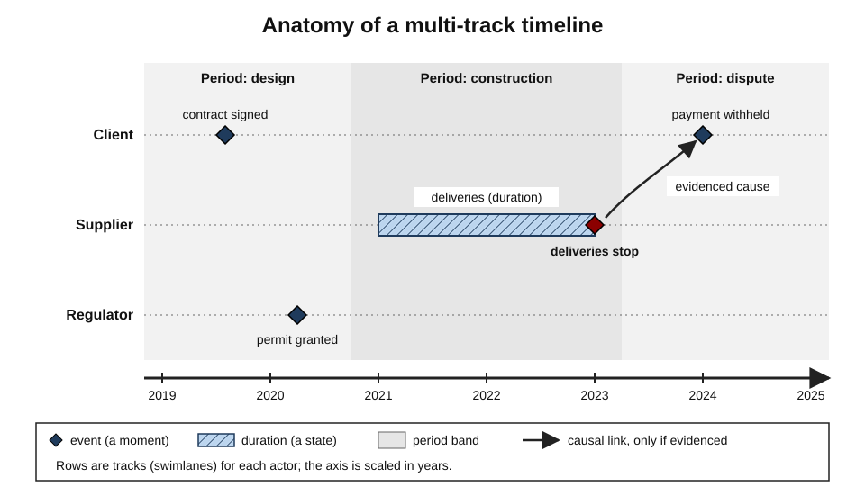
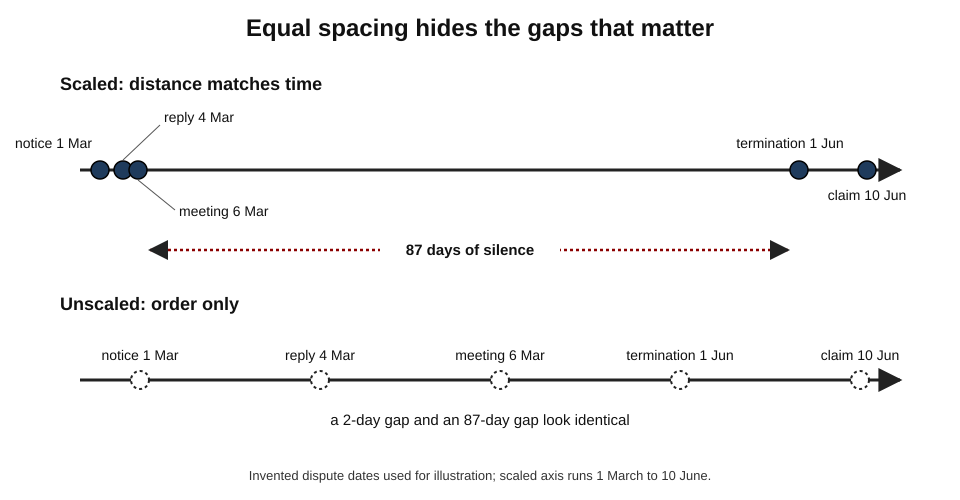
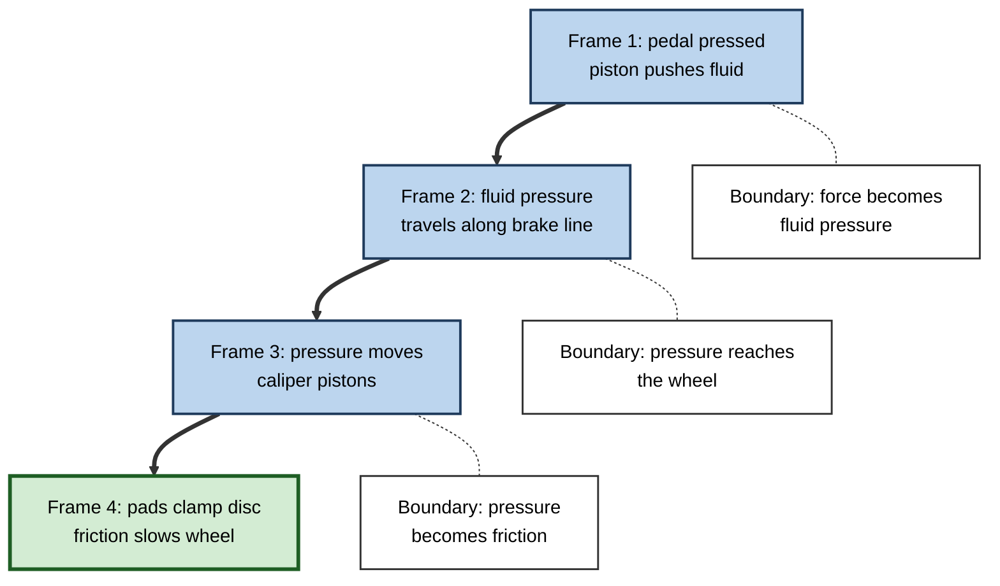
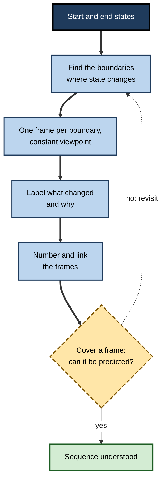
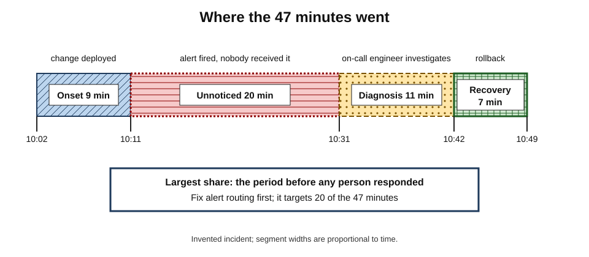

# G.7. Timelines and Visual Sequences

A litigation team inherits a dispute with three thousand emails, forty contracts and a dozen witness statements. For weeks the case feels like fog. Then a trainee builds a single chronology — every relevant event in date order, with the parties in separate rows — and pins it along a wall. Within an hour, a partner points to a gap: the supplier stopped deliveries **before** the payment default, not after. The case turns on that order of events, and the timeline made it visible.

> **Definition — Timeline:** a visual representation that places events, durations and periods along an axis of time, so that their **order**, **spacing** and **overlap** can be seen.

> **Definition — Visual sequence:** a series of images or frames — steps, panels or snapshots — that shows how something unfolds, such as a procedure, a mechanism or a story.

**Why it matters**

- Many subjects are made of **change over time**: history, case law, project delivery, disease progression, incidents, customer journeys, product evolution.
- Words present events one after another but make **spacing, overlap and simultaneity** hard to see; a timeline shows them at once.
- Sequences of frames are among the most effective ways to teach **processes and mechanisms**, often rivalling animation.
- In professional work, chronologies, roadmaps and incident timelines are core analytical documents, not decorations.

---

## Time Represented as Space

### The mental time line

- People across cultures talk about time in spatial terms — the future "ahead", the past "behind", a deadline "approaching".
- **Barbara Tversky, Sol Kugelmass and Atalia Winter (1991)** asked children and adults who spoke English, Hebrew or Arabic to place stickers representing events (breakfast, lunch, dinner) on a page.
  - English speakers tended to place earlier events on the **left**; Hebrew and Arabic speakers — whose languages are written right to left — tended to place them on the **right**.
- **Lera Boroditsky and Alice Gaby (2010)** found that members of the Pormpuraaw Aboriginal community in Australia arranged picture sequences from **east to west**, whichever direction they themselves were facing — time laid out on the landscape rather than the body.
- **Contested:** an earlier claim that Mandarin speakers think of time vertically because of vertical time metaphors produced mixed results in replications.

> **Key point:** the direction of time on a page is a **convention**, strongly shaped by writing direction. In left-to-right cultures, left-to-right timelines are read effortlessly; reversing them causes errors.

### Time is not just order

- **Order** — what came before what.
- **Interval** — how long between events.
- **Duration** — how long each state or activity lasted.
- **Simultaneity** — what was happening at the same time elsewhere.
- **Rate** — how fast things changed.
- **Periodisation** — how the stream of events is divided into eras or phases.

> **Remember:** a good timeline shows **order, interval, duration and overlap**. A numbered list shows only order.

---

## A Short History of Timelines

- **Early chronologies** — for centuries, chronologies were tables of dates and events in columns, often aligning different kingdoms' reign lists.
- **Joseph Priestley**, the English scientist and theologian, published *A Chart of Biography* (1765), showing about two thousand lives as horizontal lines on a **scaled** time axis, and *A New Chart of History* (1769), showing empires as bands across time.
  - Priestley explained that a reader could see at a glance which people were contemporaries — something a list of dates conceals.
- **Gantt charts** — the Polish engineer **Karol Adamiecki** devised a similar "harmonogram" in the 1890s; the American engineer **Henry Gantt** popularised bar charts of tasks against time in the 1910s, and they remain the standard picture of project schedules.
- **The geological time scale** — developed through the nineteenth and twentieth centuries — forced the use of **non-linear** representations because recent periods are tiny compared with deep time.

---

## The Anatomy of a Timeline

### Elements

- **Axis** — the line of time; horizontal (most common) or vertical (useful on phones and long documents).
- **Scale** — linear (equal distance for equal time), broken (gaps skipped and marked), or logarithmic (each step a multiple of time).
- **Events** — moments, shown as points or ticks with labels.
- **Durations** — states or activities with a start and end, shown as bars.
- **Periods** — eras or phases, shown as background bands.
- **Tracks** — parallel rows for different actors, places or themes (swimlanes).
- **Annotations** — notes explaining significance.
- **Links** — arrows showing cause, dependency or influence between events.

**Figure 1.** The elements of a multi-track timeline.

### Kinds of timeline and sequence

| Kind | Shows | Best for | Main risk |
|---|---|---|---|
| Simple linear timeline | Order and spacing of events | History, careers, product releases | Treats all events as equally important |
| Multi-track timeline | Several actors or themes in parallel | Disputes, incidents, comparative history | Clutter when tracks multiply |
| Gantt chart | Tasks as bars with dependencies | Project planning | Dates read as promises; hides uncertainty |
| Logarithmic or broken-scale timeline | Very different time spans together | Deep time, technology history | Misjudged intervals |
| Cyclical sequence | Repeating stages | Seasons, business cycles, life cycles | Implies a neat cycle where there is drift |
| Branching timeline | Alternative paths or scenarios | Strategy, decision analysis | Too many branches to follow |
| Frame sequence or storyboard | Snapshots of a process or story | Mechanisms, procedures, user journeys | Missing intermediate states |

### Scaled and unscaled

- **Scaled timelines** keep equal distances for equal times.
  - *Benefit:* intervals are honest — a reader sees that two events were five years apart, not five weeks.
  - *Cost:* long empty stretches and crowded clusters.
- **Unscaled (ordinal) timelines** place events at equal spacing regardless of the gap.
  - *Benefit:* compact; every event has room for a label.
  - *Cost:* intervals disappear; readers often assume equal spacing means equal time.
- **Compromise:** a scaled timeline with **breaks** — marked gaps where nothing relevant happened.

**Figure 2.** The same events on a scaled and an unscaled timeline. (illustrative)

> **Watch out:** in an unscaled timeline of a dispute, a three-day gap and a three-month gap look identical. When intervals matter — notice periods, limitation dates, response times — use a scaled axis or label each interval.

---

## How People Understand Sequences

### Chronology is not causation

- **Post hoc reasoning** — assuming that because B followed A, A caused B — is one of the oldest fallacies.
- A timeline makes order vivid and therefore **invites** causal readings.
- **Good practice:** draw causal arrows **only** where there is evidence for causation; otherwise the timeline shows sequence only.

### Memory for when things happened

- **Dates are hard to remember** because they are arbitrary numbers with little meaning.
- **People remember order relative to landmarks** — "after the merger", "before the pandemic" — better than absolute dates.
- **Telescoping** — in surveys, people tend to report events as having happened more recently than they did (**forward telescoping**), a pattern described by John Neter and Joseph Waksberg (1964) in household expenditure surveys.
- **Implication:** a timeline anchored by a few well-known **landmark events** helps learners place unfamiliar events.

### Events and boundaries

- **Event segmentation theory** — developed by **Jeffrey Zacks** and colleagues (2007) — holds that people perceive continuous activity as a series of discrete events, marking a **boundary** whenever their predictions about what happens next change.
  - *e.g.* watching someone make coffee, viewers agree closely on where one step ends and the next begins.
- **Memory is organised around boundaries:** information at event boundaries is remembered better, and segmenting a long activity at its natural boundaries aids learning.
- **For visual sequences:** frames should fall at **meaningful boundaries** — the moments when the state of the system changes — not at arbitrary time intervals.

**Figure 3.** A process divided into frames at its natural event boundaries.

### Static frames versus animation

**Study card — Tversky, Morrison and Bétrancourt (2002)**

- **Design:** a review of studies comparing animated graphics with static graphics for teaching processes such as mechanical systems, biology and algorithms.
- **Findings:**
  - many studies that seemed to favour animation had given the animated condition **more information** or **interactivity** than the static condition;
  - when static and animated versions were **equivalent** in content, animation rarely helped;
  - animations are often too fast or too complex to perceive accurately, and they are **transient** — each state disappears as the next appears.
- **Conclusion:** the authors proposed that a graphic should be **apprehensible** (easily perceived) and **congruent** (its structure matching the structure of the content). A series of well-chosen static frames often meets both conditions better than an animation.

**Study card — Mayer, Hegarty, Mayer and Campbell (2005)**

- **Design:** four experiments on how lightning forms, how a toilet tank flushes, how ocean waves work and how car brakes work.
  - One group received a **narrated animation**.
  - Another received **static illustrations** with printed text, in a series of frames.
- **Results:** the static-frame group performed **as well or better** on retention and transfer tests in each experiment.
- **Conclusion:** static frames let learners **control the pace**, compare states and infer motion themselves — active processing that animation can bypass.

- **The wider picture:** a meta-analysis by **Tim Höffler and Detlev Leutner (2007)** found a modest overall advantage for animation over static pictures, larger when the animation **directly depicted** the content to be learned and largest for **procedural–motor** skills (such as knot-tying or assembly), where seeing the movement itself is essential.

> **Key point:** for understanding a **mechanism** or **causal process**, a sequence of static frames at meaningful boundaries is often as effective as animation and easier to make. For learning a **movement** — a surgical knot, a dance step — showing the motion helps.

### Mental animation

- **Mary Hegarty (1992)** studied how people understand pulley systems from static diagrams.
  - Eye movements and response times showed that people **mentally animate** the system piece by piece along the causal chain — from the rope being pulled to the first pulley to the next — rather than all at once.
- **Implication:** a frame sequence that follows the **causal chain** matches the way people reason about mechanisms; the learner can rehearse each link.

---

## Building Timelines and Sequences to Learn

### A procedure for a timeline

1. **Set the question** — "Why did the merger fail?" or "What order did the reforms come in?"
2. **Collect events** with dates; mark uncertain dates as approximate.
3. **Choose the scale** — linear, broken or logarithmic — according to the spread of dates.
4. **Choose tracks** — one per actor, place or theme, if parallel developments matter.
5. **Mark periods** — phases that give the events meaning.
6. **Add causal links sparingly** — only where evidence supports them.
7. **Annotate turning points** — one line on why each matters.
8. **Close the sources and rebuild the core** from memory a few days later.

> **Mnemonic — "QUEST":** **Q**uestion, **U**nits of scale, **E**vents and periods, **S**wimlanes, **T**urning points — then rebuild from memory.

### A procedure for a frame sequence

1. **Identify the start and end states** of the process.
2. **Find the boundaries** — the moments where something changes state.
3. **Draw one frame per boundary** — keep the viewpoint and layout constant so that only the change differs.
4. **Label what changed** in each frame and **why**.
5. **Number the frames** and connect them with arrows.
6. **Test** by covering a frame and predicting its contents from its neighbours.

**Figure 4.** Building a sequence of frames for a process.

### Why constructing beats copying

- **Placing events** forces decisions about order and overlap that reading glosses over.
- **Choosing a scale** forces attention to intervals.
- **Dividing into periods** forces interpretation — what belongs together, and why.
- **Rebuilding from memory** adds retrieval practice.
- **Caution:** direct experimental evidence on timeline construction is thinner than for diagrams in general; the case rests partly on research into generative learning and retrieval, and partly on long practice in history education and law.

### Timelines for revision

- **Blank-axis recall** — draw only the axis and the period bands, then fill in as many events as possible from memory before checking.
- **Order-only drills** — shuffle event cards and arrange them; then add approximate dates; then add one cause and one consequence for each turning point.
- **Parallel tracks from memory** — reconstruct what was happening in two places or to two actors at the same time; simultaneity is the aspect most often forgotten.
- **Interval estimates** — before checking, estimate how long each gap was; large estimation errors reveal where the mental timeline is distorted.
- **Spaced rebuilding** — rebuild the core timeline after a day, a week and a month; each rebuild is faster and more complete if learning is taking hold.

> **In practice:** history teachers often ask pupils to arrange event cards in order **before** revealing dates, then to justify their order; the discussion of disagreements builds chronological reasoning that memorising dates does not.

---

## Worked Example (illustrative): An Incident Timeline

**Situation:** an online retailer's checkout failed for 47 minutes during a sale. The engineering team holds a **blameless post-incident review** and builds a timeline from logs, chat messages and alerts.

| Time | Systems track | Monitoring track | People track |
|---|---|---|---|
| 10:02 | Configuration change deployed to payment service | — | Engineer A deploys routine change |
| 10:04 | Error rate on payments begins to rise | — | — |
| 10:11 | — | Alert fires (threshold: 5% errors for 5 minutes) | Alert goes to an unattended channel |
| 10:26 | — | Customer-support tickets spike | Support lead posts in engineering chat |
| 10:31 | — | — | On-call engineer acknowledges |
| 10:42 | — | — | Change identified as likely cause |
| 10:49 | Configuration rolled back; errors fall | Alert clears | — |

*Illustrative figures.*

1. **Tracks** reveal that the problem was not only technical: the alert fired at 10:11 but reached **nobody** until 10:31.
2. **Intervals** matter: 9 minutes to detect, 20 minutes to reach a person, 18 minutes to fix.
3. **Periods:** *onset* (10:02–10:11), *unnoticed* (10:11–10:31), *diagnosis* (10:31–10:42), *recovery* (10:42–10:49).
4. **Causal links** drawn only where evidenced: change → errors; errors → alert; alert → (no) response.

- **Conclusion:** the biggest improvement is **alert routing**, not the configuration change. A list of events would have hidden that; the multi-track timeline exposed it.

> **Watch out:** a timeline built only from **systems** logs omits human actions and communication. Incidents, disputes and projects usually need at least one **people** track.

**Figure 5.** The incident divided into four periods with the time spent in each. (illustrative)

---

## Sequences Beyond the Timeline

### Step-by-step instructions

- **Wordless assembly instructions**, made familiar by flat-pack furniture, show a procedure as a sequence of frames, each showing **one action** and its result.
- **Design principles drawn from research and practice on instructions:**
  - **one step per frame**, or a small group of closely linked actions;
  - **show the action** — arrows for movement, a hand or tool in position — not just the before and after;
  - **keep the viewpoint stable**, changing it only when a new face of the object must be seen, and then signalling the rotation;
  - **show parts at the moment they are needed**, with a count ("× 4");
  - **group steps hierarchically** — sub-assemblies first, then their combination.
- **Words still matter** for conditions and warnings that pictures cannot express ("do not tighten fully until step 9").

> **Example:** a laboratory protocol rewritten as eight numbered photographs, each showing the technician's hands at a step, with a one-line instruction beneath and a caution symbol on the two steps where errors are dangerous.

### Storyboards and comics

- **Storyboards** — originally from film and animation — are frame sequences used to plan a story, a user's interaction with a product, or a training scenario.
  - In design, a storyboard of a customer using a service exposes gaps ("how does she know her order shipped?") before anything is built.
- **Comics and graphic narratives** combine frames, words and characters to teach.
  - **Graphic medicine** — comics about illness and care — is used in patient education and clinical training.
  - Comics can make abstract processes concrete through characters and situations, but the evidence that they teach better than well-designed text with diagrams is limited and mixed.
- **Panel transitions** carry meaning: the gap between two frames (the "gutter", in the cartoonist Scott McCloud's terms) is filled by the reader's inference — a form of active processing.

### Journey maps

- **A customer journey map** is a timeline of a customer's experience across **stages** (aware, consider, buy, use, seek help), with tracks for:
  - **actions** — what the customer does;
  - **touchpoints** — channels and people they meet;
  - **thoughts and feelings** — often drawn as a line rising and falling;
  - **pain points and opportunities**.
- **Learning value:** building a journey map from interviews forces a team to integrate many observations into one sequence and to see the experience **from the customer's side**.
- **Risk:** journey maps built from internal assumptions rather than evidence look convincing and mislead.

### Cyclical sequences

- **Cycles** suit processes that genuinely repeat: the water cycle, the cardiac cycle, the plan–do–check–act cycle in quality management, the business cycle.
- **Caution:** drawing something as a neat circle implies regular repetition and return to the start. Many real processes **spiral** (each round differs), **drift** or **branch**; a cycle drawing can hide that.

| | Linear timeline | Frame sequence | Cycle | Journey map |
|---|---|---|---|---|
| Time shown as | A scaled or ordered axis | Discrete states | A loop | Stages with parallel tracks |
| Best for | History, chronology, schedules | Mechanisms, procedures | Repeating processes | Experiences across channels |
| Typical learning use | Ordering and dating events | Understanding how a system changes | Seeing feedback and repetition | Seeing a process from a user's side |
| Main failure | Implied causation | Missing intermediate states | False regularity | Assumptions presented as evidence |

---

## Timelines in Professional Practice

### Where timelines are central

- **Law** — the **chronology** is often the first analytical document prepared in litigation and investigations; it underpins witness preparation and pleadings.
- **Medicine** — a patient's history taken as a timeline of symptoms, treatments and results; clinicians reason about onset, progression and response.
- **Project and programme management** — Gantt charts, milestone charts and critical-path diagrams.
- **Product management** — roadmaps; many teams now use "now, next, later" roadmaps that avoid false date precision.
- **Customer experience** — **journey maps** show a customer's steps, channels, thoughts and feelings over time.
- **Operations and engineering** — incident timelines, change logs and audit trails.
- **Strategy and history** — industry timelines that place a firm's decisions in context.

### Case study (illustrative): a chronology that changed a case

- **Situation:** a construction company was sued by a developer for delay on a hospital project. The company's lawyers held thousands of documents.
- **Problem:** after two months, the legal team could not agree on the cause of delay; each lawyer had a different narrative.
- **Diagnosis:**
  - knowledge was held in **separate narratives** in each person's head;
  - no shared representation showed what happened **when**, and who knew what.
- **Actions:**
  1. A trainee built a **multi-track chronology**: developer, contractor, architect and regulator in separate rows; design changes, instructions, approvals and site events as dated entries.
  2. Each entry was linked to its source document.
  3. The team added **periods** (design, early works, main works, dispute) and marked **critical events** in bold.
  4. The chronology was printed along a wall and reviewed weekly; disagreements were resolved by checking entries.
- **Result:** the timeline revealed that the developer issued major design changes **after** the agreed design freeze, and that the regulator's approval of revised plans came months later. The team built its case around this sequence; the matter settled on favourable terms.
- **Caveats:** the outcome depended on many factors beyond the chronology.
- **Lesson:** a shared, sourced, multi-track timeline turned **scattered knowledge** into a **common model** that exposed the decisive order of events.

### Roadmaps and the danger of false precision

- **Problem:** dates on a timeline look like commitments; stakeholders treat a tentative quarter as a promise.
- **Responses:**
  - mark uncertainty explicitly — date ranges, confidence levels, shading that fades into the future;
  - group work into **now, next, later** rather than precise dates when the future is uncertain;
  - date only what is truly committed.

> **In practice:** label every timeline as **record** (what happened, sourced) or **plan** (what is intended, uncertain). Mixing the two on one axis without distinction is a common source of misunderstanding.

### Timelines and AI tools

- AI tools can extract events and dates from large document sets and draft chronologies quickly.
- **Risks:** misread dates (especially between day–month and month–day formats), conflated events, invented entries, and loss of the link to source documents.
- **Good practice:** require a **source reference** for every entry and spot-check a sample; keep human judgement for periodisation and causal links, where interpretation matters most.

---

## Open Questions

- **How much does constructing timelines improve chronological understanding?**
  - Long practice in history teaching and law supports it, but controlled studies are few.
- **When should animation replace frame sequences?**
  - Movement-based skills benefit from animation; for mechanisms, static frames often suffice. The boundary is still being mapped, especially for interactive and learner-controlled animations.
- **How do people judge intervals on non-linear scales?**
  - Logarithmic and broken axes are essential for deep time but are often misread; how best to teach them is not settled.
- **How should uncertainty be shown on timelines?**
  - Plans and reconstructed histories both contain uncertainty; conventions for showing it are inconsistent across fields.
- **What is lost when AI drafts the chronology?**
  - Building a chronology is how many professionals learn a case or project; delegating that step may save time but reduce understanding.

---

## Summary

- A **timeline** shows order, interval, duration and overlap; a **visual sequence** shows how something unfolds through frames.
- **Time as space:** direction follows writing conventions (Tversky, Kugelmass and Winter, 1991); some cultures use cardinal directions (Boroditsky and Gaby, 2010).
- **History:** Priestley's scaled charts (1765, 1769); Adamiecki and Gantt's schedule charts; non-linear geological scales.
- **Elements:** axis, scale, events, durations, periods, tracks, annotations, links. **Kinds:** linear, multi-track, Gantt, logarithmic or broken, cyclical, branching, frame sequences.
- **Scaled versus unscaled:** scaled timelines keep intervals honest; unscaled ones hide them.
- **Cognition:** chronology is not causation; dates are hard to remember; landmarks anchor memory; forward telescoping; **event segmentation** — frames should fall at boundaries.
- **Static frames versus animation:** equivalent static frames often match or beat animation for mechanisms (Tversky and colleagues, 2002; Mayer and colleagues, 2005); animation helps more for procedural–motor skills (Höffler and Leutner, 2007); people **mentally animate** along causal chains (Hegarty).
- **Procedures:** QUEST for timelines; boundaries-and-frames for sequences; rebuild from memory.
- **Practice:** legal chronologies, clinical histories, project schedules, roadmaps, journey maps, incident reviews; separate **record** from **plan**; source every entry.

---

## Self-Check

1. What does a timeline show that a numbered list does not?
2. Describe Tversky, Kugelmass and Winter's (1991) finding and its implication for designing timelines.
3. What did Priestley's charts allow readers to see that tables of dates did not?
4. Compare scaled and unscaled timelines. When is each appropriate?
5. Explain why a timeline can encourage post hoc reasoning, and how to prevent it.
6. What is event segmentation theory, and how should it guide the choice of frames in a sequence?
7. Summarise the evidence comparing static frames with animation, including when animation helps most.
8. What is mental animation, and how does it support frame sequences that follow causal chains?
9. Apply QUEST to building a timeline of a company's digital transformation.
10. In the incident example, why did the multi-track timeline reveal what a list of events would have hidden?
11. A product roadmap shows exact launch dates for the next eight quarters. Identify the risks and redesign it.
12. A paralegal uses an AI tool to draft a chronology from 5,000 emails. What controls would you put in place?

### Answer Key

1. Interval, duration, simultaneity and periods — the spacing and overlap of events — not just their order.
2. Speakers of left-to-right languages placed earlier events on the left; speakers of right-to-left languages on the right. Timelines should follow the audience's writing direction.
3. Which people and empires were contemporaries, and how long each lasted, because lives and reigns were drawn as lines on a scaled time axis.
4. Scaled — equal distance for equal time, honest intervals, but empty stretches; use when intervals matter. Unscaled — compact and readable, but intervals vanish; use for order alone, labelling gaps. Broken scales combine both.
5. Order is vivid, inviting the assumption that earlier events caused later ones. Draw causal arrows only where evidence supports causation; otherwise present sequence only.
6. People divide continuous activity into events at boundaries where predictions change; memory is organised around these boundaries. Frames should fall at meaningful changes of state.
7. When content is equivalent, static frames often match or beat animation for mechanisms (Tversky and colleagues; Mayer and colleagues, 2005). Animation helps more when it directly depicts the content and most for procedural–motor skills (Höffler and Leutner, 2007).
8. People infer the motion of a system step by step along its causal chain; frame sequences that follow that chain let learners rehearse each link.
9. Question: "Why did the transformation take five years?" Units: scaled years with quarters. Events and periods: strategy, pilots, roll-out, stabilisation. Swimlanes: technology, people, finance, customers. Turning points: leadership change, failed pilot. Then rebuild from memory.
10. Separate tracks showed the alert firing at 10:11 but no person receiving it until 10:31; intervals made the 20-minute routing gap visible, pointing to alert routing as the main fix.
11. Exact dates are read as commitments and hide uncertainty. Redesign as now / next / later, or show date ranges with uncertainty increasing into the future; date only committed items; mark plan versus record.
12. Require a source reference for every entry; spot-check samples against originals, especially dates and parties; check date-format conversions; keep human review of periodisation, causal links and critical events.

---

## Glossary

| Term | Meaning |
|---|---|
| Animation | A display in which images change continuously to show motion or change. |
| Chronology | An ordered record of events with dates, often with sources. |
| Congruence principle | The idea that a graphic's structure should match the structure of the content. |
| Event boundary | A point where one perceived event ends and another begins. |
| Event segmentation theory | The theory that people perceive continuous activity as discrete events marked by boundaries. |
| Forward telescoping | Reporting past events as more recent than they were. |
| Gantt chart | A bar chart of tasks against time, showing schedule and dependencies. |
| Journey map | A timeline of a customer's steps, channels and experiences. |
| Logarithmic timeline | A timeline in which each step represents a multiple of time. |
| Mental animation | Inferring the motion of a system from a static display, step by step. |
| Mental time line | The spatial arrangement people use to think about time. |
| Multi-track timeline | A timeline with parallel rows for different actors or themes. |
| Periodisation | Dividing a stream of events into eras or phases. |
| Post hoc reasoning | Assuming that because one event followed another, it was caused by it. |
| Scaled timeline | A timeline in which equal distances represent equal times. |
| Storyboard | A sequence of frames showing the steps of a story or process. |
| Timeline | A visual representation placing events along an axis of time. |
| Unscaled timeline | A timeline that shows order but not intervals. |
| Visual sequence | A series of frames showing how something unfolds. |
