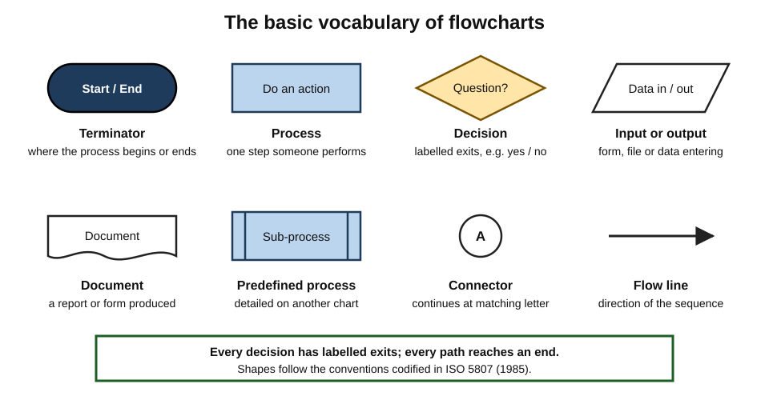
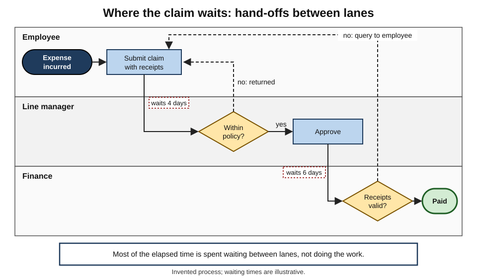
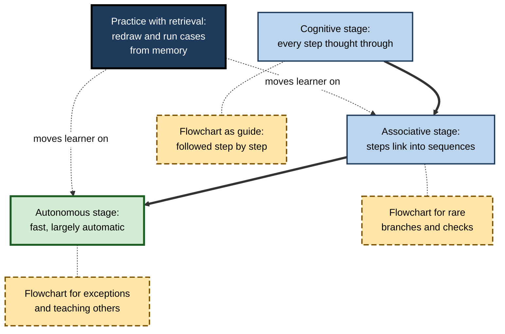
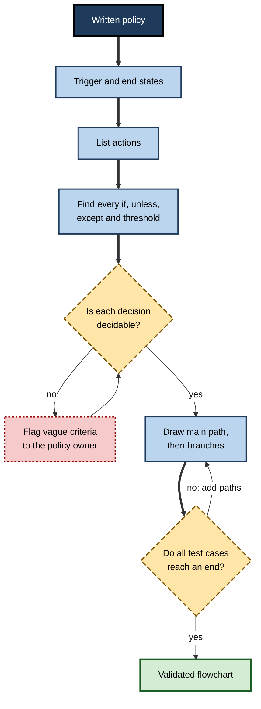
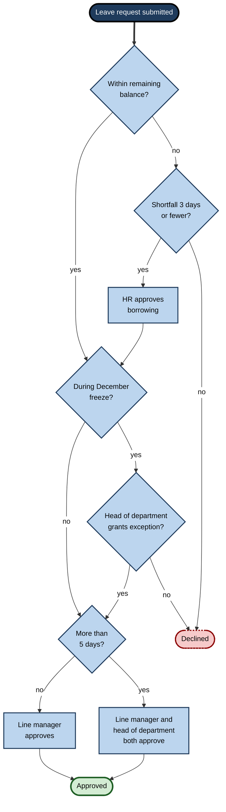

# G.8. Flowcharts for Process Learning

A newly qualified nurse is handed a six-page policy on recognising and escalating a deteriorating patient. It is accurate and complete, and on a busy night shift almost impossible to use. Beside it on the ward wall hangs a one-page chart: a start box, four diamond-shaped questions about the patient's observations, and arrows leading to clearly labelled actions. Within a week, the nurse no longer needs to look at the chart — the questions and their order have become part of how they think.

> **Definition — Flowchart:** a diagram of a process in which **steps** are shown as shapes, **decisions** as branching points, and **arrows** show the order in which steps and decisions follow one another.

> **Definition — Decision algorithm:** a flowchart, or equivalent set of rules, that leads from a starting situation through explicit questions to a defined action or outcome.

**Why it matters**

- Much professional knowledge is **procedural**: what to do, in what order, under which conditions.
- Prose hides the **branches** of a procedure inside sentences full of "unless", "if" and "except where"; a flowchart lays them out.
- A flowchart externalises the conditions, so that working memory is freed for judging the case at hand.
- Building a flowchart from a policy is one of the most reliable ways to find out whether one understands it — and whether the policy itself is coherent.
- Flowcharts are standard in software, operations, healthcare, compliance, customer service and quality management.

---

## Origins and Standards

### From industrial engineering to computing

- **Frank and Lillian Gilbreth**, pioneers of motion study, presented the **flow process chart** to the American Society of Mechanical Engineers in 1921 as a way to record and improve work processes.
- **Herman Goldstine and John von Neumann** (1947) used **flow diagrams** to plan programs for early electronic computers.
- **Standard symbols** were codified by the American National Standards Institute in the 1960s and internationally in **ISO 5807** (1985).
- **Structured programming** in the 1970s moved programmers away from flowcharts towards structured code; alternatives such as **Nassi–Shneiderman diagrams** (1973) appeared.
- **Business process modelling** revived flowcharting: **UML activity diagrams** (late 1990s) and **Business Process Model and Notation (BPMN)**, whose version 2.0 was published by the Object Management Group in 2011.

### Clinical and safety algorithms

- **Resuscitation algorithms** — published by bodies such as the European Resuscitation Council and the American Heart Association — show cardiac-arrest management as a flowchart of rhythm checks and actions.
- **Early-warning escalation charts** in hospitals link observation scores to required responses.
- **Aviation and nuclear operations** use flow-based **abnormal and emergency procedures**, often alongside checklists.

> **Key point:** flowcharts persist wherever **sequence and branching** must be executed reliably by many people — and wherever errors are costly.

---

## The Grammar of Flowcharts

### Core symbols

| Symbol | Shape | Meaning | Example |
|---|---|---|---|
| Terminator | Rounded rectangle or oval | Start or end of the process | "Request received"; "Case closed" |
| Process | Rectangle | An action or step | "Send acknowledgement email" |
| Decision | Diamond | A question with two or more exits | "Is the amount above the approval limit?" |
| Input or output | Parallelogram | Data entering or leaving | "Customer submits form" |
| Document | Rectangle with a wavy base | A document produced or used | "Signed contract" |
| Predefined process | Rectangle with double side bars | A sub-process detailed elsewhere | "Run identity check" |
| Connector | Small circle | Continues a flow elsewhere on the page | "A" linking to "A" |
| Flow line | Arrow | Direction of the sequence | — |

**Figure 1.** The standard flowchart symbols and what each represents.

### Rules of good form

- **One start, clear ends** — every path must end at a terminator.
- **Decisions are questions** with **labelled exits** ("yes" / "no", or named categories).
- **Questions must be decidable** — "Is the score 5 or more?" rather than "Is the patient unwell?".
- **Consistent direction** — top to bottom or left to right, with loops returning upward or leftward.
- **One action per box** — "Check identity" and "Open account" are two boxes.
- **Limited size** — roughly fifteen shapes per page; beyond that, use sub-processes.
- **No crossing lines** where avoidable; redraw instead.
- **Consistent vocabulary** — the same name for the same thing in every box.

> **Mnemonic — "SQUARE":** **S**tart and end defined; **Q**uestions decidable; **U**nique action per box; **A**rrows labelled at decisions; **R**eadable direction; **E**very path ends.

### Kinds of flowchart

| Kind | Shows | Typical use | Strength | Weakness |
|---|---|---|---|---|
| Basic process flowchart | Steps and decisions | Standard operating procedures | Simple, widely understood | Hides who does what |
| Decision tree or algorithm | Questions leading to outcomes | Triage, eligibility, diagnosis | Makes criteria explicit | Can over-simplify judgement |
| Swimlane (cross-functional) | Steps by role or department | Hand-offs between teams | Exposes hand-offs and delays | Grows wide quickly |
| SIPOC | Suppliers, inputs, process, outputs, customers | Scoping an improvement project | High-level clarity | No decision detail |
| Value stream map | Material and information flow with times | Lean improvement | Shows waiting and waste | Needs measurement |
| BPMN diagram | Events, tasks, gateways, messages | Process automation and analysis | Precise, executable | Steep learning curve |

- **Swimlanes** were popularised in organisational improvement by **Geary Rummler and Alan Brache** (*Improving Performance*, 1990), who showed that many process failures occur in the "white space" between departments.
- **Value stream mapping** was described for a general audience by **Mike Rother and John Shook** (*Learning to See*, 1998), drawing on Toyota's practice.

**Figure 2.** A swimlane flowchart of an expense claim, showing where hand-offs occur.

---

## Why Flowcharts Help People Learn Procedures

### Procedures are condition–action structures

- **Procedural knowledge** can be described as a set of **condition–action rules**: *if* this situation holds, *then* do that.
  - John Anderson's **ACT-R** theory represents skills as **production rules** of exactly this form.
- **A flowchart is a picture of the rules:** each diamond is a condition; each box after it is an action.
- **Prose** scatters the conditions through sentences; the learner must reconstruct the structure before they can use it.

### Three stages of skill learning

- **Paul Fitts and Michael Posner (1967)** described skill learning in three stages:
  - **cognitive** — the learner thinks through each step consciously and relies on instructions;
  - **associative** — steps link into smoother sequences; errors fall;
  - **autonomous** — performance becomes fast and largely automatic.
- **Role of the flowchart at each stage:**
  - in the **cognitive** stage it is an external guide, reducing errors while the structure is learned;
  - in the **associative** stage it is consulted less, mainly for rare branches;
  - in the **autonomous** stage it becomes a reference for exceptions and a tool for teaching others.

**Figure 3.** How reliance on a flowchart changes as a procedure is learned.

### Evidence

- **Patricia Wright and Fraser Reid (1973)** compared ways of presenting complex rules — about which travel options applied under different conditions — as **prose**, **short sentences**, a **table** and an **algorithm** (a flowchart of yes/no questions).
  - With the material available, people using the **algorithm** or **table** answered faster and more accurately than those using prose; prose performed worst.
  - When the material had to be **remembered** rather than consulted, the advantage of the algorithm diminished, and shorter, structured formats held up better than prose.
  - **Lesson:** flowcharts are excellent for **using** a rule set; learning it so that it can be applied **without** the chart requires practice and retrieval.
- **Clinical algorithms and structured protocols** are widely associated with more consistent care in emergencies and with faster training, though their effects are hard to separate from the training, audit and team practices that come with them.
- **Instructional research on procedures** generally finds that learners do better with explicit, stepwise representations of procedures than with continuous prose, especially as novices.

> **Watch out:** a flowchart that someone can **follow** is not proof that they have **learned** the procedure. If the chart is removed and performance collapses, the learning has been offloaded to the paper.

### What flowcharts do to the mind

- **Externalise conditions** — the learner no longer holds "if A and not B, unless C" in working memory.
- **Make branching visible** — every exception has a place and a path.
- **Reveal missing cases** — a decision with only a "yes" exit is obviously incomplete.
- **Support self-explanation** — tracing a case through the chart and saying why each exit was taken.
- **Enable retrieval** — redrawing the chart from memory is a strong test of procedural understanding.

---

## Building a Flowchart from a Policy or Procedure

### A procedure

1. **Define the trigger and the end states** — what starts the process, and what counts as finished (including failure outcomes).
2. **List the actions** — each verb that someone must perform.
3. **Find the decisions** — every "if", "unless", "where", "except" and threshold in the text.
4. **Make each decision decidable** — turn vague terms into criteria; note where the source itself is vague.
5. **Order the steps** and draw the main path first.
6. **Add branches** for each decision exit.
7. **Walk test cases through** — normal, borderline and unusual — and fix any that have nowhere to go.
8. **Simplify** — merge duplicate steps, move detail into sub-processes.
9. **Validate with practitioners** — do people actually do it this way? Where do they deviate, and why?
10. **Redraw from memory** later to check that the structure has been learned.

**Figure 4.** Turning a written procedure into a tested flowchart.

### Worked example: an annual-leave policy

**Source text (extract):** "Employees may request annual leave through the HR system. Requests of up to five days are approved by the line manager. Requests of more than five days also require the head of department's approval. Requests during the December freeze period are declined unless the head of department grants an exception. Leave may not exceed the employee's remaining balance, except that up to three days may be borrowed from next year with HR approval."

1. **Trigger:** request submitted. **Ends:** approved, declined.
2. **Actions:** submit; line manager approves; head of department approves; HR approves borrowing; decline.
3. **Decisions:** within balance? borrowing of up to three days? during freeze? exception granted? more than five days?
4. **Decidability check:** all are decidable — but the text does not say **in what order** balance and freeze are checked, or whether a borrowing request during the freeze needs both approvals. These are **gaps in the policy**, found by drawing.

**Figure 5.** The annual-leave policy drawn as a decision flowchart.

**Test cases**

| Case | Days | Balance | Freeze? | Path | Outcome |
|---|---|---|---|---|---|
| A | 3 | 10 | No | Balance yes → freeze no → ≤5 → line manager | Approved |
| B | 8 | 10 | No | Balance yes → freeze no → >5 → line manager and head | Approved after two approvals |
| C | 4 | 2 | No | Balance no → shortfall 2 → HR → freeze no → ≤5 → line manager | Approved with borrowing |
| D | 6 | 1 | No | Balance no → shortfall 5 | Declined |
| E | 2 | 10 | Yes | Balance yes → freeze yes → exception? | Depends on head of department |

- **Conclusion:** the flowchart makes the policy executable, and drawing it surfaced two questions the policy owner must answer. Learners who draw it themselves understand the policy better than those who only read it.

> **Watch out:** a flowchart can make a vague policy **look** precise. Where the source is ambiguous, mark the ambiguity on the chart rather than silently choosing an interpretation.

---

## Flowcharts, Checklists and Decision Tables

### Three ways to represent a procedure

- **Flowchart** — sequence plus branching; best when the **path** depends on answers to questions.
- **Checklist** — a list of items to confirm; best when the steps are known and the risk is **omission**, not choosing the wrong path.
- **Decision table** — rows of conditions and columns of rules, each column giving the action for one combination; best when **many conditions combine** and order does not matter.

**Study card — Haynes and colleagues (2009)**

- **Design:** the World Health Organization's Surgical Safety Checklist — a short list of checks before anaesthesia, before incision and before the patient leaves the operating room — was introduced in eight hospitals in eight countries, from high-income to low-income settings.
- **Results:** comparing periods before and after introduction, the rate of major complications fell from about 11% to 7%, and in-hospital deaths from about 1.5% to 0.8%.
- **Conclusion:** a well-designed **checklist** can reduce omissions in complex, high-stakes procedures; later studies found that benefits depend heavily on how seriously teams adopt it.

| | Flowchart | Checklist | Decision table |
|---|---|---|---|
| Represents | Sequence and branches | Items to confirm | Combinations of conditions and their outcomes |
| Main error prevented | Taking the wrong path | Forgetting a step | Misapplying a complex rule |
| Order matters? | Yes | Sometimes | No |
| Learning value | Shows the structure of decisions | Builds habits of verification | Shows the full rule space |
| Weakness | Grows unwieldy with many conditions | Shows no branching | Hard to read for novices |
| Example | Triage of a patient with chest pain | Pre-flight checks | Insurance premium loading rules |

> **Key point:** choose the representation that matches the **kind of error** to be prevented. A flowchart prevents wrong turns; a checklist prevents omissions; a decision table prevents misreading combinations.

### Reading formal process notations

- **BPMN** uses a richer vocabulary than basic flowcharts:
  - **events** (circles) — something happens: a start, a message, a timer, an end;
  - **activities** (rounded rectangles) — tasks or sub-processes;
  - **gateways** (diamonds) — branching and merging, with markers for exclusive, parallel or inclusive paths;
  - **pools and lanes** — organisations and roles;
  - **message flows** (broken lines between pools) — communication across organisations.
- **UML activity diagrams** are similar, with forks and joins for parallel actions.
- **For learners:** the core logic — steps, decisions, sequence, roles — transfers directly from basic flowcharts; the extra symbols add precision about **parallelism, events and timing**.

> **In practice:** when joining a team that uses a formal notation, ask for a one-page legend and redraw one real process from memory in the notation within the first week. Reading the notation fluently is part of the team's representational competence.

---

## Pitfalls

- **Spaghetti** — too many crossing lines and loops on one page.
  - *Fix:* sub-processes; redraw with the main path straight down the middle.
- **Hidden judgement** — a diamond such as "Is it serious?" conceals the hardest part of the decision.
  - *Fix:* state the criteria, or mark the step explicitly as **professional judgement** with guidance.
- **Missing exits** — decisions with an unlabelled or absent branch.
  - *Fix:* every diamond must show every exit.
- **Happy-path only** — no route for failures, errors or exceptions.
  - *Fix:* walk unusual test cases through.
- **Out of date** — the process changed; the chart did not.
  - *Fix:* give every chart an owner, a version and a review date.
- **Wrong tool** — forcing conceptual or causal knowledge into a flowchart.
  - *Fix:* use a concept map or causal diagram for "why"; a flowchart for "what to do".
- **Over-proceduralising** — reducing expert judgement to rules that fail in unusual cases.
  - *Fix:* include an explicit "if the situation does not fit, escalate" path.

> **Key point:** a flowchart shows **what to do**; it rarely shows **why**. Learners who know only the chart can follow it but cannot adapt when reality departs from it. Pair the chart with the reasons behind each decision.

---

## Learning a Procedure with a Flowchart

### A study routine

1. **Trace typical cases** with a finger, saying each decision aloud.
2. **Explain each diamond** — why this question, why at this point?
3. **Close the chart and redraw it** from memory; check and correct.
4. **Run unusual cases** mentally through the redrawn chart.
5. **Practise the procedure** in simulation or real tasks, consulting the chart only when stuck.
6. **Space the redrawing** — after a day, a week, a month.
7. **Teach it** to someone else using the chart, then without it.

> **Remember:** **trace → explain → redraw → run cases → practise → space → teach.**

### Reading someone else's flowchart critically

- **Find the start and every end** — are failure outcomes shown, or only success?
- **Read every diamond as a question** — could two competent people answer it differently? If so, the criterion is vague.
- **Follow each exit** — does every branch lead somewhere, and does any loop run forever?
- **Look for missing actors** — in a swimlane, is there a lane for the customer, the system or an external party who clearly takes part?
- **Check the date and owner** — an undated chart may describe a process that no longer exists.
- **Compare with practice** — ask someone who does the work where the chart and reality differ; the differences are often the most important knowledge.

> **Example:** a new compliance analyst reviewing an escalation flowchart notices that the diamond "Is the transaction unusual?" has no criteria. Asking about it reveals an unwritten rule used by experienced staff — which is then added to the chart.

### Job aid or learned procedure?

- **Keep it as a job aid** (consulted every time) when the procedure is:
  - performed rarely;
  - long or complex;
  - changed frequently;
  - safe to pause and consult.
- **Learn it to automaticity** when the procedure is:
  - performed often;
  - time-critical (no time to look);
  - performed where consulting is impossible (gloved hands, live customer call);
  - a foundation for judgement in harder cases.
- **Many procedures need both:** the core learned by heart, rare branches consulted.

| | Job aid only | Learned procedure | Learned core plus job aid |
|---|---|---|---|
| Frequency | Rare | Frequent | Frequent core, rare branches |
| Time pressure | Low | High | High for the core |
| Training effort | Minimal | Substantial practice | Moderate |
| Error risk | Low if consulted | Low if practised | Lowest overall |
| Example | Year-end payroll adjustments | Cardiopulmonary resuscitation | Sepsis recognition and escalation |

---

## Flowcharts in Professional Practice

### Uses across fields

- **Software engineering** — algorithms, deployment pipelines, error-handling logic, user flows.
- **Operations** — standard operating procedures, incident runbooks.
- **Healthcare** — triage, resuscitation, medication protocols, referral pathways.
- **Compliance and risk** — escalation of suspicious activity, data-breach response, approval limits.
- **Customer service** — triage of enquiries and complaints, refund eligibility.
- **Law** — legal tests laid out as sequences of questions, such as the elements of negligence (duty, breach, causation, damage), each of which must be satisfied in turn.

### Case study: suspicious-activity escalation in a retail bank

- **Situation:** a retail bank's branch staff were required to recognise and escalate potentially suspicious transactions under anti-money-laundering rules.
- **Problem:** internal reviews found inconsistent escalation — some branches reported almost nothing, others over-reported trivial cases; regulators had raised the issue.
- **Diagnosis:**
  - guidance was a forty-page manual with indicators described in prose;
  - staff could recite indicators in e-learning quizzes but did not know **what to do, in what order**, when they noticed one;
  - the manual mixed **recognition** (what looks suspicious) with **procedure** (whom to tell, what not to say to the customer).
- **Actions:**
  1. Separated recognition from procedure: an **annotated-examples** guide for indicators, and a **one-page escalation flowchart**.
  2. The flowchart began with "Have you noticed an indicator?", then asked decidable questions (Is the customer present? Is a transaction in progress?) and led to clear actions — including the critical instruction not to alert the customer.
  3. Staff practised with **scenario cards**, tracing each case through the chart aloud in team huddles, then without the chart.
  4. Every quarter, branch teams redrew the flowchart from memory as a short refresher.
- **Result:** over the following year, escalation rates across branches converged, and the share of escalations judged useful by the financial-crime team rose.
- **Caveats:** the bank introduced better feedback from the central team at the same time; that also improved quality.
- **Lesson:** separating **what to notice** from **what to do**, and turning the latter into a practised flowchart, produced consistent action.

### Flowcharts, automation and AI

- **Flowcharts as specifications** — a clear flowchart is often the first step towards automating a process with workflow software or robotic process automation.
- **AI-drafted flowcharts** — language models can turn a policy into a draft chart quickly.
  - *Risks:* invented branches, dropped exceptions, and misread thresholds that look authoritative in diagram form.
  - *Good practice:* draft by hand or with AI, then **walk test cases** and **validate with practitioners**, exactly as for a hand-drawn chart.
- **Decision engines and judgement** — once a flowchart is automated, the rare case that does not fit can be processed wrongly at scale; an explicit exception path to a human is essential.

---

## Open Questions

- **How much do flowcharts improve learning, as opposed to performance with the chart in hand?**
  - The evidence that flowcharts aid use of rules is good; evidence on durable learning without the chart is thinner.
- **When do algorithms erode judgement?**
  - In medicine and finance, heavy reliance on algorithms may reduce practitioners' ability to handle atypical cases; the size of this effect is debated.
- **Which notation should learners use?**
  - Simple flowcharts are easier to learn; BPMN and UML are more precise. The best entry point for professionals who must later read formal notations is unclear.
- **How should judgement be represented?**
  - Flowcharts handle decidable rules well; conventions for showing judgement, uncertainty and discretion remain underdeveloped.
- **What changes when AI executes the flowchart?**
  - When procedures are automated, people may no longer learn them at all; how organisations keep the understanding needed to supervise automation is an open problem.

---

## Summary

- A **flowchart** shows steps, decisions and their order; a **decision algorithm** leads through explicit questions to defined outcomes.
- **History:** Gilbreth flow process charts (1921); Goldstine and von Neumann flow diagrams (1947); ANSI and **ISO 5807** (1985) symbols; Nassi–Shneiderman; UML activity diagrams; **BPMN 2.0** (2011); clinical and safety algorithms.
- **Symbols:** terminator, process, decision, input/output, document, predefined process, connector, arrows. **Good form (SQUARE):** defined start and ends, decidable questions, one action per box, labelled exits, readable direction, every path ends.
- **Kinds:** process, decision tree, **swimlane** (Rummler and Brache), SIPOC, **value stream map** (Rother and Shook), BPMN.
- **Why they help:** procedures are **condition–action rules** (ACT-R); flowcharts externalise conditions, show branches, reveal gaps and support self-explanation; they fit the **cognitive** stage of skill learning (Fitts and Posner).
- **Evidence:** algorithm and table formats beat prose for applying complex rules (Wright and Reid, 1973); following a chart is not the same as learning the procedure.
- **Building:** trigger and ends → actions → decisions → decidable criteria → main path → branches → test cases → simplify → validate → redraw from memory.
- **Pitfalls:** spaghetti, hidden judgement, missing exits, happy-path only, out of date, wrong tool, over-proceduralising.
- **Learning routine:** trace, explain, redraw, run cases, practise, space, teach; decide **job aid versus learned procedure** by frequency, time pressure and setting.

---

## Self-Check

1. Define a flowchart and a decision algorithm, and give one professional example of each.
2. Name six standard flowchart symbols and what each represents.
3. Rewrite the vague decision "Is the customer high-risk?" as a decidable question.
4. Why are swimlane flowcharts useful for improving processes between departments?
5. Explain how flowcharts relate to condition–action rules and to the cognitive stage of skill learning.
6. Summarise Wright and Reid's (1973) findings and their lesson for learners.
7. Apply the ten-step procedure to: "Refunds are issued for items returned within 30 days with a receipt. Without a receipt, store credit is offered for items under ₹5,000. Damaged items are refunded only if the damage was present at sale."
8. What policy gaps might drawing the refund flowchart reveal?
9. List five pitfalls of flowcharts and a fix for each.
10. When should a procedure remain a job aid, and when should it be learned to automaticity? Classify: fire evacuation; quarterly VAT return adjustments; handling a chargeback dispute.
11. A trainee can follow the leave flowchart perfectly but cannot explain why the freeze check exists. What is missing, and why does it matter?
12. Your organisation plans to automate a claims-approval flowchart. What learning and governance risks arise, and how would you address them?

### Answer Key

1. Flowchart — a diagram of steps, decisions and order (a software deployment pipeline). Decision algorithm — explicit questions leading to outcomes (a triage algorithm assigning urgency).
2. Terminator — start or end; process — an action; decision — a question with exits; input/output — data in or out; document — a document produced or used; predefined process — a sub-process; connector — continuation; arrow — direction.
3. *e.g.* "Is the customer on a sanctions list, or resident in a listed high-risk country, or is the transaction above ₹10 lakh in cash?" — criteria that can be checked.
4. They show which role performs each step and make **hand-offs** visible, where delays and errors often occur (the "white space" between departments).
5. Each diamond is a condition and each subsequent box an action — the structure of production rules. In the cognitive stage the learner relies on explicit guidance; the chart provides it while the structure is learned.
6. Algorithm and table formats allowed faster, more accurate application of complex rules than prose; when rules had to be remembered, the algorithm's advantage diminished. Use charts for application, but practise and retrieve to learn the rules.
7. Trigger: item returned. Ends: refund, store credit, decline. Decisions: within 30 days? receipt? under ₹5,000? damaged? damage present at sale? Draw the main path (within 30 days, receipt, undamaged → refund), add branches, walk cases (no receipt, ₹6,000 → ?), simplify, validate with store staff.
8. What happens after 30 days? Does the damage rule apply to store credit? Who judges whether damage was present at sale, and how? What if an item over ₹5,000 has no receipt?
9. Spaghetti — sub-processes; hidden judgement — criteria or explicit judgement step; missing exits — label every exit; happy-path only — test unusual cases; out of date — owner, version, review date (also wrong tool; over-proceduralising — exception path).
10. Job aid: rare, complex, changeable, safe to pause. Automaticity: frequent, time-critical, no chance to consult. Fire evacuation — learned to automaticity; VAT adjustments — job aid; chargeback — learned core plus job aid for rare branches.
11. The **reason** behind the decision. Without it, the trainee cannot adapt when a case does not fit — for example, a critical business need during the freeze — or explain the rule to others.
12. Staff may stop learning the rules and lose the ability to supervise or handle exceptions; errors could apply at scale. Address by validating with test cases, keeping a human exception path, monitoring outcomes, and training staff on the reasons behind the rules with periodic case reviews.

---

## Glossary

| Term | Meaning |
|---|---|
| ACT-R | John Anderson's cognitive architecture representing skills as production rules. |
| BPMN | Business Process Model and Notation, a standard for detailed process diagrams. |
| Condition–action rule | An if–then rule linking a situation to an action. |
| Connector | A flowchart symbol linking flows across a page or pages. |
| Decision algorithm | A sequence of explicit questions leading to defined outcomes. |
| Decision symbol | A diamond representing a question with two or more exits. |
| Flowchart | A diagram of steps, decisions and their order. |
| Job aid | A reference used during a task so it need not be remembered. |
| Predefined process | A flowchart symbol for a sub-process detailed elsewhere. |
| Procedural knowledge | Knowing how to perform a task. |
| Process symbol | A rectangle representing an action or step. |
| SIPOC | Suppliers, inputs, process, outputs, customers: a high-level process overview. |
| Skill-learning stages | Fitts and Posner's cognitive, associative and autonomous stages. |
| Swimlane flowchart | A flowchart divided into lanes showing which role performs each step. |
| Terminator | A symbol marking the start or end of a process. |
| Value stream map | A diagram of material and information flow with times, used in lean improvement. |
