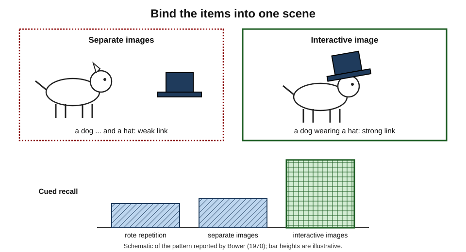
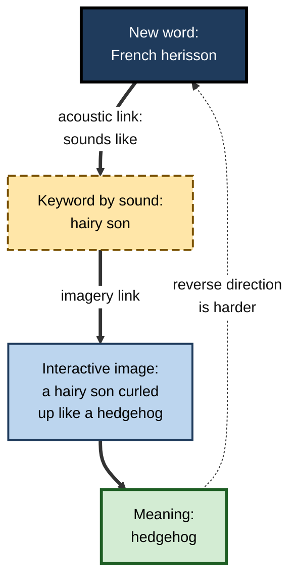
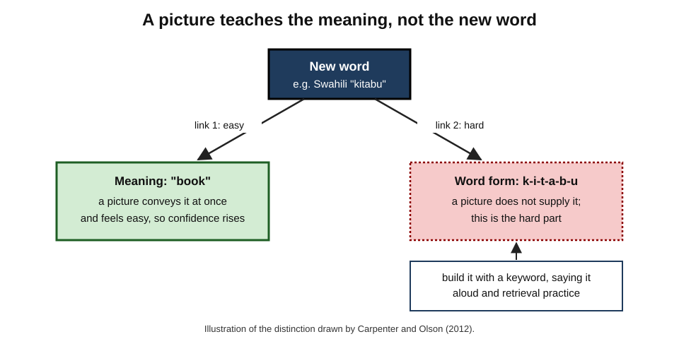
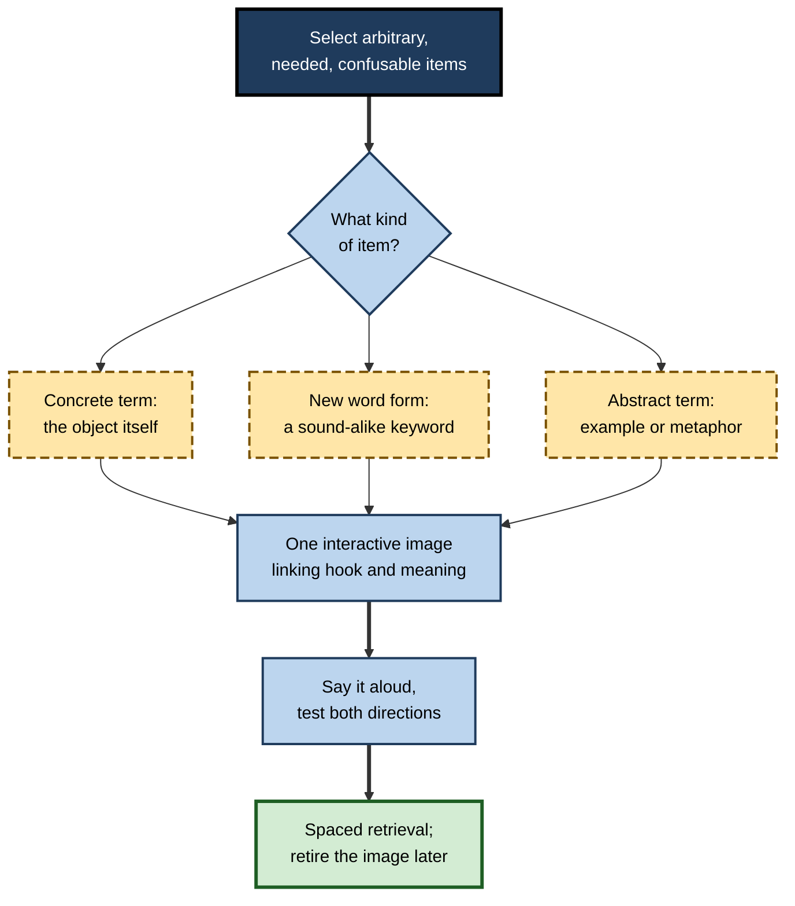
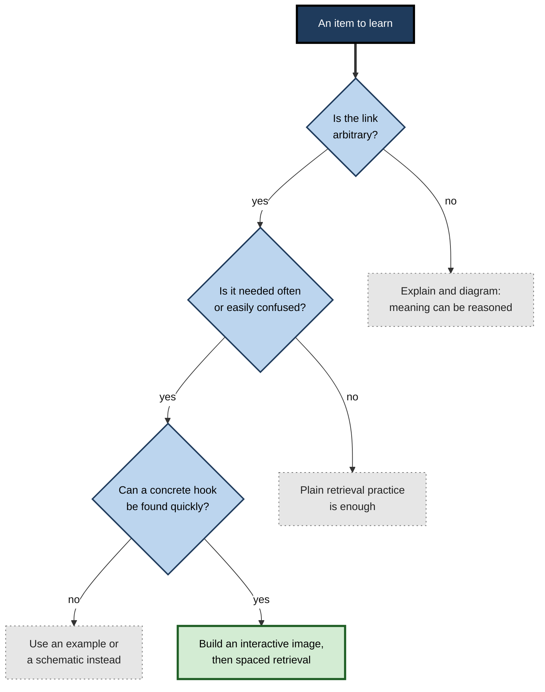

# G.9. Image-Word Pairing Strategies

A pharmacy student must learn two hundred drug names, many of which sound alike. A consultant moving to Paris has three months to learn enough French to run meetings. A new regional manager will meet sixty franchise owners in a week and wants to greet each by name.

In each case the problem is the same: an **arbitrary link** between a word and its meaning, or between a name and a face, must be made to stick. Few techniques do this better than pairing the word with a carefully built **image**.

> **Definition — Image–word pairing:** a family of learning techniques in which a word, term or name is deliberately linked with a picture or a mental image that represents its meaning, so that each cues the other.

> **Definition — Interactive image:** an image in which the items to be linked are shown **doing something together** — touching, acting on or combining with each other — rather than simply appearing side by side.

**Why it matters**

- Much professional learning includes **paired associates**: terms and definitions, drug names and classes, foreign words and meanings, names and faces, codes and products.
- These links are arbitrary, so they cannot be worked out by reasoning; they must be **encoded** and later **retrieved**.
- Well-designed image–word pairs can produce large gains in initial learning, especially for concrete material and new vocabulary.
- Poorly designed ones waste time, create confusion between similar items or produce overconfidence.
- Knowing which pairings work, and why, lets a learner use them where they help and avoid them where they do not.

---

## Why Pairing Words with Images Works

### Two codes and a bridge

- A word paired with a meaningful image is represented both **verbally** and **visually**; either code can lead back to the other.
- **Concrete, imageable** words are learned faster in pairs than abstract ones, and the **cue** word's imageability matters most — a concrete cue acts as a peg on which an image can be hung.
- **The bridge is the interaction:** it is not enough to have an image of each item; the images must be **bound** together.

### Interaction is the active ingredient

**Study card — Bower (1970)**

- **Design:** participants learned lists of word pairs (such as *dog–hat*) under different instructions:
  - **rote repetition** of each pair;
  - forming **separate images** of the two items, side by side but not interacting;
  - forming **interactive images** in which the items act on each other (a dog wearing a hat).
- **Results:** interactive imagery produced far better cued recall than separate images or repetition; separate images helped little.
- **Conclusion:** Gordon Bower argued that imagery works as a **relational organiser** — it binds items into a single unit that can be retrieved as a whole.

**Study card — Wollen, Weber and Lowry (1972)**

- **Design:** participants learned noun pairs with drawings that were either **interacting** or **non-interacting**, and either **bizarre** or **ordinary**.
  - *e.g.* for *piano–cigar*: a piano smoking a cigar (bizarre, interacting) versus a cigar resting on a piano (ordinary, interacting).
- **Results:** **interaction** strongly improved recall; **bizarreness** added nothing once interaction was present.
- **Conclusion:** what matters is that the images are **linked**, not that they are strange.

**Figure 1.** Separate images compared with an interactive image for the pair "dog" and "hat".

### When bizarre images help

- **Mark McDaniel and Gilles Einstein (1986)** found that bizarre images improve memory mainly in **mixed lists** — when a few bizarre items stand out among ordinary ones.
  - In **pure lists** where everything is bizarre, the advantage largely disappears.
- **Explanation:** bizarreness works through **distinctiveness**; when everything is unusual, nothing is.
- **Practical rule:** reserve striking images for the few items most likely to be confused or forgotten.

> **Key point:** build images in which the items **interact**; make them **distinctive** where items are confusable; do not rely on strangeness alone.

### Generation and ownership

- **The generation effect** — Norman Slamecka and Peter Graf (1978) found that words people **generate** themselves (from a cue) are remembered better than words they simply read.
- **For images:** self-generated images tend to be more memorable to their creator than supplied ones, because they connect to the learner's own knowledge — though supplied images can be better for novices who would otherwise produce poor or inaccurate ones.

---

## The Classic Techniques

### The keyword method

**Study card — Atkinson and Raugh (1975)**

- **Design:** university students learned the English meanings of 120 Russian words over three days.
  - The **keyword** group was given, for each Russian word, an English word that **sounded like** part of it (the keyword), and was asked to form an image linking the keyword to the English meaning.
    - *e.g.* Russian *zdanie* (building) sounds like "dawn" → imagine a building lit by the dawn.
  - The control group studied the same words in their own way.
- **Results:** the keyword group recalled substantially more meanings, both at the end of training and on a test some weeks later.
- **Conclusion:** Richard Atkinson and Michael Raugh showed that a two-step link — **sound → keyword**, then **keyword → meaning by image** — can make foreign vocabulary much easier to learn.

> **Definition — Keyword method:** a mnemonic for learning word meanings in which a familiar word that sounds like the new word (the keyword) is linked to the meaning through an interactive image.

**Figure 2.** The two links of the keyword method.

### Peg-word, loci and link systems

- **Peg-word system** — a pre-learned rhyming list ("one is a bun, two is a shoe, three is a tree…") provides concrete pegs; each item to remember is imaged interacting with its peg.
  - *Use:* ordered lists of up to ten or twenty items.
- **Method of loci** — items are imaged at successive places along a well-known route.
  - *Use:* speeches, sequences, long lists; used by memory competitors.
- **Link method** — each item is imaged interacting with the next, forming a chain.
  - *Use:* short sequences; fragile if one link is lost.

### Name–face association

1. **Attend** to the name; say it back; ask about it if unusual.
2. **Choose a distinctive facial feature** — eyebrows, a smile, hair, glasses.
3. **Turn the name into a concrete keyword** — *Baker* → bread; *Rajan* → raja (king); *Whitfield* → white field.
4. **Form an interactive image** linking the feature to the keyword — a crown sitting on Mr Rajan's thick eyebrows.
5. **Use the name** in conversation and **retrieve it** a few minutes later.

> **In practice:** name–face techniques are demanding in real time. Many professionals combine a quick image with **immediate use** of the name and **spaced retrieval** afterwards — reviewing a list of new contacts, with photographs, that evening and the next morning.

### Comparing the techniques

| | Keyword method | Peg-word system | Method of loci | Name–face technique | Labelled picture cards |
|---|---|---|---|---|---|
| Links | New word → keyword → meaning | Item → numbered peg | Item → place on route | Face → name keyword | Picture ↔ word |
| Best for | Foreign vocabulary, technical terms | Short ordered lists | Long ordered sequences | Remembering people | Concrete vocabulary |
| Preparation | A keyword per item | Learn the peg list once | Choose a familiar route | A keyword per name | Find or draw images |
| Typical gain | Large for initial learning | Large for order | Large for order | Moderate in practice | Varies; risk of overconfidence |
| Main weakness | Hard for abstract words; reverse recall weaker | Limited length | Training needed | Effortful in live settings | Picture may not teach the word form |

---

## The Evidence and Its Limits

### What holds up

- **Interactive imagery** reliably improves recall of concrete paired associates — among the most replicated findings in memory research.
- **The keyword method** produces large gains for **receptive** vocabulary (recognising a foreign word and recalling its meaning) and for some technical vocabulary.
  - Michael Pressley, Joel Levin and Harold Delaney (1982) reviewed many keyword studies and concluded that the benefits were robust across ages and materials.
- **The method of loci** is used by memory champions and supported by laboratory research for ordered lists.

### What is qualified

- **Long-term retention:** some studies found that keyword benefits shrink over longer delays, or that keyword-learned items are forgotten faster once the image fades.
- **Productive use:** the keyword method helps more in recalling the meaning of a foreign word than in producing the foreign word from its meaning.
- **Abstract words** — *government*, *reliability* — are hard to keyword or image.
- **Training and time:** learners need practice to generate good keywords quickly.
- **Interference:** many similar keywords can become confused.
- **John Dunlosky and colleagues (2013)** rated the keyword mnemonic as **low utility** as a general study technique — not because it fails, but because its benefits are confined to keyword-friendly material and may not persist without further practice.

> **Watch out:** a mnemonic image is a **scaffold for encoding**, not a substitute for retrieval and spacing. The image helps the first link form; repeated retrieval over time makes it durable.

### Pictures on flashcards

**Study card — Carpenter and Olson (2012)**

- **Design:** English-speaking students learned foreign words (in Swahili) paired either with **pictures** of their meanings or with **English translations**.
- **Results:**
  - pictures did **not** produce better learning than English words in the basic comparison;
  - learners were **more confident** after studying with pictures — confidence outran performance;
  - when learners were warned that pictures might not help, they studied differently and the picture condition improved.
- **Conclusion:** Shana Carpenter and Kellie Olson concluded that pictures help learning of new vocabulary mainly **when learners do not assume they will**. A picture makes the meaning easy to grasp, but the hard part — the unfamiliar **word form** — still has to be learned.

> **Key point:** a picture makes **meaning** vivid, but it does not make a new **sound or spelling** memorable. For foreign or technical vocabulary, the word form needs its own link — a keyword, saying it aloud, or retrieval practice.

**Figure 3.** Picture superiority helps the meaning but leaves the new word form to be learned.

---

## Designing Good Image–Word Pairs

### Principles

- **Relevant** — the image depicts the **meaning**, not something merely associated with the topic.
- **Interactive** — the elements are bound together in one scene.
- **Distinctive** — confusable items get clearly different images.
- **Simple** — one scene, few elements, quick to recall.
- **Consistent** — the same concept always gets the same image or icon.
- **Generated or chosen by the learner** where possible — and checked for accuracy.
- **Tested in both directions** — word → image/meaning and meaning → word.
- **Not a giveaway** — on flashcards, the cue side should not contain the answer in another form.

> **Mnemonic — "RIDS-CGT":** **R**elevant, **I**nteractive, **D**istinctive, **S**imple; **C**onsistent, **G**enerated, **T**ested both ways.

### A procedure for building image–word cards

1. **Select** the items that genuinely need a mnemonic — arbitrary, frequently needed, easily confused.
2. **For each item, find the concrete hook:**
   - for a concrete term, the object itself;
   - for a foreign or technical word, a **keyword** that sounds like it;
   - for an abstract term, a **concrete example** or **visual metaphor**.
3. **Build one interactive image** linking the hook to the meaning.
4. **Sketch it** quickly or describe it in a few words on the card.
5. **Say the word aloud** while looking at the image.
6. **Test** from both directions after a short delay.
7. **Schedule spaced retrieval** — the image is for the first encounters; retrieval makes it last.
8. **Retire the image** once the word is known directly; it is scaffolding, not a permanent route.

**Figure 4.** Building and using an image–word card.

### Abstract terms

- **Concrete instance** — pair "opportunity cost" with an image of a person holding a cinema ticket while friends wave from a beach.
- **Visual metaphor** — pair "bottleneck" with a literal bottle neck through which tasks queue; "liquidity" with water flowing freely versus frozen.
- **Diagram as image** — for relational terms ("leverage", "feedback loop"), the best image is often a small **schematic** — a lever and fulcrum; a looping arrow.

> **Watch out:** a visual metaphor carries the metaphor's baggage. Picturing electric current as water helps with flow and pressure but misleads about other properties; tell learners where the metaphor stops working.

### Beyond pictures: action and gesture

- **The enactment effect** — research led by **Johannes Engelkamp** and by **Ronald Cohen** in the 1980s found that action phrases ("lift the pen", "open the book") are remembered better when people **perform** the actions than when they only hear or read them.
- **Gestures and vocabulary** — studies by **Manuela Macedonia** and colleagues found that adults learning words in an artificial or foreign language remembered them better when they performed a meaningful **gesture** for each word while learning, compared with learning the words alone.
- **Implication:** the nonverbal code need not be a picture. A meaningful **movement** paired with a word gives another route to it — useful for verbs, procedures and actions.

> **Example:** a trainee learning the sequence of hand-hygiene actions says each step's name while performing it — "palm to palm", "backs of hands", "interlaced fingers" — linking the word to the movement.

### Pairing for categories

- **Category icons** — one simple icon for each category in a field (each class of drug, each type of contract, each family of software services), used consistently in notes and diagrams.
- **Shape and position codes** — a consistent shape for each kind of thing (a cylinder for any data store, a person for any role) lets a learner read a new diagram at once.
- **Avoid colour as the only code** — it is often unavailable (monochrome copies, colour-vision deficiency) and carries no meaning of its own; pair it with shape or label.

### A routine for vocabulary-heavy subjects

1. **Group** new terms by category or by confusable pairs.
2. **Explain** each term in one sentence, in one's own words.
3. **Add a hook** only for the arbitrary, hard or confusable ones — an image, keyword, gesture or concrete example.
4. **Say** each term aloud while recalling its image.
5. **Test** in both directions the next day, and space later tests.
6. **Use** the terms in sentences, explanations and real tasks as soon as possible.

> **Remember:** **group → explain → hook → say → test → use.** Images help the first encounters; use and retrieval finish the job.

---

## Worked Example: Pharmacology Terms

**Situation:** a pharmacy student must learn drug names with their classes and a key fact. Several names are confusable.

| Drug | Class and key fact | Hook | Interactive image | Check |
|---|---|---|---|---|
| Warfarin | Anticoagulant; opposes vitamin K | "war" + "farm" | A farmer at war, tearing up a field of **kale** (rich in vitamin K) so the blood stays thin | Image depicts the meaning (anti-vitamin K), not just the sound |
| Metoprolol | Beta-blocker (the -olol ending) | "-olol" as a slowing sound | A heart drummer slowed down, the drumsticks labelled **"-olol"** | The suffix rule carries the class; the image adds slowing of heart rate |
| Hydroxyzine | Antihistamine (sedating) | "hydr-OXY-zine": an **ox** | A sleepy **ox** yawning beside a sneezing hay bale | Distinct from hydralazine |
| Hydralazine | Vasodilator for blood pressure | "hydr-ALA-zine": "a lazy" | A **lazy** blood vessel stretched wide on a sofa | Distinct from hydroxyzine; contrasting image |

1. **Selection:** only confusable or hard names get images; others are learned by suffix rules and retrieval.
2. **Distinctiveness:** the two "hydr-" drugs get deliberately contrasting images (an ox; a lazy vessel).
3. **Relevance:** each image encodes the **class or action**, not just the sound.
4. **Testing:** cards are tested name → class and class → name, then scheduled for spaced review.

- **Conclusion:** images speed the first links and keep confusable names apart; retrieval and spacing make the knowledge durable.

> **Watch out:** never rely on a mnemonic alone for safety-critical facts such as doses. Mnemonics help recall of **categories and distinctions**; exact values must be checked against authoritative references.

---

## Image–Word Pairing in Professional Life

### Uses

- **Languages** — vocabulary for relocation, international clients and travel.
- **Healthcare** — anatomy, drug names, pathogens, eponymous signs.
- **Sales and retail** — product names, codes and features.
- **Law and compliance** — names of cases paired with a scene representing their facts and principle.
- **Management** — names and faces of colleagues, clients and stakeholders.
- **Software and data** — icons paired with function labels in interfaces; consistent symbols for entities in diagrams.

### Icons and labels in interfaces

- **Icons alone** are often ambiguous — a floppy disk for "save" means little to people who never used one; a gear may mean settings, tools or processing.
- **Labels alone** are slower to scan.
- **Icon plus label** combines fast recognition with precise meaning; over time, frequent users learn the icon and rely on it alone.
- **Lesson for learning materials:** pair each recurring symbol with its word at first use, and keep the pairing **consistent**.

### Case study: look-alike, sound-alike medicines

- **Situation:** a hospital pharmacy recorded several near-miss errors involving **look-alike, sound-alike** drug names — pairs whose names are easily confused in speech or writing.
- **Problem:** new pharmacy technicians and nurses learned names from lists, where similar names sat close together and blurred.
- **Diagnosis:**
  - confusable pairs had no **distinguishing** cue in memory;
  - training emphasised memorising lists rather than distinguishing pairs.
- **Actions:**
  1. Adopted **tall-man lettering** on labels and in systems, capitalising the differing letters (*hydrOXYzine* and *hydrALAZINE*) — a practice promoted by medication-safety organisations.
  2. In training, each confusable pair was taught **together**, with a **contrasting image** for each name tied to its use, and the differing letters highlighted.
  3. Staff practised **discrimination**: shown a name or a picture cue, they had to name the drug and its use, with feedback.
  4. Short spaced quizzes over the first months on the job.
- **Result:** the pharmacy reported fewer near misses involving the targeted pairs in the following period.
- **Caveats:** system changes such as barcode scanning were introduced in the same period; the training was one part of a broader safety programme.
- **Lesson:** for confusable items, pairing each word with a **distinctive**, **meaningful** image — and practising the distinction — is more effective than memorising lists.

### Combining images with spacing and retrieval

- **First session** — build the image, say the word, test immediately in both directions.
- **Next day** — test from the word and from the meaning; rebuild the image only for items that failed.
- **After a few days** — test again, mixed with older items; notice which items now come back **without** the image.
- **After a week or more** — items recalled directly need no image; keep the image only for the stubborn few.
- **Throughout** — use the words in real sentences, tasks and conversations; use converts a mnemonic route into direct knowledge.

> **Key point:** the image does its work in the **first few encounters**. Durable knowledge comes from retrieval spread over time, with the image fading into the background.

### When not to use image mnemonics

- **When understanding matters more than recall** — for concepts that can be reasoned about, explanation and diagrams serve better.
- **When items are few or already meaningful** — the overhead is not worth it.
- **When the image could mislead** — a mnemonic that encodes an outdated or partial fact can persist after the fact changes.
- **When speed of production is the goal** — fluent speech in a language eventually needs direct links, built through use and retrieval.

**Figure 5.** Deciding whether an image–word technique is worth using for an item.

### AI-generated images for mnemonics

- Image generators can now produce a custom picture for any mnemonic scene in seconds.
- **Possible benefits:** vivid, specific images for learners who cannot draw; quick illustration of keyword scenes.
- **Risks:**
  - generated images often contain errors, odd details and stereotyped depictions of people and professions;
  - a supplied picture removes the learner's own generation, which may weaken the memory benefit;
  - time spent prompting and regenerating can exceed time spent learning.
- **Good practice:** imagine or sketch the scene first; use a generated image only if it is accurate and adds clarity; never let the picture carry factual detail that has not been checked.

---

## Open Questions

- **How durable are keyword-method gains?**
  - Results on long-term retention are mixed; the best combination of mnemonic encoding and spaced retrieval is not settled.
- **Do pictures help adult vocabulary learning in real courses?**
  - Laboratory findings, including overconfidence effects, suggest caution; classroom evidence is limited.
- **Are self-generated images always better than supplied ones?**
  - Generation helps, but novices may generate poor images; the crossover point is unclear.
- **How should mnemonics be used for abstract professional vocabulary?**
  - Most research uses concrete nouns and foreign words; abstract terms in law, finance or management are less studied.
- **What do AI-generated mnemonic images do to learning?**
  - They are new; whether they help or hinder compared with imagining or sketching has hardly been tested.

---

## Summary

- **Image–word pairing** links a word, term or name with an image of its meaning so each cues the other; it suits **arbitrary** links.
- **Interaction is the active ingredient** (Bower, 1970): interactive images beat separate images or repetition; **bizarreness** adds nothing once interaction is present (Wollen and colleagues, 1972) except in **mixed lists**, through distinctiveness (McDaniel and Einstein, 1986).
- **Generation** helps: self-made images connect to the learner's knowledge.
- **Keyword method** (Atkinson and Raugh, 1975): sound → keyword → interactive image → meaning; large gains for receptive vocabulary; weaker for production, abstract words and some long delays; rated **low utility** as a general technique (Dunlosky and colleagues, 2013).
- **Other systems:** peg-word, method of loci, link method; name–face association.
- **Pictures on flashcards** can produce **overconfidence** and do not teach the new word form (Carpenter and Olson, 2012).
- **Design principles:** relevant, interactive, distinctive, simple, consistent, generated, tested both ways, not a giveaway.
- **Procedure:** select items → find the hook → build an interactive image → say it aloud → test both ways → spaced retrieval → retire the image.
- **Professional uses:** languages, drug names (with **tall-man lettering** for confusable pairs), names and faces, interface icons with labels; check AI-generated images for accuracy.

---

## Self-Check

1. Define image–word pairing and explain why it suits arbitrary links.
2. Describe Bower's (1970) experiment and the role of interaction.
3. What did Wollen, Weber and Lowry (1972) find about bizarreness, and when do bizarre images help?
4. Explain the two links of the keyword method using a new example of your own.
5. Why is the keyword method better for receptive than productive vocabulary?
6. Why did Dunlosky and colleagues rate the keyword mnemonic as low utility despite its laboratory success?
7. Summarise Carpenter and Olson (2012) and explain the distinction between meaning and word form.
8. Apply the name–face technique to a new colleague named "Ms Shah" with prominent glasses.
9. Create an image for the abstract term "sunk cost" and explain where its metaphor might mislead.
10. In the look-alike, sound-alike case, why were confusable pairs taught together with contrasting images?
11. A learner has made picture flashcards with the foreign word and an image on the front, and the English meaning on the back. What is wrong with this design?
12. A colleague proposes using an AI image generator to make a mnemonic picture for every term in a 300-term glossary. Advise them.

### Answer Key

1. Linking a word or name with an image of its meaning so each cues the other; arbitrary links cannot be reasoned out, so a vivid, bound image provides a retrieval route.
2. Word pairs learned by rote, separate images or interactive images; interactive images gave far better cued recall. Imagery works by binding items into one unit (a relational organiser).
3. Interaction improved recall; bizarreness added nothing beyond it. Bizarre images help mainly in mixed lists, where a few stand out (distinctiveness).
4. *e.g.* Hindi *kitaab* (book) → keyword "kit-up" → image of someone packing a kit bag full of books → "book". Link 1: sound to keyword; link 2: keyword to meaning by interactive image.
5. The chain runs naturally from the foreign word's sound to the meaning; going from meaning to the foreign word requires recalling the image, then the keyword, then reconstructing the foreign sound — weaker and slower.
6. Benefits are confined to keyword-friendly items, require training, may fade over longer delays and do not suit abstract material; it is not a general-purpose study technique.
7. Pictures did not beat English translations for learning Swahili words and made learners overconfident; warned learners did better. A picture conveys meaning but the unfamiliar word form still needs learning.
8. Feature: glasses. Keyword: "Shah" → a shah (king). Image: a tiny shah sitting on the bridge of her glasses. Use her name in conversation and recall it later that day.
9. *e.g.* a person pouring more coins into a sinking boat already holding water. The metaphor may suggest that past spending is always wasted; in fact sunk costs are simply irrelevant to future decisions, not necessarily wasted.
10. Teaching pairs together forces **discrimination**; contrasting, meaningful images (and highlighted differing letters) give each name a distinct cue, reducing confusion.
11. The image gives away the meaning, so the learner never retrieves it from the word — the card tests recognition of the picture. Put only the foreign word on the front; test meaning from the word and the word from the meaning, using the image only during initial learning.
12. Use images only for arbitrary, frequently needed or confusable terms; imagine or sketch first; check accuracy and avoid stereotypes; most terms are better learned through explanation, examples and spaced retrieval.

---

## Glossary

| Term | Meaning |
|---|---|
| Bizarreness effect | Better memory for bizarre images, mainly when they are few among ordinary ones. |
| Distinctiveness | The degree to which an item stands out from others, aiding memory. |
| Generation effect | Better memory for information that learners generate themselves. |
| Image–word pairing | Linking a word or name with an image of its meaning so each cues the other. |
| Interactive image | An image in which the items to be linked act on or combine with each other. |
| Keyword method | A mnemonic linking a new word to its meaning through a sound-alike keyword and an image. |
| Link method | A mnemonic chaining each item to the next by interactive images. |
| Look-alike, sound-alike drugs | Medicines with confusable names that create error risk. |
| Method of loci | A mnemonic placing images along a familiar route. |
| Mnemonic | A technique that aids memory, often by adding structure or imagery. |
| Name–face association | Linking a facial feature to a keyword for a person's name. |
| Paired associate | A pair of items in which one must cue recall of the other. |
| Peg-word system | A mnemonic using a pre-learned list of concrete pegs for ordered items. |
| Productive vocabulary | Words a learner can produce when needed. |
| Receptive vocabulary | Words a learner can recognise and understand. |
| Relational organiser | Bower's description of imagery binding items into one unit. |
| Tall-man lettering | Capitalising the differing letters of confusable drug names. |
| Visual metaphor | An image that represents an abstract idea through a concrete analogue. |
